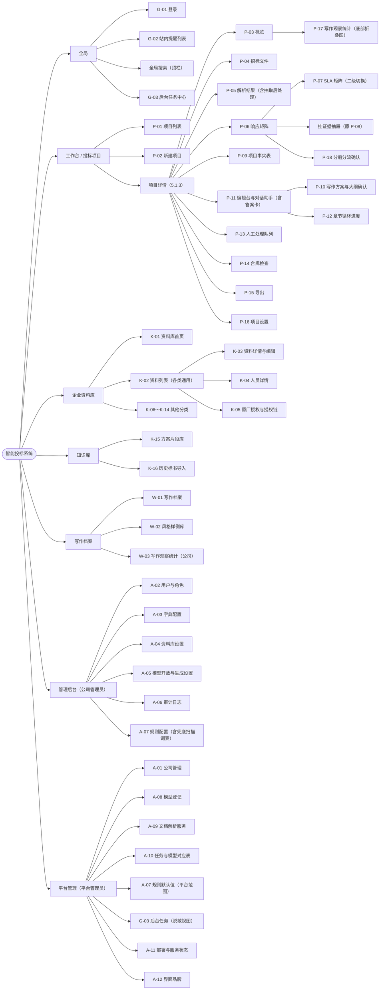
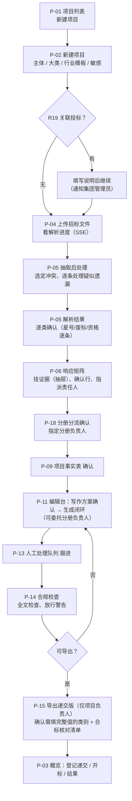
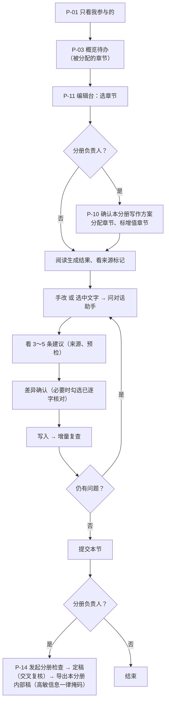
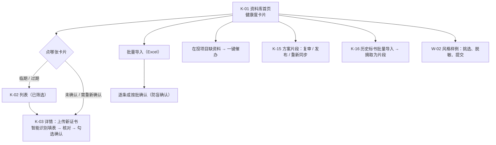
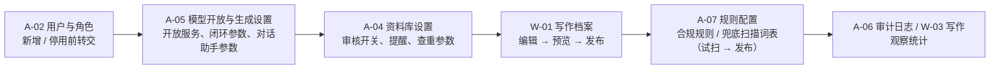
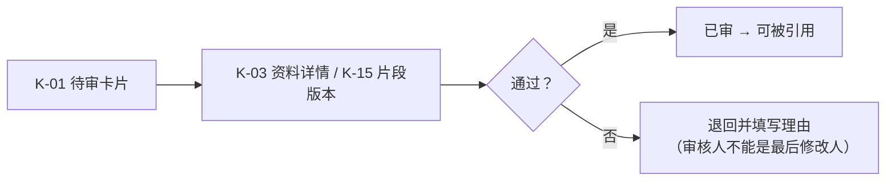
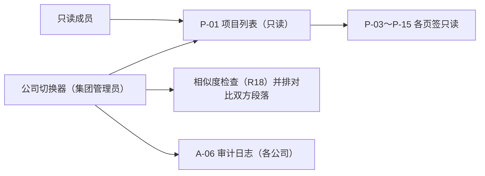
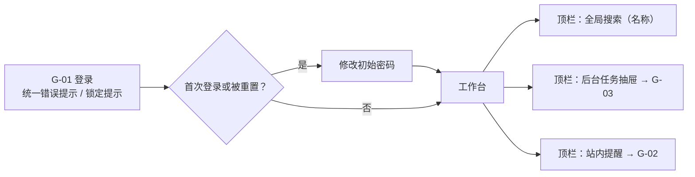

# 智能投标系统 · 前端设计规范 v1.1

| 项 | 内容 |
|---|---|
| 文档版本 | v1.1（2026-10-08）；v1（`design-spec-v1.md`）保留不改 |
| 编写 | 前端设计（高级前端设计工程师） |
| 依据 | PRD `prd-mvp-v1.5.md`、数据字典 `kb-data-dictionary-v1.6.md`、技术方案 `tech/tech-plan-v1.md`（v1.4；前端相关条目与 v1.3 一致，v1.4 增加 AI 工程师 bot + Cursor 研发模式、代码托管 GitHub）；旧版本不作依据 |
| 前端技术栈 | React 19 + TypeScript + Vite；Ant Design + ProComponents（**antd 主版本 5.x 或 6.x、ProComponents 版本在 M0 确定，ADR-0021**）；TipTap 3（编辑台）；PDF.js（原文预览）；TanStack Query 管服务端状态、Zustand 只管编辑台本地状态（技术方案 1.3.1；其余页面不引入全局状态库，11.4.5）；长任务进度用 SSE；接口只用由 `spec/openapi/` 生成的 SDK |
| 配套原型 | `prototype/index.html`（浏览器直接打开，无需构建）；截图 `screenshots/`（1440×900；编辑台另有 1280×800、1680×1050） |
| 配套交接 | `frontend-handoff-v1.md`（页面 / 组件清单、接口草案、任务卡拆分、开发顺序、视觉验收基准） |
| 视觉基准 | neil 指定 **04a、02d、03、05** 四张截图为开发视觉基准，v1.1 只改内容和规则，不改风格 |
| 约定 | “〔建议〕”是本设计的建议值，未经产品确认；“〔待定〕”表示需要 neil 或产品拍板，目前按 PRD 原文写。v1 中的 “†”“〔待确认〕”标记在本版全部去掉：PRD v1.5 已补齐页面定义，字典 v1.6 已补齐 49 张 PRD 表的列定义（3.10 节）和 PRD 表的 66 张状态与枚举代码表（4.16 节，其余代码表在 4.1～4.15 节） |

## 修订记录

| 版本 | 日期 | 改动 |
|---|---|---|
| v1.1 | 2026-10-08 | ① 依据升级为 PRD v1.5 / 字典 v1.6 / 技术方案 v1.4。② 第 5 章页面清单：全部写上真实 PRD 章节号和字典表名，去掉 † 与〔待确认〕；P-08 资料匹配取消（并入 P-06“挂证据”抽屉），P-17 并入 P-03 底部折叠区，新增“全局搜索”行。③ 第 2 章站点地图去掉虚线框。④ 第 3 章：项目页签去掉“资料匹配”，SLA 矩阵为“响应矩阵”内二级切换，统一用“投标截止时间”；顶栏写清全局搜索、任务抽屉、提醒下拉的规则。⑤ 第 6.2 节新增 G-01、G-02、全局搜索、G-03、A-07、A-11、A-12 版式（按 PRD 5.12），重写 P-05、P-06、P-15、K-04、K-16。⑥ 第 9.3 节状态颜色逐一绑定字典 4.16 代码值。⑦ 新增 9.9 答案卡、9.10 高敏信息掩码、9.11 配置联动校验、9.12 界面品牌与主题运行时切换；9.6 补 1280～1439 收窄规则。⑧ 第 7、8 章：思源黑体 WOFF2 子集内置、资源全部离线、品牌只派生主色、锁定色 token、第一期不做暗色（技术方案 v1.3、ADR-0021）。⑨ 第 11 章改为“已对齐结论”（19 项）+ 新发现的不一致 + 待定事项。⑩ 第 10 章原型说明更新。第 12 章保持定稿不变 |
| v1 | 2026-10-08 | 首版 |

---

## 1. 设计原则

1. **先看风险，再看进度。** 截止时间、阻断问题、【待补】、证据失效在每个层级都优先展示（项目列表置顶标红、项目摘要条常驻、矩阵行底色标红）。
2. **人对结果负责，AI 只给建议。** 所有模型产出都带 AI 标识和来源；写入正文前必须看差异并确认；星号、废标、偏离、披露类内容需要再勾选“已逐字核对”。
3. **每个数字都能点回原文。** 抽取条目、矩阵行、合规问题、段落引用都能跳回招标文件页码或资料记录。
4. **敏感优先。** 敏感项目在顶栏摘要条、编辑台模型标识、解析服务选择处始终可见“敏感 · 强制本地”，且不可切换。
5. **信息密度偏高但不拥挤。** 中后台业务表格默认 `size="small"`/`middle`，正文编辑区用宽松行高（1.85）保证长时间阅读。
6. **中文优先。** 字体、标点、数字格式都按中文环境；时间统一按 UTC+8 显示（PRD 5.1.1 验收②；技术方案假设 A-22）。
7. **品牌可换，语义色不变。** 产品名、Logo、主色可由平台管理员替换（A-12）；阻断红、警告橙、AI 紫、助手紫、来源色永远不变，保证风险语义在任何客户部署中一致。

---

## 2. 信息架构（站点地图）

页面 ID 与第 5 章页面清单、PRD 第 5 章“页面清单”的“设计编号”一致。v1.5 起 P-08 取消（功能在 P-06 的“挂证据”抽屉中），P-07 是响应矩阵页签内的二级切换，P-17 在 P-03 底部折叠区；全局搜索是顶栏功能，没有页面 ID。



---

## 3. 全局导航

### 3.1 整体框架（ProLayout `layout="mix"` 的变体：侧栏 + 顶栏）

```
┌──────────┬──────────────────────────────────────────────────────────────┐
│ Logo/产品名│ ≡  面包屑               环境标记  搜索  任务  提醒  公司  用户 │  顶栏 56px（白底）
│          ├──────────────────────────────────────────────────────────────┤
│ 一级菜单  │ [项目摘要条 + 项目二级导航]  ← 只在项目内出现                         │
│ （深蓝）  ├──────────────────────────────────────────────────────────────┤
│ 216px    │ 内容区（背景 #F5F7FA，内边距 16/24）                                │
│ 收起 60px │                                                              │
└──────────┴──────────────────────────────────────────────────────────────┘
```

Logo 和产品名取界面品牌设置（A-12，`brand_product_name`、`brand_logo`）；侧栏收起时用方形 Logo（见 11.2 第 6 项）。

### 3.2 侧栏（一级菜单）

| 菜单 | 子项 | 可见角色（PRD 2.3） | 原型 |
|---|---|---|---|
| 工作台 | — | 除平台管理员外全部 | 01 |
| 企业资料库 | 首页 + 13 个分类（在页内左侧分类栏切换，不进侧栏） | 公司内全部角色（权限按 2.3 节） | 07#library |
| 知识库 | 方案片段库、历史标书导入（页内切换） | 公司内全部角色 | 07#snippets |
| 写作档案 | 写作档案、风格样例库 | 公司管理员（编辑）、其他角色只读 | — |
| 写作观察统计 | — | 公司管理员（W-03，5.7.13） | — |
| 管理后台 | 用户与角色、模型开放与生成设置、资料库设置、字典配置、审计日志、规则配置 | 公司管理员；集团管理员只读；项目负责人可只读查看规则配置（5.12.5，建议） | 08#users / #grant / #rules |
| 平台管理 | 公司管理、模型登记、文档解析服务、任务与模型对应表、规则默认值、后台任务（脱敏视图）、部署与服务状态、界面品牌 | 平台管理员 | 08#models / #routes / #rules / #deploy / #brand |

规则：

- 菜单按角色裁剪，没有权限的菜单不显示（不是置灰）。原型为演示把“管理后台”和“平台管理”同时显示，已在页面上注明“演示合并”。
- 平台管理员看不到业务数据（PRD 2.3 节规则 3、9），其侧栏只有“平台管理”和审计入口；登录后落到“平台管理”（5.12.1 规则 1）。
- 集团管理员额外有“公司切换器”（顶栏公司名处变为下拉），全站只读，登录后落到工作台（5.1.1、5.12.1）。
- 侧栏可收起到 60px；**进入项目后默认收起**，用户手动展开后记住偏好（第 12 章第 10 项）。

### 3.3 顶栏

从左到右：收起按钮 → 面包屑 → 环境 / 示例标记（原型“示例数据 · 非真实业务”；生产可显示“试运行”等）→ **全局搜索** → **后台任务** → **站内提醒** → 当前公司 → 用户名 · 主要角色（用户菜单含“退出登录”）。

| 元素 | 规则 | PRD | 原型 |
|---|---|---|---|
| 全局搜索 | 输入框宽 252，占位“搜索项目名称 / 资料名称”，右侧快捷键提示 `Ctrl K`；至少 2 个字开始搜索；下拉分“项目”“资料”两组，每组最多 5 条，名称命中部分高亮，补充信息（项目：状态、投标截止时间；资料：有效期、确认状态）；组底“查看更多”进完整结果页。**只搜名称**，不搜片段、历史标书、招标文件、章节正文；**只在当前一家公司内**（集团管理员按公司切换器当前公司，不跨公司汇总）；无权限记录不出现也不计数；**平台管理员不显示搜索框** | 5.12.3 | 01#search |
| 后台任务 | 图标徽标 = 本人运行中的任务数；点开右侧抽屉（宽 420，不遮罩），页签“运行中 / 排队 / 失败 / 已完成”，每条显示类型、所属对象、状态点、进度条（AI 步骤紫色）、“前往页面”“取消”；失败条目显示原因与“从失败步骤重试”；底部“查看全部”进 G-03 | 5.12.4 | 01#tasks |
| 站内提醒 | 铃铛徽标 = 未读数；点开下拉（宽 380）显示最近 10 条，未读红点、类型、摘要、时间；右上“全部标为已读”，底部“查看全部”进 G-02；**第一期只做站内提醒**，任何地方不出现邮件 / 短信渠道选项 | 5.12.2 | 01#notify |
| 当前公司 | 公司名 + 图标；集团管理员为切换下拉；悬停显示全名 | 5.1.1 | 全部页 |

窄屏（1280～1439）：公司名只显示图标、用户角色文字隐藏（悬停显示），保证顶栏不换行（原型 `tokens.css` 媒体查询）。

### 3.4 面包屑

- 规则：`一级菜单 / 对象名 / 当前页`，最多 4 级；项目名过长时用简称（招标人简称 + 关键词，例如“东海城商行数据库维保”），悬停显示全名。
- 项目内面包屑示例：`工作台 / 东海城商行数据库维保 / 编辑台 · 技术分册`。

### 3.5 项目内二级导航（项目摘要条 + 页签）

依据 PRD 5.1.3（v1.5）：

- **摘要条**（常驻）：项目名、状态标签、敏感标记、分册进度卡（分册名、负责人、内部截止时间、分册状态）、招标编号 / 标段、投标主体、**投标截止时间**与倒计时（≤3 天标红）、响应覆盖率、阻断数、【待补】数、待人工处理数。全站统一叫“投标截止时间”（字段 `bid_deadline_at`），界面上不出现“递交截止”。
- **紧凑模式**：编辑台、矩阵、合规检查、导出等工作页只保留第一行（项目名 + 状态 + 分册卡），把纵向空间留给内容。
- **页签**：概览、招标文件、解析结果、响应矩阵、项目事实表、编辑台、人工处理队列（带徽标）、合规检查、导出、项目设置。
  - **没有“资料匹配”页签**：挂接证据在响应矩阵行上点“挂证据”打开右侧抽屉（5.3.1 规则 11）。
  - **SLA 矩阵**是“响应矩阵”页签内的二级切换“要求矩阵 / SLA 矩阵”（5.3.1 规则 4、5.3.2），不单设页签；切换器放在统计卡下方、提示条左侧，不占用矩阵工具栏。
  - **项目级写作观察统计**放在“概览”页底部的折叠区（5.7.13），默认收起。
  - “编辑台”页签对应 PRD 5.1.3 中的“大纲与章节”（v1.4 已升级为编辑台，见 11.2 第 5 项）；写作方案与大纲确认（5.7.2）、章节循环进度（5.7.6）是编辑台内的视图。

---

## 4. 各角色主流程

角色取 PRD 2.2 节：平台管理员、集团管理员、公司管理员、资料管理员、项目负责人、投标编写人、审核人（可选）、只读成员；项目内分工：分册负责人、合标负责人（v1.2，不是公司级角色）。

### 4.1 项目负责人（主链路）



### 4.2 投标编写人 / 分册负责人



### 4.3 资料管理员



### 4.4 公司管理员



### 4.5 平台管理员


### 4.6 审核人（仅资料审核开关开启时出现）



### 4.7 集团管理员 / 只读成员



### 4.8 合标负责人（项目内分工，默认商务分册负责人；只下载，不能导出递交版，PRD 5.9.1）


### 4.9 所有角色：登录与顶栏



---

## 5. 页面清单

表名全部取自字典 v1.6：49 张 PRD 表的完整列定义在 3.10 节，其余 60 张资料库 / 知识 / 写作 / 生成过程表在第 3 章其他小节（合计 109 张）。页面 ID 与 PRD 第 5 章“页面清单”的设计编号一一对应。

| 页面ID | 页面名 | 所属模块 | PRD 章节号 | 涉及的真实表名（字典 v1.6） | 主要角色 | 是否有原型 |
|---|---|---|---|---|---|---|
| G-01 | 登录（Keycloak 自定义主题） | 全局 | 5.12.1 | sys_user、audit_log、platform_setting（login_max_failures、login_lock_minutes、session_timeout_minutes、password_policy、brand_*） | 全部账号 | 是 · `09-login.html#error`、`#locked`、`#first`（另有 `#timeout`、`#disabled`） |
| G-02 | 站内提醒列表 | 全局 | 5.12.2 | notification | 全部 | 部分 · 顶栏下拉 `01-workbench.html#notify`；完整列表页见 6.2 |
| —（顶栏） | 全局搜索 | 全局 | 5.12.3 | bid_project、bid_project_member；资料名称字段所在表：org_entity、qualification、person、person_certificate、authorization、contract、org_proof_doc、sla_template、tool_asset；resource_acl（受限资料） | 平台管理员以外全部 | 部分 · 下拉 `01-workbench.html#search` |
| G-03 | 后台任务中心 | 全局 | 5.12.4 | job（通过 ref_type、ref_id 关联 parse_job、generation_task、compliance_run、similarity_check、bid_export、bid_archive 等） | 发起人、项目负责人、公司管理员；平台管理员（脱敏视图） | 部分 · 顶栏抽屉 `01-workbench.html#tasks`；完整页见 6.2 |
| P-01 | 项目列表（工作台，含 6 张统计卡） | 投标项目 | 5.1.1 | bid_project、bid_project_member、bid_volume | 项目负责人、编写人、只读成员、集团管理员（只读） | 是 · `01-workbench.html` |
| P-02 | 新建项目（含 R19 提示） | 投标项目 | 5.1.2 | bid_project、bid_volume、tender_file、org_entity、writing_outline_template | 项目负责人、公司管理员 | 是 · `02-new-project-parse.html#create`、`#r19` |
| P-03 | 项目概览（底部折叠区为 P-17） | 投标项目 | 5.1.3、5.7.13 | bid_project、bid_volume、response_matrix_item、chapter_check_issue、bid_export、writing_style_metric | 项目成员 | 否 · 版式见 6.2 |
| P-04 | 招标文件（上传与解析进度） | 招标文件解析 | 5.2.1 | tender_file、parse_job、parse_service、attachment、job | 项目负责人 | 是 · `02-new-project-parse.html#upload` |
| P-05 | 解析结果（含冲突待选定、疑似遗漏、引用未解析） | 招标文件解析 | 5.2.2、5.2.4 | tender_requirement、parse_block、tender_requirement_source、tender_requirement_ref、tender_conflict、tender_scan_hit、tender_scan_rule | 项目负责人（确认）、编写人（编辑） | 是 · `02-new-project-parse.html#result`、`#conflict` |
| P-06 | 响应矩阵（含“挂证据”抽屉） | 响应矩阵 | 5.3.1 | response_matrix_item、matrix_evidence、tender_requirement、bid_volume；证据候选：qualification、person_certificate、authorization、contract、org_proof_doc、sla_template、solution_snippet、bid_archive | 项目负责人、编写人 | 是 · `03-response-matrix.html`、`#evidence` |
| P-07 | SLA 矩阵（响应矩阵内二级切换） | 响应矩阵 | 5.3.2 | project_sla_value、sla_template、sla_level、sla_variable、project_fact | 项目负责人 | 是 · `03-response-matrix.html#sla` |
| P-08 | 资料匹配（v1.5 取消，并入 P-06“挂证据”抽屉） | 响应矩阵 | 5.3.1 规则 11 | 同 P-06（matrix_evidence） | — | 不单独做 |
| P-09 | 项目事实表 | 分节生成 | 5.7.8 | project_fact、project_sla_value、project_person | 项目负责人 | 否 · 版式见 6.2 |
| P-10 | 写作方案与大纲确认 | 分节生成 | 5.7.2 | bid_outline_node、response_matrix_item、project_fact、solution_snippet | 项目负责人、分册负责人 | 否 · 版式见 6.2 |
| P-11 | 编辑台与对话助手（含答案卡） | 编辑台 | 5.11.2（另见 5.11.3～5.11.10）、5.11.15 | bid_outline_node、chapter_version、paragraph_lock、citation、edit_lock、chapter_edit_draft、chapter_edit_operation、assistant_session、assistant_message（答案卡为 message_kind = answer_card）、assistant_suggestion、chapter_check_issue | 编写人、分册负责人、项目负责人 | 是 · `04-editor-assistant.html`、`#diff`、`#answer`、`#insert` |
| P-12 | 章节循环进度 | 分节生成 | 5.7.6 | chapter_loop_round、chapter_check_issue、chapter_version、generation_task、writing_style_metric | 项目负责人、分册负责人 | 否 · 版式见 6.2 |
| P-13 | 人工处理队列 | 分节生成 | 5.7.7 | chapter_check_issue、chapter_loop_round、bid_outline_node | 编写人、分册负责人 | 否 · 版式见 6.2 |
| P-14 | 合规检查 | 合规检查 | 5.8.2（另见 5.8.3、5.8.5） | compliance_run、compliance_issue、compliance_rule_config、similarity_check、similarity_hit | 项目负责人、分册负责人 | 是 · `05-compliance.html` |
| P-15 | 导出 | Word 导出 | 5.9.1、5.9.2 | bid_export、bid_volume、bid_project（submit_full_value_fields）、company_setting（sensitive_mask_rules）、attachment、writing_profile | 项目负责人（递交版）、分册负责人（内部稿）、合标负责人（下载） | 是 · `06-export.html` |
| P-16 | 项目设置 | 投标项目 | 5.1.4 | bid_project、bid_project_member、project_partner、project_person、project_sla_value、project_rule_override、bid_volume | 项目负责人 | 否 · 版式见 6.2 |
| P-17 | 写作观察统计（项目级，在 P-03 底部折叠区） | 分节生成 | 5.7.13 | writing_style_metric | 项目负责人 | 否（随 P-03） |
| P-18 | 分册分流确认 | 响应矩阵 | 5.3.1 规则 8 | response_matrix_item、bid_volume | 项目负责人；分册负责人提建议 | 否（03 页有入口横幅） |
| K-01 | 资料库首页 | 企业资料库 | 5.4.2 | qualification、person、person_certificate、authorization、contract、org_proof_doc、attachment_link | 资料管理员、公司管理员 | 是 · `07-library-kb.html#library`（与 K-02 合并展示） |
| K-02 | 资料列表（各类通用） | 企业资料库 | 5.4.3 | 按分类取对应表（资质：qualification；人员：person、person_certificate） | 资料管理员、编写人 | 是 · `07-library-kb.html#library`、`#people` |
| K-03 | 资料详情与编辑 | 企业资料库 | 5.4.4 | 各资料表、attachment、attachment_link、change_log | 资料管理员、编写人 | 否 · 版式见 6.2 |
| K-04 | 人员详情 | 企业资料库 | 5.4.5 | person、person_certificate、person_assignment、contract_member、attachment_link | 资料管理员、公司管理员 | 否 · 版式见 6.2 |
| K-05 | 原厂授权与授权链 | 企业资料库 | 5.4.6 | authorization、authorization_product、org_entity、vendor、product | 资料管理员 | 否 · 版式见 6.2 |
| K-06 | 公司主体 | 企业资料库 | 5.4.7 | org_entity、org_relation | 公司管理员、资料管理员 | 否 |
| K-07 | 证明材料 | 企业资料库 | 5.4.7 | org_proof_doc | 资料管理员 | 否 |
| K-08 | 中小企业划型 | 企业资料库 | 5.4.7 | sme_classification、sme_standard | 资料管理员 | 否 |
| K-09 | SLA 模板 | 企业资料库 | 5.4.7 | sla_template、sla_level、sla_variable | 资料管理员 | 否 |
| K-10 | 全局变量 | 企业资料库 | 5.4.7 | merge_variable | 资料管理员 | 否 |
| K-11 | 附件库 | 企业资料库 | 5.4.7 | attachment、attachment_link | 资料管理员 | 否 |
| K-12 | 安全与合规事件记录 | 企业资料库 | 5.4.7 | org_compliance_event | 资料管理员 | 否 |
| K-13 | 工具与设备 | 企业资料库 | 5.4.7 | tool_asset | 资料管理员 | 否 |
| K-14 | 业绩 | 企业资料库 | 5.4.3、5.4.7 | contract、contract_product、contract_member | 资料管理员 | 否（分类入口在 07） |
| K-15 | 方案片段库 | 知识库 | 5.5.2 | solution_snippet、snippet_revision、snippet_link | 编写人、资料管理员 | 是 · `07-library-kb.html#snippets` |
| K-16 | 历史标书导入 | 知识库 | 5.5.3 | bid_archive（parse_status、kb_sync_status）、bid_archive_ref、attachment、job | 资料管理员、公司管理员（批量） | 是 · `07-library-kb.html#archive` |
| W-01 | 写作档案 | 写作档案 | 5.6.2 | writing_profile、writing_outline_template、writing_outline_node、writing_term、prompt_template、task_card、review_checklist_item、writing_sentence_pattern | 公司管理员 | 否 · 版式见 6.2 |
| W-02 | 风格样例库 | 写作档案 | 5.6.5 | writing_style_sample | 公司管理员、资料管理员 | 否 |
| W-03 | 写作观察统计（公司级） | 写作档案 | 5.7.13 | writing_style_metric | 公司管理员 | 否 |
| A-01 | 公司管理 | 平台管理 | 5.10.1 | company、company_affiliation、org_entity、sys_group | 平台管理员 | 否 · 版式见 6.2 |
| A-02 | 用户与角色 | 管理后台 | 5.10.2 | sys_user、sys_role、sys_user_role、sys_permission、sys_role_permission | 公司管理员 | 是 · `08-admin-models.html#users` |
| A-03 | 字典配置 | 管理后台 | 5.10.3 | dict_type、dict_item、cert_type、vendor、product、attachment_slot | 平台管理员（平台级）、公司管理员（公司级） | 否 |
| A-04 | 资料库设置 | 管理后台 | 5.10.4 | company_setting | 公司管理员 | 否 |
| A-05 | 模型开放与生成设置 | 管理后台 | 5.10.5、6.9 | company_model_grant、task_model_route、company_setting（含 editor_autosave_seconds、edit_lock_heartbeat_seconds、edit_lock_timeout_minutes）、compliance_rule_config | 公司管理员 | 是 · `08-admin-models.html#grant`、`#grant-err` |
| A-06 | 审计日志 | 管理后台 | 5.10.6、6.7 | audit_log、model_call_audit | 公司管理员、平台管理员、集团管理员 | 否 |
| A-07 | 规则配置（含“兜底扫描词表”页签；平台范围为“规则默认值”） | 管理后台 / 平台管理 | 5.12.5 | compliance_rule_config、tender_scan_rule、platform_setting（平台默认值） | 公司管理员；平台管理员（平台默认值）；集团管理员、项目负责人只读 | 是 · `08-admin-models.html#rules`、`#rules-scan` |
| A-08 | 模型登记 | 平台管理 | 6.6.1（字段 6.2.1） | llm_model、llm_model_config_version、service_health | 平台管理员 | 是 · `08-admin-models.html#models` |
| A-09 | 文档解析服务 | 平台管理 | 6.6.2（字段 6.3.1） | parse_service、parse_service_config_version、service_health | 平台管理员 | 否 |
| A-10 | 任务与模型对应表 | 平台管理 | 6.6.3（内容 6.4，21 类任务） | task_model_route | 平台管理员 | 是 · `08-admin-models.html#routes` |
| A-11 | 部署与服务状态 | 平台管理 | 5.12.6 | service_health、llm_model、parse_service、platform_setting（health_check_interval_seconds） | 平台管理员 | 是 · `08-admin-models.html#deploy` |
| A-12 | 界面品牌 | 平台管理 | 5.12.7 | platform_setting（brand_product_name、brand_logo、brand_primary_color）、attachment（Logo） | 平台管理员 | 是 · `08-admin-models.html#brand` |

---

## 6. 无原型页面的版式与 v1.5 新增页面

### 6.1 通用状态规范（所有页面适用）

| 状态 | 表现 | 组件 |
|---|---|---|
| 加载 | 首屏用骨架屏（表格 5 行、卡片 3 张）；局部刷新用区块级 Spin，不遮整页；超过 10 秒显示“仍在加载，可离开本页，任务在后台继续”（长任务） | `Skeleton`、`Spin`、ProTable `loading` |
| 空态 | 插图 + 一句原因 + 一个主操作。示例：项目列表为空 →“上传第一份招标文件”（5.1.1）；资料库为空 →“从零开始：公司主体 → 营业执照 → 资质 → 人员”（5.4.2） | `Empty`（区块内用 `Empty.PRESENTED_IMAGE_SIMPLE`） |
| 筛选无结果 | “没有符合条件的记录” + “清除筛选”；全局搜索为“没有找到名称包含 ×× 的项目或资料”（5.12.3） | `Empty` |
| 错误 | 区块内 `Result status="error"`：错误说明 + 请求编号（traceId）+ “重试”；整页失败才用整页 Result；表单字段错误就近显示 | `Result`、`Alert` |
| 权限不足 | 整页：`Result status="403"`“你没有该页面的权限，请联系公司管理员”；页内操作：按钮隐藏（不是置灰），只读字段改为文本；跳转对象已删除或无权限：“对象已不存在或你没有查看权限”（5.12.2） | `Result` |
| 已过期 / 需复核 | 结果仍显示，顶部黄色 `Alert`“内容已修改，结果已过期”+“重新运行”；规则配置修改后合规检查页提示“规则配置已修改，建议重新检查”（5.12.5） | `Alert` |
| 只读（项目取消、集团管理员） | 顶部灰色条“只读：项目已取消” | `Alert type="info"` |
| 实时进度断开 | “实时进度已断开，正在重连”，回退轮询（9.7） | `Alert` |

### 6.2 各页面版式

已有原型的页面以原型和截图为准，下表只写规则要点；没有原型的页面给出区域划分。

| 页面 | 区域划分 | 主要组件 | 特有状态 |
|---|---|---|---|
| **G-01 登录**（原型 09） | 左 46% 品牌区（产品名、Logo，读界面品牌设置；不放业务数据）；右侧居中登录卡 380 宽（账号、密码、登录、“忘记密码请联系公司管理员”）；左下版本号和环境标记（如“试运行”）。不提供“记住密码”，第一期无验证码。**实现为 Keycloak 自定义登录主题**，资源离线打包，与系统读同一套品牌设置（技术方案 1.3.12、WBS P02a） | `Form`、`Input.Password`、`Alert` | 三种状态必须实现：①**统一错误提示**：账号不存在和密码错误都显示“账号或密码错误”，不显示剩余次数；②**账号锁定**：连续失败 `login_max_failures`（示例 5）次锁定 `login_lock_minutes`（示例 15）分钟，提示“账号已锁定，请 N 分钟后重试或联系公司管理员”，登录按钮禁用，到期自动解锁，公司管理员可在 A-02 提前解锁；③**首次登录强制改密**：首次登录或被重置后先进入“修改初始密码”（新密码两次、显示 `password_policy`），改完才能进入（Keycloak 必需操作）。另有：公司已停用提示“所属公司已停用”；会话超时（`session_timeout_minutes` 示例 120）后重新登录回到原页面 |
| **G-02 站内提醒列表** | 顶栏铃铛下拉见 3.3（原型 01#notify）。完整页：顶部筛选条（类型、已读 / 未读、所属项目、时间范围）；主体按时间倒序的列表（类型标签、标题、摘要、所属项目、时间、未读红点）；右上“全部标为已读” | `ProList`、`Select`、`RangePicker`、`Badge` | 点击跳转并标已读；可改回未读；提醒不能删除；同一对象同类提醒未读期间合并更新；17 类提醒取字典 `notification_type`；**页面和个人设置中都没有邮件 / 短信渠道** |
| **全局搜索**（顶栏，原型 01#search） | 下拉见 3.3；“查看更多”结果页：顶部搜索框 + 两个分组页签“项目（N）/ 资料（N）”，列表分页 | `Input.Search`、`Tabs`、`List` | 平台管理员没有搜索框；集团管理员只搜当前切换的公司；搜索服务异常时提示重试，不影响其他功能 |
| **G-03 后台任务中心** | 顶栏抽屉见 3.3（原型 01#tasks）。完整页：页签“运行中 / 排队 / 失败 / 已完成”，每页一张任务表（任务类型 `job_type`、所属项目、发起人、状态、进度“分块 31/43”、排队原因、开始时间、已运行时长、失败原因、操作）；点行打开右侧详情抽屉（步骤进度、使用的服务、重试记录） | ProTable、`Drawer`、`Steps`、`Progress` | 重试从失败步骤继续，重试后回到排队；取消限发起人、项目负责人、公司管理员；敏感项目排队原因写“只能使用本地服务”；对象已删除显示“对象已删除”不能重试；**平台管理员脱敏视图**：只显示任务类型、所属公司、状态、阶段、耗时、错误码、脱敏失败摘要，无项目名、文件名，无重试 / 取消；已完成任务按 `job_retention_days` 隐藏 |
| **P-03 项目概览** | 摘要条下：左 2/3“下一步该做什么”待办清单（按分册分组，每条一键跳转，含“冲突待选定 / 疑似遗漏”）；右 1/3 分册进度卡、状态操作卡（登记递交 / 开标 / 结果）、最近导出；**底部折叠区“写作观察统计（项目）”**（P-17，默认收起，只读、不标红、不排名） | `List`、`Card`、`Progress`、`Steps`、`Collapse`、`Modal` | 空态“暂无待办”；“定稿后已修改，待复核”的章节进待办 |
| **P-05 解析结果**（原型 02d、02e） | 左原文 · 中分类树 · 右条目卡片（第 12 章第 7 项）。顶部后处理条：完成摘要（合并 N 组、经引用补齐 N 条、兜底词表版本）+ 三个入口 **冲突待选定 N**（红）/ **疑似遗漏 N**（红）/ **引用未解析 N · 不阻断**（橙）+ 确认进度 + 右上“确认解析结果”主按钮。入口打开右侧非遮罩抽屉（560），三个页签 | `Drawer`、`Tabs`、`Radio.Group`（卡片式并列各方取值）、`TextArea`（理由必填） | **“确认解析结果”可用前提**（5.2.2 规则 7、5.2.4 规则 1～3）：无“待处理”冲突；疑似遗漏全部“新增为条目”或“排除”（填理由，无批量）；星号 / 废标 / 资格逐条确认。不满足时按钮置灰，悬停列出未满足项和数量；底栏常驻“确认前提”清单。卡片显示“已合并 N 条 · 拆分”“经引用补齐”；被补遗替代的条目加删除线 +“已被补遗替代”，对应冲突状态“已按补遗处理”不阻断；后处理失败时提示“抽取后处理未完成”，去任务中心重试 |
| **P-06 挂证据抽屉**（原型 03b） | 在矩阵行上点“挂证据”，右侧抽屉 560：上部本行要求原文和证明材料要求（含“须覆盖投标截止时间”）；中部候选两组——“结构化资料”（规则匹配：名称、版本、有效期状态、确认状态、截止时是否有效）和“方案片段与历史标书”（按相关度）；下部本行已挂证据（可移除）；右上“智能匹配证据” | `Drawer`、`Checkbox` 卡片列表、`Badge` | 只有满足 5.4.1“可引用”的记录可选；合作方缺协议：显示但不可选，提示“缺协议”；未确认：不可选；历史标书段落只能参考、不能挂为证据（5.5.3 验收①）；候选为空：“资料库没有可引用的记录”+“去补录”；多选行批量智能匹配，结果逐行确认；打开期间该行被他人修改，保存时提示刷新 |
| **P-07 SLA 矩阵**（原型 03c） | 响应矩阵内二级切换。顶部：SLA 模板选择 +“按招标要求取值”+“导出为承诺函表格”；主体：指标、招标要求值（带页码）、我方承诺值（变量，可编辑）、公司最严可承诺值、单位、判定 | `EditableProTable`、判定 `Tag` | 判定实时计算：满足 绿 / 不满足 红（阻断 R09）/ 超出能力 橙（需项目负责人确认）/ 未填写 灰 / 需人工判断（工作日 vs 自然日） |
| **P-09 项目事实表** | 按事实类别分组的描述列表；来自项目设置 / SLA 矩阵 / 拟派人员的事实显示“引用自 ××”且不可在此编辑（5.7.8） | `ProDescriptions`、`Tag`（必备 / 已确认 / 待确认 / 需复核，字典 `fact_confirm_status`） | 必备事实未确认时顶部红条，阻止写作方案确认 |
| **P-10 写作方案与大纲确认** | 三栏：左大纲树（章节号、标题、分册、负责人、章节状态、增值标记）；中“本节写作方案”卡片（回应的矩阵行、计划证据、片段、篇幅预算）；右招标原文预览 | `Tree`（可拖动）、`Card`、原文预览组件（同 P-05） | 顶部提示 R26 未分配行；星号、废标行不能标“不适用” |
| **P-12 章节循环进度** | 顶部摘要（状态、轮次 / 最大轮数、停止原因、生成 / 评审模型、任务卡版本）；左轮次时间线；右版本对比（只高亮变化段落）；底部问题清单 | `Timeline`、差异视图（与 04 页同一套）、`ProTable` | 异常中断：红色 `Alert` + “重试”；历史很多时按循环折叠 |
| **P-13 人工处理队列** | 顶部统计（按转人工原因分组、分册内部截止倒计时）；左按章节分组的队列；右详情（段落原文可编辑、相关证据与矩阵行、历次修正文字） | `Collapse`、`List`、内嵌 TipTap 只编辑单段 | 处理完 →“一键重新检查”；空态“没有待人工处理的问题” |
| **P-15 导出**（原型 06） | 导出前提逐项检查 → 导出类型（内部稿 / 递交版）→ 命名规则 → 模板与选项 → **高敏个人信息**区块 → 任务进度与历史 | `Steps`、`Radio`、`Form`、ProTable | **递交版只由项目负责人导出**，其他人不显示递交版选项；合标负责人只下载。**内部稿高敏信息一律掩码**（按 `sensitive_mask_rules`：证件号前 3 后 4、手机号前 3 后 4、银行账号后 4，均为示例），不提供关闭开关；**递交版**只在招标要求的位置、对项目设置中已确认的类别（`bid_project.submit_full_value_fields`）填完整值，页面列出已确认类别、确认人和依据，并链接到项目设置。导出状态：排队 / 生成中 / 完成 / 失败 / 已过期（`export_status`），排队、生成中时下载置灰 |
| **P-16 项目设置** | 左侧锚点导航（基本信息 / 成员与分工 / 合作方 / 拟派人员 / SLA 取值 / 规则覆盖 / 生成闭环 / 分册 / 导出设置）；右侧分组表单，底部固定保存条。导出设置内含“递交版需填完整值的类别”（只有项目负责人可勾选，写依据） | `Anchor`、`ProForm`、`EditableProTable` | “已人工修改”字段标记；递交版命名含 {编写人} 时保存报错；分册内部截止晚于投标截止时间给警告 |
| **K-03 资料详情与编辑** | 左 2/3 字段表单（按字典生成，★ 字段带星）；右 1/3：附件槽位（缺失必备槽位标红）、来源追溯、确认区；页签：变更历史、被引用情况 | `ProForm`、`Upload`、`Checkbox`、`Tabs` | 智能识别后字段标“待核对”；修改 ★ 字段后确认勾选自动清空 |
| **K-04 人员详情** | 同 K-03 结构；**身份证件号码掩码保留前 3 位和后 4 位**（示例 `330***********1234`，规则取 `sensitive_mask_rules`）；手机号前 3 后 4（`138****5678`）；“查看完整身份证号”只对有权限的角色显示，点击弹窗填原因并留痕 | `Descriptions`、`Modal` | 离职人员：顶部红条，已有拟派标红 |
| **K-05 原厂授权与授权链** | 列表 + 详情；详情中横向链条图：原厂 → 总代 → 我方，每级显示出具方、有效期、产品与地域，不满足的节点标红 | `ProTable`、自绘链条 | “上游未登记”节点灰色虚线 + R07 警告 |
| **K-06～K-14 其他分类** | 统一使用 K-02 列表模板（同 07 页）：左分类栏 + 筛选条 + ProTable + 批量操作栏 | ProTable | 同 6.1 |
| **K-16 历史标书导入**（原型 07d） | 列表列“入库状态”只显示一个派生值，下方小字“解析：X · 同步：Y” | ProTable、`Badge` | 派生（5.5.3）：待解析 / 解析中 / 入库中（已解析 + 同步中）/ 已入库（已解析 + 已同步）/ 失败（解析）/ 失败（同步）；同步失败只“重新同步”，不重新解析 |
| **W-01 写作档案** | 顶部版本条（当前版本、状态、发布、回滚）；页签：章节模板、叫法与术语、语气与称呼、句式规则、风格样例、任务卡与提示词、审查清单、Word 模板、导出命名（5.6.2） | `Tabs`、`ProForm`、`Tree`、预览抽屉 | “仍为平台默认”提示；引用不存在变量时发布按钮禁用并列原因 |
| **W-02 / W-03** | W-02：卡片墙（样例、来源、脱敏状态、启用开关）；W-03：只读统计表 + 折线图，不标红、不排名（5.7.13） | `Card`、`Switch`、图表（建议 AntV G2，待技术确认） | W-03 无阈值、无告警色 |
| **A-01 公司管理** | ProTable：公司名称、统一社会信用代码、所属集团、状态、用户数、开通时间；新建抽屉 | ProTable、`Drawer` | 停用二次确认；停用公司的用户无法登录 |
| **A-03 字典配置** | 左字典类型树（平台级 / 公司级分组），右字典项表 | `Tree`、`EditableProTable` | 已使用代码只能停用 |
| **A-04 资料库设置** | 分组表单，对应 5.10.4 各项；查重参数、掩码规则 `sensitive_mask_rules` 一组 | `ProForm` | 切换审核开关时弹窗说明状态变化规则 |
| **A-06 审计日志** | 筛选（时间、用户、操作类型、对象、是否云端调用、公司）+ 只读表格；云端调用行可展开看模型、token 数 | ProTable | 只追加，不提供删除与编辑 |
| **A-07 规则配置**（原型 08g、08h） | 两个页签。“合规规则”：左 2/3 按模块分组的规则表（编号、名称、MVP 标记、适用场景、级别下拉、启用开关、来源“平台默认 / 本公司已修改”、版本号）；右 1/3 选中规则的参数编辑区（参数键取 `compliance_rule_config.params`，如 R43 `cliche_density_threshold`）+“恢复平台默认”+ 修改历史。“兜底扫描词表”：当前生效版本、草稿版本标签、词条表（词条、类型 关键词 / 正则、目标类别 星号 / 废标、启用、来源）、“新增词条”“发布新版本”；右侧“试扫”区（粘贴样例文本 → 高亮命中、按类别计数，不保存） | `Tabs`、`EditableProTable`、`Switch`、`InputNumber`、`TextArea` | 不可关闭的规则（R01、R15、R23、R26、R27、R34、R37、R39、R44，以及招标要求评审索引表时的 R40）开关置灰加锁；R43 级别下拉没有“阻断”；R28 启用即“模型评审开关”，与 A-05 同步；参数越界就近报错；顶部提示“修改只影响之后发起的检查”；词表修改只对之后上传或重解析的文件生效；集团管理员、项目负责人只读；平台管理员在“规则默认值”编辑平台范围 |
| **A-09 文档解析服务** | 页签“云端配置 / 本地配置”；结构同 A-08；本地服务另有只读“部署参数”区；“测试解析”上传样例 | 同 A-08 | 云端服务“可用于敏感内容”固定为否 |
| **A-11 部署与服务状态**（原型 08e） | 左 2/3：顶部总览（正常 / 异常 / 未检测 / 已停用的数量，最近检测时间，“全部立即检测”）；“平台组件”区（Web 前端、业务服务、数据库、文件存储、知识检索服务与向量库、任务队列，示例清单）；“模型与解析服务”区（6.6 节登记的全部服务）；每行：名称（版本）、部署方式、状态、最近检测、耗时、错误摘要或“并发 x / y · 排队 n”、“立即检测”。右 1/3：选中项检测历史（近 24 小时条形图）、平台设置（会话、登录锁定、健康检测间隔、任务保留天数）、品牌入口卡（“仅平台管理员可修改”，详见 A-12） | ProTable（分组）、`Badge`、迷你条形图 | 状态只有 正常 / 异常 / 未检测（另有“已停用”不计入异常，5.12.6 异常与边界）；检测超时记“异常”并注“检测超时”；连续失败的模型 / 解析服务自动标 `service_status` = 不可用并触发 6.5 降级；**本页不提供启停、重启**；错误摘要不含业务内容和密钥；不显示任何公司的数据 |
| **A-12 界面品牌**（原型 08i） | 左 9/24 设置表单：产品名（≤20 字，计数）、Logo（横版 + 方形版，PNG / SVG ≤200KB）、主色（预设色块 + 取色器）、校验结果框、锁定色列表、“恢复默认”“保存”；右 15/24 **实时预览**：登录页缩略、顶栏与侧栏缩略、一组按钮 / 链接 / 开关 / 标签、一张带选中行和“阻断 / AI 建议”标签的表格。右上标“仅平台管理员可修改” | `Form`、`Upload`、`ColorPicker`、`ConfigProvider`（预览区局部主题） | 主色两项校验（9.12）：白字对比度 ≥ 4.5:1；与锁定色（成功、警告、错误、AI 紫、助手紫）色差不足阈值时不能保存，色块置灰并在悬停说明原因；保存后对全部公司生效，刷新后看到；导出 Word 不受影响；非平台管理员看不到本页 |

---

## 7. 设计令牌（Design Tokens）

所有原型共享 `prototype/assets/tokens.css`（CSS 变量）和 `prototype/assets/theme.js`（AntD 主题），数值与本章一致。令牌分两类：**品牌令牌**（产品名、Logo、主色及由主色派生的色阶，可由平台管理员在 A-12 修改，PRD 5.12.7）和**锁定令牌**（其余全部，任何配置都不能改）。

### 7.1 颜色

**主色（品牌令牌；默认深海蓝 `#1E4DB7`，第 12 章第 1 项已定稿）**

下表是默认值。平台管理员在 A-12 改主色后，`hover / active / bg / border` 由 AntD 算法从新主色派生（8.4），不单独配置。

| 令牌 | 值 | 用途 |
|---|---|---|
| `--c-primary` | `#1E4DB7` | 主按钮、链接、选中态、侧栏选中项 |
| `--c-primary-hover` | `#3A67C9` | 悬停 |
| `--c-primary-active` | `#143A91` | 按下 |
| `--c-primary-bg` | `#EEF3FC` | 选中行、浅底标签 |
| `--c-primary-border` | `#B7C9EE` | 浅色描边 |
| `--c-sider` / `--c-sider-deep` | `#0F1C3F` / `#0A1430` | 侧栏背景 / 子菜单背景（锁定，不随主色变化；侧栏选中项随主色） |

**功能色（锁定令牌）**

| 令牌 | 值 | 浅底 | 用途 |
|---|---|---|---|
| `--c-success` | `#2B9D5C` | `#EAF6EF` | 通过、有效、已确认 |
| `--c-warning` | `#E08A1E` | `#FDF3E6` | 警告、临期、待确认 |
| `--c-error` | `#D9363E` | `#FDECEC` | 阻断、过期、失败、负偏离 |
| `--c-info` | `#1E4DB7` | `#EEF3FC` | 提示级、信息。**与主色分开**：换主色后仍为 `#1E4DB7`（8.1 中 `colorInfo` 单独固定） |
| `--c-ai` | `#6E4BD8` | `#F2EEFC` | **AI 生成内容专用**（AI 建议标签、模型撰写段落、抽取中进度） |
| `--c-assistant` | `#A23CC8` | `#F8EDFC` | 对话助手撰写的段落和建议 |

**中性色阶（N1～N10）**

| N1 | N2 | N3 | N4 | N5 | N6 | N7 | N8 | N9 | N10 |
|---|---|---|---|---|---|---|---|---|---|
| `#FFFFFF` | `#F7F8FA` | `#F2F3F5` | `#E8EBF0` | `#DCDFE6` | `#C2C7D0` | `#A1A7B3` | `#86909C` | `#4E5969` | `#1D2129` |
| 卡片 | 表头/次底 | 填充/悬停 | 分割线 | 边框 | 禁用边框 | 占位符 | 次要文字 | 正文次级 | 标题/正文 |

页面背景 `--c-bg-layout: #F5F7FA`。

**段落来源色（锁定令牌）**（编辑台段落左侧色条 + 文字标签，PRD 5.11.2 七种来源）。证据来源色与默认主色同值，但不随主色变化；正文引用上标 `.cite` 用证据来源色而不是主色（9.5）

| 来源 | 令牌 | 值 |
|---|---|---|
| 证据 | `--src-evidence` | `#1E4DB7` |
| 方案片段 | `--src-snippet` | `#0E8A8A` |
| 招标原文引用 | `--src-tender` | `#86909C` |
| 模型撰写 | `--src-model` | `#6E4BD8` |
| 对话助手撰写 | `--src-assistant` | `#A23CC8` |
| 人工编写 | `--src-manual` | `#2B9D5C` |
| 系统生成 | `--src-system` | `#4E5969` |

**编辑器内联标记**：变量底色 `#FFF4D6` + 下边线 `#F0C24B`；【待补】文字 `#C42B33` 底 `#FDECEC`；R43 命中波浪下划线 `#E08A1E`；锁定内容底色 N3 + 虚线边框 N5。

### 7.2 字体

```css
--font-sans: "Source Han Sans SC Subset", "PingFang SC", "Microsoft YaHei", "Source Han Sans SC", "Noto Sans CJK SC", "Noto Sans SC", "Helvetica Neue", Arial, sans-serif;
--font-mono: "JetBrains Mono", "SFMono-Regular", Consolas, "Liberation Mono", monospace;
```

- **内置字体（第 12 章第 12 项已定稿，ADR-0021、WBS P08）**：随前端包发布思源黑体 WOFF2 子集（Regular 400 / Medium 500 两个字重，字符集为 GB 2312 常用字 + 标点 + 业务生僻字补充表），`@font-face` 用相对路径，`font-display: swap`；**禁止 CDN 和在线字体**。Keycloak 登录主题使用同一份字体文件。字体族名 `Source Han Sans SC Subset` 排在最前，系统字体只作缺字兜底。
- 子集字符表由 M0 脚手架卡生成并纳入仓库；导出 Word 的字体由 Word 模板决定，与界面字体无关。
- 等宽字体用于编号、招标编号、证书编号、时间、配置键、模型名。
- 浏览器范围按技术方案假设 A-15（Chrome / Edge 最近 2 个大版本、奇安信可信浏览器、360 极速模式）。

**字号阶梯**

| 令牌 | 字号 / 行高 | 字重 | 用途 |
|---|---|---|---|
| `--fs-30` | 30 / 38 | 600 | 大数字（统计卡，少用） |
| `--fs-24` | 24 / 32 | 600 | 页面级大标题（索引页） |
| `--fs-20` | 20 / 28 | 600 | 页面标题、编辑台章节标题 |
| `--fs-16` | 16 / 24 | 600 | 区块标题、项目名 |
| `--fs-15` | 15 / 28（1.85） | 400 | **编辑台正文**（长时间阅读） |
| `--fs-14` | 14 / 22 | 400 | 默认正文、表单、按钮 |
| `--fs-13` | 13 / 20 | 400 | 表格单元格、卡片内容 |
| `--fs-12` | 12 / 18 | 400 | 辅助说明、标签、时间 |

### 7.3 间距、圆角、阴影、栅格、密度

| 类别 | 令牌 |
|---|---|
| 间距（4 点网格） | 4 / 8 / 12 / 16 / 20 / 24 / 32（`--sp-*`）；页面内边距 16（上下）/ 24（左右）；卡片内边距 16；区块间距 12 |
| 圆角 | 4（标签、小按钮）/ 6（按钮、输入框、默认）/ 8（卡片、弹窗、面板） |
| 阴影 | `--shadow-1` 卡片悬浮前（极浅）；`--shadow-2` 下拉、悬浮工具条；`--shadow-3` 弹窗、抽屉。业务卡片默认**只用 1px 边框不用阴影** |
| 栅格 | 24 栏，槽宽 16；设计基准 1440×900；最小支持 1280；编辑台 ≥1680 四栏、1280～1679 三栏（见 9.6） |
| 密度 | 默认档：控件高 32，表格行高约 48（middle）；**紧凑档**（矩阵、合规问题、资料列表）：表格 `size="small"`，行高约 40；不提供用户级密度切换（第 12 章第 5 项已定稿） |
| 层级 | 顶栏 sticky z=20；悬浮“问对话助手”工具条 z=5；抽屉/弹窗用 AntD 默认 |

### 7.4 锁定令牌清单（A-12 不可改）

| 类别 | 令牌 |
|---|---|
| 功能色 | `--c-success` `#2B9D5C`、`--c-warning` `#E08A1E`、`--c-error` `#D9363E`、`--c-info` `#1E4DB7`（含各自浅底） |
| AI 与助手 | `--c-ai` `#6E4BD8`、`--c-assistant` `#A23CC8`（含浅底） |
| 段落来源色 | 7 种 `--src-*` |
| 编辑器内联标记 | 变量、【待补】、R43 波浪线、锁定内容 |
| 中性色、侧栏底色、字体、字号、间距、圆角、阴影 | 全部 |

品牌主色的校验（对比度、与锁定色的距离）见 9.12。

---

## 8. 映射到 Ant Design 主题

antd 主版本（5.x 或 6.x）和 ProComponents 版本由研发在 M0 以 **ADR-0021** 锁定（技术方案 1.3 节、PRD v1.5 7.1 第 5 条、第 12 章第 11 项）。本章代码按 v5 的 token 名书写；若 ADR-0021 选 v6，由脚手架卡复核组件级 token 名并更新本章，**全局 token 和设计令牌数值不变**。样式、图标、字体全部离线打包，不使用 CDN。

### 8.1 令牌映射表

| 设计令牌 | 值 | AntD v5 全局 token | 说明 |
|---|---|---|---|
| `--c-primary`（品牌） | `#1E4DB7` | `colorPrimary`、`colorLink` | 运行时取平台设置 `brand_primary_color`；派生色阶由算法生成（8.4） |
| `--c-info`（锁定） | `#1E4DB7` | `colorInfo` | **单独固定**，不随主色变化 |
| `--c-success` | `#2B9D5C` | `colorSuccess` | |
| `--c-warning` | `#E08A1E` | `colorWarning` | |
| `--c-error` | `#D9363E` | `colorError` | |
| N10 | `#1D2129` | `colorTextBase` | 文字色阶由算法派生 |
| `--c-bg-layout` | `#F5F7FA` | `colorBgLayout` | |
| N5 | `#DCDFE6` | `colorBorder` | |
| N4 | `#E8EBF0` | `colorBorderSecondary` | 表格、卡片分割线 |
| N2 | `#F7F8FA` | `colorFillAlter` | 表头、斑马纹 |
| `--font-sans` | 见 7.2 | `fontFamily` | |
| `--fs-14 / 12 / 16` | 14 / 12 / 16 | `fontSize` / `fontSizeSM` / `fontSizeLG` | |
| `--fs-30 / 24 / 20 / 16 / 14` | | `fontSizeHeading1～5` | |
| `--r-md / sm / lg` | 6 / 4 / 8 | `borderRadius` / `borderRadiusSM` / `borderRadiusLG` | |
| 控件高 | 32 / 24 / 40 | `controlHeight` / `controlHeightSM` / `controlHeightLG` | |
| `--sp-16 / 12 / 8` | | `padding` / `paddingSM` / `paddingXS`、`margin` | |
| `--shadow-2 / 3` | | `boxShadow` / `boxShadowSecondary` | |
| 侧栏 | `#0F1C3F` | `components.Layout.siderBg`、`components.Menu.darkItemBg` | |
| 侧栏选中 | 随主色 | `components.Menu.darkItemSelectedBg` | 运行时与 `colorPrimary` 同值 |
| 顶栏高 | 56 | `components.Layout.headerHeight` | |
| 表头底 | `#F7F8FA` | `components.Table.headerBg` | |
| 行悬停 | `#F5F8FF` | `components.Table.rowHoverBg` | |
| `--c-ai` 等业务色 | | 不进 AntD token，用 CSS 变量 + 自定义组件（`AiTag`、`SourceBar`、`LevelTag`） | AntD 没有对应语义 |

### 8.2 ConfigProvider 示例（与 `prototype/assets/theme.js` 一致）

```tsx
// src/theme/index.ts
import type { ThemeConfig } from 'antd';

export const FONT_FAMILY =
  '"Source Han Sans SC Subset", "PingFang SC", "Microsoft YaHei", "Source Han Sans SC", "Noto Sans CJK SC", "Noto Sans SC", "Helvetica Neue", Arial, sans-serif';

export const DEFAULT_PRIMARY = '#1E4DB7';

// 运行时：primary 取平台设置 brand_primary_color（见 8.4），其余 token 锁定
export const buildTheme = (primary: string = DEFAULT_PRIMARY): ThemeConfig => ({
  token: {
    colorPrimary: primary,
    colorInfo: '#1E4DB7',        // 锁定：提示级、信息，不随品牌主色
    colorLink: primary,
    colorSuccess: '#2B9D5C',
    colorWarning: '#E08A1E',
    colorError: '#D9363E',
    colorTextBase: '#1D2129',
    colorBgLayout: '#F5F7FA',
    colorBorder: '#DCDFE6',
    colorBorderSecondary: '#E8EBF0',
    colorFillAlter: '#F7F8FA',
    fontFamily: FONT_FAMILY,
    fontSize: 14,
    fontSizeSM: 12,
    fontSizeLG: 16,
    fontSizeHeading1: 30,
    fontSizeHeading2: 24,
    fontSizeHeading3: 20,
    fontSizeHeading4: 16,
    fontSizeHeading5: 14,
    borderRadius: 6,
    borderRadiusSM: 4,
    borderRadiusLG: 8,
    controlHeight: 32,
    controlHeightSM: 24,
    controlHeightLG: 40,
    boxShadow: '0 4px 12px rgba(16,28,63,0.08)',
    boxShadowSecondary: '0 8px 24px rgba(16,28,63,0.14)',
    wireframe: false,
  },
  components: {
    Layout: { siderBg: '#0F1C3F', headerBg: '#FFFFFF', headerHeight: 56, headerPadding: '0 20px', bodyBg: '#F5F7FA' },
    Menu: {
      darkItemBg: '#0F1C3F', darkSubMenuItemBg: '#0A1430', darkPopupBg: '#0F1C3F',
      darkItemSelectedBg: primary, darkItemColor: 'rgba(255,255,255,0.72)',
      darkItemHoverColor: '#FFFFFF', darkItemHoverBg: 'rgba(255,255,255,0.06)',
      itemHeight: 40, itemMarginInline: 8, itemBorderRadius: 6,
    },
    Table: { headerBg: '#F7F8FA', headerColor: '#4E5969', headerSplitColor: 'transparent', rowHoverBg: '#F5F8FF', borderColor: '#E8EBF0' },
    Card: { headerFontSize: 15 },
    Tag: { defaultBg: '#F2F3F5', defaultColor: '#4E5969' },
    Button: { primaryShadow: 'none', defaultShadow: 'none', dangerShadow: 'none' },
    Descriptions: { labelBg: '#F7F8FA' },
  },
});

// src/main.tsx
import { ConfigProvider, App as AntdApp } from 'antd';
import zhCN from 'antd/locale/zh_CN';
import dayjs from 'dayjs';
import 'dayjs/locale/zh-cn';
dayjs.locale('zh-cn');

function ThemedApp() {
  const { data: brand } = useBrandSettings();   // 生成 SDK + TanStack Query；未取到时用默认值
  return (
    <ConfigProvider locale={zhCN} theme={buildTheme(brand?.primaryColor)}>
      <AntdApp>
        <RouterProvider router={router} />
      </AntdApp>
    </ConfigProvider>
  );
}

root.render(
  <QueryClientProvider client={queryClient}>
    <ThemedApp />
  </QueryClientProvider>,
);
```

### 8.3 ProLayout token 配置

token 名已按 `@ant-design/pro-provider` 2.16.2 的 `typing/layoutToken.d.ts` 核对；ProComponents 最终版本以 ADR-0021 为准。`colorPrimary`、`colorTextMenuSelected`、`colorBgMenuItemSelected`（侧栏）、`colorTextCollapsedButtonHover` 运行时取品牌主色，`colorBgMenuItemSelected`（顶栏）取主色派生的浅底。

```tsx
import { ProLayout } from '@ant-design/pro-components';

export const proLayoutToken = {
  bgLayout: '#F5F7FA',
  colorPrimary: '#1E4DB7',
  header: {
    colorBgHeader: '#FFFFFF',
    colorHeaderTitle: '#1D2129',
    heightLayoutHeader: 56,
    colorTextRightActionsItem: '#4E5969',
    colorBgRightActionsItemHover: '#F2F3F5',
    colorTextMenu: '#4E5969',
    colorTextMenuSelected: '#1E4DB7',
    colorBgMenuItemSelected: '#EEF3FC',
  },
  sider: {
    colorMenuBackground: '#0F1C3F',
    colorMenuItemDivider: 'rgba(255,255,255,0.08)',
    colorTextMenu: 'rgba(255,255,255,0.72)',
    colorTextMenuSecondary: 'rgba(255,255,255,0.56)',
    colorTextMenuSelected: '#FFFFFF',
    colorTextMenuActive: '#FFFFFF',
    colorTextMenuItemHover: '#FFFFFF',
    colorBgMenuItemSelected: '#1E4DB7',
    colorBgMenuItemHover: 'rgba(255,255,255,0.06)',
    colorBgMenuItemActive: 'rgba(255,255,255,0.10)',
    colorTextMenuTitle: '#FFFFFF',
    colorTextSubMenuSelected: '#FFFFFF',
    colorBgCollapsedButton: '#FFFFFF',
    colorTextCollapsedButton: '#4E5969',
    colorTextCollapsedButtonHover: '#1E4DB7',
    paddingInlineLayoutMenu: 8,
    paddingBlockLayoutMenu: 8,
  },
  pageContainer: {
    colorBgPageContainer: '#F5F7FA',
    paddingInlinePageContainerContent: 24,
    paddingBlockPageContainerContent: 16,
    colorBgPageContainerFixed: '#FFFFFF',
  },
};

<ProLayout
  layout="side"
  navTheme="realDark"          // 侧栏深色；顶栏通过 header token 保持白底
  fixSiderbar
  fixedHeader
  siderWidth={216}
  collapsedButtonRender={false}
  title={brand.productName}    // 品牌：产品名、Logo 取平台设置（8.4、A-12）
  logo={collapsed ? brand.logoSquareUrl : brand.logoUrl}
  token={proLayoutToken}
  route={menuByRole(currentUser)}
  breadcrumbRender={(routers) => routers}
  actionsRender={() => [<GlobalSearch key="s" />, <TaskCenter key="t" />, <NoticeBell key="n" />, <CompanySwitcher key="c" />]}
  avatarProps={{ title: currentUser.name }}
>
  {/* 项目内页面：<ProjectHeader /> + <Outlet /> */}
</ProLayout>
```

说明：原型中 ProComponents 没有 UMD 包，外壳用 antd `Layout` + `Menu` 手写还原同等视觉；研发接入时直接使用上面的 ProLayout 配置。

### 8.4 运行时界面品牌（PRD 5.12.7、技术方案 ADR-0021、WBS P15）

1. **可改的只有三项**：产品名（`brand_product_name`）、Logo（`brand_logo`，横版；侧栏收起时用方形版，见 11.2 第 6 项）、主色（`brand_primary_color`）。三项都是平台设置（字典 4.17），只有平台管理员能在 A-12 修改，对全部公司生效。
2. **派生**：前端启动时读取品牌设置，把主色传给 `buildTheme(primary)`；`colorPrimaryHover / Active / Bg / Border` 等色阶由 AntD 算法派生，不另存。ProLayout 的选中色同样取主色。
3. **锁定**：功能色、`colorInfo`、AI 紫、助手紫、7 种来源色和中性色写死在主题文件，不读配置（7.4）。
4. **预览**：A-12 右侧预览区用局部 `<ConfigProvider theme={buildTheme(draftColor)}>` 包住示例组件，未保存的颜色不影响页面其他部分。
5. **生效**：保存后新打开或刷新的页面生效（不做 WebSocket 推送）；接口失败或未设置时用默认值 `#1E4DB7`、默认产品名和内置 Logo。
6. **登录页**：Keycloak 自定义登录主题（WBS P02a）在服务端渲染时读取同一组平台设置，生成主色 CSS 变量和 Logo；资源随主题镜像离线打包。登录页与系统内同一主色、同一字体。
7. **不做暗色模式**（第 12 章第 4 项）：不引入 `theme.darkAlgorithm`，令牌按算法组织，二期可加。
8. **不影响导出**：导出 Word 的样式只由 Word 模板决定（PRD 5.12.7）。

---

## 9. 组件与交互规范

### 9.1 表格

1. 一律用 ProTable；默认 `size="middle"`，矩阵 / 合规问题 / 资料列表用 `size="small"`。
2. **不出现横向滚动是首选**：先合并列（例如“招标人 / 投标主体”两行显示）、用次级文字（12px N8）承载次要信息，再考虑 `scroll.x`；必须横滚时固定首列和操作列。
3. 列顺序：标识列（名称 + 编号两行）→ 分类 / 状态 → 业务数值 → 责任人 → 操作。数值右对齐，时间用等宽字体。
4. 风险行：阻断 / 证据失效 / 负偏离用浅红底 `#FFF5F5`（`.row-danger`）；3 天内截止的项目置顶 + 红色“急”标签（5.1.1）。
5. 操作列最多 2 个文字链接 + “更多”下拉；危险操作（取消项目、停用）放进下拉并二次确认。
6. 批量操作：勾选后出现批量操作栏；**星号、废标、资格三类抽取条目不提供批量确认**（5.2.2）。
7. 分页默认 10 条，显示总数；列表数据只统计本公司。
8. 页码链接 `P.47` 统一用 `.pg-link` 样式，点击在侧边预览原文并高亮。

### 9.2 表单

1. 用 ProForm；默认纵向布局，两栏或三栏栅格；必填加红色星号；★ 字段（修改后需重新确认）在标签前加 ★。
2. 系统字段（配置页）标签两行：中文名 + 等宽小字系统键（例如“最大输入 / max_input_tokens”），便于和 PRD、字典对照。
3. 不支持的字段**置灰并写明原因**（例如 Qwen3-30B-A3B-Instruct-2507 的“开启思考”，PRD 6.2.1）。
4. 敏感值（api_key、身份证件号码）只显示掩码，编辑只能“整体替换”。
5. 保存条固定在底部；离开有未保存修改时提示。
6. 校验即时进行；跨字段规则（递交版命名不能含 {编写人}；自动保存 / 心跳 / 锁超时三项联动，9.11；品牌主色，9.12）保存时校验并就近报错。前端校验只做提示，同一规则后端必须再校验（技术方案 11.4.5）。
7. 敏感字段（身份证件号码、手机号、银行账号）一律用 `MaskedField` 显示掩码，规则见 9.10；完整值不进 localStorage、URL、日志。


### 9.3 状态标签（绑定字典 v1.6 第 4 章代码值，PRD 表状态集中在 4.16）

统一用 AntD `Tag`（实心浅底）或 `Badge`（圆点 + 文字）。**颜色绑定代码值，不绑定中文显示名**：前端只认接口返回的代码（如 `pending_confirm`），显示名和颜色从一张注册表取（原型 `assets/shell.js` 的 `UI.STATUS` + `UI.St` 组件即这张表的实现）。同一代码全站同色；AI 紫只用于 AI 步骤（抽取中、生成中），任何业务状态不得用紫色。

表中“点”= `Badge`（processing 为动态蓝点），“签”= `Tag` 预设色。

| 代码表（字典节） | 代码 → 显示名 → 颜色 |
|---|---|
| `project_status`（4.16） | `draft` 草稿 灰签 · `parsing` 解析中 processing 签 · `pending_confirm` 待确认 金签 · `drafting` 编制中 蓝签 · `checking` 检查中 processing 签 · `exportable` 可导出 青签 · `exported` 已导出 绿签 · `submitted` 已递交 极客蓝签 · `opened` 已开标 极客蓝签 · `closed` 已结束 灰签 · `cancelled` 已取消 灰签 + 删除线 |
| `tender_parse_status`（4.16） | `pending` 待解析 灰点 · `uploading` 上传中 / `parsing` 解析中 蓝色动态点 + 进度条 · `extracting` 抽取中（含抽取后处理）**AI 紫**动态点 + 紫色进度条 · `completed` 已完成 绿点 · `failed` 失败 红点 + 原因 |
| `parse_job_status` / `generation_task_status` / `job_status`（4.16） | `queued` 排队 橙点 · `running` 运行中（解析任务显示“解析中”）蓝色动态点 · `completed` 已完成 绿点 · `failed` 失败 红点 · `cancelled` 已取消 灰点 |
| `compliance_run_status`（4.16） | `queued` 排队 橙点 · `running` 运行中 蓝色动态点 · `completed` 已完成 绿点 · `incomplete` 未完成（部分规则失败）橙点 + 说明 · `failed` 失败 红点 |
| `requirement_status`（4.16） | `pending` 待确认 金签 · `confirmed` 已确认 绿签 · `manually_edited` 已人工修改 蓝签（加锁）· `deleted` 已删除 灰签 + 删除线；置信度 < 0.8 橙色高亮 |
| `requirement_merge_status` / `requirement_effective_status`（4.16） | `primary` 主条目显示“已合并 N 条 · 拆分”灰签 · `merged` 已并入（不单独显示）· `superseded` 已被补遗替代：原文删除线 + 灰签 |
| `conflict_status`（4.16） | `pending` 待处理 红签（阻断确认）· `chosen` 已选定 绿签 · `not_conflict` 不构成冲突 灰签 · `resolved_by_addendum` 已按补遗处理 蓝签（不阻断） |
| `scan_hit_status`（4.16） | `covered` 已覆盖 灰签 · `suspected_missing` 疑似遗漏 红签（阻断确认）· `added` 已新增为条目 绿签 · `excluded` 已排除 灰签 |
| `ref_resolve_status`（4.16） | `resolved` 已解析 绿签 · `ambiguous` 多义 / `unresolved` 未解析 橙签（不阻断）· `target_missing` 目标缺失 红签 |
| `scan_rule_publish_status`（4.16） | `draft` 草稿 金签 · `published` 已发布 绿签 |
| `matrix_item_status`（4.16） | `not_responded` 未响应 灰签 · `pending_confirm` 已响应待确认 金签 · `confirmed` 已确认 绿签 |
| `matrix_risk_flag`（4.16，多值） | `evidence_invalid` 证据失效 红签 · `star_deviation` 星号条款偏离 红签 · `review_required` 需复核 橙签 · `missing_evidence` 缺证据 橙签；风险提示与行状态分开显示（证据失效时行状态回到“已响应待确认”，下方另加“证据失效”签）；有“证据失效”或负偏离的行用浅红底 |
| `response_type`（4.16） | `meet` 无偏离 灰签 · `exceed` 正偏离 绿签 · `deviate` 负偏离 红签 · `not_applicable` 不适用 灰签 |
| `rule_level`（4.16） | `blocker` **阻断** 红底白字（实心）· `warning` **警告** 橙浅底 · `hint` **提示** 蓝浅底；图标分别为禁止、三角、信息 |
| `compliance_conclusion`（4.16） | `has_blocker` 有阻断 红签 · `warning_only` 仅警告 橙签 · `passed` 通过 绿签；未检查 / 已过期为页面派生显示（灰签 + 黄色提示条），不是代码值 |
| `compliance_issue_status`（4.16） | `open` 未处理 红点 · `fixed` 已修正 绿点 · `waived` 已放行 灰点（显示放行人和时间） |
| `similarity_hit_status`（4.16） | `pending` 待处理 橙签 · `rewritten` 已改写 绿签 · `waived` 已放行 灰签 · `excluded` 已排除 灰签；R18 一期只显示“段落相似度”一个分值 |
| `export_status`（4.16） | `queued` 排队 橙点 · `generating` 生成中 蓝色动态点 · `completed` 完成 绿点 · `failed` 失败 红点 · `expired` 已过期 灰点；排队、生成中时下载置灰 |
| `volume_status`（4.13） | `drafting` 编制中 蓝签 · `checking` 分册检查中 processing 签 · `finalized` 已定稿 绿签（加锁） |
| `loop_status`（4.12，章节状态） | `not_started` 未开始 / `ready` 待生成 浅灰 · `plan_pending` 大纲待确认 蓝 · `generating` 生成中 **AI 紫**（Spin）· `checking` 检查中 蓝色动态 · `fixing` 修正中 橙 · `completed` 已完成 绿 · `pending_human` 待人工处理 红 · `human_handled` 人工已处理 绿（人形图标）· `interrupted` 异常中断 红（感叹号）；“定稿后已修改，待复核”是分册定稿后的提示标记（橙），不是章节状态代码 |
| `archive_parse_status` + `kb_sync_status` → `archive_kb_display`（4.16、PRD 5.5.3） | 只显示派生值：`pending` 待解析 灰点 · `parsing` 解析中 蓝色动态点 · `syncing` 入库中 蓝色动态点 · `done` 已入库 绿点 · `failed` 失败 红点（后缀注明“解析”或“同步”）；下方小字显示两个原始状态 |
| `user_status`（4.16） | `active` 启用 绿点 · `disabled` 停用 灰点 · `locked` 锁定 红点（操作列出现“解锁”） |
| `service_status`（4.16） | `draft` 草稿 灰点 · `enabled` 已启用 绿点 · `disabled` 已停用 灰点 · `unavailable` 不可用 红点 |
| 服务健康显示（A-11，由 `service_health.ok` 派生，无代码表，见 11.2 第 4 项） | 正常 绿点 · 异常 红点（含“检测超时”）· 未检测 灰点 · 已停用 灰点（不计入异常） |
| `fact_confirm_status`（4.12） | `pending` 待确认 金签 · `confirmed` 已确认 绿签 · `review_required` 需复核 橙签 |
| `confirm_status`（4.11）/ `validity_status`（4.1） | `unconfirmed` 未确认 灰签 · `confirmed` 已确认 绿签 · `reconfirm_required` 需重新确认 橙签；`valid` 有效 绿点 · `expiring` 临期 橙点 · `expired` 过期 红点 · `unknown` 待补录 灰点 |
| 片段版本 / `kb_sync_status`（4.1） | 草稿 金 · 已发布 绿 · 已被替代 灰；未同步 灰点 · 同步中 蓝色动态点 · 已同步 绿点 · 同步失败 红点 + “重新同步”（4.1 只有中文取值、无英文代码，见 11.2 第 2 项） |
| `deploy_type`（4.16） | `local` 本地 绿签 · `cloud` 云端 蓝签 |
| 敏感 | “敏感 · 强制本地”火山橙 + 盾牌图标 |
| 答案卡来源 | “系统直查 · 未经模型”蓝色浅底（`.direct-tag`），**不用 AI 紫**（9.9） |

### 9.4 AI 生成内容标识

1. **颜色专用**：AI 相关只用紫色系（`--c-ai`、`--c-assistant`），不用主色，避免和“已确认 / 可操作”混淆。紫色系是锁定令牌，品牌主色不能接近它（9.12）。**答案卡不是 AI 内容**：取值来自业务库、未经模型，用蓝色“系统直查 · 未经模型”标签（9.9）。
2. **标签**：模型建议值（矩阵响应要点、章节对应）前加 `AI 建议` 紫色小标签（`.ai-tag`），人确认后标签消失（5.3.1 规则 6）。
3. **段落来源**：编辑台每段左侧 3px 色条 + 文字标签（证据 / 方案片段 / 招标原文 / 模型撰写 / 助手撰写 / 人工编写 / 系统生成），悬停显示来源详情（资料名、版本、写入人、时间）。
4. **模型标识**：对话面板顶部常驻当前模型；敏感项目显示“本地 · Qwen3-30B-A3B-Instruct-2507（敏感项目强制本地）”且不可切换；发生降级时显示“已使用备用模型 X”（6.5 规则 3）。
5. **建议卡片**：每条建议显示写法标签、差异（新增绿底、删除红底删除线）、来源引用或“无知识库来源”灰标签、预检结果（绿勾 / 橙三角），以及两个按钮“替换选中内容”“插在选中内容后”。自由问答的回答只有“复制”，不显示写入按钮（5.11.4）。
6. **写入确认**：点击写入先弹差异确认框；涉及星号 / 废标 / 偏离 / 披露的段落须勾选“我已逐字核对”才能确认；确认后显示新版本号和“增量复查中”。
7. **不可伪装**：系统生成的五类章节和锁定段落灰底 + 锁图标，不能被 AI 改写。

### 9.5 来源引用样式

| 类型 | 样式 | 交互 |
|---|---|---|
| 资料证据（含答案卡插入的引用） | 上标方块 `[1]` 或“证”，证据来源色浅底（`.cite`，固定 `#EEF3FC` / `--src-evidence`，不随品牌主色） | 悬停卡片：资料名、版本、有效期、确认状态；点击在侧栏“来源”页签定位 |
| 方案片段 | 上标方块 `[2]`，青色浅底（`.cite.snippet`） | 悬停：片段标题、版本（已发布 r4）、负责人 |
| 招标原文 | 上标 `P47`，灰底（`.cite.tender`） | 点击打开 PDF.js 预览并高亮原文 |
| 项目事实 / SLA 变量 | 变量高亮（黄底下划线），不加上标 | 悬停显示变量名与取值来源 |
| 无来源 | 灰色标签“无知识库来源” | — |

### 9.6 编辑台布局（PRD 5.11.2）

| 屏幕宽度 | 布局 |
|---|---|
| ≥ 1680 | **四栏**：章节目录 252 · 正文编辑区（自适应，正文最大宽 820）· 问题 / 来源侧栏 320 · 对话面板 380（截图 04a-editor-assistant-1680） |
| 1440～1679 | **三栏**：目录 252 · 正文 · 右栏 412，右栏页签“对话助手 / 问题 / 来源”合并（PRD 5.11.2“窄屏合并为页签”；视觉基准 04a） |
| 1280～1439 | **三栏（紧凑）**：目录 220 · 正文 · 右栏 360；正文区宽度 < 700 时工具栏把格式按钮收进“格式”下拉（四栏在 1680 附近同样适用；截图 04a-editor-assistant-1280） |
| < 1280 | 目录收为抽屉，右栏收为抽屉；不推荐在此宽度编辑 |

断点用 CSS 容器宽度（`min-width: 1680px` / `1440px` / `1280px`）判断，切换时保留右栏当前页签和滚动位置；四栏时“问题 / 来源”与“对话助手”同时可见，三栏时互斥。

细节：选中文字出现悬浮工具条（“问对话助手”紫色主按钮 + 改写 / 扩写 / 缩写）；R44 在得分要点子节标题旁显示“已核实事实 N”；工具栏右侧常驻编辑锁状态（本人持有 / 他人编辑中 / 可接管）和自动保存时间。

### 9.7 长任务进度反馈

适用：解析、抽取（含抽取后处理）、生成闭环、合规检查、本公司查重、导出（PRD 7.4“都是后台任务，页面不阻塞”；统一任务视图 `job`，状态取 `job_status`，类型取 `job_type`，PRD 5.12.4）。技术方案：长任务接口返回 202 + jobId，SSE 推送进度，以后端任务表为准。前端统一用 `JobProgress` 组件（packages/ui）。

1. **三层反馈**：①页面内进度卡（纵向 Steps：已完成步骤打勾，当前步骤显示子进度“分块 31/43”和进度条，后续步骤灰色）；②列表行内状态（动态点 + 迷你进度条）；③顶栏“后台任务”徽标 + 抽屉（G-03）。
2. **可离开**：进度卡写明“可以离开本页，任务在后台继续”，提供“在后台运行”“取消任务”。
3. **完成通知**：站内提醒（第一期只有站内，PRD 5.12.2）+ 列表状态变化；失败时显示原因和“从失败步骤重试”。
4. **耗时**：显示“已运行 mm:ss”；有统计数据后再显示预计剩余时间（原型标“示例”）。
5. **AI 步骤用紫色进度条**（抽取、生成），非 AI 步骤用主色。
6. **断线**：SSE 断开时显示“实时进度已断开，正在重连”，并回退为轮询任务详情接口（技术方案 2.8.4 节接口规范）。
7. **排队**：显示排队原因（例如“本地解析并发上限 2”“本地模型繁忙，排队 6”），不改走云端（6.4 对话助手行）。

### 9.8 其他交互

- **确认类操作**：阻断级放行不存在；警告放行必须填理由，放行记录不可删除（5.8.2）。
- **原文联动**：抽取结果卡、矩阵行、合规问题点击后，PDF 预览跳页并用黄色框高亮（`.pdf-hl`）。
- **只读态**：集团管理员、只读成员、项目已取消时，编辑控件替换为文本，不只是禁用。
- **数字与时间**：金额千分位；接口时间为 UTC ISO-8601，界面按 Asia/Shanghai 显示 `YYYY-MM-DD HH:mm`；倒计时“剩 2 天 3 小时”，截止后“已截止”；截止时间一律叫“投标截止时间”（列表列名可简写“投标截止”），不用“递交截止”。
- **并发修改**：保存带 `If-Match: record_version`，返回 409 时提示“内容已被他人修改”并提供“刷新查看”；提交类操作带 `Idempotency-Key`，按钮在请求期间置为 loading，防止重复提交。
- **错误码**：接口错误体 `{code, message, details, traceId}`；界面显示 `message`，“复制请求编号”复制 `traceId`。

### 9.9 答案卡（PRD 5.11.15，原型 04c、04d）

| 项 | 规范 |
|---|---|
| 出现条件 | **按 PRD 5.11.15：只在知识库开关打开时出现**，且问题按 `direct_query_intents` 词表命中五类对象（人员、证书、资质、业绩、SLA，字典 `answer_card_domain`）。知识库关闭时不出现答案卡，按 5.11.4 处理。〔待定〕知识库关闭时是否仍可直查（技术方案 2.3.4、8.22 / Q-T32 的完整版会在知识库关闭时直查招标要求和项目事实），neil 尚未决定；前端按 PRD 实现，开关判断放在一个可配置的条件里，结论变化时只改条件 |
| 外观 | 对话面板内的卡片，白底 + 1px N4 边框；标题行“人员证书 · 张磊”+ 蓝色浅底标签 **“系统直查 · 未经模型”**（`.direct-tag`，**不用 AI 紫**）+ 词表版本小字。每条记录一行：字段（等宽字体显示编号和日期）、记录版本号、确认状态（`confirm_status`）、有效期状态（`validity_status`）、“截止前到期”红色小标签（按本项目投标截止时间）；不可引用的记录灰显并写原因（“未确认”“已过期”） |
| 条数 | 最多 10 条（示例），其余显示“去资料库查看全部” |
| 操作 | “插入为引用”主按钮（只对可引用记录可用；未持有编辑锁时置灰，悬停“需先取得编辑锁”）· “不是我要的”（改为检索）· “继续问”（发起一次模型请求，答案卡作为材料，答案卡本身不变）· 来源链接新窗口打开资料详情 |
| 插入流程 | 点“插入为引用”→ 弹差异视图（04d）：顶部单选“替换选中内容 / 插在选中内容后”；原段落与插入后段落对照（新增绿底），插入文字按平台预置格式生成并带证据引用标记“证”；底部说明“段落来源：证据 · 写入引用 · 增量复查 · 编辑方式：插入答案卡”→ 确认后生成新版本，章节状态变为“人工已处理” |
| 敏感字段 | 身份证件号码只显示掩码；手机号按权限显示；插入正文时作为“敏感字段变量”插入，编辑区显示掩码（9.10） |
| 未命中 | 面板提示“未找到对应的结构化资料，已改为检索”，后续按普通回答显示 |
| 敏感项目 | 同样可用（不调用模型），模型标识栏不变 |

### 9.10 高敏个人信息掩码（PRD 5.4.5、5.9.1 第 8 条，字典 4.10 `sensitive_mask_rules`）

| 字段（字典 `sensitive_export_field`） | 掩码规则（示例，可配置） | 示例 |
|---|---|---|
| `id_number` 身份证件号码 | 保留前 3 位和后 4 位 | `330***********1234` |
| `mobile` 手机号 | 保留前 3 位和后 4 位 | `138****5678` |
| `bank_account` 银行账号 | 只保留后 4 位 | `**** **** **** 4321` |

1. 界面统一用 `MaskedField` 组件：默认掩码；“查看完整值”只对有权限的角色显示，点开先填原因，走专门接口并留痕（PRD 7.3），完整值只在弹窗中显示，不进 localStorage、URL、日志。
2. **内部稿一律掩码**，导出页没有关闭脱敏的开关。
3. **递交版**只在招标要求的位置、对项目设置中已确认的类别（`bid_project.submit_full_value_fields`）填完整值；递交版只有项目负责人能导出，导出留痕（P-15）。
4. 编辑台、答案卡、资料详情、导出预览使用同一套掩码规则。

### 9.11 配置联动校验（PRD 6.9，字典 4.10，原型 08f）

适用：编辑台配置（A-05，WBS B06）中的 `editor_autosave_seconds`、`edit_lock_heartbeat_seconds`（默认 60 秒，范围 15～120 秒）、`edit_lock_timeout_minutes`。

| # | 规则 | 不满足时就近显示的文案 |
|---|---|---|
| ① | 自动保存间隔 ≤ 心跳间隔 | “自动保存间隔不能大于心跳间隔” |
| ② | 心跳间隔 × 10 ≤ 锁超时（换算为秒） | “锁超时至少为心跳间隔的 10 倍” |
| ③ | 锁超时 > 5 分钟（释放前提示需要的余量） | “锁超时须大于 5 分钟” |

1. 三个输入框旁实时显示红色错误；表单下方“联动校验”框列出三条，满足为绿勾、不满足为红叉。
2. 任一条不满足时“保存”置灰，悬停列出原因；后端保存接口同样校验并返回字段级错误（前后端同一组规则，技术方案 1.3.5）。
3. 输入框旁显示可调范围（“范围 15～120 秒”）和示例值说明。

### 9.12 品牌主色校验（PRD 5.12.7，原型 08i）

1. **对比度**：主色作为按钮底色时，白色文字的对比度须 ≥ 4.5:1（WCAG AA，按相对亮度计算）。不满足：校验框显示实际比值和“对比度不足”，不能保存。
2. **与锁定色的距离**：主色与成功、警告、错误、AI 紫、助手紫的色差（CIE76 ΔE，Lab 空间）须不小于阈值，建议阈值 20，**最终数值在 M0 定**；不满足时写明最接近的锁定色名称和 ΔE。“信息”色与默认主色同值，暂不参与比较（见 11.2 第 8 项、11.3）。
3. 预设色块中不满足条件的置灰，悬停说明原因；取色器任意取色时实时校验。
4. 右侧预览（登录页缩略、侧栏与顶栏、按钮、开关、表格选中、标签）即时反映草稿主色；功能色和 AI 标签在预览中保持不变，用来直观对比。
5. “恢复默认”恢复 `#1E4DB7`、默认产品名和内置 Logo。后端保存接口同样执行两项校验。

---

## 10. 原型说明

| 项 | 说明 |
|---|---|
| 位置 | `/workspace/deliverables/design/prototype/`，入口 `index.html`（v1.1 页面卡片、状态直达链接、未画页面清单） |
| 技术 | React 18.3.1 UMD + antd 5.29.3（`antd-with-locales`，zh_CN）+ @ant-design/icons 5.6.1 + dayjs 1.11.13 + @babel/standalone 7.26.10；全部放在 `prototype/vendor/`，**离线可打开**，不依赖 CDN。原型用 antd 5 UMD 只是演示手段，**不代表 ADR-0021 的版本结论**；研发实现为 React 19 + TS + Vite（技术方案 1.3） |
| 共享资源 | `assets/tokens.css`（设计令牌与业务样式）、`assets/theme.js`（AntD / ProLayout token）、`assets/shell.js`（应用外壳、顶栏三个浮层、项目摘要条、通用小组件、**状态注册表 `UI.STATUS` 与 `UI.St`**，与 9.3 一一对应） |
| v1.1 新增与修改 | 新增 `09-login.html`（#error 统一错误 / #locked 锁定 / #first 首次改密 / #timeout 会话超时 / #disabled 公司停用）；`01-workbench.html` 顶栏浮层 #notify / #tasks / #search；`02-new-project-parse.html` 抽取后处理（#result 后处理条、#conflict 抽屉）；`03-response-matrix.html` 挂证据抽屉 #evidence、SLA 矩阵 #sla；`04-editor-assistant.html` 答案卡 #answer、插入差异 #insert，三种宽度断点；`05-compliance.html` R18 段落相似度、R24 估算；`08-admin-models.html` 心跳校验错误态 #grant-err、部署与服务状态 #deploy、规则配置 #rules / #rules-scan、界面品牌 #brand；全站“投标截止时间”统一 |
| 示例数据 | 全部为虚构示例，页面顶栏显示“示例数据 · 非真实业务”；主示例项目为“东海市城市商业银行 2026—2028 年数据库及中间件维保服务采购项目”（敏感项目） |
| 状态切换 | URL hash 切换同一页面的不同状态（见 index.html“状态直达”） |
| 截图 | `screenshots/`，headless Chrome，默认 1440×900；编辑台另有 1280×800、1680×1050 两张；脚本 `tools/shot.js`（输出 `errors=N`，有横向溢出时标 `[横向溢出]`），清单 `tools/shots.json` |
| 视觉基准 | **04a、02d、03、05 四张为开发视觉基准**（neil 指定，风格不大改）；其余截图为补充参考 |
| 限制 | 原型是静态演示：按钮不执行业务逻辑；编辑区是 TipTap 风格的静态排版，不是真实 TipTap 实例；PDF 预览是 HTML 模拟，不是 PDF.js；ProComponents 没有 UMD 包，外壳用 antd `Layout` + `Menu` 手写还原 |

---

## 11. 已对齐结论与遗留问题

### 11.1 已对齐结论（v1 第 11 章 19 条，按 PRD v1.5 / 字典 v1.6 变更记录中的结论表）

| # | v1 问题 | 结论（PRD v1.5 / 字典 v1.6） | 本版设计落实 |
|---|---|---|---|
| 1 | 约 40 张 PRD 表没有完整列定义 | 字典 3.10 节给出 PRD 提到的全部 49 张表的完整列定义（字典合计 109 张表） | 第 5 章“数据（字典表）”列改用实际表名，去掉 † |
| 2 | 状态缺代码表 | 字典第 4 章补齐全部状态代码表（4.16 新增，共 66 张代码表） | 9.3 全部按代码值绑定颜色；原型 `UI.STATUS` 同步 |
| 3 | export_status 缺“排队” | 补“排队”：排队 / 生成中 / 完成 / 失败 / 已过期 | 9.3、P-15、原型 06 导出历史 |
| 4 | 历史标书入库状态 | `bid_archive.parse_status` + `kb_sync_status`（加“同步中”），页面只显示派生的“入库状态”（`archive_kb_display`），按 PRD 5.5.3 派生 | 9.3、K-16、原型 07d |
| 5 | 项目页签与页面定义不一致 | 取消“资料匹配”页签（并入挂证据抽屉）；SLA 矩阵为响应矩阵内二级切换；写作观察统计放概览底部折叠区 | 3.5、P-06、P-07、P-17；原型 03b、03c |
| 6 | 5 个页面无定义；全局搜索无定义 | PRD 5.12.1～5.12.6 补齐登录、站内提醒列表、全局搜索、后台任务中心、规则配置、部署与服务状态；5.12.7 界面品牌 | 第 5、6 章新增 G-01、G-02、全局搜索、G-03、A-07、A-11、A-12；原型 01b～d、08e、08g～i、09 |
| 7 | 解析结果页三栏顺序 | 左原文预览 · 中分类树 · 右条目卡片 | 原型 02d 不变（视觉基准） |
| 8 | 截止时间说法不统一 | 统一为“投标截止时间”（`bid_deadline_at`） | 全站文案、9.8；原型 01、03、05 已替换，不再出现“递交截止” |
| 9 | 版本标注错位 | 两份文档开头加版本对照表 | 引用以 PRD 章节号为准 |
| 10 | antd 版本未定 | 研发在 M0 确定（ADR-0021）；PRD 只写离线可用、内置字体子集 | 第 8 章、7.2、10 |
| 11 | 降级规则矛盾 | 以 6.2.1 为准：首选本地只能降级到本地 | A-08 备用模型下拉只列本地；A-10 写作方案行备用改为本地；原型 08a、08b |
| 12 | R18 语义层 | 一期只做文本层，只显示“段落相似度” | P-14、9.3；原型 05 |
| 13 | 内部稿身份证号 | 内部稿一律掩码（前 3 后 4），无关闭开关；完整值只在递交版、只在招标要求时；递交版只有项目负责人能导出 | 9.10、P-15、K-04、P-16 |
| 14 | 通知渠道 | 第一期只做站内提醒 | G-02 无渠道设置；原型 01b |
| 15 | 抽取后处理 | 新增 PRD 5.2.4：去重合并、交叉引用、冲突检测、兜底扫描；冲突全部处理、疑似遗漏逐条处理后才能确认 | P-05 后处理条、三个入口、抽屉、确认前提；A-07 兜底扫描词表；原型 02d、02e、08h |
| 16 | 结构化直查和答案卡 | 一期简化版：知识库开关打开时、五类对象、不经模型、可插入为引用 | 9.9；原型 04c、04d；知识库关闭时的行为见 11.3 |
| 17 | R24 页数 | 提示写“估算”，以合标后的 Word 为准 | P-14；原型 05 |
| 18 | 心跳间隔 | `edit_lock_heartbeat_seconds` 示例 60 秒；保存校验（自动保存 ≤ 心跳；心跳 × 10 ≤ 锁超时；另：锁超时 > 5 分钟） | 9.11；原型 08c、08f |
| 19 | 界面品牌 | 平台级，只换产品名、Logo、主色；功能色、AI 紫、来源色不可改；只有平台管理员 | 7.4、8.4、9.12、A-12；原型 08i、09 |

### 11.2 本轮发现的新不一致（只记录，不自行下结论）

| # | 出处 | 问题 | 对前端的影响 | 本设计的处理 |
|---|---|---|---|---|
| 1 | 字典 3.3.1 节 `solution_snippet.kb_sync_status`（约第 1305 行）vs 3.3.4 节 `bid_archive`、4.1 节 | 3.3.1 的字段说明只列“未同步 / 已同步 / 同步失败”，3.3.4 与 4.1 代码表已有“同步中”（v1.6 新增） | 片段列表同步状态 | 按 4.1 显示“同步中” |
| 2 | 字典 4.1 节 `kb_sync_status` | 只有中文取值，没有英文代码值；其他代码表都有 | 前端状态注册表无法用代码绑定 | 9.3 暂按中文取值，待字典补代码 |
| 3 | PRD 5.4 节开头 | 仍写“字段定义以字典 v1.5 为准” | 无 | 按 v1.6 |
| 4 | PRD 5.12.6 vs 字典 `service_health` | 页面状态 正常 / 异常 / 未检测 / 已停用（检测超时记异常）没有代码表；`service_health` 只存 `ok` 布尔，没有写“未检测”“已停用”如何派生 | A-11 状态列 | 原型按页面派生值显示（`health_display`），待字典补派生规则或代码表 |
| 5 | PRD 5.1.3 页签列表 | 仍写“大纲与章节（含…）”，v1.4 起该页签叫“编辑台” | 项目二级导航文案 | 用“编辑台” |
| 6 | PRD 5.12.7 vs 字典 4.17 | PRD 要求侧栏收起时用方形 Logo，平台设置只有 `brand_logo` 一个键 | A-12 上传项、ProLayout 收起态 | 原型画了两个上传位；待字典补键（例如方形 Logo）或 PRD 改为自动裁切 |
| 7 | 字典 4.17 `brand_primary_color` vs PRD 5.12.7、技术方案 | 字典只写“不能与功能色、AI 紫色过于接近”，PRD 与技术方案还包括助手紫 | 校验范围 | 按 PRD：包括助手紫 |
| 8 | PRD 5.12.7 规则 1 | 把“信息”列为固定功能色，但默认主色 `#1E4DB7` 与信息色、证据来源色同值；若“信息”也参与距离校验，默认主色自身不能保存 | 品牌主色校验 | 原型暂不比较“信息”色，待决定（11.3） |
| 9 | PRD 5.12.1 / 字典 `password_policy` vs 技术方案 | PRD 与字典示例为 8 位、字母加数字；技术方案建议 12 位、3 类字符（技术方案已注明由平台设置决定） | 首次改密页的策略提示 | 原型显示 `password_policy` 当前值，文案随设置变化 |
| 10 | PRD 5.11.15 vs 技术方案 2.3.4、8.22（Q-T32） | PRD：知识库关闭时不出答案卡；技术方案完整版在知识库关闭时仍直查招标要求和项目事实（+6 人天） | 答案卡出现条件 | 按 PRD 实现，标〔待定〕（9.9、11.3） |
| 11 | PRD 5.3.1 规则 2、11 vs 5.5.3 验收① | 挂证据抽屉的候选包含“方案片段与历史标书”，但 5.5.3 规定历史标书段落不能直接挂为矩阵证据 | P-06 候选列表 | 原型中历史标书候选只能查看原文、不可勾选；待 PRD 明确是否只作参考 |

### 11.3 待定事项

| # | 事项 | 当前做法 | 由谁决定 |
|---|---|---|---|
| 1 | 知识库关闭时答案卡是否可用（Q-T32 / PRD Q27） | 按 PRD 5.11.15：只在知识库打开时出现 | neil |
| 2 | 品牌主色与锁定色的 ΔE 阈值 | 建议 20 | 研发 M0（与 ADR-0021 一起） |
| 3 | “信息”色是否参与主色距离校验（11.2 第 8 项） | 不参与 | neil / 产品 |
| 4 | antd 5.x / 6.x、ProComponents 版本 | 本规范按 v5 token 名书写 | 研发 M0（ADR-0021） |
| 5 | 方形 Logo 的配置键（11.2 第 6 项） | 原型两个上传位 | 产品 / 字典 |

---

## 12. 设计决策（已定稿）

> 2026-10-08 neil 确认：本章 15 项全部按默认建议执行。第 1、4、6、7、9、10 项的视觉与交互以 04a、02d、03、05 四张原型截图为开发基准。第 7、8、13、14 项需要 PRD 同步修改。

| # | 问题 | 选项 | 定稿决策 |
|---|---|---|---|
| 1 | **主色 / 强调色** | A 深海蓝 `#1E4DB7`（当前）；B 青蓝 `#0F6E8C`；C 集团 VI 色 | **A 深海蓝**：政企、金融客户接受度高，和红色阻断、紫色 AI 区分清楚；AI 专用紫 `#6E4BD8` 保留 |
| 2 | **产品名与 Logo** | 原型用占位“智能投标系统 / 标” | 先定内部代号，正式名称和 Logo 由集团品牌部门提供；所有出现处走配置 |
| 3 | **私有化白标换肤** | A 不支持；B 只换产品名 + Logo + 主色（`colorPrimary` 系列）；C 完整主题 | **B**：与技术方案 6.9 节 C1“界面品牌”配置一致；功能色、AI 紫、来源色不允许改，保证风险语义不变 |
| 4 | **暗色模式** | MVP 做 / 不做 | **MVP 不做**：标书长时间阅读以浅色为主；token 已按算法组织，二期可用 `theme.darkAlgorithm` 加 |
| 5 | **信息密度** | 宽松 / 默认 / 紧凑；是否提供用户切换 | **默认档 + 工作页局部紧凑**（矩阵、合规问题、资料列表用 small 表格），MVP 不做用户级切换 |
| 6 | 编辑台断点 | 1440 三栏 + 页签 / 1440 也四栏 | **≥1680 四栏，1280～1679 三栏 + 右栏页签**（符合 PRD“窄屏合并为页签”） |
| 7 | 解析结果页布局 | PRD：树 · 卡片 · 原文；任务：原文在左 | **原文在左**（与 PDF 阅读习惯一致，确认时视线从左到右），需 PRD 同步修改 5.2.2 描述 |
| 8 | SLA 矩阵、写作观察统计的入口 | 新增页签 / 并入现有页签 | SLA 矩阵并入“响应矩阵”二级切换；写作观察统计放“概览”底部折叠区 |
| 9 | 工作台顶部统计条 | 要 / 不要（PRD 5.1.1 没有） | **要**，6 张卡（进行中、3 天内截止、阻断合计、【待补】合计、待我处理、资料临期/过期），点卡片即筛选 |
| 10 | 进入项目后侧栏默认收起 | 收起 / 展开 | **收起**，用户手动展开后记住 |
| 11 | antd 版本 | v5 / v6 | 按 M0 结论；若无强理由选 **v5**（ProComponents 生态更稳） |
| 12 | 字体内置 | 依赖系统字体 / 内置思源黑体子集 | **内置思源黑体子集**（信创 Linux 和内网机器常缺中文字体） |
| 13 | 没有页面定义的页面 | 资料匹配、规则配置、后台任务中心、站内提醒、部署与服务状态、登录 | 规则配置、后台任务中心、部署与服务状态在 MVP 必须有（PRD 5.8.2、7.6 已有要求）；资料匹配建议并入响应矩阵的“挂证据”抽屉，取消独立页签 |
| 14 | 全局搜索 | 要 / 不要 | MVP 只做“项目 + 资料”名称搜索；PRD 无定义，需补需求 |
| 15 | AI 内容标识强度 | 只在编辑台显示 / 导出 Word 也带标识 | 编辑台必须显示；导出 Word 是否带标识取决于 Q20 法务结论，默认不带 |

> v1.1 补注：第 3 项（白标换肤 B）由 PRD 5.12.7、平台设置 `brand_*` 与本规范 7.4、8.4、9.12 落实；第 11 项、第 12 项由技术方案 ADR-0021 在 M0 落实（字体内置已写入 7.2）；第 13 项中规则配置、后台任务中心、部署与服务状态以及登录、站内提醒列表已由 PRD 5.12 补齐页面定义；第 14 项已由 PRD 5.12.3 补齐需求。本章其余内容未改。
