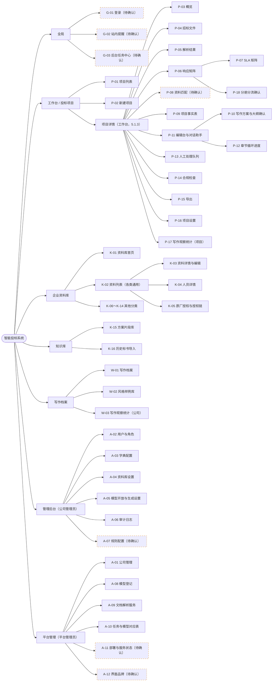
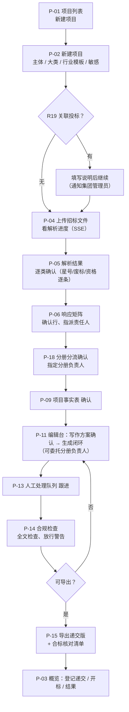
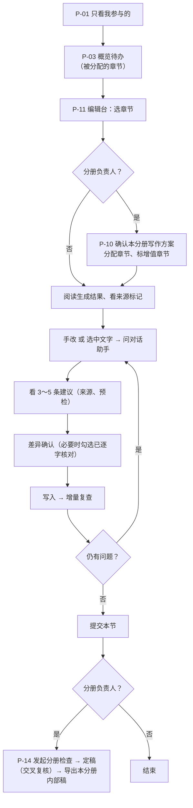
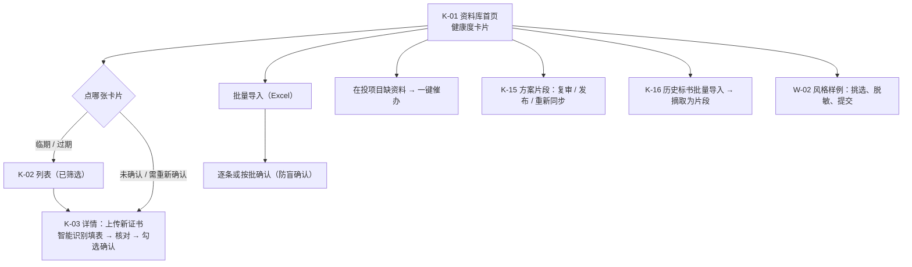
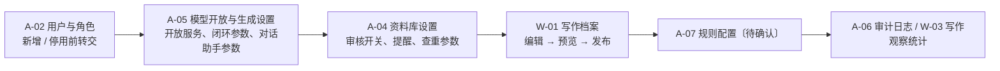
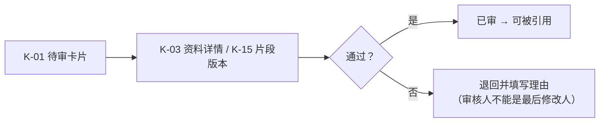
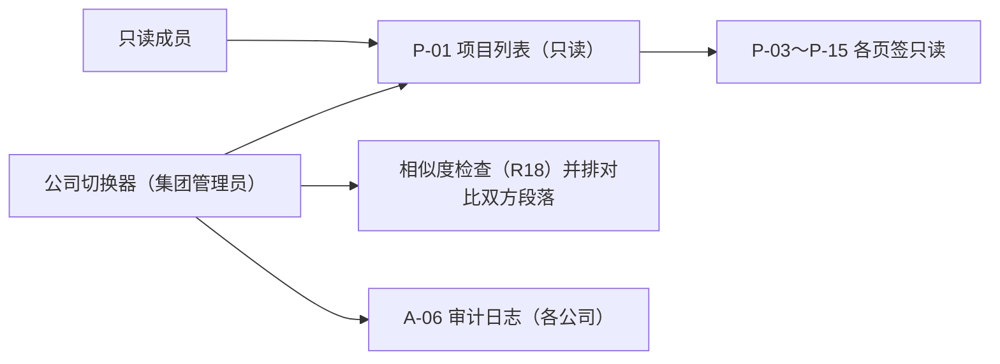

# 智能投标系统 · 前端设计规范 v1

| 项 | 内容 |
|---|---|
| 文档版本 | v1（首版，2026-10-08） |
| 编写 | 前端设计（高级前端设计工程师） |
| 依据 | PRD `prd-mvp-v1.4.md`（重点 5.11）、数据字典 `kb-data-dictionary-v1.5.md`、技术方案 `tech/tech-plan-v1.md`；旧版本不作依据 |
| 前端技术栈 | React + TypeScript + Vite；Ant Design v5 + ProComponents；TipTap（编辑台）；PDF.js（原文预览）；长任务进度用 SSE（技术方案 1.3.1 节） |
| 配套原型 | `prototype/index.html`（浏览器直接打开，无需构建）；截图 `screenshots/`（1440×900） |
| 约定 | 文中“〔待确认〕”表示 PRD、字典、技术方案中找不到对应章节或表名，或三者说法不一致；“〔建议〕”是本设计的建议值，未经产品确认 |

---

## 1. 设计原则

1. **先看风险，再看进度。** 截止时间、阻断问题、【待补】、证据失效在每个层级都优先展示（项目列表置顶标红、项目摘要条常驻、矩阵行底色标红）。
2. **人对结果负责，AI 只给建议。** 所有模型产出都带 AI 标识和来源；写入正文前必须看差异并确认；星号、废标、偏离、披露类内容需要再勾选“已逐字核对”。
3. **每个数字都能点回原文。** 抽取条目、矩阵行、合规问题、段落引用都能跳回招标文件页码或资料记录。
4. **敏感优先。** 敏感项目在顶栏摘要条、编辑台模型标识、解析服务选择处始终可见“敏感 · 强制本地”，且不可切换。
5. **信息密度偏高但不拥挤。** 中后台业务表格默认 `size="small"`/`middle`，正文编辑区用宽松行高（1.85）保证长时间阅读。
6. **中文优先。** 字体、标点、数字格式都按中文环境；时间统一按 UTC+8 显示（PRD 5.1.1 验收②；技术方案假设 A-22）。

---

## 2. 信息架构（站点地图）

页面 ID 与第 5 章页面清单一致。虚线框表示 PRD 中没有独立页面定义的页面〔待确认〕。



---

## 3. 全局导航

### 3.1 整体框架（ProLayout `layout="mix"` 的变体：侧栏 + 顶栏）

```
┌──────────┬──────────────────────────────────────────────────────────────┐
│ Logo/产品名│ ≡  面包屑                    示例/环境标记  搜索  任务  提醒  公司  用户 │  顶栏 56px（白底）
│          ├──────────────────────────────────────────────────────────────┤
│ 一级菜单  │ [项目摘要条 + 项目二级导航]  ← 只在项目内出现                         │
│ （深蓝）  ├──────────────────────────────────────────────────────────────┤
│ 216px    │ 内容区（背景 #F5F7FA，内边距 16/24）                                │
│ 收起 60px │                                                              │
└──────────┴──────────────────────────────────────────────────────────────┘
```

### 3.2 侧栏（一级菜单）

| 菜单 | 子项 | 可见角色（PRD 2.3） | 原型 |
|---|---|---|---|
| 工作台 | — | 除平台管理员外全部 | 01 |
| 企业资料库 | 首页 + 13 个分类（在页内左侧分类栏切换，不进侧栏） | 公司内全部角色（权限按 2.3 节） | 07#library |
| 知识库 | 方案片段库、历史标书导入（页内切换） | 公司内全部角色 | 07#snippets |
| 写作档案 | 写作档案、风格样例库 | 公司管理员（编辑）、其他角色只读 | — |
| 写作观察统计 | — | 公司管理员（5.7.13 第 3 项“公司管理后台一处”） | — |
| 管理后台 | 用户与角色、模型开放与生成设置、资料库设置、字典配置、审计日志、规则配置〔待确认〕 | 公司管理员；集团管理员只读 | 08#users / #grant |
| 平台管理 | 公司管理、模型登记、文档解析服务、任务与模型对应表、部署与服务状态〔待确认〕 | 平台管理员 | 08#models / #routes / #deploy |

规则：

- 菜单按角色裁剪，没有权限的菜单不显示（不是置灰）。原型为演示把“管理后台”和“平台管理”同时显示，已在页面上注明“演示合并”。
- 平台管理员默认看不到业务数据（技术方案 8.15 引 PRD 8.1 第 7 条），其侧栏只有“平台管理”和审计入口。
- 集团管理员额外有“公司切换器”（顶栏公司名处变为下拉），全站只读（PRD 5.1.1、5.4.2）。
- 侧栏可收起到 60px；**进入项目后默认收起**（矩阵、编辑台、合规检查需要横向空间），用户手动展开后记住偏好〔建议〕。

### 3.3 顶栏

从左到右：收起按钮 → 面包屑 → 环境/示例标记（原型显示“示例数据 · 非真实业务”；生产可显示“试运行”等）→ 全局搜索〔待确认，PRD 无定义〕→ 后台任务（徽标为运行中任务数，G-03）→ 站内提醒（徽标为未读数，G-02）→ 当前公司 → 用户名 · 主要角色。

### 3.4 面包屑

- 规则：`一级菜单 / 对象名 / 当前页`，最多 4 级；项目名过长时用简称（招标人简称 + 关键词，例如“东海城商行数据库维保”），悬停显示全名。
- 项目内面包屑示例：`工作台 / 东海城商行数据库维保 / 编辑台 · 技术分册`。

### 3.5 项目内二级导航（项目摘要条 + 页签）

依据 PRD 5.1.3：

- **摘要条**（常驻）：项目名、状态标签、敏感标记、分册进度卡（分册名、负责人、内部截止时间、分册状态）、招标编号/标段、投标主体、递交截止时间与倒计时（≤3 天标红）、响应覆盖率、阻断数、【待补】数、待人工处理数。
- **紧凑模式**：编辑台、矩阵、合规检查、导出等工作页只保留第一行（项目名 + 状态 + 分册卡），把纵向空间留给内容〔建议〕。
- **页签**（按 5.1.3 顺序）：概览、招标文件、解析结果、响应矩阵、资料匹配、项目事实表、编辑台（v1.4 取代“大纲与章节”）、人工处理队列（带徽标）、合规检查、导出、项目设置。
- **未纳入 5.1.3 页签、但 PRD 定义了页面的**：SLA 矩阵（5.3.2）、写作观察统计（5.7.13 第 3 项“项目详情页签”）。本设计建议：SLA 矩阵作为“响应矩阵”页签内的二级切换（响应矩阵 | SLA 矩阵 | 偏离汇总）；写作观察统计放在“概览”页底部的折叠区〔待拍板〕。
- 写作方案与大纲确认（5.7.2）、章节循环进度（5.7.6）是“编辑台”页签内的视图：左侧目录选中章节后，中间区按章节状态显示“写作方案卡片 / 正文编辑 / 循环进度”。

---

## 4. 各角色主流程

角色取 PRD 2.2 节：平台管理员、集团管理员、公司管理员、资料管理员、项目负责人、投标编写人、审核人（可选）、只读成员；项目内分工：分册负责人、合标负责人（v1.2，不是公司级角色）。

### 4.1 项目负责人（主链路）



### 4.2 投标编写人 / 分册负责人



### 4.3 资料管理员



### 4.4 公司管理员



### 4.5 平台管理员


### 4.6 审核人（仅资料审核开关开启时出现）



### 4.7 集团管理员 / 只读成员



### 4.8 合标负责人（项目内分工，默认商务分册负责人）


---

## 5. 页面清单

表名标注：不带标记的表在字典 v1.5 第 3 章有完整列定义；带 **†** 的表由 PRD 各“数据对象”小节定义，字典只给了部分补充字段或未定义（技术方案 8.16 指出约 40 张 PRD 表缺完整列定义）。“〔待确认〕”表示 PRD 中没有独立页面定义或对应表。

| 页面ID | 页面名 | 所属模块 | PRD 章节号 | 涉及的真实表名 | 主要角色 | 是否有原型 |
|---|---|---|---|---|---|---|
| G-01 | 登录 | 全局 | 〔待确认〕（7.2 只有安全要求，无页面定义） | sys_user†、audit_log† | 全部 | 否 |
| G-02 | 站内提醒 | 全局 | 〔待确认〕（只有 notification 表，5.10.7） | notification† | 全部 | 否（顶栏入口已画） |
| G-03 | 后台任务中心 | 全局 | 〔待确认〕（7.6 第 3 条要求“统一的任务列表”，无页面定义） | parse_job†、generation_task†、compliance_run†、bid_export† | 项目负责人、编写人、平台管理员 | 否（顶栏入口已画） |
| P-01 | 项目列表（工作台） | 投标项目 | 5.1.1 | bid_project†、bid_project_member†、bid_volume† | 项目负责人、编写人、只读成员、集团管理员（只读） | 是 · `01-workbench.html` |
| P-02 | 新建项目（含 R19 提示） | 投标项目 | 5.1.2 | bid_project†、bid_volume†、tender_file†、org_entity、writing_outline_template | 项目负责人、公司管理员 | 是 · `02-new-project-parse.html#create`、`#r19` |
| P-03 | 项目概览 | 投标项目 | 5.1.3 | bid_project†、bid_volume†、response_matrix_item†、chapter_check_issue | 项目成员 | 否 |
| P-04 | 招标文件（上传与解析进度） | 招标文件解析 | 5.2.1 | tender_file†、parse_job†、parse_service†、attachment | 项目负责人 | 是 · `02-new-project-parse.html#upload` |
| P-05 | 解析结果 | 招标文件解析 | 5.2.2 | tender_requirement†、parse_block† | 项目负责人（确认）、编写人（编辑） | 是 · `02-new-project-parse.html#result` |
| P-06 | 响应矩阵 | 响应矩阵 | 5.3.1 | response_matrix_item†、matrix_evidence†、tender_requirement†、bid_volume†、qualification、person_certificate、authorization、contract、sla_template、solution_snippet | 项目负责人、编写人 | 是 · `03-response-matrix.html` |
| P-07 | SLA 矩阵 | 响应矩阵 | 5.3.2 | project_sla_value†、sla_template、sla_level、sla_variable、project_fact | 项目负责人 | 否 |
| P-08 | 资料匹配 | 响应矩阵 | 〔待确认〕（5.1.3 页签有，无页面定义） | matrix_evidence†（推测） | 项目负责人、编写人 | 否 |
| P-09 | 项目事实表 | 分节生成 | 5.7.8 | project_fact、project_sla_value†、project_person† | 项目负责人 | 否 |
| P-10 | 写作方案与大纲确认 | 分节生成 | 5.7.2 | bid_outline_node†、response_matrix_item†、project_fact、solution_snippet | 项目负责人、分册负责人 | 否 |
| P-11 | 编辑台与对话助手 | 编辑台 | 5.11.2（另见 5.11.3～5.11.10） | bid_outline_node†、chapter_version†、paragraph_lock†、citation†、edit_lock†、chapter_edit_draft、chapter_edit_operation、assistant_session、assistant_message、assistant_suggestion、chapter_check_issue | 投标编写人、分册负责人、项目负责人 | 是 · `04-editor-assistant.html`、`#diff` |
| P-12 | 章节循环进度 | 分节生成 | 5.7.6 | chapter_loop_round、chapter_check_issue、chapter_version†、generation_task†、writing_style_metric | 项目负责人、分册负责人 | 否 |
| P-13 | 人工处理队列 | 分节生成 | 5.7.7 | chapter_check_issue、chapter_loop_round、bid_outline_node† | 编写人、分册负责人 | 否 |
| P-14 | 合规检查 | 合规检查 | 5.8.2（另见 5.8.3、5.8.5） | compliance_run†、compliance_issue†、compliance_rule_config†、similarity_check†、similarity_hit† | 项目负责人、分册负责人 | 是 · `05-compliance.html` |
| P-15 | 导出 | Word 导出 | 5.9.1、5.9.2 | bid_export†、bid_volume†、attachment、writing_profile | 项目负责人、分册负责人（内部稿）、合标负责人（下载） | 是 · `06-export.html` |
| P-16 | 项目设置 | 投标项目 | 5.1.4 | bid_project†、bid_project_member†、project_partner†、project_person†、project_sla_value†、project_rule_override†、bid_volume† | 项目负责人 | 否 |
| P-17 | 写作观察统计（项目页签） | 分节生成 | 5.7.13 第 3 项 | writing_style_metric | 项目负责人 | 否 |
| P-18 | 分册分流确认 | 响应矩阵 | 5.3.1 规则 8（交互形式〔待确认〕） | response_matrix_item†、bid_volume† | 项目负责人；分册负责人提建议 | 否（03 页有入口横幅） |
| K-01 | 资料库首页 | 企业资料库 | 5.4.2 | qualification、person、person_certificate、authorization、contract、org_proof_doc、attachment_link | 资料管理员、公司管理员 | 是 · `07-library-kb.html#library`（与 K-02 合并展示） |
| K-02 | 资料列表（各类通用） | 企业资料库 | 5.4.3 | 按分类取对应表（资质：qualification；人员：person、person_certificate） | 资料管理员、编写人 | 是 · `07-library-kb.html#library`（资质证书）、`#people`（人员） |
| K-03 | 资料详情与编辑 | 企业资料库 | 5.4.4 | 各资料表、attachment、attachment_link、change_log | 资料管理员、编写人（本人录入或负责的） | 否 |
| K-04 | 人员详情 | 企业资料库 | 5.4.5 | person、person_certificate、person_assignment、contract_member、attachment_link | 资料管理员、公司管理员 | 否 |
| K-05 | 原厂授权与授权链 | 企业资料库 | 5.4.6 | authorization、authorization_product、org_entity、vendor、product | 资料管理员 | 否 |
| K-06 | 公司主体 | 企业资料库 | 5.4.7 | org_entity、org_relation | 公司管理员、资料管理员 | 否 |
| K-07 | 证明材料 | 企业资料库 | 5.4.7 | org_proof_doc | 资料管理员 | 否 |
| K-08 | 中小企业划型 | 企业资料库 | 5.4.7 | sme_classification、sme_standard | 资料管理员 | 否 |
| K-09 | SLA 模板 | 企业资料库 | 5.4.7 | sla_template、sla_level、sla_variable | 资料管理员 | 否 |
| K-10 | 全局变量 | 企业资料库 | 5.4.7 | merge_variable | 资料管理员 | 否 |
| K-11 | 附件库 | 企业资料库 | 5.4.7 | attachment、attachment_link | 资料管理员 | 否 |
| K-12 | 安全与合规事件记录 | 企业资料库 | 5.4.7 | org_compliance_event | 资料管理员 | 否 |
| K-13 | 工具与设备 | 企业资料库 | 5.4.7 | tool_asset | 资料管理员 | 否 |
| K-14 | 业绩 | 企业资料库 | 5.4.3（通用列表）、5.4.7（业绩项目成员补充） | contract、contract_product、contract_member | 资料管理员 | 否（分类入口在 07） |
| K-15 | 方案片段库 | 知识库 | 5.5.2 | solution_snippet、snippet_revision、snippet_link | 编写人、资料管理员 | 是 · `07-library-kb.html#snippets` |
| K-16 | 历史标书导入 | 知识库 | 5.5.3 | bid_archive、bid_archive_ref、attachment | 资料管理员、公司管理员（批量） | 是 · `07-library-kb.html#archive` |
| W-01 | 写作档案 | 写作档案 | 5.6.2 | writing_profile、writing_outline_template、writing_outline_node、writing_term、prompt_template、task_card、review_checklist_item、writing_sentence_pattern | 公司管理员 | 否 |
| W-02 | 风格样例库 | 写作档案 | 5.6.5 | writing_style_sample | 公司管理员、资料管理员 | 否 |
| W-03 | 写作观察统计（公司） | 写作档案 | 5.7.13 第 3 项 | writing_style_metric | 公司管理员 | 否 |
| A-01 | 公司管理 | 平台管理 | 5.10.1 | company、company_affiliation、org_entity、sys_group† | 平台管理员 | 否 |
| A-02 | 用户与角色 | 管理后台 | 5.10.2 | sys_user†、sys_role†、sys_user_role†、sys_permission† | 公司管理员 | 是 · `08-admin-models.html#users` |
| A-03 | 字典配置 | 管理后台 | 5.10.3 | dict_type、dict_item、cert_type、vendor、product、attachment_slot | 平台管理员（平台级）、公司管理员（公司级） | 否 |
| A-04 | 资料库设置 | 管理后台 | 5.10.4 | company_setting | 公司管理员 | 否 |
| A-05 | 模型开放与生成设置 | 管理后台 | 5.10.5、6.9 | company_model_grant†、task_model_route†、company_setting、compliance_rule_config† | 公司管理员 | 是 · `08-admin-models.html#grant` |
| A-06 | 审计日志 | 管理后台 | 5.10.6、6.7 | audit_log†、model_call_audit† | 公司管理员、平台管理员、集团管理员 | 否 |
| A-07 | 规则配置 | 管理后台 | 〔待确认〕（5.8.2 规则 2 要求按公司配置，无页面定义） | compliance_rule_config† | 公司管理员 | 否 |
| A-08 | 模型登记 | 平台管理 | 6.6.1（字段 6.2.1） | llm_model†、llm_model_config_version†、service_health† | 平台管理员 | 是 · `08-admin-models.html#models` |
| A-09 | 文档解析服务 | 平台管理 | 6.6.2（字段 6.3.1） | parse_service†、parse_service_config_version†、service_health† | 平台管理员 | 否 |
| A-10 | 任务与模型对应表 | 平台管理 | 6.6.3（内容 6.4） | task_model_route† | 平台管理员 | 是 · `08-admin-models.html#routes` |
| A-11 | 部署与服务状态 | 平台管理 | 〔待确认〕（7.6 第 3 条“服务健康状态在管理后台可见”、7.1、7.2，无页面定义） | service_health† | 平台管理员 | 是 · `08-admin-models.html#deploy` |
| A-12 | 界面品牌（白标） | 平台管理 | 〔待确认〕（PRD 无；技术方案 6.9 节 C1“界面品牌”配置） | 〔待确认〕（无表） | 平台管理员 | 部分 · 在 `08#deploy` 中示意 |

---

## 6. 无原型页面的版式

### 6.1 通用状态规范（所有页面适用）

| 状态 | 表现 | 组件 |
|---|---|---|
| 加载 | 首屏用骨架屏（表格 5 行、卡片 3 张）；局部刷新用区块级 Spin，不遮整页；超过 10 秒显示“仍在加载，可离开本页，任务在后台继续”（长任务） | `Skeleton`、`Spin`、ProTable `loading` |
| 空态 | 插图 + 一句原因 + 一个主操作。示例：项目列表为空 →“上传第一份招标文件”（5.1.1）；资料库为空 →“从零开始：公司主体 → 营业执照 → 资质 → 人员”（5.4.2） | `Empty`（`image={Empty.PRESENTED_IMAGE_SIMPLE}` 用于区块内） |
| 筛选无结果 | “没有符合条件的记录” + “清除筛选” | `Empty` |
| 错误 | 区块内 `Result status="error"`：错误说明 + 请求编号（traceId）+ “重试”；整页失败才用整页 Result；表单字段错误就近显示 | `Result`、`Alert` |
| 权限不足 | 整页：`Result status="403"`“你没有该页面的权限，请联系公司管理员”；页内操作：按钮隐藏（不是置灰），只读字段改为文本 | `Result` |
| 已过期 / 需复核 | 结果仍显示，顶部黄色 `Alert`“内容已修改，结果已过期”+“重新运行” | `Alert` |
| 只读（项目取消、集团管理员） | 顶部灰色条“只读：项目已取消” | `Alert type="info"` |

### 6.2 各页面版式

| 页面 | 区域划分 | 主要组件 | 特有状态 |
|---|---|---|---|
| **P-03 项目概览** | 摘要条下：左 2/3“下一步该做什么”待办清单（按分册分组，每条可一键跳转）；右 1/3 分册进度卡（每册：负责人、内部截止倒计时、章节完成数/总数、阻断数）、状态操作卡（登记递交 / 开标 / 结果）、最近导出；底部折叠区“写作观察统计”〔建议〕 | `List`（待办）、`Card`、`Progress`、`Steps`（项目状态 4.3 节）、`Modal`（登记结果：中标/未中标/废标/流标） | 空态：“暂无待办”；“定稿后已修改，待复核”的章节进待办（5.1.3 v1.4） |
| **P-07 SLA 矩阵** | 顶部：SLA 模板选择 + “按招标要求取值”+“导出承诺函表格”；主体 ProTable：指标、招标要求值（带页码）、我方承诺值（可编辑）、公司最严可承诺值、单位、优劣方向、判定 | `EditableProTable`、判定 `Tag`（满足绿 / 不满足红=阻断 R09 / 超出能力橙 / 招标未要求灰 / 需人工判断） | 无独立状态，判定实时计算（5.3.2）；“工作日 vs 自然日”显示“需人工判断” |
| **P-08 资料匹配**〔待确认〕 | 建议：左侧矩阵行列表（只显示需证据的行），右侧候选证据（结构化资料按规则匹配 + 片段按相关度），底部已挂证据 | `ProList`、`Card`、有效期 `Badge` | 候选为空：“资料库没有可引用的记录”+“去补录”；合作方缺协议：显示但不可选（5.1.4） |
| **P-09 项目事实表** | 按事实类别分组的描述列表；来自项目设置 / SLA 矩阵 / 拟派人员的事实显示“引用自 ×× ”且不可在此编辑（5.7.8） | `ProDescriptions`、`Tag`（必备 / 已确认 / 待确认） | 必备事实未确认时顶部红条，阻止写作方案确认 |
| **P-10 写作方案与大纲确认** | 三栏：左大纲树（章节号、标题、分册、负责人、章节状态、增值标记）；中“本节写作方案”卡片（回应的矩阵行、计划证据、片段、篇幅预算）；右招标原文 PDF.js 预览 | `Tree`（可拖动）、`Card`、PDF 预览组件（同 P-05） | 顶部提示 R26 未分配行；星号、废标行不能标“不适用” |
| **P-12 章节循环进度** | 顶部摘要（状态、轮次/最大轮数、停止原因、生成/评审模型、任务卡版本）；左轮次时间线；右版本对比（只高亮变化段落）；底部问题清单 | `Timeline`、差异视图（与 04 页 diff 同一套样式）、`ProTable` | 异常中断：红色 `Alert` + “重试”；历史很多时按循环折叠 |
| **P-13 人工处理队列** | 顶部统计（按转人工原因分组、分册内部截止倒计时）；左按章节分组的队列；右详情（段落原文可编辑、相关证据与矩阵行、历次修正文字） | `Collapse`、`List`、内嵌 TipTap 只编辑单段 | 处理完 →“一键重新检查”；空态“没有待人工处理的问题” |
| **P-16 项目设置** | 左侧锚点导航（基本信息 / 成员与分工 / 合作方 / 拟派人员 / SLA 取值 / 规则覆盖 / 生成闭环 / 分册 / 导出设置，对应 5.1.4 九项）；右侧分组表单，底部固定保存条 | `Anchor`、`ProForm`、`EditableProTable`（分册、拟派人员） | “已人工修改”字段标记；递交版命名含 {编写人} 时保存报错；分册内部截止晚于递交截止给警告 |
| **K-03 资料详情与编辑** | 左 2/3 字段表单（按字典生成，★ 字段带星）；右 1/3：附件槽位（缺失必备槽位标红）、来源追溯、确认区（勾选“本人确认以上资料真实有效”）；页签：变更历史、被引用情况 | `ProForm`、`Upload`、`Checkbox`、`Tabs` | 智能识别后字段标“待核对”、低置信度高亮；修改 ★ 字段后确认勾选自动清空 |
| **K-04 人员详情** | 同 K-03 结构；身份证号脱敏（前 4 后 4），“查看完整身份证号”按钮只对公司管理员、资料管理员显示，点击弹窗填原因 | `Descriptions`、`Modal` | 离职人员：顶部红条，已有拟派标红 |
| **K-05 原厂授权与授权链** | 列表 + 详情；详情中横向链条图：原厂 → 总代 → 我方，每级节点显示出具方、有效期、产品与地域，不满足的节点标红 | `ProTable`、自绘链条（`Steps` 变体） | “上游未登记”节点灰色虚线 + R07 警告 |
| **K-06～K-14 其他分类** | 统一使用 K-02 列表模板（同 07 页）：左分类栏 + 筛选条 + ProTable + 批量操作栏；列按 5.4.3 / 5.4.7 各分类 | ProTable | 同 6.1 |
| **W-01 写作档案** | 顶部版本条（当前版本、状态 草稿 / 已发布 / 已归档、发布、回滚）；页签：章节模板、叫法与术语、语气与称呼、句式规则、风格样例、任务卡与提示词、审查清单、Word 模板、导出命名（5.6.2） | `Tabs`、`ProForm`、`Tree`、预览抽屉（试生成一段） | “仍为平台默认”提示；引用不存在变量时发布按钮禁用并列原因 |
| **W-02 / W-03** | W-02：卡片墙（样例、来源、脱敏状态、启用开关）；W-03：只读统计表 + 折线图，不标红、不排名（5.7.13） | `Card`、`Switch`、图表（建议 AntV G2，待技术确认） | W-03 无阈值、无告警色 |
| **A-01 公司管理** | ProTable：公司名称、统一社会信用代码、所属集团、状态、用户数、开通时间；新建抽屉 | ProTable、`Drawer` | 停用二次确认 |
| **A-03 字典配置** | 左字典类型树（平台级 / 公司级分组），右字典项表；示例值带“示例”标记 | `Tree`、`EditableProTable` | 已使用代码只能停用 |
| **A-04 资料库设置** | 分组表单，对应 5.10.4 表的 15 项；查重参数一组 | `ProForm` | 切换审核开关时弹窗说明状态变化规则 |
| **A-06 审计日志** | 筛选（时间、用户、操作类型、对象、是否云端调用、公司）+ 只读表格（时间、用户、公司、操作、对象、结果、IP）；云端调用行可展开看模型、token 数 | ProTable | 只追加，不提供删除与编辑 |
| **A-07 规则配置**〔待确认〕 | R01～R44 表格：编号、名称、级别（下拉）、阈值、启用开关；不可关闭的规则开关置灰并加锁图标（R01、R15、R23、R26、R27、R34、R37、R39、R44，以及招标要求评审索引表时的 R40），R43 级别下拉中没有“阻断” | `EditableProTable` | 修改记审计日志 |
| **A-09 文档解析服务** | 页签“云端配置 / 本地配置”；结构同 A-08（列表 + 编辑表单），本地服务另有只读“部署参数”区（读 `/v1/health`、`/v1/tiers`）；“测试解析”上传样例 | 同 A-08 | 云端服务“可用于敏感内容”固定为否 |
| **G-01 登录**〔待确认〕 | 左品牌区（产品名、Logo，支持白标），右登录卡（账号、密码、验证码〔待确认〕） | `Form` | 失败次数限制与锁定提示（7.2） |
| **G-03 后台任务中心**〔待确认〕 | 顶栏任务图标点开右侧抽屉：运行中 / 排队 / 失败 / 已完成；每条显示类型、项目、进度、耗时、“查看”“重试” | `Drawer`、`List`、`Progress` | 失败任务显示失败原因（7.6 第 3 条） |

---

## 7. 设计令牌（Design Tokens）

所有原型共享 `prototype/assets/tokens.css`（CSS 变量）和 `prototype/assets/theme.js`（AntD 主题），数值与本章一致。

### 7.1 颜色

**主色（默认深海蓝，待 neil 拍板）**

| 令牌 | 值 | 用途 |
|---|---|---|
| `--c-primary` | `#1E4DB7` | 主按钮、链接、选中态、侧栏选中项 |
| `--c-primary-hover` | `#3A67C9` | 悬停 |
| `--c-primary-active` | `#143A91` | 按下 |
| `--c-primary-bg` | `#EEF3FC` | 选中行、浅底标签 |
| `--c-primary-border` | `#B7C9EE` | 浅色描边 |
| `--c-sider` / `--c-sider-deep` | `#0F1C3F` / `#0A1430` | 侧栏背景 / 子菜单背景 |

**功能色**

| 令牌 | 值 | 浅底 | 用途 |
|---|---|---|---|
| `--c-success` | `#2B9D5C` | `#EAF6EF` | 通过、有效、已确认 |
| `--c-warning` | `#E08A1E` | `#FDF3E6` | 警告、临期、待确认 |
| `--c-error` | `#D9363E` | `#FDECEC` | 阻断、过期、失败、负偏离 |
| `--c-info` | `#1E4DB7` | `#EEF3FC` | 提示级、信息 |
| `--c-ai` | `#6E4BD8` | `#F2EEFC` | **AI 生成内容专用**（AI 建议标签、模型撰写段落、抽取中进度） |
| `--c-assistant` | `#A23CC8` | `#F8EDFC` | 对话助手撰写的段落和建议 |

**中性色阶（N1～N10）**

| N1 | N2 | N3 | N4 | N5 | N6 | N7 | N8 | N9 | N10 |
|---|---|---|---|---|---|---|---|---|---|
| `#FFFFFF` | `#F7F8FA` | `#F2F3F5` | `#E8EBF0` | `#DCDFE6` | `#C2C7D0` | `#A1A7B3` | `#86909C` | `#4E5969` | `#1D2129` |
| 卡片 | 表头/次底 | 填充/悬停 | 分割线 | 边框 | 禁用边框 | 占位符 | 次要文字 | 正文次级 | 标题/正文 |

页面背景 `--c-bg-layout: #F5F7FA`。

**段落来源色**（编辑台段落左侧色条 + 文字标签，PRD 5.11.2 七种来源）

| 来源 | 令牌 | 值 |
|---|---|---|
| 证据 | `--src-evidence` | `#1E4DB7` |
| 方案片段 | `--src-snippet` | `#0E8A8A` |
| 招标原文引用 | `--src-tender` | `#86909C` |
| 模型撰写 | `--src-model` | `#6E4BD8` |
| 对话助手撰写 | `--src-assistant` | `#A23CC8` |
| 人工编写 | `--src-manual` | `#2B9D5C` |
| 系统生成 | `--src-system` | `#4E5969` |

**编辑器内联标记**：变量底色 `#FFF4D6` + 下边线 `#F0C24B`；【待补】文字 `#C42B33` 底 `#FDECEC`；R43 命中波浪下划线 `#E08A1E`；锁定内容底色 N3 + 虚线边框 N5。

### 7.2 字体

```css
--font-sans: "PingFang SC", "Microsoft YaHei", "Source Han Sans SC", "Noto Sans CJK SC", "Noto Sans SC", "Helvetica Neue", Arial, sans-serif;
--font-mono: "JetBrains Mono", "SFMono-Regular", Consolas, "Liberation Mono", monospace;
```

- 中文优先：macOS 用苹方，Windows 用微软雅黑，信创 Linux（麒麟 / 统信）用思源黑体 / Noto Sans CJK 兜底。私有化部署时**随前端包内置思源黑体子集**（Regular / Medium 两个字重），避免内网机器缺字体〔建议〕。
- 等宽字体用于编号、招标编号、证书编号、时间、配置键、模型名。
- 浏览器范围按技术方案假设 A-15（Chrome / Edge 最近 2 个大版本、奇安信可信浏览器、360 极速模式）。

**字号阶梯**

| 令牌 | 字号 / 行高 | 字重 | 用途 |
|---|---|---|---|
| `--fs-30` | 30 / 38 | 600 | 大数字（统计卡，少用） |
| `--fs-24` | 24 / 32 | 600 | 页面级大标题（索引页） |
| `--fs-20` | 20 / 28 | 600 | 页面标题、编辑台章节标题 |
| `--fs-16` | 16 / 24 | 600 | 区块标题、项目名 |
| `--fs-15` | 15 / 28（1.85） | 400 | **编辑台正文**（长时间阅读） |
| `--fs-14` | 14 / 22 | 400 | 默认正文、表单、按钮 |
| `--fs-13` | 13 / 20 | 400 | 表格单元格、卡片内容 |
| `--fs-12` | 12 / 18 | 400 | 辅助说明、标签、时间 |

### 7.3 间距、圆角、阴影、栅格、密度

| 类别 | 令牌 |
|---|---|
| 间距（4 点网格） | 4 / 8 / 12 / 16 / 20 / 24 / 32（`--sp-*`）；页面内边距 16（上下）/ 24（左右）；卡片内边距 16；区块间距 12 |
| 圆角 | 4（标签、小按钮）/ 6（按钮、输入框、默认）/ 8（卡片、弹窗、面板） |
| 阴影 | `--shadow-1` 卡片悬浮前（极浅）；`--shadow-2` 下拉、悬浮工具条；`--shadow-3` 弹窗、抽屉。业务卡片默认**只用 1px 边框不用阴影** |
| 栅格 | 24 栏，槽宽 16；设计基准 1440×900；最小支持 1280；编辑台四栏布局在 ≥1680 启用（见 9.6） |
| 密度 | 默认档：控件高 32，表格行高约 48（middle）；**紧凑档**（矩阵、合规问题、资料列表）：表格 `size="small"`，行高约 40；不提供用户级密度切换（MVP）〔待拍板〕 |
| 层级 | 顶栏 sticky z=20；悬浮“问对话助手”工具条 z=5；抽屉/弹窗用 AntD 默认 |

---

## 8. 映射到 Ant Design v5 主题

技术方案 1.3 节写的是“antd 5/6（M0 定）”。本规范按 **v5** 写（任务要求）；v6 的 token 名基本兼容，若 M0 选 v6，需复核组件级 token 名〔待拍板〕。

### 8.1 令牌映射表

| 设计令牌 | 值 | AntD v5 全局 token | 说明 |
|---|---|---|---|
| `--c-primary` | `#1E4DB7` | `colorPrimary`、`colorInfo`、`colorLink` | 派生色阶由算法生成；hover/active 与 `--c-primary-hover/active` 接近 |
| `--c-success` | `#2B9D5C` | `colorSuccess` | |
| `--c-warning` | `#E08A1E` | `colorWarning` | |
| `--c-error` | `#D9363E` | `colorError` | |
| N10 | `#1D2129` | `colorTextBase` | 文字色阶由算法派生 |
| `--c-bg-layout` | `#F5F7FA` | `colorBgLayout` | |
| N5 | `#DCDFE6` | `colorBorder` | |
| N4 | `#E8EBF0` | `colorBorderSecondary` | 表格、卡片分割线 |
| N2 | `#F7F8FA` | `colorFillAlter` | 表头、斑马纹 |
| `--font-sans` | 见 7.2 | `fontFamily` | |
| `--fs-14 / 12 / 16` | 14 / 12 / 16 | `fontSize` / `fontSizeSM` / `fontSizeLG` | |
| `--fs-30 / 24 / 20 / 16 / 14` | | `fontSizeHeading1～5` | |
| `--r-md / sm / lg` | 6 / 4 / 8 | `borderRadius` / `borderRadiusSM` / `borderRadiusLG` | |
| 控件高 | 32 / 24 / 40 | `controlHeight` / `controlHeightSM` / `controlHeightLG` | |
| `--sp-16 / 12 / 8` | | `padding` / `paddingSM` / `paddingXS`、`margin` | |
| `--shadow-2 / 3` | | `boxShadow` / `boxShadowSecondary` | |
| 侧栏 | `#0F1C3F` | `components.Layout.siderBg`、`components.Menu.darkItemBg` | |
| 侧栏选中 | `#1E4DB7` | `components.Menu.darkItemSelectedBg` | |
| 顶栏高 | 56 | `components.Layout.headerHeight` | |
| 表头底 | `#F7F8FA` | `components.Table.headerBg` | |
| 行悬停 | `#F5F8FF` | `components.Table.rowHoverBg` | |
| `--c-ai` 等业务色 | | 不进 AntD token，用 CSS 变量 + 自定义组件（`AiTag`、`SourceBar`、`LevelTag`） | AntD 没有对应语义 |

### 8.2 ConfigProvider 示例（与 `prototype/assets/theme.js` 一致）

```tsx
// src/theme/index.ts
import type { ThemeConfig } from 'antd';

export const FONT_FAMILY =
  '"PingFang SC", "Microsoft YaHei", "Source Han Sans SC", "Noto Sans CJK SC", "Noto Sans SC", "Helvetica Neue", Arial, sans-serif';

export const appTheme: ThemeConfig = {
  token: {
    colorPrimary: '#1E4DB7',
    colorInfo: '#1E4DB7',
    colorLink: '#1E4DB7',
    colorSuccess: '#2B9D5C',
    colorWarning: '#E08A1E',
    colorError: '#D9363E',
    colorTextBase: '#1D2129',
    colorBgLayout: '#F5F7FA',
    colorBorder: '#DCDFE6',
    colorBorderSecondary: '#E8EBF0',
    colorFillAlter: '#F7F8FA',
    fontFamily: FONT_FAMILY,
    fontSize: 14,
    fontSizeSM: 12,
    fontSizeLG: 16,
    fontSizeHeading1: 30,
    fontSizeHeading2: 24,
    fontSizeHeading3: 20,
    fontSizeHeading4: 16,
    fontSizeHeading5: 14,
    borderRadius: 6,
    borderRadiusSM: 4,
    borderRadiusLG: 8,
    controlHeight: 32,
    controlHeightSM: 24,
    controlHeightLG: 40,
    boxShadow: '0 4px 12px rgba(16,28,63,0.08)',
    boxShadowSecondary: '0 8px 24px rgba(16,28,63,0.14)',
    wireframe: false,
  },
  components: {
    Layout: { siderBg: '#0F1C3F', headerBg: '#FFFFFF', headerHeight: 56, headerPadding: '0 20px', bodyBg: '#F5F7FA' },
    Menu: {
      darkItemBg: '#0F1C3F', darkSubMenuItemBg: '#0A1430', darkPopupBg: '#0F1C3F',
      darkItemSelectedBg: '#1E4DB7', darkItemColor: 'rgba(255,255,255,0.72)',
      darkItemHoverColor: '#FFFFFF', darkItemHoverBg: 'rgba(255,255,255,0.06)',
      itemHeight: 40, itemMarginInline: 8, itemBorderRadius: 6,
    },
    Table: { headerBg: '#F7F8FA', headerColor: '#4E5969', headerSplitColor: 'transparent', rowHoverBg: '#F5F8FF', borderColor: '#E8EBF0' },
    Card: { headerFontSize: 15 },
    Tag: { defaultBg: '#F2F3F5', defaultColor: '#4E5969' },
    Button: { primaryShadow: 'none', defaultShadow: 'none', dangerShadow: 'none' },
    Descriptions: { labelBg: '#F7F8FA' },
  },
};

// src/main.tsx
import { ConfigProvider, App as AntdApp } from 'antd';
import zhCN from 'antd/locale/zh_CN';
import dayjs from 'dayjs';
import 'dayjs/locale/zh-cn';
dayjs.locale('zh-cn');

root.render(
  <ConfigProvider locale={zhCN} theme={appTheme}>
    <AntdApp>
      <RouterProvider router={router} />
    </AntdApp>
  </ConfigProvider>,
);
```

### 8.3 ProLayout token 配置

token 名已按 `@ant-design/pro-provider` 2.16.2 的 `typing/layoutToken.d.ts` 核对。

```tsx
import { ProLayout } from '@ant-design/pro-components';

export const proLayoutToken = {
  bgLayout: '#F5F7FA',
  colorPrimary: '#1E4DB7',
  header: {
    colorBgHeader: '#FFFFFF',
    colorHeaderTitle: '#1D2129',
    heightLayoutHeader: 56,
    colorTextRightActionsItem: '#4E5969',
    colorBgRightActionsItemHover: '#F2F3F5',
    colorTextMenu: '#4E5969',
    colorTextMenuSelected: '#1E4DB7',
    colorBgMenuItemSelected: '#EEF3FC',
  },
  sider: {
    colorMenuBackground: '#0F1C3F',
    colorMenuItemDivider: 'rgba(255,255,255,0.08)',
    colorTextMenu: 'rgba(255,255,255,0.72)',
    colorTextMenuSecondary: 'rgba(255,255,255,0.56)',
    colorTextMenuSelected: '#FFFFFF',
    colorTextMenuActive: '#FFFFFF',
    colorTextMenuItemHover: '#FFFFFF',
    colorBgMenuItemSelected: '#1E4DB7',
    colorBgMenuItemHover: 'rgba(255,255,255,0.06)',
    colorBgMenuItemActive: 'rgba(255,255,255,0.10)',
    colorTextMenuTitle: '#FFFFFF',
    colorTextSubMenuSelected: '#FFFFFF',
    colorBgCollapsedButton: '#FFFFFF',
    colorTextCollapsedButton: '#4E5969',
    colorTextCollapsedButtonHover: '#1E4DB7',
    paddingInlineLayoutMenu: 8,
    paddingBlockLayoutMenu: 8,
  },
  pageContainer: {
    colorBgPageContainer: '#F5F7FA',
    paddingInlinePageContainerContent: 24,
    paddingBlockPageContainerContent: 16,
    colorBgPageContainerFixed: '#FFFFFF',
  },
};

<ProLayout
  layout="side"
  navTheme="realDark"          // 侧栏深色；顶栏通过 header token 保持白底
  fixSiderbar
  fixedHeader
  siderWidth={216}
  collapsedButtonRender={false}
  title={brand.productName}    // 白标：产品名、Logo 走配置（见 12 章）
  logo={brand.logoUrl}
  token={proLayoutToken}
  route={menuByRole(currentUser)}
  breadcrumbRender={(routers) => routers}
  actionsRender={() => [<TaskCenter key="t" />, <NoticeBell key="n" />, <CompanySwitcher key="c" />]}
  avatarProps={{ title: currentUser.name }}
>
  {/* 项目内页面：<ProjectHeader /> + <Outlet /> */}
</ProLayout>
```

说明：原型中 ProComponents 没有 UMD 包，外壳用 antd `Layout` + `Menu` 手写还原同等视觉；研发接入时直接使用上面的 ProLayout 配置。

---

## 9. 组件与交互规范

### 9.1 表格

1. 一律用 ProTable；默认 `size="middle"`，矩阵 / 合规问题 / 资料列表用 `size="small"`。
2. **不出现横向滚动是首选**：先合并列（例如“招标人 / 投标主体”两行显示）、用次级文字（12px N8）承载次要信息，再考虑 `scroll.x`；必须横滚时固定首列和操作列。
3. 列顺序：标识列（名称 + 编号两行）→ 分类 / 状态 → 业务数值 → 责任人 → 操作。数值右对齐，时间用等宽字体。
4. 风险行：阻断 / 证据失效 / 负偏离用浅红底 `#FFF5F5`（`.row-danger`）；3 天内截止的项目置顶 + 红色“急”标签（5.1.1）。
5. 操作列最多 2 个文字链接 + “更多”下拉；危险操作（取消项目、停用）放进下拉并二次确认。
6. 批量操作：勾选后出现批量操作栏；**星号、废标、资格三类抽取条目不提供批量确认**（5.2.2）。
7. 分页默认 10 条，显示总数；列表数据只统计本公司。
8. 页码链接 `P.47` 统一用 `.pg-link` 样式，点击在侧边预览原文并高亮。

### 9.2 表单

1. 用 ProForm；默认纵向布局，两栏或三栏栅格；必填加红色星号；★ 字段（修改后需重新确认）在标签前加 ★。
2. 系统字段（配置页）标签两行：中文名 + 等宽小字系统键（例如“最大输入 / max_input_tokens”），便于和 PRD、字典对照。
3. 不支持的字段**置灰并写明原因**（例如 Qwen3-30B-A3B-Instruct-2507 的“开启思考”，PRD 6.2.1）。
4. 敏感值（api_key、身份证号）只显示掩码，编辑只能“整体替换”。
5. 保存条固定在底部；离开有未保存修改时提示。
6. 校验即时进行；跨字段规则（递交版命名不能含 {编写人}）保存时校验并就近报错。

### 9.3 状态标签

统一用 AntD `Tag`（实心浅底）或 `Badge`（圆点 + 文字）。同一状态全站同色。

| 业务 | 取值 → 颜色 |
|---|---|
| 项目状态（4.3） | 草稿 灰 · 解析中 蓝（processing）· 待确认 金 · 编制中 蓝 · 检查中 青蓝 · 可导出 青 · 已导出 绿 · 已递交 / 已开标 极客蓝 · 已结束 灰 · 已取消 灰（删除线） |
| 解析状态（tender_file） | 待解析 灰点 · 上传中 / 解析中 蓝色动态点 + 进度条 · 抽取中 **AI 紫**动态点 + 进度条 · 已完成 绿点 · 失败 红点 + 原因 |
| 抽取条目（tender_requirement） | 待确认 金 · 已确认 绿 · 已人工修改 蓝（加锁）· 已删除 灰；置信度 < 0.8 橙色高亮 |
| 矩阵行 | 未响应 灰 · 已响应待确认 金 · 已确认 绿 · 证据失效 红（显示为“待确认 · 证据失效”） |
| 响应方式 | 无偏离 灰 · 正偏离 绿 · 负偏离 红 · 不适用 灰 |
| 合规问题等级 | **阻断** 红底白字（实心）· **警告** 橙浅底 · **提示** 蓝浅底；图标分别为禁止、三角、信息，色弱用户靠图标 + 文字区分 |
| 合规检查结论 | 未检查 灰 · 检查中 蓝 · 有阻断 红 · 仅警告 橙 · 通过 绿 · 已过期 灰 + 黄色提示条 |
| 章节状态（loop_status） | 已完成 绿 · 生成中 紫（Spin）· 修正中 / 定稿后已修改，待复核 橙 · 待人工处理 红 · 待生成 浅灰 · 大纲待确认 蓝 · 异常中断 红（感叹号） |
| 分册状态 | 编制中 蓝 · 分册检查中 青蓝（processing）· 已定稿 绿（加锁） |
| 资料确认 | 未确认 灰 · 已确认 绿 · 需重新确认 橙 |
| 有效期 | 有效 绿点 · 临期 橙点 · 过期 红点 · 待补录 灰点 |
| 片段版本 / 检索同步 | 草稿 金 · 已发布 绿 · 已被替代 灰；未同步 灰点 · 已同步 绿点 · 同步失败 红点 + “重新同步” |
| 导出任务 | 排队 橙点 · 生成中 蓝色动态点 · 完成 绿点 · 失败 红点 · 已过期 灰点 |
| 部署方式 | 本地 绿 · 云端 蓝 |
| 敏感 | “敏感 · 强制本地”火山橙 + 盾牌图标 |

### 9.4 AI 生成内容标识

1. **颜色专用**：AI 相关只用紫色系（`--c-ai`、`--c-assistant`），不用主色蓝，避免和“已确认 / 可操作”混淆。
2. **标签**：模型建议值（矩阵响应要点、章节对应）前加 `AI 建议` 紫色小标签（`.ai-tag`），人确认后标签消失（5.3.1 规则 6）。
3. **段落来源**：编辑台每段左侧 3px 色条 + 文字标签（证据 / 方案片段 / 招标原文 / 模型撰写 / 助手撰写 / 人工编写 / 系统生成），悬停显示来源详情（资料名、版本、写入人、时间）。
4. **模型标识**：对话面板顶部常驻当前模型；敏感项目显示“本地 · Qwen3-30B-A3B-Instruct-2507（敏感项目强制本地）”且不可切换；发生降级时显示“已使用备用模型 X”（6.5 规则 3）。
5. **建议卡片**：每条建议显示写法标签、差异（新增绿底、删除红底删除线）、来源引用或“无知识库来源”灰标签、预检结果（绿勾 / 橙三角），以及两个按钮“替换选中内容”“插在选中内容后”。自由问答的回答只有“复制”，不显示写入按钮（5.11.4）。
6. **写入确认**：点击写入先弹差异确认框；涉及星号 / 废标 / 偏离 / 披露的段落须勾选“我已逐字核对”才能确认；确认后显示新版本号和“增量复查中”。
7. **不可伪装**：系统生成的五类章节和锁定段落灰底 + 锁图标，不能被 AI 改写。

### 9.5 来源引用样式

| 类型 | 样式 | 交互 |
|---|---|---|
| 资料证据 | 上标方块 `[1]`，蓝色浅底（`.cite`） | 悬停卡片：资料名、版本、有效期、确认状态；点击在侧栏“来源”页签定位 |
| 方案片段 | 上标方块 `[2]`，青色浅底（`.cite.snippet`） | 悬停：片段标题、版本（已发布 r4）、负责人 |
| 招标原文 | 上标 `P47`，灰底（`.cite.tender`） | 点击打开 PDF.js 预览并高亮原文 |
| 项目事实 / SLA 变量 | 变量高亮（黄底下划线），不加上标 | 悬停显示变量名与取值来源 |
| 无来源 | 灰色标签“无知识库来源” | — |

### 9.6 编辑台布局（PRD 5.11.2）

| 屏幕宽度 | 布局 |
|---|---|
| ≥ 1680 | 四栏：章节目录 252 · 正文编辑区（自适应，正文最大宽 820）· 问题/来源侧栏 320 · 对话面板 380 |
| 1280～1679（原型 1440 的情况） | 三栏：目录 252 · 正文 · 右栏 412，右栏页签“对话助手 / 问题 / 来源”合并（PRD：窄屏合并为页签） |
| < 1280 | 目录收为抽屉，右栏收为抽屉；不推荐在此宽度编辑 |

细节：选中文字出现悬浮工具条（“问对话助手”紫色主按钮 + 改写 / 扩写 / 缩写）；R44 在得分要点子节标题旁显示“已核实事实 N”；工具栏右侧常驻编辑锁状态（本人持有 / 他人编辑中 / 可接管）和自动保存时间。

### 9.7 长任务进度反馈

适用：解析、抽取、生成闭环、合规检查、本公司查重、导出（PRD 7.4 设计要求“都是后台任务，页面不阻塞”；技术方案：SSE 推送，以后端任务表为准）。

1. **三层反馈**：①页面内进度卡（纵向 Steps：已完成步骤打勾，当前步骤显示子进度“分块 31/43”和进度条，后续步骤灰色）；②列表行内状态（动态点 + 迷你进度条）；③顶栏“后台任务”徽标 + 抽屉（G-03）。
2. **可离开**：进度卡写明“可以离开本页，任务在后台继续”，提供“在后台运行”“取消任务”。
3. **完成通知**：站内提醒 + 列表状态变化；失败时显示原因和“重试 / 换服务重试”。
4. **耗时**：显示“已运行 mm:ss”；有统计数据后再显示预计剩余时间（原型标“示例”）。
5. **AI 步骤用紫色进度条**（抽取、生成），非 AI 步骤用主色。
6. **断线**：SSE 断开时显示“实时进度已断开，正在重连”，并回退为轮询 `GET /jobs/{id}`（技术方案 2.8.4 节接口规范）。
7. **排队**：显示排队原因（例如“本地解析并发上限 2”“本地模型繁忙，排队 6”），不改走云端（6.4 对话助手行）。

### 9.8 其他交互

- **确认类操作**：阻断级放行不存在；警告放行必须填理由，放行记录不可删除（5.8.2）。
- **原文联动**：抽取结果卡、矩阵行、合规问题点击后，PDF 预览跳页并用黄色框高亮（`.pdf-hl`）。
- **只读态**：集团管理员、只读成员、项目已取消时，编辑控件替换为文本，不只是禁用。
- **数字与时间**：金额千分位，时间 `YYYY-MM-DD HH:mm`（UTC+8），倒计时“剩 2 天 3 小时”，截止后“已截止”。

---

## 10. 原型说明

| 项 | 说明 |
|---|---|
| 位置 | `/workspace/deliverables/design/prototype/`，入口 `index.html` |
| 技术 | React 18.3.1 UMD + antd 5.29.3（`antd-with-locales`，zh_CN）+ @ant-design/icons 5.6.1 + dayjs 1.11.13 + @babel/standalone 7.26.10；全部放在 `prototype/vendor/`，**离线可打开**，不依赖 CDN |
| 共享资源 | `assets/tokens.css`（设计令牌与业务样式）、`assets/theme.js`（AntD / ProLayout token）、`assets/shell.js`（应用外壳、项目摘要条、通用小组件） |
| 示例数据 | 全部为虚构示例，页面顶栏显示“示例数据 · 非真实业务”；主示例项目为“东海市城市商业银行 2026—2028 年数据库及中间件维保服务采购项目”（敏感项目） |
| 状态切换 | 用 URL hash 切换同一页面的不同状态（例如 `02-new-project-parse.html#upload`、`04-editor-assistant.html#diff`） |
| 截图 | `screenshots/`，headless Chrome 1440×900，脚本 `tools/shot.js`，清单 `tools/shots.json` |
| 限制 | 原型是静态演示：按钮不执行业务逻辑；编辑区是 TipTap 风格的静态排版，不是真实 TipTap 实例；PDF 预览是 HTML 模拟，不是 PDF.js |

---

## 11. PRD / 数据字典 / 技术方案之间的不一致与缺口（设计视角）

| # | 出处 | 问题 | 对前端的影响 | 本设计的处理 |
|---|---|---|---|---|
| 1 | PRD 5.1.5、5.2.3、5.3.3、5.7.12、5.8.6、5.9.3、5.10.7、6.8；字典 3.8.5；技术方案 8.16 | 约 40 张 PRD 表（bid_project、tender_file、parse_job、parse_block、tender_requirement、response_matrix_item、matrix_evidence、bid_volume、bid_outline_node、chapter_version、paragraph_lock、citation、generation_task、edit_lock、compliance_*、similarity_*、bid_export、sys_*、audit_log、notification、llm_model 等）在字典中没有完整列定义 | 表格列、表单字段、校验无法最终定稿 | 页面清单中用 † 标出；原型字段取自 PRD“关键字段”列 |
| 2 | PRD 4.3、5.2.1、5.3.1、5.8.2；字典第 4 章 | **状态缺代码表**：项目状态（bid_project.status）、解析状态（tender_file.parse_status、parse_job.status）、抽取条目状态（tender_requirement.status）、矩阵行状态、检查批次结论在字典第 4 章都没有代码表；字典只有 loop_status、volume_status、export_kind、kb_sync_status 等 | 状态标签颜色表（9.3）无法和代码值一一绑定 | 9.3 按 PRD 中文取值定颜色，待字典补代码表 |
| 3 | PRD 5.9.1 状态流转 vs 5.9.3 bid_export.export_status | 5.9.1 是“排队 → 生成中 → 完成 / 失败”，5.9.3 的 export_status 只有“生成中/完成/失败/已过期”，缺“排队” | 导出历史的状态枚举 | 原型保留“排队”，建议 export_status 补上 |
| 4 | PRD 5.5.3 vs 字典 3.3.4 bid_archive | 历史标书页面状态是“待解析 → 已入库 / 失败”，字典 bid_archive 只有 kb_sync_status（未同步 / 已同步 / 同步失败）；且两者都没有“解析中”过程态 | 入库状态列显示什么 | 原型按 PRD 显示，并额外画了“解析中（过程态，PRD 未列）” |
| 5 | PRD 5.1.3 页签列表 | ①“资料匹配”是页签但没有页面定义；②SLA 矩阵（5.3.2）、写作观察统计（5.7.13 第 3 项写明“项目详情页签”）有页面定义但不在页签列表里 | 项目二级导航 | 资料匹配标〔待确认〕；SLA 矩阵建议并入响应矩阵二级切换（待拍板） |
| 6 | PRD 5.8.2 规则 2、7.6 第 3 条、7.2 | 规则配置页、后台任务列表、服务健康页、登录页、站内提醒列表都没有页面定义 | 这些页面只能按惯例设计 | 页面清单标〔待确认〕，第 6 章给出版式建议；A-11 原型标“页面定义待确认” |
| 7 | PRD 5.2.2 vs 本次任务要求 | PRD 是“左分类树 · 中条目卡片 · 右原文预览”；任务要求“左 PDF · 右抽取结果” | 解析结果页布局 | 原型采用“左 PDF · 中分类 · 右卡片”，三栏内容与 PRD 一致、顺序不同（待拍板） |
| 8 | PRD 叫法 | “递交截止时间”（5.1.1、5.1.3）与“投标截止时间”（bid_project.bid_deadline_at、5.1.4、R03）混用 | 界面文案 | 列表与摘要条用“递交截止”，规则提示用“投标截止”〔建议统一为一个词〕 |
| 9 | PRD 版本标注 | PRD v1.4 正文中的“v1.2 / v1.3 / v1.4 新增”与字典“v1.3 / v1.4 / v1.5 新增”错位一档（例如对话助手：PRD 写 v1.4，字典写 v1.5） | 只影响阅读 | 设计文档引用时以 PRD 章节号为准 |
| 10 | 技术方案 1.3 节 | 组件库写“antd 5/6（M0 定）” | 主题 token、ProComponents 兼容性 | 本规范按 v5；若选 v6 需复核（待拍板） |
| 11 | 技术方案 8.1；PRD 6.2.1 vs 6.4 | 降级规则矛盾：6.2.1“本地模型备用只能是本地”，6.4 中写作方案（大纲）生成的备用为“云端模型（非敏感时）” | 模型登记页“备用模型”下拉的可选范围 | 原型按 6.2.1 只列本地，并加说明 |
| 12 | 技术方案 8.2 | R18 语义层属于一期还是二期不一致 | 合规检查页 R18 结果展示（是否显示语义相似度分值） | 原型只显示“段落相似度”一个值 |
| 13 | 技术方案 8.4；PRD 5.4.5、Q12 | 内部稿缺口：分册负责人（公司角色可为编写人）能导出内部稿，导出时会填入完整身份证号 | 导出页是否需要“内部稿身份证号脱敏”开关 | 未画，待产品决策 |
| 14 | 技术方案 8.19；PRD 5.4 | 通知只有站内信 | G-02 站内提醒是否需要“邮件”渠道设置 | 未画 |
| 15 | 技术方案 8.20、2.3.3；PRD 5.2 | 抽取后处理（去重、交叉引用、冲突、星号/废标兜底扫描）PRD 没有设计；技术方案建议新增 tender_requirement_source、tender_requirement_ref、tender_conflict、tender_scan_hit 等表 | 解析结果页需要“冲突待选定”“疑似遗漏”“引用未解析”入口 | 原型在分类栏底部画了这三个入口，标“技术方案 2.3.3 建议，PRD 待补” |
| 16 | 技术方案 8.21、2.3.4 | 对话助手没有“结构化直查”和答案卡 | 对话面板可能需要“答案卡”样式 | 未画，待产品决策 |
| 17 | 技术方案 8.11；PRD R24 | Word 页数无法精确计算 | 合规问题文案应为“估算” | 规范建议 R24 文案带“估算”字样 |
| 18 | PRD 5.11.9 / 6.9 | 编辑锁超时 30 分钟、自动保存 10 秒都是示例值；“心跳间隔”PRD 未给 | 编辑台锁状态提示 | 原型提示文字引用 6.9 配置键 |
| 19 | 技术方案 6.9 节 C1 vs PRD | 技术方案的产品化路线有“界面品牌”配置，PRD 没有对应页面或设置项 | 白标 / 换肤 | A-12 标〔待确认〕，第 12 章待拍板 |

---

## 12. 设计决策（已定稿）

> 2026-10-08 neil 确认：本章 15 项全部按默认建议执行。第 1、4、6、7、9、10 项的视觉与交互以 04a、02d、03、05 四张原型截图为开发基准。第 7、8、13、14 项需要 PRD 同步修改。

| # | 问题 | 选项 | 定稿决策 |
|---|---|---|---|
| 1 | **主色 / 强调色** | A 深海蓝 `#1E4DB7`（当前）；B 青蓝 `#0F6E8C`；C 集团 VI 色 | **A 深海蓝**：政企、金融客户接受度高，和红色阻断、紫色 AI 区分清楚；AI 专用紫 `#6E4BD8` 保留 |
| 2 | **产品名与 Logo** | 原型用占位“智能投标系统 / 标” | 先定内部代号，正式名称和 Logo 由集团品牌部门提供；所有出现处走配置 |
| 3 | **私有化白标换肤** | A 不支持；B 只换产品名 + Logo + 主色（`colorPrimary` 系列）；C 完整主题 | **B**：与技术方案 6.9 节 C1“界面品牌”配置一致；功能色、AI 紫、来源色不允许改，保证风险语义不变 |
| 4 | **暗色模式** | MVP 做 / 不做 | **MVP 不做**：标书长时间阅读以浅色为主；token 已按算法组织，二期可用 `theme.darkAlgorithm` 加 |
| 5 | **信息密度** | 宽松 / 默认 / 紧凑；是否提供用户切换 | **默认档 + 工作页局部紧凑**（矩阵、合规问题、资料列表用 small 表格），MVP 不做用户级切换 |
| 6 | 编辑台断点 | 1440 三栏 + 页签 / 1440 也四栏 | **≥1680 四栏，1280～1679 三栏 + 右栏页签**（符合 PRD“窄屏合并为页签”） |
| 7 | 解析结果页布局 | PRD：树 · 卡片 · 原文；任务：原文在左 | **原文在左**（与 PDF 阅读习惯一致，确认时视线从左到右），需 PRD 同步修改 5.2.2 描述 |
| 8 | SLA 矩阵、写作观察统计的入口 | 新增页签 / 并入现有页签 | SLA 矩阵并入“响应矩阵”二级切换；写作观察统计放“概览”底部折叠区 |
| 9 | 工作台顶部统计条 | 要 / 不要（PRD 5.1.1 没有） | **要**，6 张卡（进行中、3 天内截止、阻断合计、【待补】合计、待我处理、资料临期/过期），点卡片即筛选 |
| 10 | 进入项目后侧栏默认收起 | 收起 / 展开 | **收起**，用户手动展开后记住 |
| 11 | antd 版本 | v5 / v6 | 按 M0 结论；若无强理由选 **v5**（ProComponents 生态更稳） |
| 12 | 字体内置 | 依赖系统字体 / 内置思源黑体子集 | **内置思源黑体子集**（信创 Linux 和内网机器常缺中文字体） |
| 13 | 没有页面定义的页面 | 资料匹配、规则配置、后台任务中心、站内提醒、部署与服务状态、登录 | 规则配置、后台任务中心、部署与服务状态在 MVP 必须有（PRD 5.8.2、7.6 已有要求）；资料匹配建议并入响应矩阵的“挂证据”抽屉，取消独立页签 |
| 14 | 全局搜索 | 要 / 不要 | MVP 只做“项目 + 资料”名称搜索；PRD 无定义，需补需求 |
| 15 | AI 内容标识强度 | 只在编辑台显示 / 导出 Word 也带标识 | 编辑台必须显示；导出 Word 是否带标识取决于 Q20 法务结论，默认不带 |
