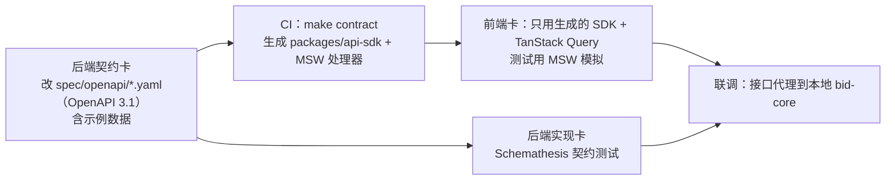
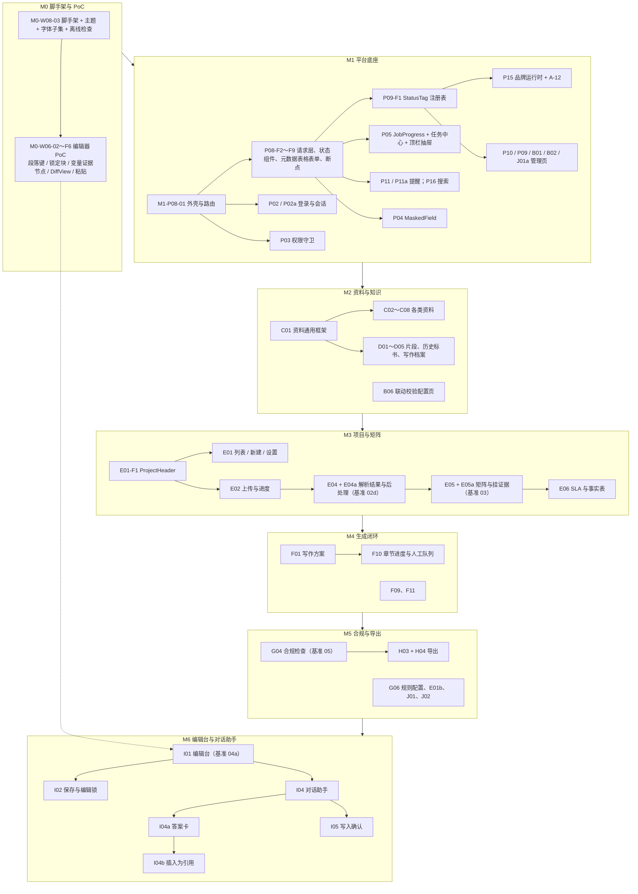

# 智能投标系统 · 前端交接文档 v1（frontend-handoff）

| 项 | 内容 |
|---|---|
| 版本 | v1（2026-10-08）；2026-10-08 按设计规范 v1.2 在原文件中修订（见“变更记录”） |
| 编写 | 前端设计工程师 bot（兼前端开发，技术方案 v1.4 第 10.2 节） |
| 读者 | 前端设计工程师 bot（自己按卡开发）、研发项目经理 bot（派卡）、后端开发工程师 bot（契约卡）、合并审批人 |
| 依据 | 设计规范 v1.2（`design-spec-v1.2.md`）；PRD v1.8；数据字典 v1.9（这两版只做入库前脱敏，需求与 PRD v1.7、字典 v1.8 相同）；技术方案 v1.4.2（第 1.3、2.8、10、11 章，附录 C）；任务卡 v1.1（M0–M1） |
| 代码仓库 | GitHub 私有仓库 `Faith-Neil/rk-ai-bid`（技术方案 v1.4.2；原占位仓库名不再使用；Java 包名不变）。本文中的 `frontend/web`、`packages/*`、`spec/openapi/`、`docs/*` 都是该仓库内的路径 |
| 示例数据 | 原型、截图、测试与 MSW 样例一律用合成数据（虚构机构名、人名、编号，页面顶栏标“合成数据 · 全部虚构”）；不使用真实项目名、真实评分表条款原话、内部《编写规范》原文、内部文档编号和本机路径 |
| 原型与截图 | `prototype/index.html`；`screenshots/`（1440×900，编辑台另有 1280、1680） |
| 组织方式 | **一张任务卡 = 一个分支 = 一个 PR；测试先行；前后端只通过 OpenAPI 契约对接**（第 2 章） |
| 状态 | 卡号为建议，由研发项目经理 bot 在里程碑规格确认时定稿；卡数与技术方案附录 C 前端卡（209 张）对齐 |

> 与《任务卡 M0–M1》的关系：其中的前端卡（M0-W08-03、M0-W06-01/02、M1-P02a-01/02、M1-P08-01）引用的是设计规范 v1，派发时把“输入”改为 v1.2 的对应章节（第 8.1 节表格）。M1-P02a-01（登录页设计卡）要求的状态已在原型 `09-login.html` 画出（错误、锁定、首次改密、会话超时、公司停用），可直接作为该卡的产出提交审阅；M0-W06-01（编辑器 PoC 设计卡）的产出是 `editor-poc/`（4 张设计稿 + README）和 `delivery/M0-W06-01.md`。

## 变更记录

| 日期 | 改动 |
|---|---|
| 2026-10-08（v1.2 修订） | ① 依据改为设计规范 v1.2、PRD v1.8、字典 v1.9、技术方案 v1.4.2；去掉本机路径，文档只写名称。② 代码仓库写明 `Faith-Neil/rk-ai-bid`。③ DoD 增加 `docs/delivery/<卡号>.md`（技术方案 11.7.4）和“只用合成数据”两项（2.4）。④ M6-I04a-F1 出现条件按 Q27 定案与 neil 2026-10-08 的结论改写：本项目数据类答案卡知识库打开或关闭都出现，本公司资料类只在打开时出现，关闭时只给提示（6.7、8.2 第 1 项）。⑤ 第 1 章补 v1.2 新截图（04e、04f、08j、08k、10a～10g、11a～11e、12a～12i、编辑器 PoC 4 张）。⑥ 第 4 章 A-03、G-02、G-03 改为有原型；第 7 章第 3 条写明这三页完整设计已在 M0 交付。⑦ 6.7 节 M6 卡数复核为 31 张，E08 给出正式卡号 M6-E08-F1。⑧ 8.2 节待定项按 PRD v1.7～v1.8 / 字典 v1.7～v1.9 的结论更新（kb_sync_status 英文代码、service_health_status、方形 Logo、密码策略、历史标书只作参考、Q27）。⑨ 原型与文档中的示例全部换成合成数据 |
| 2026-10-08（v1） | 首版 |

## 目录

1. 视觉验收基准
2. 工作方式：任务卡、测试先行、OpenAPI 契约
3. 共享组件与主题（先做）
4. 页面清单（PRD 章节、字典表、原型、复杂度、WBS）
5. 每页接口草案（供后端契约卡起草）
6. 任务卡拆分（按里程碑）
7. 开发顺序与依赖
8. 示例卡输入更新与待定事项

---

## 1. 视觉验收基准

| 级别 | 截图（`screenshots/`） | 用途 |
|---|---|---|
| **基准（neil 指定，风格不改）** | `04a-editor-assistant.png`（编辑台 + 对话助手）、`02d-parse-result.png`（解析结果三栏）、`03-response-matrix.png`（响应矩阵）、`05-compliance.png`（合规检查） | 布局分区、间距、字号、颜色、状态标签的验收依据；对应页面的 PR 必须附与基准并排的截图 |
| 补充：编辑台断点 | `04a-editor-assistant-1280.png`、`04a-editor-assistant-1680.png` | 1280 三栏紧凑、≥1680 四栏（规范 9.6） |
| 补充：v1.1 新增交互 | `02e-parse-post-drawer.png`（抽取后处理抽屉）、`03b-matrix-evidence-drawer.png`（挂证据）、`03c-matrix-sla.png`（SLA 矩阵）、`04c-editor-answer-card.png`（答案卡）、`04d-editor-answer-insert-diff.png`（插入为引用差异视图） | 新交互的结构和文案 |
| 补充：平台与登录 | `01b-topbar-notify.png`、`01c-topbar-tasks.png`、`01d-topbar-search.png`、`08e-admin-deploy.png`、`08f-admin-heartbeat-error.png`、`08g-admin-rules.png`、`08h-admin-scan-words.png`、`08i-admin-brand.png`、`09a～09e-login-*.png` | 顶栏浮层、部署状态、配置校验、规则配置、品牌、登录各状态 |
| 补充：v1.2 新增 | `04e-editor-answer-kb-off.png`（知识库关闭时问本公司资料：只给提示）、`04f-editor-answer-project-data.png`（本项目数据答案卡，含“待确认”和冲突并列）、`08d-admin-users.png` / `08j-admin-users-password-policy-error.png`（账号安全设置）、`08k-admin-brand-square-logo-error.png`（方形 Logo 分辨率不足）、`10a～10g-admin-dict-*.png`（A-03）、`11a～11e-notifications-*.png`（G-02）、`12a～12i-jobs-*.png`（G-03，含平台管理员脱敏视图）；`editor-poc/01～04-*.png`（编辑器 PoC 设计稿） | 新页面与新状态的结构和文案 |
| 其余 | `01`、`02a～02c`、`04b`、`06`、`07a～07d`、`08a～08c` | 结构参考 |

验收方法：

1. **人工并排**：页面卡的 PR 附“实现截图 | 原型截图”并排图（同宽度），逐项说明差异（技术方案 11.4.5、示例卡 AC 写法）。
2. **自动截图测试**：Playwright `toHaveScreenshot` 的基线取**该页面第一次被审批合并时的实现截图**，而不是原型截图（原型是 HTML 模拟，像素不可能一致）；之后的 PR 若改变截图须在 PR 中说明并由审批人确认更新基线。基准四页必须开启。
3. **令牌一致性**：Vitest 快照断言主题对象中的锁定令牌（功能色、AI 紫、助手紫、来源色）与规范 7.1 / 7.4 完全一致。

---

## 2. 工作方式：任务卡、测试先行、OpenAPI 契约

### 2.1 一张任务卡 = 一个分支 = 一个 PR

| 项 | 约定 |
|---|---|
| 卡号 | `M<里程碑>-<WBS>-<序号>`（技术方案 10.9）；设计卡沿用示例中的 `-01`（如 M1-P02a-01），开发卡顺延 |
| 分支 | `feat/<卡号小写>-<英文短名>`，例如 `feat/m1-p08-01-app-shell`；从 `main` 拉出，生命周期 ≤3 天（主干开发） |
| PR 标题 | Conventional Commits + 卡号，例如 `feat(web): 应用外壳与路由守卫 [M1-P08-01]` |
| 规模 | 业务代码 diff ≤400 行（不含生成的 SDK、MSW 模拟数据和测试）；超过先拆卡。S ≤150 / M ≤300 / L ≤400 |
| PR 内容 | 卡号与链接；“先失败、后通过”的测试输出摘要；页面卡附原型并排截图（第 1 章）；DoD 勾选；涉及契约问题时写“契约问题”小节（前端不改契约，由后端卡修改） |
| 合并 | CI 必需检查全绿 + Cursor Bugbot 无高严重度问题 + CODEOWNERS 中的真人 Approve；bot 不能合并（技术方案 10.8） |
| 设计先行 | 每张页面卡的“输入”写仓库内设计稿路径（`docs/design/...`，由设计交付目录同步）；没有原型的页面先出设计卡（第 6 章标“需设计卡”） |

### 2.2 测试先行（每张卡的顺序）

1. **先写失败的测试**并提交为 PR 的第一个提交：
   - 组件与 hooks：Vitest + React Testing Library + **MSW**（处理器和示例数据从 OpenAPI 生成）；
   - 规则类前端逻辑（例如 9.11 联动校验、9.12 对比度与 ΔE、9.10 掩码、5.5.3 入库状态派生、5.2.4 确认前提）：**表格驱动单测**，用例直接取规范中的示例值和边界值；
   - 页面流程：每张带页面的卡至少 1 条 Playwright E2E（`tests/e2e/`，MSW 模拟后端）；
   - 权限：按 PRD 2.3 权限矩阵做表格驱动测试（无权限时按钮隐藏、路由显示 403）。
2. 再实现，直到测试通过；PR 描述贴出“先失败、后通过”的输出摘要。
3. 覆盖率目标：页面 ≥40%，`packages/editor` ≥70%（技术方案 5 章）。
4. 只用合成数据（`tools/fixtures/`，可复用原型中的虚构示例），不读取真实样本，不调用真实模型和外网。
5. 自检：`pnpm -C frontend/web check`（eslint + tsc --noEmit + vitest run + depcruise）和 `pnpm -C frontend/web e2e:smoke`。

### 2.3 OpenAPI 契约对接

1. **契约卡先合并**：前端卡依赖对应的契约卡（技术方案 10.2 协作约定第 3 条）。第 5 章给出每页需要的资源与操作草案，供后端 bot 起草契约；最终路径、字段以合并后的契约为准。
2. **生成代码禁止手改**：`packages/api-sdk` 由 CI 生成；字段缺失、命名不一致时在前端卡中提出，由后端开一张契约修改卡。
3. **公共约定**（技术方案 2.8）：
   - 路径前缀 `/api/v1`；错误体 `{code, message, details, traceId}`，前端统一显示 `message`、可复制 `traceId`；
   - 更新带 `If-Match: <record_version>`，冲突返回 409 → 提示“内容已被他人修改”+“刷新查看”；
   - 提交类操作带 `Idempotency-Key`（前端每次用户动作生成一个 UUID，重试复用）；
   - 长任务返回 `202 + jobId`，进度经 SSE 推送，断线回退为轮询任务详情；
   - 时间一律 UTC ISO-8601，界面按 Asia/Shanghai 显示；
   - 状态字段返回**代码值**（字典第 4 章），显示名与颜色由前端状态注册表决定（规范 9.3）；
   - 敏感字段在列表与详情接口中只返回掩码值；完整值走单独的“查看完整值”接口（带原因，服务端留痕）。
4. **MSW 示例数据**：契约中的 `examples` 使用虚构数据（可复用原型数据），前端测试和 Playwright 冒烟都从这里取，保证前后端看到同一份样例。

### 2.4 完成定义（前端卡 DoD）

- [ ] 测试先失败后通过，摘要贴在 PR；`check` 与 `e2e:smoke` 通过
- [ ] 空、加载、错误、无权限四种状态齐全（规范 6.1）
- [ ] 状态显示走状态注册表，未出现硬编码的状态颜色
- [ ] 无外网资源引用（离线检查脚本通过）
- [ ] 页面卡附原型并排截图；基准四页附截图测试
- [ ] 文案与 PRD 一致（“投标截止时间”等统一叫法）
- [ ] 没有手改 `packages/api-sdk`
- [ ] PR 带 `docs/delivery/<卡号>.md`（写给 neil 学习用，中文、大白话；两部分：①交付说明——做了什么、对应哪条需求和验收标准、怎么验证的（附截图）、已知限制、后续卡；②讲解——每个设计点做什么、为什么这样设计，专业概念第一次出现时解释一句，最后写怎么打开原型或页面自己点一点；技术方案 11.7.4）。样例见设计交付 `delivery/M0-W06-01.md`
- [ ] 代码、测试、MSW 样例和截图里只有合成数据：没有真实机构名、真实项目名、真实评分表条款原话、内部《编写规范》原文、内部文档编号、本机路径、手机号 / 证件号 / 账号 / 内网地址 / 密钥

---

## 3. 共享组件与主题（先做）

页面卡开工前，以下基础件须已合并（第 7 章顺序）。“建议卡”一列对应第 6 章卡号。包位置按技术方案 11.4.5：`packages/ui` 放通用组件，`packages/editor` 放 TipTap 相关，`apps/web/src/features/<模块>` 放页面。

### 3.1 主题、字体、品牌

| # | 件 | 位置 | 规范 | 原型参考 | 要点 | 建议卡 | 规模 |
|---|---|---|---|---|---|---|---|
| T1 | 设计令牌与 `buildTheme(primary)` | `packages/ui/theme` | 7、8.1～8.3 | `assets/tokens.css`、`assets/theme.js` | 品牌令牌只有主色；`colorInfo`、功能色、AI 紫、助手紫、来源色锁定；导出 CSS 变量供业务样式使用；antd 主版本按 ADR-0021 | M0-W08-03（已有示例卡） | M |
| T2 | 思源黑体 WOFF2 子集 | `packages/ui/fonts` | 7.2 | — | Regular / Medium；字符表入库；`@font-face` 相对路径；离线检查扫描 `dist/` 无外网 URL | M0-W08-03 | 含在 T1 |
| T3 | 运行时品牌 `BrandProvider` | `apps/web/src/app` | 8.4 | `08i`、`09a` | 启动时取品牌设置 → `ConfigProvider theme={buildTheme(primary)}`；产品名、Logo（横版 / 方形版）注入 ProLayout 与 `document.title`；失败时用默认值 | M1-P15-F1 | S |
| T4 | 品牌校验函数 | `packages/ui/theme/brand-check.ts` | 9.12 | `08-admin-models.html` 中 `brandCheck()`、`contrastW()`、`dE()` | WCAG 对比度 ≥4.5；CIE76 ΔE 与 5 个锁定色（阈值常量 M0 定，建议 20）；前后端同规则，前端只做提示 | M1-P15-F1 | S |
| T5 | Keycloak 登录主题 | `deploy/keycloak-theme`（或卡中指定路径） | 6.2 G-01、8.4 第 6 条 | `09-login.html` | FreeMarker 模板 + 本地 CSS / 字体；读取品牌设置；5 种提示状态 | M1-P02a-02、M1-P02a-F3 | M |

### 3.2 外壳与导航

| # | 件 | 位置 | 规范 | 原型参考 | 要点 | 建议卡 | 规模 |
|---|---|---|---|---|---|---|---|
| S1 | `AppShell`（ProLayout） | `apps/web/src/app/layout` | 3.1～3.4、8.3 | `assets/shell.js` `AppShell`；`01-workbench.png` | 侧栏 216 / 收起 64；进入项目默认收起并记住；按权限生成菜单；面包屑；1280～1439 顶栏收紧 | M1-P08-01（已有示例卡） | L |
| S2 | 路由守卫与权限指令 | `apps/web/src/app/auth` | 6.1 权限不足 | — | 无权限路由 → 403 页；按钮级 `<Can perm>` 隐藏（不是置灰） | M1-P03-F1、F2 | M |
| S3 | 请求层 | `packages/api-sdk` 外层 hooks | 2.3 | — | TanStack Query 默认配置；401 跳登录（记住原路径）；403；404“对象已不存在或你没有查看权限”；409 冲突提示；`Idempotency-Key` 注入 | M1-P08-F2 | M |
| S4 | 通用状态组件 | `packages/ui/state` | 6.1 | — | `PageSkeleton`、`EmptyState`、`ErrorState`（带 traceId 复制）、`NoPermission`、`StaleBanner`（结果已过期）、`ReadOnlyBanner` | M1-P08-F3 | S |
| S5 | 顶栏：站内提醒 | `features/notification` | 3.3、6.2 G-02 | `01b-topbar-notify.png` | 铃铛未读数（>99 显示 99+）；下拉最近 7 条；“全部标为已读”；“查看全部”→ G-02 | M1-P11-F1、F2 | M |
| S6 | 顶栏：后台任务 | `features/job` | 3.3、6.2 G-03 | `01c-topbar-tasks.png` | 角标 = 运行中 + 排队；抽屉 420 宽四个页签；失败卡片“从失败步骤重试” | M1-P05-F3 | M |
| S7 | 顶栏：全局搜索 | `features/search` | 3.3、6.2 全局搜索 | `01d-topbar-search.png` | 输入 ≥1 字防抖 300ms；项目 / 资料两组各 5 条，高亮命中；平台管理员不渲染 | M1-P16-F1 | S |
| S8 | `ProjectHeader` 项目摘要条 + 页签 | `features/project/header` | 3.5 | `shell.js` `ProjectHeader`；基准 03、04a | 摘要条常驻；页签无“资料匹配”；“投标截止时间”倒计时 ≤3 天标红；紧凑模式（编辑台） | M3-E01-F1 | M |

### 3.3 业务通用组件

| # | 件 | 位置 | 规范 | 原型参考 | 要点 | 建议卡 | 规模 |
|---|---|---|---|---|---|---|---|
| C1 | `StatusTag`（状态注册表） | `packages/ui/status` | 9.3 | `shell.js` `UI.STATUS` / `UI.St` | 输入 `{dict, code}`；注册表覆盖 9.3 全部代码表；未知代码原样显示并在开发模式告警；单测逐表断言显示名与颜色 | M1-P09-F1 | M |
| C2 | `LevelTag`、`AiTag`、`DirectTag`、`Cite`、`SourceBar` | `packages/ui/biz` | 9.3 rule_level、9.4、9.5 | `shell.js` `LevelTag` / `AiTag` / `Cite`；`.direct-tag` | 阻断实心红；AI 紫只给 AI；答案卡用蓝色 `DirectTag`；`.cite` 用证据来源色 | M1-P08-F4 | S |
| C3 | `MaskedField` | `packages/ui/masked` | 9.10 | `07b-library-people.png` | 证件号前 3 后 4、手机号前 3 后 4、银行账号后 4（规则来自设置接口）；“查看完整值”弹窗填原因 → 调专门接口；完整值不落 localStorage / URL / 日志 | M1-P04-F1 | M |
| C4 | `JobProgress` | `packages/ui/job` | 9.7 | `02c-parse-progress.png` | 纵向 Steps + 子进度；AI 步骤紫色；SSE 订阅 + 断线轮询；“在后台运行”“取消任务”；排队原因 | M1-P05-F1、F2 | L |
| C5 | `PdfLocator`（PDF.js 原文预览） | `packages/ui/pdf` | 9.8 原文联动 | `assets/shell.js` `PdfMock`；基准 02d | 跳页 + 黄色框高亮；缩放；页内搜索；Worker 本地打包 | M3-E04-F1 | L |
| C6 | `DiffView` | `packages/editor/diff` | 9.4 第 5～6 条、9.9 | `04b-editor-diff-confirm.png`、`04d` | 段落级对照，新增绿底、删除红底删除线；“替换选中内容 / 插在选中内容后”；“我已逐字核对”勾选；W06 PoC 产出后复用 | M0-W06-F4 | L |
| C7 | 元数据驱动表格与表单 | `packages/ui/meta` | 9.1、9.2 | `07-library-kb.html` | 按字典字段元数据生成列和表单项；★ 字段、系统键两行标签；ProTable 默认 small / middle；不出现横向滚动优先 | M1-P08-F5～F7 | L |
| C8 | `CrossFieldHint`（联动校验提示） | `packages/ui/form` | 9.11 | `08f-admin-heartbeat-error.png` | 规则数组 → 就近红字 + 汇总框绿勾 / 红叉 + 保存置灰并悬停列原因；规则函数可单测 | M2-B06-F1 | S |
| C9 | `RuleIssueList`（合规问题列表） | `packages/ui/rule` | 9.3、9.8 | 基准 05 | 按等级分组；放行须填理由；点击定位原文或段落 | M5-G04-F1 | M |
| C10 | `EditLockBadge` | `packages/editor/lock` | 9.6 细节 | 基准 04a 工具栏 | 本人持有 / 他人编辑中 / 可接管；心跳按 `edit_lock_heartbeat_seconds`、只在有操作时发送；释放前 5 分钟提示 | M6-I02-F2 | M |
| C11 | `EvidenceDrawer` 骨架 | `features/matrix` | 6.2 P-06 | `03b` | 候选两组 + 已挂证据；可引用判断由后端字段给出，前端只显示原因 | M3-E05-F3 | M |

---

## 4. 页面清单

复杂度按前端工作量：**S** ≈ 1 张卡、**M** ≈ 2～3 张、**L** ≈ 4 张以上（与第 6 章卡数对应）。“WBS（前端卡）”取技术方案附录 C。表名为主要表，完整清单见规范第 5 章。

| 页面 | PRD | 主要表（字典 v1.6） | 原型 / 截图 | 复杂度 | WBS（前端卡） | 里程碑 |
|---|---|---|---|---|---|---|
| G-01 登录（Keycloak 主题） | 5.12.1 | sys_user、platform_setting | `09-login.html` · 09a～09e | M | P02a（2）、P02（2） | M1 |
| G-02 站内提醒列表 + 顶栏下拉 | 5.12.2 | notification | `11-notifications.html`（含 `#empty`、`#loading`、`#error`、`#forbidden`）· 11a～11e；下拉 `01#notify` · 01b | M | P11（2）、P11a（2） | M1 |
| 全局搜索（顶栏 + 结果页） | 5.12.3 | bid_project、各资料表名称字段、resource_acl | `01#search` · 01d | S | P16（1） | M1 |
| G-03 后台任务中心 + 顶栏抽屉 | 5.12.4 | job | `12-jobs.html`（`#queued`、`#failed`、`#detail`、`#platform` 脱敏视图、`#reconnect` 及四种通用状态）· 12a～12i；抽屉 `01#tasks` · 01c | M | P05（3）、P05a（1） | M1 |
| P-01 项目列表（工作台） | 5.1.1 | bid_project、bid_project_member | `01-workbench.html` · 01 | M | E01 | M3 |
| P-02 新建项目（含 R19） | 5.1.2 | bid_project、bid_volume、tender_file | `02#create`、`#r19` · 02a、02b | M | E01 | M3 |
| P-03 项目概览（含 P-17 折叠区） | 5.1.3、5.7.13 | bid_project、bid_volume、writing_style_metric | 无（规范 6.2） | M | E01、E01b（2） | M3 / M5 |
| P-04 招标文件上传与解析进度 | 5.2.1 | tender_file、parse_job、job | `02#upload` · 02c | M | E02（2） | M3 |
| P-05 解析结果 + 抽取后处理 | 5.2.2、5.2.4 | tender_requirement、tender_conflict、tender_scan_hit、tender_requirement_ref | `02#result`、`#conflict` · **02d（基准）**、02e | L | E04（6）、E04a（3） | M3 |
| P-06 响应矩阵 + 挂证据抽屉 | 5.3.1 | response_matrix_item、matrix_evidence | `03-response-matrix.html`、`#evidence` · **03（基准）**、03b | L | E05（6）、E05a（1） | M3 |
| P-07 SLA 矩阵 | 5.3.2 | project_sla_value、sla_template | `03#sla` · 03c | M | E06 | M3 |
| P-09 项目事实表 | 5.7.8 | project_fact | 无（规范 6.2） | M | E06（与 P-07 共 4） | M3 |
| P-18 分册分流确认 | 5.3.1 规则 8 | response_matrix_item、bid_volume | 03 页横幅入口 | S | E05 | M3 |
| P-16 项目设置 | 5.1.4 | bid_project、project_partner、project_person、project_rule_override | 无（规范 6.2） | L | E01 | M3 |
| P-10 写作方案与大纲确认 | 5.7.2 | bid_outline_node | 无（规范 6.2） | M | F01（4） | M4 |
| P-12 章节循环进度 | 5.7.6 | chapter_loop_round、chapter_check_issue | 无（规范 6.2） | M | F10 | M4 |
| P-13 人工处理队列 | 5.7.7 | chapter_check_issue | 无（规范 6.2） | M | F10 | M4 |
| 系统生成章节预览（五类） | 5.7.2 规则 1、5.11.8 | bid_outline_node、chapter_version | 无 | S | F09（2） | M4 |
| P-17 / W-03 写作观察统计 | 5.7.13 | writing_style_metric | 无 | M | F11（3） | M4 |
| P-14 合规检查 | 5.8.2、5.8.3、5.8.5 | compliance_run、compliance_issue、similarity_hit | `05-compliance.html` · **05（基准）** | L | G04（6） | M5 |
| P-15 导出 | 5.9.1、5.9.2 | bid_export、bid_project.submit_full_value_fields | `06-export.html` · 06 | M | H03（3）、H04（1） | M5 |
| P-11 编辑台 | 5.11.2～5.11.10 | chapter_version、paragraph_lock、citation、edit_lock、chapter_edit_draft | `04-editor-assistant.html` · **04a（基准）**、04a-1280 / 1680、04b | L | I01（12）、I02（4） | M6 |
| P-11 对话助手 + 答案卡 | 5.11.3～5.11.6、5.11.15 | assistant_session、assistant_message、chapter_edit_operation | `04#answer`、`#insert` · 04c、04d | L | I04（5）、I04a（2）、I04b（1）、I05（4）、I06（2）、E08（1，可选） | M6 |
| K-01 资料库首页 | 5.4.2 | 各资料表、attachment_link | `07#library` · 07a | M | C07（3） | M2 |
| K-02 / K-03 资料列表与详情（通用框架） | 5.4.1、5.4.3、5.4.4 | 各资料表、change_log | `07#library` · 07a | L | C01（5） | M2 |
| K-04 人员与人员证书 | 5.4.5 | person、person_certificate | `07#people` · 07b | M | C04（4） | M2 |
| K-05 原厂授权与授权链 | 5.4.6 | authorization、authorization_product | 无（规范 6.2） | M | C05（3） | M2 |
| K-06～K-08、K-11～K-13 公司主体、证明材料、资质、划型、附件、合规事件、工具设备 | 5.4.7 | org_entity、org_proof_doc、qualification、sme_classification、org_compliance_event、tool_asset | 用 K-02 模板 | L | C03（6） | M2 |
| K-09、K-10、K-14 SLA 模板、全局变量、业绩 | 5.4.7 | sla_template、merge_variable、contract | 用 K-02 模板 | M | C06（4） | M2 |
| 平台主数据（厂商产品、证书类别、附件槽位、划型标准） | 5.10.3 | vendor、product、cert_type、attachment_slot、sme_standard | 无 | M | C02（3） | M2 |
| 附件智能识别填表 | 5.4.4 | attachment | 无 | S | C08（2） | M2 |
| K-15 方案片段库 | 5.5.2 | solution_snippet、snippet_revision | `07#snippets` · 07c | M | D01（4） | M2 |
| K-16 历史标书导入 | 5.5.3 | bid_archive、job | `07#archive` · 07d | S | D02（2） | M2 |
| W-01 写作档案 | 5.6.2 | writing_profile 等 | 无（规范 6.2） | L | D03（6） | M2 |
| 任务卡与提示词模板 | 5.7.9、5.6.4 | task_card、prompt_template | 无 | M | D04（3） | M2 |
| W-02 风格样例 + 审查清单 | 5.6.5、5.6.4（默认审查清单） | writing_style_sample、review_checklist_item | 无 | M | D05（3） | M2 |
| A-01 公司管理、A-02 用户与角色 | 5.10.1、5.10.2 | company、sys_user、sys_role、company_setting（`password_min_length`、`password_min_char_classes`） | `08#users`、`#users-pwd-low` · 08d、08j | M | P10（3） | M1 |
| A-03 字典配置 | 5.10.3 | dict_type、dict_item、cert_type、vendor、product、attachment_slot | `10-admin-dict.html`（`#platform`、`#vendor`、`#company` 及四种通用状态）· 10a～10g | M | P09（3，含状态注册表） | M1 |
| A-08 模型登记、A-09 文档解析服务 | 6.6.1、6.6.2 | llm_model、parse_service | `08#models` · 08a | L | B01（4） | M1 |
| A-10 任务与模型对应表、A-05 模型开放 | 6.6.3、5.10.5 | task_model_route、company_model_grant | `08#routes`、`#grant` · 08b、08c | M | B02（2） | M1 |
| A-05 生成闭环与编辑台配置（联动校验） | 6.9、5.10.5 | company_setting | `08#grant-err` · 08f | M | B06（3） | M2 |
| A-04 资料库设置 | 5.10.4 | company_setting | 无 | S | C07 或 C01（随资料库） | M2 |
| A-06 审计日志、服务健康基础 | 5.10.6、6.7 | audit_log、model_call_audit、service_health | 无 | M | J01（3）、P04（2，含 MaskedField 查看留痕） | M5 / M1 |
| A-11 部署与服务状态 | 5.12.6 | service_health（`health_status` → 代码表 `service_health_status`） | `08#deploy` · 08e | S | J01a（1） | M1 |
| A-12 界面品牌 | 5.12.7 | platform_setting（`brand_logo`、`brand_logo_square` 等）、attachment | `08#brand` · 08i | M | P15（2） | M1 |
| A-07 规则配置（合规规则 + 兜底扫描词表） | 5.12.5 | compliance_rule_config、tender_scan_rule | `08#rules`、`#rules-scan` · 08g、08h | M | G06（3） | M5 |
| 集团管理员只读视图 | 5.10、2.3 | — | 无 | M | J02（2） | M5 |

---

## 5. 每页接口草案（供后端契约卡起草）

说明：下表只描述“页面需要什么数据、做哪些操作”，`operationId` 和路径是**草案**，以合并后的 `spec/openapi/*.yaml` 为准。标记：**[V]** 带 `If-Match: record_version`（409 冲突）；**[I]** 带 `Idempotency-Key`；**[J]** 返回 `202 + jobId`，进度走 SSE；**[M]** 敏感字段只返回掩码。所有列表接口支持分页、排序和本页需要的筛选参数；状态字段返回代码值。

### 5.1 全局与平台底座（M1）

| 页面 / 组件 | 读取 | 操作 |
|---|---|---|
| 会话（S1～S3） | `getSession`：用户、角色、权限点、当前公司、可切换公司（集团管理员）、`session_timeout_minutes` | `switchCompany`（集团管理员） |
| 品牌（T3、G-01、A-12） | `getBrandSettings`（**无需登录**，登录页和外壳共用）：产品名、Logo 横版 / 方形版 URL、主色 | `updateBrandSettings` [V][I]（服务端同样校验对比度与 ΔE，返回字段级错误）；`uploadBrandLogo`（PNG / SVG ≤200KB）；`resetBrandSettings` [I] |
| G-01 登录 | Keycloak 内置流程；主题渲染时读品牌设置 | 统一错误、锁定剩余分钟、首次改密（Keycloak 必需操作）、公司停用由认证服务返回错误码，主题按码显示文案 |
| G-02 站内提醒 | `listNotifications`（类型 `notification_type`、已读、项目、时间）；`getUnreadNotificationCount` | `markNotificationRead` / `markNotificationUnread`；`markAllNotificationsRead` [I]；跳转目标由 `targetType + targetId` 给出，目标无权限时 404 |
| 全局搜索 | `globalSearch`（关键词、分组 `project` / `kb`、每组条数）：名称、高亮区间、类型、所属分类 | — |
| G-03 后台任务 | `listJobs`（页签 = `job_status`、`job_type`、项目、发起人）；`getJob`（步骤、子进度、排队原因、错误码、重试记录）；SSE `subscribeJobEvents`；平台管理员调用 `listJobsMasked`（只返回脱敏摘要） | `retryJob` [I]（从失败步骤）；`cancelJob` [I]；按钮可用性由响应中的 `allowedActions` 决定 |
| C3 MaskedField | 各详情接口只返回掩码 [M] | `revealSensitiveField` [I]（字段键、对象、原因；返回一次性完整值，服务端写审计） |
| A-01 / A-02 | `listCompanies`、`listUsers`（`user_status`、角色）、`listRoles` | `createCompany` [I]、`setCompanyStatus` [V]；`createUser` [I]、`updateUser` [V]、`setUserStatus` [V]、`unlockUser` [I]、`resetUserPassword` [I]、`transferUserItems`（停用前转交） |
| A-03 字典 | `listDictTypes`、`listDictItems` | `createDictItem` [I]、`updateDictItem` [V]、`disableDictItem` [V] |
| A-08 / A-09 | `listLlmModels`、`getLlmModel`（配置版本）、`listParseServices`；`service_status` | `createLlmModel` [I]、`updateLlmModel` [V]（生成新配置版本）、`testLlmModelConnection` [J]、`rollbackLlmModelConfig` [V]、`setServiceStatus` [V]；解析服务同理 |
| A-10 / A-05 模型 | `listTaskModelRoutes`（21 类任务、首选、备用、只能本地标记）；`listCompanyModelGrants` | `updateTaskModelRoute` [V]（服务端校验“首选本地 → 备用只能本地”）；`updateCompanyModelGrants` [V] |
| A-11 部署与服务状态 | `listServiceHealth`（分组 `service_kind`、`health_status`（`service_health_status`：ok / error / unknown / disabled）、最近检测时间、耗时、错误摘要、并发与排队）；`getServiceHealthHistory`（24 小时）；`getPlatformSettings` | `runHealthCheck` [J]（单个或全部）；`updatePlatformSettings` [V]（会话、锁定、检测间隔、任务保留天数） |

### 5.2 资料库、知识与写作档案（M2）

| 页面 | 读取 | 操作 |
|---|---|---|
| K-01 首页 | `getKbHealthSummary`（临期、过期、未确认、需重新确认、待审、在投项目缺资料） | `remindMissingKb` [I]（催办） |
| K-02 / K-03 通用 | `listKbRecords`（分类、有效期 `validity_status`、确认 `confirm_status`、主体、关键词）；`getKbRecord`（字段元数据 + 值、附件槽位、来源、变更历史、被引用情况）；`getFieldMetadata`（元数据驱动表单） | `createKbRecord` [I]、`updateKbRecord` [V]（★ 字段修改后服务端清空确认）、`confirmKbRecord` [V]、`batchConfirmKbRecords` [I]（星号类不提供）、`submitKbReview` / `approveKbReview` / `rejectKbReview` [V]、`importKbExcel` [J]、`recognizeAttachment` [J]（C08 智能识别填表） |
| K-04 人员 | `getPerson` [M]、`listPersonCertificates`、`listPersonAssignments`（占用） | 同 K-03；`revealSensitiveField` |
| K-05 授权链 | `getAuthorizationChain`（节点：出具方、有效期、产品、地域、满足与否） | 同 K-03 |
| K-15 片段 | `listSnippets`、`getSnippetRevision`、`diffSnippetRevisions` | `createSnippet` [I]、`updateSnippetDraft` [V]、`publishSnippet` [V]（R31 拦截返回原因列表）、`resyncSnippet` [J] |
| K-16 历史标书 | `listArchives`（`parse_status`、`kb_sync_status`、派生 `archive_kb_display` 由前端按 5.5.3 计算或后端返回，契约卡二选一） | `importArchives` [J]、`resyncArchive` [J]（不重解析）、`extractSnippetFromArchive` [I] |
| W-01 写作档案 | `getWritingProfile`（版本、各页签内容、引用变量校验结果） | `updateWritingProfileDraft` [V]、`publishWritingProfile` [V]、`rollbackWritingProfile` [V]、`previewWritingProfile` |
| 任务卡、W-02、审查清单 | `listTaskCards`、`listStyleSamples`、`listReviewChecklistItems` | 各自的创建 [I]、更新 [V]、发布 [V]、启用开关 [V] |
| A-05 编辑台配置 | `getCompanySettings`（含平台上下限） | `updateCompanySettings` [V]（服务端执行 9.11 三条校验，返回字段级错误码） |

### 5.3 项目、解析、矩阵（M3）

| 页面 | 读取 | 操作 |
|---|---|---|
| P-01 项目列表 | `listProjects`（只看我参与的、状态 `project_status`、投标截止时间范围）；`getWorkbenchStats`（6 张卡） | — |
| P-02 新建 | `checkRelatedBidding`（R19 关联投标检查） | `createProject` [I]（含敏感标记、主体、大类、模板） |
| P-03 概览 | `getProjectOverview`（待办、分册进度、最近导出、写作观察统计） | `registerSubmission` / `registerOpening` / `registerResult` [V]；`cancelProject` [V] |
| P-16 设置 | `getProjectSettings`（成员、合作方、拟派人员、SLA 取值、规则覆盖、闭环参数、分册、导出设置含 `submit_full_value_fields`） | 各分组 `update*` [V]；`setSubmitFullValueFields` [V]（仅项目负责人，须填依据） |
| P-04 上传 | `listTenderFiles`（版本链、`tender_parse_status`） | `uploadTenderFile` [I][J]（按 SHA-256 复用）；`reparseTenderFile` [J]；`uploadAddendum` [J] |
| P-05 解析结果 | `listRequirements`（类别、重要性、`requirement_status`、合并 / 有效状态、置信度、页码）；`getPostProcessSummary`（合并组数、经引用补齐数、词表版本、三个入口计数、确认前提）；`listConflicts`、`listScanHits`、`listUnresolvedRefs`；`getParseBlocks`（原文定位） | `updateRequirement` [V]；`confirmRequirement` [V]；`batchConfirmRequirements` [I]（星号 / 废标 / 资格不允许）；`splitMergedRequirement` [V]；`chooseConflict` [V]（选定方或不构成冲突 + 理由必填）；`addScanHitAsRequirement` [I]；`excludeScanHit` [V]（理由必填）；`setRefTarget` [V]；`confirmParseResult` [I]（服务端再校验确认前提，不满足返回未满足项列表） |
| P-06 响应矩阵 | `listMatrixItems`（`matrix_item_status`、`matrix_risk_flag`、`response_type`、分册、负责人）；`listEvidenceCandidates`（行 ID → 结构化候选含可引用判断与原因、片段候选、历史标书参考）；`listMatrixEvidence` | `updateMatrixItem` [V]；`attachEvidence` / `detachEvidence` [V]；`autoMatchEvidence` [J]（多行）；`confirmMatrixItems` [I]；`exportMatrixExcel` [J] |
| P-18 分流 | `getVolumeRoutingProposal` | `confirmVolumeRouting` [V]；`suggestVolumeRouting`（分册负责人提建议） [I] |
| P-07 SLA | `listProjectSlaValues`（招标要求值、承诺值、公司最严值、判定） | `applyTenderSlaValues` [I]；`updateProjectSlaValue` [V]；`exportSlaCommitment` [J] |
| P-09 事实表 | `listProjectFacts`（`fact_confirm_status`、引用来源） | `confirmProjectFact` [V]；`updateProjectFact` [V]（引用型事实不可改，服务端拒绝） |

### 5.4 生成、合规、导出（M4～M5）

| 页面 | 读取 | 操作 |
|---|---|---|
| P-10 写作方案 | `getOutlinePlan`（大纲树、章节类型、负责人、增值标记、本节写作方案） | `updateOutlineNode` [V]（拖动排序、分配）；`markNotApplicable` [V]（星号 / 废标行不允许）；`confirmOutlinePlan` [I]；`startGeneration` [J] |
| P-12 循环进度 | `getChapterLoop`（轮次、停止原因、模型、任务卡版本）；`diffChapterVersions` | `retryChapterLoop` [J] |
| P-13 人工处理 | `listHumanQueue`（按原因分组）；`getHumanQueueItem` | `resolveIssueByEdit` [V]；`recheckChapter` [J] |
| P-14 合规检查 | `getComplianceRun`（`compliance_run_status`、`compliance_conclusion`、过期标记）；`listComplianceIssues`（`rule_level`、`compliance_issue_status`、定位）；`listSimilarityHits`（段落相似度） | `startComplianceRun` [J]；`waiveIssue` [V]（警告级，理由必填；阻断级服务端拒绝）；`updateSimilarityHit` [V]；分册 `startVolumeCheck` [J]、`finalizeVolume` [V]、`unlockVolume` [V] |
| P-15 导出 | `getExportPreconditions`；`listExports`（`export_status`）；`getExportMaskPreview`（已确认的完整值类别、确认人、依据） | `createExport` [I][J]（类型内部稿 / 递交版；递交版仅项目负责人，服务端校验）；`downloadExport`（预签名链接，排队 / 生成中不可用） |
| A-07 规则配置 | `listComplianceRuleConfigs`（级别、启用、不可关闭标记、参数定义与取值、来源、版本）；`getRuleConfigHistory`；`listScanRules`（生效版本、草稿）；平台范围 `listPlatformRuleDefaults` | `updateComplianceRuleConfig` [V]（R43 不允许阻断、不可关闭规则拒绝关闭）；`resetRuleToPlatformDefault` [V]；`createScanRule` [I]、`updateScanRule` [V]；`trialScan`（样例文本 → 命中列表，不保存）；`publishScanRules` [V] |
| A-06 审计 | `listAuditLogs`（`audit_action`、用户、对象、是否云端调用、公司）；`getModelCallAudit` | —（只读） |

### 5.5 编辑台与对话助手（M6）

| 区域 | 读取 | 操作 |
|---|---|---|
| 编辑台正文 | `getChapterForEdit`（版本、段落键、来源、锁定段落、变量、证据节点、问题标注、`loop_status`）；`getEditLock` | `acquireEditLock` [I]；`heartbeatEditLock`（间隔取 `edit_lock_heartbeat_seconds`，只在有操作时）；`releaseEditLock`；`takeOverEditLock` [I]（原因必填）；`saveChapterDraft` [V]（自动保存）；`submitChapterVersion` [V][I]；`listChapterVersions` / `diffChapterVersions` / `revertChapterVersion` [V] |
| 问题 / 来源侧栏 | `listChapterIssues`；`listParagraphSources` | `recheckParagraphs` [J]（增量复查） |
| 对话助手 | `listAssistantMessages`；SSE `streamAssistantReply`（模型标识、降级提示） | `askAssistant` [I]（选区、意图、写法）；`writeAssistantSuggestion` [V][I]（替换 / 插在后；须差异确认、必要时逐字核对） |
| 答案卡 | 消息类型“答案卡”：对象类型 `answer_card_domain`、意图、词表版本、记录（字段、版本、确认状态、有效期、截止前到期、可引用与原因）[M] | `insertAnswerCard` [V][I]（记录 ID、插入方式、选区段落键；服务端生成插入文字、写 `citation`、记编辑方式“插入答案卡”、触发增量复查）；`rejectAnswerCard`（改为检索）；`askFollowUp` [I]。**出现条件**按 PRD 5.11.15（知识库开关打开），〔待定〕见第 8 章 |

---

## 6. 任务卡拆分（按里程碑）

规则：

- 卡数与技术方案附录 C 的前端卡一致：M0 7、M1 42、M2 51、M3 29、M4 17、M5 20、M6 31、M7 4、M8 8，合计 **209**。设计卡、Playwright E2E 测试卡另计（技术方案 10.4）。
- **卡号**：已有示例卡保留原号（M0-W08-03、M0-W06-02、M1-P02a-02、M1-P08-01）；其余用 `M<m>-<WBS>-F<n>` 占位（同一 WBS 的后端卡与前端卡共用序号，真实序号由研发项目经理 bot 分配）。
- 每张卡的“先写的测试”是 PR 第一个提交的内容；“契约依赖”是必须先合并的后端契约（第 5 章 operationId 草案）。
- 风险等级：涉及权限、敏感字段、导出的卡标“高”（开工前须人确认计划，技术方案 10.8），其余为中 / 低。

### 6.1 M0（7 张）

| 卡号 | 标题 | 输入 | 先写的测试 | 契约依赖 | 规模 | 风险 |
|---|---|---|---|---|---|---|
| M0-W01-F1 | 前端侧需求澄清：规范 v1.1 对照 PRD、字典的问题清单闭环（文档卡） | 规范 11.2、11.3 | 不适用 | 无 | S | 低 |
| M0-W08-03 | 前端 monorepo 脚手架与离线资源检查（已有示例卡） | 规范 7、8；`assets/` | 主题快照（锁定令牌）；断网构建后无外网请求（Playwright） | 无 | M | 中 |
| M0-W06-02 | 编辑器 PoC：段落键稳定与锁定块（已有示例卡） | 设计卡 M0-W06-01；规范 9.4～9.6 | fast-check 属性测试：50 种随机操作后段落键不变；锁定块拒绝修改 | 无 | L | 中 |
| M0-W06-F3 | 编辑器 PoC：变量节点与证据节点（原子性） | 规范 7.1 编辑器内联标记、9.5；04a | 变量 / 证据节点不可被部分选中删除；复制粘贴保留属性 | 无 | M | 中 |
| M0-W06-F4 | 编辑器 PoC：DiffView 差异视图（段落级） | 规范 9.4 第 5～6 条、9.9；04b、04d | 段落新增 / 删除 / 修改三类对照渲染快照；“替换 / 插在后”两种结果 | 无 | L | 中 |
| M0-W06-F5 | 编辑器 PoC：粘贴拦截（外部格式清洗、锁定区拒绝） | PRD 5.11.8；规范 9.4 | 粘贴 Word / 网页 HTML 后只保留允许的标记；锁定区粘贴被拒 | 无 | M | 中 |
| M0-W06-F6 | 编辑器 PoC：演示集成与长章节性能基准 | 规范 9.6；04a | Playwright 演示路径 1 条；200 段落章节输入延迟基准（记录数值，不设门槛） | 无 | M | 低 |

### 6.2 M1（42 张）

| 卡号 | 标题 | 输入 | 先写的测试 | 契约依赖 | 规模 | 风险 |
|---|---|---|---|---|---|---|
| M1-P08-01 | ProLayout 布局、路由、权限守卫、请求层（已有示例卡） | 规范 3.1～3.4、6.1、8.3；01、01b～d | 角色 → 菜单表格驱动；403 页；409 / 401 处理 | `getSession` | L | 中 |
| M1-P08-F2 | 请求层细化：错误体、traceId 复制、Idempotency-Key 注入、重试策略 | 规范 9.8；交接 2.3 | MSW 模拟 409 / 422 / 500；同一动作重试复用同一 Key | `getSession` | M | 中 |
| M1-P08-F3 | 通用状态组件（骨架、空态、错误、无权限、已过期、只读） | 规范 6.1 | 组件快照 + 可访问性断言 | 无 | S | 低 |
| M1-P08-F4 | 业务小组件：LevelTag、AiTag、DirectTag、Cite、SourceBar | 规范 9.3 rule_level、9.4、9.5 | 颜色取锁定令牌；AI 紫只出现在 AiTag | 无 | S | 低 |
| M1-P08-F5 | 元数据驱动表格（ProTable 封装、列合并、无横滚优先） | 规范 9.1；07a | 元数据 → 列配置单测；1280 宽无横向滚动（Playwright） | `getFieldMetadata` | L | 中 |
| M1-P08-F6 | 元数据驱动表单（★ 字段、系统键两行标签、不支持字段置灰） | 规范 9.2 | 元数据 → 表单项单测；★ 字段修改提示 | `getFieldMetadata` | L | 中 |
| M1-P08-F7 | 表单通用：底部保存条、离开未保存提示、就近报错 | 规范 9.2 第 5～6 条 | 未保存离开拦截；服务端字段级错误映射到表单项 | 无 | M | 低 |
| M1-P08-F8 | 主题运行时接口位与离线检查纳入 CI（应用级） | 规范 7、8.4 | 应用构建产物离线扫描；`buildTheme` 换主色后锁定令牌不变 | 无 | S | 低 |
| M1-P08-F9 | 断点与侧栏记忆（1280 / 1440 / 1680）、面包屑 | 规范 3.1、3.4、7.3 | 三种宽度截图；进入项目侧栏收起并记住 | 无 | M | 低 |
| M1-P02-F1 | OIDC 登录跳转、会话续期、401 回登录并返回原页 | PRD 5.12.1；规范 6.2 G-01 | 401 → 登录 → 回原路径（Testcontainers Keycloak 或 MSW） | `getSession` | M | 高 |
| M1-P02-F2 | 会话超时处理、用户菜单与退出登录 | PRD 5.12.1 入口；规范 3.3 | 超时后提示并跳转；退出清空本地状态 | `getSession` | S | 中 |
| M1-P02a-02 | Keycloak 自定义登录主题（离线；错误、锁定、超时，已有示例卡） | `09-login.html`；09a、09b、09d | Playwright：输错 → 统一提示；断网完整渲染 | 无（Keycloak 内置） | M | 中 |
| M1-P02a-F3 | 登录主题：首次登录强制改密、公司停用提示、读取品牌设置 | 09c、09e；规范 8.4 第 6 条 | 首次登录必须改密才进入；品牌主色 / Logo 随设置变化 | `getBrandSettings` | M | 中 |
| M1-P03-F1 | 路由守卫与 403 页 | 规范 6.1 权限不足 | 表格驱动：无权限路由显示 403、不请求数据 | `getSession` | M | 高 |
| M1-P03-F2 | 权限指令 `<Can>` 与按钮隐藏 | PRD 2.3 | 表格驱动：各角色按钮可见性与权限矩阵一致 | `getSession` | S | 高 |
| M1-P03-F3 | 数据权限的前端表现：只读态切换（项目 / 分册 / 章节） | 规范 9.8 只读态 | 只读成员与集团管理员看到文本而非控件 | `getSession` | M | 中 |
| M1-P04-F1 | MaskedField 与“查看完整值”弹窗（原因必填） | 规范 9.10；07b | 掩码规则表格驱动（3+4、3+4、后 4）；完整值不写入 storage / URL（断言） | `revealSensitiveField` | M | 高 |
| M1-P04-F2 | 掩码规则读取与查看留痕提示 | 规范 9.10 | 规则变化后显示随之变化 | `getCompanySettings` | S | 高 |
| M1-P05-F1 | JobProgress：步骤、子进度、AI 紫进度条 | 规范 9.7；02c | 各 `job_status` 渲染；AI 步骤颜色 | `getJob` | M | 中 |
| M1-P05-F2 | JobProgress：SSE 订阅、断线提示与轮询回退 | 规范 9.7 第 6 条 | 模拟 SSE 断开 → 提示 → 轮询 → 恢复 | `subscribeJobEvents`、`getJob` | M | 中 |
| M1-P05-F3 | 任务中心页基础 + 顶栏任务角标与抽屉 | 规范 3.3、6.2 G-03；01c | 角标 = 运行中 + 排队；抽屉四页签；重试按钮按 `allowedActions` | `listJobs`、`retryJob`、`cancelJob` | L | 中 |
| M1-P05a-F1 | 平台管理员脱敏视图；从失败步骤重试、取消权限 | PRD 5.12.4 | 平台管理员看不到项目名、文件名，无重试 / 取消 | `listJobsMasked` | M | 高 |
| M1-P09-F1 | StatusTag 状态注册表（9.3 全部代码表） | 规范 9.3；`shell.js` `UI.STATUS` | 逐表断言代码 → 显示名 → 颜色；未知代码告警 | 无 | M | 低 |
| M1-P09-F2 | A-03 字典配置页 | 规范 6.2 A-03 | 已使用代码只能停用 | `listDictTypes`、`listDictItems` 等 | M | 低 |
| M1-P09-F3 | 扩展字段与公司设置键表单框架 | 字典 4.10；规范 9.2 | 设置键元数据 → 表单；越界提示平台上下限 | `getCompanySettings` | M | 中 |
| M1-P10-F1 | A-01 公司管理 | 规范 6.2 A-01 | 停用二次确认 | `listCompanies`、`createCompany`、`setCompanyStatus` | M | 中 |
| M1-P10-F2 | A-02 用户列表、新增、停用前转交；“账号安全设置”面板（公司密码策略，只能调严） | 08d、08j；规范 9.14 | 停用前未转交不能停用；低于默认值（8 位 / 3 类）不能保存，服务端同样拒绝 | `listUsers`、`createUser`、`transferUserItems` | M | 中 |
| M1-P10-F3 | A-02 角色分配、解锁、重置密码 | 08d（锁定用户、解锁） | `user_status` = locked 显示“解锁” | `unlockUser`、`resetUserPassword` | M | 高 |
| M1-P11-F1 | 顶栏铃铛与未读数 | 01b | >99 显示 99+；轮询间隔 | `getUnreadNotificationCount` | S | 低 |
| M1-P11-F2 | 提醒下拉：最近 7 条、标已读、全部已读 | 01b | 点击跳转并标已读 | `listNotifications`、`markNotificationRead` | M | 低 |
| M1-P11a-F1 | G-02 站内提醒列表页（筛选、已读 / 未读、合并显示） | 规范 6.2 G-02 | 无渠道设置项；合并更新显示 | `listNotifications`、`markAllNotificationsRead` | M | 低 |
| M1-P11a-F2 | 17 类提醒的跳转目标映射与“对象已不存在”提示 | PRD 5.12.2；字典 `notification_type` | 17 类逐一映射；404 显示提示 | 同上 | S | 低 |
| M1-P15-F1 | BrandProvider 运行时主题 + 品牌校验函数（对比度、ΔE） | 规范 8.4、9.12 | 校验函数表格驱动（默认色、低对比、近 AI 紫、近错误红）；换主色锁定令牌不变 | `getBrandSettings` | M | 中 |
| M1-P15-F2 | A-12 界面品牌页（表单 + 预览 + 恢复默认） | 08i；规范 6.2 A-12 | 不满足校验时保存置灰；预览只影响局部 | `updateBrandSettings`、`uploadBrandLogo` | M | 中 |
| M1-P16-F1 | 全局搜索：顶栏下拉与结果页 | 01d；规范 6.2 全局搜索 | 平台管理员不渲染；高亮；空结果文案 | `globalSearch` | M | 中 |
| M1-B01-F1 | A-08 模型列表与 `service_status` | 08a | 状态颜色；不可用模型不可选为首选 | `listLlmModels` | M | 低 |
| M1-B01-F2 | 模型登记表单（不支持字段置灰）与测试连接 | 08a；PRD 6.2.1 | 不支持字段置灰并写原因；测试连接走任务 | `createLlmModel`、`testLlmModelConnection` | L | 中 |
| M1-B01-F3 | 模型配置版本与回滚 | PRD 6.6.1 | 回滚生成新版本 | `rollbackLlmModelConfig` | M | 中 |
| M1-B01-F4 | A-09 文档解析服务（云端 / 本地两组页签） | 规范 6.2 A-09 | 云端“可用于敏感内容”固定为否 | `listParseServices` 等 | M | 中 |
| M1-B02-F1 | A-10 任务与模型对应表（首选本地 → 备用只列本地） | 08b；PRD 6.2.1 | 备用下拉过滤规则表格驱动 | `listTaskModelRoutes`、`updateTaskModelRoute` | M | 高 |
| M1-B02-F2 | A-05 公司模型开放 | 08c | 平台未启用的服务不可开放 | `listCompanyModelGrants`、`updateCompanyModelGrants` | M | 中 |
| M1-J01a-F1 | A-11 部署与服务状态页 | 08e；规范 6.2 A-11 | 健康显示派生（正常 / 异常 / 未检测 / 已停用）；无启停按钮 | `listServiceHealth`、`runHealthCheck`、`updatePlatformSettings` | M | 中 |

### 6.3 M2（51 张）

| WBS（卡数） | 卡（F1…Fn） | 输入 | 先写的测试（每张卡至少） | 契约依赖 |
|---|---|---|---|---|
| B06（3） | F1 CrossFieldHint 组件与 9.11 规则函数；F2 A-05 生成闭环参数；F3 编辑台与对话助手参数（自动保存、心跳 15～120、锁超时） | 规范 9.11；08c、08f | 三条规则表格驱动（10/60/30 通过；90/60 失败；60×10>8 分钟失败；锁超时 5 分钟失败）；不满足时保存置灰 | `getCompanySettings`、`updateCompanySettings` |
| C01（5） | F1 资料列表通用页；F2 资料详情通用页（附件槽位、来源）；F3 确认 / 审核状态机界面（★ 字段重确认）；F4 受限资料与转交；F5 变更历史与被引用情况 | PRD 5.4.1～5.4.4；规范 6.2 K-03；07a | 可引用判定的显示（未确认、过期、缺协议各一例）；★ 字段修改后确认清空 | `listKbRecords`、`getKbRecord`、`confirmKbRecord` 等 |
| C02（3） | F1 厂商产品树；F2 证书类别与附件槽位；F3 中小企业划型标准 | PRD 5.10.3 | 树节点增删改与停用 | 平台主数据接口 |
| C03（6） | F1 公司主体（含关联关系）；F2 证明材料；F3 资质证书；F4 安全与合规事件；F5 工具与设备；F6 附件库 | PRD 5.4.7；K-02 模板 | 每类列表 + 详情 E2E 1 条 | 同 C01（分类参数） |
| C04（4） | F1 人员列表；F2 人员详情（MaskedField）；F3 人员证书；F4 占用（R12）与离职提示 | PRD 5.4.5；07b；规范 9.10 | 证件号显示 `000***********0001`；离职人员红条 | `getPerson`、`revealSensitiveField` |
| C05（3） | F1 授权列表；F2 授权详情；F3 授权链图（不满足节点标红、上游未登记虚线） | PRD 5.4.6；规范 6.2 K-05 | 链条节点状态渲染快照 | `getAuthorizationChain` |
| C06（4） | F1 业绩列表与详情；F2 业绩成员与产品；F3 SLA 模板（等级、变量）；F4 全局变量 | PRD 5.4.7 | SLA 变量单位校验提示 | 资料接口 |
| C07（3） | F1 资料库首页健康度卡片；F2 Excel 批量导入与逐条 / 按批确认；F3 有效期提醒与 A-04 资料库设置 | PRD 5.4.2、5.10.4；07a | 卡片点击带筛选跳转；批量确认不含星号类 | `getKbHealthSummary`、`importKbExcel` |
| C08（2） | F1 附件识别上传与进度；F2 识别结果核对（“待核对”标记） | PRD 5.4.4 | 识别字段标“待核对”，核对后消失 | `recognizeAttachment` |
| D01（4） | F1 片段列表；F2 片段编辑（变量校验）；F3 版本对比与发布（R31 拦截原因）；F4 同步状态与重新同步 | PRD 5.5.2；07c | 发布被拦截时列出原因；`kb_sync_status` 显示 | 片段接口 |
| D02（2） | F1 历史标书单个 / 批量导入；F2 入库状态派生显示与摘取为片段 | PRD 5.5.3；07d | 派生表 6 种组合表格驱动；同步失败只给“重新同步” | `listArchives`、`importArchives`、`resyncArchive` |
| D03（6） | F1 版本条（发布、回滚）；F2 章节模板；F3 叫法术语、语气称呼；F4 句式规则；F5 Word 模板与导出命名；F6 预览抽屉 | PRD 5.6.2；规范 6.2 W-01（需设计卡） | 引用不存在变量时发布禁用并列原因 | 写作档案接口 |
| D04（3） | F1 任务卡列表与版本；F2 提示词模板编辑与发布校验；F3 平台默认与公司覆盖对照 | PRD 5.7.9、5.6.4 | 发布校验失败原因列表 | 任务卡接口 |
| D05（3） | F1 审查清单；F2 风格样例卡片墙（启用开关）；F3 入库脱敏扫描结果展示 | PRD 5.6.4、5.6.5；规范 6.2 W-02 | 未脱敏样例不能启用 | 样例接口 |

### 6.4 M3（29 张）

| WBS（卡数） | 卡（F1…Fn） | 输入 | 先写的测试 | 契约依赖 |
|---|---|---|---|---|
| E01（7） | F1 ProjectHeader 摘要条与页签（无“资料匹配”）；F2 项目列表；F3 新建项目与 R19 提示；F4 项目概览（待办、分册、状态操作）；F5 项目设置：基本、成员、合作方；F6 项目设置：拟派人员、SLA 取值、规则覆盖；F7 项目设置：分册、闭环、导出设置（`submit_full_value_fields`，仅项目负责人） | 规范 3.5、6.2 P-03 / P-16；01、02a、02b；基准 03 摘要条 | 投标截止时间倒计时 ≤3 天标红；页签按权限；完整值类别只有项目负责人可勾选 | `listProjects`、`createProject`、`getProjectOverview`、`getProjectSettings` 等 |
| E02（2） | F1 招标文件上传与版本链；F2 解析进度页（JobProgress 接入） | 02c；规范 9.7 | 上传后进入进度；失败显示原因与重试 | `uploadTenderFile`、`listTenderFiles` |
| E04（6） | F1 PdfLocator（PDF.js 本地 Worker、跳页高亮）；F2 解析结果三栏布局与分类树；F3 条目卡片编辑与逐条确认；F4 批量确认（星号 / 废标 / 资格禁用）与置信度高亮；F5 重抽不覆盖与补遗差异；F6 “确认解析结果”闸门（悬停列未满足项） | **基准 02d**；规范 6.2 P-05 | 闸门条件表格驱动（冲突待处理、遗漏未处理、星号未确认各一例）；与 02d 并排截图 | `listRequirements`、`getParseBlocks`、`confirmParseResult` |
| E04a（3） | F1 后处理条与合并条目（“已合并 N 条 · 拆分”、多位置切换）；F2 冲突待选定页签（并列取值、理由必填）；F3 疑似遗漏（无批量、排除须理由）与引用未解析页签 | 02e；PRD 5.2.4 | 无批量按钮断言；理由为空不能保存；“已按补遗处理”不阻断 | `getPostProcessSummary`、`listConflicts`、`chooseConflict`、`listScanHits` 等 |
| E05（6） | F1 矩阵表格与筛选（风险提示）；F2 行编辑（响应方式、要点、负责人）；F3 EvidenceDrawer；F4 批量智能匹配与逐行确认；F5 P-18 分册分流确认；F6 Excel 导出与确认闸门 | **基准 03**；03b；规范 6.2 P-06 | 状态与风险分开显示（证据失效行）；与 03 并排截图 | `listMatrixItems`、`listEvidenceCandidates`、`attachEvidence` 等 |
| E05a（1） | F1 挂证据候选的三路显示（结构化规则匹配 / 片段检索 / 历史标书仅参考） | 03b；PRD 5.3.1 规则 2、11 | 历史标书候选不可勾选（见 11.2 第 11 项，结论变化时改条件） | `listEvidenceCandidates` |
| E06（4） | F1 SLA 矩阵表与判定；F2 模板取值与承诺函导出；F3 项目事实表；F4 “需复核”传播提示 | 03c；规范 6.2 P-07 / P-09 | 判定五种结果表格驱动 | `listProjectSlaValues`、`listProjectFacts` |

### 6.5 M4（17 张）

| WBS（卡数） | 卡（F1…Fn） | 输入 | 先写的测试 | 契约依赖 |
|---|---|---|---|---|
| F01（4） | F1 大纲树（拖动、分配负责人、增值标记）；F2 本节写作方案卡片；F3 招标原文预览联动与 R26 提示；F4 确认大纲与开始生成 | 规范 6.2 P-10（需设计卡） | 星号 / 废标行不能标“不适用” | `getOutlinePlan`、`confirmOutlinePlan`、`startGeneration` |
| F09（2） | F1 五类系统生成章节预览；F2 锁定提示与“去数据源修改” | PRD 5.11.8 | 系统生成章节不可编辑 | 章节接口 |
| F10（8） | F1 章节列表（编辑台入口）；F2 章节循环进度页；F3 轮次时间线；F4 版本对比（复用 DiffView）；F5 人工处理队列列表；F6 队列详情单段编辑；F7 一键重新检查；F8 异常中断与重试 | 规范 6.2 P-12 / P-13（需设计卡） | 异常中断显示重试；队列空态 | `getChapterLoop`、`listHumanQueue`、`recheckChapter` |
| F11（3） | F1 W-03 公司级写作观察统计；F2 P-17 项目级折叠区；F3 图表组件（AntV G2，待技术确认） | PRD 5.7.13 | 无阈值、无告警色、不排名 | 统计接口 |

### 6.6 M5（20 张）

| WBS（卡数） | 卡（F1…Fn） | 输入 | 先写的测试 | 契约依赖 |
|---|---|---|---|---|
| G04（6） | F1 RuleIssueList；F2 合规检查页布局与结论条；F3 警告放行（理由必填，阻断无放行）；F4 R18 段落相似度并排对比；F5 分册检查 / 定稿 / 解锁 / 交叉复核；F6 全文检查与“结果已过期”提示 | **基准 05**；规范 6.2 P-14 | 阻断级无放行按钮；R24 文案含“估算”；与 05 并排截图 | `getComplianceRun`、`listComplianceIssues`、`waiveIssue` 等 |
| G06（3） | F1 合规规则页签（不可关闭锁、R43 无阻断）；F2 规则参数、恢复平台默认、修改历史；F3 兜底扫描词表（草稿、试扫、发布） | 08g、08h；规范 6.2 A-07 | 不可关闭规则开关置灰；试扫高亮命中计数 | `listComplianceRuleConfigs`、`trialScan`、`publishScanRules` 等 |
| H03（3） | F1 导出前提检查；F2 导出类型、模板与命名；F3 导出历史与下载（`export_status` 含排队） | 06；规范 6.2 P-15 | 排队、生成中下载置灰 | `getExportPreconditions`、`createExport`、`listExports` |
| H04（1） | F1 递交版：仅项目负责人可见、已确认完整值类别展示、内部稿掩码说明 | 规范 9.10、6.2 P-15 | 非项目负责人看不到递交版选项；内部稿无脱敏开关 | `createExport`、`getExportMaskPreview` |
| E01b（2） | F1 工作台 6 张统计卡（点击即筛选）；F2 概览底部折叠区 | 01；规范 3.5 | 卡片计数与筛选联动 | `getWorkbenchStats`、`getProjectOverview` |
| J02（2） | F1 集团管理员公司切换与只读视图；F2 集团统计 | 规范 4.7 | 所有编辑控件替换为文本 | `switchCompany` |
| J01（3） | F1 A-06 审计日志页；F2 云端调用审计展开；F3 服务健康基础与 A-11（M1-J01a）对齐 | 规范 6.2 A-06 | 只读，无删除 / 编辑 | `listAuditLogs`、`getModelCallAudit` |

### 6.7 M6（31 张）

卡数复核（v1.2）：I01 12 + I02 4 + I04 5 + I04a 2 + I04b 1 + E08 1 + I05 4 + I06 2 = 31，与标题一致；E08 为可选卡（技术方案 E08 默认关闭，M6、在 I04a 之后），正式卡号定为 **M6-E08-F1**，不做时 M6 为 30 张。

| WBS（卡数） | 卡（F1…Fn） | 输入 | 先写的测试 | 契约依赖 |
|---|---|---|---|---|
| I01（12） | F1 编辑台布局与三档断点（四栏 / 三栏 / 紧凑）；F2 章节加载与段落键；F3 SourceBar 来源标记；F4 锁定内容；F5 变量节点；F6 证据节点与 `.cite`；F7 问题标注与侧栏联动；F8 选区悬浮工具条；F9 目录树与章节切换；F10 工具栏紧凑模式（“格式”下拉）；F11 只读态（他人编辑中）；F12 长章节性能 | **基准 04a**；04a-1280、04a-1680；规范 9.4～9.6 | 三种宽度截图测试；正文区 <700 时工具栏收起；与 04a 并排截图 | `getChapterForEdit` |
| I02（4） | F1 自动保存草稿；F2 EditLockBadge、心跳、超时提示、接管；F3 提交版本与版本历史；F4 版本对比与回退 | PRD 5.11.9；规范 9.6 | 心跳只在有操作时发送（假时钟测试）；释放前 5 分钟提示 | `acquireEditLock`、`heartbeatEditLock`、`saveChapterDraft` 等 |
| I04（5） | F1 对话面板与会话列表；F2 流式输出、模型标识、降级提示；F3 建议卡片（写法、差异、来源、预检）；F4 自由问答（只“复制”）；F5 上下文与样例任务卡选择 | 04a；规范 9.4 | 敏感项目模型不可切换；自由问答无写入按钮 | `askAssistant`、`streamAssistantReply` |
| I04a（2） | **M6-I04a-F1** 答案卡组件：资料库类（DirectTag、字段、确认 / 有效期状态、截止前到期、不可引用原因、插入为引用）与**本项目数据类**（招标要求 / 项目事实 / 响应矩阵 / 检查结果；“待确认”标记、冲突各方取值并列、来源按 `query_route` 显示结构化来源、只有“查看原文 / 前往对应页面”，**没有“插入为引用”**）。**出现条件**（PRD 5.11.15 第 1、2 部分；Q27 定案，neil 2026-10-08 确认关闭时不查本公司资料库）：命中本项目数据类意图 → 知识库打开或关闭都出现；命中本公司资料类意图 → 只在知识库打开时出现，关闭时不出卡，显示“知识库已关闭，未查询本公司资料库 · 打开知识库开关后可查询本公司资料”，消息记 `library_query_skipped`；知识库关闭时开关下方常驻“不检索知识库；本项目招标要求、项目事实等仍可直查”。**M6-I04a-F2** 未命中或查无结果时的面板提示（“未找到对应的结构化数据，已改为常规回答”） | 04c、04e、04f；规范 9.9 | 出现条件表格驱动测试（意图类别 × 知识库开关 4 种组合）；关闭时本项目数据卡注“本卡来自本项目结构化数据”且不出现“无知识库来源”；本项目数据卡无插入按钮；无权查看的记录不出现；身份证件号码掩码 | 答案卡消息结构（`direct_query_domain`、`query_route`、`library_query_skipped`、冲突取值） |
| I04b（1） | F1 插入为引用：差异视图、写入、引用标记 | 04d；PRD 5.11.15 规则 4 | 未持锁时按钮不可用；不可引用记录不可用；写入后版本号与“增量复查中” | `insertAnswerCard` |
| E08（1，可选） | **M6-E08-F1** 本项目招标文件轻量索引的检索结果展示 | 技术方案 E08（默认关闭） | 开关关闭时不渲染 | 检索接口 |
| I05（4） | F1 差异确认写入；F2 “我已逐字核对”二次确认（星号 / 废标 / 偏离 / 披露）；F3 冲突校验与重新定位提示；F4 粘贴识别 | 04b；规范 9.4 第 6 条 | 未勾选不能确认；段落已被改动时提示重新定位 | `writeAssistantSuggestion` |
| I06（2） | F1 对话助手观察指标；F2 人工修改率分项 | PRD 5.7.13 | 只读统计 | 统计接口 |

### 6.8 M7、M8（12 张）

| WBS（卡数） | 卡 | 说明 |
|---|---|---|
| K03（4） | F1 主链路 E2E 回归（新建 → 解析 → 矩阵 → 生成 → 编辑 → 合规 → 导出）；F2 权限矩阵 E2E；F3 离线与浏览器兼容（Chrome / Edge、奇安信、360 极速模式）；F4 视觉回归（基准四页 + 编辑台三档宽度） | 系统集成测试的前端部分；探索性测试由人做 |
| L01（8） | 试运行缺陷修复卡（按缺陷单逐张开卡） | 每张卡仍按“先写复现测试、再修复” |

---

## 7. 开发顺序与依赖

按技术方案的里程碑顺序（M0 → M8）和门禁不变；前端在每个里程碑内的顺序是“**共享件 → 契约就绪的页面 → E2E**”。

要点：

1. **共享件先合并**：M1 中 P08（9 张）、P09-F1、P05-F1/F2、P04-F1 是后续所有页面卡的前置；它们排在 M1 前半段。
2. **契约先行**：每张页面卡开工前，第 5 章对应的契约卡须已合并、SDK 和 MSW 已生成；契约未就绪时项目经理 bot 不派发该卡（技术方案 10.2）。
3. **设计领先一个里程碑**（技术方案 10.6 瓶颈⑥）：**A-03 字典配置、G-02 站内提醒完整列表页、G-03 后台任务中心完整页（含平台管理员脱敏视图）的完整页面设计已在 M0 交付**（原型 `10-admin-dict.html`、`11-notifications.html`、`12-jobs.html`，截图 10a～10g、11a～11e、12a～12i，规范 v1.2 第 5 章、6.2 节），M1 的 P09、P11a、P05 可直接按原型开发，不再需要单独的设计卡。其余没有原型的页面仍须在上一个里程碑出设计卡——M2 需要 W-01、K-05；M3 需要 P-03、P-09、P-16；M4 需要 P-10、P-12、P-13；M5 需要 A-06。
4. **基准页优先审查**：02d（E04）、03（E05）、05（G04）、04a（I01）所在卡带截图测试，建议审批人按高优先级审查。
5. **编辑器 PoC 成果复用**：M0 的段落键、锁定块、变量 / 证据节点、DiffView 直接进入 `packages/editor`，M6 只做集成和页面。

---

## 8. 示例卡输入更新与待定事项

### 8.1 任务卡 M0–M1 中前端卡的输入更新（v1 → v1.2）

| 卡号 | 原输入 | 改为 |
|---|---|---|
| M0-W08-03 | 设计规范 v1 第 7、8 节 | `design-spec-v1.2.md` 第 7 节（含 7.2 内置字体、7.4 锁定令牌）、第 8 节（含 8.4 运行时品牌）；交接文档 3.1 |
| M0-W06-01 / -02 | 设计规范 9.4、9.5、9.6；截图 04a、04b | v1.2 的 9.4～9.6（9.6 三档断点）与 9.13（编辑器 PoC 交互）；`editor-poc/` 4 张设计稿与 README；另加 04a-1280、04a-1680、04d |
| M1-P02a-01 | 规范第 5 节 G-01“无原型、待确认” | v1.2 第 6.2 节 G-01 与 9.14（密码策略与字符分类）；原型 `09-login.html`（5 种状态）与截图 09a～09e，可作为该设计卡的产出提交审阅 |
| M1-P02a-02 | 设计稿 `design/login/` | 同上原型与截图；首次改密、公司停用另拆为 M1-P02a-F3 |
| M1-P08-01 | 规范 3.1～3.4、6.1、8.3；截图 01、01b～01d | 不变（章节号沿用），加 v1.2 的 3.3 顶栏规则和 9.3 状态注册表 |

### 8.2 待定与需要注意的事项

| # | 事项 | 对前端卡的影响 | 当前做法 |
|---|---|---|---|
| 1 | **已定**：知识库关闭时答案卡是否可用（Q27 / Q-T32 定案为完整版；neil 2026-10-08 确认关闭时不查本公司资料库） | M6-I04a-F1 的出现条件 | 本项目数据类：开关打开或关闭都出卡；本公司资料类：只在打开时出卡，关闭时只给提示（见 6.7）；条件仍集中在一个函数 |
| 2 | antd 5.x / 6.x 与 ProComponents 版本（ADR-0021） | M0-W08-03 及所有用到组件级 token 的卡 | 规范按 v5 token 名；若选 v6 由脚手架卡复核 8.2、8.3 |
| 3 | 品牌主色 ΔE 阈值（建议 20，M0 定）；“信息”色**已定不参与比较**（PRD v1.6 5.12.7） | M1-P15-F1 | 阈值做成常量；比较对象：成功、警告、错误、AI 紫、助手紫 |
| 4 | **已定**：方形 Logo 配置键 `brand_logo_square`（字典 v1.7 起） | M1-P15-F2、T3 | 横版 `brand_logo` 与方形 `brand_logo_square` 两个上传位；方形未上传时由横版按比例裁切（规范 9.12） |
| 5 | **已定**：服务检测状态代码表 `service_health_status`（ok / error / unknown / disabled，字典 v1.7 起） | M1-J01a-F1 | 直接走状态注册表；检测超时记 error；unknown 只在没有检测记录时显示；disabled 不计入异常 |
| 6 | **已定**：`kb_sync_status` 英文代码 not_synced / syncing / synced / sync_failed（字典 v1.7 起） | M2-D01、D02 | 注册表按代码绑定；历史标书列表仍只显示派生“入库状态”（`archive_kb_display`），小字显示两个原始状态 |
| 7 | **已定**：历史标书在挂证据抽屉中只作参考（PRD v1.6 5.3.1） | M3-E05a-F1 | 单列一组“历史标书（参考）”，无勾选框，只能查看原文 |
| 8 | 兜底扫描词表页（G06，M5）晚于抽取后处理（E04a，M3） | M3 解析结果页显示“词表版本” | M3 先只读显示平台初始词表版本；是否把 G06-F3 提前到 M3 由项目经理 bot 决定 |
| 9 | J01a（M1）依赖“J01 已含服务健康页基础”，但 J01 在 M5 | M1-J01a-F1 | M1 先做完整 A-11 页面，M5 的 J01-F3 只做对齐 |
| 10 | 前端设计工程师 bot 一身二任（技术方案 10.6 ⑥） | 全部页面卡 | 第 7 章第 3 条：设计卡领先一个里程碑 |
| 11 | **已定**（Q28）：密码策略为公司设置 `password_min_length`（默认 8）、`password_min_char_classes`（默认 3）；只能调严；多公司账号按最严；下次改密码时生效；`password_policy` 废止 | M1-P02a-F3（首次改密）、M1-P10-F2（A-02 账号安全设置） | 页面提示与服务端校验同一口径（PRD 5.12.1 验收⑧）：字符分类按规范 9.14（符号 = 0x21～0x7E 中除字母数字外的 32 个可打印 ASCII 字符，空格、中文不计入任何一类）；分类函数做表格驱动单测，后端用同一组用例 |
| 12 | 技术方案 v1.4.2 仍有少量旧表述（1.3.12 登录页按 `password_policy`、2.6 身份行“默认值待定”等，PRD v1.7 10.5 节已列出） | M1-P02a | 以 PRD v1.8 与规范 9.14 为准，待研发更新技术方案 |
