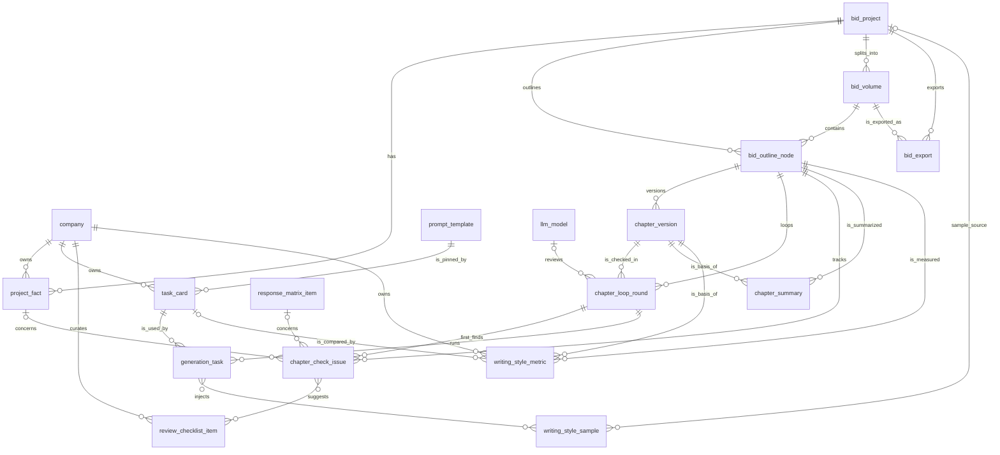
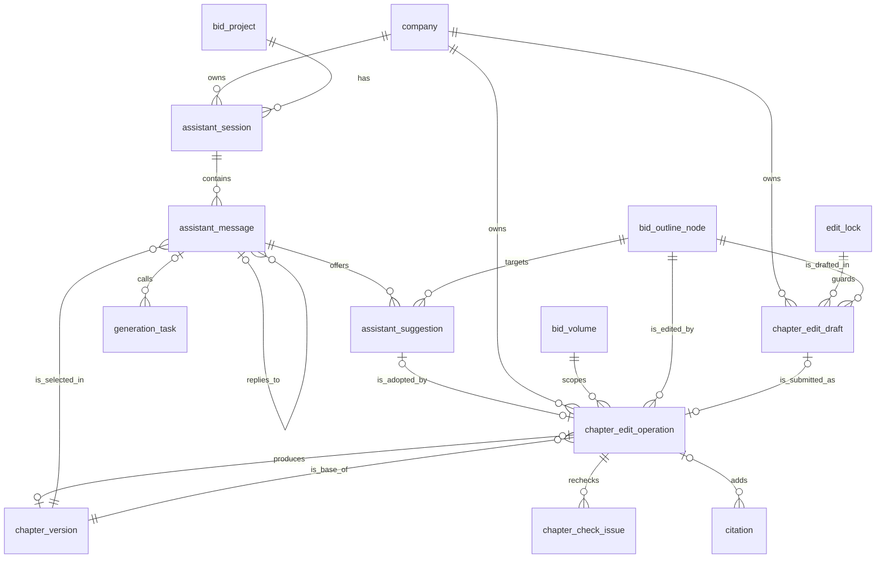

# 企业投标资料库数据字典 v1.5

| 项目 | 内容 |
|---|---|
| 文档版本 | v1.5（在 v1.4 基础上配合 PRD v1.4 落地 neil 2026-09-29 提出的“编辑台”和“对话助手（chatbot）”需求，供评审） |
| 编写日期 | 2026-09-29（UTC+8） |
| 适用系统 | 私有化部署智能投标系统：企业投标资料库 |
| 业务范围 | 当前以数据库维保、IT 运维服务类标为主，结构上预留工程类、货物类扩展 |
| 主要依据 | 《资料库设计借鉴调研》（kb-schema-references-2026-09-28.md，下称“调研报告”）；《智能投标系统市场调研》（bid-system-landscape-2026-09-28.md）；《智能投标系统 第一期（MVP）PRD v1.4》（/workspace/deliverables/prd-mvp-v1.4.md，下称“PRD”）；neil 2026-09-29 提出的编辑台与对话助手需求；《AI 标书“像人写”调研：案例、特征、检测风险与可落地方案》（/workspace/research/human-like-writing-2026-09-29.md，下称“像人写调研”）；《〈投标技术服务方案编写规范〉与 PRD v1.1 差距分析》（/workspace/research/spec-gap-analysis-2026-09-28.md，下称“差距分析”）；公司内部《投标技术服务方案编写规范》（逐页原文 /workspace/bid_extracted.txt，下称“编写规范”，引用页码写作“p.N”）；《Agent 闭环参考调研》（/workspace/research/agent-loop-reference-2026-09-28.md）；与用户已确认的设计要点及本轮决定 |
| 上一版本 | v1.4：/workspace/deliverables/kb-data-dictionary-v1.4.md；v1.3：/workspace/deliverables/kb-data-dictionary-v1.3.md；v1.2：/workspace/deliverables/kb-data-dictionary-v1.2.md；v1.1：/workspace/deliverables/kb-data-dictionary-v1.1.md；v1：/workspace/deliverables/kb-data-dictionary-v1.md（均保留不动，供对照） |
| 文档性质 | 产品设计文档（逻辑数据字典），不是数据库建表脚本；数据类型为逻辑类型，由研发落到具体数据库 |

## v1.5 变更记录（2026-09-29）

变更日期：2026-09-29（UTC+8）。v1.4 文件保留不动，供对照。本版配合 PRD v1.4，落实 neil 于 2026-09-29 提出的“编辑台”和“对话助手（chatbot）”需求所需的数据结构：对话会话、对话消息、修改样例、编辑操作记录、编辑草稿，以及章节版本的修改方式、增量复查的问题记录和人工修改率分项。

**本版结论**：新增 1 层、5 张表（`assistant_session` 对话会话、`assistant_message` 对话消息、`assistant_suggestion` 修改样例、`chapter_edit_operation` 编辑操作记录、`chapter_edit_draft` 编辑草稿），5 张表都是公司级表，`company_id` 必填，并冗余 `project_id`；修改 3 张本字典的表（`task_card`、`chapter_check_issue`、`writing_style_metric`），为 5 张 PRD 表补充字段；新增 11 个代码表，扩展 4 个代码表；公司设置新增 11 个键。本版不新增合规规则。

| 序号 | 变更内容 | 位置 | 依据 |
|---|---|---|---|
| 1 | 新增“编辑台与对话助手层”5 张表：对话会话、对话消息、修改样例、编辑操作记录、编辑草稿 | 新增 3.9 节 | PRD 5.11 节 |
| 2 | `task_card`：`task_type` 增加对话助手问答、对话助手修改样例；`input_items` 增加选区原文、选区前后文、对应招标条款、检索结果、对话历史、用户指令；`prompt_banned_expressions` 适用于对话助手修改样例 | 3.7.6 节 | PRD 5.11.4、5.7.9 节 |
| 3 | `chapter_check_issue` 新增 `check_context`（检查场景）、`found_by_edit_operation_id`（由哪次编辑操作的增量复查发现） | 3.8.4 节 | PRD 5.11.6 节 |
| 4 | PRD 表补充字段：`chapter_version` 新增 `edit_mode`、`edit_operation_id`，`version_origin` 增加 `assistant_edit`，`paragraph_sources` 扩展；`bid_outline_node` 新增 `last_edit_mode`、`last_edited_by`、`last_edited_at`、`edited_after_finalize`；`edit_lock` 新增 `heartbeat_at`、`taken_over_from_user_id`、`takeover_reason`；`generation_task` 的 `task_type` 增加两类，新增 `assistant_message_id`、`kb_enabled`；`citation` 新增 `origin_edit_operation_id` | 3.8.5 节 | PRD 5.7.12 节 |
| 5 | `writing_style_metric` 新增 `edit_distance_by_mode`、`edit_ratio_manual_part`、`edit_ratio_assistant_part`、`assistant_adopted_count`；`manual_edit_ratio`、`baseline_version_id` 的说明补充对话助手修改 | 3.8.6 节 | PRD 5.7.13、5.11.7 节 |
| 6 | 表数量由 55 张增至 60 张；新增实体关系图 3（编辑台与对话助手层） | 第 2 章 | 同 1 |
| 7 | 代码表：`prompt_task_type` 增加 `assistant_qa`、`assistant_suggest`；`task_input_item` 增加 6 个值；`version_origin` 增加 `assistant_edit`；`paragraph_source_type` 增加 `assistant`；`loop_status`、`volume_status`、`style_feature` 补充使用字段；新增 4.15 节，含 11 个代码表 | 4.11～4.15 节 | PRD 5.11 节 |
| 8 | 公司设置新增 11 个键：对话助手启用、样例条数、知识库开关默认值与是否允许关闭、上下文与检索与对话历史预算、检索条数上限、粘贴识别比例、自动保存间隔、编辑锁超时 | 4.10 节 | PRD 6.9 节 |
| 9 | 第 5 章：R01、R30、R34、R35、R43、R44 补充对话助手样例预检和编辑台增量复查的检查时机与字段；规则总数不变（44 条） | 第 5 章 | PRD 5.8.1、5.8.4 节 |
| 10 | 按公司隔离口径补充新层和新表的归属；新增 6.6 节“v1.5 设计取舍（待评审）” | 1.1、1.7 节；6.6 节 | — |

说明：

- **与 PRD 的字段对齐**：PRD v1.4 5.11.13 节列出的 5 张新表字段、5.7.12 节列出的补充字段，与本字典 3.8、3.9 节逐一对应，字段名一致。
- **`partial_rewrite`（局部改写）保留**：PRD v1.4 把局部改写并入对话助手，新版本记为 `assistant_edit`；`version_origin` 中的 `partial_rewrite` 保留给历史数据，新数据不再使用。
- 本版自行做出的数据层判断见 6.6 节，需评审。

## v1.4 变更记录（2026-09-29）

变更日期：2026-09-29（UTC+8）。v1.3 文件保留不动，供对照。本版配合 PRD v1.3，落实像人写调研第六节第一期建议（neil 已于 2026-09-29 确认全部采纳）所需的数据结构：风格样例、套话表、句式规则、总结句策略、任务卡参数依据、R43 与 R44 的问题记录，以及写作观察指标。

**本版结论**：新增 3 张表（`writing_sentence_pattern` 句式规则、`writing_style_sample` 风格样例、`writing_style_metric` 写作观察指标），修改 4 张本字典的表，为 2 张 PRD 表补充字段，新增 11 个字典；新增的表都带 C 组 `company_id`，其中风格样例和写作观察指标必须属于一家公司，句式规则的平台预置行 `company_id` 为空。

| 序号 | 变更内容 | 位置 | 依据 |
|---|---|---|---|
| 1 | 新增 `writing_sentence_pattern`（句式规则：句式偏好与禁用句式；可混合，平台预置行 `company_id` 为空，公司复制后可停用或修改） | 3.7.8 节 | PRD 5.6.5 节；像人写调研 6.2 节第 1、6 条 |
| 2 | 新增 `writing_style_sample`（风格样例；公司级，`company_id` 必填；不绑定写作档案版本） | 3.7.9 节 | PRD 5.6.5 节；像人写调研 6.2 节第 4 条 |
| 3 | 新增 `writing_style_metric`（写作观察指标；公司级，`company_id` 必填，只追加） | 3.8.6 节 | PRD 5.7.13 节；像人写调研 6.2 节第 11 条 |
| 4 | `writing_profile` 增加 `summary_policy`（总结句策略）；`writing_term` 的 `term_kind` 增加 `cliche`（套话）、`habitual`（惯用表达），新增 `cliche_class`、`suggested_rewrite`、`term_enabled`、`term_origin`、`based_on_term_id`，`generic_concept` 由必填改为条件必填 | 3.7.1、3.7.4 节 | PRD 5.6.1、5.6.5 节 |
| 5 | `task_card` 新增 `model_params_basis`（参数依据）、`prompt_banned_expressions`（提示词禁用表达），`model_params` 写明键名（temperature、top_p、top_k、presence_penalty） | 3.7.6 节 | PRD 5.7.9 节 |
| 6 | `chapter_check_issue` 新增 `fix_scope`（修正范围）、`style_hit_refs`（风格命中明细）；问题指纹对 R43 另加命中文字 | 3.8.4 节 | PRD 5.7.4 节 |
| 7 | PRD 表补充字段：`generation_task` 新增 `style_sample_ids`、`model_params_snapshot`；`compliance_rule_config.params` 增加 R43、R44 的参数键 | 3.8.5 节 | PRD 5.7.12、5.8.6 节 |
| 8 | 表数量由 52 张增至 55 张；实体关系图 1 增加句式规则、风格样例及其与公司、历史标书的关系；实体关系图 2 增加写作观察指标及风格样例与生成任务的关系 | 第 2 章 | 同 1～3 |
| 9 | 字典：`term_kind` 增加 2 个值；`prompt_task_type` 增加 `commitment_scan`（额外承诺候选识别，补 v1.3 遗漏）和 `fact_scan`（事实锚点识别）；`issue_type` 增加 9 个值；`human_route_reason` 增加 `fact_conflict`；`task_input_item` 增加 `style_samples`；新增 4.14 节，含 11 个 v1.4 新字典 | 4.11、4.12、4.14 节 | PRD 5.7.4、5.7.9、5.8.7 节 |
| 10 | 公司设置新增 `style_sample_token_budget`（风格样例注入预算） | 4.10 节 | PRD 6.9 节 |
| 11 | 第 5 章：规则总数由 42 条改为 44 条；新增 R43、R44 的字段对照；修改 R28、R35 | 第 5 章 | PRD 5.8.1、5.8.7 节 |
| 12 | 按公司隔离口径补充新表的归属，`writing_term` 改为可混合表；新增 6.5 节“v1.4 设计取舍（待评审）” | 1.1、1.7 节；6.5 节 | — |

说明：

- **v1.3 遗漏的补正**：PRD v1.2 已有“额外承诺候选识别”任务（PRD 6.4 节），但 v1.3 的 `prompt_task_type` 没有对应取值；本版补上 `commitment_scan`。
- **`writing_term` 的归属变化**：平台默认写作档案中预置的套话条目 `company_id` 为空，所以 `writing_term` 由公司级表改为可混合表（1.7 节）；公司复制档案时，平台预置条目随之复制，`term_origin` 记为平台预置。
- 本版自行做出的数据层判断见 6.5 节，需评审。

## v1.3 变更记录

变更日期：2026-09-29（UTC+8）。v1.2 文件保留不动，供对照。本版配合 PRD v1.2，按差距分析第 5.4 节的修改清单落地资料库和字典的修改，并按 neil 已确认的三点（本公司查重默认连续 8 个字符、近 2 年；技术标和商务标分开编写、合标在系统外完成；增值章节不算超范围、额外数值承诺转人工）调整相关设计。与差距分析不一致之处以 neil 的确认为准，见下表说明。

| 序号 | 变更内容 | 位置 | 依据 |
|---|---|---|---|
| 1 | 新增 2 张公司级表：`org_compliance_event`（安全与合规事件记录，供 R39 披露类条款检查）、`tool_asset`（工具与设备，供 R38 截图证明和评分项中的工具要求）；两张表都带 C 组 `company_id` | 3.2.17、3.2.18 节 | 差距分析 G45、G46、G47；PRD 5.4.7 节 |
| 2 | 表数量由 50 张增至 52 张；实体关系图 1 增加新表与主体、产品、资质证书的关系；实体关系图 2 增加 PRD 新表 `bid_volume`（项目分册）、`bid_export`（导出记录） | 第 2 章 | 同 1；PRD 5.1.5、5.9.3 节 |
| 3 | 现有表增加字段：`qualification.product_ids`；`contract_member.proof_page`；`solution_snippet` 增加出处、内容性质、已确认不含真实报告数据、套话组；`attachment_link` 增加功能点标签、盖章状态；`writing_profile` 增加对招标人称呼、采购人口吻自称禁用名单、内部稿命名模板、点对点应答样式；`project_fact` 增加招标要求值、优劣方向 | 3.2.4、3.2.12、3.3.1、3.4.2、3.7.1、3.8.1 节 | 差距分析 5.4 节；PRD 5.4～5.7 节 |
| 4 | 列出 PRD v1.2 对 PRD 表的补充字段（矩阵行分册归属与得分要点、大纲节点章节类型与增值标记、章节版本段落来源、投标项目称呼与命名规则、检查批次范围、查重相关字段等），以及 PRD 新表 `bid_volume`、`bid_export` 的对齐说明；不采用差距分析建议的 `bid_merge`（合标记录） | 3.8.5 节 | PRD 5.1.5、5.2.3、5.3.3、5.7.12、5.8.6、5.9.3 节；neil 确认第 2 点 |
| 5 | 字典值：`proof_type` 增加 4 个示例值；`cert_family` 增加“知识产权”，证书类别增加 3 个示例；`sla_var_group` 增加培训、质保、交付，`var_unit` 增加课时、月、次/半年；`snippet_type` 增加“报告模板（只含框架）”；新增 9 个附件槽位；原字典编码 `bid_volume`（分册）更名为 `bid_volume_type`（分册类型）并增加“其他”，避免与 PRD 新表 `bid_volume` 同名 | 4.2、4.3、4.7、4.8、4.9、4.11 节；3.7.2 节 | 差距分析 5.4 节；本版判断 |
| 6 | 公司设置新增 7 个键：本公司查重的连续字数（默认 8）、历史标书年限（默认 24 个月）、比对范围、段落与全文阈值、术语白名单，以及定稿前交叉复核开关 | 4.10 节 | neil 确认第 1 点；PRD 5.10.4 节 |
| 7 | 生成闭环字典：`issue_type` 增加 11 个值，`human_route_reason` 增加 4 个值，`fact_category` 增加 `commitment`（承诺）；新增 4.13 节，含 16 个 v1.3 新字典（章节类型、分册状态、导出类型、检查范围、查重比对范围、盖章状态、合规事件类型等） | 4.12、4.13 节 | PRD 5.7、5.8、5.9 节 |
| 8 | 第 5 章：规则总数由 28 条改为 42 条；新增 R29～R42 的字段对照；按 PRD 修改 R09、R14、R18、R23、R25～R28 | 第 5 章 | PRD 5.8.1 节 |
| 9 | 按公司隔离口径补充新增表的归属和对 PRD 新表的引用；新增 6.4 节“v1.3 设计取舍（待评审）” | 1.1、1.7 节；6.4 节 | — |

说明：

- **与差距分析不一致、以 neil 确认为准的地方**：公司设置键 `dup_window_months` 改名为 `dup_history_months`，默认 24 个月（确认第 1 点）；不设 `out_of_scope_level`，R30 的级别在规则配置中统一管理；`human_route_reason` 不设 `cross_volume`（R36 不参与章节循环），`out_of_scope_commitment` 改名为 `extra_commitment`；`volume_status` 不设“已合标”，不设 `merge_status` 字典和 `bid_merge` 表（确认第 2 点）；PRD 表补充字段 `is_general_section`、`general_reason`（通用章节）改为 `is_value_added`、`value_added_reason`（增值章节，确认第 3 点）；矩阵行 `volume_codes` 改为 `volume_ids`（引用 PRD `bid_volume`）；`writing_profile.file_naming_template` 改名为 `internal_file_naming_template`，明确只用于内部稿。
- R42（暗标）是系统补充的规则，不是编写规范原文的要求，第 5 章同样注明。

## v1.2 变更记录

变更日期：2026-09-28（UTC+8）。v1.1 文件保留不动，供对照。本版配合 PRD v1.1 的“生成闭环”设计（PRD 5.7、5.8 节），新增生成闭环所需的数据表，并修正 v1.1 中遗漏的一处表定义。

| 序号 | 变更内容 | 位置 | 依据 |
|---|---|---|---|
| 1 | 新增“生成闭环层”4 张表：`project_fact`（项目事实）、`chapter_summary`（章节摘要）、`chapter_loop_round`（章节循环轮次，即生成轮次与章节版本的检查记录）、`chapter_check_issue`（检查问题记录） | 3.8.1～3.8.4 节 | PRD 5.7.4、5.7.8、5.7.10 节 |
| 2 | 写作档案层新增 2 张表：`task_card`（任务卡，即带版本号的提示词配置）、`review_checklist_item`（审查清单条目） | 3.7.6、3.7.7 节 | PRD 5.6、5.7.7、5.7.9 节 |
| 3 | 列出 PRD 生成模块已有表需要补充的字段：大纲节点（章节状态、当前轮次、停止原因等）、章节版本（版本来源、所属循环与轮次、段落指纹等）、生成任务（任务卡版本等）、章节编辑锁、响应矩阵行（条款性质）、投标项目（关闭模型评审、章节生成顺序）、合规问题（循环放行记录带入）。这些表仍由 PRD 定义，本字典只列补充字段，便于研发对齐 | 3.8.5 节 | PRD 5.1.5、5.3.3、5.7.12、5.8.6 节 |
| 4 | 补上 `sme_classification`（中小企业划型记录）的字段定义。v1.1 在表清单、实体关系图和多处引用中都有此表，但第 3 章缺少字段表 | 3.2.16 节 | v1.1 遗漏；v1.1 第 6 章第 19 项结论 |
| 5 | 表数量由 44 张增至 50 张；实体关系图增加第二张“生成闭环层”关系图 | 第 2 章 | 同 1、2 |
| 6 | `prompt_task_type` 新增 3 个值（summary 章节摘要、review 章节模型评审、fix 定位修正），outline 的显示名改为“写作方案（大纲）”；新增 4.12 节，含 23 个生成闭环相关字典 | 4.11、4.12 节 | 同 1、2 |
| 7 | 公司设置新增 9 个键（最大轮数、模型评审开关、同模型评审策略等） | 4.10 节 | PRD 6.9 节 |
| 8 | 第 5 章：规则总数由 25 条改为 28 条；新增 R26、R27、R28 的字段对照；R01、R02、R10、R15 的检查时机增加章节循环 | 第 5 章 | PRD 5.8.1、5.8.4 节 |
| 9 | 按公司隔离口径补充新增表的归属；新增 6.3 节“v1.2 设计取舍（待评审）” | 1.1、1.7 节；6.3 节 | — |

## v1.1 变更记录

变更日期：2026-09-28（UTC+8）。v1 文件保留不动；下表按“改了什么、在哪里、依据”列出，依据中的“第 N 项”指 v1 第 6 章待确认事项的编号，“决定 N”指本轮新定的决定。

| 序号 | 变更内容 | 位置 | 依据 |
|---|---|---|---|
| 1 | 新增“按公司隔离”口径：公司是最高隔离单位；公司级表一律带 C 组 `company_id`；列出平台级表和公司级表清单；附件只在本公司内去重；RAGFlow 按公司分库；合作伙伴、渠道商主体每家公司各自维护 | 1.7 节；3.0 节 C 组；各表表头 | 决定 1；第 3、16 项 |
| 2 | 治理机制改为“谁录入谁负责”：新增确认状态、确认人、确认时间、确认声明版本；审核改为公司级可选开关（默认关闭），审核状态增加 `not_required`（无需审核）、`returned`（已退回）；审核人不能是最后修改人；关键字段修改后须由修改人重新确认 | 1.5 节；3.0 节 G 组；4.1 节；3.6.3 节 | 决定 3；第 1、2 项 |
| 3 | 新增“受限资料”标记 `is_restricted`（公司内部敏感资料的可见范围控制），权限表由 PRD 权限模块定义 | 3.0 节 G 组 | 第 16 项 |
| 4 | 敏感信息改为三级：最高级（身份证号、银行账号、劳动合同）、中级（出生年月、甲方联系人电话、手机号）、一般；只有公司管理员和资料管理员能看完整身份证号，每次查看留痕；新增身份证号、银行账号的不可逆指纹字段，用于跨公司冲突检查 | 1.6 节；person、org_entity；4.1 节 | 第 18 项；PRD R21、R22 |
| 5 | 新增 11 张表：company、company_affiliation、company_setting、cross_company_grant（二期启用）、sme_standard、sme_classification、writing_profile、writing_outline_template、writing_outline_node、writing_term、prompt_template | 3.1.9 节；3.2.16 节；3.6 节；3.7 节 | 决定 1、2；第 19 项 |
| 6 | 厂商、厂商产品明确为平台级（平台管理员维护，各公司共用）；删除“国产/信创厂商（产品）”布尔字段，改为“是否入选信创目录”及“信创目录依据”（暂不启用），国产只记客观事实（国别/地区）；给出首批导入的品牌与产品名清单 | 3.1.4、3.1.5 节；4.5 节 | 第 15 项 |
| 7 | 公司主体：主体范围增加 `third_party`（第三方，仅作授权链节点）；企业规模改由中小企业划型记录带出 | 3.2.1 节；4.2 节 | 第 14、19 项 |
| 8 | 证明材料：可用截止日由材料类型属性“默认有效天数”推算，新增“有效期依据”字段；招标文件有要求时以项目覆盖值为准 | 3.2.3 节；4.2 节 | 第 6 项 |
| 9 | 人员：社保只记“缴纳至哪个月”并上传证明，不记逐月明细；新增身份证号指纹；证件号唯一范围改为本公司内 | 3.2.5 节 | 第 12、18 项 |
| 10 | 人员占用：只提示不锁定；项目经理默认提示冲突；开标后自动释放；中标转履约占用；规则放在公司设置 | 3.2.7 节；3.6.3 节 | 第 13 项 |
| 11 | 原厂授权：支持多级授权链（新增出具方主体、上游授权、链条层级）；授权地域到地市，新增地域备注记区县 | 3.2.8 节 | 第 14 项 |
| 12 | 方案片段：数据库中也保存正文副本；审核开关关闭时，确认即发布 | 3.3.1、3.3.2 节 | 第 5 项；决定 3 |
| 13 | 定稿回收：改写阈值 30%（可调），与已有片段高度相似时只提示 | 3.3.4 节；3.6.3 节 | 第 20 项 |
| 14 | `bid_project_ref` 改为引用 PRD 定义的 `bid_project` 表；所有“引用→sys_user”改为引用 PRD 定义的 `sys_user` 表 | 3.0、3.2.7、3.3.4 节等 | 第 21 项 |
| 15 | 附件槽位新增联合体协议、分包协议（挂在 PRD 的项目合作方 `project_partner` 上）、中小企业划型依据 | 4.9 节 | 第 4、19 项 |
| 16 | 有效期检查基准改为投标截止时间，项目可开启“覆盖服务期”检查 | 1.5 节；V 组说明；第 5 章 R03 | 第 7 项 |
| 17 | 第 5 章：更新 R01、R02、R03、R07、R11、R12，新增 R18～R22 涉及的资料库字段；完整规则定义以 PRD 5.8 节为准 | 第 5 章 | 决定 2、3 |
| 18 | 第 6 章改为“已决事项”（21 项逐条记录结论和落实位置）加“剩余待确认”（只保留编码与代码表类） | 第 6 章 | 本轮决定 |

> 阅读提示：第 3 章每张表的最后一列“对应规范字段”只在调研报告里确有对应字段时填写，写法见 1.4 节；空着表示规范里没有对应字段，不是遗漏。表中凡是“初始值”“示例”字样的枚举，都是为了方便上线预置的参考值，管理员可以在后台修改。

---

## 1. 设计说明

### 1.1 分层：结构化资料和非结构化资料分开放

资料库分成五层。第一层是“字典与配置层”，存放证书类别、厂商产品、行业、方案类型、服务分类、附件用途、扩展字段定义等可配置的代码，业务数据只引用这些代码，不把名称写死在程序里。第二层是“结构化资料层”，存放公司主体、资质证书、人员、人员证书、原厂授权、业绩合同、SLA 模板这些有固定字段、需要逐条核对的资料，它们放在数据库表里，便于做到期提醒、合规检查和自动填表。第三层是“内容与知识层”，存放方案片段和历史标书这类以大段文字为主的资料；它们的正文进入知识检索库做语义检索，数据库里保存一张“卡片”，记录标题、负责人、确认与审核状态、适用范围、来源等管理信息；v1.1 起方案片段正文在数据库中也保存一份副本。第四层是“文件层”，所有扫描件和电子文件在本公司内统一存一份，记录原件、识别出来的文字（OCR 文本）、文件指纹（哈希值），再通过“附件归属”把同一个文件挂到一个或多个业务对象的指定用途位置上，例如“某份合同扫描件”既是业绩合同的“合同文本”，也是某位工程师的“项目经历证明”。第五层是“系统层”，记录变更日志和标签。v1.1 另增两部分：“公司与隔离层”（公司、公司关联关系、公司设置、跨公司授权，3.6 节）和“写作档案层”（每家公司的章节模板、叫法与术语、语气和提示词，3.7 节）。v1.2 再增“生成闭环层”（项目事实、章节摘要、章节循环轮次、检查问题记录，3.8 节），并在写作档案层增加任务卡和审查清单（3.7.6、3.7.7 节）。v1.3 在结构化资料层增加“安全与合规事件记录”和“工具与设备”（3.2.17、3.2.18 节）。v1.4 在写作档案层增加“句式规则”和“风格样例”（3.7.8、3.7.9 节），在生成闭环层增加“写作观察指标”（3.8.6 节）。v1.5 新增“编辑台与对话助手层”（对话会话、对话消息、修改样例、编辑操作记录、编辑草稿，3.9 节）。

结构化资料和知识检索库之间靠三样东西打通：附件（文件既可以挂在结构化记录上，也可以同步到检索库）、标签（同一套标签同时用于表记录和检索库条目）、以及同步到检索库的“元数据”（所属公司、确认与审核状态、来源分级、所属主体、服务分类、涉及产品、有效期），这样检索时可以先按元数据过滤，未确认（或审核开关开启时未审核）、过期或非本公司的内容不会被生成环节直接取用。

### 1.2 通用性：今天服务 IT 运维，明天能扩到工程和货物

通用性主要靠四个做法实现。第一，项目大类单独做成字典（服务、货物、工程），业绩、SLA、方案片段、历史标书都带这个字段，并能同时对照政府采购品目分类和电子招投标技术规范两套编码；以后投工程或货物标时，只需要新增品目分类和证书类别，不需要改表结构。第二，证书类别是一张可以无限分层的字典表，企业资质和个人证书共用，国家执业资格、行业资质、体系认证、厂商认证都放在一起，靠“适用对象”“是否有注册”“关联厂商/产品”等属性区分；以后加建造师、安全生产许可证也只是加几行数据。第三，厂商产品字典按“厂商—产品线—产品—版本”的树来组织，同一套结构对 Oracle 数据库版本、国产数据库、服务器型号、存储设备型号都适用，未来投货物标时可以直接复用为产品型号库。第四，每张业务表都预留“扩展字段”，管理员可以在后台为某张表增加字段（例如工程类需要的“安全生产许可证编号”），不用等研发改版。

### 1.3 维护性：谁负责、多久复审、改了什么都要看得见

这套资料要长期使用，最常见的问题是资料过期没人管、改错了找不到原因、同一件事有好几个版本。因此每条业务资料都有一位负责人，按设定的复审周期由系统生成复审提醒；有有效期的资料由系统自动计算“有效、临期、过期”，不允许人工手填状态；所有记录采用“停用”和“逻辑删除”而不是物理删除，任何字段的修改都进入变更日志，能查到谁在什么时间把什么值改成了什么值。字典的初始值区分“规范值”（来自国家规范、不宜随意改）和“示例值”（仅供上线参考、可以随意改），示例值在后台会带明显标记。规范字段映射集中写在两处：一是本字典每张表的“对应规范字段”列，二是字典项上的“规范代码”属性，以后规范更新时只需要改这两处。

### 1.4 命名约定

库内表名和列名都使用小写英文加下划线（snake_case），表名用单数名词，例如 `org_entity`、`person_certificate`。列名后缀有固定含义：`_id` 表示引用另一张表的记录；`_code` 表示取值来自某个字典；`_date` 表示日期；`_at` 表示精确到秒的时间；`_amount` 表示金额；布尔类字段用 `is_`、`has_`、`requires_` 开头。所有记录的主键 `id` 使用全局唯一标识（GUID），这与电子招标投标系统技术规范附录 B.3.7“附件关联标识号用 GUID”的做法一致，便于多主体、多系统之间交换数据不冲突。枚举值在库里存英文代码（例如 `pending`），界面显示中文名称，中文名称可以在字典里改而不影响历史数据。

金额统一以“元”为单位存储，最多 20 位、保留 6 位小数（与 V2.0 注册资本 N..20,6 的精度一致），界面可以按万元显示；这样可以避免“元/万元”混用导致的比较错误，导出规范格式时金额单位字段固定填“元”。日期统一存公历日期，时间统一按 UTC+8 显示。

本字典的“类型”列使用以下逻辑类型：

| 逻辑类型 | 含义 |
|---|---|
| 标识 | 全局唯一标识（GUID） |
| 文本(n) | 最长 n 个字符的短文本 |
| 长文本 | 不限长度的文字，如经营范围、OCR 文本 |
| 整数 / 小数 | 数值 |
| 金额 | 以元为单位的小数，最多 20 位、6 位小数 |
| 日期 / 年月 / 时间 | 日期精确到日；年月精确到月；时间精确到秒 |
| 布尔 | 是 / 否 |
| 代码〈字典〉 | 取值来自第 4 章某个字典，尖括号内是字典编码 |
| 多值代码〈字典〉 | 可多选的字典值 |
| 引用→表名 | 指向另一张表的一条记录 |
| 多值引用→表名 | 指向另一张表的多条记录 |
| 键值集合 | 一组“名称—值”，用于扩展字段、变量取值快照等 |

“必填”列的取值：**是**＝保存时必须填写；**否**＝选填；**条件**＝满足说明中的条件时必填；**系统**＝由系统生成或计算，用户不能直接修改。

“对应规范字段”列的写法：
- 《公共资源交易平台系统数据规范（V2.0）》中有英文名的字段，写成“V2.0 章节号 英文名”，例如 `V2.0 14.1.1 LEGAL_NAME`。V2.0 第 14 章没有合同字段，业绩合同表参照调研报告 5.3 节的建议，引用了 V2.0 第 7.5 节（工程建设合同，表 23）和第 8.1.5 节（政府采购合同，表 49）的英文名，并注明章节。
- 《电子招标投标系统技术规范》附录 A.2 的字段，调研报告只记录了中文名，没有记录英文名，因此写成“A.2.x 中文名（无英文名）”，不自造英文名。
- V2.0 中有该字段、但调研报告只记录了中文名的（如政府采购合同的“采购项目编号”），写成“V2.0 章节号 中文名（报告未载英文名）”。
- 规范里没有对应字段的，留空。
- 规范原文中的明显拼写（例如 `QUAL_CART_DOC`）照原样抄录，不做修正。

### 1.5 公共治理字段：每条资料都要回答“能不能用”

所有业务表都带一组相同的“公共治理字段”（3.0 节的 A、C、G、V 四组），它们回答的是“这条资料现在能不能被标书引用”。v1.1 按本轮决定改为“谁录入谁负责”，不设专职审核员：

1. **确认（必经）。** 新录入、从文件自动识别入库、批量导入的资料都是“未确认”。录入人保存时勾选“本人确认以上资料真实有效，并对其准确性负责”后变为“已确认”，系统记录确认人、确认时间和确认声明的版本；确认人自动成为该资料的负责人（建议，待产品经理确认）。已确认的资料被修改了关键字段（各表中标 ★ 的字段）后变为“需重新确认”，须由**修改人**重新勾选确认后才能继续被新引用。
2. **审核（可选开关）。** 原审核流程保留为每家公司的可选开关（公司设置 `review_enabled`，默认关闭）。关闭时审核状态固定为 `not_required`（无需审核）；开启后资料确认即进入“待审”，审核人通过为“已审”、退回为“已退回”，一级审核，**审核人不能是该记录的最后修改人**。开关切换时存量资料的处理见 PRD 5.10.4 节。
3. **可引用条件。** 一条资料能被标书引用，必须同时满足：已启用；未删除；确认状态为“已确认”；审核开关开启时审核状态为“已审”；来源分级满足要求（见下）；有有效期的资料在投标截止时间仍有效；属于受限资料的，引用人须在授权名单内。
4. **来源分级。** 资料来源分为“本公司”“合作伙伴”“仅供参考”三级。生成时直接引用本公司的资料；合作伙伴的资料（例如联合体成员的资质）由项目负责人上传，自动标为“合作伙伴提供”，只有在投标项目登记了该合作方、并上传了联合体协议或分包协议后才能引用，且要注明来源；仅供参考的资料（例如收集来的同行方案）只用于学习和检索，永远不进入标书正文。
5. **受限资料。** 公司内部 MVP 不分区授权；个别敏感资料可标为“受限资料”（`is_restricted`），只有公司管理员、资料管理员和被授权的人可见、可引用。授权名单表由 PRD 权限模块定义（`resource_acl`）。

有有效期的资料（资质证书、人员证书、原厂授权、主体证明材料等）由系统每天根据到期日计算状态：距到期超过 90 天为“有效”，90 天以内为“临期”，并在到期前 90、30、7 天分别提醒**资料负责人**（天数可在公司设置或证书类别上调整）；已过到期日为“过期”；既没填到期日、又没勾选“长期有效”的记为“待补录”。合规检查时不看今天，而看投标项目的**投标截止时间**：只要证书在截止时间之前到期，就在检查结果里标红；项目开启“覆盖服务期”检查时，还要求在整个服务期内有效。在投项目缺资料时，在项目待办和资料库首页标红，并提醒资料负责人。

每条资料还记录来源追溯信息：从哪个文件的第几页采集的、谁采集的、是人工录入还是系统识别、识别的可信程度有多高。人工核对过的字段可以加“人工编辑锁”，以后重新识别同一份文件时，系统不会覆盖已锁定的字段。每条资料有负责人、复审周期和下次复审日期，到期未复审会提醒负责人并在资料上显示“待复审”。创建人、修改人、创建时间、修改时间由系统自动记录。

### 1.6 敏感信息

敏感信息分三级（字典 `sensitivity_level`），在对应字段的说明里用【最高级】【中级】标出：

| 级别 | 范围 | 存储 | 展示 | 谁能看完整值 |
|---|---|---|---|---|
| 最高级（`high`） | 身份证件号码、银行账号、劳动合同（附件及其 OCR 文本）；身份证件、社保缴纳记录的扫描件及其 OCR 文本（含完整证件号，v1.1 按最高级处理，待产品经理确认） | 字段级加密；附件加密存储；OCR 文本加密且不同步到知识检索库 | 默认掩码：证件号显示前 4 位和后 4 位，银行账号只显示后 4 位 | 只有公司管理员和资料管理员；每次查看须填写原因并记入变更日志和审计日志。生成标书时，需要完整号码的位置由系统在导出时按需自动填入，编写人在编辑界面只看到掩码 |
| 中级（`medium`） | 出生年月、甲方联系人电话、人员手机号（手机号归入中级是 v1.1 的判断，待产品经理确认） | 手机号、联系人电话加密存储 | 列表中掩码（手机号显示前 3 位和后 4 位），详情中有权限的角色可见 | 公司管理员、资料管理员、项目成员（按 PRD 权限矩阵） |
| 一般（`normal`） | 其他字段 | 常规 | 常规 | 按资料可见范围 |

另外，身份证件号码和银行账号各保存一个**不可逆指纹**（用平台持有的密钥对号码做单向散列得到的字符串，只能比较两个号码是否相同，不能还原号码），专门用于跨公司的冲突检查（PRD R21 同一项目管理成员、R22 同一保证金账户），检查时不暴露号码本身。变更日志里记录敏感字段时只记掩码值。

### 1.7 按公司隔离的口径（v1.1 新增）

**结论：公司（法人主体）是最高隔离单位。** 每家公司各有资料库、知识库、标书，默认互不可见、不可互相引用；生成标书时只检索本公司的库。普通用户只属于一家公司；集团管理员可只读查看所有公司，但生成时不能跨公司取资料。跨公司借用资料默认不允许，以后由集团管理员对单条资料授权并留痕（`cross_company_grant`，二期启用）。是否存在子公司借用母公司资质尚不确定，按以上口径通用设计。

1. **字段做法。** 公司级表一律带 C 组字段 `company_id`（引用→company，见 3.0 节），不复用“所属主体”字段。原因：一家公司的资料库里除了本公司主体，还有合作伙伴、第三方主体，主体字段不能表达“这条记录归哪家公司管理”。所有查询、检索、匹配、统计都以 `company_id` 为第一过滤条件，由服务端强制附加。
2. **平台级表**（不带 `company_id`，所有公司共用、只读，由平台管理员维护）：`vendor`、`product`、`dict_type`、平台级 `dict_item`、`attachment_slot`、`sme_standard`，以及平台预置的 `cert_type`、`prompt_template`、`writing_profile`（默认模板）、`task_card`（默认任务卡，v1.2）。
3. **可混合的表**（`company_id` 为空表示平台级，非空表示某公司自定义）：`dict_item`（公司可在平台字典基础上追加本公司项）、`cert_type`、`ext_field_def`、`prompt_template`、`writing_profile`、`task_card`（v1.2）、`writing_term`（v1.4 起，平台默认档案中预置的套话条目为平台级）、`writing_sentence_pattern`（v1.4，平台预置的句式规则为平台级）。公司自定义的项只在本公司可见；公司复制平台条目后得到的是本公司的行（`company_id` 非空），平台条目本身只读。
4. **公司级表**（`company_id` 必填）：其余全部表，包括 3.2 结构化资料层、3.3 内容与知识层、3.4 文件层、3.5 系统层的全部表，以及 `merge_variable`、`tag`、`tag_link`、`attachment`、`attachment_link`、`change_log`、`bid_archive_ref`、`sme_classification`、`company_setting`、写作档案各表（其中 `review_checklist_item` 只能是公司级），以及 v1.2 新增的生成闭环层各表 `project_fact`、`chapter_summary`、`chapter_loop_round`、`chapter_check_issue`，v1.3 新增的 `org_compliance_event`、`tool_asset`，v1.4 新增的 `writing_style_sample`（风格样例，平台不预置）、`writing_style_metric`（写作观察指标），v1.5 新增的编辑台与对话助手层各表 `assistant_session`、`assistant_message`、`assistant_suggestion`、`chapter_edit_operation`、`chapter_edit_draft`（都冗余 `project_id`，便于按项目隔离）。从属明细表（如 `authorization_product`）也冗余存放 `company_id`，便于按公司过滤和校验“明细与主表同属一家公司”。
5. **附件去重只在本公司内做**（按文件指纹）。跨公司去重会暴露“另一家公司也有这个文件”，因此两家公司上传同一文件各自独立存储。
6. **知识检索库按公司分库**：RAGFlow 中每家公司一个独立的知识库（数据集），标识记在 `company.kb_dataset_ref`；检索时业务层只传入本公司的知识库。
7. **合作伙伴、渠道商主体每家公司各自维护一份**，不共享；同一家合作伙伴在两家公司各有一条 `org_entity` 记录。
8. **跨表引用必须同公司**：公司级表之间的引用（如人员证书引用人员）必须属于同一 `company_id`；公司级表引用平台级表（如引用厂商产品）不受此限。
9. **与 PRD 的衔接**：用户（`sys_user`）、角色权限、投标项目（`bid_project`）、招标文件解析结果等表由 PRD 定义；本字典中的“引用→sys_user”“引用→bid_project”即指向这些表。v1.2 起，生成闭环层还引用 PRD 定义的 `bid_outline_node`、`chapter_version`、`generation_task`、`response_matrix_item`、`llm_model`，这些 PRD 表需要补充的字段列在 3.8.5 节。v1.3 起还引用 PRD v1.2 新增的 `bid_volume`（项目分册）和 `bid_export`（导出记录），这两张表带 C 组 `company_id`，由 PRD 定义，对齐说明见 3.8.5 节。v1.4 新表引用 PRD 的 `bid_project`、`bid_outline_node`、`chapter_version`、`generation_task`、`llm_model`，引用关系同样须同属一家公司（平台级的 `llm_model` 除外）。v1.5 新表还引用 PRD 的 `bid_volume`、`edit_lock`、`citation`、`response_matrix_item`，这些 PRD 表需要补充的字段列在 3.8.5 节“v1.5 补充字段”表中。

---

## 2. 实体关系图

说明：图中只画主要的引用关系。v1.1 起所有公司级表都通过 `company_id` 归属于 `company`（1.7 节），图中只画出公司与主体、设置、写作档案等直接关系，其余不逐一连线。附件归属（`attachment_link`）、标签归属（`tag_link`）、变更日志（`change_log`）和标书引用快照（`bid_archive_ref`）可以挂到任意业务表上（通过“归属对象类型 + 归属对象标识”），为了图面清晰没有逐一连线；公司主体的“上级主体”、厂商产品的“上级节点”、原厂授权的“依托授权”和“上游授权”、写作模板节点的“上级节点”等自引用关系也没有画出，见表内说明。

```mermaid
erDiagram
    company ||--o{ company_affiliation : "relates"
    company ||--o{ company_setting : "configures"
    company ||--o{ org_entity : "manages"
    company ||--o{ writing_profile : "owns"
    company ||--o{ cross_company_grant : "grants"
    org_entity ||--o{ org_relation : "relates"
    org_entity ||--o{ org_proof_doc : "has"
    org_entity ||--o{ qualification : "holds"
    org_entity |o--o{ person : "employs"
    org_entity ||--o{ authorization : "is_grantee"
    org_entity ||--o{ contract : "signs"
    org_entity ||--o{ bid_archive : "bids"
    org_entity |o--o{ merge_variable : "scopes"
    org_entity ||--o{ sme_classification : "is_classified"
    sme_standard ||--o{ sme_classification : "applies"
    cert_type ||--o{ qualification : "classifies"
    cert_type ||--o{ person_certificate : "classifies"
    vendor |o--o{ cert_type : "issues"
    person ||--o{ person_certificate : "holds"
    person ||--o{ person_assignment : "is_occupied"
    person ||--o{ contract_member : "serves"
    vendor ||--o{ product : "offers"
    vendor ||--o{ authorization : "grants"
    authorization ||--|{ authorization_product : "covers"
    product ||--o{ authorization_product : "is_authorized"
    contract ||--o{ contract_product : "services"
    product ||--o{ contract_product : "is_serviced"
    contract ||--o{ contract_member : "staffed_by"
    contract |o--o{ person_assignment : "occupies"
    sla_template ||--|{ sla_level : "defines"
    sla_template ||--|{ sla_variable : "parameterizes"
    sla_template }o--o{ product : "applies_to"
    solution_snippet ||--|{ snippet_revision : "versions"
    solution_snippet ||--o{ snippet_link : "links"
    solution_snippet }o--o{ product : "applies_to"
    bid_archive |o--o{ solution_snippet : "sources"
    bid_archive ||--o{ bid_archive_ref : "cites"
    writing_profile ||--o{ writing_outline_template : "contains"
    writing_outline_template ||--|{ writing_outline_node : "structures"
    writing_profile ||--o{ writing_term : "defines"
    writing_profile ||--o{ prompt_template : "uses"
    writing_profile ||--o{ writing_sentence_pattern : "sets_patterns"
    company ||--o{ writing_style_sample : "curates_samples"
    bid_archive |o--o{ writing_style_sample : "sample_source"
    attachment ||--o{ attachment_link : "attached_as"
    attachment_slot ||--o{ attachment_link : "slots"
    dict_type ||--o{ dict_item : "contains"
    dict_type |o--o{ ext_field_def : "options_from"
    tag ||--o{ tag_link : "tags"
    org_entity ||--o{ org_compliance_event : "is_subject_of"
    org_entity ||--o{ tool_asset : "owns"
    tool_asset }o--o{ product : "supports"
    qualification |o--o{ tool_asset : "registers"
    qualification }o--o{ product : "relates_to"
```

实体中英对照：

| 表名 | 中文名 | 所在层 |
|---|---|---|
| dict_type | 字典类型 | 字典与配置层 |
| dict_item | 字典项 | 字典与配置层 |
| cert_type | 证书类别 | 字典与配置层 |
| vendor | 厂商 | 字典与配置层 |
| product | 厂商产品（产品线/产品/版本） | 字典与配置层 |
| attachment_slot | 附件用途槽位 | 字典与配置层 |
| ext_field_def | 扩展字段定义 | 字典与配置层 |
| merge_variable | 全局变量 | 字典与配置层 |
| sme_standard | 中小企业划型标准（v1.1 新增） | 字典与配置层 |
| org_entity | 公司主体 | 结构化资料层 |
| org_relation | 主体关系 | 结构化资料层 |
| org_proof_doc | 主体证明材料 | 结构化资料层 |
| qualification | 资质证书（企业） | 结构化资料层 |
| person | 人员 | 结构化资料层 |
| person_certificate | 人员证书 | 结构化资料层 |
| person_assignment | 人员占用记录 | 结构化资料层 |
| authorization | 原厂授权 | 结构化资料层 |
| authorization_product | 授权产品 | 结构化资料层 |
| contract | 业绩合同 | 结构化资料层 |
| contract_product | 业绩服务对象产品 | 结构化资料层 |
| contract_member | 业绩项目成员 | 结构化资料层 |
| sla_template | SLA 模板 | 结构化资料层 |
| sla_level | SLA 故障等级 | 结构化资料层 |
| sla_variable | SLA 变量 | 结构化资料层 |
| sme_classification | 中小企业划型记录（v1.1 新增） | 结构化资料层 |
| org_compliance_event | 安全与合规事件记录（v1.3 新增） | 结构化资料层 |
| tool_asset | 工具与设备（v1.3 新增） | 结构化资料层 |
| solution_snippet | 方案片段（卡片） | 内容与知识层 |
| snippet_revision | 方案片段版本 | 内容与知识层 |
| snippet_link | 方案片段关联 | 内容与知识层 |
| bid_archive | 历史标书 | 内容与知识层 |
| bid_archive_ref | 标书引用快照 | 内容与知识层 |
| attachment | 附件文件 | 文件层 |
| attachment_link | 附件归属 | 文件层 |
| tag | 标签 | 系统层 |
| tag_link | 标签归属 | 系统层 |
| change_log | 变更日志 | 系统层 |
| company | 公司（v1.1 新增） | 公司与隔离层 |
| company_affiliation | 公司关联关系（v1.1 新增） | 公司与隔离层 |
| company_setting | 公司设置（v1.1 新增） | 公司与隔离层 |
| cross_company_grant | 跨公司资料授权（v1.1 新增，二期启用） | 公司与隔离层 |
| writing_profile | 写作档案（v1.1 新增） | 写作档案层 |
| writing_outline_template | 章节结构模板（v1.1 新增） | 写作档案层 |
| writing_outline_node | 章节模板节点（v1.1 新增） | 写作档案层 |
| writing_term | 叫法与术语（v1.1 新增） | 写作档案层 |
| prompt_template | 提示词模板（v1.1 新增） | 写作档案层 |
| task_card | 任务卡（v1.2 新增） | 写作档案层 |
| review_checklist_item | 审查清单条目（v1.2 新增） | 写作档案层 |
| writing_sentence_pattern | 句式规则（v1.4 新增） | 写作档案层 |
| writing_style_sample | 风格样例（v1.4 新增） | 写作档案层 |
| project_fact | 项目事实（v1.2 新增） | 生成闭环层 |
| chapter_summary | 章节摘要（v1.2 新增） | 生成闭环层 |
| chapter_loop_round | 章节循环轮次（v1.2 新增） | 生成闭环层 |
| chapter_check_issue | 检查问题记录（v1.2 新增） | 生成闭环层 |
| writing_style_metric | 写作观察指标（v1.4 新增） | 生成闭环层 |
| assistant_session | 对话会话（v1.5 新增） | 编辑台与对话助手层 |
| assistant_message | 对话消息（v1.5 新增） | 编辑台与对话助手层 |
| assistant_suggestion | 修改样例（v1.5 新增） | 编辑台与对话助手层 |
| chapter_edit_operation | 编辑操作记录（v1.5 新增） | 编辑台与对话助手层 |
| chapter_edit_draft | 编辑草稿（v1.5 新增） | 编辑台与对话助手层 |

合计 60 张（v1.1 为 44 张，v1.2 新增 6 张，v1.3 新增 2 张，v1.4 新增 3 张，v1.5 新增 5 张）。PRD 定义的表（如 `bid_project`、`bid_volume`、`bid_export`）不计入。

说明（v1.3）：图 1 中 `qualification |o--o{ tool_asset` 表示工具与设备可关联一张软件著作权登记证书；`qualification }o--o{ product` 表示证书的相关产品（`qualification.product_ids`）。

说明（v1.4）：图 1 中 `writing_profile ||--o{ writing_sentence_pattern` 表示句式规则随写作档案版本发布；`company ||--o{ writing_style_sample` 表示风格样例直接归属公司、不绑定写作档案版本；`bid_archive |o--o{ writing_style_sample` 表示样例可来自本公司历史标书（来自本系统已定稿项目的样例引用 PRD `bid_project`，见图 2）。

**生成闭环层关系图（v1.2 新增，v1.3 补充分册与导出，v1.4 补充写作观察指标与风格样例）**。图中 `bid_project`、`bid_volume`、`bid_export`、`bid_outline_node`、`chapter_version`、`generation_task`、`response_matrix_item`、`llm_model` 由 PRD 定义，画出来是为了说明新表挂在哪里；它们需要补充的字段见 3.8.5 节。

**编辑台与对话助手层关系图（v1.5 新增）**。图中 `bid_project`、`bid_volume`、`bid_outline_node`、`chapter_version`、`generation_task`、`edit_lock`、`citation` 由 PRD 定义，画出来是为了说明新表挂在哪里；它们需要补充的字段见 3.8.5 节“v1.5 补充字段”表。

说明（v1.5）：`assistant_suggestion |o--o| chapter_edit_operation` 表示一条样例最多被采纳一次、产生一条编辑操作记录；手改提交和版本回退的编辑操作记录没有样例。`chapter_edit_operation |o--o| chapter_version` 表示写入成功时产生一个结果版本，冲突被拒绝时没有结果版本；PRD `chapter_version.edit_operation_id` 反向指向产生它的操作记录。`chapter_edit_operation ||--o{ chapter_check_issue` 表示增量复查发现的问题（`chapter_check_issue.found_by_edit_operation_id`）。

---

## 3. 表结构（字段字典）

### 3.0 公共字段组

为了不在每张表里重复罗列，公共字段分成四组（A、C、G、V），各表在表头注明带哪几组。“sys_user”指 PRD 权限模块定义的用户表（v1 中写作“用户”），不在本字典范围内。

**A 组：审计字段（所有表都有）**

| 列名 | 中文名 | 类型 | 必填 | 说明/取值 | 对应规范字段 |
|---|---|---|---|---|---|
| id | 记录标识 | 标识 | 系统 | GUID，全局唯一 | |
| created_by | 创建人 | 引用→sys_user | 系统 | | |
| created_at | 创建时间 | 时间 | 系统 | | |
| updated_by | 修改人 | 引用→sys_user | 系统 | | |
| updated_at | 修改时间 | 时间 | 系统 | 导出公司主体信息时作为数据时间戳 | V2.0 14.1.1 DATA_TIMESTAMP（仅公司主体导出时） |
| record_version | 记录版本号 | 整数 | 系统 | 每次保存加 1；防止两人同时修改互相覆盖；标书引用快照据此记录“引用的是第几版” | |
| is_deleted | 已删除 | 布尔 | 系统 | 逻辑删除，删除后普通用户不可见，管理员可恢复 | |

**C 组：所属公司字段（公司级表都有；平台级表没有；可混合的表为选填，见 1.7 节）**

| 列名 | 中文名 | 类型 | 必填 | 说明/取值 | 对应规范字段 |
|---|---|---|---|---|---|
| company_id | 所属公司 | 引用→company | 是（公司级表）/ 否（可混合的表，空＝平台级） | 记录归哪家公司管理，是数据隔离的依据；创建时取当前用户所属公司，之后不可修改（跨公司授权通过 `cross_company_grant`，不修改本字段） | |

**G 组：治理字段（所有业务表都有；字典表和从属明细表不带，明细表随主表一起确认和审核）**

| 列名 | 中文名 | 类型 | 必填 | 说明/取值 | 对应规范字段 |
|---|---|---|---|---|---|
| confirm_status | 确认状态 | 代码〈confirm_status〉 | 系统 | `unconfirmed` 未确认 / `confirmed` 已确认 / `reconfirm_required` 需重新确认。新建、自动识别入库、批量导入为未确认；录入人勾选确认后为已确认；已确认后修改关键字段（各表中标 ★ 的字段）变为需重新确认，须由修改人重新确认。**只有已确认的资料能被引用** | |
| confirmed_by | 确认人 | 引用→sys_user | 系统 | 最近一次勾选确认的人；需重新确认时只能由最后修改人确认 | |
| confirmed_at | 确认时间 | 时间 | 系统 | | |
| confirm_statement_version | 确认声明版本 | 文本(20) | 系统 | 确认时勾选的声明文字的版本号（声明文字在公司设置 `confirm_statement` 中维护），便于追溯当时承诺的内容 | |
| review_status | 审核状态 | 代码〈review_status〉 | 系统 | `not_required` 无需审核（公司审核开关关闭时的取值）/ `pending` 待审 / `approved` 已审 / `returned` 已退回。开关开启时：确认后自动置为待审；已审后关键字段被修改并重新确认，回到待审；退回后修改并重新确认，回到待审。**开关开启时，只有已审的资料能被引用** | |
| reviewed_by | 审核人 | 引用→sys_user | 系统 | 一级审核；**不能是该记录的最后修改人**（`updated_by`） | |
| reviewed_at | 审核时间 | 时间 | 系统 | | |
| review_comment | 审核意见 | 文本(500) | 条件 | 退回时必填 | |
| is_restricted | 受限资料 | 布尔 | 是 | 默认否；是：只有公司管理员、资料管理员和授权名单（PRD `resource_acl`）中的人可见、可引用 | |
| enabled | 启用状态 | 布尔 | 是 | 默认启用；停用后不参与检索、匹配、生成，历史引用保留 | |
| owner_id | 负责人 | 引用→sys_user | 是 | 对资料准确性负责，接收到期提醒、在投项目缺资料提醒和复审任务；未确认前默认等于创建人，确认后默认等于确认人（建议，待产品经理确认）；可由资料管理员转交，转交留痕 | |
| review_cycle_months | 复审周期（月） | 整数 | 否 | 空则取类别默认值（如证书类别上的默认复审周期），再空取系统默认 12 个月 | |
| last_review_date | 最近复审日期 | 日期 | 系统 | 确认、审核通过或复审确认“内容无变化”时更新 | |
| next_review_date | 下次复审日期 | 日期 | 系统 | ＝最近复审日期＋复审周期，负责人可手工提前；逾期显示“待复审”并提醒 | |
| source_tier | 资料来源分级 | 代码〈source_tier〉 | 是 | `own` 本公司 / `partner` 合作伙伴 / `reference` 仅供参考。默认按所属公司主体的“主体范围”带出（`partner`、`third_party` 主体下的资料为 partner）。**生成时直接引用 own**；partner 须投标项目已登记该合作方并上传联合体协议或分包协议，引用时注明来源；reference 永不进入标书正文 | |
| source_attachment_id | 来源文件 | 引用→attachment | 否 | 资料采集自哪个文件 | |
| source_page | 来源页码 | 文本(50) | 否 | 如“3”“12-13” | |
| collected_by | 采集人 | 引用→sys_user | 系统 | 人工录入为录入人；自动识别为发起识别的人 | |
| collected_at | 采集时间 | 时间 | 系统 | | |
| extract_method | 采集方式 | 代码〈extract_method〉 | 系统 | `manual` 人工录入 / `ocr` 文字识别 / `ai_extract` 智能抽取 / `import` 批量导入 / `harvest` 定稿回收 | |
| extract_confidence | 识别置信度 | 小数 | 否 | 0～1；自动识别时记录；低于阈值（建议 0.8，可配置）的字段在确认界面高亮 | |
| locked_fields | 人工编辑锁 | 多值文本 | 否 | 已人工核对并锁定的列名清单；重新识别同一文件时不覆盖这些字段 | |
| ext_data | 扩展字段值 | 键值集合 | 否 | 管理员在 `ext_field_def` 中为本表定义的扩展字段的取值 | |

标签不作为列存放，统一通过 `tag_link` 关联；附件统一通过 `attachment_link` 关联。

**V 组：有效期字段（有有效期的表才有）**

| 列名 | 中文名 | 类型 | 必填 | 说明/取值 | 对应规范字段 |
|---|---|---|---|---|---|
| valid_from | 有效期起 | 日期 | 否 | | |
| valid_to | 有效期止 ★ | 日期 | 条件 | 未勾选“长期有效”时必填 | 各表单独注明 |
| is_long_term | 长期有效 | 布尔 | 是 | 默认否 | |
| validity_status | 有效期状态 | 代码〈validity_status〉 | 系统 | 每日计算：`valid` 有效（剩余＞90 天或长期有效）/ `expiring` 临期（0～90 天）/ `expired` 过期 / `unknown` 待补录（无到期日且非长期） | |
| days_to_expiry | 剩余天数 | 整数 | 系统 | 有效期止减今天；长期有效为空 | |
| alert_stage | 已提醒阶段 | 代码〈alert_stage〉 | 系统 | 记录 90/30/7 天提醒已发到哪一级，避免重复提醒；有效期止被修改后重置 | |

提醒天数默认 90、30、7 天，可在系统参数中修改，也可以在证书类别（`cert_type.reminder_days`）上单独设置。合规检查时以投标项目的投标截止时间（而不是今天）判断，截止时间前过期即标红；项目开启“覆盖服务期”检查时还须覆盖整个服务期，见第 5 章 R03。

### 3.1 字典与配置层

#### 3.1.1 dict_type 字典类型

通用字典的“目录”。第 4 章列出的大部分代码表都在这里登记，行业、方案类型、服务分类等都是它的一个类型。带 A 组。

| 列名 | 中文名 | 类型 | 必填 | 说明/取值 | 对应规范字段 |
|---|---|---|---|---|---|
| type_code | 字典编码 | 文本(50) | 是 | 唯一，如 `service_category` | |
| type_name | 字典名称 | 文本(100) | 是 | | |
| description | 说明 | 文本(500) | 否 | | |
| is_tree | 是否分层 | 布尔 | 是 | 如服务分类、方案类型为分层字典 | |
| is_builtin | 系统内置 | 布尔 | 系统 | 内置字典不可删除（如审核状态、资料来源分级），字典项能否修改由字典项的“值来源”决定 | |
| maintainer_role | 维护角色 | 文本(50) | 否 | 哪类管理员可维护 | |

#### 3.1.2 dict_item 字典项

带 A、C 组（C 组可为空：空＝平台级字典项；非空＝某公司追加的本公司项，只在本公司可见）。

| 列名 | 中文名 | 类型 | 必填 | 说明/取值 | 对应规范字段 |
|---|---|---|---|---|---|
| type_code | 所属字典 | 引用→dict_type | 是 | | |
| item_code | 代码 | 文本(50) | 是 | 同一字典内唯一；被使用后不可修改，只能停用 | |
| item_name | 名称 | 文本(200) | 是 | 可修改，不影响历史数据 | |
| parent_item_id | 上级项 | 引用→dict_item | 否 | 分层字典使用 | |
| level_no | 层级 | 整数 | 系统 | | |
| aliases | 别名 | 多值文本 | 否 | 用于从招标文件文字中识别，如“七乘二十四小时”识别为 7×24 | |
| std_code | 规范代码 | 文本(50) | 否 | 该项在国家规范代码表中的代码，如资质等级“一级”为 02 | |
| std_source | 规范出处 | 文本(200) | 否 | 如“V2.0 14.4 资质等级代码（表 110）”“政府采购品目分类目录（财库〔2022〕31号）” | |
| value_origin | 值来源 | 代码〈value_origin〉 | 是 | `standard` 规范值 / `example` 示例值 / `custom` 用户自定义。示例值在界面带“示例”标记，规范值修改时二次确认 | |
| attributes | 附加属性 | 键值集合 | 否 | 按字典需要存放，如伙伴等级所属厂商、服务时段对应的每周小时数、项目大类在两套编码中的字母 | |
| sort_order | 排序 | 整数 | 否 | | |
| enabled | 启用 | 布尔 | 是 | | |
| remark | 备注 | 文本(500) | 否 | | |

#### 3.1.3 cert_type 证书类别

企业资质和个人证书共用的分层证书类别表（借鉴 Odoo hr_skills“技能类型＋是否证书类”的两层思路，自行建模）。因为带有较多专用属性，没有放进通用字典。带 A、C 组（C 组可为空：平台预置的类别为空，公司自定义的类别只在本公司可见）。

| 列名 | 中文名 | 类型 | 必填 | 说明/取值 | 对应规范字段 |
|---|---|---|---|---|---|
| type_code | 类别代码 | 文本(50) | 是 | 自建码，格式见本节末“自建扩展码段” | |
| type_name | 类别名称 | 文本(200) | 是 | 如“ISO/IEC 27001 信息安全管理体系认证” | |
| parent_id | 上级类别 | 引用→cert_type | 否 | 分层：分组→子分组→具体证书 | |
| node_kind | 节点类型 | 代码〈cert_node_kind〉 | 是 | `group` 分组 / `cert` 具体证书；只有具体证书能被资质或人员证书选用 | |
| applies_to | 适用对象 | 代码〈cert_applies_to〉 | 是 | `org` 企业 / `person` 个人 / `both` 两者 | |
| cert_family | 证书性质 | 代码〈cert_family〉 | 是 | 许可证 / 行业资质 / 体系认证 / 能力成熟度评估 / 国家职业（执业）资格 / 厂商认证 / 荣誉 / 其他 | |
| issuer_default | 默认发证机构 | 文本(200) | 否 | 录入证书时带出，可改 | |
| vendor_id | 关联厂商 | 引用→vendor | 否 | 厂商认证填写，如 Oracle OCP 关联 Oracle | |
| product_ids | 关联产品 | 多值引用→product | 否 | 证书对应的产品线/产品，用于“招标涉及的数据库品牌需有对应原厂认证人员”的检查 | |
| level_dict_code | 等级取值字典 | 引用→dict_type | 否 | 此类证书的等级从哪个字典取，如资质等级、ITSS 等级、CMMI 等级 | |
| has_registration | 有注册环节 | 布尔 | 是 | 是：人员证书必须填注册证书编号、注册单位、注册有效期（注册类执业资格）；厂商认证一般为否 | |
| requires_surveillance | 需年审/监督审核 | 布尔 | 否 | 体系认证一般为是 | |
| default_validity_years | 默认有效年限 | 整数 | 否 | 录入发证日期后推算到期日供参考，仍以证书为准 | |
| default_review_cycle_months | 默认复审周期（月） | 整数 | 否 | | |
| reminder_days | 提醒天数 | 多值整数 | 否 | 空则用系统默认 90/30/7 | |
| std_code | 规范代码 | 文本(20) | 否 | 若属于 V2.0 资质类型代码（执业资格代码，表 111）或资质序列、行业和专业类别 6 位码，填写对应代码；IT 类证书没有，留空 | V2.0 14.1.4 / 14.2.6 QUAL_TYPE（仅当有规范码时） |
| is_extension_code | 自建扩展码 | 布尔 | 系统 | std_code 为空时为是 | |
| value_origin | 值来源 | 代码〈value_origin〉 | 是 | 初始 IT 类证书均为 `example` | |
| aliases | 别名 | 多值文本 | 否 | 如“OCP”“Oracle Certified Professional” | |
| enabled | 启用 | 布尔 | 是 | | |

**自建扩展码段说明。** V2.0 的资质类型代码（执业资格代码，表 111）以工程类执业资格为主（如 010201 一级注册建造师、010801 注册造价工程师），没有 ISO 20000/27001、ITSS、CMMI、Oracle OCP、达梦 DCP 这类 IT 行业常用证书；资质序列、行业和专业类别 6 位码所依据的《企业资质序列行业和专业类别编码标准》原文本次未取得。因此本系统的 `type_code` 一律自建，规范码只作为属性放在 `std_code`：企业类证书用 `Q-` 开头（如 `Q-ISO27001`），个人类证书用 `P-` 开头（如 `P-ORA-OCP`），字母前缀保证不会与规范中的纯数字代码冲突。以后扩展工程类时，对规范里已有的证书（如注册建造师）同样建自建码，并在 `std_code` 填上规范码。需要按 V2.0 格式交换数据时，有规范码的证书用规范码填 `QUAL_TYPE`；自建码证书无法直接填，调研报告建议放入企业资质的“自定义数据项 CUSTOM_DEFINITION_DATAITEM”或使用“其他”类代码，具体码值需拿到标准原文后核实（列入第 6 章待确认）。

#### 3.1.4 vendor 厂商

厂商产品字典的第一层，是原厂授权、厂商认证、业绩服务对象的共同依据。**平台级**：由平台管理员维护，各公司共用、只读（第 6 章第 15 项结论）；首批导入清单见 4.5 节。带 A 组。

| 列名 | 中文名 | 类型 | 必填 | 说明/取值 | 对应规范字段 |
|---|---|---|---|---|---|
| vendor_code | 厂商代码 | 文本(50) | 是 | 自建，如 `ORACLE`、`DAMENG`（示例） | |
| vendor_name | 厂商名称 | 文本(200) | 是 | 厂商法人全称，建议以授权书落款主体的名称为准；导入时逐条核对，不凭印象填写 | |
| short_name | 简称 | 文本(50) | 否 | | |
| aliases | 别名 | 多值文本 | 否 | 中英文名、曾用名、品牌名，用于识别招标文件中的品牌，如“甲骨文” | |
| country_region | 国别/地区 | 代码〈country_region〉 | 否 | GB/T 2659；客观记录厂商注册地，导入时核对 | |
| credit_code | 统一社会信用代码 | 文本(18) | 否 | 境内厂商填写 | |
| xinchuang_catalog_listed | 是否入选信创目录 | 布尔 | 否 | **暂不启用**，目录来源确定后启用（第 6 章剩余待确认）。v1.1 删除 v1 的“国产/信创厂商”判断字段，“国产”只记客观事实（国别/地区、统一社会信用代码） | |
| xinchuang_catalog_ref | 信创目录依据 | 文本(300) | 条件 | 入选时填写目录名称、版本、条目编号或查询地址；暂不启用 | |
| partner_program | 伙伴计划名称 | 文本(200) | 否 | 厂商的合作伙伴体系名称 | |
| verify_url | 授权核验渠道 | 文本(500) | 否 | 原厂官网查询地址或核验方式说明 | |
| enabled | 启用 | 布尔 | 是 | | |
| remark | 备注 | 文本(500) | 否 | | |

#### 3.1.5 product 厂商产品

按“产品线—产品—版本/型号”自引用成树，授权、证书、业绩、SLA、方案片段都可以挂到任意一层。**平台级**，与厂商相同。带 A 组。

| 列名 | 中文名 | 类型 | 必填 | 说明/取值 | 对应规范字段 |
|---|---|---|---|---|---|
| vendor_id | 厂商 | 引用→vendor | 是 | | |
| parent_id | 上级节点 | 引用→product | 否 | 产品线的上级为空 | |
| node_level | 节点层级 | 代码〈product_node_level〉 | 是 | `line` 产品线 / `product` 产品 / `version` 版本或型号 | |
| product_name | 名称 | 文本(200) | 是 | 如“Oracle Database”“19c”（示例） | |
| full_name | 完整名称 | 文本(300) | 系统 | 自动拼接“厂商＋产品线＋产品＋版本” | |
| aliases | 别名 | 多值文本 | 否 | 如“DM8”“达梦 8” | |
| product_category_code | 产品类别 | 代码〈product_category〉 | 是 | 下级默认继承上级 | |
| gov_catalog_code | 货物品目编码 | 代码〈gov_catalog〉 | 否 | 政府采购品目 A 开头的货物编码，为扩展货物类预留 | |
| lifecycle_status | 生命周期状态 | 代码〈lifecycle_status〉 | 否 | 在售 / 停售 / 停止标准支持 / 停止全部支持 | |
| end_of_support_date | 原厂支持截止日 | 日期 | 否 | 投维保标时判断原厂是否还能提供服务 | |
| xinchuang_catalog_listed | 是否入选信创目录 | 布尔 | 否 | 暂不启用，同厂商 | |
| xinchuang_catalog_ref | 信创目录依据 | 文本(300) | 条件 | 暂不启用，同厂商 | |
| sort_order | 排序 | 整数 | 否 | | |
| enabled | 启用 | 布尔 | 是 | | |
| remark | 备注 | 文本(500) | 否 | | |

#### 3.1.6 attachment_slot 附件用途槽位

规定每类记录可以挂哪些附件、哪些必备（借鉴 OpenBidKit_Yibiao 的 fieldKey 思路，自行建模；该项目为 AGPL，不复用其代码）。初始槽位见第 4 章。**平台级**。带 A 组。

| 列名 | 中文名 | 类型 | 必填 | 说明/取值 | 对应规范字段 |
|---|---|---|---|---|---|
| slot_code | 槽位代码 | 文本(50) | 是 | 如 `business_license` | |
| slot_name | 槽位名称 | 文本(100) | 是 | | |
| owner_type | 适用对象类型 | 代码〈owner_type〉 | 是 | 挂在哪类记录上，如 `qualification` | |
| is_required | 必备 | 布尔 | 是 | 必备槽位缺失时，记录不能确认（审核开关开启时也不能提交审核） | |
| allow_multiple | 允许多个文件 | 布尔 | 是 | | |
| is_sensitive | 敏感附件 | 布尔 | 是 | 是：按最高级敏感处理（1.6 节）：加密存储、OCR 文本不进检索库、导出自动加水印；只能用本地解析服务识别（PRD 第 6 章） | |
| std_code | 规范附件采集项 | 文本(50) | 否 | V2.0 14.3 附件采集项代码 | V2.0 14.3 附件采集项（LICENSE_CERT_DOC、ORGAN_CERT_DOC、TAX_CERT_DOC、QUAL_CART_DOC、ID_CARD_DOC、PROFESSIONAL_CART_DOC） |
| value_origin | 值来源 | 代码〈value_origin〉 | 是 | | |
| sort_order | 排序 | 整数 | 否 | | |
| enabled | 启用 | 布尔 | 是 | | |

#### 3.1.7 ext_field_def 扩展字段定义

管理员在后台为任意业务表增加字段，取值存在该表的 `ext_data` 中。带 A、C 组（C 组可为空：平台管理员定义的对所有公司生效，公司管理员定义的只对本公司生效）。

| 列名 | 中文名 | 类型 | 必填 | 说明/取值 | 对应规范字段 |
|---|---|---|---|---|---|
| target_table | 所属表 | 代码〈owner_type〉 | 是 | | |
| field_key | 字段键 | 文本(50) | 是 | `ext_` 开头的 snake_case，同表唯一，创建后不可改 | |
| field_label | 显示名称 | 文本(100) | 是 | | |
| data_type | 数据类型 | 代码〈ext_data_type〉 | 是 | 文本 / 长文本 / 整数 / 小数 / 金额 / 日期 / 布尔 / 单选 / 多选 | |
| options_dict_code | 选项字典 | 引用→dict_type | 条件 | 单选、多选时必填 | |
| is_required | 必填 | 布尔 | 是 | | |
| default_value | 默认值 | 文本(200) | 否 | | |
| help_text | 填写说明 | 文本(500) | 否 | | |
| is_sensitive | 敏感 | 布尔 | 是 | 是则加密存储、脱敏展示 | |
| is_key_field | 关键字段 | 布尔 | 否 | 是则已确认记录修改此字段后变为“需重新确认” | |
| show_in_list | 列表显示 | 布尔 | 否 | | |
| applies_when | 显示条件 | 文本(200) | 否 | 如“仅当项目大类为工程时显示” | |
| sort_order | 排序 | 整数 | 否 | | |
| enabled | 启用 | 布尔 | 是 | 停用后不再显示，已有取值保留 | |

#### 3.1.8 merge_variable 全局变量

借鉴 Loopio 的 Library Merge Variable / Responsive 的 Merge Tag：会随时间变化的公司级数值（如认证 DBA 人数、服务客户数）只存一处，方案片段里用占位符引用，更新一次全部生效。带 A、C、G 组。

| 列名 | 中文名 | 类型 | 必填 | 说明/取值 | 对应规范字段 |
|---|---|---|---|---|---|
| var_key | 变量键 | 文本(100) | 是 | 如 `company.dba_count`，正文中写作 `{{company.dba_count}}` | |
| var_label | 变量名称 | 文本(100) | 是 | 如“认证 DBA 人数” | |
| scope_entity_id | 适用主体 | 引用→org_entity | 否 | 空表示本公司所有主体通用；本公司下的分公司数值不同时分别建（子公司是另一家公司，各自维护） | |
| value_type | 取值类型 | 代码〈var_value_type〉 | 是 | 整数 / 小数 / 文本 / 日期 | |
| current_value | 当前值 ★ | 文本(500) | 是 | | |
| unit | 单位 | 代码〈var_unit〉 | 否 | | |
| as_of_date | 数据截止日期 | 日期 | 是 | 如“截至 2026-06-30”，生成时可一并输出 | |
| evidence_note | 取值依据 | 文本(500) | 否 | 也可挂附件 | |
| calc_rule | 自动计算规则 | 文本(500) | 否 | 如“在职且 Oracle OCP 有效的人数”；填写后由系统按资料库数据计算，不再手填 | |

#### 3.1.9 sme_standard 中小企业划型标准（v1.1 新增）

按行业配置的中小企业划型标准，平台级，由平台管理员维护。**本字典不预置任何阈值数字**：由管理员按现行有效的划型标准文件逐行导入，并记录文件名称、文号和生效日期，导入后须二次核对（第 6 章剩余待确认）。一个行业的一个规模档对应一行。带 A 组。

| 列名 | 中文名 | 类型 | 必填 | 说明/取值 | 对应规范字段 |
|---|---|---|---|---|---|
| standard_doc_name | 依据文件名称 | 文本(200) | 是 | 划型标准文件全称，导入时照录 | |
| standard_doc_no | 依据文件文号 | 文本(100) | 否 | 照录 | |
| effective_from | 生效日期 | 日期 | 是 | | |
| effective_to | 失效日期 | 日期 | 否 | 被新文件替代时填写；生成声明函时按投标截止时间取当时有效的标准 | |
| sme_industry_code | 划型行业 | 代码〈sme_industry〉 | 是 | 划型标准文件中的行业划分（不是 GB/T 4754 行业代码，两者可在附加属性中对照） | |
| scale_code | 规模档 | 代码〈enterprise_scale〉 | 是 | 中型 / 小型 / 微型（大型为不满足中小微条件的结果，不单独建行） | |
| employee_min / employee_max | 从业人员下限 / 上限 | 整数 | 否 | 单位：人；空表示该指标不作要求；上下限是否含等号见 `boundary_rule` | |
| revenue_min / revenue_max | 营业收入下限 / 上限 | 金额 | 否 | 以元存储 | |
| assets_min / assets_max | 资产总额下限 / 上限 | 金额 | 否 | 以元存储 | |
| combine_logic | 指标组合方式 | 代码〈sme_combine_logic〉 | 是 | 多个指标之间是“同时满足”还是“满足其一”，按标准文件原文选择 | |
| boundary_rule | 边界规则说明 | 文本(300) | 否 | 照录标准文件对“以上”“以下”的解释 | |
| value_origin | 值来源 | 代码〈value_origin〉 | 是 | 导入并核对后为 `standard` | |
| verified_by / verified_at | 核对人 / 核对时间 | 引用→sys_user / 时间 | 系统 | 导入后第二人核对 | |

### 3.2 结构化资料层

中文名后标 ★ 的是“关键字段”：已确认的记录修改这些字段后变为“需重新确认”，须由修改人重新确认后才能继续被引用；审核开关开启时还须重新审核。本层及以下各层的表都带 C 组 `company_id`。

#### 3.2.1 org_entity 公司主体

每家公司的资料库里可以有多个主体：本公司法人主体及其分公司、合作伙伴（联合体伙伴、分包方等）、第三方（总代理、渠道商等只作为授权链节点的主体）都建在这张表里，用“主体范围”区分。v1.1 起母公司、子公司各为独立的“公司”（3.6.1 节），各自维护自己的主体记录，不再在同一资料库中互相引用；分公司与本公司法人主体的关系用“上级主体”表达，联合体等合作关系用 `org_relation` 表达。合作伙伴、第三方主体每家公司各自维护一份。带 A、C、G 组。

| 列名 | 中文名 | 类型 | 必填 | 说明/取值 | 对应规范字段 |
|---|---|---|---|---|---|
| entity_name | 主体名称 ★ | 文本(200) | 是 | 以营业执照为准 | V2.0 14.1.1 LEGAL_NAME |
| short_name | 简称 | 文本(50) | 否 | | |
| former_names | 曾用名 | 多值文本 | 否 | 用于核对证书、业绩上的旧名称 | |
| credit_code | 统一社会信用代码 ★ | 文本(18) | 条件 | 境内法人、非法人组织必填；18 位，GB 32100-2015 | V2.0 14.1.1 LEGAL_CODE |
| business_license_no | 营业执照号码 | 文本(50) | 否 | 默认带出统一社会信用代码，可改 | V2.0 14.1.1 LICENSE_NO |
| entity_scope | 主体范围 | 代码〈entity_scope〉 | 是 | `own` 本公司（含本公司的分公司）/ `partner` 合作伙伴（联合体成员、分包方）/ `third_party` 第三方（如总代理、渠道商，只作为授权链节点，名下资料不能作为我方证据）。决定其名下资料的默认来源分级 | |
| entity_category | 主体类别 | 代码〈entity_category〉 | 是 | 取值采用 V2.0 14.4 主体类别代码（表 112），如 2 法人、3 联合体、7 二级单位（非法人）；报告未载明对应字段英文名 | |
| org_type | 法人机构类别 | 代码〈org_type〉 | 否 | V2.0 14.4 法人机构类别：1 企业 / 2 机关法人 / 3 事业单位 / 4 社会组织 / 9 其他 | V2.0 14.1.1 LEGAL_TYPE |
| company_type | 企业类型 | 文本(100) | 否 | 照录营业执照“类型”，如“有限责任公司” | |
| parent_entity_id | 上级主体 | 引用→org_entity | 否 | 分公司指向本公司法人主体；集团内母子公司关系在 `company`、`company_affiliation` 中维护 | |
| group_role | 集团内角色 | 代码〈group_role〉 | 否 | 母公司 / 子公司 / 分公司 / 独立主体 | |
| legal_representative | 法定代表人（负责人） ★ | 文本(50) | 是 | 分公司填负责人 | V2.0 14.1.1 LEGAL_REPRESENT |
| legal_rep_person_id | 法定代表人人员记录 | 引用→person | 否 | 关联后可复用其身份证件附件 | |
| reg_capital | 注册资本 | 金额 | 否 | 以元存储 | V2.0 14.1.1 REG_CAPITAL（REG_UNIT 导出时固定填元） |
| reg_capital_currency | 注册资本币种 | 代码〈currency〉 | 否 | GB/T 12406，默认人民币 | V2.0 14.1.1 REG_CAP_CURRENCY |
| established_date | 成立日期 | 日期 | 否 | | |
| business_term_start | 经营期限起 | 日期 | 否 | | |
| business_term_end | 经营期限止 ★ | 日期 | 条件 | 非长期时必填；参与“营业执照有效”检查 | V2.0 14.1.1 LICENSE_END_DATE |
| business_term_long | 经营期限长期 | 布尔 | 是 | | |
| registered_address | 住所 | 文本(300) | 是 | 照录营业执照 | |
| office_address | 实际经营地址 | 文本(300) | 否 | | |
| postal_code | 邮政编码 | 文本(6) | 否 | | A.2.1 邮政编码（无英文名） |
| business_scope | 经营范围 | 长文本 | 否 | 照录营业执照；用于核对“经营范围包含运维服务”类资格要求 | |
| industry_code | 行业代码 | 代码〈industry_gbt4754〉 | 否 | GB/T 4754-2011 | V2.0 14.1.1 LEGAL_INDUSTRY |
| country_region | 国别/地区 | 代码〈country_region〉 | 否 | GB/T 2659，默认中国 | V2.0 14.1.1 COUNTRY_REGION |
| region_code | 行政区域代码 | 代码〈region〉 | 否 | GB/T 2260 | V2.0 14.1.1 REGION_CODE |
| contact_name | 联系人 | 文本(50) | 否 | | V2.0 14.1.1 LEGAL_CONTACT |
| contact_phone | 联系人电话 | 文本(30) | 否 | 【中级】加密存储、脱敏展示 | V2.0 14.1.1 LEGAL_CONTACT_PHONE |
| contact_email | 电子邮箱 | 文本(100) | 否 | | A.2.1 电子邮箱（无英文名） |
| bank_name | 基本户开户银行 | 文本(200) | 否 | | A.2.1 开户银行（无英文名） |
| bank_account_name | 基本户户名 | 文本(200) | 否 | 一般与主体名称相同 | |
| bank_account_no | 基本户账号 | 文本(50) | 否 | 【最高级】加密存储，只显示后 4 位 | A.2.1 基本账户账号（无英文名） |
| bank_account_hash | 基本户账号指纹 | 文本(64) | 系统 | 带密钥的不可逆指纹（1.6 节），只用于跨公司“同一保证金账户”检查（PRD R22，二期），不能还原账号 | |
| taxpayer_type | 纳税人资格 | 代码〈taxpayer_type〉 | 否 | 一般纳税人 / 小规模纳税人 | |
| enterprise_scale | 企业规模 | 代码〈enterprise_scale〉 | 系统 | 大型 / 中型 / 小型 / 微型；v1.1 起由中小企业划型记录（`sme_classification`，3.2.16 节）带出最新一条已确认记录的结果，不再手填 | |
| insured_employee_count | 参保人数 | 整数 | 否 | | |
| insured_count_as_of | 参保人数截止月份 | 年月 | 条件 | 填参保人数时必填 | |
| company_intro | 公司简介（短） | 文本(1000) | 否 | 一两百字的短介绍；长版公司介绍作为方案片段管理 | |
| default_watermark | 默认水印文字 | 文本(100) | 否 | 导出附件时的默认水印，如“仅用于××项目投标” | |
| entity_status | 主体状态 | 代码〈entity_status〉 | 是 | 存续 / 注销 / 吊销 / 停用 | |

常用附件槽位：营业执照、法定代表人身份证件（正反面）、法定代表人授权书模板、开户许可证/基本存款账户信息、公司章程。

#### 3.2.2 org_relation 主体关系

记录联合体合作、分包合作、战略合作等主体之间的关系（分公司与本公司主体的关系用 `org_entity.parent_entity_id`；集团内母子公司关系用 `company_affiliation`）。带 A、C、G、V 组。

| 列名 | 中文名 | 类型 | 必填 | 说明/取值 | 对应规范字段 |
|---|---|---|---|---|---|
| from_entity_id | 主体 | 引用→org_entity | 是 | 通常为本公司主体 | |
| to_entity_id | 关联主体 | 引用→org_entity | 是 | | |
| relation_type | 关系类型 ★ | 代码〈relation_type〉 | 是 | 联合体合作 / 分包合作 / 战略合作 / 其他 | |
| agreement_no | 协议编号 | 文本(100) | 否 | 框架合作协议编号；单个项目的联合体协议随投标项目管理 | |
| scope_note | 合作范围 | 文本(500) | 否 | | |

V 组中 `valid_to` 为协议有效期止。常用附件槽位：合作协议。

#### 3.2.3 org_proof_doc 主体证明材料

把纳税、社保、财务审计、信用查询等“按期开具、会过期”的证明从主体表中拆出来，一年一条或一期一条，便于按“近三年”“近六个月”等要求挑选（类型参照《政府采购法实施条例》第十七条的材料清单）。带 A、C、G、V 组。

| 列名 | 中文名 | 类型 | 必填 | 说明/取值 | 对应规范字段 |
|---|---|---|---|---|---|
| entity_id | 所属主体 | 引用→org_entity | 是 | | |
| proof_type | 材料类型 ★ | 代码〈proof_type〉 | 是 | 财务审计报告 / 纳税证明 / 社保缴纳证明 / 信用查询截图 / 无重大违法记录声明 等 | |
| period_start | 所属期间起 | 日期 | 否 | 如纳税证明覆盖的起始月 | |
| period_end | 所属期间止 | 日期 | 否 | | |
| fiscal_year | 所属年度 | 整数 | 条件 | 财务审计报告必填 | |
| issue_date | 开具/查询日期 ★ | 日期 | 是 | 信用查询以查询日期为准 | |
| issuing_org | 出具机构 | 文本(200) | 否 | 税务机关、社保机构、会计师事务所、查询网站 | |
| audit_opinion | 审计意见类型 | 代码〈audit_opinion〉 | 否 | 财务审计报告填写：标准无保留 / 带强调事项 / 保留 / 否定 / 无法表示 | |
| revenue_amount | 营业收入 | 金额 | 否 | 财务审计报告填写 | |
| net_profit_amount | 净利润 | 金额 | 否 | | |
| total_assets_amount | 资产总额 | 金额 | 否 | | |
| total_liabilities_amount | 负债总额 | 金额 | 否 | | |
| insured_count | 缴费人数 | 整数 | 否 | 社保缴纳证明填写 | |
| query_result | 查询结论 | 文本(200) | 否 | 信用查询填写，如“未查询到失信记录” | |
| validity_basis | 有效期依据 | 代码〈validity_basis〉 | 系统 | `type_default` 按材料类型默认天数推算 / `doc_stated` 证明原文载明 / `manual` 负责人手工填写（须在说明中写依据）；项目覆盖值不写入本字段，在项目中单独计算 | |
| remark | 说明 | 文本(500) | 否 | | |

V 组的 `valid_to` 为该证明在投标中的可用截止日：多数证明没有法定有效期，系统按“开具/查询日期＋材料类型的默认有效天数”（`proof_type` 字典项的附加属性 `default_valid_days`，平台预置、公司可在设置 `proof_valid_days` 中覆盖，预置值上线前由管理员核定）自动推算，负责人可按证明原文改写；投标项目中招标文件有明确时效要求时，以项目覆盖值为准（PRD `project_rule_override`），检查时按覆盖值重新计算（第 6 章第 6 项结论）。常用附件槽位：证明原件扫描件；社保缴纳证明为敏感附件。

#### 3.2.4 qualification 资质证书（企业）

企业持有的各类资质、许可证、体系认证、能力评估证书。原厂的伙伴资质证书放在“原厂授权”表（授权类型＝合作伙伴资质），不放这里。带 A、C、G、V 组。

| 列名 | 中文名 | 类型 | 必填 | 说明/取值 | 对应规范字段 |
|---|---|---|---|---|---|
| holder_entity_id | 持证主体 ★ | 引用→org_entity | 是 | | V2.0 14.1.4 LEGAL_CODE（导出时取持证主体的统一社会信用代码） |
| holder_name_on_cert | 证书所载持证单位名称 | 文本(200) | 是 | 照录证书原文，用于和主体名称比对（企业改名后证书未变更的情况） | |
| cert_type_id | 证书类别 ★ | 引用→cert_type | 是 | 只能选“适用对象”含企业的具体证书 | V2.0 14.1.4 QUAL_TYPE（导出时取 cert_type.std_code，自建码见 3.1.3） |
| qual_name | 资质名称 ★ | 文本(200) | 是 | 默认带出类别名称，按证书原文修改 | V2.0 14.1.4 QUAL_NAME |
| qual_level_code | 资质等级 ★ | 代码〈qual_level〉 | 否 | V2.0 14.4 资质等级 01～13；ITSS、CMMI 等级用扩展码，见第 4 章 | V2.0 14.1.4 QUAL_LEVEL |
| cert_no | 证书编号 ★ | 文本(100) | 是 | | V2.0 14.1.4 QUAL_CERT_NO |
| issuer_name | 发证机构 | 文本(200) | 是 | 命名可参考双公示标准的许可机关 XK_XKJG | |
| issuer_credit_code | 发证机构统一社会信用代码 | 文本(18) | 否 | 参考双公示 XK_XKJGDM | |
| issue_date | 发证日期 | 日期 | 否 | | |
| scope_text | 认证/许可范围原文 | 长文本 | 否 | 照录证书上的范围，用于核对“认证范围须包含运维服务”类要求 | |
| service_category_codes | 覆盖服务分类 | 多值代码〈service_category〉 | 否 | 人工根据范围原文勾选，供匹配 | |
| requires_surveillance | 需年审/监督审核 | 布尔 | 否 | 默认取证书类别设置 | |
| next_surveillance_date | 下次年审/监督审核日期 | 日期 | 条件 | 需年审时必填；逾期未更新视为风险 | |
| issuer_status | 发证机构公示状态 | 代码〈cert_issuer_status〉 | 否 | 有效 / 暂停 / 撤销 / 注销，按发证机构官网查询结果填写（参考双公示 XK_ZT），与系统计算的有效期状态是两回事 | |
| last_verified_date | 最近官网核验日期 | 日期 | 否 | 配合“官网查询截图”附件 | |
| verify_url | 查询地址 | 文本(500) | 否 | | |
| product_ids | 相关产品（v1.3） | 多值引用→product | 否 | 证书涉及的厂商产品，主要用于知识产权证书（如某数据库运维工具的软件著作权），挂证据时提示与本项目涉及产品是否相关（编写规范 p.14 所示评分表要求发明专利、软件著作权“必须与项目相关”） | |
| remark | 备注 | 文本(500) | 否 | | |

V 组中 `valid_to` 对应 **V2.0 14.1.4 QUAL_CERT_END_DATE**。知识产权类证书（v1.3，证书性质“知识产权”）一般没有到期日，录入时勾选“长期有效”；专利按法定保护期填写有效期止（以证书载明为准）。`ext_data` 导出时可放入 **V2.0 14.1.4 CUSTOM_DEFINITION_DATAITEM**。常用附件槽位：证书正本/副本扫描件（规范码 QUAL_CART_DOC）、官网查询截图、年审/监督审核记录。

#### 3.2.5 person 人员

本单位员工、外包人员、合作伙伴人员都建在这里，用“人员归属”区分。带 A、C、G 组（合作伙伴人员默认来源分级为合作伙伴）。

| 列名 | 中文名 | 类型 | 必填 | 说明/取值 | 对应规范字段 |
|---|---|---|---|---|---|
| person_name | 姓名 ★ | 文本(50) | 是 | | V2.0 14.2.5 PERSON_NAME |
| gender | 性别 | 代码〈gender〉 | 否 | GB/T 2261.1 | A.2.4 性别（无英文名） |
| id_card_type | 身份证件类型 | 代码〈id_card_type〉 | 是 | 默认居民身份证 | V2.0 14.2.5 ID_CARD_TYPE |
| id_card_no | 身份证件号码 ★ | 文本(30) | 是 | 【最高级】加密存储，显示前 4 位＋****＋后 4 位；只有公司管理员、资料管理员可查看完整值，每次查看须填原因并留痕；同一证件号在本公司内唯一，用于去重 | V2.0 14.2.5 ID_CARD |
| id_card_hash | 证件号码指纹 | 文本(64) | 系统 | 带密钥的不可逆指纹（1.6 节），只用于跨公司“同一项目管理成员”检查（PRD R21，二期），不能还原号码 | |
| id_card_valid_to | 证件有效期止 | 日期 | 否 | 证件过期会导致身份证复印件无效，参与提醒 | |
| birth_month | 出生年月 | 年月 | 否 | 【中级】只存年月，列表中脱敏 | A.2.4 出生年月（无英文名） |
| phone | 手机号码 | 文本(30) | 否 | 【中级】加密存储、脱敏展示（手机号归入中级为 v1.1 判断，待确认） | V2.0 14.2.5 PERSON_PHONE |
| email | 电子邮箱 | 文本(100) | 否 | | |
| region_code | 所在行政区域 | 代码〈region〉 | 否 | GB/T 2260 | V2.0 14.2.5 REGION_CODE |
| person_affiliation | 人员归属 ★ | 代码〈person_affiliation〉 | 否 | `own_staff` 本单位（默认）/ `outsourced` 外包 / `partner` 合作伙伴 | |
| employer_entity_id | 所在单位（库内主体） | 引用→org_entity | 条件 | 所在单位已在主体表中时选择；本单位人员必填 | V2.0 14.2.5 UNIT_CODE（导出取该主体统一社会信用代码） |
| employer_name | 所在单位名称 | 文本(200) | 是 | 选了库内主体则自动带出；外包人员填外包公司 | V2.0 14.2.5 UNIT_NAME |
| social_insurance_unit_name | 社保缴纳单位 ★ | 文本(200) | 否 | 选填；用于核对“社保须由投标人缴纳”类要求 | |
| social_insurance_unit_code | 社保缴纳单位代码 | 文本(18) | 否 | 选填；统一社会信用代码，比对时优先用代码 | |
| social_insurance_proved_until | 社保缴纳至 | 年月 | 否 | 最近一份社保缴纳证明显示的缴纳到的月份；不记逐月明细（第 6 章第 12 项结论），证明文件挂在附件槽位“个人社保缴纳记录”；招标要求近 N 个月连续缴纳时，合规检查提示人工核对证明（R11） | |
| labor_contract_start | 劳动合同起 | 日期 | 否 | | |
| labor_contract_end | 劳动合同止 | 日期 | 否 | 无固定期限可留空并在备注说明 | |
| employment_status | 在职状态 ★ | 代码〈employment_status〉 | 是 | 在职 / 离职 / 退休返聘 | A.2.4 是否在职（无英文名） |
| availability_status | 占用状态 | 代码〈availability_status〉 | 系统 | `available` 可用 / `occupied` 占用 / `disabled` 停用。占用由 `person_assignment` 自动推导；停用由人工设置（如长期病假）；离职人员自动为停用 | |
| position | 职务/岗位 | 文本(100) | 否 | | A.2.4 职务（无英文名） |
| professional_title | 技术职称 | 代码〈professional_title〉 | 否 | 初级 / 中级 / 高级等，具体职称名称可在备注中照录 | A.2.4 技术职称（无英文名） |
| education_level | 最高学历 | 代码〈education_level〉 | 否 | GB/T 4658 | A.2.4 最高学历（无英文名） |
| school | 毕业院校 | 文本(100) | 否 | | |
| major | 专业 | 文本(100) | 否 | | |
| graduation_date | 毕业时间 | 年月 | 否 | | |
| work_start_date | 从业开始时间 | 日期 | 否 | 用它计算从业年限，不手填年限 | V2.0 14.2.5 WORK_START_DATE |
| years_of_experience | 从业年限 | 小数 | 系统 | 按从业开始时间计算到今天（合规检查时算到投标截止时间） | A.2.4 从业年限（无英文名） |
| skill_tags | 技术专长 | 多值引用→product | 否 | 熟悉的厂商产品，辅助排人 | |
| resume_summary | 简历摘要 | 长文本 | 否 | 工作经历、主要能力；项目经历优先从 `contract_member` 自动汇总 | A.2.4 从业经历（无英文名） |
| remark | 备注 | 文本(500) | 否 | | |

常用附件槽位：身份证件正反面（规范码 ID_CARD_DOC，最高级）、社保缴纳记录（最高级）、劳动合同（最高级）、学历/学位证书、职称证书、个人照片；v1.3 增加学信网学历证明（`education_verify`）、简历（`resume`），供 R33、R41 核对（编写规范 p.14 所示评分表要求学历证明包括毕业证和学信网证明材料）。

#### 3.2.6 person_certificate 人员证书

国家职业（执业）资格和厂商认证共用一张表；按规范把“资格证书编号”和“注册证书编号”分开存，并记录注册单位。带 A、C、G、V 组。

| 列名 | 中文名 | 类型 | 必填 | 说明/取值 | 对应规范字段 |
|---|---|---|---|---|---|
| person_id | 持证人 ★ | 引用→person | 是 | | V2.0 14.2.6 ID_CARD、ID_CARD_TYPE（导出时取持证人证件） |
| cert_type_id | 证书类别 ★ | 引用→cert_type | 是 | 只能选“适用对象”含个人的具体证书 | V2.0 14.2.6 QUAL_TYPE（导出时取 cert_type.std_code） |
| qual_name | 证书名称 ★ | 文本(200) | 是 | 默认带出类别名称，按证书原文修改 | V2.0 14.2.6 QUAL_NAME |
| qual_level | 证书等级 | 代码（按证书类别的等级字典） | 否 | 如初级/中级/高级，或厂商认证级别 | A.2.5 职业资格等级（无英文名） |
| qualification_cert_no | 资格证书编号 ★ | 文本(100) | 是 | 资格/认证证书上的编号 | V2.0 14.2.6 CERT_NO；A.2.5 资格证书编号 |
| registration_cert_no | 注册证书编号 ★ | 文本(100) | 条件 | 证书类别“有注册环节”时必填 | A.2.5 注册登记证书编号（无英文名） |
| registration_entity_name | 注册单位 ★ | 文本(200) | 条件 | 同上；应与投标主体一致 | |
| registration_entity_code | 注册单位代码 | 文本(18) | 否 | 统一社会信用代码，比对时优先用代码 | |
| registration_valid_to | 注册有效期止 ★ | 日期 | 条件 | 有注册环节时必填；参与有效期检查 | V2.0 14.2.6 CERT_END_DATE |
| issuer_name | 发证机构 | 文本(200) | 否 | 默认取证书类别的默认发证机构 | |
| issue_date | 发证/通过日期 | 日期 | 否 | | |
| product_ids | 对应产品 | 多值引用→product | 否 | 默认带出证书类别关联的产品，可细化到具体版本 | |
| continuing_edu_due_date | 继续教育/再认证截止日 | 日期 | 否 | | |
| verify_url | 查询/核验方式 | 文本(500) | 否 | 厂商认证的官网验证地址或验证码 | |
| last_verified_date | 最近核验日期 | 日期 | 否 | | |
| remark | 备注 | 文本(500) | 否 | | |

V 组中 `valid_to` 为证书本身的有效期止（很多厂商认证为长期有效或按版本失效）；有注册环节的证书同时检查 `registration_valid_to`。常用附件槽位：证书扫描件（规范码 PROFESSIONAL_CART_DOC）、官网核验截图。

#### 3.2.7 person_assignment 人员占用记录

记录人员在哪些在投项目或履约项目中被占用，用于推导占用状态和发现冲突（思路借鉴 RudyJunyu/Bid_Agent 的可用状态字段，该仓库无许可证，仅参考思路）。v1.1 规则（第 6 章第 13 项结论）：同一人员被多个在投项目拟派时只提示不锁定；项目经理默认提示冲突；开标后自动释放在投占用；中标转为履约占用；规则在公司设置中配置（4.10 节）。带 A、C 组。

| 列名 | 中文名 | 类型 | 必填 | 说明/取值 | 对应规范字段 |
|---|---|---|---|---|---|
| person_id | 人员 | 引用→person | 是 | | |
| assignment_type | 占用类型 | 代码〈assignment_type〉 | 是 | 在投占用 / 中标履约 / 内部项目 / 其他 | |
| bid_project_ref | 投标项目 | 引用→bid_project | 条件 | 在投占用时必填；引用 PRD 投标项目模块的 `bid_project` 表（列名保留 v1 写法以便对齐） | |
| contract_id | 履约合同 | 引用→contract | 条件 | 中标履约时必填 | |
| role_code | 担任角色 | 代码〈person_role〉 | 是 | 项目经理 / 技术负责人 / 驻场工程师 等 | |
| is_exclusive | 需提示冲突 | 布尔 | 是 | 是：同一时段在其他项目也担任需提示冲突的角色时提示冲突（**只提示不锁定**）；默认按公司设置 `assignment_conflict_roles`（默认项目经理）带出；招标文件要求不得兼任时由投标项目带入 | |
| start_date | 开始日期 | 日期 | 是 | 在投占用一般从投标截止时间开始 | |
| planned_end_date | 计划结束日期 | 日期 | 否 | 在投占用默认在开标时自动释放（公司设置 `assignment_release_rule`，可改为结果公布后释放） | |
| released_at | 实际释放时间 | 时间 | 否 | 开标自动释放、未中标、项目结束时写入；中标时本记录释放并新建一条“中标履约”占用 | |
| assignment_status | 状态 | 代码〈assignment_status〉 | 系统 | 生效 / 已释放 | |
| origin | 产生方式 | 代码〈assignment_origin〉 | 系统 | 递交时自动写入 / 中标后转履约 / 人工登记 | |
| remark | 备注 | 文本(500) | 否 | | |

#### 3.2.8 authorization 原厂授权

原厂（或其授权的总代理）给我方主体出具的各类授权。调研中没有找到任何开源项目或国家规范的字段定义，本表为自行设计。v1.1 支持多级授权链（第 6 章第 14 项结论）：原厂授权总代理、总代理再转授权我方时，每一级各建一条记录，下级用“上游授权”指向上级；链条上的出具方和被授权方都是本公司资料库中的主体（总代理等建为主体范围 `third_party` 的主体）。带 A、C、G、V 组。

| 列名 | 中文名 | 类型 | 必填 | 说明/取值 | 对应规范字段 |
|---|---|---|---|---|---|
| vendor_id | 授权厂商 ★ | 引用→vendor | 是 | 授权所针对的原厂 | |
| grantor_entity_id | 出具方主体 | 引用→org_entity | 条件 | 转授权时必填：出具方（如总代理）在本公司资料库中的主体记录，主体范围一般为 `third_party`；原厂直接授权时可空 | |
| grantor_name | 出具方名称 | 文本(200) | 否 | 照录授权书落款；默认为原厂；选了出具方主体时自动带出 | |
| grantor_type | 出具方类型 | 代码〈grantor_type〉 | 否 | 原厂 / 总代理 / 其他渠道 | |
| grantee_entity_id | 被授权主体 ★ | 引用→org_entity | 是 | 链条最后一级应与投标主体一致；中间级为总代理等第三方主体 | |
| auth_type | 授权类型 ★ | 代码〈auth_type〉 | 是 | `partner_qual` 合作伙伴资质 / `annual_agency` 年度代理 / `service_auth` 服务授权 / `project_auth` 项目专项授权 | |
| partner_level_code | 伙伴等级 | 代码〈partner_level〉 | 条件 | 合作伙伴资质时必填；等级按厂商分别配置 | |
| auth_letter_no | 授权书编号 ★ | 文本(100) | 否 | 授权书无编号时留空，在备注说明 | |
| service_scope_codes | 授权服务内容 ★ | 多值代码〈auth_service_scope〉 | 是 | 销售 / 维保服务 / 技术支持 / 备件供应 / 培训 等；维保标通常要求含“维保服务” | |
| auth_scope_text | 授权范围原文 | 长文本 | 否 | 照录授权书上关于产品和范围的原文 | |
| auth_region_codes | 授权地域 ★ | 多值代码〈auth_region〉 | 是 | 全国，或按 GB/T 2260 选省、地市（最细到地市） | |
| region_note | 地域备注 | 文本(300) | 否 | 授权书限定到区县等更细范围时照录于此；合规检查不自动判断，提示人工核对 | |
| project_name | 适用项目名称 ★ | 文本(300) | 条件 | 项目专项授权必填 | |
| tender_no | 适用招标/采购编号 ★ | 文本(100) | 条件 | 项目专项授权必填 | |
| lot_no | 适用标段（包）编号 | 文本(50) | 否 | | |
| tenderee_name | 适用采购人/招标人 | 文本(200) | 否 | | |
| parent_authorization_id | 依托授权 | 引用→authorization | 否 | 项目专项授权所依托的年度代理或伙伴资质（同一被授权主体的授权之间的依托关系，与“上游授权”不同） | |
| upstream_authorization_id | 上游授权 ★ | 引用→authorization | 条件 | 转授权时必填：出具方自己获得的上一级授权（如原厂给总代理的授权）；未登记时链条标“上游未登记” | |
| chain_depth | 链条层级 | 整数 | 系统 | 原厂直接授权为 1，每转授权一级加 1；用于展示和校验 | |
| requires_project_application | 需按项目单独申请 | 布尔 | 是 | 是：投这个厂商的标时必须另行向原厂申请项目专项授权，系统在投标立项时提示 | |
| application_lead_days | 申请提前天数 | 整数 | 否 | 原厂出具专项授权通常需要的天数，用于倒排计划 | |
| application_contact | 原厂申请联系人 | 文本(100) | 否 | 姓名和联系方式；联系方式【中级】 | |
| requires_original | 需提供原件 | 布尔 | 否 | 招标常要求授权书原件或原厂盖章件 | |
| original_location | 原件保管位置 | 文本(200) | 否 | | |
| verify_url | 核验方式 | 文本(500) | 否 | 默认取厂商的授权核验渠道 | |
| last_verified_date | 最近核验日期 | 日期 | 否 | | |
| remark | 备注 | 文本(500) | 否 | | |

V 组中 `valid_to` 为授权有效期止。授权的产品范围在 `authorization_product` 中维护，至少一条。常用附件槽位：授权书扫描件、伙伴资质证书、原厂官网核验截图、原厂承诺函。

#### 3.2.9 authorization_product 授权产品

原厂授权与厂商产品的多对多关系。带 A、C 组，随主表确认和审核。

| 列名 | 中文名 | 类型 | 必填 | 说明/取值 | 对应规范字段 |
|---|---|---|---|---|---|
| authorization_id | 授权 | 引用→authorization | 是 | | |
| product_id | 授权产品 ★ | 引用→product | 是 | 可以是产品线、产品或具体版本 | |
| include_descendants | 含下级 | 布尔 | 是 | 默认是：授权到产品线即覆盖其下所有产品和版本 | |
| coverage_note | 覆盖说明 | 文本(300) | 否 | 如“仅限 19c 及以上版本” | |

#### 3.2.10 contract 业绩合同

我方主体签署并履行的合同业绩。V2.0 第 14 章没有合同字段，映射列引用 V2.0 第 7.5 节（工程建设合同，表 23）、第 8.1.5 节（政府采购合同，表 49）和技术规范附录 A.2.7（投标人业绩）。带 A、C、G 组。

| 列名 | 中文名 | 类型 | 必填 | 说明/取值 | 对应规范字段 |
|---|---|---|---|---|---|
| project_name | 项目名称 ★ | 文本(300) | 是 | 中标项目名称 | A.2.7 中标项目和标段（包）名称（无英文名） |
| contract_name | 合同名称 ★ | 文本(300) | 是 | | V2.0 7.5 CONTRACT_NAME |
| contract_no | 合同编号 | 文本(100) | 否 | | |
| tender_no | 招标/采购项目编号 | 文本(100) | 否 | | V2.0 8.1.5 采购项目编号（报告未载英文名） |
| lot_no | 标段（包）编号 | 文本(50) | 否 | | A.2.7 中标项目的标段（包）编号（无英文名） |
| lot_name | 标段（包）名称 | 文本(300) | 否 | | A.2.7 中标项目和标段（包）名称（无英文名） |
| our_entity_id | 签约主体 ★ | 引用→org_entity | 是 | 我方签约的主体；用于核对“业绩须为投标人自身业绩” | V2.0 8.1.5 SUPPLIER_NAME、SUPPLIER_CODE（导出取主体名称、代码） |
| our_role | 我方角色 ★ | 代码〈our_role〉 | 是 | 独立承接 / 总包 / 分包 / 联合体牵头方 / 联合体成员 | |
| client_name | 甲方（采购人/招标人）名称 ★ | 文本(200) | 是 | | A.2.7 招标人名称（无英文名） |
| client_credit_code | 甲方统一社会信用代码 | 文本(18) | 否 | | A.2.7 招标人代码（无英文名） |
| client_type | 甲方类型 | 代码〈client_type〉 | 否 | 政府机关 / 事业单位 / 国有企业 等 | |
| client_industry_code | 甲方行业 | 代码〈industry〉 | 否 | 金融 / 政府 / 能源 等 | |
| project_region_code | 项目地点 | 代码〈region〉 | 否 | GB/T 2260 | |
| project_category_code | 项目大类 ★ | 代码〈project_category〉 | 是 | 服务 / 货物 / 工程，两套字母编码的区别见第 4 章 | |
| service_category_codes | 服务分类码 ★ | 多值代码〈service_category〉 | 条件 | 项目大类为服务时必填，如 C16070300 软件运维 | |
| bid_win_amount | 中标金额 | 金额 | 否 | | A.2.7 中标金额（无英文名） |
| contract_amount | 合同金额 ★ | 金额 | 是 | 含税总价；费率、单价合同在价款形式中说明 | V2.0 8.1.5 CONTRACT_AMOUNT；V2.0 7.5 CONTRACT_PRICE |
| settlement_amount | 结算金额 ★ | 金额 | 否 | 履约完成后的结算金额 | A.2.7 合同结算金额（无英文名） |
| currency_code | 币种 | 代码〈currency〉 | 是 | GB/T 12406，默认人民币；金额单位固定为元 | V2.0 8.1.5 CURRENCY_CODE；V2.0 7.5 PRICE_CURRENCY |
| price_form_code | 价款形式 | 代码〈price_form〉 | 否 | | V2.0 8.1.5 PRICE_FORM_CODE |
| win_bid_rate | 中标优惠率或其他价格 | 文本(100) | 否 | 费率类合同填写 | V2.0 8.1.5 WIN_BID_RATE |
| sign_date | 合同签署日期 ★ | 日期 | 是 | 用于“近 N 年业绩”判断 | V2.0 8.1.5 SIGNING_TIME；V2.0 7.5 CONTRACT_SIGN_TIME |
| service_start_date | 合同约定服务期起 | 日期 | 是 | | |
| service_end_date | 合同约定服务期止 | 日期 | 是 | | |
| contract_term_days | 合同期限（天） | 整数 | 系统 | 按约定服务期计算 | A.2.7 合同期限（天）（无英文名）；V2.0 8.1.5 CONTRACT_TERM、7.5 LIMITE_TIME 以年计，导出时换算 |
| actual_start_date | 实际履行开始日期 | 日期 | 否 | | |
| actual_end_date | 实际履行结束日期 | 日期 | 否 | 履行中则为空 | |
| actual_term_days | 实际履行期限（天） | 整数 | 系统 | 按实际履行起止计算；履行中算到今天 | A.2.7 实际履行期限（天）（无英文名） |
| performance_status | 履行状态 ★ | 代码〈performance_status〉 | 是 | 履行中 / 已完成 / 已验收 / 提前终止 | |
| acceptance_date | 验收日期 | 日期 | 否 | | |
| acceptance_result | 验收结论 | 代码〈acceptance_result〉 | 否 | 验收合格 / 待验收 / 不适用 | |
| contract_content | 合同主要内容 | 长文本 | 否 | 服务范围、服务对象规模（如数据库实例数） | V2.0 7.5 CONTRACT_CONTENT |
| quality_requirement | 质量/服务要求 | 长文本 | 否 | 合同中的 SLA 摘要 | V2.0 7.5 QUALITY_REQUIRE |
| project_manager_id | 项目经理 | 引用→person | 否 | 也会写入项目成员 | |
| client_contact | 甲方联系人 | 文本(100) | 否 | 用于业绩核查；甲方联系人电话【中级】加密存储、脱敏展示 | |
| is_confidential | 保密项目 | 布尔 | 是 | 是：不得公开项目名称或只能脱敏引用，生成时提示 | |
| highlights | 可复用亮点 | 长文本 | 否 | 服务成效、客户评价要点，供方案生成参考 | |
| remark | 备注 | 文本(500) | 否 | | |

常用附件槽位：合同关键页（首页、金额页、服务内容页、签章页）、中标/成交通知书、验收证明、发票、用户评价/服务评价证明。

#### 3.2.11 contract_product 业绩服务对象产品

业绩合同服务了哪些厂商产品、规模多大，用于“同类数据库维保业绩”的匹配。带 A、C 组，随主表确认和审核。

| 列名 | 中文名 | 类型 | 必填 | 说明/取值 | 对应规范字段 |
|---|---|---|---|---|---|
| contract_id | 合同 | 引用→contract | 是 | | |
| product_id | 服务对象产品 | 引用→product | 是 | | |
| quantity | 数量 | 小数 | 否 | | |
| quantity_unit | 数量单位 | 代码〈quantity_unit〉 | 否 | 套 / 实例 / 节点 / 台 / 库 等 | |
| remark | 说明 | 文本(300) | 否 | | |

#### 3.2.12 contract_member 业绩项目成员

记录人员在业绩项目中担任的角色，即人员业绩，同时是人员简历中“项目经历”的来源。带 A、C 组，随主表确认和审核。

| 列名 | 中文名 | 类型 | 必填 | 说明/取值 | 对应规范字段 |
|---|---|---|---|---|---|
| contract_id | 合同 | 引用→contract | 是 | 合同金额、签署时间、招标人等从合同带出 | A.2.6 人员业绩信息（标段、招标人、金额、时间取自合同，无英文名） |
| person_id | 人员 | 引用→person | 是 | | A.2.6 职业人员代码（无英文名） |
| role_code | 担任角色 | 代码〈person_role〉 | 是 | | |
| start_date | 参与开始日期 | 日期 | 否 | | |
| end_date | 参与结束日期 | 日期 | 否 | | |
| work_summary | 工作内容 | 文本(500) | 否 | | |
| proof_page | 证明页码（v1.3） | 文本(50) | 否 | 合同中体现该成员姓名和参与日期的页码，如“5”“12-13”；导出人员业绩证明时按此定位附件页 | |

常用附件槽位（v1.3）：第三方工作年限证明（`member_proof`），合同中没有体现该成员时使用。

#### 3.2.13 sla_template SLA 模板

服务级别承诺的模板，可以存多套（如标准版、金融版、政府版）。所有数值都放在 `sla_variable` 中，模板正文和故障等级只引用变量，保证一份标书里的 SLA 数字处处一致。调研中没有找到字段标准，ITSS（T/CESA 1299—2023 6.4.1）只规定了服务级别管理的过程要求。带 A、C、G 组。

| 列名 | 中文名 | 类型 | 必填 | 说明/取值 | 对应规范字段 |
|---|---|---|---|---|---|
| template_code | 模板代码 | 文本(50) | 是 | | |
| template_name | 模板名称 | 文本(200) | 是 | 如“数据库维保 SLA（金融版）” | |
| edition_code | 版本类型 | 代码〈sla_edition〉 | 是 | 标准版 / 金融版 / 政府版（示例） | |
| version_no | 模板版本号 | 文本(20) | 是 | 修改发布后递增，如 1.0、1.1 | |
| project_category_code | 适用项目大类 | 代码〈project_category〉 | 是 | 默认服务 | |
| service_category_codes | 适用服务类别 | 多值代码〈service_category〉 | 是 | 如 C16070300 软件运维 | |
| product_ids | 适用厂商产品 | 多值引用→product | 否 | 空表示不限产品 | |
| industry_codes | 适用行业 | 多值代码〈industry〉 | 否 | | |
| service_hours_code | 服务时段 ★ | 代码〈service_hours〉 | 是 | 5×8 / 7×24 等 | |
| inspection_desc | 巡检安排 | 文本(500) | 否 | 文字说明，数值用变量，如“每 {{inspection_per_year}} 次/年现场巡检” | |
| onsite_arrangement_code | 驻场安排 ★ | 代码〈onsite_arrangement〉 | 是 | 无驻场 / 定期驻场 / 常驻；人数、天数用变量 | |
| report_cycle_code | 报告周期 ★ | 代码〈report_cycle〉 | 否 | 周 / 月 / 季 / 年 | |
| spare_parts_desc | 备品备件承诺 | 文本(1000) | 否 | 数值（备件到场时限等）用变量 | |
| escalation_desc | 升级与通报机制 | 文本(1000) | 否 | | |
| body_text | 承诺条款正文 | 长文本 | 是 | 含变量占位，如“一级故障 {{P1.response}} 分钟内响应”；生成时替换 | |
| is_default | 默认模板 | 布尔 | 否 | 同一服务类别下的默认选用 | |
| remark | 备注 | 文本(500) | 否 | | |

常用附件槽位：限时服务承诺函模板、服务流程图。

#### 3.2.14 sla_level SLA 故障等级

每个模板的故障等级定义及各级时限。时限不直接存数字，而是引用本模板的变量键。带 A、C 组，随主表确认和审核。

| 列名 | 中文名 | 类型 | 必填 | 说明/取值 | 对应规范字段 |
|---|---|---|---|---|---|
| template_id | 所属模板 | 引用→sla_template | 是 | | |
| level_code | 等级代码 | 代码〈severity_level〉 | 是 | 如 P1～P4 / 一级～四级 | |
| level_name | 等级名称 | 文本(50) | 是 | 如“一级（紧急）” | |
| definition | 等级定义 | 文本(1000) | 是 | 如“核心数据库宕机或数据丢失，业务全部中断” | |
| examples | 典型场景 | 文本(1000) | 否 | | |
| response_var_key | 响应时限变量 | 文本(100) | 是 | 指向 `sla_variable.var_key`，如 `P1.response` | |
| onsite_var_key | 到场时限变量 | 文本(100) | 否 | 远程服务可空 | |
| restore_var_key | 恢复时限变量 | 文本(100) | 是 | | |
| sort_order | 排序 | 整数 | 是 | | |

#### 3.2.15 sla_variable SLA 变量

模板中所有数值的唯一存放处（借鉴 Loopio Library Merge Variable / Responsive Merge Tag）。投标时可以按招标要求改写取值，但不得超过“最严可承诺值”，否则需审批。带 A、C 组，随主表确认和审核。

| 列名 | 中文名 | 类型 | 必填 | 说明/取值 | 对应规范字段 |
|---|---|---|---|---|---|
| template_id | 所属模板 | 引用→sla_template | 是 | | |
| var_key | 变量键 | 文本(100) | 是 | 模板内唯一，如 `P1.response`、`inspection_per_year`、`onsite_staff_count` | |
| var_label | 变量名称 | 文本(100) | 是 | 如“一级故障响应时限” | |
| var_group | 变量分组 | 代码〈sla_var_group〉 | 是 | 响应 / 到场 / 恢复 / 巡检 / 驻场 / 报告 / 备件 / 其他 | |
| value_type | 取值类型 | 代码〈var_value_type〉 | 是 | 整数 / 小数 / 文本 | |
| default_value | 默认值 ★ | 文本(100) | 是 | | |
| unit | 单位 | 代码〈var_unit〉 | 否 | 分钟 / 小时 / 自然日 / 工作日 / 次每年 / 人 等 | |
| compare_direction | 优劣方向 | 代码〈compare_direction〉 | 是 | `lower_better` 越小越好（时限）/ `higher_better` 越大越好（巡检次数、驻场人数）/ `exact` 须一致 | |
| best_committable_value | 最严可承诺值 ★ | 文本(100) | 否 | 公司实际能做到的极限，如一级响应最快 15 分钟；招标要求更严时提示风险并走审批 | |
| description | 说明 | 文本(300) | 否 | | |

#### 3.2.16 sme_classification 中小企业划型记录（v1.2 补充字段定义）

v1.1 已在表清单、实体关系图和 `org_entity.enterprise_scale` 中引用本表，但未给出字段表，v1.2 补上（字段为本版设计，待评审）。记录某个主体某个年度的划型依据和结果，供生成中小企业声明函使用；主体的“企业规模”取最新一条已确认记录的结果。**本表不预置任何阈值**，判定依据来自 `sme_standard`。带 A、C、G 组。

| 列名 | 中文名 | 类型 | 必填 | 说明/取值 | 对应规范字段 |
|---|---|---|---|---|---|
| entity_id | 所属主体 | 引用→org_entity | 是 | 一般为本公司主体 | |
| fiscal_year | 数据所属年度 ★ | 整数 | 是 | 从业人员、营业收入、资产总额对应的年度 | |
| employee_count | 从业人员 ★ | 整数 | 条件 | 单位：人；所选行业标准要求该指标时必填 | |
| revenue_amount | 营业收入 ★ | 金额 | 条件 | 以元存储；所选行业标准要求该指标时必填 | |
| total_assets_amount | 资产总额 ★ | 金额 | 条件 | 以元存储；所选行业标准要求该指标时必填 | |
| sme_industry_code | 划型行业 ★ | 代码〈sme_industry〉 | 是 | 按划型标准文件的行业划分选择 | |
| applied_standard_ids | 适用的划型标准 | 多值引用→sme_standard | 系统 | 按划型行业和投标截止时间取当时有效的标准行 | |
| scale_code | 划型结果 ★ | 代码〈enterprise_scale〉 | 系统 | 系统按标准计算，经负责人确认后生效；计算结果与人工判断不一致时须填写依据说明 | |
| basis_note | 依据说明 | 文本(500) | 否 | 计算口径、特殊情况说明；依据证明挂附件槽位 `sme_basis_proof` | |
| calculated_at | 计算时间 | 时间 | 系统 | 指标或标准变化时重新计算，结果变化则变为“需重新确认” | |

#### 3.2.17 org_compliance_event 安全与合规事件记录（v1.3 新增）

记录本公司及分公司在安全生产、网络安全领域被主管部门书面通报的重大隐患、行政处罚、生产安全责任事故、网络安全通报等事件，供 R39 检查投标文件中的披露段落（编写规范 p.13 所示评分表：隐瞒涉及生产安全的重大隐患、行政处罚、责任事故将被否决响应）。**资料库中没有记录不等于没有发生**，所以招标要求披露而本表在要求期间内没有记录时，R39 给警告，须项目负责人确认已核实。带 A、C、G 组。文书编号和事件说明建议按“中级”敏感处理（脱敏展示、有权限的项目成员可看），是否这样定级待评审（PRD Q18）。

| 列名 | 中文名 | 类型 | 必填 | 说明/取值 | 对应规范字段 |
|---|---|---|---|---|---|
| entity_id | 所属主体 ★ | 引用→org_entity | 是 | 本公司主体或分公司 | |
| domain_code | 领域 ★ | 代码〈compliance_domain〉 | 是 | 安全生产 / 网络安全 | |
| event_type_code | 事件类型 ★ | 代码〈compliance_event_type〉 | 是 | 重大隐患通报 / 行政处罚 / 生产安全责任事故 / 网络安全通报 / 其他 | |
| authority_name | 出具机关 | 文本(200) | 是 | 出具通报或处罚决定的主管部门 | |
| document_no | 文书编号 ★ | 文本(100) | 条件 | 有书面文书时必填；【中级】（建议） | |
| event_date | 事件日期 ★ | 日期 | 是 | R39 按此判断是否在招标要求的期间内（例如投标截止时间前 24 个月） | |
| publish_date | 公布日期 | 日期 | 否 | 通报或处罚决定公布的日期 | |
| description | 事件说明 | 长文本 | 是 | 事件经过、处罚内容；【中级】（建议） | |
| involves_death | 是否涉及人员死亡 | 布尔 | 条件 | 事件类型为生产安全责任事故时必填（编写规范 p.13 所示评分表按是否涉及人员死亡区分扣分） | |
| related_service_note | 涉及的系统或服务 | 文本(300) | 否 | | |
| related_product_ids | 涉及产品 | 多值引用→product | 否 | | |
| rectification_status | 整改状态 ★ | 代码〈rectification_status〉 | 是 | 未整改 / 整改中 / 已整改 / 不适用 | |
| rectification_date | 整改完成日期 | 日期 | 条件 | 整改状态为已整改时必填 | |
| remark | 备注 | 文本(500) | 否 | | |

常用附件槽位：处罚决定或通报文书（`penalty_doc`，必备）、整改证明（`rectification_proof`，已整改时建议上传）。

#### 3.2.18 tool_asset 工具与设备（v1.3 新增）

记录投标中可能需要证明的工具与设备，例如自研或外购的运维工具软件、笔记本电脑、服务器（编写规范 p.13 所示评分表的“设备保障”项要求提供笔记本电脑及工具名称、规格型号、照片、设备购置发票，非供应商自购的还须提供租赁合同；差距分析 G47）。评分项要求提供工具截图时，R38 按功能点清单和附件的功能点标签核对。单独建表、不并入资质证书表的理由见 6.4 节。带 A、C、G、V 组；V 组只对租赁有意义（租赁有效期），自购和自研的记录勾选“长期有效”。

| 列名 | 中文名 | 类型 | 必填 | 说明/取值 | 对应规范字段 |
|---|---|---|---|---|---|
| holder_entity_id | 所属主体 ★ | 引用→org_entity | 是 | 一般为本公司主体 | |
| asset_kind | 类型 ★ | 代码〈tool_asset_kind〉 | 是 | 自研软件 / 外购软件 / 笔记本电脑 / 服务器 / 其他 | |
| asset_name | 名称 ★ | 文本(200) | 是 | 如“数据库巡检工具”（示例） | |
| model_spec | 规格型号或版本 | 文本(200) | 否 | 硬件填型号和配置，软件填版本号 | |
| brand_name | 厂商或品牌 | 文本(200) | 否 | 自研软件填本公司 | |
| ownership | 归属方式 ★ | 代码〈tool_ownership〉 | 是 | 自购 / 租赁 / 自研；自购须挂购置发票，租赁须挂租赁合同并填写 V 组有效期 | |
| purchase_date | 购置日期 | 日期 | 条件 | 自购时必填 | |
| quantity | 数量 | 整数 | 否 | 默认 1 | |
| asset_no | 资产编号 | 文本(100) | 否 | 公司内部资产编号 | |
| feature_list | 功能点清单 | 多值文本 | 否 | 软件的主要功能点，如“SQL 审核”“慢查询分析”（示例）；R38 用于匹配评分项要求的功能关键词 | |
| product_ids | 支持的产品 | 多值引用→product | 否 | 工具支持的数据库或中间件产品 | |
| related_qualification_id | 关联软著 | 引用→qualification | 否 | 自研软件对应的计算机软件著作权登记证书 | |
| remark | 备注 | 文本(500) | 否 | | |

常用附件槽位：照片（`tool_photo`）、购置发票（`tool_invoice`，自购时必备）、租赁合同（`tool_lease_contract`，租赁时必备）、功能截图（`tool_screenshot`，挂接时可填功能点标签）。

### 3.3 内容与知识层

#### 3.3.1 solution_snippet 方案片段（卡片）

方案片段的正文同时存放在知识检索库和数据库：检索库用于语义检索，数据库在版本表中保存正文副本（v1.1，第 6 章第 5 项结论），用于版本对比、备份、审计和检索库重建。本表是“卡片”，记录标题、适用范围、负责人、确认与审核、新鲜度、来源等管理信息（治理机制借鉴 Loopio / Responsive 的官方帮助文档）。与其他资料“改了关键字段就要重新确认”不同，方案片段采用“修改—确认（—审核）—发布”：修改会生成一个新版本（`snippet_revision`），审核开关关闭时编辑人确认即发布，开启时审核通过后发布；新版本发布前，标书仍然使用上一个已发布版本，不影响正在进行的投标。带 A、C、G 组（G 组的确认与审核状态指卡片信息本身；正文的确认与审核在版本表中进行）。

| 列名 | 中文名 | 类型 | 必填 | 说明/取值 | 对应规范字段 |
|---|---|---|---|---|---|
| snippet_code | 片段编号 | 文本(50) | 系统 | | |
| title | 标题 ★ | 文本(200) | 是 | | |
| alt_titles | 同义标题 | 多值文本 | 否 | 招标文件里可能出现的其他叫法，如“售后服务方案”“运维保障措施”，用于检索匹配（借鉴 Loopio Alternate Question） | |
| snippet_type_code | 方案类型 | 代码〈snippet_type〉 | 是 | 分层字典 | |
| summary | 摘要 | 文本(500) | 否 | | |
| published_revision_id | 当前发布版本 | 引用→snippet_revision | 系统 | 生成时只取这一版 | |
| kb_doc_id | 检索库文档标识 | 文本(100) | 系统 | 当前发布版在知识检索库中的标识 | |
| kb_sync_status | 检索库同步状态 | 代码〈kb_sync_status〉 | 系统 | 未同步 / 已同步 / 同步失败 | |
| length_variant | 篇幅版本 | 代码〈length_variant〉 | 否 | 长版 / 标准版 / 短版；不同篇幅的同一内容用 `snippet_link` 互相关联 | |
| word_count | 字数 | 整数 | 系统 | | |
| project_category_codes | 适用项目大类 | 多值代码〈project_category〉 | 是 | | |
| service_category_codes | 适用服务类别 | 多值代码〈service_category〉 | 否 | | |
| product_ids | 适用厂商产品 | 多值引用→product | 否 | 空表示通用 | |
| industry_codes | 适用行业 | 多值代码〈industry〉 | 否 | | |
| scoring_dimension_codes | 适用评分项 | 多值代码〈scoring_dimension〉 | 否 | | |
| variables_used | 引用的变量 | 多值文本 | 系统 | 从正文中自动识别的 `{{…}}` 变量键；有变量不存在或不可引用时不能发布 | |
| usage_alert | 使用提示 | 文本(250) | 否 | 引用时弹出，如“仅适用于 Oracle RAC 环境”（借鉴 Loopio Alert，≤250 字符） | |
| is_from_winning_bid | 是否中标来源 | 布尔 | 是 | 默认否；来源标书结果为中标时系统自动置为是 | |
| source_bid_id | 来源历史标书 | 引用→bid_archive | 否 | | |
| source_location | 来源位置 | 文本(200) | 否 | 章节号、页码 | |
| win_evidence | 中标证据 | 文本(500) | 否 | 如该章节得分、评委评价 | |
| quality_rating | 质量评级 | 代码〈quality_rating〉 | 否 | A 可直接使用 / B 需小改 / C 仅作参考（示例定义） | |
| freshness_score | 新鲜度 | 整数 | 系统 | 0～100；发布或复审后为 100，随时间向下次复审日期线性下降，逾期为 0（借鉴 Loopio Freshness Score） | |
| usage_count | 引用次数 | 整数 | 系统 | 按标书引用快照统计 | |
| last_used_at | 最近引用时间 | 时间 | 系统 | | |
| citation_source | 出处（v1.3） | 文本(500) | 否 | 引用公开标准、产品手册等时填写；R29 本公司查重中注明出处的内容不算重复（编写规范 p.24） | |
| content_nature | 内容性质（v1.3） | 代码〈content_nature〉 | 否 | 方法论 / 报告模板 / 案例 / 公司介绍 / 通用承诺 | |
| no_real_data_confirmed | 已确认不含真实报告数据（v1.3） | 布尔 | 条件 | 方案类型为“报告模板（只含框架）”或内容性质为报告模板时必填且须为是，否则不能发布（编写规范 p.27） | |
| boilerplate_group | 套话组（v1.3） | 文本(100) | 否 | 同一类套话（质量、售后、保密、交付承诺等）的多个替代版本填同一组名；生成时优先选近期没有在同一招标人标书中用过的版本，降低 R29 重复 | |
| rewrite_tips | 改写建议 | 文本(1000) | 否 | 给编写人看的改写要点，不进入标书 | |
| internal_note | 内部备注 | 文本(1000) | 否 | 不进入标书 | |

#### 3.3.2 snippet_revision 方案片段版本

每次修改正文生成一个版本（借鉴 Responsive Moderator 与 Loopio Entry History）。审核开关关闭时，编辑人确认即发布；开启时审核通过后才发布。带 A、C 组。

| 列名 | 中文名 | 类型 | 必填 | 说明/取值 | 对应规范字段 |
|---|---|---|---|---|---|
| snippet_id | 所属片段 | 引用→solution_snippet | 是 | | |
| revision_no | 版本号 | 整数 | 系统 | 从 1 递增 | |
| revision_status | 版本状态 | 代码〈revision_status〉 | 系统 | `draft` 草稿 / `pending` 待审 / `published` 已发布 / `rejected` 已退回 / `superseded` 已被替代；待审、已退回只在审核开关开启时出现 | |
| content_ref | 正文存储标识 | 文本(200) | 是 | 正文在知识检索库中的位置；非发布版在检索库中标记为不可引用 | |
| content_text | 正文副本 | 长文本 | 是 | 数据库中的正文副本（v1.1），与检索库中的正文一致；用于版本对比、审计、备份和检索库重建 | |
| content_hash | 正文指纹 | 文本(64) | 系统 | 用于判断是否真有改动 | |
| change_note | 修改说明 | 文本(500) | 条件 | 非首版必填 | |
| submitted_by | 提交人 | 引用→sys_user | 系统 | | |
| submitted_at | 提交时间 | 时间 | 系统 | | |
| confirmed_by | 确认人 | 引用→sys_user | 系统 | 勾选确认的编辑人；开关关闭时确认即发布 | |
| confirmed_at | 确认时间 | 时间 | 系统 | | |
| reviewed_by | 审核人 | 引用→sys_user | 系统 | 开关开启时使用；不能是该版本的提交人 | |
| reviewed_at | 审核时间 | 时间 | 系统 | | |
| review_comment | 审核意见 | 文本(500) | 条件 | 退回时必填 | |
| published_at | 发布时间 | 时间 | 系统 | | |

#### 3.3.3 snippet_link 方案片段关联

同一内容的长短版本、替代版本、配套片段互相关联（借鉴 Loopio Linked Entries）。带 A、C 组。

| 列名 | 中文名 | 类型 | 必填 | 说明/取值 | 对应规范字段 |
|---|---|---|---|---|---|
| from_snippet_id | 片段 | 引用→solution_snippet | 是 | | |
| to_snippet_id | 关联片段 | 引用→solution_snippet | 是 | 关联双向显示 | |
| link_type | 关联类型 | 代码〈snippet_link_type〉 | 是 | 长短版本 / 替代版本 / 配套使用 / 中英文版本 | |
| remark | 说明 | 文本(300) | 否 | | |

#### 3.3.4 bid_archive 历史标书

既收录系统上线前的历史标书（MVP 手工导入），也收录系统内完成并递交的标书（“定稿回收”，二期）。正文文件进入知识检索库，本表记录项目信息、结果和回收状态（字段参考 Hugin-Z/tender-writer-v3 历史标书案例 schema，MIT）。带 A、C、G 组。

定稿回收的流程是：递交后上传最终递交版文件 → 系统把最终版与系统生成稿比对，把新增或人工改写较多的段落拆成候选方案片段（确认状态为未确认、采集方式为“定稿回收”、来源标书指向本记录；段落人工修改比例超过公司设置的改写阈值（默认 30%，可调）即视为“改写较多”；候选片段与已有片段高度相似时只提示，由人决定合并或新建，第 6 章第 20 项结论）→ 把标书中实际引用的资料和承诺数值写入 `bid_archive_ref` → 结果公布后填写结果；中标时相关片段自动标记“中标来源”，在投人员占用转为履约占用，未中标则释放。

| 列名 | 中文名 | 类型 | 必填 | 说明/取值 | 对应规范字段 |
|---|---|---|---|---|---|
| project_name | 项目名称 ★ | 文本(300) | 是 | | |
| tender_no | 招标/采购编号 | 文本(100) | 否 | | |
| lot_no | 标段（包）编号 | 文本(50) | 否 | | |
| lot_name | 标段（包）名称 | 文本(300) | 否 | | |
| bid_project_ref | 投标项目 | 引用→bid_project | 否 | 系统内完成的标书关联 PRD 的 `bid_project`（列名保留 v1 写法以便对齐） | |
| tenderee_name | 采购人/招标人 | 文本(200) | 是 | | |
| agency_name | 代理机构 | 文本(200) | 否 | | |
| bid_entity_id | 投标主体 ★ | 引用→org_entity | 是 | 联合体投标时为牵头方 | |
| is_consortium | 联合体投标 | 布尔 | 是 | | |
| consortium_member_ids | 联合体成员 | 多值引用→org_entity | 条件 | 联合体投标时必填 | |
| project_category_code | 项目大类 | 代码〈project_category〉 | 是 | | |
| service_category_codes | 服务分类 | 多值代码〈service_category〉 | 否 | | |
| industry_code | 采购人行业 | 代码〈industry〉 | 否 | | |
| project_region_code | 项目地点 | 代码〈region〉 | 否 | | |
| product_ids | 招标涉及产品 | 多值引用→product | 否 | 如招标覆盖的数据库品牌与版本 | |
| budget_amount | 预算金额 | 金额 | 否 | | |
| ceiling_amount | 最高限价 | 金额 | 否 | | |
| our_bid_amount | 我方报价 | 金额 | 否 | | |
| submission_date | 递交日期 | 日期 | 是 | | |
| open_date | 开标日期 | 日期 | 否 | | |
| bid_result_code | 投标结果 ★ | 代码〈bid_result〉 | 是 | 中标 / 未中标 / 废标（我方被否决）/ 流标或项目终止 / 待公布 | |
| our_rank | 我方排名 | 整数 | 否 | | |
| our_total_score | 我方总分 | 小数 | 否 | | |
| score_detail | 分项得分 | 键值集合 | 否 | 技术分、商务分、价格分等 | |
| winner_name | 中标人 | 文本(200) | 否 | 未中标时填写 | |
| winning_amount | 中标金额 | 金额 | 否 | | |
| success_factors | 成功因素 | 长文本 | 否 | | |
| failure_reasons | 失败/废标原因 | 长文本 | 否 | | |
| evaluator_concerns | 评委关注点 | 长文本 | 否 | 来自澄清、评审意见、复盘 | |
| harvest_status | 定稿回收状态 | 代码〈harvest_status〉 | 系统 | 待回收 / 已上传定稿 / 已拆解入库 / 无需回收 | |
| final_received_at | 定稿上传时间 | 时间 | 系统 | | |
| harvested_by | 回收人 | 引用→sys_user | 系统 | | |
| harvested_snippet_count | 拆出候选片段数 | 整数 | 系统 | | |
| kb_doc_id | 检索库文档标识 | 文本(100) | 系统 | | |
| kb_sync_status | 检索库同步状态 | 代码〈kb_sync_status〉 | 系统 | | |
| remark | 备注 | 文本(500) | 否 | | |

常用附件槽位：招标文件、澄清/答疑/补遗、最终递交版投标文件（可分商务、技术、报价）、开标记录、结果公告或中标通知书、评分表或评审意见。

#### 3.3.5 bid_archive_ref 标书引用快照

记录一份标书实际引用了资料库中的哪些条目、引用时是第几版、承诺了哪些数值。它是“定稿回收”“中标来源标记”“引用次数统计”和事后追溯的依据。带 A、C 组。

| 列名 | 中文名 | 类型 | 必填 | 说明/取值 | 对应规范字段 |
|---|---|---|---|---|---|
| bid_archive_id | 所属标书 | 引用→bid_archive | 是 | | |
| ref_type | 引用对象类型 | 代码〈owner_type〉 | 是 | 资质、人员、人员证书、授权、业绩、SLA 模板、方案片段、全局变量 等 | |
| ref_id | 引用对象 | 标识 | 是 | | |
| ref_version | 引用时版本 | 整数 | 是 | 记录版本号或片段版本号 | |
| usage_location | 使用位置 | 文本(200) | 否 | 章节、页码 | |
| value_snapshot | 承诺值快照 | 键值集合 | 否 | 引用 SLA 模板或变量时，记录本标书实际填写的取值 | |
| confirm_status_at_use | 引用时确认状态 | 代码〈confirm_status〉 | 系统 | 正常应全部为已确认，用于审计 | |
| review_status_at_use | 引用时审核状态 | 代码〈review_status〉 | 系统 | 开关关闭时为无需审核；开启时应为已审 | |
| source_tier_at_use | 引用时来源分级 | 代码〈source_tier〉 | 系统 | | |
| remark | 备注 | 文本(300) | 否 | | |

### 3.4 文件层

#### 3.4.1 attachment 附件文件

同一公司内每个物理文件只存一份，按文件指纹去重；**不跨公司去重**（1.7 节）。带 A、C 组（上传人、上传时间即创建人、创建时间）。

| 列名 | 中文名 | 类型 | 必填 | 说明/取值 | 对应规范字段 |
|---|---|---|---|---|---|
| file_name | 原文件名 | 文本(255) | 是 | | V2.0 14.3 ATTACHMENT_FILE_NAME |
| storage_uri | 存储位置 | 文本(500) | 系统 | 私有化文件存储中的位置 | V2.0 14.3 URL（导出时转换为可访问地址） |
| file_ext | 扩展名 | 文本(20) | 系统 | | |
| mime_type | 文件类型 | 文本(100) | 系统 | | |
| file_size | 文件大小（字节） | 整数 | 系统 | | |
| sha256 | 文件指纹 | 文本(64) | 系统 | 同一公司内同一文件只存一份，重复上传时提示“已存在”并直接关联；不同公司各自存储 | |
| page_count | 页数 | 整数 | 系统 | | |
| file_form | 文件形态 | 代码〈file_form〉 | 否 | 电子原件 / 扫描件 / 照片 / 电子证照 / 其他 | |
| doc_date | 文件日期 | 日期 | 否 | 文件本身的签发或开具日期 | |
| is_sensitive | 敏感文件 | 布尔 | 系统 | 任一挂接槽位为敏感即为是 | |
| is_encrypted | 已加密存储 | 布尔 | 系统 | 敏感文件必须为是 | |
| ocr_status | 识别状态 | 代码〈ocr_status〉 | 系统 | 待识别 / 识别中 / 已完成 / 失败 / 无需识别 | |
| ocr_text | OCR 文本 | 长文本 | 系统 | 敏感文件的 OCR 文本【加密】，且不同步到知识检索库 | |
| ocr_engine | 识别引擎及版本 | 文本(100) | 系统 | 便于日后换引擎重识别 | |
| ocr_confidence | 平均识别置信度 | 小数 | 系统 | | |
| parsed_ref | 解析产物位置 | 文本(500) | 系统 | 版面、表格等结构化解析结果 | |
| kb_doc_id | 检索库文档标识 | 文本(100) | 系统 | | |
| kb_sync_status | 检索库同步状态 | 代码〈kb_sync_status〉 | 系统 | | |
| source_channel | 来源渠道 | 代码〈source_channel〉 | 系统 | 手工上传 / 批量导入 / 定稿回收 / 系统生成 | |
| original_location | 纸质原件保管位置 | 文本(200) | 否 | | |

#### 3.4.2 attachment_link 附件归属

把文件挂到业务记录的某个用途槽位上；同一文件可以挂多处。附件的确认和审核跟随其归属记录。带 A、C 组。

| 列名 | 中文名 | 类型 | 必填 | 说明/取值 | 对应规范字段 |
|---|---|---|---|---|---|
| attachment_id | 文件 | 引用→attachment | 是 | | |
| owner_type | 归属对象类型 | 代码〈owner_type〉 | 是 | | |
| owner_id | 归属对象 | 标识 | 是 | | |
| slot_code | 用途槽位 | 引用→attachment_slot | 是 | 必须是该对象类型可用的槽位 | |
| display_name | 附件名称 | 文本(200) | 否 | 默认取槽位名称，如“营业执照副本” | V2.0 14.3 ATTACHMENT_NAME |
| page_from | 起始页 | 整数 | 否 | 只引用文件中的部分页，如合同的首页、金额页、签章页 | |
| page_to | 结束页 | 整数 | 否 | | |
| is_primary | 主证明文件 | 布尔 | 否 | 同一槽位多个文件时，默认输出主文件 | |
| sort_order | 排序 | 整数 | 否 | | |
| feature_tags | 功能点标签（v1.3） | 多值文本 | 否 | 截图或证明材料体现的功能点，如“JAVA”（示例）；R38 用于核对评分项要求的功能关键词 | |
| stamp_status | 盖章状态（v1.3） | 代码〈stamp_status〉 | 否 | 未盖章 / 已盖章 / 电子章；人工标记，R41 使用 | |
| remark | 备注 | 文本(300) | 否 | | |

V2.0 14.3 中的附件集编码 ATTACHMENT_SET_CODE、附件数量 ATTACHMENT_COUNT 在导出时按“归属对象”汇总生成，不单独存储；附件类型 ATTACHMENT_TYPE 的含义调研报告没有说明，暂不映射。

### 3.5 系统层

#### 3.5.1 tag 标签

结构化记录和知识检索库共用的一套标签。带 A、C 组。

| 列名 | 中文名 | 类型 | 必填 | 说明/取值 | 对应规范字段 |
|---|---|---|---|---|---|
| tag_name | 标签名称 | 文本(50) | 是 | 同一分组内唯一 | |
| tag_group | 标签分组 | 代码〈tag_group〉 | 是 | 场景 / 客户 / 技术 / 地区 / 其他（示例） | |
| synonyms | 同义词 | 多值文本 | 否 | | |
| description | 说明 | 文本(300) | 否 | | |
| enabled | 启用 | 布尔 | 是 | | |

#### 3.5.2 tag_link 标签归属

带 A、C 组。标签变化同步到知识检索库的元数据。

| 列名 | 中文名 | 类型 | 必填 | 说明/取值 | 对应规范字段 |
|---|---|---|---|---|---|
| tag_id | 标签 | 引用→tag | 是 | | |
| target_type | 对象类型 | 代码〈owner_type〉 | 是 | | |
| target_id | 对象 | 标识 | 是 | | |

#### 3.5.3 change_log 变更日志

只能追加、不能修改。带 A 组中的 id、created_at，以及 C 组 `company_id`。

| 列名 | 中文名 | 类型 | 必填 | 说明/取值 | 对应规范字段 |
|---|---|---|---|---|---|
| table_name | 表名 | 代码〈owner_type〉 | 是 | | |
| record_id | 记录 | 标识 | 是 | | |
| action | 操作 | 代码〈change_action〉 | 是 | 新增 / 修改 / 删除 / 恢复 / 确认 / 转为需重新确认 / 提交审核 / 审核通过 / 退回 / 转交负责人 / 加锁 / 解锁 / 查看敏感信息 / 导出 | |
| changed_fields | 变更内容 | 键值集合 | 否 | 字段的旧值与新值；敏感字段只记脱敏值 | |
| reason | 原因 | 文本(500) | 否 | 退回、删除、查看敏感信息时必填 | |
| operator_id | 操作人 | 引用→sys_user | 系统 | | |
| operated_at | 操作时间 | 时间 | 系统 | | |
| client_info | 操作终端 | 文本(200) | 系统 | IP 等 | |

### 3.6 公司与隔离层（v1.1 新增）

#### 3.6.1 company 公司

公司是系统里最高的数据隔离单位，一家公司对应一个法人主体。由平台管理员在 PRD 5.10.1 节“公司管理”页面开通。带 A 组。

| 列名 | 中文名 | 类型 | 必填 | 说明/取值 | 对应规范字段 |
|---|---|---|---|---|---|
| company_name | 公司名称 | 文本(200) | 是 | 以营业执照为准，与本公司主体记录的名称一致 | |
| credit_code | 统一社会信用代码 | 文本(18) | 是 | 平台内唯一 | |
| group_id | 所属集团 | 引用→sys_group | 否 | 集团表由 PRD 权限模块定义；不属于任何集团时为空 | |
| primary_entity_id | 本公司主体 | 引用→org_entity | 系统 | 开通公司时自动在该公司资料库中创建主体范围为 `own` 的主体记录并回填 | |
| kb_dataset_ref | 知识库标识 | 文本(100) | 系统 | 该公司在 RAGFlow 中的知识库（数据集）标识；检索时只传入本标识 | |
| company_status | 状态 | 代码〈company_status〉 | 是 | `active` 启用 / `disabled` 停用。停用后该公司用户不能登录，数据保留 | |
| opened_at | 开通时间 | 时间 | 系统 | | |
| remark | 备注 | 文本(500) | 否 | | |

#### 3.6.2 company_affiliation 公司关联关系

记录集团内公司之间的控股、管理关系和单位负责人相同的情况，供 PRD R19“关联投标冲突”使用（依据《招标投标法实施条例》第三十四条、《政府采购法实施条例》第十八条，见 PRD 8.3 节）。由集团管理员或平台管理员维护。带 A 组。

| 列名 | 中文名 | 类型 | 必填 | 说明/取值 | 对应规范字段 |
|---|---|---|---|---|---|
| company_id | 公司 | 引用→company | 是 | | |
| related_company_id | 关联公司 | 引用→company | 是 | 关系双向生效 | |
| affiliation_type | 关系类型 | 代码〈affiliation_type〉 | 是 | `controlling` 控股 / `managing` 管理 / `same_principal` 单位负责人为同一人 / `other` 其他 | |
| basis_note | 依据说明 | 文本(500) | 否 | 如持股比例、任职情况；可挂附件 | |
| valid_from / valid_to | 关系起止 | 日期 | 否 | 关系变化时结束旧记录、新建记录 | |

#### 3.6.3 company_setting 公司设置

公司级的键值配置，由公司管理员在 PRD 5.10.4 节“资料库设置”中维护；平台提供每个键的默认值。每次修改记入审计日志。带 A、C 组。

| 列名 | 中文名 | 类型 | 必填 | 说明/取值 | 对应规范字段 |
|---|---|---|---|---|---|
| setting_key | 设置键 | 代码〈company_setting_key〉 | 是 | 同一公司内唯一；键清单见 4.10 节 | |
| setting_value | 设置值 | 键值集合 | 是 | 按键的取值类型存放 | |
| value_type | 取值类型 | 代码〈ext_data_type〉 | 系统 | 由键决定 | |
| effective_at | 生效时间 | 时间 | 系统 | 保存即生效 | |
| change_note | 修改说明 | 文本(300) | 否 | 切换审核开关时必填 | |

#### 3.6.4 cross_company_grant 跨公司资料授权（二期启用）

跨公司借用资料默认不允许。本表预留“集团管理员对单条资料授权给另一家公司使用”的能力，全程留痕；MVP 建表但不开放入口。被授权方只能引用、不能修改；引用时仍须满足原资料的可引用条件。带 A 组。

| 列名 | 中文名 | 类型 | 必填 | 说明/取值 | 对应规范字段 |
|---|---|---|---|---|---|
| owner_company_id | 资料所属公司 | 引用→company | 是 | | |
| grantee_company_id | 被授权公司 | 引用→company | 是 | 须与资料所属公司同属一个集团 | |
| ref_type | 资料类型 | 代码〈owner_type〉 | 是 | 如 qualification、contract | |
| ref_id | 资料记录 | 标识 | 是 | 只能是单条记录，不支持整类授权 | |
| bid_project_id | 限定投标项目 | 引用→bid_project | 否 | 空表示在有效期内可用于被授权公司的任何项目 | |
| valid_from / valid_to | 授权起止 | 日期 | 是 | | |
| grant_reason | 授权理由 | 文本(500) | 是 | | |
| granted_by | 授权人 | 引用→sys_user | 系统 | 只能是集团管理员 | |
| grant_status | 状态 | 代码〈grant_status〉 | 系统 | `active` 生效 / `revoked` 已撤销 / `expired` 已过期 | |
| revoked_by / revoked_at / revoke_reason | 撤销人 / 时间 / 原因 | 引用→sys_user / 时间 / 文本(300) | 条件 | 撤销时必填 | |

### 3.7 写作档案层（v1.1 新增）

写作档案让每家公司的标书在结构、叫法、用语和语气上有自己的特征，是防止不同公司标书“异常一致”的第二层措施（PRD 5.6、8.2 节）。平台提供默认档案和默认提示词（`company_id` 为空），公司复制后修改；公司档案只在本公司可见。v1.2 增加任务卡（3.7.6 节）和审查清单（3.7.7 节），供 PRD 5.7 节生成闭环使用。v1.4 增加句式规则（3.7.8 节）和风格样例（3.7.9 节），并在叫法与术语中增加套话和惯用表达（3.7.4 节），供生成提示和 R43 使用（PRD 5.6.5 节）。

#### 3.7.1 writing_profile 写作档案

一家公司可以有多个版本，同一时间只有一个“已发布”版本。带 A、C 组（C 组可为空，空＝平台默认档案）。

| 列名 | 中文名 | 类型 | 必填 | 说明/取值 | 对应规范字段 |
|---|---|---|---|---|---|
| profile_name | 档案名称 | 文本(100) | 是 | | |
| version_no | 版本号 | 整数 | 系统 | 发布时递增 | |
| profile_status | 状态 | 代码〈profile_status〉 | 系统 | `draft` 草稿 / `published` 已发布 / `archived` 已归档 | |
| based_on_profile_id | 来源档案 | 引用→writing_profile | 否 | 从平台默认档案或本公司旧版本复制而来 | |
| is_default_unmodified | 仍为平台默认 | 布尔 | 系统 | 章节模板和叫法都未修改时为是；为是时生成页提示“与其他公司可能雷同”（PRD 5.6.2 节） | |
| pronoun | 自称 | 文本(20) | 否 | 如“我公司”“我方”“本公司” | |
| formality_code | 正式程度 | 代码〈formality〉 | 否 | | |
| sentence_style | 句式偏好 | 文本(300) | 否 | 如“句子偏短、多用条目”；v1.4：自由描述，保留；结构化的句式偏好和禁用句式放在 `writing_sentence_pattern`（3.7.8 节） | |
| length_preference | 篇幅偏好 | 代码〈length_variant〉 | 否 | 长版 / 标准版 / 短版 | |
| tone_note | 语气说明 | 文本(500) | 否 | 给模型的语气要求补充说明 | |
| word_template_attachment_id | Word 模板 | 引用→attachment | 否 | 本公司 .docx 模板（封面、样式、页眉页脚）；平台默认模板预置一至八级标题样式（v1.3，编写规范 p.31） | |
| client_address_default | 对招标人称呼默认值（v1.3） | 文本(20) | 否 | 如“贵行”“贵单位”（示例）；项目可改写（PRD `bid_project.client_address`）；R35 使用 | |
| banned_self_terms | 采购人口吻自称禁用名单（v1.3） | 多值文本 | 否 | 如“我行、我院、我局”（示例）；R35 使用 | |
| internal_file_naming_template | 内部稿命名模板（v1.3） | 文本(200) | 否 | 默认“{编写人}_{版本}_{日期}_{项目名称}”（编写规范 p.27）；只用于内部稿，递交版不使用（PRD 5.9.1 节） | |
| point_response_style | 点对点应答样式（v1.3） | 代码〈point_response_style〉 | 否 | 表格式 / 逐条式（编写规范 p.16） | |
| summary_policy | 总结句策略（v1.4） | 代码〈summary_policy〉 | 是 | 默认 `head_tail_only`（每章只在开头和结尾各总结一次）；可选 `per_subsection`（每个小节末尾允许总结一次）；R43 据此判断段末总结句是否超出（PRD 5.6.5 节） | |
| published_by / published_at | 发布人 / 发布时间 | 引用→sys_user / 时间 | 系统 | | |

#### 3.7.2 writing_outline_template 章节结构模板

按项目大类和行业模板区分的章节树模板，隶属于写作档案。带 A、C 组。

| 列名 | 中文名 | 类型 | 必填 | 说明/取值 | 对应规范字段 |
|---|---|---|---|---|---|
| profile_id | 所属档案 | 引用→writing_profile | 是 | | |
| template_name | 模板名称 | 文本(100) | 是 | 如“数据库维保技术标” | |
| project_category_code | 项目大类 | 代码〈project_category〉 | 是 | | |
| industry_template_code | 行业模板 | 代码〈industry_template〉 | 是 | 数据库维保 / IT 运维 / 通用服务（示例） | |
| volume_code | 分册类型 | 代码〈bid_volume_type〉 | 是 | 技术 / 商务 / 资格（示例）；v1.3 起字典编码由 `bid_volume` 改为 `bid_volume_type` | |
| is_default | 默认模板 | 布尔 | 否 | 同一项目大类、行业模板、分册下的默认选用 | |

#### 3.7.3 writing_outline_node 章节模板节点

带 A、C 组。

| 列名 | 中文名 | 类型 | 必填 | 说明/取值 | 对应规范字段 |
|---|---|---|---|---|---|
| template_id | 所属模板 | 引用→writing_outline_template | 是 | | |
| parent_id | 上级节点 | 引用→writing_outline_node | 否 | | |
| sort_order | 排序 | 整数 | 是 | | |
| title | 标题 | 文本(200) | 是 | 可引用叫法变量，如“{{term.service_desk}}建设方案” | |
| writing_points | 写作要点 | 长文本 | 否 | 给编写人和模型的要点 | |
| default_length | 默认篇幅（字） | 整数 | 否 | | |
| scoring_dimension_codes | 关联评分维度 | 多值代码〈scoring_dimension〉 | 否 | 写作方案（大纲）生成时用于和评分项对应 | |
| snippet_type_codes | 默认方案类型 | 多值代码〈snippet_type〉 | 否 | 检索方案片段时优先的类型 | |
| is_required | 必备章节 | 布尔 | 否 | | |

#### 3.7.4 writing_term 叫法与术语

本公司对通用概念的专有叫法、首选术语、禁用词和同义替换；v1.4 增加套话（含空泛词）和本公司惯用表达。带 A、C 组（v1.4 起 C 组可为空，空＝平台默认档案中的预置条目）。

| 列名 | 中文名 | 类型 | 必填 | 说明/取值 | 对应规范字段 |
|---|---|---|---|---|---|
| profile_id | 所属档案 | 引用→writing_profile | 是 | | |
| term_kind | 类型 | 代码〈term_kind〉 | 是 | `naming` 叫法 / `preferred` 首选术语 / `banned` 禁用词 / `synonym` 同义替换；v1.4 增加 `cliche` 套话（R43 按每千字密度统计，与禁用词分开，禁用词仍由 R35 逐个警告）、`habitual` 惯用表达（写入生成提示词，不做检查） | |
| term_key | 变量键 | 文本(100) | 条件 | 叫法类必填，如 `term.service_desk`，模板和提示词中以 `{{term.service_desk}}` 引用 | |
| generic_concept | 通用概念 | 文本(100) | 条件 | 如“服务台”（示例）；v1.4 起改为条件必填：叫法、首选术语、禁用词、同义替换必填，套话和惯用表达可空 | |
| company_term | 本公司用语 | 文本(200) | 条件 | 叫法、首选术语、同义替换必填，如“7×24 运维服务中心”（示例）；v1.4：惯用表达必填，填写该表达本身，如“双人复核”（示例） | |
| avoid_terms | 避免使用 | 多值文本 | 条件 | 禁用词或需替换的说法；v1.4：套话必填，填写套话的一种或几种写法，如“全方位保障”“为……提供坚实保障”（示例） | |
| cliche_class | 套话细分（v1.4） | 代码〈cliche_class〉 | 条件 | 套话必填：`stock_phrase` 套话 / `vague_word` 空泛词 | |
| suggested_rewrite | 推荐改法（v1.4） | 文本(300) | 否 | 如“写明具体保障措施”（示例）；R43 问题的修改建议和定位修正的输入取此值 | |
| term_enabled | 是否启用（v1.4） | 布尔 | 是 | 默认是；平台预置条目公司只能停用（置为否），不能删除 | |
| term_origin | 条目来源（v1.4） | 代码〈term_origin〉 | 系统 | `platform_preset` 平台预置 / `company_added` 公司添加；平台预置条目在公司端不能删除、不能直接修改正文，要改须复制为公司添加的条目 | |
| based_on_term_id | 复制来源（v1.4） | 引用→writing_term | 否 | 公司条目由平台预置条目复制而来时记录；平台词表更新时据此判断哪些是新增条目，提示公司管理员查看（PRD 5.6.5 节） | |
| note | 说明 | 文本(300) | 否 | | |

#### 3.7.5 prompt_template 提示词模板

按任务区分的提示词。平台提供默认模板（`company_id` 为空），公司复制后修改。带 A、C 组（C 组可为空）。

| 列名 | 中文名 | 类型 | 必填 | 说明/取值 | 对应规范字段 |
|---|---|---|---|---|---|
| profile_id | 所属档案 | 引用→writing_profile | 否 | 平台默认模板为空 | |
| task_type | 任务类型 | 代码〈prompt_task_type〉 | 是 | 写作方案（大纲）/ 章节生成 / 章节摘要 / 章节模型评审 / 定位修正 / 改写 / 扩写 / 缩写 / 按指令修改（v1.2 增加摘要、评审、修正三类）；v1.2 起模型调用通过任务卡（3.7.6 节）引用本表的某个已发布版本 | |
| template_text | 模板正文 | 长文本 | 是 | 可引用写作档案变量（`{{profile.pronoun}}`、`{{term.*}}`）和系统变量（招标要求、证据、矩阵行） | |
| variables_used | 引用的变量 | 多值文本 | 系统 | 自动识别；引用不存在的变量时不能发布 | |
| version_no | 版本号 | 整数 | 系统 | | |
| template_status | 状态 | 代码〈profile_status〉 | 系统 | 草稿 / 已发布 / 已归档 | |
| based_on_id | 来源模板 | 引用→prompt_template | 否 | | |

#### 3.7.6 task_card 任务卡（v1.2 新增）

把一类模型任务的用途、输入材料、输出结构、提示词模板、示例和建议参数打包成一张卡（PRD 5.7.9 节）。**每行是一张卡的一个版本**，发布后不可修改，修改即生成新版本；每次模型调用在 PRD `generation_task.task_card_id` 中记录所用版本。平台提供默认任务卡（`company_id` 为空），公司复制后修改。任务卡属于公司写作档案的一部分，但不绑定写作档案版本（写作档案发布新版本时，任务卡不必重新发布）。带 A、C 组（C 组可为空，空＝平台默认）。

| 列名 | 中文名 | 类型 | 必填 | 说明/取值 | 对应规范字段 |
|---|---|---|---|---|---|
| card_code | 任务卡编码 | 文本(50) | 是 | 同一公司内，同一张卡的各版本共用一个编码，如 `review.tech`（示例） | |
| card_name | 任务卡名称 | 文本(100) | 是 | 如“技术分册章节模型评审”（示例） | |
| task_type | 任务类型 | 代码〈prompt_task_type〉 | 是 | 写作方案（大纲）/ 章节生成 / 章节摘要 / 章节模型评审 / 定位修正 / 改写 / 扩写 / 缩写 / 按指令修改；v1.4 补齐：额外承诺候选识别、事实锚点识别；v1.5 增加：对话助手问答、对话助手修改样例（PRD 5.11.4 节；原改写、扩写、缩写、按指令修改并入对话助手修改样例的快捷指令，旧卡保留供历史追溯） | |
| applies_scoring_dimensions | 适用评分维度 | 多值代码〈scoring_dimension〉 | 否 | 空表示通用；用于同一任务类型下按章节类型选卡 | |
| applies_industry_templates | 适用行业模板 | 多值代码〈industry_template〉 | 否 | 空表示通用 | |
| version_no | 版本号 | 整数 | 系统 | 同一编码下发布时递增 | |
| card_status | 状态 | 代码〈profile_status〉 | 系统 | 草稿 / 已发布 / 已归档；同一公司、同一任务类型、同一适用范围下只有一个已发布版本处于启用 | |
| prompt_template_id | 引用的提示词模板 | 引用→prompt_template | 是 | 固定引用某个提示词模板的某个已发布版本；模板未发布时任务卡不能发布 | |
| purpose | 用途说明 | 文本(500) | 是 | 给管理员看的说明 | |
| input_items | 输入材料 | 多值代码〈task_input_item〉 | 是 | 系统需要喂给模型的材料，如本节正文、矩阵行原文与评分标准、项目事实、前序章节摘要、审查清单；v1.4 生成类任务卡增加风格样例；v1.5 对话助手任务卡增加选区原文、选区前后文、对应招标条款、检索结果、对话历史、用户指令 | |
| output_schema | 输出结构 | 长文本 | 条件 | 写作方案、章节摘要、章节模型评审、定位修正必填；系统按此校验模型输出，不合格按一次调用失败处理 | |
| output_limits | 输出限制 | 键值集合 | 否 | 如摘要字数上限、每节最多意见条数（示例） | |
| examples | 示例 | 长文本 | 否 | 1～2 个输入输出示例，须标注为示例；用于说明输出格式和结构，与风格样例（3.7.9 节）不同 | |
| model_params | 建议模型参数 | 键值集合 | 否 | 如温度；实际取值以试运行验证为准。v1.4 写明键名：`temperature` 温度、`top_p` TopP、`top_k` TopK、`presence_penalty` 重复惩罚；调用时以本字段为准，未填的键取模型配置（PRD 6.2.1 节）。平台默认值：生成类 0.7 / 0.8 / 20、重复惩罚取小值；评审和抽取类低温（PRD 5.7.9 节，均为参考值）；v1.5：对话助手修改样例同生成类，对话助手问答低温（示例 0.3） | |
| model_params_basis | 参数依据（v1.4） | 代码〈param_basis〉 | 条件 | 填写了 model_params 时必填；`vendor_reference` 厂商参考值 / `platform_reference` 平台参考值 / `trial_validated` 试运行确定 / `custom` 公司自定；前两种在页面上显示“参考值，待试运行确定” | |
| prompt_banned_expressions | 提示词禁用表达（v1.4） | 多值文本 | 否 | 生成类和定位修正任务卡使用（v1.5 含对话助手修改样例）；写入提示词的 5～10 条禁用表达，如“全方位保障”“保驾护航”（示例）；超过 10 条不能发布，少于 5 条时提示；其余交给 R43 事后检查 | |
| based_on_id | 来源版本 | 引用→task_card | 否 | 从平台默认卡或本公司旧版本复制而来 | |
| change_note | 修改说明 | 文本(300) | 条件 | 发布新版本时必填 | |
| published_by / published_at | 发布人 / 发布时间 | 引用→sys_user / 时间 | 系统 | 发布写入审计日志 | |

#### 3.7.7 review_checklist_item 审查清单条目（v1.2 新增）

公司沉淀的检查项（PRD 5.7.7 节）。来自人工处理中反复出现的问题：由处理人提出，或由系统按次数统计推荐为候选，**只有公司管理员确认后才启用**；系统不会自动新增、修改或启用条目，不做自动长期记忆。启用的条目在章节模型评审时按章节类型取用，并在编辑器中作为自查清单展示。公司级，不绑定写作档案版本。带 A、C 组。

| 列名 | 中文名 | 类型 | 必填 | 说明/取值 | 对应规范字段 |
|---|---|---|---|---|---|
| item_code | 条目编号 | 文本(30) | 系统 | 公司内唯一 | |
| check_text | 检查项表述 | 文本(300) | 是 | 一句可判断的要求，如“运维方案须写明备件到场时限”（示例） | |
| applies_scoring_dimensions | 适用评分维度 | 多值代码〈scoring_dimension〉 | 否 | 空表示通用；模型评审时按本节的评分维度筛选 | |
| applies_industry_templates | 适用行业模板 | 多值代码〈industry_template〉 | 否 | 空表示通用 | |
| use_in_model_review | 用于模型评审 | 布尔 | 是 | 默认是 | |
| show_in_self_check | 用于自查清单 | 布尔 | 是 | 默认是 | |
| origin | 来源 | 代码〈checklist_origin〉 | 系统 | 人工建议 / 系统按次数推荐 / 管理员直接新增 | |
| source_issue_ids | 依据问题 | 多值引用→chapter_check_issue | 否 | 候选所依据的问题记录，只能是本公司的问题 | |
| occurrence_count | 同类问题次数 | 整数 | 系统 | 生成候选时统计的同类问题被人工处理的次数 | |
| item_status | 状态 | 代码〈checklist_item_status〉 | 系统 | 候选 / 已启用 / 已停用 / 已拒绝 | |
| proposed_by / proposed_at | 提出人 / 提出时间 | 引用→sys_user / 时间 | 系统 | 系统推荐时提出人为空 | |
| confirmed_by / confirmed_at | 确认人 / 确认时间 | 引用→sys_user / 时间 | 系统 | 只能是公司管理员；启用、停用、拒绝都记录，并写入审计日志 | |
| status_note | 处理说明 | 文本(300) | 条件 | 拒绝、停用时必填 | |
| owner_id | 负责人 | 引用→sys_user | 是 | 默认等于确认人 | |
| sort_order | 排序 | 整数 | 否 | 超过每次取用条数上限时按此优先 | |
| hit_count | 命中次数 | 整数 | 系统 | 模型评审中据此条目提出、且通过引用核对的意见数，供管理员判断是否停用 | |

#### 3.7.8 writing_sentence_pattern 句式规则（v1.4 新增）

写作档案中的句式偏好和禁用句式（PRD 5.6.5 节）。禁用句式供 R43 检查，超出允许次数的部分逐句报；句式偏好写入生成提示词，不做检查。随写作档案版本发布和回滚。平台默认档案中预置 7 类禁用句式（`company_id` 为空），公司复制档案时一并复制，平台预置的行在公司端只能停用或复制后修改，不能删除。带 A、C 组（C 组可为空，空＝平台预置）。

| 列名 | 中文名 | 类型 | 必填 | 说明/取值 | 对应规范字段 |
|---|---|---|---|---|---|
| profile_id | 所属档案 | 引用→writing_profile | 是 | | |
| pattern_code | 规则编码 | 文本(50) | 是 | 同一档案内唯一，如 `contrast.default`（示例） | |
| pattern_name | 规则名称 | 文本(100) | 是 | 如“否定对比：不是……而是……”（示例） | |
| pattern_kind | 规则类型 | 代码〈sentence_pattern_kind〉 | 是 | `banned` 禁用句式 / `preferred` 句式偏好 | |
| detector | 检测方式 | 代码〈sentence_detector〉 | 条件 | 禁用句式必填：否定对比、递进、序列、三项排比、段末总结句、段首重复、自定义关联词组合 | |
| cue_words | 关联词 | 多值文本 | 条件 | 按关联词识别的检测方式必填；每项为一组前后呼应的关联词，如“不是……而是”“综上所述”（示例） | |
| params | 参数 | 键值集合 | 否 | 如 `allowed_per_chapter` 每章允许次数（示例：1）；段首重复的判定段数取 R43 的规则参数 `opening_repeat_paragraphs`，段末总结句的允许位置取 `writing_profile.summary_policy`，不在本字段重复设置 | |
| structure_text | 结构描述 | 文本(300) | 条件 | 句式偏好必填，如“结论→措施→保障”“问题→方案→效果”（示例） | |
| suggested_rewrite | 推荐改法 | 文本(300) | 否 | 如“改为直接陈述措施”（示例）；R43 问题的修改建议取此值 | |
| example_text | 例句 | 文本(500) | 否 | 须标注为示例 | |
| pattern_enabled | 是否启用 | 布尔 | 是 | 默认是 | |
| pattern_origin | 规则来源 | 代码〈term_origin〉 | 系统 | 平台预置 / 公司添加；与 `writing_term.term_origin` 共用字典 | |
| based_on_pattern_id | 复制来源 | 引用→writing_sentence_pattern | 否 | 公司规则由平台预置规则复制而来时记录 | |
| note | 说明 | 文本(300) | 否 | | |

#### 3.7.9 writing_style_sample 风格样例（v1.4 新增）

从本公司已定稿标书中人工挑选并脱敏的范文段落（PRD 5.6.5 节）。生成章节时按本节评分维度注入同类样例，供模型学语气和结构；**样例不是证据**，其中的内容不能作为事实引用。每个评分维度（即章节类别）启用 3～5 段。公司级，`company_id` 必填，平台不预置；不绑定写作档案版本，启用、停用立即对之后的生成生效。不带 G 组（样例不会被标书引用为资料，状态由本表 `sample_status` 管理）。带 A、C 组。

| 列名 | 中文名 | 类型 | 必填 | 说明/取值 | 对应规范字段 |
|---|---|---|---|---|---|
| sample_title | 样例标题 | 文本(100) | 是 | 如“应急响应：分级响应流程”（示例） | |
| scoring_dimension_code | 章节类别 | 代码〈scoring_dimension〉 | 是 | 按评分维度分类，“每类 3～5 段”按本字段计数；启用时同一公司同一类别已有 5 段启用的，须先停用一段 | |
| applies_snippet_types | 适用方案类型 | 多值代码〈snippet_type〉 | 否 | 同一类别下进一步筛选 | |
| sample_text | 样例正文 | 长文本 | 是 | 脱敏后的正文 | |
| char_count | 字数 | 整数 | 系统 | 用于控制注入长度（公司设置 `style_sample_token_budget`） | |
| style_features | 风格特征 | 多值代码〈style_feature〉 | 是 | 至少一项，如结论先行、流程递进、表格为主（示例）；同一类别全部启用样例的风格特征完全相同时提示“样例写法单一” | |
| source_kind | 来源类型 | 代码〈style_sample_source〉 | 是 | `archive` 本公司历史标书 / `system_project` 本系统已定稿项目 | |
| source_archive_id | 来源历史标书 | 引用→bid_archive | 条件 | 来源为历史标书时必填；须为本公司的记录 | |
| source_project_id | 来源项目 | 引用→bid_project | 条件 | 来源为本系统项目时必填；须为本公司项目，且来源章节所在分册已定稿 | |
| source_location | 来源位置 | 文本(200) | 否 | 章节号或页码，如“第 5.3 节”（示例）；同一类别中有 2 段以上来源相同时提示“样例写法单一” | |
| desensitize_confirmed | 已脱敏确认 | 布尔 | 是 | 挑选人勾选确认已去除客户名称、项目名称、人名、联系方式、IP、主机名、金额等；未勾选不能提交 | |
| desensitize_check_result | 脱敏扫描结果 | 键值集合 | 系统 | 保存时用 R25、R31、R35 的识别方法扫描的命中项，以及挑选人对每项的说明；有未处理的命中项不能提交 | |
| sample_status | 状态 | 代码〈style_sample_status〉 | 系统 | 草稿 / 已启用 / 已停用 | |
| selected_by / selected_at | 挑选人 / 挑选时间 | 引用→sys_user / 时间 | 系统 | 资料管理员或公司管理员 | |
| enabled_by / enabled_at | 启用人 / 启用时间 | 引用→sys_user / 时间 | 系统 | 只能是公司管理员；启用、停用写入审计日志 | |
| status_note | 状态说明 | 文本(300) | 条件 | 停用时必填 | |
| use_count | 注入次数 | 整数 | 系统 | 被生成任务注入的次数；注入超出预算时优先取近期用得少的样例 | |
| last_used_at | 最近注入时间 | 时间 | 系统 | | |

### 3.8 生成闭环层（v1.2 新增）

**结论：本层记录每个项目的关键事实、每个章节的摘要、章节循环的每一轮以及每个检查问题，使生成闭环的每一轮都能回看和追溯（PRD 5.7.10 节）；v1.4 增加写作观察指标（3.8.6 节）。** 本层表都是项目过程数据，不是可被标书引用的“资料”，因此不带 G 组治理字段；全部带 A、C 组，`company_id` 必须与所属投标项目的公司一致。过程记录只追加、不修改（问题记录的状态字段除外），保留期限与项目数据相同（PRD Q13）。

#### 3.8.1 project_fact 项目事实

每个项目的关键事实，是全文唯一口径（PRD 5.7.8 节）。来自项目设置、SLA 矩阵、拟派人员的事实只存“引用”，取值实时读取来源，不另存一份可编辑的值；来自解析结果或人工补充的事实存取值。**不存放最高级敏感信息**（身份证号、银行账号等），人员只记姓名和项目角色。带 A、C 组。

| 列名 | 中文名 | 类型 | 必填 | 说明/取值 | 对应规范字段 |
|---|---|---|---|---|---|
| project_id | 所属项目 | 引用→bid_project | 是 | PRD 定义的投标项目表 | |
| fact_key | 变量键 | 文本(100) | 是 | 项目内唯一，如 `service_period`、`onsite_staff_count`（示例）；正文中以变量引用 | |
| fact_label | 事实名称 | 文本(100) | 是 | 如“服务期”“驻场人数”（示例） | |
| fact_category | 类别 | 代码〈fact_category〉 | 是 | 项目基本信息 / 服务期与地点 / SLA 承诺 / 人员 / 数量规模 / 金额 / 承诺（v1.3）/ 其他；决定相关问题是否直接转人工（PRD 5.7.4 节第 4 条） | |
| source_type | 来源类型 | 代码〈fact_source_type〉 | 是 | 解析结果 / 项目设置 / SLA 矩阵 / 拟派人员 / 人工补充 | |
| source_ref_type | 来源对象类型 | 代码〈owner_type〉 | 条件 | 来源不是人工补充时必填，如 `tender_requirement`、`bid_project`、`project_sla_value`、`project_person`（PRD 表） | |
| source_ref_id | 来源对象 | 标识 | 条件 | 同上 | |
| source_field | 来源字段 | 文本(100) | 条件 | 引用型事实（项目设置、SLA 矩阵、拟派人员）必填，如 `service_end_date` | |
| value_text | 取值 | 文本(500) | 条件 | 解析结果、人工补充的事实必填；引用型事实为空，显示时实时读取来源 | |
| value_type | 取值类型 | 代码〈var_value_type〉 | 是 | 整数 / 小数 / 文本 / 日期 | |
| unit | 单位 | 代码〈var_unit〉 | 否 | | |
| aliases | 等价写法 | 多值文本 | 否 | 同一取值的其他合法写法，如日期的不同写法；R27 比对时视为一致 | |
| tender_required_value | 招标要求值（v1.3） | 文本(100) | 条件 | 承诺类事实必填（招标有要求时），如质保期“12 个月”（示例）；R09 据此判断我方取值是否不劣于招标要求；招标未要求时为空 | |
| compare_direction | 优劣方向（v1.3） | 代码〈compare_direction〉 | 条件 | 承诺类事实必填：时限类越小越好、次数课时类越大越好；SLA 模板中已有同一指标变量时以 SLA 变量为准，本事实改为引用型 | |
| tender_page | 原文页码 | 文本(50) | 否 | 来源为解析结果时记录，便于点回原文 | |
| is_required | 必备事实 | 布尔 | 是 | 必备事实须由项目负责人逐条确认后，写作方案才能确认 | |
| confirm_status | 确认状态 | 代码〈fact_confirm_status〉 | 系统 | 待确认 / 已确认 / 需复核；来源数据变化后自动变为需复核 | |
| confirmed_by / confirmed_at | 确认人 / 确认时间 | 引用→sys_user / 时间 | 系统 | | |
| conflict_note | 取值冲突说明 | 文本(300) | 条件 | 解析结果中同一事实有多个互相矛盾的取值时，人工选定一个并填写理由 | |
| last_synced_at | 最近同步时间 | 时间 | 系统 | 引用型事实最近一次检测来源变化的时间 | |
| enabled | 启用 | 布尔 | 是 | 停用后不再交给模型、不参与 R27 | |

#### 3.8.2 chapter_summary 章节摘要

每个章节循环停止时为当前版本生成的简短摘要，供后面章节保持前后一致（PRD 5.7.8 节）。只作衔接参考，不作证据，不进入正文。带 A、C 组。

| 列名 | 中文名 | 类型 | 必填 | 说明/取值 | 对应规范字段 |
|---|---|---|---|---|---|
| project_id | 所属项目 | 引用→bid_project | 是 | | |
| node_id | 所属章节 | 引用→bid_outline_node | 是 | PRD 定义的大纲节点表 | |
| chapter_version_id | 依据的章节版本 | 引用→chapter_version | 是 | 摘要对应的正文版本 | |
| summary_text | 摘要正文 | 文本(2000) | 是 | 不超过公司设置 `summary_max_chars`（示例 300 字）；列宽留有余量 | |
| facts_used | 本章使用的事实 | 多值引用→project_fact | 否 | | |
| facts_snapshot | 事实取值快照 | 键值集合 | 系统 | 生成摘要时各事实的取值，事实变化后可据此提示“摘要可能过期” | |
| summary_status | 状态 | 代码〈summary_status〉 | 系统 | 有效 / 已过期；章节内容之后又被修改，重新生成摘要时旧摘要变为已过期 | |
| generation_task_id | 生成任务 | 引用→generation_task | 系统 | 可查到模型和任务卡版本 | |
| token_count | token 数 | 整数 | 系统 | 用于前序摘要预算计算 | |

#### 3.8.3 chapter_loop_round 章节循环轮次

章节循环每一轮一条记录（PRD 5.7.4 节第 1 条：一轮＝一次检查，需要时再加一次定位修正）。本表把“检查了哪个版本、修正后产生哪个版本”连接起来，是章节循环进度页（PRD 5.7.6 节）的数据来源。发生回退时，记录在发现问题的那一轮上。带 A、C 组。

| 列名 | 中文名 | 类型 | 必填 | 说明/取值 | 对应规范字段 |
|---|---|---|---|---|---|
| project_id | 所属项目 | 引用→bid_project | 是 | | |
| node_id | 所属章节 | 引用→bid_outline_node | 是 | | |
| run_no | 循环序号 | 整数 | 系统 | 本章第几次循环；首次生成为 1，每次“重新检查”或“整章重新生成”加 1 | |
| round_no | 轮次 | 整数 | 系统 | 本次循环内第几轮，从 1 开始 | |
| trigger | 循环触发方式 | 代码〈loop_trigger〉 | 系统 | 首次生成 / 重新检查 / 整章重新生成；同一次循环各轮相同 | |
| triggered_by | 触发人 | 引用→sys_user | 系统 | 大纲确认后自动开始时为确认人 | |
| max_rounds_snapshot | 最大轮数（快照） | 整数 | 系统 | 循环开始时的取值，进行中修改配置不影响 | |
| task_cards_snapshot | 任务卡版本（快照） | 多值引用→task_card | 系统 | 循环开始时锁定的各任务卡版本 | |
| checked_version_id | 被检查的版本 | 引用→chapter_version | 系统 | | |
| rule_check_status | 规则检查状态 | 代码〈check_step_status〉 | 系统 | 通过 / 有问题 / 已跳过 / 失败 | |
| rules_run | 执行的规则 | 多值文本 | 系统 | 实际执行的规则编号，如 R10、R15、R26、R27 | |
| model_review_status | 模型评审状态 | 代码〈check_step_status〉 | 系统 | | |
| model_review_skip_reason | 模型评审跳过原因 | 代码〈model_review_skip_reason〉 | 条件 | 跳过时必填 | |
| review_model_id | 评审模型 | 引用→llm_model | 条件 | 执行模型评审时必填；PRD 定义的模型登记表 | |
| review_model_config_version | 评审模型配置版本 | 整数 | 条件 | 同上 | |
| is_same_model_review | 同模型评审 | 布尔 | 系统 | 评审模型与本章实际使用的生成模型相同时为是，页面标注 | |
| review_task_ids | 评审任务 | 多值引用→generation_task | 系统 | 分片评审时有多条 | |
| checklist_items_used | 取用的审查清单条目 | 多值引用→review_checklist_item | 系统 | 连同条目当时的记录版本号 | |
| model_opinions_total | 模型意见总数 | 整数 | 系统 | 引用核对前 | |
| model_opinions_discarded | 引用核对丢弃数 | 整数 | 系统 | | |
| discarded_opinions | 被丢弃的意见 | 键值集合 | 系统 | 原文与丢弃原因（引用不存在 / 跨段落 / 过短），项目负责人可查看 | |
| issues_found_new | 本轮新发现问题数 | 整数 | 系统 | | |
| issues_resolved | 本轮已解决问题数 | 整数 | 系统 | | |
| issues_unresolved | 本轮未解决问题数 | 整数 | 系统 | ＝待修正＋修正中＋待人工，不含已驳回、已作废；用于“问题数量未减少”判定 | |
| issues_to_human | 本轮转人工问题数 | 整数 | 系统 | | |
| introduced_issue_ids | 修正引入的新问题 | 多值引用→chapter_check_issue | 系统 | 在上一轮被修改的段落上新出现的问题；非空即触发回退 | |
| round_result | 本轮结论 | 代码〈round_result〉 | 系统 | 继续修正 / 已停止 / 已回退并停止 / 异常中断 | |
| stop_reason | 停止原因 | 代码〈loop_stop_reason〉 | 条件 | 本轮停止时必填 | |
| fix_issue_ids | 本轮修正的问题 | 多值引用→chapter_check_issue | 系统 | 继续修正时记录 | |
| fixed_paragraph_keys | 本轮修改的段落 | 多值文本 | 系统 | | |
| rejected_fix_paragraph_keys | 被拒绝的修正段落 | 多值文本 | 系统 | 未通过证据标记检查或改动了未被点名段落的修正，放弃合并 | |
| fix_task_ids | 修正任务 | 多值引用→generation_task | 系统 | 每个段落一条 | |
| fixed_version_id | 修正后的版本 | 引用→chapter_version | 系统 | 下一轮的被检查版本 | |
| rolled_back | 已回退 | 布尔 | 系统 | | |
| rollback_to_version_id | 回退到的版本 | 引用→chapter_version | 条件 | 回退时必填（回退会生成一个内容等于该版本的新版本） | |
| started_at / finished_at | 开始 / 结束时间 | 时间 | 系统 | 用于统计章节循环耗时（PRD 7.4 节） | |
| error_message | 错误信息 | 文本(1000) | 条件 | 异常中断时必填 | |

#### 3.8.4 chapter_check_issue 检查问题记录

章节循环中发现的每个问题一条记录，跨轮、跨循环跟踪（PRD 5.7.4 节第 3 条）。v1.5：编辑台写入后增量复查发现的问题也写本表（`check_context`＝incremental），改动段落上原有问题在复查中不再出现的改为“已解决”。同一问题（问题指纹相同）沿用同一条记录和编号；“重新检查”时再次出现的历史问题重新打开，修正次数清零。全文检查的问题不写本表，写 PRD `compliance_issue`。带 A、C 组。

| 列名 | 中文名 | 类型 | 必填 | 说明/取值 | 对应规范字段 |
|---|---|---|---|---|---|
| project_id | 所属项目 | 引用→bid_project | 是 | | |
| node_id | 所属章节 | 引用→bid_outline_node | 是 | | |
| issue_no | 问题编号 | 文本(30) | 系统 | 项目内唯一，格式为“章节号-序号”，如“3.2-007”（示例） | |
| fingerprint | 问题指纹 | 文本(64) | 系统 | 由来源（规则编号或模型评审）、问题类型、关联的矩阵行或事实、所在段落计算；用于判断是不是同一问题；v1.4：R43 的问题另加命中的文字，同一段内不同命中句是不同问题 | |
| check_layer | 来源层 | 代码〈check_layer〉 | 系统 | 规则检查 / 模型评审 | |
| rule_code | 规则编号 | 文本(10) | 系统 | 如 R27；模型评审为 R28 | |
| issue_type | 问题类型 | 代码〈issue_type〉 | 系统 | | |
| matrix_item_id | 关联矩阵行 | 引用→response_matrix_item | 否 | PRD 定义的响应矩阵行；用于判断星号、废标、商务偏离 | |
| fact_id | 关联事实 | 引用→project_fact | 否 | | |
| checklist_item_id | 依据的审查清单条目 | 引用→review_checklist_item | 否 | 模型评审据某条审查清单提出时记录 | |
| paragraph_key | 所在段落 | 文本(50) | 条件 | 段落级问题必填；整节级问题（如 R26 评分项未覆盖）为空 | |
| location_text | 位置说明 | 文本(300) | 系统 | 如“第 3.2 节第 12 段”（示例） | |
| quote_text | 引用原句 | 文本(1000) | 条件 | 模型评审必填；规则检查记录命中的原文 | |
| quote_verified | 引用已核对 | 布尔 | 系统 | 只有核对通过的模型意见才会写入本表 | |
| description | 问题说明 | 文本(1000) | 是 | | |
| suggestion | 修改建议 | 文本(1000) | 否 | | |
| severity | 严重程度 | 代码〈issue_severity〉 | 系统 | 高 / 中 / 低；规则问题按规则级别换算（阻断→高、警告→中、提示→低）；模型评审只能是中或低 | |
| route | 处理路径 | 代码〈issue_route〉 | 系统 | 自动修正 / 直接转人工 / 升级转人工；问题产生时由系统规则判定 | |
| human_reason | 转人工原因 | 代码〈human_route_reason〉 | 条件 | 路径为转人工时必填 | |
| fix_scope | 修正范围（v1.4） | 代码〈fix_scope〉 | 系统 | `paragraph` 整段（默认）/ `sentence` 只改命中句；R43 的问题为 `sentence`，定位修正只替换命中句，同段其他句子逐字不变（PRD 5.7.4 节第 5 条） | |
| style_hit_refs | 风格命中明细（v1.4） | 键值集合 | 条件 | R43 的问题必填：命中的套话条目（→writing_term）或句式规则（→writing_sentence_pattern）或照抄的风格样例（→writing_style_sample）、命中文字、所在句子的起止位置、本项目招标原文是否出现（出现即放行，不生成问题） | |
| check_context | 检查场景（v1.5） | 代码〈check_context〉 | 系统 | `loop` 章节循环（默认）/ `incremental` 编辑后增量复查；增量复查只查改动段落，不做模型评审和自动修正（PRD 5.11.6 节） | |
| found_by_edit_operation_id | 由哪次编辑发现（v1.5） | 引用→chapter_edit_operation | 条件 | `check_context`＝incremental 时必填；此时 `first_found_round_id` 可为空 | |
| status | 状态 | 代码〈issue_status〉 | 系统 | 待修正 / 修正中 / 已解决 / 待人工 / 人工已处理 / 已驳回 / 已作废 | |
| fix_attempts | 已自动修正次数 | 整数 | 系统 | 达到 2 次仍在即升级转人工；新一次循环重新打开时清零 | |
| first_found_run_no / first_found_round_no | 首次发现的循环 / 轮次 | 整数 | 系统 | | |
| first_found_round_id | 首次发现的轮次记录 | 引用→chapter_loop_round | 系统 | v1.5：增量复查发现的问题可为空，改记 `found_by_edit_operation_id` | |
| last_seen_round_id | 最近出现的轮次记录 | 引用→chapter_loop_round | 系统 | | |
| resolved_round_id | 解决于轮次 | 引用→chapter_loop_round | 否 | | |
| found_in_version_id | 发现于版本 | 引用→chapter_version | 系统 | | |
| is_introduced_by_fix | 由修正引入 | 布尔 | 系统 | 是：出现在上一轮被修改的段落上，触发回退 | |
| status_history | 状态变化记录 | 键值集合 | 系统 | 每轮的状态，只追加 | |
| handled_by / handled_at | 处理人 / 处理时间 | 引用→sys_user / 时间 | 条件 | 人工处理或驳回时必填 | |
| handle_action | 处理方式 | 代码〈human_action〉 | 条件 | 同上 | |
| handle_note | 处理说明 | 文本(500) | 条件 | 驳回时必填（理由）；驳回权限见 PRD 5.7.7 节（v1.4：R43 的问题本节编写人也可驳回，驳回后同一指纹不再报） | |
| checklist_candidate | 建议加入审查清单 | 布尔 | 否 | 处理人勾选时为是 | |
| checklist_candidate_text | 建议的检查项表述 | 文本(300) | 条件 | 勾选建议加入时必填 | |

#### 3.8.5 PRD 生成模块已有表的补充字段

以下表由 PRD 定义（字段全集以 PRD 为准），本节只列 v1.2 为生成闭环补充的字段、v1.3 配合 PRD v1.2 补充的字段（第二张表），以及 v1.4 配合 PRD v1.3 补充的字段（第三张表），便于研发对齐。所有表都带 C 组 `company_id`。

| 表（PRD 位置） | 补充字段 | 类型 | 必填 | 说明 |
|---|---|---|---|---|
| bid_outline_node 大纲节点（PRD 5.7.12） | loop_status | 代码〈loop_status〉 | 系统 | 章节状态，取代 v1 的 status（PRD 5.7.5 节） |
| | plan_confirmed_by / plan_confirmed_at | 引用→sys_user / 时间 | 系统 | 写作方案确认人和时间 |
| | planned_evidence_refs | 键值集合 | 否 | 写作方案中计划使用的证据（资料类型＋记录） |
| | selected_snippet_ids | 多值引用→solution_snippet | 否 | 写作方案中选用的方案片段 |
| | fact_ids | 多值引用→project_fact | 否 | 本节需要的项目事实（必备事实自动加入） |
| | not_applicable_items | 键值集合 | 否 | 标为“不适用”的矩阵行及理由；星号、废标行不能标不适用 |
| | current_version_id | 引用→chapter_version | 系统 | 当前版本 |
| | current_run_no / current_round_no | 整数 | 系统 | 当前循环序号和轮次 |
| | stop_reason | 代码〈loop_stop_reason〉 | 系统 | 最近一次循环的停止原因 |
| | stopped_at | 时间 | 系统 | |
| chapter_version 章节版本 | version_origin | 代码〈version_origin〉 | 系统 | 首次生成 / 定位修正 / 人工编辑 / 局部改写 / 整章重新生成 / 回退 |
| | parent_version_id | 引用→chapter_version | 系统 | 基于哪个版本产生 |
| | run_no / round_no | 整数 | 系统 | 由章节循环产生时记录 |
| | changed_paragraph_keys | 多值文本 | 系统 | 相对上一版本改动的段落 |
| | paragraph_hashes | 键值集合 | 系统 | 段落→内容指纹；用于校验“未被点名的段落逐字不变” |
| | paragraph_matrix_map | 键值集合 | 系统 | 段落→回应的矩阵行；R26 据此判断覆盖 |
| | is_rolled_back | 布尔 | 系统 | 被回退的版本标是，保留不删 |
| generation_task 生成任务 | task_card_id | 引用→task_card | 系统 | 所用任务卡版本 |
| | loop_round_id | 引用→chapter_loop_round | 否 | 属于哪一轮 |
| | target_paragraph_keys | 多值文本 | 否 | 定位修正时的目标段落 |
| | is_fallback | 布尔 | 系统 | 是否发生了降级 |
| edit_lock 章节编辑锁 | user_id（改为可空） | 引用→sys_user | 否 | 为空表示章节循环进行中由系统持锁 |
| | lock_reason | 代码〈loop_status〉 | 否 | 系统持锁时记录当时的章节状态 |
| response_matrix_item 响应矩阵行（PRD 5.3.3） | term_nature | 代码〈term_nature〉 | 是 | 技术 / 商务；抽取时由模型建议，项目负责人确认 |
| bid_project 投标项目（PRD 5.1.5） | model_review_disabled | 布尔 | 是 | 默认否；本项目关闭模型评审 |
| | chapter_generation_order | 代码〈chapter_generation_order〉 | 否 | 空＝取公司设置 |
| compliance_issue 合规问题（PRD 5.8.6） | waived_from_loop_issue_id | 引用→chapter_check_issue | 否 | 从章节循环带入的放行记录 |

**v1.3 补充字段（配合 PRD v1.2）**

| 表（PRD 位置） | 补充字段 | 类型 | 必填 | 说明 |
|---|---|---|---|---|
| response_matrix_item 响应矩阵行（PRD 5.3.3） | volume_ids | 多值引用→bid_volume | 条件 | 归属分册；分流确认后必填（差距分析建议的 `volume_codes` 改为引用分册表） |
| | is_cross_volume | 布尔 | 是 | 跨分册共用；默认否 |
| | score_type | 代码〈score_type〉 | 条件 | 评分行必填：客观 / 主观 |
| | parent_item_id | 引用→response_matrix_item | 否 | 得分要点子行指向所属评分行 |
| | proof_requirements | 键值集合 | 否 | 证明材料要求（材料名称、是否盖章、是否原件、适用人员角色等） |
| | is_disclosure | 布尔 | 是 | 披露类条款；默认否；为是时相关问题直接转人工（R39） |
| | volume_confirmed_by / volume_confirmed_at | 引用→sys_user / 时间 | 系统 | 分流确认人和时间 |
| bid_outline_node 大纲节点（PRD 5.7.12） | volume_id | 引用→bid_volume | 是 | 所属分册，取代 v1.1 的 `volume` 文本 |
| | chapter_kind | 代码〈chapter_kind〉 | 是 | 章节类型；默认普通 |
| | is_value_added | 布尔 | 是 | 增值章节；默认否（差距分析建议的“通用章节”改为“增值章节”） |
| | value_added_reason | 文本(300) | 条件 | 标为增值时必填 |
| | value_added_by / value_added_at | 引用→sys_user / 时间 | 系统 | 标记人和时间 |
| chapter_version 章节版本（PRD 5.7.12） | paragraph_sources | 键值集合 | 系统 | 段落→来源列表：来源类型〈paragraph_source_type〉、来源编号与版本、回应的矩阵行；人工修改后追加“人工编写”，原来源保留 |
| bid_project 投标项目（PRD 5.1.5） | client_address | 文本(20) | 否 | 对招标人称呼；空则取 `writing_profile.client_address_default` |
| | merge_owner_id | 引用→sys_user | 否 | 合标负责人；默认商务分册负责人 |
| | internal_naming_template | 文本(200) | 否 | 内部稿命名模板；空则取写作档案 |
| | submit_naming_rule | 文本(200) | 否 | 递交版命名规则；不得含 {编写人}，保存时校验 |
| bid_project_member 项目成员（PRD 5.1.5） | volume_ids | 多值引用→bid_volume | 否 | 参与的分册；分册负责人以 `bid_volume.owner_user_id` 为准 |
| tender_file 招标文件（PRD 5.1.5） | file_role（增加取值） | 代码 | 是 | 增加“技术规范书”“合同条款” |
| tender_requirement 招标要求（PRD 5.2.3） | parent_requirement_id | 引用→tender_requirement | 否 | 得分要点指向所属评分项；结构化人员条件、证明材料清单存在 value_structured 中 |
| compliance_run 检查批次（PRD 5.8.6） | check_scope | 代码〈check_scope〉 | 是 | 分册检查 / 全文检查 |
| | volume_id | 引用→bid_volume | 条件 | 分册检查时必填 |
| similarity_check 相似度检查（PRD 5.8.6） | match_basis（增加取值） | 代码〈dup_compare_scope〉 | 是 | R29 增加：本公司历史标书 / 本公司在编项目 / 仅供参考资料 |
| | rule_code | 文本(10) | 是 | R18 / R29 |
| | dup_params_snapshot | 键值集合 | 条件 | R29 时记录连续字数、年限、阈值快照 |
| | dup_char_count | 整数 | 否 | R29 重复字数 |
| similarity_hit 相似段落（PRD 5.8.6） | whitelist_hit | 布尔 | 否 | 命中术语白名单 |
| | has_citation | 布尔 | 否 | 段落或片段注明了出处 |
| | matched_text | 长文本 | 否 | R29 的重复片段（本公司内部数据，本公司用户可查看） |

**PRD v1.2 新表的对齐说明**

- `bid_volume`（项目分册，PRD 5.1.5 节）：投标项目模块的表，带 A 组和 C 组 `company_id`。`volume_type` 取字典 `bid_volume_type`（4.11 节），`volume_status` 取 `volume_status`，`compile_mode` 取 `volume_compile_mode`（4.13 节）；`owner_user_id`、`cross_reviewer_id`、`finalized_by`、`unlocked_by` 引用 `sys_user`。
- `bid_export`（导出记录，PRD 5.9.3 节）：导出模块的表，带 A 组和 C 组 `company_id`。`export_kind` 取 `export_kind`（4.13 节）；`file_attachment_id`、`merge_checklist_attachment_id` 引用本字典 `attachment`（来源渠道为“系统生成”）；`volume_id` 引用 `bid_volume`。
- **不采用差距分析建议的 `bid_merge`（合标记录）**：合标在系统外完成（neil 确认第 2 点），系统只记录导出批次和合标核对清单，不记录合标过程。

**v1.4 补充字段（配合 PRD v1.3）**

| 表（PRD 位置） | 补充字段 | 类型 | 必填 | 说明 |
|---|---|---|---|---|
| generation_task 生成任务（PRD 5.7.12） | task_type（增加取值） | 代码〈prompt_task_type〉 | 是 | 补齐 instruct 按指令修改、commitment_scan 额外承诺候选识别、fact_scan 事实锚点识别 |
| | style_sample_ids | 多值引用→writing_style_sample | 否 | 本次注入的风格样例；只能是本公司、已启用的样例 |
| | model_params_snapshot | 键值集合 | 系统 | 实际使用的 temperature、top_p、top_k、presence_penalty，每个值的来源（任务卡 / 模型配置）、参数依据（`param_basis`），以及因模型或接口不支持而未传的参数 |
| compliance_rule_config 规则配置（PRD 5.8.6） | params（增加键） | 键值集合 | 否 | R43：`cliche_density_threshold` 套话每千字密度阈值（示例 3）、`opening_repeat_paragraphs` 段首重复判定段数（示例 3）、`sample_copy_min_chars` 照抄样例判定字数（默认取 `dup_min_chars`，建议）；R44：`min_facts_per_section` 每个得分要点小节最低已核验事实个数（默认 1，建议）。R43 的 `level` 不能设为阻断；R44 的 `enabled` 不能关闭 |

**v1.5 补充字段（配合 PRD v1.4）**

| 表（PRD 位置） | 补充字段 | 类型 | 必填 | 说明 |
|---|---|---|---|---|
| chapter_version 章节版本（PRD 5.7.12） | edit_mode | 代码〈edit_mode〉 | 条件 | 编辑台产生的版本必填：手改 / 对话助手替换 / 对话助手增加 / 版本回退；一个版本只对应一种修改方式 |
| | edit_operation_id | 引用→chapter_edit_operation | 条件 | 编辑台产生的版本必填 |
| | version_origin（增加取值） | 代码〈version_origin〉 | 是 | 增加 `assistant_edit` 对话助手修改；手改仍记 `manual_edit`，版本回退仍记 `rollback` |
| | paragraph_sources（扩展） | 键值集合 | 系统 | 每条来源增加 edit_mode 修改方式、kb_enabled 知识库开关、citation_refs 引用来源、no_kb_source 无知识库来源、operated_by 操作人、operated_at 操作时间、span 字符区间、is_pasted 是否粘贴；来源类型增加 `assistant` 对话助手撰写；同一段落的来源依次追加，不覆盖 |
| bid_outline_node 大纲节点（PRD 5.7.12） | last_edit_mode | 代码〈edit_mode〉 | 否 | 最近一次编辑台修改方式 |
| | last_edited_by / last_edited_at | 引用→sys_user / 时间 | 否 | 最近一次编辑台修改的操作人和时间 |
| | edited_after_finalize | 布尔 | 系统 | 分册定稿后又解锁修改时为是，界面显示“定稿后已修改，待复核”；分册重新定稿时清除 |
| edit_lock 章节编辑锁（PRD 5.7.12） | heartbeat_at | 时间 | 系统 | 最近心跳时间；超过 `edit_lock_timeout_minutes` 无操作自动释放 |
| | taken_over_from_user_id | 引用→sys_user | 条件 | 强制接管时必填：原持有人 |
| | takeover_reason | 文本(300) | 条件 | 强制接管时必填 |
| generation_task 生成任务（PRD 5.7.12） | task_type（增加取值） | 代码〈prompt_task_type〉 | 是 | 增加 `assistant_qa` 对话助手问答、`assistant_suggest` 对话助手修改样例 |
| | assistant_message_id | 引用→assistant_message | 条件 | 对话助手调用必填 |
| | kb_enabled | 布尔 | 条件 | 对话助手调用必填：调用时的知识库开关 |
| citation 证据引用（PRD 5.7.12） | origin_edit_operation_id | 引用→chapter_edit_operation | 否 | 由编辑台写入产生的引用填写；知识库打开时对话助手样例引用的资料库记录和方案片段写入本表 |

#### 3.8.6 writing_style_metric 写作观察指标（v1.4 新增）

每个章节在三个时点各记录一条写作观察指标（PRD 5.7.13 节）：初稿、每次循环停止、分册定稿。第一期只观察、不拦截，指标不参与任何状态判断。五类系统生成章节不记录。只追加、不修改；口径调整后旧记录不重算，按 `metric_version` 分开统计。带 A、C 组，`company_id` 必须与所属投标项目的公司一致。

| 列名 | 中文名 | 类型 | 必填 | 说明/取值 | 对应规范字段 |
|---|---|---|---|---|---|
| project_id | 所属项目 | 引用→bid_project | 是 | | |
| node_id | 所属章节 | 引用→bid_outline_node | 是 | | |
| chapter_version_id | 计算所用版本 | 引用→chapter_version | 是 | | |
| scoring_dimension_codes | 章节类别 | 多值代码〈scoring_dimension〉 | 系统 | 记录时从本节关联的矩阵行和章节模板带出，供按章节类别统计 | |
| measure_point | 记录时点 | 代码〈style_measure_point〉 | 是 | 初稿 / 循环停止 / 分册定稿 | |
| metric_version | 口径版本 | 文本(20) | 系统 | 如 `v1`（示例） | |
| char_count / paragraph_count / sentence_count | 字数 / 段落数 / 句子数 | 整数 | 系统 | 招标原文引用段落、表格单元格和标题不计 | |
| cliche_hit_count | 套话命中次数 | 整数 | 系统 | 用本公司当时启用的套话表匹配 | |
| cliche_allowed_count | 招标原文放行次数 | 整数 | 系统 | 因本项目招标原文中出现过而放行的次数，用于评估词表误报 | |
| cliche_density | 套话命中密度 | 小数 | 系统 | 命中次数 ÷ 字数 × 1000 | |
| scoring_section_count | 得分要点小节数 | 整数 | 系统 | | |
| fact_anchor_count | 识别出的具体事实数 | 整数 | 系统 | 数字、型号、人员、案例、客户系统名五类 | |
| fact_anchor_verified_count | 已核验的具体事实数 | 整数 | 系统 | 能对应项目事实表、本段证据或招标原文的个数 | |
| fact_density | 事实密度 | 小数 | 系统 | 已核验的具体事实数 ÷ 得分要点小节数；小节数为 0 时为空 | |
| summary_sentence_count | 段末总结句数 | 整数 | 系统 | 识别方法与 R43 相同 | |
| summary_ratio | 总结句比例 | 小数 | 系统 | 带段末总结句的段落数 ÷ 段落数 | |
| sentence_length_mean | 平均句长 | 小数 | 系统 | 单位：字 | |
| sentence_length_cv | 句长变异系数 | 小数 | 系统 | 句子字数的标准差 ÷ 平均句长 | |
| opening_repeat_count | 段首句式重复数 | 整数 | 系统 | 连续若干段（段数取 R43 参数 `opening_repeat_paragraphs`）开头相同的组数 | |
| pattern_hit_detail | 句式命中明细 | 键值集合 | 系统 | 按检测方式分别记录命中次数，如否定对比 2 次（示例） | |
| baseline_version_id | AI 初稿版本 | 引用→chapter_version | 条件 | 分册定稿时点必填：人第一次修改前的最后一个 AI 版本（含自动定位修正产生的版本）；v1.5：“人第一次修改”包括手改提交和对话助手写入 | |
| manual_edit_ratio | 人工修改率 | 小数 | 条件 | 分册定稿时点必填：AI 初稿与定稿版本的字符编辑距离 ÷ 两者中较长一方的字数；没有人工修改时为 0；不与个人绩效挂钩（PRD 5.7.13 节）；v1.5：手改和对话助手写入都计入 | |
| edit_distance_by_mode | 按修改方式累计的编辑距离（v1.5） | 键值集合 | 条件 | 分册定稿时点必填：AI 初稿之后各次编辑操作的 `chapter_edit_operation.edit_distance_chars` 按修改方式累计；版本回退计入手改 | |
| edit_ratio_manual_part | 人工修改率手改分项（v1.5） | 小数 | 条件 | 分册定稿时点必填：`manual_edit_ratio` × 手改累计 ÷（手改累计＋对话助手累计）；近似拆分，两个分项之和等于总数（PRD 5.7.13 节） | |
| edit_ratio_assistant_part | 人工修改率对话助手分项（v1.5） | 小数 | 条件 | 同上，按对话助手（替换和增加）累计值拆分 | |
| assistant_adopted_count | 对话助手写入次数（v1.5） | 整数 | 条件 | 分册定稿时点必填：AI 初稿之后对话助手写入的次数 | |
| generation_model_id | 生成模型 | 引用→llm_model | 否 | 初稿所用模型 | |
| task_card_id | 任务卡版本 | 引用→task_card | 否 | 初稿所用章节生成任务卡 | |
| style_sample_ids | 注入的风格样例 | 多值引用→writing_style_sample | 否 | 初稿生成时注入的样例 | |
| measured_at | 记录时间 | 时间 | 系统 | | |

### 3.9 编辑台与对话助手层（v1.5 新增）

**结论：本层 5 张表记录编辑台与对话助手的全部过程：对话会话、对话消息、修改样例、编辑操作记录和编辑草稿（PRD 5.11 节）。** 5 张表都是公司级表，带 A 组审计字段和 C 组 `company_id`（必填，服务端按登录账号强制附加），并冗余 `project_id`，便于按公司、按项目隔离和统计；`company_id` 必须与所属投标项目的公司一致。会话、消息、样例、编辑操作记录只追加，不物理删除；编辑草稿在提交或丢弃后保留状态记录。

表之间的关系：一个会话有多条消息；一条“修改请求”消息产生一组样例；用户采纳某条样例时产生一条编辑操作记录和一个新的章节版本；手改提交和版本回退也各产生一条编辑操作记录；编辑草稿提交后指向它产生的编辑操作记录。

#### 3.9.1 assistant_session 对话会话

一个用户在一个项目中与对话助手的一组连续对话（PRD 5.11.11 节）。会话只属于创建人，对话历史只在同一会话内交给模型。带 A、C 组。

| 列名 | 中文名 | 类型 | 必填 | 说明/取值 | 对应规范字段 |
|---|---|---|---|---|---|
| project_id | 所属项目 | 引用→bid_project | 是 | PRD 定义 | |
| node_id | 创建时所在章节 | 引用→bid_outline_node | 否 | 会话可跨本项目的多个章节，每条消息另记章节 | |
| owner_user_id | 会话所有人 | 引用→sys_user | 是 | 创建人；会话正文对本人、项目负责人、公司管理员可见（PRD 5.11.11 节） | |
| session_title | 会话标题 | 文本(100) | 否 | 默认取第一条消息的前若干字，用户可改 | |
| session_status | 会话状态 | 代码〈assistant_session_status〉 | 系统 | 进行中 / 已归档；归档只从列表隐藏，不删除 | |
| sensitive_at_create | 创建时项目是否敏感 | 布尔 | 系统 | 记录创建时 `bid_project` 的敏感标记，便于审计；每次调用的模型约束仍按调用时的敏感标记判断 | |
| message_count | 消息数 | 整数 | 系统 | | |
| last_message_at | 最近消息时间 | 时间 | 系统 | | |
| archived_at | 归档时间 | 时间 | 条件 | 归档时必填 | |

#### 3.9.2 assistant_message 对话消息

会话中的每一条消息，包括用户消息和对话助手的回复（PRD 5.11.4 节）。选区修改的用户消息记录选区快照；对话助手回复记录交给模型的材料清单、检索结果快照和调用记录。带 A、C 组。

| 列名 | 中文名 | 类型 | 必填 | 说明/取值 | 对应规范字段 |
|---|---|---|---|---|---|
| session_id | 所属会话 | 引用→assistant_session | 是 | | |
| project_id | 所属项目 | 引用→bid_project | 是 | 冗余，与会话一致 | |
| node_id | 所在章节 | 引用→bid_outline_node | 否 | 发送消息时所在章节 | |
| seq_no | 序号 | 整数 | 系统 | 会话内递增 | |
| message_role | 消息角色 | 代码〈assistant_message_role〉 | 是 | 用户 / 对话助手 | |
| message_kind | 消息类型 | 代码〈assistant_message_kind〉 | 是 | 自由提问 / 修改请求 / 回答 / 修改样例 / 拒绝或提示 | |
| content_text | 消息正文 | 长文本 | 是 | 用户输入的问题或指令；对话助手的回答正文或样例说明 | |
| kb_enabled | 知识库开关 | 布尔 | 是 | 发送时知识库开关状态；每条消息单独记录 | |
| base_version_id | 选区所在版本 | 引用→chapter_version | 条件 | 修改请求必填 | |
| selection_paragraph_keys | 选区所在段落 | 多值文本 | 条件 | 修改请求必填；对应 `chapter_version` 的段落键 | |
| selection_range | 选区范围 | 键值集合 | 条件 | 修改请求必填：起止段落键和段内字符位置 | |
| selection_text | 选区原文 | 长文本 | 条件 | 修改请求必填；保留变量和证据标记 | |
| selection_hash | 选区内容指纹 | 文本(64) | 条件 | 修改请求必填；由选区原文计算，写入前用于冲突校验（PRD 5.11.6 节） | |
| context_snapshot | 上下文清单 | 键值集合 | 系统 | 对话助手回复必填：交给模型的材料项（取值见〈task_input_item〉）、每项的 token 数、因超出预算而略去的项 | |
| retrieval_snapshot | 检索结果快照 | 键值集合 | 条件 | 知识库打开时必填：每条检索结果的编号、类型（方案片段 / 资料库记录）、对象编号与版本、得分、是否脱敏；检索无结果时记为空列表并注明 | |
| no_kb_source | 无知识库来源 | 布尔 | 系统 | 知识库关闭时为是 | |
| generation_task_id | 调用记录 | 引用→generation_task | 条件 | 对话助手回复必填（未调用模型的拒绝或提示除外）；分批调用时指向第一批，其余批次在 `generation_task.assistant_message_id` 中回指 | |
| message_status | 消息状态 | 代码〈assistant_message_status〉 | 系统 | 处理中 / 已完成 / 已拒绝 / 失败 | |
| refusal_reason | 拒绝原因 | 代码〈assistant_refusal_reason〉 | 条件 | 状态为已拒绝时必填，如选区在锁定内容中、要求改数据源取值、检索无结果 | |
| requested_count | 请求样例条数 | 整数 | 条件 | 修改请求必填；取公司设置 `assistant_suggestion_count`（3～5） | |
| reply_to_message_id | 回复的消息 | 引用→assistant_message | 条件 | 对话助手回复必填；用户针对某条样例追问时指向该样例所在的回复消息 | |

#### 3.9.3 assistant_suggestion 修改样例

对话助手针对一次修改请求给出的每条样例一行（PRD 5.11.5 节），包括被预检过滤的样例。样例原文（模型输出）和预检后的文字分开存放，便于追溯系统在预检中改了什么。带 A、C 组。

| 列名 | 中文名 | 类型 | 必填 | 说明/取值 | 对应规范字段 |
|---|---|---|---|---|---|
| message_id | 所属回复消息 | 引用→assistant_message | 是 | 消息类型为“修改样例”的对话助手回复 | |
| session_id | 所属会话 | 引用→assistant_session | 是 | 冗余 | |
| project_id | 所属项目 | 引用→bid_project | 是 | 冗余 | |
| node_id | 所在章节 | 引用→bid_outline_node | 是 | | |
| suggestion_no | 样例序号 | 整数 | 系统 | 同一组内从 1 起 | |
| style_label | 写法标签 | 文本(50) | 是 | 卡片上显示的写法方向，如“结论先行”（示例） | |
| style_feature_code | 写法方向代码 | 代码〈style_feature〉 | 否 | 系统指定的写法方向来自风格特征时填写；来自句式偏好时为空，另在 `style_label` 中说明 | |
| raw_text | 样例原文 | 长文本 | 是 | 模型输出的原始文字 | |
| suggestion_text | 预检后文字 | 长文本 | 条件 | 未被过滤时必填：R34 清理、R44 换【待补】之后的文字，即差异确认界面显示并最终写入的文字 | |
| base_version_id | 基础版本 | 引用→chapter_version | 是 | 与所属修改请求的选区所在版本一致 | |
| target_paragraph_keys | 目标段落 | 多值文本 | 是 | 选区所在段落 | |
| selection_hash | 选区内容指纹 | 文本(64) | 是 | 与修改请求一致，写入前核对 | |
| kb_enabled | 知识库开关 | 布尔 | 是 | | |
| no_kb_source | 无知识库来源 | 布尔 | 系统 | 知识库关闭时为是，卡片上标“无知识库来源” | |
| citation_refs | 引用来源 | 键值集合 | 条件 | 知识库打开且未被过滤时必填，至少 1 条：检索结果编号、对象类型与编号、版本；必须在所属消息的 `retrieval_snapshot` 之内 | |
| matrix_item_ids | 回应的矩阵行 | 多值引用→response_matrix_item | 否 | 模型标注的矩阵行；不在选区段落原对应矩阵行内的作废（沿用 PRD 5.7.3 节规则 5） | |
| precheck_result | 预检结果 | 键值集合 | 系统 | 逐条规则的预检结果：R34 清理数、R35 与 R43 命中、R44 替换明细、R30 与金额、人员身份标记、变量与证据标记核对、引用核对、写法相近判定 | |
| placeholder_added_count | 新增【待补】数 | 整数 | 系统 | 预检中换成【待补】的个数 | |
| needs_human_items | 需人工确认事项 | 键值集合 | 否 | 额外数值承诺、金额、人员身份等在卡片上标出的事项；写入后由增量复查生成直接转人工的问题 | |
| similar_to_suggestion_no | 与哪条写法相近 | 整数 | 条件 | 因写法相近被合并时填写保留的那条样例序号 | |
| suggestion_status | 样例状态 | 代码〈suggestion_status〉 | 系统 | 待选 / 已采纳 / 已放弃 / 已失效 / 已过滤 | |
| filter_reason | 过滤原因 | 文本(300) | 条件 | 状态为已过滤时必填，如“改动了变量取值”“缺少引用”“含其他公司名称”“写法相近已合并”（示例） | |
| adopted_edit_mode | 采纳方式 | 代码〈edit_mode〉 | 条件 | 已采纳时必填：对话助手替换 / 对话助手增加 | |
| edit_operation_id | 编辑操作记录 | 引用→chapter_edit_operation | 条件 | 已采纳时必填 | |
| char_count | 字数 | 整数 | 系统 | 预检后文字的字数 | |
| decided_by / decided_at | 处理人 / 处理时间 | 引用→sys_user / 时间 | 条件 | 采纳或放弃时必填；系统判定失效时处理人为空 | |

#### 3.9.4 chapter_edit_operation 编辑操作记录

编辑台中每一次产生新章节版本的人为修改一条记录：手改提交、对话助手替换、对话助手增加、版本回退（PRD 5.11.6 节）。一条记录只对应一种修改方式和一个结果版本。写入冲突被拒绝时也记一条（没有结果版本）。带 A、C 组。

| 列名 | 中文名 | 类型 | 必填 | 说明/取值 | 对应规范字段 |
|---|---|---|---|---|---|
| project_id | 所属项目 | 引用→bid_project | 是 | | |
| volume_id | 所属分册 | 引用→bid_volume | 是 | PRD 定义 | |
| node_id | 所属章节 | 引用→bid_outline_node | 是 | | |
| edit_mode | 修改方式 | 代码〈edit_mode〉 | 是 | 手改 / 对话助手替换 / 对话助手增加 / 版本回退 | |
| base_version_id | 基础版本 | 引用→chapter_version | 是 | 修改所基于的版本 | |
| result_version_id | 结果版本 | 引用→chapter_version | 条件 | 写入成功时必填；冲突被拒绝时为空 | |
| changed_paragraph_keys | 改动段落 | 多值文本 | 条件 | 有结果版本时必填；增量复查的对象 | |
| inserted_paragraph_keys | 新增段落 | 多值文本 | 否 | “插在选中内容后”作为新段落插入时填写 | |
| diff_snapshot | 差异快照 | 键值集合 | 系统 | 用户确认时看到的差异：每个改动段落修改前后的文字 | |
| diff_confirmed | 已确认差异 | 布尔 | 条件 | 对话助手写入时必须为是；手改和回退为空 | |
| suggestion_id | 所用样例 | 引用→assistant_suggestion | 条件 | 对话助手写入时必填 | |
| session_id | 所属会话 | 引用→assistant_session | 条件 | 对话助手写入时必填 | |
| kb_enabled | 知识库开关 | 布尔 | 条件 | 对话助手写入时必填 | |
| citation_refs | 引用来源 | 键值集合 | 条件 | 对话助手写入且知识库打开时必填，取自样例；同时写入 PRD `citation`（`origin_edit_operation_id` 指向本记录） | |
| no_kb_source | 无知识库来源 | 布尔 | 条件 | 对话助手写入时必填 | |
| rollback_to_version_id | 回退到的版本 | 引用→chapter_version | 条件 | 版本回退时必填 | |
| edit_distance_chars | 编辑距离 | 整数 | 系统 | 基础版本与结果版本之间的字符编辑距离，用于人工修改率分项（3.8.6 节） | |
| conflict_status | 冲突校验结果 | 代码〈edit_conflict_status〉 | 系统 | 无冲突 / 已重新定位 / 冲突已拒绝；手改和回退记为无冲突 | |
| loop_status_before / loop_status_after | 修改前 / 后章节状态 | 代码〈loop_status〉 | 系统 | 按 PRD 5.11.10 节映射；冲突被拒绝时两者相同 | |
| volume_status_at_edit | 修改时分册状态 | 代码〈volume_status〉 | 系统 | 只能是编制中（已定稿须先解锁） | |
| edited_after_finalize | 定稿后修改 | 布尔 | 系统 | 分册定稿后又解锁修改时为是，同时写 PRD `bid_outline_node.edited_after_finalize` | |
| second_confirm_items | 二次确认事项 | 键值集合 | 条件 | 选区所在段落回应星号、废标、商务偏离、披露类条款时必填：勾选“已逐字核对”的事项和时间 | |
| recheck_status | 增量复查状态 | 代码〈recheck_status〉 | 条件 | 有结果版本时必填：复查中 / 已完成 / 失败 | |
| recheck_rules_run | 复查执行的规则 | 多值文本 | 条件 | 复查完成时必填，如 R30、R34、R43、R44（示例） | |
| recheck_issue_ids | 复查发现的问题 | 多值引用→chapter_check_issue | 否 | 本次复查新发现或重新打开的问题 | |
| recheck_finished_at | 复查完成时间 | 时间 | 条件 | 复查完成时必填 | |
| operated_by / operated_at | 操作人 / 操作时间 | 引用→sys_user / 时间 | 是 | 锁释放时的自动提交，操作人记草稿所有人，另在 `operation_note` 注明“自动提交” | |
| operation_note | 操作说明 | 文本(300) | 否 | 如“自动提交（锁超时）”“回退原因”（示例） | |

#### 3.9.5 chapter_edit_draft 编辑草稿

手改过程中自动保存的内容（PRD 5.11.9 节）。草稿不是章节版本，只有本人可见；提交后才产生版本。每人每个章节最多一份状态为“编辑中”的草稿。带 A、C 组。

| 列名 | 中文名 | 类型 | 必填 | 说明/取值 | 对应规范字段 |
|---|---|---|---|---|---|
| project_id | 所属项目 | 引用→bid_project | 是 | | |
| node_id | 所属章节 | 引用→bid_outline_node | 是 | | |
| user_id | 草稿所有人 | 引用→sys_user | 是 | | |
| edit_lock_id | 所持编辑锁 | 引用→edit_lock | 是 | PRD 定义；草稿只能在持锁期间保存 | |
| base_version_id | 基础版本 | 引用→chapter_version | 是 | 开始编辑时的当前版本；该版本被其他版本取代时草稿标“已过期” | |
| draft_content | 草稿内容 | 长文本 | 是 | 结构化段落，格式与 `chapter_version.content` 相同 | |
| draft_paragraph_sources | 草稿段落来源 | 键值集合 | 系统 | 格式与 `chapter_version.paragraph_sources` 相同；粘贴识别命中的段落记为 assistant 并标“粘贴” | |
| changed_paragraph_keys | 改动段落 | 多值文本 | 系统 | 相对基础版本 | |
| autosaved_at | 最近自动保存时间 | 时间 | 系统 | 间隔取公司设置 `editor_autosave_seconds` | |
| draft_status | 草稿状态 | 代码〈draft_status〉 | 系统 | 编辑中 / 已提交 / 已丢弃 / 已过期 | |
| submitted_operation_id | 提交产生的操作记录 | 引用→chapter_edit_operation | 条件 | 已提交时必填 | |

---

## 4. 字典与代码表清单

“值来源”说明：**规范值**＝来自国家规范或标准原文，调研报告中有记载，不宜随意改；**按标准导入**＝规范明确引用了某项国家标准，但调研报告没有抄录具体码值，需要取得标准原文后导入；**示例**＝仅供上线参考的初始值，管理员可以增删改；**内置**＝系统逻辑依赖的固定值，只能改显示名称。

### 4.1 治理与系统类（内置）

| 字典编码 | 名称 | 使用字段 | 值来源 | 初始值 |
|---|---|---|---|---|
| review_status | 审核状态 | G.review_status 等 | 内置 | not_required 无需审核（开关关闭）、pending 待审、approved 已审、returned 已退回 |
| source_tier | 资料来源分级 | G.source_tier 等 | 内置 | own 本公司、partner 合作伙伴、reference 仅供参考 |
| validity_status | 有效期状态 | V.validity_status | 内置 | valid 有效、expiring 临期、expired 过期、unknown 待补录 |
| alert_stage | 已提醒阶段 | V.alert_stage | 内置 | none 未提醒、d90 已提醒 90 天、d30 已提醒 30 天、d7 已提醒 7 天、overdue 已过期提醒 |
| extract_method | 采集方式 | G.extract_method | 内置 | manual 人工录入、ocr 文字识别、ai_extract 智能抽取、import 批量导入、harvest 定稿回收 |
| value_origin | 值来源 | dict_item、cert_type、attachment_slot | 内置 | standard 规范值、example 示例值、custom 自定义 |
| owner_type | 对象类型 | attachment_slot、attachment_link、tag_link、change_log、bid_archive_ref、ext_field_def | 内置 | 取值为第 3 章各业务表的表名，以及 PRD 中需要挂附件或被引用的表（如 project_partner） |
| ext_data_type | 扩展字段类型 | ext_field_def.data_type | 内置 | 文本、长文本、整数、小数、金额、日期、布尔、单选、多选 |
| var_value_type | 变量取值类型 | merge_variable、sla_variable | 内置 | 整数、小数、文本、日期 |
| kb_sync_status | 检索库同步状态 | 片段、标书、附件 | 内置 | 未同步、已同步、同步失败 |
| ocr_status | 识别状态 | attachment.ocr_status | 内置 | 待识别、识别中、已完成、失败、无需识别 |
| change_action | 变更操作 | change_log.action | 内置 | 新增、修改、删除、恢复、确认、转为需重新确认、提交审核、审核通过、退回、转交负责人、加锁、解锁、查看敏感信息、导出 |
| revision_status | 片段版本状态 | snippet_revision | 内置 | draft 草稿、pending 待审、published 已发布、rejected 已退回、superseded 已被替代 |
| harvest_status | 定稿回收状态 | bid_archive | 内置 | 待回收、已上传定稿、已拆解入库、无需回收 |
| assignment_status / assignment_origin | 占用状态 / 产生方式 | person_assignment | 内置 | 生效、已释放 / 递交时自动写入、中标后转履约、人工登记 |
| compare_direction | 优劣方向 | sla_variable、project_fact（v1.3） | 内置 | lower_better 越小越好、higher_better 越大越好、exact 须一致 |

### 4.2 公司主体类

| 字典编码 | 名称 | 使用字段 | 值来源 | 初始值 |
|---|---|---|---|---|
| entity_scope | 主体范围 | org_entity.entity_scope | 内置 | own 本公司（含本公司的分公司）、partner 合作伙伴、third_party 第三方（仅作授权链节点） |
| entity_category | 主体类别 | org_entity.entity_category | 规范值（V2.0 14.4，表 112） | 1 自然人、2 法人、3 联合体、4 部队、5 港澳企业、6 境外企业、7 二级单位（非法人）、9 其他 |
| org_type | 法人机构类别 | org_entity.org_type | 规范值（V2.0 14.4） | 1 企业、2 机关法人、3 事业单位、4 社会组织、9 其他 |
| group_role | 集团内角色 | org_entity.group_role | 示例 | 母公司、子公司、分公司、独立主体 |
| entity_status | 主体状态 | org_entity.entity_status | 示例 | 存续、注销、吊销、停用 |
| relation_type | 主体关系类型 | org_relation.relation_type | 示例 | 联合体合作、分包合作、战略合作、其他 |
| taxpayer_type | 纳税人资格 | org_entity.taxpayer_type | 示例 | 一般纳税人、小规模纳税人 |
| enterprise_scale | 企业规模 | org_entity.enterprise_scale、sme_classification、sme_standard | 示例 | 大型、中型、小型、微型 |
| proof_type | 证明材料类型 | org_proof_doc.proof_type | 前 5 项依据《政府采购法实施条例》第十七条（材料名，不是规范码）；其余为示例 | 财务状况报告（审计报告/财务报表）、纳税证明、社保缴纳证明、无重大违法记录声明、其他法定条件证明；示例：信用中国查询截图、中国政府采购网严重违法失信记录查询截图、失信被执行人查询截图、基本存款账户信息、银行资信证明；v1.3 示例：安全生产情况报告、网络安全情况报告、安全管理体系文件、运行检查记录（编写规范 p.13 所示评分表要求提供安全生产、网络安全情况报告） |
| audit_opinion | 审计意见类型 | org_proof_doc.audit_opinion | 示例 | 标准无保留意见、带强调事项段的无保留意见、保留意见、否定意见、无法表示意见 |
| country_region | 国别/地区 | 多处 | 按标准导入（GB/T 2659） | — |
| region | 行政区域 | 多处 | 按标准导入（GB/T 2260） | — |
| industry_gbt4754 | 国民经济行业分类 | org_entity.industry_code | 按标准导入（GB/T 4754-2011，V2.0 引用版本） | — |
| currency | 币种 | 金额相关 | 按标准导入（GB/T 12406） | 默认人民币 |

**证明材料类型的附加属性（v1.1）**：每个 `proof_type` 字典项在附加属性中带 `default_valid_days`（默认有效天数，自开具/查询日期起算）。系统预置默认值，预置值属于示例值，上线前由平台管理员按公司常用口径核定；公司可在设置 `proof_valid_days` 中覆盖；投标项目中招标文件有明确要求时再按项目覆盖（第 6 章第 6 项结论）。财务审计报告等按年度判断的材料不用天数，按 `fiscal_year` 与招标要求的年份比较。

### 4.3 证书类

**证书类别（cert_type）初始值**。以下 IT 类证书全部是**示例**，名称、级别、有效期规则请以发证机构当前公告为准；代码按 3.1.3 节的自建扩展码段编写。

| 类别代码 | 名称 | 适用对象 | 证书性质 | 值来源 | 说明 |
|---|---|---|---|---|---|
| Q-MS | 管理体系认证（分组） | 企业 | 分组 | 示例 | |
| Q-ISO9001 | ISO 9001 质量管理体系认证 | 企业 | 体系认证 | 示例 | 需监督审核 |
| Q-ISO20000 | ISO/IEC 20000-1 信息技术服务管理体系认证 | 企业 | 体系认证 | 示例 | 需监督审核 |
| Q-ISO27001 | ISO/IEC 27001 信息安全管理体系认证 | 企业 | 体系认证 | 示例 | 需监督审核 |
| Q-ISO14001 | ISO 14001 环境管理体系认证 | 企业 | 体系认证 | 示例 | |
| Q-ISO45001 | ISO 45001 职业健康安全管理体系认证 | 企业 | 体系认证 | 示例 | |
| Q-CAP | 能力成熟度评估（分组） | 企业 | 分组 | 示例 | |
| Q-ITSS-OM | ITSS 运行维护服务能力成熟度证书 | 企业 | 能力成熟度评估 | 示例 | 等级取 itss_level；依据标准 T/CESA 1299—2023 |
| Q-CMMI | CMMI 成熟度等级评估 | 企业 | 能力成熟度评估 | 示例 | 等级取 cmmi_level |
| Q-LIC | 许可证（分组，扩展工程/货物类时使用） | 企业 | 分组 | 示例 | 如以后的安全生产许可证 |
| P-VENDOR | 厂商认证（分组） | 个人 | 分组 | 示例 | |
| P-ORA-OCP | Oracle OCP（Oracle Certified Professional） | 个人 | 厂商认证 | 示例 | 关联厂商 Oracle、产品线 Oracle Database |
| P-ORA-OCM | Oracle OCM（Oracle Certified Master） | 个人 | 厂商认证 | 示例 | 同上 |
| P-DM-DCA | 达梦 DCA | 个人 | 厂商认证 | 示例 | 关联厂商达梦；中文全称以厂商公告为准 |
| P-DM-DCP | 达梦 DCP | 个人 | 厂商认证 | 示例 | 同上 |
| P-CN | 国家职业资格/水平评价（分组） | 个人 | 分组 | 示例 | |
| P-CN-ISPM | 信息系统项目管理师（计算机技术与软件专业技术资格） | 个人 | 国家职业（执业）资格 | 示例 | |
| P-GEN | 通用行业认证（分组） | 个人 | 分组 | 示例 | 如 ITIL、PMP、CISP，按需添加 |
| P-REG | 注册类执业资格（分组，扩展工程类时启用） | 个人 | 分组 | 示例 | |
| P-REG-CE1 | 一级注册建造师 | 个人 | 国家职业（执业）资格 | 示例（规范码为规范值） | std_code＝010201（V2.0 表 111）；有注册环节 |
| Q-IP | 知识产权（分组，v1.3） | 企业 | 分组 | 示例 | |
| Q-IP-SWCR | 计算机软件著作权登记证书（v1.3） | 企业 | 知识产权 | 示例 | 一般无到期日，录入时勾选长期有效；可关联工具与设备（`tool_asset.related_qualification_id`）和相关产品 |
| Q-IP-PAT | 发明专利证书（v1.3） | 企业 | 知识产权 | 示例 | 有效期按证书载明填写；须与项目相关时用 `product_ids` 提示 |

**其他证书相关字典**

| 字典编码 | 名称 | 使用字段 | 值来源 | 初始值 |
|---|---|---|---|---|
| qual_level | 资质等级 | qualification.qual_level_code | 规范值（V2.0 14.4 资质等级代码，表 110） | 01 特级、02 一级、03 二级、04 三级、05 四级、06 甲级、07 乙级、08 丙级、09 丁级、10 暂定级、11 初级、12 中级、13 高级 |
| itss_level | ITSS 等级 | 证书类别 Q-ITSS-OM 的等级 | 示例 | 一级、二级、三级、四级（建议 std_code 分别对应资质等级 02～05，待确认） |
| cmmi_level | CMMI 等级 | 证书类别 Q-CMMI 的等级 | 示例（自建扩展码） | X-CMMI2 二级、X-CMMI3 三级、X-CMMI4 四级、X-CMMI5 五级（无对应规范码） |
| cert_node_kind | 证书节点类型 | cert_type.node_kind | 内置 | group 分组、cert 具体证书 |
| cert_applies_to | 适用对象 | cert_type.applies_to | 内置 | org 企业、person 个人、both 两者 |
| cert_family | 证书性质 | cert_type.cert_family | 示例 | 许可证、行业资质、体系认证、能力成熟度评估、国家职业（执业）资格、厂商认证、荣誉、知识产权（v1.3）、其他 |
| cert_issuer_status | 发证机构公示状态 | qualification.issuer_status | 示例 | 有效、暂停、撤销、注销 |

### 4.4 人员类

| 字典编码 | 名称 | 使用字段 | 值来源 | 初始值 |
|---|---|---|---|---|
| gender | 性别 | person.gender | 按标准导入（GB/T 2261.1） | 0 未知的性别、1 男性、2 女性、9 未说明的性别 |
| id_card_type | 身份证件类型 | person.id_card_type | 示例（规范码待核实） | 居民身份证、护照、港澳居民来往内地通行证、台湾居民来往大陆通行证、外国人永久居留身份证 |
| education_level | 学历 | person.education_level | 按标准导入（GB/T 4658） | — |
| professional_title | 技术职称级别 | person.professional_title | 示例 | 无、初级、中级、副高级、正高级 |
| person_affiliation | 人员归属 | person.person_affiliation | 内置 | own_staff 本单位（默认）、outsourced 外包、partner 合作伙伴 |
| employment_status | 在职状态 | person.employment_status | 示例 | 在职、离职、退休返聘 |
| availability_status | 占用状态 | person.availability_status | 内置 | available 可用、occupied 占用、disabled 停用 |
| person_role | 项目角色 | person_assignment、contract_member | 示例 | 项目经理、技术负责人、服务经理、驻场工程师、数据库工程师（DBA）、二线专家、质量负责人 |
| assignment_type | 占用类型 | person_assignment | 示例 | 在投占用、中标履约、内部项目、其他 |

### 4.5 厂商产品与授权类

| 字典编码 | 名称 | 使用字段 | 值来源 | 初始值 |
|---|---|---|---|---|
| vendor（表） | 厂商 | 多处 | 平台级，平台管理员维护，各公司共用；首批清单见下表 | 见下表 |
| product（表） | 厂商产品 | 多处 | 平台级；首批清单见下表 | 见下表 |
| product_node_level | 产品节点层级 | product.node_level | 内置 | line 产品线、product 产品、version 版本/型号 |
| product_category | 产品类别 | product.product_category_code | 示例 | 数据库、中间件、操作系统、服务器、存储、网络设备、安全设备、虚拟化/云平台、备份软件 |
| lifecycle_status | 生命周期状态 | product.lifecycle_status | 示例 | 在售、停售、停止标准支持、停止全部支持 |
| gov_catalog | 政府采购品目（货物） | product.gov_catalog_code | 按标准导入（政府采购品目分类目录，财库〔2022〕31号，A 开头部分） | 扩展货物类时导入 |
| auth_type | 授权类型 | authorization.auth_type | 内置（用户已确定） | partner_qual 合作伙伴资质、annual_agency 年度代理、service_auth 服务授权、project_auth 项目专项授权 |
| partner_level | 伙伴等级 | authorization.partner_level_code | 示例（按厂商分别配置，附加属性记录所属厂商） | 各厂商的伙伴等级名称按其伙伴计划录入 |
| grantor_type | 出具方类型 | authorization.grantor_type | 示例 | 原厂、总代理、其他渠道 |
| auth_service_scope | 授权服务内容 | authorization.service_scope_codes | 示例 | 销售、维保服务、技术支持、备件供应、培训 |
| auth_region | 授权地域 | authorization.auth_region_codes | 内置“全国”＋按标准导入（GB/T 2260，最细到地市） | 全国 |
**厂商产品首批导入清单**（字典第 6 章第 15 项结论）。只列品牌和产品名；厂商法人全称、统一社会信用代码、国别/地区在导入时按授权书落款或官方资料逐条核对后填写，本字典不预填。版本层（如具体版本号）由平台管理员按需补充。

| 序号 | 品牌（vendor 显示名） | 产品（product，产品线层） | 厂商法人全称 | 国别/地区 |
|---|---|---|---|---|
| 1 | Oracle | Oracle Database | 导入时核对 | 导入时核对 |
| 2 | MySQL | MySQL | 导入时核对 | 导入时核对 |
| 3 | SQL Server | SQL Server | 导入时核对 | 导入时核对 |
| 4 | PostgreSQL | PostgreSQL | 导入时核对（开源社区项目，厂商层可记为社区） | 导入时核对 |
| 5 | 达梦 | 达梦数据库（DM） | 导入时核对 | 导入时核对 |
| 6 | 人大金仓 | 金仓数据库（KingbaseES） | 导入时核对 | 导入时核对 |
| 7 | 南大通用 | GBase | 导入时核对 | 导入时核对 |
| 8 | OceanBase | OceanBase | 导入时核对 | 导入时核对 |
| 9 | TiDB | TiDB | 导入时核对 | 导入时核对 |
| 10 | openGauss | openGauss | 导入时核对（开源社区项目） | 导入时核对 |
| 11 | GaussDB | GaussDB | 导入时核对 | 导入时核对 |

说明：同一厂商拥有多个品牌时（例如一个厂商下有多个数据库产品），导入时合并到同一 vendor 记录下，以核对结果为准。“是否入选信创目录”字段暂不启用，目录来源待确认（第 6 章剩余待确认）。

### 4.6 业绩与分类类

**项目大类（project_category）——两套字母编码含义不同，务必注意。** 库内代码使用英文单词，不使用字母，避免混淆；两套字母分别记在附加属性里，导出时按目标规范转换。

| 代码 | 名称 | 政府采购品目分类目录中的字母 | 电子招标投标系统技术规范 B.3.6 标段（包）分类中的字母 |
|---|---|---|---|
| services | 服务 | C | C |
| goods | 货物 | A | B |
| works | 工程 | B | A |

> 提醒：政府采购品目分类目录中 A＝货物、B＝工程、C＝服务；电子招标投标系统技术规范 B.3.6 中 A＝工程、B＝货物、C＝服务（另有 D 产权、E 土地）。两套只有“C＝服务”相同，A、B 正好相反，不能混用。

**服务分类（service_category）**，规范值，来自《政府采购品目分类目录》（财库〔2022〕31号）：

| 代码 | 名称 | 说明 |
|---|---|---|
| C16070000 | 运行维护服务 | 上级分类 |
| C16070100 | 基础环境运维 | |
| C16070200 | 硬件运维 | 涉及数据库服务器、存储等硬件维保时选用 |
| C16070300 | 软件运维 | 目录说明中包括基础软件（操作系统、数据库管理系统等）运维，数据库维保通常归入此类；以招标公告所列品目为准 |
| C16070400 | 安全运维 | |
| C16079900 | 其他运行维护服务 | |

以后扩展工程、货物或其他服务时，从同一目录继续导入对应品目即可，字典结构不变。

| 字典编码 | 名称 | 使用字段 | 值来源 | 初始值 |
|---|---|---|---|---|
| industry | 行业（业务口径） | 甲方行业、适用行业 | 示例（可在附加属性中对照 GB/T 4754 门类） | 政府机关、金融-银行、金融-保险、金融-证券、能源电力、电信运营商、交通、医疗卫生、教育、制造业、其他 |
| client_type | 甲方类型 | contract.client_type | 示例（参考 tender-writer-v3） | 政府机关、事业单位、国有企业、中央企业、民营企业、外资企业、其他 |
| our_role | 我方角色 | contract.our_role | 示例 | 独立承接、总包、分包、联合体牵头方、联合体成员 |
| performance_status | 履行状态 | contract.performance_status | 示例 | 履行中、已完成、已验收、提前终止 |
| acceptance_result | 验收结论 | contract.acceptance_result | 示例 | 验收合格、待验收、不适用 |
| price_form | 价款形式 | contract.price_form_code | 按标准导入（V2.0 PRICE_FORM_CODE 代码表，报告未抄录码值） | — |
| quantity_unit | 数量单位 | contract_product.quantity_unit | 示例 | 套、实例、节点、台、库、人月 |

### 4.7 SLA 类

| 字典编码 | 名称 | 使用字段 | 值来源 | 初始值 |
|---|---|---|---|---|
| sla_edition | SLA 版本类型 | sla_template.edition_code | 示例 | 标准版、金融版、政府版 |
| service_hours | 服务时段 | sla_template.service_hours_code | 示例 | 5×8、5×8＋节假日值守、7×24 |
| severity_level | 故障等级 | sla_level.level_code | 示例 | P1 一级（紧急）、P2 二级（严重）、P3 三级（一般）、P4 四级（咨询） |
| onsite_arrangement | 驻场安排 | sla_template.onsite_arrangement_code | 示例 | 无驻场、定期驻场、常驻 |
| report_cycle | 报告周期 | sla_template.report_cycle_code | 示例 | 周报、月报、季报、年报 |
| sla_var_group | SLA 变量分组 | sla_variable.var_group | 示例 | 响应、到场、恢复、巡检、驻场、报告、备件、培训（v1.3）、质保（v1.3）、交付（v1.3）、其他 |
| var_unit | 变量单位 | sla_variable.unit、merge_variable.unit、project_fact.unit | 示例 | 分钟、小时、自然日、工作日、次/月、次/季、次/半年（v1.3）、次/年、人、个、%、课时（v1.3）、月（v1.3） |

示例变量（示例，仅说明写法）：`P1.response`＝一级故障响应时限（分钟，越小越好）、`P1.onsite`＝一级故障到场时限（小时）、`P1.restore`＝一级故障恢复时限（小时）、`inspection_per_year`＝现场巡检次数（次/年，越大越好）、`onsite_staff_count`＝驻场人数（人，越大越好）、`spare_parts_arrival`＝备件到场时限（小时）。v1.3 增加的承诺类示例：`warranty_months`＝质保期（月，越大越好）、`training_sessions`＝培训次数（次/年，越大越好）、`training_hours`＝培训课时（课时，越大越好）、`resource_arrival_days`＝资源到位时限（自然日，越小越好）。

### 4.8 方案与标书类

| 字典编码 | 名称 | 使用字段 | 值来源 | 初始值 |
|---|---|---|---|---|
| snippet_type | 方案类型（分层） | solution_snippet.snippet_type_code | 示例 | 公司介绍；服务体系与组织架构；运维服务方案（日常运维、巡检、故障处理流程、变更管理）；应急预案与演练；数据库专项（备份恢复、性能优化、升级迁移、高可用）；安全保障与保密措施；驻场管理；服务质量保障与考核；培训方案；备品备件方案；项目管理与进度计划；报告模板（只含框架，v1.3） |
| scoring_dimension | 评分项 | solution_snippet.scoring_dimension_codes；v1.4：writing_style_sample.scoring_dimension_code（章节类别）、writing_style_metric.scoring_dimension_codes | 示例 | 服务方案、人员配置、应急响应、售后服务、培训、项目管理、服务承诺、类似业绩 |
| length_variant | 篇幅版本 | solution_snippet.length_variant | 示例 | 长版、标准版、短版 |
| quality_rating | 质量评级 | solution_snippet.quality_rating | 示例 | A 可直接使用、B 需小改、C 仅作参考 |
| snippet_link_type | 片段关联类型 | snippet_link.link_type | 示例 | 长短版本、替代版本、配套使用、中英文版本 |
| bid_result | 投标结果 | bid_archive.bid_result_code | 示例 | 中标、未中标、废标（我方被否决）、流标或项目终止、待公布 |
| tag_group | 标签分组 | tag.tag_group | 示例 | 场景、客户、技术、地区、其他 |

### 4.9 附件类

| 字典编码 | 名称 | 使用字段 | 值来源 | 初始值 |
|---|---|---|---|---|
| file_form | 文件形态 | attachment.file_form | 示例 | 电子原件、扫描件、照片、电子证照、其他 |
| source_channel | 来源渠道 | attachment.source_channel | 内置 | 手工上传、批量导入、定稿回收、系统生成 |

**附件用途槽位（attachment_slot）初始值**。规范码一列来自 V2.0 14.3 附件采集项（规范值），其余槽位为示例（槽位思路参考 OpenBidKit_Yibiao 的 fieldKey，自行命名）。

| 槽位代码 | 名称 | 适用对象 | 必备 | 敏感 | 规范码 |
|---|---|---|---|---|---|
| business_license | 营业执照 | org_entity | 是 | 否 | LICENSE_CERT_DOC |
| org_code_cert | 组织机构代码证（三证合一前的历史资料） | org_entity | 否 | 否 | ORGAN_CERT_DOC |
| tax_reg_cert | 税务登记证（三证合一前的历史资料） | org_entity | 否 | 否 | TAX_CERT_DOC |
| legal_rep_id | 法定代表人身份证件 | org_entity | 否 | 是 | |
| legal_rep_auth_template | 法定代表人授权书模板 | org_entity | 否 | 否 | |
| bank_account_info | 开户许可证/基本存款账户信息 | org_entity | 否 | 是 | |
| articles_of_association | 公司章程 | org_entity | 否 | 否 | |
| cooperation_agreement | 合作协议 | org_relation | 否 | 否 | |
| proof_original | 证明材料原件 | org_proof_doc | 是 | 否 | |
| social_security_proof | 单位社保缴纳证明 | org_proof_doc | 否 | 是 | |
| qual_cert | 资质证书扫描件 | qualification | 是 | 否 | QUAL_CART_DOC |
| qual_verify_screenshot | 官网查询截图 | qualification | 否 | 否 | |
| surveillance_record | 年审/监督审核记录 | qualification | 否 | 否 | |
| person_id_card | 身份证件正反面 | person | 否 | 是 | ID_CARD_DOC |
| person_social_security | 个人社保缴纳记录 | person | 否 | 是 | |
| labor_contract | 劳动合同 | person | 否 | 是 | |
| education_cert | 学历/学位证书 | person | 否 | 否 | |
| title_cert | 职称证书 | person | 否 | 否 | |
| person_photo | 个人照片 | person | 否 | 否 | |
| person_cert | 人员证书扫描件 | person_certificate | 是 | 否 | PROFESSIONAL_CART_DOC |
| cert_verify_screenshot | 证书核验截图 | person_certificate | 否 | 否 | |
| auth_letter | 授权书 | authorization | 是 | 否 | |
| partner_cert | 伙伴资质证书 | authorization | 否 | 否 | |
| auth_verify_screenshot | 原厂官网核验截图 | authorization | 否 | 否 | |
| vendor_commitment | 原厂承诺函 | authorization | 否 | 否 | |
| contract_pages | 合同关键页 | contract | 是 | 否 | |
| win_notice | 中标/成交通知书 | contract | 否 | 否 | |
| acceptance_cert | 验收证明 | contract | 否 | 否 | |
| invoice | 发票 | contract | 否 | 否 | |
| client_evaluation | 用户评价/服务评价证明 | contract | 否 | 否 | |
| sla_commitment_template | 限时服务承诺函模板 | sla_template | 否 | 否 | |
| service_flow_chart | 服务流程图 | sla_template | 否 | 否 | |
| snippet_figure | 配图/图表 | solution_snippet | 否 | 否 | |
| tender_doc | 招标文件 | bid_archive | 是 | 否 | |
| clarification | 澄清/答疑/补遗 | bid_archive | 否 | 否 | |
| final_bid_doc | 最终递交版投标文件 | bid_archive | 否 | 否 | |
| bid_open_record | 开标记录 | bid_archive | 否 | 否 | |
| result_notice | 结果公告/中标通知书 | bid_archive | 否 | 否 | |
| score_sheet | 评分表/评审意见 | bid_archive | 否 | 否 | |
| consortium_agreement | 联合体协议（v1.1 新增） | project_partner（PRD 投标项目模块） | 条件（合作方为联合体成员时必备） | 否 | |
| subcontract_agreement | 分包协议（v1.1 新增） | project_partner（PRD 投标项目模块） | 条件（合作方为分包方时必备） | 否 | |
| sme_basis_proof | 中小企业划型依据证明（v1.1 新增） | sme_classification | 否 | 否 | |
| education_verify | 学信网学历证明（v1.3 新增） | person | 否 | 否 | |
| resume | 简历（v1.3 新增） | person | 否 | 否 | |
| member_proof | 第三方工作年限证明（v1.3 新增） | contract_member | 否 | 否 | |
| tool_photo | 工具与设备照片（v1.3 新增） | tool_asset | 否 | 否 | |
| tool_invoice | 购置发票（v1.3 新增） | tool_asset | 条件（归属方式为自购时必备） | 否 | |
| tool_lease_contract | 租赁合同（v1.3 新增） | tool_asset | 条件（归属方式为租赁时必备） | 否 | |
| tool_screenshot | 功能截图（v1.3 新增） | tool_asset | 否 | 否 | |
| penalty_doc | 处罚决定或通报文书（v1.3 新增） | org_compliance_event | 是 | 否（文书内容按中级处理，建议） | |
| rectification_proof | 整改证明（v1.3 新增） | org_compliance_event | 否 | 否 | |

### 4.10 公司设置键（company_setting_key，v1.1 新增）

下表“默认值”中标「示例」的只是上线前的参考值，由各公司管理员按业务核定。

| 设置键 | 名称 | 取值类型 | 默认值 | 说明 |
|---|---|---|---|---|
| review_enabled | 资料审核开关 | 布尔 | 否（关闭） | 开启后启用待审、已审、已退回；切换时存量资料处理见 PRD 5.10.4 节 |
| reviewer_user_ids | 审核人 | 多值引用→sys_user | 空 | 开关开启时至少一人 |
| confirm_statement | 确认声明文字 | 文本＋版本号 | 平台默认：“本人确认以上资料真实有效，并对其准确性负责。” | 修改后版本号加 1 |
| reminder_days | 到期提醒天数 | 多值整数 | 90、30、7 | 证书类别可单独设置 |
| reminder_targets | 提醒对象 | 多选 | 资料负责人 | 可追加资料管理员 |
| assignment_conflict_roles | 需提示冲突的角色 | 多值代码〈person_role〉 | 项目经理 | 只提示不锁定 |
| assignment_release_rule | 在投占用释放时点 | 单选 | 开标后自动释放 | 可选“结果公布后释放” |
| assignment_convert_on_win | 中标转履约占用 | 布尔 | 是 | |
| proof_valid_days | 证明材料默认有效天数 | 键值集合（材料类型→天数） | 取平台预置值 | 覆盖平台在 `proof_type` 上预置的默认值；项目可再覆盖 |
| harvest_rewrite_threshold | 定稿回收改写阈值 | 百分比 | 30% | 段落人工修改超过该比例视为“改写较多”（二期使用） |
| harvest_similar_action | 回收片段与已有片段高度相似时 | 单选 | 只提示，由人决定合并或新建 | 二期使用 |
| similarity_paragraph_threshold / similarity_document_threshold | 相似度阈值（段落级 / 全文级） | 小数 | 示例值，试运行校准 | PRD 5.8.3 节 |
| similarity_window_months | 同招标人比对窗口 | 整数 | 12（示例） | |
| similarity_block_export | 相似度超阈值时阻断导出 | 布尔 | 否（警告） | |
| default_sensitive_project | 新项目默认敏感 | 布尔 | 否 | |
| watermark_text | 默认水印文字 | 文本 | 空 | 空时取主体的默认水印 |
| loop_max_rounds | 章节循环最大轮数（v1.2） | 整数 | 3 | 一次循环最多检查几轮（3 轮＝最多 3 次检查、2 次自动修正）；不得超过平台上限（建议 5）；PRD 6.9 节 |
| model_review_enabled | 章节模型评审开关（v1.2） | 布尔 | 试运行期间为是 | 即 R28 的启用；正式默认值按试运行抽测结果确定（PRD Q14）；项目可再关闭 |
| same_model_review_policy | 同模型评审策略（v1.2） | 键值集合（非敏感项目 / 敏感项目 → 允许并标注 / 跳过） | 非敏感：允许并标注；敏感：跳过 | 评审模型与生成模型相同时生效 |
| auto_generate_after_plan_confirm | 大纲确认后自动开始生成（v1.2） | 布尔 | 是 | |
| chapter_generation_order | 章节生成顺序（v1.2） | 代码〈chapter_generation_order〉 | 依次 | 项目可覆盖（PRD `bid_project.chapter_generation_order`） |
| summary_max_chars | 章节摘要字数上限（v1.2） | 整数 | 300（示例） | |
| prior_summary_token_budget | 前序摘要预算（v1.2） | 整数 | 1500（示例） | 单位：token；不超过所用模型的输入预算 |
| checklist_max_items | 审查清单每次取用条数上限（v1.2） | 整数 | 15（示例） | |
| checklist_suggest_threshold | 审查清单推荐阈值（v1.2） | 整数 | 3（示例） | 同类问题被人工处理达到该次数时生成候选，须公司管理员确认 |
| dup_min_chars | 本公司查重连续相同字数（v1.3） | 整数 | 8 | 去掉空格和标点后，同一段连续达到该字数相同即记为一处重复；依据公司内部编写规范（p.25）；R29 |
| dup_history_months | 本公司查重历史标书年限（v1.3） | 整数 | 24 | 单位：月；只比对递交日期在此期间内的本公司历史标书 |
| dup_scope | 本公司查重比对范围（v1.3） | 多值代码〈dup_compare_scope〉 | 历史标书、在编标书、仅供参考资料三类全选 | 可分别取消 |
| dup_paragraph_threshold / dup_document_threshold | 本公司查重阈值（段落级 / 全文级，v1.3） | 小数 | 示例值，试运行校准 | 重复字数占比超过阈值才报警告或提示（PRD Q17） |
| dup_whitelist_terms | 本公司查重术语白名单（v1.3） | 多值文本 | 空（平台基础名单另行维护） | 公司追加的产品名、命令、参数等，如“MySQL”“ALTER SYSTEM”“TLS1.2”（示例）；命中部分不计入连续相同字符 |
| cross_review_required | 定稿前交叉复核（v1.3） | 布尔 | 是（建议） | 开启时分册定稿须由一名非本分册编写人的项目成员确认（PRD 5.8.5 节） |
| style_sample_token_budget | 风格样例注入预算（v1.4） | 整数 | 1200（示例） | 单位：token；每次生成注入的风格样例总长度上限，不超过所用模型的输入预算（PRD 5.6.5、6.9 节） |
| assistant_enabled | 启用对话助手（v1.5） | 布尔 | 是 | 否：编辑台不显示对话面板（PRD 5.11 节） |
| assistant_suggestion_count | 修改样例条数（v1.5） | 整数 | 3 | 取值范围 3～5；每次选区修改展示的样例条数 |
| assistant_kb_default | 知识库开关默认值（v1.5） | 布尔 | 是（打开，建议） | 新会话中知识库开关的初始状态 |
| assistant_allow_kb_off | 允许关闭知识库（v1.5） | 布尔 | 是（允许） | 否：对话面板不显示“关闭” |
| assistant_context_token_budget | 选区前后文预算（v1.5） | 整数 | 1500（示例） | 单位：token；不超过所用模型的输入预算（PRD 5.11.4 节） |
| assistant_retrieval_token_budget | 检索结果预算（v1.5） | 整数 | 2000（示例） | 单位：token；知识库打开时生效 |
| assistant_retrieval_top_k | 检索结果条数上限（v1.5） | 整数 | 5（示例） | 知识库和资料库结果合计 |
| assistant_history_token_budget | 对话历史预算（v1.5） | 整数 | 1000（示例） | 单位：token；只取同一会话 |
| assistant_paste_match_ratio | 粘贴识别重合比例（v1.5） | 小数 | 0.8（示例） | 粘贴内容与近期对话助手输出的重合比例达到该值时，段落来源记为 assistant 并标“粘贴”（PRD 5.11.7 节） |
| editor_autosave_seconds | 自动保存间隔（v1.5） | 整数 | 10（示例） | 单位：秒；编辑草稿自动保存间隔（PRD 5.11.9 节） |
| edit_lock_timeout_minutes | 编辑锁超时（v1.5） | 整数 | 30（示例） | 单位：分钟；PRD v1.3 已有示例值，本版补设为设置键；超时后自动提交草稿并释放锁 |

说明：v1.2 新增的 9 个键由 PRD 5.10.5 节“模型开放与生成设置”页维护，平台设默认值和上限（PRD 6.9 节）；引用核对最短字数 `quote_min_chars` 是平台级配置，不在公司设置中。v1.3 新增的 7 个键由 PRD 5.10.4 节“资料库设置”页维护。以下三项是平台级配置，不在公司设置中：`ai_residue_patterns`（R34 对话残留语句库和格式符号规则，公司可在规则配置中追加）、`dup_whitelist_base`（R29 平台基础术语白名单）、`org_name_suffixes`（R25 机构名称识别用的机构后缀表）。v1.4 新增的 `style_sample_token_budget` 由 PRD 5.10.5 节维护；R43、R44 的阈值不是公司设置键，存在 PRD `compliance_rule_config.params` 中（3.8.5 节）；平台预置的套话条目和句式规则存在平台默认写作档案的 `writing_term`、`writing_sentence_pattern` 行中（`company_id` 为空），不另设平台配置。v1.5 新增的 11 个键由 PRD 5.10.5 节“编辑台与对话助手”区域维护，平台提供默认值（PRD 6.9 节“编辑台与对话助手配置”）。

### 4.11 写作档案、划型与隔离类（v1.1 新增）

| 字典编码 | 名称 | 使用字段 | 值来源 | 初始值 |
|---|---|---|---|---|
| confirm_status | 确认状态 | G.confirm_status | 内置 | unconfirmed 未确认、confirmed 已确认、reconfirm_required 需重新确认 |
| sensitivity_level | 敏感级别 | 字段说明、attachment_slot | 内置 | high 最高级、medium 中级、normal 一般 |
| company_status | 公司状态 | company.company_status | 内置 | active 启用、disabled 停用 |
| affiliation_type | 公司关联关系类型 | company_affiliation.affiliation_type | 内置 | controlling 控股、managing 管理、same_principal 单位负责人为同一人、other 其他 |
| grant_status | 跨公司授权状态 | cross_company_grant.grant_status | 内置 | active 生效、revoked 已撤销、expired 已过期 |
| profile_status | 档案/模板状态 | writing_profile、prompt_template、task_card | 内置 | draft 草稿、published 已发布、archived 已归档 |
| term_kind | 术语类型 | writing_term.term_kind | 内置 | naming 叫法、preferred 首选术语、banned 禁用词、synonym 同义替换；v1.4 增加：cliche 套话、habitual 惯用表达 |
| prompt_task_type | 提示词任务类型 | prompt_template.task_type、task_card.task_type、PRD generation_task.task_type | 内置 | outline 写作方案（大纲）、chapter 章节生成、summary 章节摘要（v1.2）、review 章节模型评审（v1.2）、fix 定位修正（v1.2）、rewrite 改写、expand 扩写、shrink 缩写、instruct 按指令修改；v1.4 增加：commitment_scan 额外承诺候选识别（补 v1.3 遗漏，PRD 6.4 节）、fact_scan 事实锚点识别；v1.5 增加：assistant_qa 对话助手问答、assistant_suggest 对话助手修改样例 |
| formality | 正式程度 | writing_profile.formality_code | 示例 | 非常正式、正式、简洁 |
| industry_template | 行业模板 | writing_outline_template、PRD bid_project | 示例 | 数据库维保、IT 运维、通用服务 |
| bid_volume_type | 分册类型（v1.3 由 `bid_volume` 更名） | writing_outline_template.volume_code、PRD bid_volume.volume_type | 示例 | 技术、商务、资格、报价、其他（v1.3） |
| sme_industry | 中小企业划型行业 | sme_standard、sme_classification | 按标准导入（现行划型标准文件的行业划分） | — |
| sme_combine_logic | 划型指标组合方式 | sme_standard.combine_logic | 内置 | all 同时满足、any 满足其一 |
| validity_basis | 证明材料有效期依据 | org_proof_doc.validity_basis | 内置 | type_default 按材料类型默认天数推算、doc_stated 证明原文载明、manual 负责人手工填写 |

### 4.12 生成闭环类（v1.2 新增）

以下字典都是系统逻辑依赖的固定值（内置），只能改显示名称。取值定义以 PRD 5.7.4、5.7.5 节为准。

| 字典编码 | 名称 | 使用字段 | 值来源 | 初始值 |
|---|---|---|---|---|
| loop_status | 章节状态 | PRD bid_outline_node.loop_status、edit_lock.lock_reason；v1.5：chapter_edit_operation.loop_status_before、loop_status_after | 内置 | not_started 未开始、plan_pending 大纲待确认、ready 待生成、generating 生成中、checking 检查中、fixing 修正中、completed 已完成、pending_human 待人工处理、human_handled 人工已处理、interrupted 异常中断 |
| loop_trigger | 循环触发方式 | chapter_loop_round.trigger | 内置 | first_generation 首次生成、recheck 重新检查、regenerate 整章重新生成 |
| round_result | 轮次结论 | chapter_loop_round.round_result | 内置 | continue_fix 继续修正、stopped 已停止、rolled_back 已回退并停止、interrupted 异常中断 |
| loop_stop_reason | 停止原因 | chapter_loop_round.stop_reason、PRD bid_outline_node.stop_reason | 内置 | introduced_new_issue 修正引入新问题、all_resolved 问题全部解决、only_human_left 剩余问题需人工处理、max_rounds 达到最大轮数、no_decrease 问题数量未减少、manual_terminated 人工终止、call_failed 调用失败 |
| check_step_status | 检查步骤状态 | chapter_loop_round.rule_check_status、model_review_status | 内置 | passed 通过、has_issues 有问题、skipped 已跳过、failed 失败 |
| model_review_skip_reason | 模型评审跳过原因 | chapter_loop_round.model_review_skip_reason | 内置 | company_disabled 公司已关闭、project_disabled 项目已关闭、same_model_skipped 与生成模型相同且策略为跳过（含敏感项目本地只有一个模型） |
| check_layer | 检查来源层 | chapter_check_issue.check_layer | 内置 | rule 规则检查、model_review 模型评审 |
| issue_type | 问题类型 | chapter_check_issue.issue_type | 内置（可增加） | 规则类：scoring_uncovered 评分项未覆盖、fact_mismatch 与项目事实不一致、sla_mismatch SLA 承诺不一致、foreign_content 混入其他公司或旧项目内容、placeholder_left 残留【待补】或占位符、evidence_invalid 证据不可引用或来源不符；模型评审类：missing_evidence 缺证据、weak_response 响应不具体、inaccurate 表述不准确或前后矛盾、off_requirement 偏离评分要求、checklist_violation 不符合审查清单、other 其他；v1.3 增加（规则类）：out_of_scope 超范围（无对应条款）、extra_commitment 招标未要求的额外数值承诺、ai_residue AI 对话残留、markdown_residue 格式符号残留、address_inconsistent 称呼不一致、sensitive_info 敏感信息、real_report 真实报告残留、product_scope 产品范围不一致、disclosure_missing 披露缺失或不一致、blind_identity 暗标分册出现身份信息；（模型评审类）not_fluent 语句不通顺；v1.4 增加（规则类）：ai_tone_phrase 套话或空泛词过多、ai_tone_pattern 模式化句式、summary_overuse 总结句过多、opening_repetition 段首句式重复、style_sample_copied 照抄风格样例（以上 R43）、low_fact_density 事实密度不足、unverified_fact 事实无来源、fact_conflict 关键事实前后矛盾（以上 R44）；（模型评审类）vague_commitment 空泛表态、无具体措施（R28，默认严重程度低；与 weak_response 的区别：weak_response 指要求的内容写得不全或不够细，vague_commitment 指只有态度和口号、没有任何措施） |
| issue_severity | 严重程度 | chapter_check_issue.severity | 内置 | high 高、medium 中、low 低 |
| issue_status | 问题状态 | chapter_check_issue.status | 内置 | pending_fix 待修正、fixing 修正中、resolved 已解决、pending_human 待人工、human_handled 人工已处理、dismissed 已驳回、voided 已作废 |
| issue_route | 处理路径 | chapter_check_issue.route | 内置 | auto_fix 自动修正、direct_human 直接转人工、escalated_human 升级转人工 |
| human_route_reason | 转人工原因 | chapter_check_issue.human_reason | 内置 | missing_evidence 缺证据的【待补】、star_or_void 星号或废标条款、amount_or_commitment 金额或承诺数值、personnel_identity 人员身份、business_deviation 商务偏离、locked_paragraph 段落已锁定、evidence_issue 证据引用问题、fix_limit_reached 自动修正两次仍在、introduced_by_fix 修正引入新问题（已回退）、loop_stopped 循环停止时尚未解决、manual_terminated 人工终止；v1.3 增加：extra_commitment 招标未要求的额外数值承诺、disclosure 披露类条款、sensitive_or_real_report 真实报告与敏感信息、system_generated_chapter 系统生成章节；v1.4 增加：fact_conflict 关键事实前后矛盾（R44）；另外 missing_evidence 也用于 R44 人工编写段落中对不上来源的具体事实 |
| human_action | 人工处理方式 | chapter_check_issue.handle_action | 内置 | edited 已修改正文、keep_placeholder 保留【待补】等资料补齐、replaced_with_variable 已替换为变量、dismissed_false_positive 驳回（误报）、dismissed_not_adopted 驳回（不采纳） |
| fact_category | 事实类别 | project_fact.fact_category | 内置 | basic 项目基本信息、period_location 服务期与地点、sla SLA 承诺、personnel 人员、scale 数量规模、amount 金额、commitment 承诺（v1.3，质保期、培训次数和课时、资源到位天数等）、other 其他 |
| fact_source_type | 事实来源类型 | project_fact.source_type | 内置 | tender_extract 解析结果、project_setting 项目设置、sla_matrix SLA 矩阵、proposed_staff 拟派人员、manual 人工补充 |
| fact_confirm_status | 事实确认状态 | project_fact.confirm_status | 内置 | pending 待确认、confirmed 已确认、review_required 需复核 |
| summary_status | 摘要状态 | chapter_summary.summary_status | 内置 | current 有效、expired 已过期 |
| version_origin | 章节版本来源 | PRD chapter_version.version_origin | 内置 | first_generation 首次生成、targeted_fix 定位修正、manual_edit 人工编辑、partial_rewrite 局部改写、regenerate 整章重新生成、rollback 回退；v1.5 增加：assistant_edit 对话助手修改（partial_rewrite 保留给历史数据，新数据不再使用） |
| checklist_item_status | 审查清单条目状态 | review_checklist_item.item_status | 内置 | candidate 候选、active 已启用、disabled 已停用、rejected 已拒绝 |
| checklist_origin | 审查清单条目来源 | review_checklist_item.origin | 内置 | human_suggested 人工建议、threshold_suggested 系统按次数推荐、admin_created 管理员直接新增 |
| term_nature | 条款性质 | PRD response_matrix_item.term_nature | 内置 | technical 技术、business 商务 |
| task_input_item | 任务卡输入材料 | task_card.input_items；v1.5：assistant_message.context_snapshot | 内置 | write_plan 写作方案、chapter_text 本节正文、target_paragraph 目标段落、matrix_items 矩阵行原文与评分标准、evidence 证据、facts 项目事实、prior_summaries 前序章节摘要、checklist 审查清单、issues 问题清单、profile_points 写作档案要点；v1.4 增加：style_samples 风格样例；v1.5 增加：selection 选区原文、selection_context 选区前后文、tender_clauses 对应招标条款、retrieval_results 检索结果、chat_history 对话历史、user_instruction 用户指令 |
| chapter_generation_order | 章节生成顺序 | company_setting、PRD bid_project.chapter_generation_order | 内置 | sequential 按大纲顺序依次、parallel 并行 |

### 4.13 分册、导出、检查与新增资料类（v1.3 新增）

除标“示例”的以外，都是系统逻辑依赖的固定值（内置），只能改显示名称。取值定义以 PRD v1.2 为准。

| 字典编码 | 名称 | 使用字段 | 值来源 | 初始值 |
|---|---|---|---|---|
| chapter_kind | 章节类型 | PRD bid_outline_node.chapter_kind | 内置 | normal 普通、point_response 点对点应答、review_index 评审索引表、deviation_table 偏离表、annual_plan 年度服务计划表、proof_list 证明材料清单 |
| score_type | 评分类型 | PRD response_matrix_item.score_type | 内置 | objective 客观、subjective 主观 |
| paragraph_source_type | 段落来源类型 | PRD chapter_version.paragraph_sources；v1.5：chapter_edit_draft.draft_paragraph_sources | 内置 | evidence 证据、snippet 方案片段、tender_quote 招标原文引用、model_free 模型撰写、manual 人工编写、system_generated 系统生成；v1.5 增加：assistant 对话助手撰写（按模型所写处理，PRD 5.11.7 节） |
| volume_status | 分册状态 | PRD bid_volume.volume_status；v1.5：chapter_edit_operation.volume_status_at_edit | 内置 | drafting 编制中、checking 分册检查中、finalized 已定稿（不设“已合标”） |
| volume_compile_mode | 分册编制方式 | PRD bid_volume.compile_mode | 内置 | in_system 系统编制、external 系统外编制 |
| export_kind | 导出类型 | PRD bid_export.export_kind | 内置 | internal_draft 内部稿、submission 递交版、trace_table 响应追溯表 |
| check_scope | 检查范围 | PRD compliance_run.check_scope | 内置 | volume 分册检查、full 全文检查（导出前检查） |
| dup_compare_scope | 查重比对范围 | company_setting.dup_scope、PRD similarity_check.match_basis | 内置 | own_archive 本公司历史标书、own_in_progress 本公司在编标书、reference 仅供参考资料 |
| point_response_style | 点对点应答样式 | writing_profile.point_response_style | 内置 | table 表格式、itemized 逐条式 |
| stamp_status | 盖章状态 | attachment_link.stamp_status | 内置 | unstamped 未盖章、stamped 已盖章、e_seal 电子章 |
| content_nature | 片段内容性质 | solution_snippet.content_nature | 示例 | 方法论、报告模板、案例、公司介绍、通用承诺 |
| compliance_domain | 合规事件领域 | org_compliance_event.domain_code | 示例 | 安全生产、网络安全 |
| compliance_event_type | 合规事件类型 | org_compliance_event.event_type_code | 示例 | 重大隐患通报、行政处罚、生产安全责任事故、网络安全通报、其他 |
| rectification_status | 整改状态 | org_compliance_event.rectification_status | 内置 | not_started 未整改、in_progress 整改中、completed 已整改、not_applicable 不适用 |
| tool_asset_kind | 工具与设备类型 | tool_asset.asset_kind | 示例 | 自研软件、外购软件、笔记本电脑、服务器、其他 |
| tool_ownership | 工具与设备归属方式 | tool_asset.ownership | 内置 | purchased 自购、leased 租赁、self_developed 自研 |

### 4.14 写作风格与观察指标类（v1.4 新增）

除标“示例”的以外，都是系统逻辑依赖的固定值（内置），只能改显示名称。取值定义以 PRD v1.3 为准。

| 字典编码 | 名称 | 使用字段 | 值来源 | 初始值 |
|---|---|---|---|---|
| cliche_class | 套话细分 | writing_term.cliche_class | 内置 | stock_phrase 套话、vague_word 空泛词 |
| term_origin | 条目来源 | writing_term.term_origin、writing_sentence_pattern.pattern_origin | 内置 | platform_preset 平台预置、company_added 公司添加 |
| sentence_pattern_kind | 句式规则类型 | writing_sentence_pattern.pattern_kind | 内置 | banned 禁用句式、preferred 句式偏好 |
| sentence_detector | 句式检测方式 | writing_sentence_pattern.detector | 内置 | contrast 否定对比（不是……而是……）、progressive 递进（不仅……更……）、sequence 序列（首先……其次……最后）、triple_parallel 三项排比、tail_summary 段末总结句、opening_repeat 段首重复、cue_pair 自定义关联词组合 |
| summary_policy | 总结句策略 | writing_profile.summary_policy | 内置 | head_tail_only 每章只在开头和结尾各总结一次（默认）、per_subsection 每个小节末尾允许总结一次 |
| style_feature | 风格特征 | writing_style_sample.style_features；v1.5：assistant_suggestion.style_feature_code | 示例 | 结论先行、流程递进、表格为主、问题—方案—效果、案例说明 |
| style_sample_source | 风格样例来源类型 | writing_style_sample.source_kind | 内置 | archive 本公司历史标书、system_project 本系统已定稿项目 |
| style_sample_status | 风格样例状态 | writing_style_sample.sample_status | 内置 | draft 草稿、active 已启用、disabled 已停用 |
| style_measure_point | 观察指标记录时点 | writing_style_metric.measure_point | 内置 | first_draft 初稿、loop_stopped 循环停止、volume_finalized 分册定稿 |
| param_basis | 模型参数依据 | task_card.model_params_basis、PRD generation_task.model_params_snapshot | 内置 | vendor_reference 厂商参考值、platform_reference 平台参考值、trial_validated 试运行确定、custom 公司自定 |
| fix_scope | 修正范围 | chapter_check_issue.fix_scope | 内置 | paragraph 整段、sentence 只改命中句 |

### 4.15 编辑台与对话助手类（v1.5 新增）

以下都是系统逻辑依赖的固定值（内置），只能改显示名称。取值定义以 PRD v1.4 5.11 节为准。

| 字典编码 | 名称 | 使用字段 | 值来源 | 初始值 |
|---|---|---|---|---|
| edit_mode | 修改方式 | PRD chapter_version.edit_mode、bid_outline_node.last_edit_mode、chapter_version.paragraph_sources；chapter_edit_operation.edit_mode、assistant_suggestion.adopted_edit_mode | 内置 | manual 手改、assistant_replace 对话助手替换、assistant_insert 对话助手增加、rollback 版本回退 |
| assistant_session_status | 对话会话状态 | assistant_session.session_status | 内置 | active 进行中、archived 已归档 |
| assistant_message_role | 消息角色 | assistant_message.message_role | 内置 | user 用户、assistant 对话助手 |
| assistant_message_kind | 消息类型 | assistant_message.message_kind | 内置 | free_question 自由提问、edit_request 修改请求、answer 回答、suggestions 修改样例、notice 拒绝或提示 |
| assistant_message_status | 消息状态 | assistant_message.message_status | 内置 | processing 处理中、completed 已完成、refused 已拒绝、failed 失败 |
| assistant_refusal_reason | 拒绝原因 | assistant_message.refusal_reason | 内置 | locked_content 选区在锁定内容中、cross_locked 选区跨锁定内容、data_source_value 要求改数据源中的取值、no_retrieval_result 检索无结果、selection_too_long 选区超出预算、not_editable 无编辑权限或章节不可编辑、all_filtered 样例全部被预检过滤 |
| suggestion_status | 样例状态 | assistant_suggestion.suggestion_status | 内置 | pending 待选、adopted 已采纳、abandoned 已放弃、invalidated 已失效、filtered 已过滤 |
| edit_conflict_status | 写入冲突校验结果 | chapter_edit_operation.conflict_status | 内置 | none 无冲突、relocated 已重新定位、rejected 冲突已拒绝 |
| recheck_status | 增量复查状态 | chapter_edit_operation.recheck_status | 内置 | running 复查中、completed 已完成、failed 失败 |
| draft_status | 编辑草稿状态 | chapter_edit_draft.draft_status | 内置 | editing 编辑中、submitted 已提交、discarded 已丢弃、expired 已过期 |
| check_context | 检查场景 | chapter_check_issue.check_context | 内置 | loop 章节循环、incremental 编辑后增量复查 |

---

## 5. 与合规检查规则相关的字段索引

本章说明每条合规检查规则要用到资料库的哪些字段，方便研发实现规则引擎、也方便业务判断“某个字段没填会影响什么”。规则的完整定义（全部 44 条规则、MVP 范围、阈值、提示文案、能否人工放行，以及哪些规则参与章节循环、分册检查和全文检查）以 PRD 5.8 节为准，本章只列与本字典字段相关的规则（R24 不涉及本字典字段，未列出；v1.2 新增的 R26～R28 用到本字典 3.7、3.8 节的表，一并列出；v1.3 列出 R23、R25 的修改和新增的 R29～R42；v1.4 列出 R28、R35 的修改和新增的 R43、R44；v1.5 不新增规则，只在 R01、R30、R34、R35、R43、R44 中补充对话助手样例预检和编辑台增量复查的检查时机与字段）；这里的“结果级别”是建议：**阻断**＝不处理不能导出标书，**警告**＝标红提示、可由负责人确认后放行，**提示**＝仅提醒。

### 5.1 来自资料库之外的输入

以下信息由投标项目模块或招标文件解析提供，不属于本字典，但规则需要用到（v1.3 增加：项目分册及其状态、是否暗标、矩阵行的归属分册和得分要点、结构化人员条件与证明材料清单、章节的段落来源）：投标截止时间（PRD `bid_project.bid_deadline_at`）、服务期及是否开启“覆盖服务期”检查、投标主体、联合体成员与分工及其协议（PRD `project_partner`）、集团内其他公司的同标段项目、项目所在地区、招标涉及的厂商产品清单（如涉及的数据库品牌和版本）、资格要求（证书、人员、业绩、财务、信用等条件）、SLA 最低要求（各级时限、服务时段、巡检、驻场等）、人员要求（角色、证书、是否本单位、是否需社保证明、是否不得兼任）、拟派人员名单及角色。

### 5.2 规则—字段对照

| 编号 | 规则 | 检查时机 | 用到的资料库字段 | 判定要点 | 结果级别 |
|---|---|---|---|---|---|
| R01 | 不可引用的资料禁止引用 | 挂证据、生成时实时拦截；章节循环每轮复核本节引用（v1.2）；对话助手检索时只取可引用记录、编辑台写入后增量复查本次引用（v1.5）；导出前总检 | 各业务表 G.confirm_status、G.review_status、G.enabled、G.is_restricted、A.is_deleted；company_setting.review_enabled；snippet_revision.revision_status、solution_snippet.published_revision_id；merge_variable 的 G 组；v1.5：assistant_message.retrieval_snapshot、assistant_suggestion.citation_refs、chapter_edit_operation.citation_refs；attachment_link 所属记录的状态；bid_archive_ref.confirm_status_at_use、review_status_at_use | 只允许引用已确认、（开关开启时）已审、启用、未删除、（受限资料时）在授权名单内的记录；方案片段只取已发布版本；附件随归属记录判断 | 阻断 |
| R02 | 资料来源分级与主体一致；合作伙伴资料须有协议 | 挂证据时；章节循环每轮复核本节引用（v1.2）；导出前 | G.source_tier；org_entity.entity_scope；qualification.holder_entity_id；person.employer_entity_id、person.person_affiliation；authorization.grantee_entity_id；contract.our_entity_id；org_relation；PRD project_partner 及其附件槽位 consortium_agreement、subcontract_agreement | own 且属于投标主体才能直接引用；partner 须投标项目已登记该合作方并上传联合体协议或分包协议，引用时注明来源；reference 一律不得进入正文 | reference：阻断；partner 无协议：阻断；partner 有协议：提示注明来源 |
| R03 | 有效期覆盖投标截止时间（可选覆盖服务期） | 立项、挂证据、导出前 | qualification 的 V 组；person_certificate 的 V 组及 registration_valid_to；authorization 的 V 组（含上游授权链各级）；org_proof_doc 的 V 组及 validity_basis；org_relation 的 V 组；org_entity.business_term_end、business_term_long；person.id_card_valid_to；PRD bid_project.bid_deadline_at、service_end_date、check_service_period；PRD project_rule_override（证明材料有效天数覆盖） | 有效期止早于投标截止时间即标红；项目开启“覆盖服务期”时，有效期止早于服务期止也标红；长期有效通过；无到期日且非长期（待补录）提示补录；证明材料按项目覆盖值（招标文件要求）优先、材料类型默认天数其次计算可用截止日 | 过期：阻断；待补录：警告 |
| R04 | 临期与复审提醒 | 每日定时 | V.days_to_expiry、V.alert_stage；cert_type.reminder_days；G.owner_id、G.next_review_date；solution_snippet.freshness_score | 到期前 90/30/7 天提醒负责人；复审逾期显示“待复审”；新鲜度低于阈值的片段在检索结果中降权 | 提示 |
| R05 | 年审/监督审核有效 | 生成、导出前 | qualification.requires_surveillance、next_surveillance_date、issuer_status、last_verified_date | 需年审但下次年审日期已过且未更新；发证机构公示状态非“有效” | 警告 |
| R06 | 持证单位与主体名称一致 | 确认时；导出前 | qualification.holder_name_on_cert；org_entity.entity_name、former_names、credit_code；person_certificate.registration_entity_name、registration_entity_code；attachment.ocr_text | 证书上的单位名称与投标主体名称（或曾用名）一致；注册类证书的注册单位与投标主体一致；OCR 文本中能找到录入的证书编号 | 警告 |
| R07 | 原厂授权覆盖招标涉及的全部产品，授权链逐级有效 | 立项（提前发现缺授权）；导出前 | product.aliases、parent_id、vendor_id；vendor.aliases；authorization.vendor_id、grantor_entity_id、grantee_entity_id、upstream_authorization_id、chain_depth、auth_type、service_scope_codes、auth_region_codes、region_note、project_name、tender_no、V 组；authorization_product.product_id、include_descendants；authorization.requires_project_application、application_lead_days；product.end_of_support_date | 招标涉及的每个产品，都至少有一条可引用、在投标截止时间有效、被授权主体为投标主体、授权地域覆盖项目所在地市、服务内容满足要求的授权覆盖（按产品树向上查找“含下级”的授权）；转授权的，沿 upstream_authorization_id 逐级检查：每一级在截止时间有效、下级的产品和地域不超出上级、链条最上一级的出具方为原厂；上游未登记时警告；需项目专项授权的，检查是否已有与本项目编号匹配的专项授权，没有则按申请提前天数提示；产品已过原厂支持截止日时提示 | 招标要求原厂授权时缺失或链条失效：阻断；上游未登记及其余：警告 |
| R08 | 原厂认证人员覆盖涉及产品 | 排人时；导出前 | cert_type.vendor_id、product_ids；person_certificate.cert_type_id、product_ids、V 组；person.employment_status | 招标涉及的每个数据库品牌，拟派人员中至少有满足要求数量的有效对应认证 | 警告 |
| R09 | SLA 承诺和承诺类事实满足招标要求（v1.3 扩展） | 选定 SLA 模板时；项目事实表实时；导出前 | sla_variable.var_key、default_value（或本标书改写后的取值）、unit、compare_direction、best_committable_value；sla_level.response_var_key、onsite_var_key、restore_var_key；sla_template.service_hours_code、onsite_arrangement_code、report_cycle_code；v1.3：project_fact（fact_category＝commitment）的 value_text、tender_required_value、unit、compare_direction | 统一单位后逐项比较：时限类不得长于招标要求，次数/人数类不得少于招标要求，服务时段不得低于招标要求；质保期、培训次数和课时、资源到位天数等承诺类事实同样不得劣于招标要求；招标要求严于“最严可承诺值”时提示履约风险并走审批 | 不满足下限：阻断；超出能力：警告 |
| R10 | SLA 承诺全文一致 | 章节循环每轮（本节，v1.2）；导出前 | sla_variable.var_key；sla_template.body_text；solution_snippet.variables_used；bid_archive_ref.value_snapshot | 正文、承诺函、偏离表、服务方案中出现的时限与次数，都必须等于本标书的变量取值；发现与变量不同的手写数字即报错 | 阻断 |
| R11 | 本单位人员与社保核对 | 排人时；导出前 | person.person_affiliation、employer_entity_id、employer_name、social_insurance_unit_code、social_insurance_unit_name、social_insurance_proved_until、labor_contract_start、labor_contract_end、employment_status；person_certificate.registration_entity_code；attachment_link（person_social_security）；PRD project_rule_override（require_own_staff、social_insurance_months） | 招标要求“本单位人员/社保由投标人缴纳”时：人员归属须为本单位、社保缴纳单位代码须等于投标主体代码、社保缴纳至月份不早于要求的月份、劳动合同在投标截止时间有效；招标要求“近 N 个月连续缴纳”时，系统不做逐月判断，提示人工核对上传的社保证明；归属或社保单位为空时提示“待补”，不默认通过 | 不一致：阻断；信息缺失：警告；连续缴纳：提示人工核对 |
| R12 | 人员占用冲突 | 排人时；递交时写入占用 | person.availability_status、employment_status；person_assignment.person_id、bid_project_ref、role_code、is_exclusive、start_date、planned_end_date、released_at、assignment_status；company_setting.assignment_conflict_roles、assignment_release_rule | 只提示不锁定：拟派人员在同一时段已有其他生效占用、且角色在“需提示冲突的角色”中（默认项目经理）时提示冲突；开标后自动释放在投占用；中标转为履约占用；停用或离职人员不得拟派 | 停用/离职：阻断；冲突：提示 |
| R13 | 业绩满足资格与评分条件 | 选业绩时；导出前 | contract.sign_date、our_entity_id、our_role、contract_amount、settlement_amount、project_category_code、service_category_codes、client_type、client_industry_code、performance_status、acceptance_result、is_confidential；contract_product.product_id；attachment_link（contract_pages、win_notice、acceptance_cert） | 签署日期在要求年限内、签约主体为投标主体、金额和服务类别满足要求、涉及产品匹配；要求提供的证明材料齐全；保密项目提示脱敏 | 不满足：警告（资格性业绩可升为阻断） |
| R14 | 必备附件齐全 | 确认时；分册检查；导出前 | attachment_slot.is_required、owner_type；attachment_link.slot_code、owner_id、attachment_id；attachment.ocr_status、is_sensitive、sha256 | 必备槽位缺文件不能确认；导出敏感附件自动加水印（取 org_entity.default_watermark 或项目水印）；v1.3：同一附件（按文件）在同一分册中插入多次时提示 | 阻断；重复插入：提示 |
| R15 | 占位符清零 | 章节循环每轮（本节，v1.2）；导出前 | merge_variable.var_key、current_value、as_of_date、G.review_status；solution_snippet.variables_used；sla_variable.var_key | 标书中不得残留未替换的 `{{…}}` 占位符或【待补】标记；引用的全局变量须可引用，数据截止日期过旧时提示 | 阻断 |
| R16 | 主体基本资格与证明材料时效 | 立项；导出前 | org_entity.entity_status、business_term_end、business_scope；org_proof_doc.proof_type、fiscal_year、period_start、period_end、issue_date、audit_opinion、query_result、V 组 | 主体须为存续状态；经营范围由人工确认覆盖招标内容（系统只做关键词提示）；财务报告年份、纳税/社保证明期间、信用查询日期满足招标要求 | 警告 |
| R17 | 使用提示与保密提醒 | 引用时 | solution_snippet.usage_alert；contract.is_confidential | 引用带使用提示的片段或保密业绩时弹出确认 | 提示 |
| R18 | 相似度检查 | 手动发起；导出前必检 | bid_archive（同项目、同招标人的历史标书，含 tender_no、lot_no、tenderee_name、submission_date、company_id）；solution_snippet / snippet_revision.content_text（片段来源标记，用于排除招标原文引用等本应相同的内容）；company_setting.similarity_*；company_affiliation（仅用于展示关系） | 与集团内其他公司投同一项目或同一招标人的标书按段落比对；公司用户只看到本方段落、分值和对方公司名称，看不到对方原文；阈值为示例值，试运行校准。比对主体数据（章节内容）在 PRD 生成模块中。v1.3：与 R29 分工，R18 只比集团内其他公司，R29 只比本公司，文本指纹能力共用 | 超阈值：警告（公司可设为阻断） |
| R19 | 关联投标冲突 | 立项；导出前 | company_affiliation.affiliation_type、valid_from、valid_to；company.group_id；PRD bid_project.tender_no、lot_no、tenderee_name、project_name、company_id | 集团内其他公司对同一招标项目同一标段已立项时提示；两家公司之间存在控股、管理或单位负责人相同关系时强提示，须填写说明并通知集团管理员；只显示对方公司名称 | 警告 |
| R20 | 同一编写人（二期） | 导出前 | 本字典无直接字段；使用 PRD sys_user 及同一自然人的识别口径（待定）、bid_project_member | 同一自然人参与集团内不同公司同一项目的编写 | 警告 |
| R21 | 同一项目管理成员（二期） | 导出前 | person.id_card_hash；PRD project_person | 不同公司同一项目的拟派人员身份证号指纹相同即提示，不暴露号码 | 警告 |
| R22 | 同一保证金账户（二期） | 导出前 | org_entity.bank_account_hash；PRD bid_project 的保证金转出账户（指纹） | 不同公司同一项目的保证金转出账户指纹相同即提示，不暴露账号 | 警告 |
| R23 | 星号、废标条款已确认响应（v1.3 列出修改） | 分册检查（本分册的行）；导出前 | 本字典无直接字段；使用 PRD tender_requirement、response_matrix_item（含 is_disclosure） | v1.3：从评分项中抽出的否决子句（例如隐瞒安全隐患、行政处罚将被否决）按废标行纳入导出闸门 | 阻断 |
| R25 | 文档残留与属性（v1.3 列出修改） | 章节循环每轮（正文）；分册检查；导出前 | org_entity.entity_name、short_name、former_names；company.company_name；bid_archive.tenderee_name、project_name；平台配置 org_name_suffixes | 已知名单（集团内其他公司、其他招标人、旧项目名称）命中为阻断；v1.3 增加机构名称识别，识别出不在本项目招标人、投标主体、合作方和证据来源中的机构名给警告 | 已知名单命中：阻断；未知机构名：警告 |
| R26 | 评分项覆盖度（v1.2；v1.3 到得分要点） | 写作方案确认时；章节循环每轮；分册检查；导出前 | PRD response_matrix_item（评分行、得分要点子行 parent_item_id、技术服务要求行）、bid_outline_node.matrix_item_ids、not_applicable_items；chapter_version.paragraph_matrix_map | 写作方案中每个评分项（v1.3 起到得分要点一级）和技术服务要求行都分配到章节（或标“不适用”并填理由，星号、废标行不能标）；每个章节正文中都有段落回应其写作方案中的每个矩阵行 | 大纲未分配：不能确认写作方案；正文未覆盖：警告 |
| R27 | 项目事实一致（v1.2；v1.3 增加承诺类） | 章节循环每轮；分册检查；导出前（跨分册重跑） | project_fact.fact_key、value_text（引用型事实读取来源字段）、aliases、fact_category、enabled；chapter_version.content | 正文中手写的服务期、服务地点、项目名称、招标人、项目经理、服务对象规模，以及质保期、培训次数和课时等承诺类事实与项目事实表一致；变量引用视为一致；SLA 数值由 R10 检查，不重复；全文检查中跨分册重跑 | 阻断 |
| R28 | 章节模型评审（辅助，v1.2） | 章节循环每轮（可关闭） | chapter_version.content；PRD response_matrix_item（原文与评分标准）；review_checklist_item（已启用、按评分维度筛选）；project_fact；task_card（review 类型）；chapter_loop_round、chapter_check_issue | 模型按评分项逐条提意见，每条须引用正文原句；系统核对引用，对不上的丢弃；不参与分册检查和全文检查；v1.3 问题类型增加 not_fluent 语句不通顺；v1.4 问题类型增加 vague_commitment 空泛表态、无具体措施（默认严重程度低） | 提示（永不阻断） |
| R29 | 本公司查重（v1.3） | 手动发起；导出前 | company_setting.dup_min_chars、dup_history_months、dup_scope、dup_paragraph_threshold、dup_document_threshold、dup_whitelist_terms；平台配置 dup_whitelist_base；bid_archive（本公司、submission_date 在年限内）；G.source_tier＝reference 的知识库资料；solution_snippet.citation_source；PRD chapter_version.paragraph_sources（tender_quote 排除）、similarity_check、similarity_hit | 去掉空格和标点后，同一段连续 8 个字符（默认）相同即记为一处重复；比对本公司近 24 个月历史标书、同期在编标书、“仅供参考”资料；招标原文、注明出处的引用、白名单中的技术术语和命令不算重复；依据公司内部编写规范（p.25） | 与仅供参考资料重复超阈值：警告；与本公司历史或在编标书重复超阈值：提示 |
| R30 | 超范围响应（v1.3） | 章节循环每轮；对话助手样例预检、编辑台写入后增量复查（v1.5）；分册检查；导出前 | PRD bid_outline_node.is_value_added、matrix_item_ids；chapter_version.paragraph_matrix_map；project_fact（含 tender_required_value）；sla_variable；PRD project_sla_value；v1.5：assistant_suggestion.needs_human_items、chapter_edit_operation.changed_paragraph_keys、chapter_check_issue.check_context | 非增值章节中无对应矩阵行的段落，或承诺了招标没有要求的服务内容；正文中的数值承诺在 SLA 矩阵和承诺类事实中都找不到对应的招标要求，即额外数值承诺（增值章节中同样检查）；产品超范围交 R32 | 无对应条款：警告；额外数值承诺：章节循环中直接转人工，分册检查和全文检查中为警告 |
| R31 | 真实报告与敏感信息残留（v1.3） | 章节循环每轮（正文）；分册检查；导出前（含插图） | chapter_version.content；attachment.ocr_text（插图识别文字）；solution_snippet.no_real_data_confirmed、content_nature | IP 地址、主机名和实例名样式、账号口令字样、手机号、身份证号样式、邮箱；整段真实报告特征（具体巡检日期加检查结果数值等）；通过证据引用、变量插入的本公司信息不报 | 证件号、口令：阻断；其余：警告 |
| R32 | 产品范围一致（v1.3） | 章节循环每轮（清单外品牌）；分册检查；导出前 | product.aliases、product_category_code；vendor.aliases；PRD 招标涉及产品清单（bid_project.product_ids）；contract_product.product_id；person_certificate.product_ids | 正文出现清单外的数据库或中间件品牌（按别名识别）；清单内每个产品在服务方案、人员、服务计划、案例中至少出现一次；与 R08、R13 联动 | 清单外品牌：警告（招标写“包含但不限于”时为提示）；未覆盖：提示 |
| R33 | 拟派人员条件（v1.3） | 排人时；导出前 | person.education_level、major、graduation_date、work_start_date、years_of_experience；person_certificate；attachment_link（education_verify、resume）；PRD tender_requirement.value_structured（结构化人员条件）、project_person | 学历、专业、工作年限（算到投标截止时间）、证书、人数、角色、AB 角、不得兼任逐项核对 | 资格要求不满足：阻断；评分要求不满足：提示；资料缺失：警告 |
| R34 | AI 痕迹与格式符号残留（v1.3） | 章节循环每轮；人工粘贴保存时（v1.5 含编辑草稿自动保存）；对话助手样例预检、编辑台写入后增量复查（v1.5）；分册检查；导出前 | chapter_version.content；平台配置 ai_residue_patterns；v1.5：chapter_edit_draft.draft_content、assistant_suggestion.raw_text 与 suggestion_text | 对话残留句、Markdown 符号；由系统直接删除或转换，不调用模型；不允许公司关闭 | 对话残留：阻断；格式符号：警告 |
| R35 | 称呼一致（v1.3） | 章节循环每轮；人工粘贴保存时（v1.5 含编辑草稿自动保存）；对话助手样例预检（只标出）、编辑台写入后增量复查（v1.5）；分册检查；导出前 | writing_profile.pronoun、client_address_default、banned_self_terms；writing_term（term_kind＝banned）；PRD bid_project.client_address | 自称等于写作档案设定；不得出现采购人口吻的自称；对招标人的称呼按项目统一；不得出现其他单位简称；写作档案禁用词。v1.4：只查 term_kind＝banned 的条目；term_kind＝cliche 的套话由 R43 按密度统计，两者不重复报 | 警告 |
| R43 | AI 腔调检查（v1.4） | 章节循环每轮；对话助手样例预检（只标出）、编辑台写入后增量复查（v1.5）；分册检查；导出前 | writing_term（term_kind＝cliche、cliche_class、avoid_terms、suggested_rewrite、term_enabled）；writing_sentence_pattern（pattern_kind＝banned、detector、cue_words、params、suggested_rewrite、pattern_enabled）；writing_profile.summary_policy；writing_style_sample.sample_text（本次注入的样例，按 PRD generation_task.style_sample_ids 取）；平台配置 dup_whitelist_base、company_setting.dup_whitelist_terms（照抄判定时不计）；PRD 招标文件解析文本（本项目招标原文放行）、chapter_version.content、paragraph_sources（tender_quote 不查）、paragraph_lock（锁定段落不查）、chapter_kind（系统生成章节不查）、compliance_rule_config.params（cliche_density_threshold、opening_repeat_paragraphs、sample_copy_min_chars）；结果写 chapter_check_issue（fix_scope＝sentence、style_hit_refs）；v1.5：样例预检结果写 assistant_suggestion.precheck_result，增量复查结果写 chapter_check_issue（check_context＝incremental） | 套话命中密度超阈值时逐句报；禁用句式超出允许次数的部分逐句报；段末总结句按总结句策略判断；与注入样例连续相同字数超阈值报照抄；本项目招标原文中出现过的词不计；命中句交给定位修正只改该句，系统不删除；分册检查和全文检查中按章节汇总；公司可关闭，关闭后 writing_style_metric 照常记录 | 警告（不能设为阻断） |
| R44 | 事实密度检查（v1.4） | 章节循环每轮；对话助手样例预检、编辑台写入后增量复查（v1.5）；分册检查；导出前（跨分册） | project_fact（value_text、aliases、fact_category、enabled）；PRD citation（本段证据）；PRD 招标文件解析文本；product.aliases、vendor.aliases（型号识别）；person.person_name、person_certificate（人员）；contract.project_name、client_name（案例）；task_card（fact_scan 类型，客户系统名候选）；平台配置 dup_whitelist_base、company_setting.dup_whitelist_terms（标准号、命令等不计为数字事实）；PRD response_matrix_item（得分要点子行 parent_item_id）、chapter_version.paragraph_matrix_map、paragraph_sources（model_free 与 manual 分别处理）、compliance_rule_config.params.min_facts_per_section；结果写 chapter_check_issue | 按得分要点小节统计已核验的具体事实，少于最低个数报事实密度不足；对不上项目事实表、本段证据、招标原文的具体事实：模型撰写段落替换为【待补】（由 R15 转人工），人工编写段落只报问题并直接转人工；v1.5：来源类型为 assistant（对话助手撰写）的段落按模型撰写处理，在样例预检时即替换为【待补】（记入 assistant_suggestion.placeholder_added_count），知识库打开时本次引用的检索结果（assistant_suggestion.citation_refs）视同本段证据；未登记为项目事实的关键事实前后矛盾报 fact_conflict 并直接转人工；已由 R10、R27、R30、R36 负责的不重复报；不允许公司关闭 | 警告 |
| R36 | 跨分册一致性（v1.3） | 分册定稿时（另一分册已定稿，只出提示）；导出前 | PRD bid_volume、citation（ref_type、ref_id、ref_version）、project_person；qualification、person_certificate、authorization | 技术分册提到的资质、证书、授权在商务（或资格）分册有对应证明材料；人员名单和角色一致；偏离口径一致；同一评分项引用同一证据的同一版本；只有一个分册在系统内编制时跳过 | 人员、资质不一致：阻断；其余：警告 |
| R37 | 偏离表一致性（v1.3） | 分册检查；导出前 | 本字典无直接字段；使用 PRD response_matrix_item.response_type、bid_outline_node.chapter_kind（deviation_table） | 偏离表与矩阵偏离行一一对应；无偏离时填“无偏离”；正文与矩阵矛盾即报错；非星号条款负偏离逐条确认；不允许公司关闭 | 不一致：阻断；非星号负偏离：警告 |
| R38 | 证明材料与评分要点对应（v1.3） | 挂证据时；分册检查；导出前 | attachment_link.feature_tags；attachment.ocr_text；tool_asset.feature_list；PRD tender_requirement.value_structured（功能点关键词） | 要求截图证明的每个功能点至少挂一份附件，功能点标签或识别文字中能找到关键词（同义词可配置，例如编写规范 p.32 所示“JAVA 虚拟机截图没有任何 JAVA 字样”导致丢分） | 警告 |
| R39 | 披露类条款（v1.3） | 章节循环每轮（披露段落）；分册检查；导出前 | org_compliance_event（entity_id、domain_code、event_type_code、event_date、rectification_status）；PRD response_matrix_item.is_disclosure | 正文须有披露段落并与截止时间前 N 年（取招标要求）的记录一致；有记录却写“无”或未披露为阻断；该期间无记录时警告，须项目负责人确认已核实；不允许公司关闭 | 阻断；无记录：警告 |
| R40 | 评审索引表（v1.3） | 分册检查（索引表所在分册）；导出前 | 本字典无直接字段；使用 PRD bid_outline_node.chapter_kind（review_index）、response_matrix_item | 招标要求时，索引表逐项覆盖评分项，顺序与评审标准一致，指向的章节存在；页码列留空或标“合标后由商务填写”，不做页码校验 | 缺表、漏项、指向章节不存在：阻断；顺序不一致：警告 |
| R41 | 证明材料齐全与盖章（v1.3） | 排人时；分册检查；导出前 | attachment_link（slot_code、stamp_status）；attachment_slot；person、contract_member.proof_page；PRD response_matrix_item.proof_requirements | 按评分项、资格项的证明材料清单逐人逐项核对附件；要求盖章而附件未标“已盖章”的列入提示 | 资格项缺失：阻断；评分项缺失：警告；盖章：提示 |
| R42 | 暗标（v1.3，系统补充） | 章节循环每轮（暗标分册正文）；分册检查；导出前 | org_entity.entity_name、short_name；person.person_name；PRD bid_volume.is_blind；attachment_link（暗标分册插入的附件） | 招标要求暗标的分册，正文、页眉页脚、水印、文档属性、插入的附件中不得出现投标人名称和简称、人员姓名、logo、联系方式。**系统补充的规则**，依据 PRD 抽取类别 8 的“暗标要求”，不是编写规范原文的要求 | 阻断 |

---

## 6. 已决事项与剩余待确认

### 6.1 已决事项（v1 第 6 章 21 项的结论）

以下结论来自本轮决定，已落实到本字典和 PRD。“落实位置”中的节号不带前缀的指本字典。

| 序号 | v1 待确认事项 | 结论 | 落实位置 |
|---|---|---|---|
| 1 | 审核流程细节（状态、审核人、级数） | 不设专职审核员，采用“谁录入谁负责”：录入人保存时勾选“确认资料真实有效”后即可引用，系统记录负责人和确认时间。原审核流程保留为每家公司的可选开关，默认关闭；开启后有待审、已审、已退回三种状态，审核人不能是最后修改人，一级审核 | 1.5 节；3.0 节 G 组；3.6.3 节；4.1、4.10、4.11 节；PRD 5.4.1、5.10.4 节 |
| 2 | 已审资料被修改后怎么办 | 关键字段被修改后变为“需重新确认”，须由修改人重新确认才能继续引用（开关开启时还须重新审核）；不保留“旧值继续可用”的快照机制。证书到期提醒、在投项目缺资料标红保留，提醒发给资料负责人 | 1.5 节；G 组 confirm_status；PRD 5.4.1 节 |
| 3 | “本公司”的口径 | 按公司（法人主体）分开管理，公司是最高隔离单位；各公司资料默认互不可见、不可互相引用；跨公司借用默认不允许，以后由集团管理员对单条资料授权并留痕；是否存在子公司借用母公司资质仍不确定，按此口径通用设计 | 1.7 节；C 组；3.6.1、3.6.4 节；PRD 8.1 节 |
| 4 | 合作伙伴资料的使用审批 | 合作伙伴资料由项目负责人上传，标为“合作伙伴提供”，必须附联合体协议或分包协议才能引用 | G 组 source_tier；4.9 节新增槽位；第 5 章 R02；PRD 5.1.4、5.1.5 节 |
| 5 | 方案片段正文存哪里 | 正文在数据库中也存一份副本（知识检索库也存） | 3.3.1、3.3.2 节（content_text） |
| 6 | 证明材料的默认时效 | 有效天数作为材料类型属性配置，系统预置默认值（上线前由管理员核定）；招标文件有明确要求时以招标文件为准（项目覆盖） | 3.2.3 节（validity_basis）；4.2 节 proof_type 属性；4.10 节 proof_valid_days；PRD project_rule_override |
| 7 | 有效期检查的基准日 | 按投标截止时间检查；项目中可开启“覆盖服务期”检查 | 1.5 节；V 组说明；第 5 章 R03；PRD 5.1.4 节 |
| 8 | ITSS、CMMI 等级编码 | 编码与代码表留到开发阶段拿原文核对 | 转入 6.2 节剩余待确认 |
| 9 | IT 类证书按 V2.0 格式交换时怎么填 | 同上，开发阶段拿原文核对 | 转入 6.2 节 |
| 10 | 缺少原文的代码表 | 同上，开发阶段拿原文核对 | 转入 6.2 节 |
| 11 | 规范映射的取舍 | 接受业绩合同引用 V2.0 第 7.5、8.1.5 节；营业执照号码默认取统一社会信用代码。技术规范附录 A.2 英文名仍缺，开发阶段拿原文核对 | 3.2.1、3.2.10 节（映射保持 v1 写法）；A.2 英文名转入 6.2 节 |
| 12 | 社保核对的粒度 | 不记逐月明细，只记缴纳到哪个月并上传证明；遇到“近 N 个月连续缴纳”要求时提示人工核对 | 3.2.5 节；第 5 章 R11 |
| 13 | 人员占用规则 | 同时投多个标只提示不锁定；项目经理默认提示冲突；开标后自动释放，中标转为履约占用；规则在资料库配置（公司设置） | 3.2.7 节；4.10 节；第 5 章 R12 |
| 14 | 原厂授权链条 | 支持多级授权链（原厂授权总代，总代转授权我方）；授权地域到地市，区县写备注 | 3.2.8 节；第 5 章 R07；PRD 5.4.6 节 |
| 15 | 厂商产品字典的维护 | 放平台一级，平台管理员维护，各公司共用；首批导入 Oracle、MySQL、SQL Server、PostgreSQL、达梦、人大金仓、南大通用 GBase、OceanBase、TiDB、openGauss、GaussDB 等；国产只记客观事实，另设“是否入选信创目录”字段，暂不启用 | 3.1.4、3.1.5 节；4.5 节 |
| 16 | 权限与数据隔离 | 按公司隔离；公司内部方案片段 MVP 不分区授权（敏感资料除外，用受限资料标记）；权限表在 PRD 权限模块定义 | 1.7 节；G 组 is_restricted；PRD 5.10.7 节 |
| 17 | SLA 的投标实例 | 项目内改写的 SLA 取值放投标项目模块，资料库只在标书引用快照中留存 | 3.3.5 节（value_snapshot）；PRD project_sla_value |
| 18 | 敏感字段范围与解密权限 | 身份证号、银行账号、劳动合同最高级保护；出生年月、甲方联系人电话中级；只有公司管理员和资料管理员能看完整身份证号，每次查看留痕；生成标书时按需自动填入 | 1.6 节；3.2.1、3.2.5、3.2.10 节字段标注；PRD 5.4.5 节 |
| 19 | 中小企业声明相关字段 | 保存划型依据（从业人员、营业收入、资产总额及对应年份），划型标准按行业可配置 | 3.1.9 节 sme_standard；3.2.16 节 sme_classification；4.9、4.11 节 |
| 20 | 定稿回收的判定 | 段落人工修改超过 30% 算改写较多（阈值可调）；与已有片段高度相似时只提示，由人决定合并或新建 | 3.3.4 节；4.10 节 |
| 21 | 范围外的关联表 | 其他模块的表在 PRD 中定义，并与本字典的引用字段对齐：`bid_project_ref` 引用 PRD `bid_project`；所有“引用→sys_user”（created_by、owner_id、confirmed_by、reviewed_by 等）引用 PRD `sys_user` | 1.7 节第 9 条；3.0 节；PRD 5.1.5、5.10.7 节 |
| 补充 | 人员归属与社保缴纳单位 | 人员表已有选填字段“人员归属”（本单位/外包/合作伙伴，默认本单位）和“社保缴纳单位”；招标要求本单位人员时合规检查提示核对 | 3.2.5 节；第 5 章 R11 |

### 6.2 剩余待确认（只剩编码与代码表类，开发阶段拿原文核对）

1. **ITSS、CMMI 等级编码**：ITSS 一级到四级是否复用 V2.0 资质等级代码 02～05；CMMI 使用自建扩展码是否可行。
2. **IT 类证书按 V2.0 格式交换时怎么填**：放入 CUSTOM_DEFINITION_DATAITEM 还是使用“其他”类代码；需取得 V2.0 表 111 和《企业资质序列行业和专业类别编码标准》原文核实。
3. **缺少原文的代码表**：身份证件类型、学历（GB/T 4658）、价款形式（V2.0 PRICE_FORM_CODE）的码值需取得原文后导入；国民经济行业分类沿用 V2.0 引用的 GB/T 4754-2011 还是采用更新版本。
4. **技术规范附录 A.2 字段的英文名**：调研报告只记录了中文名，需取得原文补齐。
5. **厂商法人全称**：首批厂商的法人全称、统一社会信用代码、国别/地区，导入时逐条核对（4.5 节），本字典不预填。
6. **信创目录来源**：“是否入选信创目录”字段依据哪一份目录、由谁维护，确定前字段不启用。
7. **中小企业划型标准数值**：按现行有效的划型标准文件导入各行业阈值并二次核对（3.1.9 节），本字典不预置数字。

### 6.3 v1.2 设计取舍（待评审）

以下是 v1.2 在 PRD v1.1 已确认设计之外自行做出的数据层判断，请评审确认。

1. **生成闭环层不带 G 组治理字段。** 这些表是项目过程数据，不是可被标书引用的资料，不需要“谁录入谁负责”的确认和审核；项目事实另设自己的确认状态（待确认、已确认、需复核）。
2. **引用型事实不存取值。** 来自项目设置、SLA 矩阵、拟派人员的事实只存来源引用，实时读取，避免与来源两处不一致；代价是事实表显示时要多查一次来源。
3. **任务卡“一行一版本”。** 每个版本是一条不可修改的记录，调用记录直接引用版本行，追溯简单；同一张卡的各版本用 `card_code` 关联。任务卡不绑定写作档案版本，避免档案每次发布都要复制全部任务卡。
4. **审查清单为公司级、不绑定写作档案版本。** 清单是公司经验的沉淀，不随档案版本变化；停用而不删除，保留历史取用记录。
5. **问题跨循环沿用同一条记录。** “重新检查”时再次出现的问题重新打开原记录并清零修正次数，而不是新建记录，便于统计同一问题反复出现的次数（审查清单推荐据此计数）。
6. **章节循环的问题与全文检查的问题分表存放**（`chapter_check_issue` 与 PRD `compliance_issue`）。两者的状态流转和权限不同；警告级放行通过 `compliance_issue.waived_from_loop_issue_id` 带入全文检查。
7. **补上 `sme_classification` 的字段定义**。字段为本版设计，划型结果由系统按 `sme_standard` 计算、负责人确认；阈值仍不预置。
8. **同模型评审策略按“非敏感 / 敏感”两类分别设置**，而不是一个开关，以对应 PRD 中两类项目的不同默认处理。

### 6.4 v1.3 设计取舍（待评审）

以下是 v1.3 在 PRD v1.2、差距分析和 neil 已确认事项之外自行做出的数据层判断，请评审确认。

1. **安全与合规事件记录单独建表，文书编号和事件说明按“中级”敏感处理。** 行政处罚等信息对外敏感，但投标披露需要项目成员查看；定级待评审（PRD Q18）。
2. **“无记录”不自动判为通过。** 资料库中没有安全与合规事件记录，只能说明没有录入，不能证明没有发生；R39 在这种情况下给警告，须项目负责人确认已核实。
3. **工具与设备单独建表，不并入资质证书表。** 工具与设备有归属方式、购置发票、租赁合同、功能点清单等资质证书没有的字段，大多也没有“持证”的概念；与软件著作权的关系用 `related_qualification_id` 表达。
4. **V 组只对租赁的工具与设备有意义。** 自购、自研的记录勾选“长期有效”，避免为了满足必填而编造到期日。
5. **段落来源放在章节版本上（`chapter_version.paragraph_sources`），不单独建表。** 段落来源随版本变化，和段落指纹、段落与矩阵行对应放在一起最简单；响应追溯表导出时按版本展开。
6. **“条款—应答”参考不建表。** 历史标书导入时切成的检索单元只写入本公司知识库，一期不需要校对和发布流程；完整的条款应答库随二期定稿回收设计。
7. **字典编码 `bid_volume` 更名为 `bid_volume_type`。** 避免与 PRD 新表 `bid_volume` 同名造成误解；已使用该编码的只有 `writing_outline_template.volume_code`，一并更新。
8. **矩阵行归属分册用 `volume_ids`（引用 PRD `bid_volume`），不用差距分析建议的 `volume_codes`（分册代码）。** 同一项目可能有两个同类型的分册（例如两个技术分册），代码无法区分。
9. **不设 `out_of_scope_level` 和 `cross_volume`。** R30 的级别和其他规则一样在规则配置（PRD `compliance_rule_config`）中管理，不另设公司设置键；R36 不参与章节循环，不需要“跨分册不一致”这一转人工原因。
10. **不设 `bid_merge`、`merge_status`，分册状态不设“已合标”。** 合标在系统外完成，系统只记录导出批次（PRD `bid_export`）和随附的合标核对清单。
11. **新增问题类型 `extra_commitment`、`blind_identity`。** 差距分析的 `out_of_scope` 同时覆盖“无对应条款”和“额外承诺”，但两者处理路径不同（前者自动修正，后者直接转人工），所以拆开；暗标问题需要单独统计，另设 `blind_identity`。

### 6.5 v1.4 设计取舍（待评审）

以下是 v1.4 在 PRD v1.3 和 neil 已确认的像人写调研第一期内容之外，自行做出的数据层判断，请评审确认。

1. **套话放进 `writing_term`，不单独建表。** 套话与禁用词、叫法一样是“一个词条加一种处理方式”，放在同一张表便于在“叫法与术语”页签统一维护（PRD 5.6.2 节）；用 `term_kind`＝cliche 与禁用词分开，R35 和 R43 各查各的。代价是 `generic_concept` 从必填改为条件必填。
2. **`writing_term` 和 `writing_sentence_pattern` 为可混合表。** 平台预置的套话和句式放在平台默认写作档案中（`company_id` 为空），公司复制档案时一并复制，并用 `term_origin`、`based_on_*_id` 记录来源；平台预置条目在公司端只能停用、不能删除，平台更新时据来源字段提示公司合并，不自动覆盖。
3. **句式规则单独建表。** 句式需要检测方式、关联词、允许次数等参数，放进 `writing_term` 会让大量字段只对一部分行有意义；偏好句式和禁用句式放在同一张表，用 `pattern_kind` 区分。
4. **风格样例为公司级、平台不预置，也不绑定写作档案版本。** 平台预置样例会让各公司写法趋同；样例是公司持续积累的素材，停用立即生效比随档案版本发布更符合使用方式。样例不带 G 组，因为它不会作为证据被标书引用。
5. **“每类”按评分维度计数。** 风格样例的章节类别复用字典 `scoring_dimension`，与章节模板、审查清单、任务卡的适用范围一致，不另设“章节类型”字典。
6. **R43、R44 的阈值放在规则配置的参数中，不设公司设置键。** 与 v1.3 对 R30 的处理一致，规则的级别、开关和阈值统一在 PRD `compliance_rule_config` 管理；只有风格样例注入预算是生成设置，放公司设置。
7. **写作观察指标单独建表、只追加，并记录口径版本。** 指标要按时点、章节类别、模型、任务卡、样例组合比较，放在 `chapter_loop_round` 上无法覆盖“分册定稿”时点；口径调整后旧记录不重算，避免历史数据被悄悄改变。
8. **人工修改率的“AI 初稿”定为人第一次修改前的最后一个 AI 版本，“定稿”定为分册定稿时的版本。** 这样自动定位修正算作 AI 的工作，人工修改率只反映人的修改量；系统生成章节不计。
9. **参数依据增加 `platform_reference`（平台参考值）。** 除厂商推荐值外，评审、抽取类的低温设置是平台建议值，同样未经试运行，需要与“试运行确定”区分开。
10. **`fix_scope` 放在问题记录上，而不是按规则写死。** 目前只有 R43 用“只改命中句”，放在问题记录上便于以后别的规则复用，也便于在过程记录中回看每次修正的范围。

### 6.6 v1.5 设计取舍（待评审）

以下是 v1.5 在 PRD v1.4 和 neil 已确认的五点设计之外，自行做出的数据层判断，请评审确认。

1. **会话、消息、样例分三张表存。** 三者的数量级和查询方式不同：会话按人列出，消息按会话顺序读取，样例要按状态、写法标签、知识库开关统计采纳率；合并存放会让大量字段只对部分行有意义。
2. **编辑操作单独建表，不只靠章节版本记录。** 章节版本记录“结果”，编辑操作记录“过程”：差异确认、冲突校验、二次确认、增量复查结果都属于一次操作；写入冲突被拒绝时没有新版本，也需要留痕。
3. **编辑草稿不作为章节版本。** 自动保存频率高（示例每 10 秒），存成版本会让版本历史失去可读性，也会让“一个版本对应一种修改方式”无法成立；草稿只本人可见，提交后才成为版本。
4. **“版本回退”作为第四种修改方式。** 已定设计列出的三种修改方式（手改、对话助手替换、对话助手增加）不能描述回退；回退产生的版本内容来自历史版本，单列便于统计和追溯。人工修改率分项中回退计入手改。
5. **段落来源类型单设 `assistant`，不并入 `model_free`。** R44 对二者处理相同，但分开后能区分生成闭环写的段落和编辑阶段写的段落，便于统计样例采纳率、无知识库来源写入占比，并在逐段追溯中显示知识库开关和引用来源。
6. **增量复查的问题复用 `chapter_check_issue`，用 `check_context` 区分。** 人工处理队列、问题侧栏和分册检查前的问题统计都读这张表，另建表会让同一段落的问题分散在两处；问题指纹规则不变，同一问题在章节循环和增量复查之间沿用同一编号。
7. **样例原文和预检后文字分开存。** 预检会删除对话残留、替换【待补】，保存两份才能追溯“系统改了什么”，也便于评估预检的误伤。
8. **五张新表都冗余 `project_id`。** 会话、消息、样例、操作记录、草稿都要按项目查询和隔离，冗余可避免每次联表取项目；写入时校验与所属章节的项目一致。
9. **检索快照放在消息上，引用放在样例上。** 一次请求只检索一次，快照属于消息；每条样例引用的是快照中的若干条，引用校验（必须在快照之内）因此可以在数据层完成。
10. **人工修改率分项为近似拆分。** 后一次修改可能覆盖前一次，精确归属需要逐字追踪来源，成本高；按各次操作编辑距离的比例拆分总数，保证两个分项之和等于总数，口径在 `metric_version` 中标明。
11. **补设 `edit_lock_timeout_minutes` 为公司设置键。** PRD v1.3 只写了“30 分钟（示例值，可配置）”，没有对应的键；v1.5 增加心跳和超时自动提交草稿后，需要明确的存放位置。
12. **对话助手的预算放在公司设置，不放任务卡。** 预算与公司使用的模型和算力相关，与任务卡版本无关；与 v1.4 的 `style_sample_token_budget` 做法一致。
