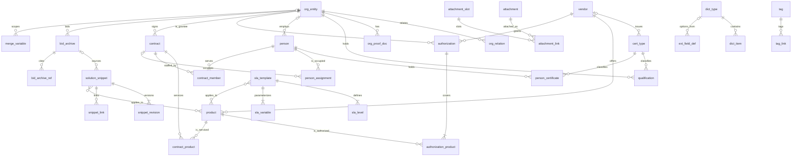

# 企业投标资料库数据字典 v1

| 项目 | 内容 |
|---|---|
| 文档版本 | v1（初稿，供评审） |
| 编写日期 | 2026-09-28（UTC+8） |
| 适用系统 | 私有化部署智能投标系统：企业投标资料库 |
| 业务范围 | 当前以数据库维保、IT 运维服务类标为主，结构上预留工程类、货物类扩展 |
| 主要依据 | 《资料库设计借鉴调研》（kb-schema-references-2026-09-28.md，下称“调研报告”）；《智能投标系统市场调研》（bid-system-landscape-2026-09-28.md）；与用户已确认的设计要点 |
| 文档性质 | 产品设计文档（逻辑数据字典），不是数据库建表脚本；数据类型为逻辑类型，由研发落到具体数据库 |

> 阅读提示：第 3 章每张表的最后一列“对应规范字段”只在调研报告里确有对应字段时填写，写法见 1.4 节；空着表示规范里没有对应字段，不是遗漏。表中凡是“初始值”“示例”字样的枚举，都是为了方便上线预置的参考值，管理员可以在后台修改。

---

## 1. 设计说明

### 1.1 分层：结构化资料和非结构化资料分开放

资料库分成五层。第一层是“字典与配置层”，存放证书类别、厂商产品、行业、方案类型、服务分类、附件用途、扩展字段定义等可配置的代码，业务数据只引用这些代码，不把名称写死在程序里。第二层是“结构化资料层”，存放公司主体、资质证书、人员、人员证书、原厂授权、业绩合同、SLA 模板这些有固定字段、需要逐条核对的资料，它们放在数据库表里，便于做到期提醒、合规检查和自动填表。第三层是“内容与知识层”，存放方案片段和历史标书这类以大段文字为主的资料；它们的正文进入知识检索库做语义检索，数据库里只保留一张“卡片”，记录标题、负责人、审核状态、适用范围、来源等管理信息。第四层是“文件层”，所有扫描件和电子文件统一存一份，记录原件、识别出来的文字（OCR 文本）、文件指纹（哈希值），再通过“附件归属”把同一个文件挂到一个或多个业务对象的指定用途位置上，例如“某份合同扫描件”既是业绩合同的“合同文本”，也是某位工程师的“项目经历证明”。第五层是“系统层”，记录变更日志和标签。

结构化资料和知识检索库之间靠三样东西打通：附件（文件既可以挂在结构化记录上，也可以同步到检索库）、标签（同一套标签同时用于表记录和检索库条目）、以及同步到检索库的“元数据”（审核状态、来源分级、所属主体、服务分类、涉及产品、有效期），这样检索时可以先按元数据过滤，未审核、过期或非本公司的内容不会被生成环节直接取用。

### 1.2 通用性：今天服务 IT 运维，明天能扩到工程和货物

通用性主要靠四个做法实现。第一，项目大类单独做成字典（服务、货物、工程），业绩、SLA、方案片段、历史标书都带这个字段，并能同时对照政府采购品目分类和电子招投标技术规范两套编码；以后投工程或货物标时，只需要新增品目分类和证书类别，不需要改表结构。第二，证书类别是一张可以无限分层的字典表，企业资质和个人证书共用，国家执业资格、行业资质、体系认证、厂商认证都放在一起，靠“适用对象”“是否有注册”“关联厂商/产品”等属性区分；以后加建造师、安全生产许可证也只是加几行数据。第三，厂商产品字典按“厂商—产品线—产品—版本”的树来组织，同一套结构对 Oracle 数据库版本、国产数据库、服务器型号、存储设备型号都适用，未来投货物标时可以直接复用为产品型号库。第四，每张业务表都预留“扩展字段”，管理员可以在后台为某张表增加字段（例如工程类需要的“安全生产许可证编号”），不用等研发改版。

### 1.3 维护性：谁负责、多久复审、改了什么都要看得见

这套资料要长期使用，最常见的问题是资料过期没人管、改错了找不到原因、同一件事有好几个版本。因此每条业务资料都有一位负责人，按设定的复审周期由系统生成复审提醒；有有效期的资料由系统自动计算“有效、临期、过期”，不允许人工手填状态；所有记录采用“停用”和“逻辑删除”而不是物理删除，任何字段的修改都进入变更日志，能查到谁在什么时间把什么值改成了什么值。字典的初始值区分“规范值”（来自国家规范、不宜随意改）和“示例值”（仅供上线参考、可以随意改），示例值在后台会带明显标记。规范字段映射集中写在两处：一是本字典每张表的“对应规范字段”列，二是字典项上的“规范代码”属性，以后规范更新时只需要改这两处。

### 1.4 命名约定

库内表名和列名都使用小写英文加下划线（snake_case），表名用单数名词，例如 `org_entity`、`person_certificate`。列名后缀有固定含义：`_id` 表示引用另一张表的记录；`_code` 表示取值来自某个字典；`_date` 表示日期；`_at` 表示精确到秒的时间；`_amount` 表示金额；布尔类字段用 `is_`、`has_`、`requires_` 开头。所有记录的主键 `id` 使用全局唯一标识（GUID），这与电子招标投标系统技术规范附录 B.3.7“附件关联标识号用 GUID”的做法一致，便于多主体、多系统之间交换数据不冲突。枚举值在库里存英文代码（例如 `pending`），界面显示中文名称，中文名称可以在字典里改而不影响历史数据。

金额统一以“元”为单位存储，最多 20 位、保留 6 位小数（与 V2.0 注册资本 N..20,6 的精度一致），界面可以按万元显示；这样可以避免“元/万元”混用导致的比较错误，导出规范格式时金额单位字段固定填“元”。日期统一存公历日期，时间统一按 UTC+8 显示。

本字典的“类型”列使用以下逻辑类型：

| 逻辑类型 | 含义 |
|---|---|
| 标识 | 全局唯一标识（GUID） |
| 文本(n) | 最长 n 个字符的短文本 |
| 长文本 | 不限长度的文字，如经营范围、OCR 文本 |
| 整数 / 小数 | 数值 |
| 金额 | 以元为单位的小数，最多 20 位、6 位小数 |
| 日期 / 年月 / 时间 | 日期精确到日；年月精确到月；时间精确到秒 |
| 布尔 | 是 / 否 |
| 代码〈字典〉 | 取值来自第 4 章某个字典，尖括号内是字典编码 |
| 多值代码〈字典〉 | 可多选的字典值 |
| 引用→表名 | 指向另一张表的一条记录 |
| 多值引用→表名 | 指向另一张表的多条记录 |
| 键值集合 | 一组“名称—值”，用于扩展字段、变量取值快照等 |

“必填”列的取值：**是**＝保存时必须填写；**否**＝选填；**条件**＝满足说明中的条件时必填；**系统**＝由系统生成或计算，用户不能直接修改。

“对应规范字段”列的写法：
- 《公共资源交易平台系统数据规范（V2.0）》中有英文名的字段，写成“V2.0 章节号 英文名”，例如 `V2.0 14.1.1 LEGAL_NAME`。V2.0 第 14 章没有合同字段，业绩合同表参照调研报告 5.3 节的建议，引用了 V2.0 第 7.5 节（工程建设合同，表 23）和第 8.1.5 节（政府采购合同，表 49）的英文名，并注明章节。
- 《电子招标投标系统技术规范》附录 A.2 的字段，调研报告只记录了中文名，没有记录英文名，因此写成“A.2.x 中文名（无英文名）”，不自造英文名。
- V2.0 中有该字段、但调研报告只记录了中文名的（如政府采购合同的“采购项目编号”），写成“V2.0 章节号 中文名（报告未载英文名）”。
- 规范里没有对应字段的，留空。
- 规范原文中的明显拼写（例如 `QUAL_CART_DOC`）照原样抄录，不做修正。

### 1.5 公共治理字段：每条资料都要回答“能不能用”

所有业务表都带一组相同的“公共治理字段”（3.0 节的 A、G、V 三组），它们回答的是“这条资料现在能不能被标书引用”。审核状态分为“待审”和“已审”，新录入、从文件里自动识别出来、或者已审后又被修改了关键内容的资料都是待审，待审资料可以查看，但生成标书时不得引用。资料来源分为“本公司”“合作伙伴”“仅供参考”三级，生成时只能直接引用本公司的资料；合作伙伴的资料（例如联合体成员的资质）只有在投标项目声明了联合体或分包关系、并经人工确认后才能使用，且要注明来源；仅供参考的资料（例如收集来的同行方案）只用于学习和检索，永远不进入标书正文。

有有效期的资料（资质证书、人员证书、原厂授权、主体证明材料等）由系统每天根据到期日计算状态：距到期超过 90 天为“有效”，90 天以内为“临期”，并在到期前 90、30、7 天分别提醒负责人；已过到期日为“过期”；既没填到期日、又没勾选“长期有效”的记为“待补录”。合规检查时不看今天，而看投标项目的递交日：只要证书在递交日之前到期，就在检查结果里标红。

每条资料还记录来源追溯信息：从哪个文件的第几页采集的、谁采集的、是人工录入还是系统识别、识别的可信程度有多高。人工核对过的字段可以加“人工编辑锁”，以后重新识别同一份文件时，系统不会覆盖已锁定的字段。每条资料有负责人、复审周期和下次复审日期，到期未复审会提醒负责人并在资料上显示“待复审”。创建人、修改人、创建时间、修改时间由系统自动记录。

### 1.6 敏感信息

身份证件号码、手机号码、银行账号、社保相关证明、身份证和社保记录的扫描件及其 OCR 文本属于敏感信息，统一要求“加密存储、脱敏展示”：库里保存加密后的值，列表和详情默认只显示部分字符（证件号显示前 4 位和后 4 位，手机号显示前 3 位和后 4 位，银行账号只显示后 4 位），只有具备权限的角色在必要时（例如生成需要完整号码的投标文件）才能解密，每次解密都进变更日志。敏感附件的 OCR 文本不同步到知识检索库，变更日志里记录敏感字段时也只记脱敏值。本字典在对应字段的说明里用【加密】【脱敏】标出。

---

## 2. 实体关系图

说明：图中只画主要的引用关系。附件归属（`attachment_link`）、标签归属（`tag_link`）、变更日志（`change_log`）和标书引用快照（`bid_archive_ref`）可以挂到任意业务表上（通过“归属对象类型 + 归属对象标识”），为了图面清晰没有逐一连线；公司主体的“上级主体”、厂商产品的“上级节点”、原厂授权的“依托授权”三处自引用关系也没有画出，见表内说明。

实体中英对照：

| 表名 | 中文名 | 所在层 |
|---|---|---|
| dict_type | 字典类型 | 字典与配置层 |
| dict_item | 字典项 | 字典与配置层 |
| cert_type | 证书类别 | 字典与配置层 |
| vendor | 厂商 | 字典与配置层 |
| product | 厂商产品（产品线/产品/版本） | 字典与配置层 |
| attachment_slot | 附件用途槽位 | 字典与配置层 |
| ext_field_def | 扩展字段定义 | 字典与配置层 |
| merge_variable | 全局变量 | 字典与配置层 |
| org_entity | 公司主体 | 结构化资料层 |
| org_relation | 主体关系 | 结构化资料层 |
| org_proof_doc | 主体证明材料 | 结构化资料层 |
| qualification | 资质证书（企业） | 结构化资料层 |
| person | 人员 | 结构化资料层 |
| person_certificate | 人员证书 | 结构化资料层 |
| person_assignment | 人员占用记录 | 结构化资料层 |
| authorization | 原厂授权 | 结构化资料层 |
| authorization_product | 授权产品 | 结构化资料层 |
| contract | 业绩合同 | 结构化资料层 |
| contract_product | 业绩服务对象产品 | 结构化资料层 |
| contract_member | 业绩项目成员 | 结构化资料层 |
| sla_template | SLA 模板 | 结构化资料层 |
| sla_level | SLA 故障等级 | 结构化资料层 |
| sla_variable | SLA 变量 | 结构化资料层 |
| solution_snippet | 方案片段（卡片） | 内容与知识层 |
| snippet_revision | 方案片段版本 | 内容与知识层 |
| snippet_link | 方案片段关联 | 内容与知识层 |
| bid_archive | 历史标书 | 内容与知识层 |
| bid_archive_ref | 标书引用快照 | 内容与知识层 |
| attachment | 附件文件 | 文件层 |
| attachment_link | 附件归属 | 文件层 |
| tag | 标签 | 系统层 |
| tag_link | 标签归属 | 系统层 |
| change_log | 变更日志 | 系统层 |

---

## 3. 表结构（字段字典）

### 3.0 公共字段组

为了不在每张表里重复罗列，公共字段分成三组，各表在表头注明带哪几组。“用户”指系统的账号与角色模块，不在本字典范围内。

**A 组：审计字段（所有表都有）**

| 列名 | 中文名 | 类型 | 必填 | 说明/取值 | 对应规范字段 |
|---|---|---|---|---|---|
| id | 记录标识 | 标识 | 系统 | GUID，全局唯一 | |
| created_by | 创建人 | 引用→用户 | 系统 | | |
| created_at | 创建时间 | 时间 | 系统 | | |
| updated_by | 修改人 | 引用→用户 | 系统 | | |
| updated_at | 修改时间 | 时间 | 系统 | 导出公司主体信息时作为数据时间戳 | V2.0 14.1.1 DATA_TIMESTAMP（仅公司主体导出时） |
| record_version | 记录版本号 | 整数 | 系统 | 每次保存加 1；防止两人同时修改互相覆盖；标书引用快照据此记录“引用的是第几版” | |
| is_deleted | 已删除 | 布尔 | 系统 | 逻辑删除，删除后普通用户不可见，管理员可恢复 | |

**G 组：治理字段（所有业务表都有；字典表和从属明细表不带，明细表随主表一起审核）**

| 列名 | 中文名 | 类型 | 必填 | 说明/取值 | 对应规范字段 |
|---|---|---|---|---|---|
| review_status | 审核状态 | 代码〈review_status〉 | 系统 | `pending` 待审 / `approved` 已审。新建、自动识别入库、已审后修改“关键字段”（各表中标 ★ 的字段）时自动置为待审。**待审资料不得被标书引用** | |
| reviewed_by | 审核人 | 引用→用户 | 系统 | 建议审核人不能是最后修改人（待确认） | |
| reviewed_at | 审核时间 | 时间 | 系统 | | |
| review_comment | 审核意见 | 文本(500) | 否 | 退回时必填 | |
| enabled | 启用状态 | 布尔 | 是 | 默认启用；停用后不参与检索、匹配、生成，历史引用保留 | |
| owner_id | 负责人 | 引用→用户 | 是 | 对资料准确性负责，接收到期提醒和复审任务；默认等于创建人 | |
| review_cycle_months | 复审周期（月） | 整数 | 否 | 空则取类别默认值（如证书类别上的默认复审周期），再空取系统默认 12 个月 | |
| last_review_date | 最近复审日期 | 日期 | 系统 | 审核通过或复审确认“内容无变化”时更新 | |
| next_review_date | 下次复审日期 | 日期 | 系统 | ＝最近复审日期＋复审周期，负责人可手工提前；逾期显示“待复审”并提醒 | |
| source_tier | 资料来源分级 | 代码〈source_tier〉 | 是 | `own` 本公司 / `partner` 合作伙伴 / `reference` 仅供参考。默认按所属公司主体的“主体范围”带出。**生成时只能直接引用 own**；partner 须在联合体/分包场景下人工确认并注明来源；reference 永不进入标书正文 | |
| source_attachment_id | 来源文件 | 引用→attachment | 否 | 资料采集自哪个文件 | |
| source_page | 来源页码 | 文本(50) | 否 | 如“3”“12-13” | |
| collected_by | 采集人 | 引用→用户 | 系统 | 人工录入为录入人；自动识别为发起识别的人 | |
| collected_at | 采集时间 | 时间 | 系统 | | |
| extract_method | 采集方式 | 代码〈extract_method〉 | 系统 | `manual` 人工录入 / `ocr` 文字识别 / `ai_extract` 智能抽取 / `import` 批量导入 / `harvest` 定稿回收 | |
| extract_confidence | 识别置信度 | 小数 | 否 | 0～1；自动识别时记录；低于阈值（建议 0.8，可配置）的字段在审核界面高亮 | |
| locked_fields | 人工编辑锁 | 多值文本 | 否 | 已人工核对并锁定的列名清单；重新识别同一文件时不覆盖这些字段 | |
| ext_data | 扩展字段值 | 键值集合 | 否 | 管理员在 `ext_field_def` 中为本表定义的扩展字段的取值 | |

标签不作为列存放，统一通过 `tag_link` 关联；附件统一通过 `attachment_link` 关联。

**V 组：有效期字段（有有效期的表才有）**

| 列名 | 中文名 | 类型 | 必填 | 说明/取值 | 对应规范字段 |
|---|---|---|---|---|---|
| valid_from | 有效期起 | 日期 | 否 | | |
| valid_to | 有效期止 ★ | 日期 | 条件 | 未勾选“长期有效”时必填 | 各表单独注明 |
| is_long_term | 长期有效 | 布尔 | 是 | 默认否 | |
| validity_status | 有效期状态 | 代码〈validity_status〉 | 系统 | 每日计算：`valid` 有效（剩余＞90 天或长期有效）/ `expiring` 临期（0～90 天）/ `expired` 过期 / `unknown` 待补录（无到期日且非长期） | |
| days_to_expiry | 剩余天数 | 整数 | 系统 | 有效期止减今天；长期有效为空 | |
| alert_stage | 已提醒阶段 | 代码〈alert_stage〉 | 系统 | 记录 90/30/7 天提醒已发到哪一级，避免重复提醒；有效期止被修改后重置 | |

提醒天数默认 90、30、7 天，可在系统参数中修改，也可以在证书类别（`cert_type.reminder_days`）上单独设置。合规检查时以投标项目的递交日（而不是今天）判断，递交日前过期即标红，见第 5 章。

### 3.1 字典与配置层

#### 3.1.1 dict_type 字典类型

通用字典的“目录”。第 4 章列出的大部分代码表都在这里登记，行业、方案类型、服务分类等都是它的一个类型。带 A 组。

| 列名 | 中文名 | 类型 | 必填 | 说明/取值 | 对应规范字段 |
|---|---|---|---|---|---|
| type_code | 字典编码 | 文本(50) | 是 | 唯一，如 `service_category` | |
| type_name | 字典名称 | 文本(100) | 是 | | |
| description | 说明 | 文本(500) | 否 | | |
| is_tree | 是否分层 | 布尔 | 是 | 如服务分类、方案类型为分层字典 | |
| is_builtin | 系统内置 | 布尔 | 系统 | 内置字典不可删除（如审核状态、资料来源分级），字典项能否修改由字典项的“值来源”决定 | |
| maintainer_role | 维护角色 | 文本(50) | 否 | 哪类管理员可维护 | |

#### 3.1.2 dict_item 字典项

带 A 组。

| 列名 | 中文名 | 类型 | 必填 | 说明/取值 | 对应规范字段 |
|---|---|---|---|---|---|
| type_code | 所属字典 | 引用→dict_type | 是 | | |
| item_code | 代码 | 文本(50) | 是 | 同一字典内唯一；被使用后不可修改，只能停用 | |
| item_name | 名称 | 文本(200) | 是 | 可修改，不影响历史数据 | |
| parent_item_id | 上级项 | 引用→dict_item | 否 | 分层字典使用 | |
| level_no | 层级 | 整数 | 系统 | | |
| aliases | 别名 | 多值文本 | 否 | 用于从招标文件文字中识别，如“七乘二十四小时”识别为 7×24 | |
| std_code | 规范代码 | 文本(50) | 否 | 该项在国家规范代码表中的代码，如资质等级“一级”为 02 | |
| std_source | 规范出处 | 文本(200) | 否 | 如“V2.0 14.4 资质等级代码（表 110）”“政府采购品目分类目录（财库〔2022〕31号）” | |
| value_origin | 值来源 | 代码〈value_origin〉 | 是 | `standard` 规范值 / `example` 示例值 / `custom` 用户自定义。示例值在界面带“示例”标记，规范值修改时二次确认 | |
| attributes | 附加属性 | 键值集合 | 否 | 按字典需要存放，如伙伴等级所属厂商、服务时段对应的每周小时数、项目大类在两套编码中的字母 | |
| sort_order | 排序 | 整数 | 否 | | |
| enabled | 启用 | 布尔 | 是 | | |
| remark | 备注 | 文本(500) | 否 | | |

#### 3.1.3 cert_type 证书类别

企业资质和个人证书共用的分层证书类别表（借鉴 Odoo hr_skills“技能类型＋是否证书类”的两层思路，自行建模）。因为带有较多专用属性，没有放进通用字典。带 A 组。

| 列名 | 中文名 | 类型 | 必填 | 说明/取值 | 对应规范字段 |
|---|---|---|---|---|---|
| type_code | 类别代码 | 文本(50) | 是 | 自建码，格式见本节末“自建扩展码段” | |
| type_name | 类别名称 | 文本(200) | 是 | 如“ISO/IEC 27001 信息安全管理体系认证” | |
| parent_id | 上级类别 | 引用→cert_type | 否 | 分层：分组→子分组→具体证书 | |
| node_kind | 节点类型 | 代码〈cert_node_kind〉 | 是 | `group` 分组 / `cert` 具体证书；只有具体证书能被资质或人员证书选用 | |
| applies_to | 适用对象 | 代码〈cert_applies_to〉 | 是 | `org` 企业 / `person` 个人 / `both` 两者 | |
| cert_family | 证书性质 | 代码〈cert_family〉 | 是 | 许可证 / 行业资质 / 体系认证 / 能力成熟度评估 / 国家职业（执业）资格 / 厂商认证 / 荣誉 / 其他 | |
| issuer_default | 默认发证机构 | 文本(200) | 否 | 录入证书时带出，可改 | |
| vendor_id | 关联厂商 | 引用→vendor | 否 | 厂商认证填写，如 Oracle OCP 关联 Oracle | |
| product_ids | 关联产品 | 多值引用→product | 否 | 证书对应的产品线/产品，用于“招标涉及的数据库品牌需有对应原厂认证人员”的检查 | |
| level_dict_code | 等级取值字典 | 引用→dict_type | 否 | 此类证书的等级从哪个字典取，如资质等级、ITSS 等级、CMMI 等级 | |
| has_registration | 有注册环节 | 布尔 | 是 | 是：人员证书必须填注册证书编号、注册单位、注册有效期（注册类执业资格）；厂商认证一般为否 | |
| requires_surveillance | 需年审/监督审核 | 布尔 | 否 | 体系认证一般为是 | |
| default_validity_years | 默认有效年限 | 整数 | 否 | 录入发证日期后推算到期日供参考，仍以证书为准 | |
| default_review_cycle_months | 默认复审周期（月） | 整数 | 否 | | |
| reminder_days | 提醒天数 | 多值整数 | 否 | 空则用系统默认 90/30/7 | |
| std_code | 规范代码 | 文本(20) | 否 | 若属于 V2.0 资质类型代码（执业资格代码，表 111）或资质序列、行业和专业类别 6 位码，填写对应代码；IT 类证书没有，留空 | V2.0 14.1.4 / 14.2.6 QUAL_TYPE（仅当有规范码时） |
| is_extension_code | 自建扩展码 | 布尔 | 系统 | std_code 为空时为是 | |
| value_origin | 值来源 | 代码〈value_origin〉 | 是 | 初始 IT 类证书均为 `example` | |
| aliases | 别名 | 多值文本 | 否 | 如“OCP”“Oracle Certified Professional” | |
| enabled | 启用 | 布尔 | 是 | | |

**自建扩展码段说明。** V2.0 的资质类型代码（执业资格代码，表 111）以工程类执业资格为主（如 010201 一级注册建造师、010801 注册造价工程师），没有 ISO 20000/27001、ITSS、CMMI、Oracle OCP、达梦 DCP 这类 IT 行业常用证书；资质序列、行业和专业类别 6 位码所依据的《企业资质序列行业和专业类别编码标准》原文本次未取得。因此本系统的 `type_code` 一律自建，规范码只作为属性放在 `std_code`：企业类证书用 `Q-` 开头（如 `Q-ISO27001`），个人类证书用 `P-` 开头（如 `P-ORA-OCP`），字母前缀保证不会与规范中的纯数字代码冲突。以后扩展工程类时，对规范里已有的证书（如注册建造师）同样建自建码，并在 `std_code` 填上规范码。需要按 V2.0 格式交换数据时，有规范码的证书用规范码填 `QUAL_TYPE`；自建码证书无法直接填，调研报告建议放入企业资质的“自定义数据项 CUSTOM_DEFINITION_DATAITEM”或使用“其他”类代码，具体码值需拿到标准原文后核实（列入第 6 章待确认）。

#### 3.1.4 vendor 厂商

厂商产品字典的第一层，是原厂授权、厂商认证、业绩服务对象的共同依据。带 A 组。

| 列名 | 中文名 | 类型 | 必填 | 说明/取值 | 对应规范字段 |
|---|---|---|---|---|---|
| vendor_code | 厂商代码 | 文本(50) | 是 | 自建，如 `ORACLE`、`DAMENG`（示例） | |
| vendor_name | 厂商名称 | 文本(200) | 是 | 建议以授权书落款主体的名称为准 | |
| short_name | 简称 | 文本(50) | 否 | | |
| aliases | 别名 | 多值文本 | 否 | 中英文名、曾用名、品牌名，用于识别招标文件中的品牌，如“甲骨文” | |
| country_region | 国别/地区 | 代码〈country_region〉 | 否 | GB/T 2659 | |
| credit_code | 统一社会信用代码 | 文本(18) | 否 | 境内厂商填写 | |
| is_domestic_innovation | 国产/信创厂商 | 布尔 | 否 | 判定口径待确认 | |
| partner_program | 伙伴计划名称 | 文本(200) | 否 | 厂商的合作伙伴体系名称 | |
| verify_url | 授权核验渠道 | 文本(500) | 否 | 原厂官网查询地址或核验方式说明 | |
| enabled | 启用 | 布尔 | 是 | | |
| remark | 备注 | 文本(500) | 否 | | |

#### 3.1.5 product 厂商产品

按“产品线—产品—版本/型号”自引用成树，授权、证书、业绩、SLA、方案片段都可以挂到任意一层。带 A 组。

| 列名 | 中文名 | 类型 | 必填 | 说明/取值 | 对应规范字段 |
|---|---|---|---|---|---|
| vendor_id | 厂商 | 引用→vendor | 是 | | |
| parent_id | 上级节点 | 引用→product | 否 | 产品线的上级为空 | |
| node_level | 节点层级 | 代码〈product_node_level〉 | 是 | `line` 产品线 / `product` 产品 / `version` 版本或型号 | |
| product_name | 名称 | 文本(200) | 是 | 如“Oracle Database”“19c”（示例） | |
| full_name | 完整名称 | 文本(300) | 系统 | 自动拼接“厂商＋产品线＋产品＋版本” | |
| aliases | 别名 | 多值文本 | 否 | 如“DM8”“达梦 8” | |
| product_category_code | 产品类别 | 代码〈product_category〉 | 是 | 下级默认继承上级 | |
| gov_catalog_code | 货物品目编码 | 代码〈gov_catalog〉 | 否 | 政府采购品目 A 开头的货物编码，为扩展货物类预留 | |
| lifecycle_status | 生命周期状态 | 代码〈lifecycle_status〉 | 否 | 在售 / 停售 / 停止标准支持 / 停止全部支持 | |
| end_of_support_date | 原厂支持截止日 | 日期 | 否 | 投维保标时判断原厂是否还能提供服务 | |
| is_domestic_innovation | 国产/信创产品 | 布尔 | 否 | | |
| sort_order | 排序 | 整数 | 否 | | |
| enabled | 启用 | 布尔 | 是 | | |
| remark | 备注 | 文本(500) | 否 | | |

#### 3.1.6 attachment_slot 附件用途槽位

规定每类记录可以挂哪些附件、哪些必备（借鉴 OpenBidKit_Yibiao 的 fieldKey 思路，自行建模；该项目为 AGPL，不复用其代码）。初始槽位见第 4 章。带 A 组。

| 列名 | 中文名 | 类型 | 必填 | 说明/取值 | 对应规范字段 |
|---|---|---|---|---|---|
| slot_code | 槽位代码 | 文本(50) | 是 | 如 `business_license` | |
| slot_name | 槽位名称 | 文本(100) | 是 | | |
| owner_type | 适用对象类型 | 代码〈owner_type〉 | 是 | 挂在哪类记录上，如 `qualification` | |
| is_required | 必备 | 布尔 | 是 | 必备槽位缺失时，记录不能提交审核 | |
| allow_multiple | 允许多个文件 | 布尔 | 是 | | |
| is_sensitive | 敏感附件 | 布尔 | 是 | 是：加密存储、OCR 文本不进检索库、导出自动加水印 | |
| std_code | 规范附件采集项 | 文本(50) | 否 | V2.0 14.3 附件采集项代码 | V2.0 14.3 附件采集项（LICENSE_CERT_DOC、ORGAN_CERT_DOC、TAX_CERT_DOC、QUAL_CART_DOC、ID_CARD_DOC、PROFESSIONAL_CART_DOC） |
| value_origin | 值来源 | 代码〈value_origin〉 | 是 | | |
| sort_order | 排序 | 整数 | 否 | | |
| enabled | 启用 | 布尔 | 是 | | |

#### 3.1.7 ext_field_def 扩展字段定义

管理员在后台为任意业务表增加字段，取值存在该表的 `ext_data` 中。带 A 组。

| 列名 | 中文名 | 类型 | 必填 | 说明/取值 | 对应规范字段 |
|---|---|---|---|---|---|
| target_table | 所属表 | 代码〈owner_type〉 | 是 | | |
| field_key | 字段键 | 文本(50) | 是 | `ext_` 开头的 snake_case，同表唯一，创建后不可改 | |
| field_label | 显示名称 | 文本(100) | 是 | | |
| data_type | 数据类型 | 代码〈ext_data_type〉 | 是 | 文本 / 长文本 / 整数 / 小数 / 金额 / 日期 / 布尔 / 单选 / 多选 | |
| options_dict_code | 选项字典 | 引用→dict_type | 条件 | 单选、多选时必填 | |
| is_required | 必填 | 布尔 | 是 | | |
| default_value | 默认值 | 文本(200) | 否 | | |
| help_text | 填写说明 | 文本(500) | 否 | | |
| is_sensitive | 敏感 | 布尔 | 是 | 是则加密存储、脱敏展示 | |
| is_key_field | 关键字段 | 布尔 | 否 | 是则已审记录修改此字段后回到待审 | |
| show_in_list | 列表显示 | 布尔 | 否 | | |
| applies_when | 显示条件 | 文本(200) | 否 | 如“仅当项目大类为工程时显示” | |
| sort_order | 排序 | 整数 | 否 | | |
| enabled | 启用 | 布尔 | 是 | 停用后不再显示，已有取值保留 | |

#### 3.1.8 merge_variable 全局变量

借鉴 Loopio 的 Library Merge Variable / Responsive 的 Merge Tag：会随时间变化的公司级数值（如认证 DBA 人数、服务客户数）只存一处，方案片段里用占位符引用，更新一次全部生效。带 A、G 组。

| 列名 | 中文名 | 类型 | 必填 | 说明/取值 | 对应规范字段 |
|---|---|---|---|---|---|
| var_key | 变量键 | 文本(100) | 是 | 如 `company.dba_count`，正文中写作 `{{company.dba_count}}` | |
| var_label | 变量名称 | 文本(100) | 是 | 如“认证 DBA 人数” | |
| scope_entity_id | 适用主体 | 引用→org_entity | 否 | 空表示所有主体通用；各子公司数值不同时分别建 | |
| value_type | 取值类型 | 代码〈var_value_type〉 | 是 | 整数 / 小数 / 文本 / 日期 | |
| current_value | 当前值 ★ | 文本(500) | 是 | | |
| unit | 单位 | 代码〈var_unit〉 | 否 | | |
| as_of_date | 数据截止日期 | 日期 | 是 | 如“截至 2026-06-30”，生成时可一并输出 | |
| evidence_note | 取值依据 | 文本(500) | 否 | 也可挂附件 | |
| calc_rule | 自动计算规则 | 文本(500) | 否 | 如“在职且 Oracle OCP 有效的人数”；填写后由系统按资料库数据计算，不再手填 | |

### 3.2 结构化资料层

中文名后标 ★ 的是“关键字段”：已审记录修改这些字段后自动回到待审，重新审核前不得引用。

#### 3.2.1 org_entity 公司主体

支持多个主体：本公司（母公司、子公司、分公司）和合作伙伴（联合体伙伴、分包方等）都建在这张表里，用“主体范围”区分；母子、分公司关系用“上级主体”表达，联合体等合作关系用 `org_relation` 表达。带 A、G 组。

| 列名 | 中文名 | 类型 | 必填 | 说明/取值 | 对应规范字段 |
|---|---|---|---|---|---|
| entity_name | 主体名称 ★ | 文本(200) | 是 | 以营业执照为准 | V2.0 14.1.1 LEGAL_NAME |
| short_name | 简称 | 文本(50) | 否 | | |
| former_names | 曾用名 | 多值文本 | 否 | 用于核对证书、业绩上的旧名称 | |
| credit_code | 统一社会信用代码 ★ | 文本(18) | 条件 | 境内法人、非法人组织必填；18 位，GB 32100-2015 | V2.0 14.1.1 LEGAL_CODE |
| business_license_no | 营业执照号码 | 文本(50) | 否 | 默认带出统一社会信用代码，可改 | V2.0 14.1.1 LICENSE_NO |
| entity_scope | 主体范围 | 代码〈entity_scope〉 | 是 | `own` 本公司（含母/子/分公司）/ `partner` 合作伙伴。决定其名下资料的默认来源分级 | |
| entity_category | 主体类别 | 代码〈entity_category〉 | 是 | 取值采用 V2.0 14.4 主体类别代码（表 112），如 2 法人、3 联合体、7 二级单位（非法人）；报告未载明对应字段英文名 | |
| org_type | 法人机构类别 | 代码〈org_type〉 | 否 | V2.0 14.4 法人机构类别：1 企业 / 2 机关法人 / 3 事业单位 / 4 社会组织 / 9 其他 | V2.0 14.1.1 LEGAL_TYPE |
| company_type | 企业类型 | 文本(100) | 否 | 照录营业执照“类型”，如“有限责任公司” | |
| parent_entity_id | 上级主体 | 引用→org_entity | 否 | 子公司、分公司指向母公司 | |
| group_role | 集团内角色 | 代码〈group_role〉 | 否 | 母公司 / 子公司 / 分公司 / 独立主体 | |
| legal_representative | 法定代表人（负责人） ★ | 文本(50) | 是 | 分公司填负责人 | V2.0 14.1.1 LEGAL_REPRESENT |
| legal_rep_person_id | 法定代表人人员记录 | 引用→person | 否 | 关联后可复用其身份证件附件 | |
| reg_capital | 注册资本 | 金额 | 否 | 以元存储 | V2.0 14.1.1 REG_CAPITAL（REG_UNIT 导出时固定填元） |
| reg_capital_currency | 注册资本币种 | 代码〈currency〉 | 否 | GB/T 12406，默认人民币 | V2.0 14.1.1 REG_CAP_CURRENCY |
| established_date | 成立日期 | 日期 | 否 | | |
| business_term_start | 经营期限起 | 日期 | 否 | | |
| business_term_end | 经营期限止 ★ | 日期 | 条件 | 非长期时必填；参与“营业执照有效”检查 | V2.0 14.1.1 LICENSE_END_DATE |
| business_term_long | 经营期限长期 | 布尔 | 是 | | |
| registered_address | 住所 | 文本(300) | 是 | 照录营业执照 | |
| office_address | 实际经营地址 | 文本(300) | 否 | | |
| postal_code | 邮政编码 | 文本(6) | 否 | | A.2.1 邮政编码（无英文名） |
| business_scope | 经营范围 | 长文本 | 否 | 照录营业执照；用于核对“经营范围包含运维服务”类资格要求 | |
| industry_code | 行业代码 | 代码〈industry_gbt4754〉 | 否 | GB/T 4754-2011 | V2.0 14.1.1 LEGAL_INDUSTRY |
| country_region | 国别/地区 | 代码〈country_region〉 | 否 | GB/T 2659，默认中国 | V2.0 14.1.1 COUNTRY_REGION |
| region_code | 行政区域代码 | 代码〈region〉 | 否 | GB/T 2260 | V2.0 14.1.1 REGION_CODE |
| contact_name | 联系人 | 文本(50) | 否 | | V2.0 14.1.1 LEGAL_CONTACT |
| contact_phone | 联系人电话 | 文本(30) | 否 | 【脱敏】 | V2.0 14.1.1 LEGAL_CONTACT_PHONE |
| contact_email | 电子邮箱 | 文本(100) | 否 | | A.2.1 电子邮箱（无英文名） |
| bank_name | 基本户开户银行 | 文本(200) | 否 | | A.2.1 开户银行（无英文名） |
| bank_account_name | 基本户户名 | 文本(200) | 否 | 一般与主体名称相同 | |
| bank_account_no | 基本户账号 | 文本(50) | 否 | 【加密】【脱敏】 | A.2.1 基本账户账号（无英文名） |
| taxpayer_type | 纳税人资格 | 代码〈taxpayer_type〉 | 否 | 一般纳税人 / 小规模纳税人 | |
| enterprise_scale | 企业规模 | 代码〈enterprise_scale〉 | 否 | 大型 / 中型 / 小型 / 微型；用于中小企业声明函，划型口径需按当年政策核对 | |
| insured_employee_count | 参保人数 | 整数 | 否 | | |
| insured_count_as_of | 参保人数截止月份 | 年月 | 条件 | 填参保人数时必填 | |
| company_intro | 公司简介（短） | 文本(1000) | 否 | 一两百字的短介绍；长版公司介绍作为方案片段管理 | |
| default_watermark | 默认水印文字 | 文本(100) | 否 | 导出附件时的默认水印，如“仅用于××项目投标” | |
| entity_status | 主体状态 | 代码〈entity_status〉 | 是 | 存续 / 注销 / 吊销 / 停用 | |

常用附件槽位：营业执照、法定代表人身份证件（正反面）、法定代表人授权书模板、开户许可证/基本存款账户信息、公司章程。

#### 3.2.2 org_relation 主体关系

记录联合体合作、分包合作、战略合作等主体之间的关系（母子公司关系用 `org_entity.parent_entity_id`）。带 A、G、V 组。

| 列名 | 中文名 | 类型 | 必填 | 说明/取值 | 对应规范字段 |
|---|---|---|---|---|---|
| from_entity_id | 主体 | 引用→org_entity | 是 | 通常为本公司主体 | |
| to_entity_id | 关联主体 | 引用→org_entity | 是 | | |
| relation_type | 关系类型 ★ | 代码〈relation_type〉 | 是 | 联合体合作 / 分包合作 / 战略合作 / 其他 | |
| agreement_no | 协议编号 | 文本(100) | 否 | 框架合作协议编号；单个项目的联合体协议随投标项目管理 | |
| scope_note | 合作范围 | 文本(500) | 否 | | |

V 组中 `valid_to` 为协议有效期止。常用附件槽位：合作协议。

#### 3.2.3 org_proof_doc 主体证明材料

把纳税、社保、财务审计、信用查询等“按期开具、会过期”的证明从主体表中拆出来，一年一条或一期一条，便于按“近三年”“近六个月”等要求挑选（类型参照《政府采购法实施条例》第十七条的材料清单）。带 A、G、V 组。

| 列名 | 中文名 | 类型 | 必填 | 说明/取值 | 对应规范字段 |
|---|---|---|---|---|---|
| entity_id | 所属主体 | 引用→org_entity | 是 | | |
| proof_type | 材料类型 ★ | 代码〈proof_type〉 | 是 | 财务审计报告 / 纳税证明 / 社保缴纳证明 / 信用查询截图 / 无重大违法记录声明 等 | |
| period_start | 所属期间起 | 日期 | 否 | 如纳税证明覆盖的起始月 | |
| period_end | 所属期间止 | 日期 | 否 | | |
| fiscal_year | 所属年度 | 整数 | 条件 | 财务审计报告必填 | |
| issue_date | 开具/查询日期 ★ | 日期 | 是 | 信用查询以查询日期为准 | |
| issuing_org | 出具机构 | 文本(200) | 否 | 税务机关、社保机构、会计师事务所、查询网站 | |
| audit_opinion | 审计意见类型 | 代码〈audit_opinion〉 | 否 | 财务审计报告填写：标准无保留 / 带强调事项 / 保留 / 否定 / 无法表示 | |
| revenue_amount | 营业收入 | 金额 | 否 | 财务审计报告填写 | |
| net_profit_amount | 净利润 | 金额 | 否 | | |
| total_assets_amount | 资产总额 | 金额 | 否 | | |
| total_liabilities_amount | 负债总额 | 金额 | 否 | | |
| insured_count | 缴费人数 | 整数 | 否 | 社保缴纳证明填写 | |
| query_result | 查询结论 | 文本(200) | 否 | 信用查询填写，如“未查询到失信记录” | |
| remark | 说明 | 文本(500) | 否 | | |

V 组的 `valid_to` 为该证明在投标中的可用截止日（多数证明没有法定有效期，按招标常见时效由负责人填写，或由材料类型的默认时效推算，见第 6 章）。常用附件槽位：证明原件扫描件；社保缴纳证明为敏感附件。

#### 3.2.4 qualification 资质证书（企业）

企业持有的各类资质、许可证、体系认证、能力评估证书。原厂的伙伴资质证书放在“原厂授权”表（授权类型＝合作伙伴资质），不放这里。带 A、G、V 组。

| 列名 | 中文名 | 类型 | 必填 | 说明/取值 | 对应规范字段 |
|---|---|---|---|---|---|
| holder_entity_id | 持证主体 ★ | 引用→org_entity | 是 | | V2.0 14.1.4 LEGAL_CODE（导出时取持证主体的统一社会信用代码） |
| holder_name_on_cert | 证书所载持证单位名称 | 文本(200) | 是 | 照录证书原文，用于和主体名称比对（企业改名后证书未变更的情况） | |
| cert_type_id | 证书类别 ★ | 引用→cert_type | 是 | 只能选“适用对象”含企业的具体证书 | V2.0 14.1.4 QUAL_TYPE（导出时取 cert_type.std_code，自建码见 3.1.3） |
| qual_name | 资质名称 ★ | 文本(200) | 是 | 默认带出类别名称，按证书原文修改 | V2.0 14.1.4 QUAL_NAME |
| qual_level_code | 资质等级 ★ | 代码〈qual_level〉 | 否 | V2.0 14.4 资质等级 01～13；ITSS、CMMI 等级用扩展码，见第 4 章 | V2.0 14.1.4 QUAL_LEVEL |
| cert_no | 证书编号 ★ | 文本(100) | 是 | | V2.0 14.1.4 QUAL_CERT_NO |
| issuer_name | 发证机构 | 文本(200) | 是 | 命名可参考双公示标准的许可机关 XK_XKJG | |
| issuer_credit_code | 发证机构统一社会信用代码 | 文本(18) | 否 | 参考双公示 XK_XKJGDM | |
| issue_date | 发证日期 | 日期 | 否 | | |
| scope_text | 认证/许可范围原文 | 长文本 | 否 | 照录证书上的范围，用于核对“认证范围须包含运维服务”类要求 | |
| service_category_codes | 覆盖服务分类 | 多值代码〈service_category〉 | 否 | 人工根据范围原文勾选，供匹配 | |
| requires_surveillance | 需年审/监督审核 | 布尔 | 否 | 默认取证书类别设置 | |
| next_surveillance_date | 下次年审/监督审核日期 | 日期 | 条件 | 需年审时必填；逾期未更新视为风险 | |
| issuer_status | 发证机构公示状态 | 代码〈cert_issuer_status〉 | 否 | 有效 / 暂停 / 撤销 / 注销，按发证机构官网查询结果填写（参考双公示 XK_ZT），与系统计算的有效期状态是两回事 | |
| last_verified_date | 最近官网核验日期 | 日期 | 否 | 配合“官网查询截图”附件 | |
| verify_url | 查询地址 | 文本(500) | 否 | | |
| remark | 备注 | 文本(500) | 否 | | |

V 组中 `valid_to` 对应 **V2.0 14.1.4 QUAL_CERT_END_DATE**。`ext_data` 导出时可放入 **V2.0 14.1.4 CUSTOM_DEFINITION_DATAITEM**。常用附件槽位：证书正本/副本扫描件（规范码 QUAL_CART_DOC）、官网查询截图、年审/监督审核记录。

#### 3.2.5 person 人员

本单位员工、外包人员、合作伙伴人员都建在这里，用“人员归属”区分。带 A、G 组（合作伙伴人员默认来源分级为合作伙伴）。

| 列名 | 中文名 | 类型 | 必填 | 说明/取值 | 对应规范字段 |
|---|---|---|---|---|---|
| person_name | 姓名 ★ | 文本(50) | 是 | | V2.0 14.2.5 PERSON_NAME |
| gender | 性别 | 代码〈gender〉 | 否 | GB/T 2261.1 | A.2.4 性别（无英文名） |
| id_card_type | 身份证件类型 | 代码〈id_card_type〉 | 是 | 默认居民身份证 | V2.0 14.2.5 ID_CARD_TYPE |
| id_card_no | 身份证件号码 ★ | 文本(30) | 是 | 【加密】【脱敏】显示前 4 位＋****＋后 4 位；同一证件号在库中唯一，用于去重 | V2.0 14.2.5 ID_CARD |
| id_card_valid_to | 证件有效期止 | 日期 | 否 | 证件过期会导致身份证复印件无效，参与提醒 | |
| birth_month | 出生年月 | 年月 | 否 | 【脱敏】只存年月 | A.2.4 出生年月（无英文名） |
| phone | 手机号码 | 文本(30) | 否 | 【加密】【脱敏】 | V2.0 14.2.5 PERSON_PHONE |
| email | 电子邮箱 | 文本(100) | 否 | | |
| region_code | 所在行政区域 | 代码〈region〉 | 否 | GB/T 2260 | V2.0 14.2.5 REGION_CODE |
| person_affiliation | 人员归属 ★ | 代码〈person_affiliation〉 | 否 | `own_staff` 本单位（默认）/ `outsourced` 外包 / `partner` 合作伙伴 | |
| employer_entity_id | 所在单位（库内主体） | 引用→org_entity | 条件 | 所在单位已在主体表中时选择；本单位人员必填 | V2.0 14.2.5 UNIT_CODE（导出取该主体统一社会信用代码） |
| employer_name | 所在单位名称 | 文本(200) | 是 | 选了库内主体则自动带出；外包人员填外包公司 | V2.0 14.2.5 UNIT_NAME |
| social_insurance_unit_name | 社保缴纳单位 ★ | 文本(200) | 否 | 选填；用于核对“社保须由投标人缴纳”类要求 | |
| social_insurance_unit_code | 社保缴纳单位代码 | 文本(18) | 否 | 选填；统一社会信用代码，比对时优先用代码 | |
| social_insurance_proved_until | 社保证明覆盖至 | 年月 | 否 | 最近一份社保缴纳记录覆盖到的月份 | |
| labor_contract_start | 劳动合同起 | 日期 | 否 | | |
| labor_contract_end | 劳动合同止 | 日期 | 否 | 无固定期限可留空并在备注说明 | |
| employment_status | 在职状态 ★ | 代码〈employment_status〉 | 是 | 在职 / 离职 / 退休返聘 | A.2.4 是否在职（无英文名） |
| availability_status | 占用状态 | 代码〈availability_status〉 | 系统 | `available` 可用 / `occupied` 占用 / `disabled` 停用。占用由 `person_assignment` 自动推导；停用由人工设置（如长期病假）；离职人员自动为停用 | |
| position | 职务/岗位 | 文本(100) | 否 | | A.2.4 职务（无英文名） |
| professional_title | 技术职称 | 代码〈professional_title〉 | 否 | 初级 / 中级 / 高级等，具体职称名称可在备注中照录 | A.2.4 技术职称（无英文名） |
| education_level | 最高学历 | 代码〈education_level〉 | 否 | GB/T 4658 | A.2.4 最高学历（无英文名） |
| school | 毕业院校 | 文本(100) | 否 | | |
| major | 专业 | 文本(100) | 否 | | |
| graduation_date | 毕业时间 | 年月 | 否 | | |
| work_start_date | 从业开始时间 | 日期 | 否 | 用它计算从业年限，不手填年限 | V2.0 14.2.5 WORK_START_DATE |
| years_of_experience | 从业年限 | 小数 | 系统 | 按从业开始时间计算到今天（合规检查时算到递交日） | A.2.4 从业年限（无英文名） |
| skill_tags | 技术专长 | 多值引用→product | 否 | 熟悉的厂商产品，辅助排人 | |
| resume_summary | 简历摘要 | 长文本 | 否 | 工作经历、主要能力；项目经历优先从 `contract_member` 自动汇总 | A.2.4 从业经历（无英文名） |
| remark | 备注 | 文本(500) | 否 | | |

常用附件槽位：身份证件正反面（规范码 ID_CARD_DOC，敏感）、社保缴纳记录（敏感）、劳动合同（敏感）、学历/学位证书、职称证书、个人照片。

#### 3.2.6 person_certificate 人员证书

国家职业（执业）资格和厂商认证共用一张表；按规范把“资格证书编号”和“注册证书编号”分开存，并记录注册单位。带 A、G、V 组。

| 列名 | 中文名 | 类型 | 必填 | 说明/取值 | 对应规范字段 |
|---|---|---|---|---|---|
| person_id | 持证人 ★ | 引用→person | 是 | | V2.0 14.2.6 ID_CARD、ID_CARD_TYPE（导出时取持证人证件） |
| cert_type_id | 证书类别 ★ | 引用→cert_type | 是 | 只能选“适用对象”含个人的具体证书 | V2.0 14.2.6 QUAL_TYPE（导出时取 cert_type.std_code） |
| qual_name | 证书名称 ★ | 文本(200) | 是 | 默认带出类别名称，按证书原文修改 | V2.0 14.2.6 QUAL_NAME |
| qual_level | 证书等级 | 代码（按证书类别的等级字典） | 否 | 如初级/中级/高级，或厂商认证级别 | A.2.5 职业资格等级（无英文名） |
| qualification_cert_no | 资格证书编号 ★ | 文本(100) | 是 | 资格/认证证书上的编号 | V2.0 14.2.6 CERT_NO；A.2.5 资格证书编号 |
| registration_cert_no | 注册证书编号 ★ | 文本(100) | 条件 | 证书类别“有注册环节”时必填 | A.2.5 注册登记证书编号（无英文名） |
| registration_entity_name | 注册单位 ★ | 文本(200) | 条件 | 同上；应与投标主体一致 | |
| registration_entity_code | 注册单位代码 | 文本(18) | 否 | 统一社会信用代码，比对时优先用代码 | |
| registration_valid_to | 注册有效期止 ★ | 日期 | 条件 | 有注册环节时必填；参与有效期检查 | V2.0 14.2.6 CERT_END_DATE |
| issuer_name | 发证机构 | 文本(200) | 否 | 默认取证书类别的默认发证机构 | |
| issue_date | 发证/通过日期 | 日期 | 否 | | |
| product_ids | 对应产品 | 多值引用→product | 否 | 默认带出证书类别关联的产品，可细化到具体版本 | |
| continuing_edu_due_date | 继续教育/再认证截止日 | 日期 | 否 | | |
| verify_url | 查询/核验方式 | 文本(500) | 否 | 厂商认证的官网验证地址或验证码 | |
| last_verified_date | 最近核验日期 | 日期 | 否 | | |
| remark | 备注 | 文本(500) | 否 | | |

V 组中 `valid_to` 为证书本身的有效期止（很多厂商认证为长期有效或按版本失效）；有注册环节的证书同时检查 `registration_valid_to`。常用附件槽位：证书扫描件（规范码 PROFESSIONAL_CART_DOC）、官网核验截图。

#### 3.2.7 person_assignment 人员占用记录

记录人员在哪些在投项目或履约项目中被占用，用于推导占用状态和发现冲突（思路借鉴 RudyJunyu/Bid_Agent 的可用状态字段，该仓库无许可证，仅参考思路）。带 A 组。

| 列名 | 中文名 | 类型 | 必填 | 说明/取值 | 对应规范字段 |
|---|---|---|---|---|---|
| person_id | 人员 | 引用→person | 是 | | |
| assignment_type | 占用类型 | 代码〈assignment_type〉 | 是 | 在投占用 / 中标履约 / 内部项目 / 其他 | |
| bid_project_ref | 投标项目标识 | 文本(100) | 条件 | 在投占用时必填；指向投标项目模块中的项目（不在本字典范围） | |
| contract_id | 履约合同 | 引用→contract | 条件 | 中标履约时必填 | |
| role_code | 担任角色 | 代码〈person_role〉 | 是 | 项目经理 / 技术负责人 / 驻场工程师 等 | |
| is_exclusive | 排他占用 | 布尔 | 是 | 是：同一时段不得再在其他项目担任排他角色（如项目经理）；招标文件有要求时由投标项目带入 | |
| start_date | 开始日期 | 日期 | 是 | 在投占用一般从递交日开始 | |
| planned_end_date | 计划结束日期 | 日期 | 否 | 在投占用可设为“开标后若干天自动释放” | |
| released_at | 实际释放时间 | 时间 | 否 | 未中标、项目结束时写入 | |
| assignment_status | 状态 | 代码〈assignment_status〉 | 系统 | 生效 / 已释放 | |
| origin | 产生方式 | 代码〈assignment_origin〉 | 系统 | 递交时自动写入 / 中标后转履约 / 人工登记 | |
| remark | 备注 | 文本(500) | 否 | | |

#### 3.2.8 authorization 原厂授权

原厂（或其授权的总代理）给我方主体出具的各类授权。调研中没有找到任何开源项目或国家规范的字段定义，本表为自行设计。带 A、G、V 组。

| 列名 | 中文名 | 类型 | 必填 | 说明/取值 | 对应规范字段 |
|---|---|---|---|---|---|
| vendor_id | 授权厂商 ★ | 引用→vendor | 是 | 授权所针对的原厂 | |
| grantor_name | 出具方 | 文本(200) | 否 | 默认为原厂；由总代理/分销商转授权时填出具方名称 | |
| grantor_type | 出具方类型 | 代码〈grantor_type〉 | 否 | 原厂 / 总代理 / 其他渠道 | |
| grantee_entity_id | 被授权主体 ★ | 引用→org_entity | 是 | 应与投标主体一致 | |
| auth_type | 授权类型 ★ | 代码〈auth_type〉 | 是 | `partner_qual` 合作伙伴资质 / `annual_agency` 年度代理 / `service_auth` 服务授权 / `project_auth` 项目专项授权 | |
| partner_level_code | 伙伴等级 | 代码〈partner_level〉 | 条件 | 合作伙伴资质时必填；等级按厂商分别配置 | |
| auth_letter_no | 授权书编号 ★ | 文本(100) | 否 | 授权书无编号时留空，在备注说明 | |
| service_scope_codes | 授权服务内容 ★ | 多值代码〈auth_service_scope〉 | 是 | 销售 / 维保服务 / 技术支持 / 备件供应 / 培训 等；维保标通常要求含“维保服务” | |
| auth_scope_text | 授权范围原文 | 长文本 | 否 | 照录授权书上关于产品和范围的原文 | |
| auth_region_codes | 授权地域 ★ | 多值代码〈auth_region〉 | 是 | 全国，或按 GB/T 2260 选省/市 | |
| project_name | 适用项目名称 ★ | 文本(300) | 条件 | 项目专项授权必填 | |
| tender_no | 适用招标/采购编号 ★ | 文本(100) | 条件 | 项目专项授权必填 | |
| lot_no | 适用标段（包）编号 | 文本(50) | 否 | | |
| tenderee_name | 适用采购人/招标人 | 文本(200) | 否 | | |
| parent_authorization_id | 依托授权 | 引用→authorization | 否 | 项目专项授权所依托的年度代理或伙伴资质 | |
| requires_project_application | 需按项目单独申请 | 布尔 | 是 | 是：投这个厂商的标时必须另行向原厂申请项目专项授权，系统在投标立项时提示 | |
| application_lead_days | 申请提前天数 | 整数 | 否 | 原厂出具专项授权通常需要的天数，用于倒排计划 | |
| application_contact | 原厂申请联系人 | 文本(100) | 否 | 姓名和联系方式；联系方式【脱敏】 | |
| requires_original | 需提供原件 | 布尔 | 否 | 招标常要求授权书原件或原厂盖章件 | |
| original_location | 原件保管位置 | 文本(200) | 否 | | |
| verify_url | 核验方式 | 文本(500) | 否 | 默认取厂商的授权核验渠道 | |
| last_verified_date | 最近核验日期 | 日期 | 否 | | |
| remark | 备注 | 文本(500) | 否 | | |

V 组中 `valid_to` 为授权有效期止。授权的产品范围在 `authorization_product` 中维护，至少一条。常用附件槽位：授权书扫描件、伙伴资质证书、原厂官网核验截图、原厂承诺函。

#### 3.2.9 authorization_product 授权产品

原厂授权与厂商产品的多对多关系。带 A 组，随主表审核。

| 列名 | 中文名 | 类型 | 必填 | 说明/取值 | 对应规范字段 |
|---|---|---|---|---|---|
| authorization_id | 授权 | 引用→authorization | 是 | | |
| product_id | 授权产品 ★ | 引用→product | 是 | 可以是产品线、产品或具体版本 | |
| include_descendants | 含下级 | 布尔 | 是 | 默认是：授权到产品线即覆盖其下所有产品和版本 | |
| coverage_note | 覆盖说明 | 文本(300) | 否 | 如“仅限 19c 及以上版本” | |

#### 3.2.10 contract 业绩合同

我方主体签署并履行的合同业绩。V2.0 第 14 章没有合同字段，映射列引用 V2.0 第 7.5 节（工程建设合同，表 23）、第 8.1.5 节（政府采购合同，表 49）和技术规范附录 A.2.7（投标人业绩）。带 A、G 组。

| 列名 | 中文名 | 类型 | 必填 | 说明/取值 | 对应规范字段 |
|---|---|---|---|---|---|
| project_name | 项目名称 ★ | 文本(300) | 是 | 中标项目名称 | A.2.7 中标项目和标段（包）名称（无英文名） |
| contract_name | 合同名称 ★ | 文本(300) | 是 | | V2.0 7.5 CONTRACT_NAME |
| contract_no | 合同编号 | 文本(100) | 否 | | |
| tender_no | 招标/采购项目编号 | 文本(100) | 否 | | V2.0 8.1.5 采购项目编号（报告未载英文名） |
| lot_no | 标段（包）编号 | 文本(50) | 否 | | A.2.7 中标项目的标段（包）编号（无英文名） |
| lot_name | 标段（包）名称 | 文本(300) | 否 | | A.2.7 中标项目和标段（包）名称（无英文名） |
| our_entity_id | 签约主体 ★ | 引用→org_entity | 是 | 我方签约的主体；用于核对“业绩须为投标人自身业绩” | V2.0 8.1.5 SUPPLIER_NAME、SUPPLIER_CODE（导出取主体名称、代码） |
| our_role | 我方角色 ★ | 代码〈our_role〉 | 是 | 独立承接 / 总包 / 分包 / 联合体牵头方 / 联合体成员 | |
| client_name | 甲方（采购人/招标人）名称 ★ | 文本(200) | 是 | | A.2.7 招标人名称（无英文名） |
| client_credit_code | 甲方统一社会信用代码 | 文本(18) | 否 | | A.2.7 招标人代码（无英文名） |
| client_type | 甲方类型 | 代码〈client_type〉 | 否 | 政府机关 / 事业单位 / 国有企业 等 | |
| client_industry_code | 甲方行业 | 代码〈industry〉 | 否 | 金融 / 政府 / 能源 等 | |
| project_region_code | 项目地点 | 代码〈region〉 | 否 | GB/T 2260 | |
| project_category_code | 项目大类 ★ | 代码〈project_category〉 | 是 | 服务 / 货物 / 工程，两套字母编码的区别见第 4 章 | |
| service_category_codes | 服务分类码 ★ | 多值代码〈service_category〉 | 条件 | 项目大类为服务时必填，如 C16070300 软件运维 | |
| bid_win_amount | 中标金额 | 金额 | 否 | | A.2.7 中标金额（无英文名） |
| contract_amount | 合同金额 ★ | 金额 | 是 | 含税总价；费率、单价合同在价款形式中说明 | V2.0 8.1.5 CONTRACT_AMOUNT；V2.0 7.5 CONTRACT_PRICE |
| settlement_amount | 结算金额 ★ | 金额 | 否 | 履约完成后的结算金额 | A.2.7 合同结算金额（无英文名） |
| currency_code | 币种 | 代码〈currency〉 | 是 | GB/T 12406，默认人民币；金额单位固定为元 | V2.0 8.1.5 CURRENCY_CODE；V2.0 7.5 PRICE_CURRENCY |
| price_form_code | 价款形式 | 代码〈price_form〉 | 否 | | V2.0 8.1.5 PRICE_FORM_CODE |
| win_bid_rate | 中标优惠率或其他价格 | 文本(100) | 否 | 费率类合同填写 | V2.0 8.1.5 WIN_BID_RATE |
| sign_date | 合同签署日期 ★ | 日期 | 是 | 用于“近 N 年业绩”判断 | V2.0 8.1.5 SIGNING_TIME；V2.0 7.5 CONTRACT_SIGN_TIME |
| service_start_date | 合同约定服务期起 | 日期 | 是 | | |
| service_end_date | 合同约定服务期止 | 日期 | 是 | | |
| contract_term_days | 合同期限（天） | 整数 | 系统 | 按约定服务期计算 | A.2.7 合同期限（天）（无英文名）；V2.0 8.1.5 CONTRACT_TERM、7.5 LIMITE_TIME 以年计，导出时换算 |
| actual_start_date | 实际履行开始日期 | 日期 | 否 | | |
| actual_end_date | 实际履行结束日期 | 日期 | 否 | 履行中则为空 | |
| actual_term_days | 实际履行期限（天） | 整数 | 系统 | 按实际履行起止计算；履行中算到今天 | A.2.7 实际履行期限（天）（无英文名） |
| performance_status | 履行状态 ★ | 代码〈performance_status〉 | 是 | 履行中 / 已完成 / 已验收 / 提前终止 | |
| acceptance_date | 验收日期 | 日期 | 否 | | |
| acceptance_result | 验收结论 | 代码〈acceptance_result〉 | 否 | 验收合格 / 待验收 / 不适用 | |
| contract_content | 合同主要内容 | 长文本 | 否 | 服务范围、服务对象规模（如数据库实例数） | V2.0 7.5 CONTRACT_CONTENT |
| quality_requirement | 质量/服务要求 | 长文本 | 否 | 合同中的 SLA 摘要 | V2.0 7.5 QUALITY_REQUIRE |
| project_manager_id | 项目经理 | 引用→person | 否 | 也会写入项目成员 | |
| client_contact | 甲方联系人 | 文本(100) | 否 | 用于业绩核查；联系方式【脱敏】 | |
| is_confidential | 保密项目 | 布尔 | 是 | 是：不得公开项目名称或只能脱敏引用，生成时提示 | |
| highlights | 可复用亮点 | 长文本 | 否 | 服务成效、客户评价要点，供方案生成参考 | |
| remark | 备注 | 文本(500) | 否 | | |

常用附件槽位：合同关键页（首页、金额页、服务内容页、签章页）、中标/成交通知书、验收证明、发票、用户评价/服务评价证明。

#### 3.2.11 contract_product 业绩服务对象产品

业绩合同服务了哪些厂商产品、规模多大，用于“同类数据库维保业绩”的匹配。带 A 组，随主表审核。

| 列名 | 中文名 | 类型 | 必填 | 说明/取值 | 对应规范字段 |
|---|---|---|---|---|---|
| contract_id | 合同 | 引用→contract | 是 | | |
| product_id | 服务对象产品 | 引用→product | 是 | | |
| quantity | 数量 | 小数 | 否 | | |
| quantity_unit | 数量单位 | 代码〈quantity_unit〉 | 否 | 套 / 实例 / 节点 / 台 / 库 等 | |
| remark | 说明 | 文本(300) | 否 | | |

#### 3.2.12 contract_member 业绩项目成员

记录人员在业绩项目中担任的角色，即人员业绩，同时是人员简历中“项目经历”的来源。带 A 组，随主表审核。

| 列名 | 中文名 | 类型 | 必填 | 说明/取值 | 对应规范字段 |
|---|---|---|---|---|---|
| contract_id | 合同 | 引用→contract | 是 | 合同金额、签署时间、招标人等从合同带出 | A.2.6 人员业绩信息（标段、招标人、金额、时间取自合同，无英文名） |
| person_id | 人员 | 引用→person | 是 | | A.2.6 职业人员代码（无英文名） |
| role_code | 担任角色 | 代码〈person_role〉 | 是 | | |
| start_date | 参与开始日期 | 日期 | 否 | | |
| end_date | 参与结束日期 | 日期 | 否 | | |
| work_summary | 工作内容 | 文本(500) | 否 | | |

#### 3.2.13 sla_template SLA 模板

服务级别承诺的模板，可以存多套（如标准版、金融版、政府版）。所有数值都放在 `sla_variable` 中，模板正文和故障等级只引用变量，保证一份标书里的 SLA 数字处处一致。调研中没有找到字段标准，ITSS（T/CESA 1299—2023 6.4.1）只规定了服务级别管理的过程要求。带 A、G 组。

| 列名 | 中文名 | 类型 | 必填 | 说明/取值 | 对应规范字段 |
|---|---|---|---|---|---|
| template_code | 模板代码 | 文本(50) | 是 | | |
| template_name | 模板名称 | 文本(200) | 是 | 如“数据库维保 SLA（金融版）” | |
| edition_code | 版本类型 | 代码〈sla_edition〉 | 是 | 标准版 / 金融版 / 政府版（示例） | |
| version_no | 模板版本号 | 文本(20) | 是 | 修改发布后递增，如 1.0、1.1 | |
| project_category_code | 适用项目大类 | 代码〈project_category〉 | 是 | 默认服务 | |
| service_category_codes | 适用服务类别 | 多值代码〈service_category〉 | 是 | 如 C16070300 软件运维 | |
| product_ids | 适用厂商产品 | 多值引用→product | 否 | 空表示不限产品 | |
| industry_codes | 适用行业 | 多值代码〈industry〉 | 否 | | |
| service_hours_code | 服务时段 ★ | 代码〈service_hours〉 | 是 | 5×8 / 7×24 等 | |
| inspection_desc | 巡检安排 | 文本(500) | 否 | 文字说明，数值用变量，如“每 {{inspection_per_year}} 次/年现场巡检” | |
| onsite_arrangement_code | 驻场安排 ★ | 代码〈onsite_arrangement〉 | 是 | 无驻场 / 定期驻场 / 常驻；人数、天数用变量 | |
| report_cycle_code | 报告周期 ★ | 代码〈report_cycle〉 | 否 | 周 / 月 / 季 / 年 | |
| spare_parts_desc | 备品备件承诺 | 文本(1000) | 否 | 数值（备件到场时限等）用变量 | |
| escalation_desc | 升级与通报机制 | 文本(1000) | 否 | | |
| body_text | 承诺条款正文 | 长文本 | 是 | 含变量占位，如“一级故障 {{P1.response}} 分钟内响应”；生成时替换 | |
| is_default | 默认模板 | 布尔 | 否 | 同一服务类别下的默认选用 | |
| remark | 备注 | 文本(500) | 否 | | |

常用附件槽位：限时服务承诺函模板、服务流程图。

#### 3.2.14 sla_level SLA 故障等级

每个模板的故障等级定义及各级时限。时限不直接存数字，而是引用本模板的变量键。带 A 组，随主表审核。

| 列名 | 中文名 | 类型 | 必填 | 说明/取值 | 对应规范字段 |
|---|---|---|---|---|---|
| template_id | 所属模板 | 引用→sla_template | 是 | | |
| level_code | 等级代码 | 代码〈severity_level〉 | 是 | 如 P1～P4 / 一级～四级 | |
| level_name | 等级名称 | 文本(50) | 是 | 如“一级（紧急）” | |
| definition | 等级定义 | 文本(1000) | 是 | 如“核心数据库宕机或数据丢失，业务全部中断” | |
| examples | 典型场景 | 文本(1000) | 否 | | |
| response_var_key | 响应时限变量 | 文本(100) | 是 | 指向 `sla_variable.var_key`，如 `P1.response` | |
| onsite_var_key | 到场时限变量 | 文本(100) | 否 | 远程服务可空 | |
| restore_var_key | 恢复时限变量 | 文本(100) | 是 | | |
| sort_order | 排序 | 整数 | 是 | | |

#### 3.2.15 sla_variable SLA 变量

模板中所有数值的唯一存放处（借鉴 Loopio Library Merge Variable / Responsive Merge Tag）。投标时可以按招标要求改写取值，但不得超过“最严可承诺值”，否则需审批。带 A 组，随主表审核。

| 列名 | 中文名 | 类型 | 必填 | 说明/取值 | 对应规范字段 |
|---|---|---|---|---|---|
| template_id | 所属模板 | 引用→sla_template | 是 | | |
| var_key | 变量键 | 文本(100) | 是 | 模板内唯一，如 `P1.response`、`inspection_per_year`、`onsite_staff_count` | |
| var_label | 变量名称 | 文本(100) | 是 | 如“一级故障响应时限” | |
| var_group | 变量分组 | 代码〈sla_var_group〉 | 是 | 响应 / 到场 / 恢复 / 巡检 / 驻场 / 报告 / 备件 / 其他 | |
| value_type | 取值类型 | 代码〈var_value_type〉 | 是 | 整数 / 小数 / 文本 | |
| default_value | 默认值 ★ | 文本(100) | 是 | | |
| unit | 单位 | 代码〈var_unit〉 | 否 | 分钟 / 小时 / 自然日 / 工作日 / 次每年 / 人 等 | |
| compare_direction | 优劣方向 | 代码〈compare_direction〉 | 是 | `lower_better` 越小越好（时限）/ `higher_better` 越大越好（巡检次数、驻场人数）/ `exact` 须一致 | |
| best_committable_value | 最严可承诺值 ★ | 文本(100) | 否 | 公司实际能做到的极限，如一级响应最快 15 分钟；招标要求更严时提示风险并走审批 | |
| description | 说明 | 文本(300) | 否 | | |

### 3.3 内容与知识层

#### 3.3.1 solution_snippet 方案片段（卡片）

方案片段的正文放在知识检索库里，数据库保存的是“卡片”：标题、适用范围、负责人、审核、新鲜度、来源等管理信息（治理机制借鉴 Loopio / Responsive 的官方帮助文档）。与其他资料“改了就回到待审”不同，方案片段采用“修改—审核—发布”：修改会生成一个新版本（`snippet_revision`），新版本审核通过前，标书仍然使用上一个已发布版本，不影响正在进行的投标。带 A、G 组（G 组的审核状态指卡片信息本身；正文的审核在版本表中进行）。

| 列名 | 中文名 | 类型 | 必填 | 说明/取值 | 对应规范字段 |
|---|---|---|---|---|---|
| snippet_code | 片段编号 | 文本(50) | 系统 | | |
| title | 标题 ★ | 文本(200) | 是 | | |
| alt_titles | 同义标题 | 多值文本 | 否 | 招标文件里可能出现的其他叫法，如“售后服务方案”“运维保障措施”，用于检索匹配（借鉴 Loopio Alternate Question） | |
| snippet_type_code | 方案类型 | 代码〈snippet_type〉 | 是 | 分层字典 | |
| summary | 摘要 | 文本(500) | 否 | | |
| published_revision_id | 当前发布版本 | 引用→snippet_revision | 系统 | 生成时只取这一版 | |
| kb_doc_id | 检索库文档标识 | 文本(100) | 系统 | 当前发布版在知识检索库中的标识 | |
| kb_sync_status | 检索库同步状态 | 代码〈kb_sync_status〉 | 系统 | 未同步 / 已同步 / 同步失败 | |
| length_variant | 篇幅版本 | 代码〈length_variant〉 | 否 | 长版 / 标准版 / 短版；不同篇幅的同一内容用 `snippet_link` 互相关联 | |
| word_count | 字数 | 整数 | 系统 | | |
| project_category_codes | 适用项目大类 | 多值代码〈project_category〉 | 是 | | |
| service_category_codes | 适用服务类别 | 多值代码〈service_category〉 | 否 | | |
| product_ids | 适用厂商产品 | 多值引用→product | 否 | 空表示通用 | |
| industry_codes | 适用行业 | 多值代码〈industry〉 | 否 | | |
| scoring_dimension_codes | 适用评分项 | 多值代码〈scoring_dimension〉 | 否 | | |
| variables_used | 引用的变量 | 多值文本 | 系统 | 从正文中自动识别的 `{{…}}` 变量键；有变量不存在或未审核时不能发布 | |
| usage_alert | 使用提示 | 文本(250) | 否 | 引用时弹出，如“仅适用于 Oracle RAC 环境”（借鉴 Loopio Alert，≤250 字符） | |
| is_from_winning_bid | 是否中标来源 | 布尔 | 是 | 默认否；来源标书结果为中标时系统自动置为是 | |
| source_bid_id | 来源历史标书 | 引用→bid_archive | 否 | | |
| source_location | 来源位置 | 文本(200) | 否 | 章节号、页码 | |
| win_evidence | 中标证据 | 文本(500) | 否 | 如该章节得分、评委评价 | |
| quality_rating | 质量评级 | 代码〈quality_rating〉 | 否 | A 可直接使用 / B 需小改 / C 仅作参考（示例定义） | |
| freshness_score | 新鲜度 | 整数 | 系统 | 0～100；发布或复审后为 100，随时间向下次复审日期线性下降，逾期为 0（借鉴 Loopio Freshness Score） | |
| usage_count | 引用次数 | 整数 | 系统 | 按标书引用快照统计 | |
| last_used_at | 最近引用时间 | 时间 | 系统 | | |
| rewrite_tips | 改写建议 | 文本(1000) | 否 | 给编写人看的改写要点，不进入标书 | |
| internal_note | 内部备注 | 文本(1000) | 否 | 不进入标书 | |

#### 3.3.2 snippet_revision 方案片段版本

每次修改正文生成一个版本，审核通过后才发布（借鉴 Responsive Moderator 与 Loopio Entry History）。带 A 组。

| 列名 | 中文名 | 类型 | 必填 | 说明/取值 | 对应规范字段 |
|---|---|---|---|---|---|
| snippet_id | 所属片段 | 引用→solution_snippet | 是 | | |
| revision_no | 版本号 | 整数 | 系统 | 从 1 递增 | |
| revision_status | 版本状态 | 代码〈revision_status〉 | 系统 | `draft` 草稿 / `pending` 待审 / `published` 已发布 / `rejected` 已退回 / `superseded` 已被替代 | |
| content_ref | 正文存储标识 | 文本(200) | 是 | 正文在知识检索库（或文档存储）中的位置；非发布版在检索库中标记为不可引用 | |
| content_hash | 正文指纹 | 文本(64) | 系统 | 用于判断是否真有改动 | |
| change_note | 修改说明 | 文本(500) | 条件 | 非首版必填 | |
| submitted_by | 提交人 | 引用→用户 | 系统 | | |
| submitted_at | 提交时间 | 时间 | 系统 | | |
| reviewed_by | 审核人 | 引用→用户 | 系统 | | |
| reviewed_at | 审核时间 | 时间 | 系统 | | |
| review_comment | 审核意见 | 文本(500) | 条件 | 退回时必填 | |
| published_at | 发布时间 | 时间 | 系统 | | |

#### 3.3.3 snippet_link 方案片段关联

同一内容的长短版本、替代版本、配套片段互相关联（借鉴 Loopio Linked Entries）。带 A 组。

| 列名 | 中文名 | 类型 | 必填 | 说明/取值 | 对应规范字段 |
|---|---|---|---|---|---|
| from_snippet_id | 片段 | 引用→solution_snippet | 是 | | |
| to_snippet_id | 关联片段 | 引用→solution_snippet | 是 | 关联双向显示 | |
| link_type | 关联类型 | 代码〈snippet_link_type〉 | 是 | 长短版本 / 替代版本 / 配套使用 / 中英文版本 | |
| remark | 说明 | 文本(300) | 否 | | |

#### 3.3.4 bid_archive 历史标书

既收录系统上线前的历史标书，也收录系统内完成并递交的标书（“定稿回收”）。正文文件进入知识检索库，本表记录项目信息、结果和回收状态（字段参考 Hugin-Z/tender-writer-v3 历史标书案例 schema，MIT）。带 A、G 组。

定稿回收的流程是：递交后上传最终递交版文件 → 系统把最终版与系统生成稿比对，把新增或人工改写较多的段落拆成候选方案片段（审核状态为待审、采集方式为“定稿回收”、来源标书指向本记录）→ 把标书中实际引用的资料和承诺数值写入 `bid_archive_ref` → 结果公布后填写结果；中标时相关片段自动标记“中标来源”，在投人员占用转为履约占用，未中标则释放。

| 列名 | 中文名 | 类型 | 必填 | 说明/取值 | 对应规范字段 |
|---|---|---|---|---|---|
| project_name | 项目名称 ★ | 文本(300) | 是 | | |
| tender_no | 招标/采购编号 | 文本(100) | 否 | | |
| lot_no | 标段（包）编号 | 文本(50) | 否 | | |
| lot_name | 标段（包）名称 | 文本(300) | 否 | | |
| bid_project_ref | 投标项目标识 | 文本(100) | 否 | 系统内完成的标书关联投标项目模块中的项目 | |
| tenderee_name | 采购人/招标人 | 文本(200) | 是 | | |
| agency_name | 代理机构 | 文本(200) | 否 | | |
| bid_entity_id | 投标主体 ★ | 引用→org_entity | 是 | 联合体投标时为牵头方 | |
| is_consortium | 联合体投标 | 布尔 | 是 | | |
| consortium_member_ids | 联合体成员 | 多值引用→org_entity | 条件 | 联合体投标时必填 | |
| project_category_code | 项目大类 | 代码〈project_category〉 | 是 | | |
| service_category_codes | 服务分类 | 多值代码〈service_category〉 | 否 | | |
| industry_code | 采购人行业 | 代码〈industry〉 | 否 | | |
| project_region_code | 项目地点 | 代码〈region〉 | 否 | | |
| product_ids | 招标涉及产品 | 多值引用→product | 否 | 如招标覆盖的数据库品牌与版本 | |
| budget_amount | 预算金额 | 金额 | 否 | | |
| ceiling_amount | 最高限价 | 金额 | 否 | | |
| our_bid_amount | 我方报价 | 金额 | 否 | | |
| submission_date | 递交日期 | 日期 | 是 | | |
| open_date | 开标日期 | 日期 | 否 | | |
| bid_result_code | 投标结果 ★ | 代码〈bid_result〉 | 是 | 中标 / 未中标 / 废标（我方被否决）/ 流标或项目终止 / 待公布 | |
| our_rank | 我方排名 | 整数 | 否 | | |
| our_total_score | 我方总分 | 小数 | 否 | | |
| score_detail | 分项得分 | 键值集合 | 否 | 技术分、商务分、价格分等 | |
| winner_name | 中标人 | 文本(200) | 否 | 未中标时填写 | |
| winning_amount | 中标金额 | 金额 | 否 | | |
| success_factors | 成功因素 | 长文本 | 否 | | |
| failure_reasons | 失败/废标原因 | 长文本 | 否 | | |
| evaluator_concerns | 评委关注点 | 长文本 | 否 | 来自澄清、评审意见、复盘 | |
| harvest_status | 定稿回收状态 | 代码〈harvest_status〉 | 系统 | 待回收 / 已上传定稿 / 已拆解入库 / 无需回收 | |
| final_received_at | 定稿上传时间 | 时间 | 系统 | | |
| harvested_by | 回收人 | 引用→用户 | 系统 | | |
| harvested_snippet_count | 拆出候选片段数 | 整数 | 系统 | | |
| kb_doc_id | 检索库文档标识 | 文本(100) | 系统 | | |
| kb_sync_status | 检索库同步状态 | 代码〈kb_sync_status〉 | 系统 | | |
| remark | 备注 | 文本(500) | 否 | | |

常用附件槽位：招标文件、澄清/答疑/补遗、最终递交版投标文件（可分商务、技术、报价）、开标记录、结果公告或中标通知书、评分表或评审意见。

#### 3.3.5 bid_archive_ref 标书引用快照

记录一份标书实际引用了资料库中的哪些条目、引用时是第几版、承诺了哪些数值。它是“定稿回收”“中标来源标记”“引用次数统计”和事后追溯的依据。带 A 组。

| 列名 | 中文名 | 类型 | 必填 | 说明/取值 | 对应规范字段 |
|---|---|---|---|---|---|
| bid_archive_id | 所属标书 | 引用→bid_archive | 是 | | |
| ref_type | 引用对象类型 | 代码〈owner_type〉 | 是 | 资质、人员、人员证书、授权、业绩、SLA 模板、方案片段、全局变量 等 | |
| ref_id | 引用对象 | 标识 | 是 | | |
| ref_version | 引用时版本 | 整数 | 是 | 记录版本号或片段版本号 | |
| usage_location | 使用位置 | 文本(200) | 否 | 章节、页码 | |
| value_snapshot | 承诺值快照 | 键值集合 | 否 | 引用 SLA 模板或变量时，记录本标书实际填写的取值 | |
| review_status_at_use | 引用时审核状态 | 代码〈review_status〉 | 系统 | 正常应全部为已审，用于审计 | |
| source_tier_at_use | 引用时来源分级 | 代码〈source_tier〉 | 系统 | | |
| remark | 备注 | 文本(300) | 否 | | |

### 3.4 文件层

#### 3.4.1 attachment 附件文件

每个物理文件只存一份，按文件指纹去重。带 A 组（上传人、上传时间即创建人、创建时间）。

| 列名 | 中文名 | 类型 | 必填 | 说明/取值 | 对应规范字段 |
|---|---|---|---|---|---|
| file_name | 原文件名 | 文本(255) | 是 | | V2.0 14.3 ATTACHMENT_FILE_NAME |
| storage_uri | 存储位置 | 文本(500) | 系统 | 私有化文件存储中的位置 | V2.0 14.3 URL（导出时转换为可访问地址） |
| file_ext | 扩展名 | 文本(20) | 系统 | | |
| mime_type | 文件类型 | 文本(100) | 系统 | | |
| file_size | 文件大小（字节） | 整数 | 系统 | | |
| sha256 | 文件指纹 | 文本(64) | 系统 | 同一文件只存一份，重复上传时提示“已存在”并直接关联 | |
| page_count | 页数 | 整数 | 系统 | | |
| file_form | 文件形态 | 代码〈file_form〉 | 否 | 电子原件 / 扫描件 / 照片 / 电子证照 / 其他 | |
| doc_date | 文件日期 | 日期 | 否 | 文件本身的签发或开具日期 | |
| is_sensitive | 敏感文件 | 布尔 | 系统 | 任一挂接槽位为敏感即为是 | |
| is_encrypted | 已加密存储 | 布尔 | 系统 | 敏感文件必须为是 | |
| ocr_status | 识别状态 | 代码〈ocr_status〉 | 系统 | 待识别 / 识别中 / 已完成 / 失败 / 无需识别 | |
| ocr_text | OCR 文本 | 长文本 | 系统 | 敏感文件的 OCR 文本【加密】，且不同步到知识检索库 | |
| ocr_engine | 识别引擎及版本 | 文本(100) | 系统 | 便于日后换引擎重识别 | |
| ocr_confidence | 平均识别置信度 | 小数 | 系统 | | |
| parsed_ref | 解析产物位置 | 文本(500) | 系统 | 版面、表格等结构化解析结果 | |
| kb_doc_id | 检索库文档标识 | 文本(100) | 系统 | | |
| kb_sync_status | 检索库同步状态 | 代码〈kb_sync_status〉 | 系统 | | |
| source_channel | 来源渠道 | 代码〈source_channel〉 | 系统 | 手工上传 / 批量导入 / 定稿回收 / 系统生成 | |
| original_location | 纸质原件保管位置 | 文本(200) | 否 | | |

#### 3.4.2 attachment_link 附件归属

把文件挂到业务记录的某个用途槽位上；同一文件可以挂多处。附件的审核跟随其归属记录。带 A 组。

| 列名 | 中文名 | 类型 | 必填 | 说明/取值 | 对应规范字段 |
|---|---|---|---|---|---|
| attachment_id | 文件 | 引用→attachment | 是 | | |
| owner_type | 归属对象类型 | 代码〈owner_type〉 | 是 | | |
| owner_id | 归属对象 | 标识 | 是 | | |
| slot_code | 用途槽位 | 引用→attachment_slot | 是 | 必须是该对象类型可用的槽位 | |
| display_name | 附件名称 | 文本(200) | 否 | 默认取槽位名称，如“营业执照副本” | V2.0 14.3 ATTACHMENT_NAME |
| page_from | 起始页 | 整数 | 否 | 只引用文件中的部分页，如合同的首页、金额页、签章页 | |
| page_to | 结束页 | 整数 | 否 | | |
| is_primary | 主证明文件 | 布尔 | 否 | 同一槽位多个文件时，默认输出主文件 | |
| sort_order | 排序 | 整数 | 否 | | |
| remark | 备注 | 文本(300) | 否 | | |

V2.0 14.3 中的附件集编码 ATTACHMENT_SET_CODE、附件数量 ATTACHMENT_COUNT 在导出时按“归属对象”汇总生成，不单独存储；附件类型 ATTACHMENT_TYPE 的含义调研报告没有说明，暂不映射。

### 3.5 系统层

#### 3.5.1 tag 标签

结构化记录和知识检索库共用的一套标签。带 A 组。

| 列名 | 中文名 | 类型 | 必填 | 说明/取值 | 对应规范字段 |
|---|---|---|---|---|---|
| tag_name | 标签名称 | 文本(50) | 是 | 同一分组内唯一 | |
| tag_group | 标签分组 | 代码〈tag_group〉 | 是 | 场景 / 客户 / 技术 / 地区 / 其他（示例） | |
| synonyms | 同义词 | 多值文本 | 否 | | |
| description | 说明 | 文本(300) | 否 | | |
| enabled | 启用 | 布尔 | 是 | | |

#### 3.5.2 tag_link 标签归属

带 A 组。标签变化同步到知识检索库的元数据。

| 列名 | 中文名 | 类型 | 必填 | 说明/取值 | 对应规范字段 |
|---|---|---|---|---|---|
| tag_id | 标签 | 引用→tag | 是 | | |
| target_type | 对象类型 | 代码〈owner_type〉 | 是 | | |
| target_id | 对象 | 标识 | 是 | | |

#### 3.5.3 change_log 变更日志

只能追加、不能修改。带 A 组中的 id、created_at。

| 列名 | 中文名 | 类型 | 必填 | 说明/取值 | 对应规范字段 |
|---|---|---|---|---|---|
| table_name | 表名 | 代码〈owner_type〉 | 是 | | |
| record_id | 记录 | 标识 | 是 | | |
| action | 操作 | 代码〈change_action〉 | 是 | 新增 / 修改 / 删除 / 恢复 / 提交审核 / 审核通过 / 退回 / 加锁 / 解锁 / 查看敏感信息 / 导出 | |
| changed_fields | 变更内容 | 键值集合 | 否 | 字段的旧值与新值；敏感字段只记脱敏值 | |
| reason | 原因 | 文本(500) | 否 | 退回、删除、查看敏感信息时必填 | |
| operator_id | 操作人 | 引用→用户 | 系统 | | |
| operated_at | 操作时间 | 时间 | 系统 | | |
| client_info | 操作终端 | 文本(200) | 系统 | IP 等 | |

---

## 4. 字典与代码表清单

“值来源”说明：**规范值**＝来自国家规范或标准原文，调研报告中有记载，不宜随意改；**按标准导入**＝规范明确引用了某项国家标准，但调研报告没有抄录具体码值，需要取得标准原文后导入；**示例**＝仅供上线参考的初始值，管理员可以增删改；**内置**＝系统逻辑依赖的固定值，只能改显示名称。

### 4.1 治理与系统类（内置）

| 字典编码 | 名称 | 使用字段 | 值来源 | 初始值 |
|---|---|---|---|---|
| review_status | 审核状态 | G.review_status 等 | 内置 | pending 待审、approved 已审 |
| source_tier | 资料来源分级 | G.source_tier 等 | 内置 | own 本公司、partner 合作伙伴、reference 仅供参考 |
| validity_status | 有效期状态 | V.validity_status | 内置 | valid 有效、expiring 临期、expired 过期、unknown 待补录 |
| alert_stage | 已提醒阶段 | V.alert_stage | 内置 | none 未提醒、d90 已提醒 90 天、d30 已提醒 30 天、d7 已提醒 7 天、overdue 已过期提醒 |
| extract_method | 采集方式 | G.extract_method | 内置 | manual 人工录入、ocr 文字识别、ai_extract 智能抽取、import 批量导入、harvest 定稿回收 |
| value_origin | 值来源 | dict_item、cert_type、attachment_slot | 内置 | standard 规范值、example 示例值、custom 自定义 |
| owner_type | 对象类型 | attachment_slot、attachment_link、tag_link、change_log、bid_archive_ref、ext_field_def | 内置 | 取值为第 3 章各业务表的表名 |
| ext_data_type | 扩展字段类型 | ext_field_def.data_type | 内置 | 文本、长文本、整数、小数、金额、日期、布尔、单选、多选 |
| var_value_type | 变量取值类型 | merge_variable、sla_variable | 内置 | 整数、小数、文本、日期 |
| kb_sync_status | 检索库同步状态 | 片段、标书、附件 | 内置 | 未同步、已同步、同步失败 |
| ocr_status | 识别状态 | attachment.ocr_status | 内置 | 待识别、识别中、已完成、失败、无需识别 |
| change_action | 变更操作 | change_log.action | 内置 | 新增、修改、删除、恢复、提交审核、审核通过、退回、加锁、解锁、查看敏感信息、导出 |
| revision_status | 片段版本状态 | snippet_revision | 内置 | draft 草稿、pending 待审、published 已发布、rejected 已退回、superseded 已被替代 |
| harvest_status | 定稿回收状态 | bid_archive | 内置 | 待回收、已上传定稿、已拆解入库、无需回收 |
| assignment_status / assignment_origin | 占用状态 / 产生方式 | person_assignment | 内置 | 生效、已释放 / 递交时自动写入、中标后转履约、人工登记 |
| compare_direction | 优劣方向 | sla_variable | 内置 | lower_better 越小越好、higher_better 越大越好、exact 须一致 |

### 4.2 公司主体类

| 字典编码 | 名称 | 使用字段 | 值来源 | 初始值 |
|---|---|---|---|---|
| entity_scope | 主体范围 | org_entity.entity_scope | 内置 | own 本公司（含母/子/分公司）、partner 合作伙伴 |
| entity_category | 主体类别 | org_entity.entity_category | 规范值（V2.0 14.4，表 112） | 1 自然人、2 法人、3 联合体、4 部队、5 港澳企业、6 境外企业、7 二级单位（非法人）、9 其他 |
| org_type | 法人机构类别 | org_entity.org_type | 规范值（V2.0 14.4） | 1 企业、2 机关法人、3 事业单位、4 社会组织、9 其他 |
| group_role | 集团内角色 | org_entity.group_role | 示例 | 母公司、子公司、分公司、独立主体 |
| entity_status | 主体状态 | org_entity.entity_status | 示例 | 存续、注销、吊销、停用 |
| relation_type | 主体关系类型 | org_relation.relation_type | 示例 | 联合体合作、分包合作、战略合作、其他 |
| taxpayer_type | 纳税人资格 | org_entity.taxpayer_type | 示例 | 一般纳税人、小规模纳税人 |
| enterprise_scale | 企业规模 | org_entity.enterprise_scale | 示例 | 大型、中型、小型、微型 |
| proof_type | 证明材料类型 | org_proof_doc.proof_type | 前 5 项依据《政府采购法实施条例》第十七条（材料名，不是规范码）；其余为示例 | 财务状况报告（审计报告/财务报表）、纳税证明、社保缴纳证明、无重大违法记录声明、其他法定条件证明；示例：信用中国查询截图、中国政府采购网严重违法失信记录查询截图、失信被执行人查询截图、基本存款账户信息、银行资信证明 |
| audit_opinion | 审计意见类型 | org_proof_doc.audit_opinion | 示例 | 标准无保留意见、带强调事项段的无保留意见、保留意见、否定意见、无法表示意见 |
| country_region | 国别/地区 | 多处 | 按标准导入（GB/T 2659） | — |
| region | 行政区域 | 多处 | 按标准导入（GB/T 2260） | — |
| industry_gbt4754 | 国民经济行业分类 | org_entity.industry_code | 按标准导入（GB/T 4754-2011，V2.0 引用版本） | — |
| currency | 币种 | 金额相关 | 按标准导入（GB/T 12406） | 默认人民币 |

### 4.3 证书类

**证书类别（cert_type）初始值**。以下 IT 类证书全部是**示例**，名称、级别、有效期规则请以发证机构当前公告为准；代码按 3.1.3 节的自建扩展码段编写。

| 类别代码 | 名称 | 适用对象 | 证书性质 | 值来源 | 说明 |
|---|---|---|---|---|---|
| Q-MS | 管理体系认证（分组） | 企业 | 分组 | 示例 | |
| Q-ISO9001 | ISO 9001 质量管理体系认证 | 企业 | 体系认证 | 示例 | 需监督审核 |
| Q-ISO20000 | ISO/IEC 20000-1 信息技术服务管理体系认证 | 企业 | 体系认证 | 示例 | 需监督审核 |
| Q-ISO27001 | ISO/IEC 27001 信息安全管理体系认证 | 企业 | 体系认证 | 示例 | 需监督审核 |
| Q-ISO14001 | ISO 14001 环境管理体系认证 | 企业 | 体系认证 | 示例 | |
| Q-ISO45001 | ISO 45001 职业健康安全管理体系认证 | 企业 | 体系认证 | 示例 | |
| Q-CAP | 能力成熟度评估（分组） | 企业 | 分组 | 示例 | |
| Q-ITSS-OM | ITSS 运行维护服务能力成熟度证书 | 企业 | 能力成熟度评估 | 示例 | 等级取 itss_level；依据标准 T/CESA 1299—2023 |
| Q-CMMI | CMMI 成熟度等级评估 | 企业 | 能力成熟度评估 | 示例 | 等级取 cmmi_level |
| Q-LIC | 许可证（分组，扩展工程/货物类时使用） | 企业 | 分组 | 示例 | 如以后的安全生产许可证 |
| P-VENDOR | 厂商认证（分组） | 个人 | 分组 | 示例 | |
| P-ORA-OCP | Oracle OCP（Oracle Certified Professional） | 个人 | 厂商认证 | 示例 | 关联厂商 Oracle、产品线 Oracle Database |
| P-ORA-OCM | Oracle OCM（Oracle Certified Master） | 个人 | 厂商认证 | 示例 | 同上 |
| P-DM-DCA | 达梦 DCA | 个人 | 厂商认证 | 示例 | 关联厂商达梦；中文全称以厂商公告为准 |
| P-DM-DCP | 达梦 DCP | 个人 | 厂商认证 | 示例 | 同上 |
| P-CN | 国家职业资格/水平评价（分组） | 个人 | 分组 | 示例 | |
| P-CN-ISPM | 信息系统项目管理师（计算机技术与软件专业技术资格） | 个人 | 国家职业（执业）资格 | 示例 | |
| P-GEN | 通用行业认证（分组） | 个人 | 分组 | 示例 | 如 ITIL、PMP、CISP，按需添加 |
| P-REG | 注册类执业资格（分组，扩展工程类时启用） | 个人 | 分组 | 示例 | |
| P-REG-CE1 | 一级注册建造师 | 个人 | 国家职业（执业）资格 | 示例（规范码为规范值） | std_code＝010201（V2.0 表 111）；有注册环节 |

**其他证书相关字典**

| 字典编码 | 名称 | 使用字段 | 值来源 | 初始值 |
|---|---|---|---|---|
| qual_level | 资质等级 | qualification.qual_level_code | 规范值（V2.0 14.4 资质等级代码，表 110） | 01 特级、02 一级、03 二级、04 三级、05 四级、06 甲级、07 乙级、08 丙级、09 丁级、10 暂定级、11 初级、12 中级、13 高级 |
| itss_level | ITSS 等级 | 证书类别 Q-ITSS-OM 的等级 | 示例 | 一级、二级、三级、四级（建议 std_code 分别对应资质等级 02～05，待确认） |
| cmmi_level | CMMI 等级 | 证书类别 Q-CMMI 的等级 | 示例（自建扩展码） | X-CMMI2 二级、X-CMMI3 三级、X-CMMI4 四级、X-CMMI5 五级（无对应规范码） |
| cert_node_kind | 证书节点类型 | cert_type.node_kind | 内置 | group 分组、cert 具体证书 |
| cert_applies_to | 适用对象 | cert_type.applies_to | 内置 | org 企业、person 个人、both 两者 |
| cert_family | 证书性质 | cert_type.cert_family | 示例 | 许可证、行业资质、体系认证、能力成熟度评估、国家职业（执业）资格、厂商认证、荣誉、其他 |
| cert_issuer_status | 发证机构公示状态 | qualification.issuer_status | 示例 | 有效、暂停、撤销、注销 |

### 4.4 人员类

| 字典编码 | 名称 | 使用字段 | 值来源 | 初始值 |
|---|---|---|---|---|
| gender | 性别 | person.gender | 按标准导入（GB/T 2261.1） | 0 未知的性别、1 男性、2 女性、9 未说明的性别 |
| id_card_type | 身份证件类型 | person.id_card_type | 示例（规范码待核实） | 居民身份证、护照、港澳居民来往内地通行证、台湾居民来往大陆通行证、外国人永久居留身份证 |
| education_level | 学历 | person.education_level | 按标准导入（GB/T 4658） | — |
| professional_title | 技术职称级别 | person.professional_title | 示例 | 无、初级、中级、副高级、正高级 |
| person_affiliation | 人员归属 | person.person_affiliation | 内置 | own_staff 本单位（默认）、outsourced 外包、partner 合作伙伴 |
| employment_status | 在职状态 | person.employment_status | 示例 | 在职、离职、退休返聘 |
| availability_status | 占用状态 | person.availability_status | 内置 | available 可用、occupied 占用、disabled 停用 |
| person_role | 项目角色 | person_assignment、contract_member | 示例 | 项目经理、技术负责人、服务经理、驻场工程师、数据库工程师（DBA）、二线专家、质量负责人 |
| assignment_type | 占用类型 | person_assignment | 示例 | 在投占用、中标履约、内部项目、其他 |

### 4.5 厂商产品与授权类

| 字典编码 | 名称 | 使用字段 | 值来源 | 初始值 |
|---|---|---|---|---|
| vendor（表） | 厂商 | 多处 | 示例 | Oracle、达梦（示例，首批清单待业务提供） |
| product（表） | 厂商产品 | 多处 | 示例 | Oracle › Oracle Database › 19c；达梦 › DM 数据库 › DM8（示例） |
| product_node_level | 产品节点层级 | product.node_level | 内置 | line 产品线、product 产品、version 版本/型号 |
| product_category | 产品类别 | product.product_category_code | 示例 | 数据库、中间件、操作系统、服务器、存储、网络设备、安全设备、虚拟化/云平台、备份软件 |
| lifecycle_status | 生命周期状态 | product.lifecycle_status | 示例 | 在售、停售、停止标准支持、停止全部支持 |
| gov_catalog | 政府采购品目（货物） | product.gov_catalog_code | 按标准导入（政府采购品目分类目录，财库〔2022〕31号，A 开头部分） | 扩展货物类时导入 |
| auth_type | 授权类型 | authorization.auth_type | 内置（用户已确定） | partner_qual 合作伙伴资质、annual_agency 年度代理、service_auth 服务授权、project_auth 项目专项授权 |
| partner_level | 伙伴等级 | authorization.partner_level_code | 示例（按厂商分别配置，附加属性记录所属厂商） | 各厂商的伙伴等级名称按其伙伴计划录入 |
| grantor_type | 出具方类型 | authorization.grantor_type | 示例 | 原厂、总代理、其他渠道 |
| auth_service_scope | 授权服务内容 | authorization.service_scope_codes | 示例 | 销售、维保服务、技术支持、备件供应、培训 |
| auth_region | 授权地域 | authorization.auth_region_codes | 内置“全国”＋按标准导入（GB/T 2260） | 全国 |

### 4.6 业绩与分类类

**项目大类（project_category）——两套字母编码含义不同，务必注意。** 库内代码使用英文单词，不使用字母，避免混淆；两套字母分别记在附加属性里，导出时按目标规范转换。

| 代码 | 名称 | 政府采购品目分类目录中的字母 | 电子招标投标系统技术规范 B.3.6 标段（包）分类中的字母 |
|---|---|---|---|
| services | 服务 | C | C |
| goods | 货物 | A | B |
| works | 工程 | B | A |

> 提醒：政府采购品目分类目录中 A＝货物、B＝工程、C＝服务；电子招标投标系统技术规范 B.3.6 中 A＝工程、B＝货物、C＝服务（另有 D 产权、E 土地）。两套只有“C＝服务”相同，A、B 正好相反，不能混用。

**服务分类（service_category）**，规范值，来自《政府采购品目分类目录》（财库〔2022〕31号）：

| 代码 | 名称 | 说明 |
|---|---|---|
| C16070000 | 运行维护服务 | 上级分类 |
| C16070100 | 基础环境运维 | |
| C16070200 | 硬件运维 | 涉及数据库服务器、存储等硬件维保时选用 |
| C16070300 | 软件运维 | 目录说明中包括基础软件（操作系统、数据库管理系统等）运维，数据库维保通常归入此类；以招标公告所列品目为准 |
| C16070400 | 安全运维 | |
| C16079900 | 其他运行维护服务 | |

以后扩展工程、货物或其他服务时，从同一目录继续导入对应品目即可，字典结构不变。

| 字典编码 | 名称 | 使用字段 | 值来源 | 初始值 |
|---|---|---|---|---|
| industry | 行业（业务口径） | 甲方行业、适用行业 | 示例（可在附加属性中对照 GB/T 4754 门类） | 政府机关、金融-银行、金融-保险、金融-证券、能源电力、电信运营商、交通、医疗卫生、教育、制造业、其他 |
| client_type | 甲方类型 | contract.client_type | 示例（参考 tender-writer-v3） | 政府机关、事业单位、国有企业、中央企业、民营企业、外资企业、其他 |
| our_role | 我方角色 | contract.our_role | 示例 | 独立承接、总包、分包、联合体牵头方、联合体成员 |
| performance_status | 履行状态 | contract.performance_status | 示例 | 履行中、已完成、已验收、提前终止 |
| acceptance_result | 验收结论 | contract.acceptance_result | 示例 | 验收合格、待验收、不适用 |
| price_form | 价款形式 | contract.price_form_code | 按标准导入（V2.0 PRICE_FORM_CODE 代码表，报告未抄录码值） | — |
| quantity_unit | 数量单位 | contract_product.quantity_unit | 示例 | 套、实例、节点、台、库、人月 |

### 4.7 SLA 类

| 字典编码 | 名称 | 使用字段 | 值来源 | 初始值 |
|---|---|---|---|---|
| sla_edition | SLA 版本类型 | sla_template.edition_code | 示例 | 标准版、金融版、政府版 |
| service_hours | 服务时段 | sla_template.service_hours_code | 示例 | 5×8、5×8＋节假日值守、7×24 |
| severity_level | 故障等级 | sla_level.level_code | 示例 | P1 一级（紧急）、P2 二级（严重）、P3 三级（一般）、P4 四级（咨询） |
| onsite_arrangement | 驻场安排 | sla_template.onsite_arrangement_code | 示例 | 无驻场、定期驻场、常驻 |
| report_cycle | 报告周期 | sla_template.report_cycle_code | 示例 | 周报、月报、季报、年报 |
| sla_var_group | SLA 变量分组 | sla_variable.var_group | 示例 | 响应、到场、恢复、巡检、驻场、报告、备件、其他 |
| var_unit | 变量单位 | sla_variable.unit、merge_variable.unit | 示例 | 分钟、小时、自然日、工作日、次/月、次/季、次/年、人、个、% |

示例变量（示例，仅说明写法）：`P1.response`＝一级故障响应时限（分钟，越小越好）、`P1.onsite`＝一级故障到场时限（小时）、`P1.restore`＝一级故障恢复时限（小时）、`inspection_per_year`＝现场巡检次数（次/年，越大越好）、`onsite_staff_count`＝驻场人数（人，越大越好）、`spare_parts_arrival`＝备件到场时限（小时）。

### 4.8 方案与标书类

| 字典编码 | 名称 | 使用字段 | 值来源 | 初始值 |
|---|---|---|---|---|
| snippet_type | 方案类型（分层） | solution_snippet.snippet_type_code | 示例 | 公司介绍；服务体系与组织架构；运维服务方案（日常运维、巡检、故障处理流程、变更管理）；应急预案与演练；数据库专项（备份恢复、性能优化、升级迁移、高可用）；安全保障与保密措施；驻场管理；服务质量保障与考核；培训方案；备品备件方案；项目管理与进度计划 |
| scoring_dimension | 评分项 | solution_snippet.scoring_dimension_codes | 示例 | 服务方案、人员配置、应急响应、售后服务、培训、项目管理、服务承诺、类似业绩 |
| length_variant | 篇幅版本 | solution_snippet.length_variant | 示例 | 长版、标准版、短版 |
| quality_rating | 质量评级 | solution_snippet.quality_rating | 示例 | A 可直接使用、B 需小改、C 仅作参考 |
| snippet_link_type | 片段关联类型 | snippet_link.link_type | 示例 | 长短版本、替代版本、配套使用、中英文版本 |
| bid_result | 投标结果 | bid_archive.bid_result_code | 示例 | 中标、未中标、废标（我方被否决）、流标或项目终止、待公布 |
| tag_group | 标签分组 | tag.tag_group | 示例 | 场景、客户、技术、地区、其他 |

### 4.9 附件类

| 字典编码 | 名称 | 使用字段 | 值来源 | 初始值 |
|---|---|---|---|---|
| file_form | 文件形态 | attachment.file_form | 示例 | 电子原件、扫描件、照片、电子证照、其他 |
| source_channel | 来源渠道 | attachment.source_channel | 内置 | 手工上传、批量导入、定稿回收、系统生成 |

**附件用途槽位（attachment_slot）初始值**。规范码一列来自 V2.0 14.3 附件采集项（规范值），其余槽位为示例（槽位思路参考 OpenBidKit_Yibiao 的 fieldKey，自行命名）。

| 槽位代码 | 名称 | 适用对象 | 必备 | 敏感 | 规范码 |
|---|---|---|---|---|---|
| business_license | 营业执照 | org_entity | 是 | 否 | LICENSE_CERT_DOC |
| org_code_cert | 组织机构代码证（三证合一前的历史资料） | org_entity | 否 | 否 | ORGAN_CERT_DOC |
| tax_reg_cert | 税务登记证（三证合一前的历史资料） | org_entity | 否 | 否 | TAX_CERT_DOC |
| legal_rep_id | 法定代表人身份证件 | org_entity | 否 | 是 | |
| legal_rep_auth_template | 法定代表人授权书模板 | org_entity | 否 | 否 | |
| bank_account_info | 开户许可证/基本存款账户信息 | org_entity | 否 | 是 | |
| articles_of_association | 公司章程 | org_entity | 否 | 否 | |
| cooperation_agreement | 合作协议 | org_relation | 否 | 否 | |
| proof_original | 证明材料原件 | org_proof_doc | 是 | 否 | |
| social_security_proof | 单位社保缴纳证明 | org_proof_doc | 否 | 是 | |
| qual_cert | 资质证书扫描件 | qualification | 是 | 否 | QUAL_CART_DOC |
| qual_verify_screenshot | 官网查询截图 | qualification | 否 | 否 | |
| surveillance_record | 年审/监督审核记录 | qualification | 否 | 否 | |
| person_id_card | 身份证件正反面 | person | 否 | 是 | ID_CARD_DOC |
| person_social_security | 个人社保缴纳记录 | person | 否 | 是 | |
| labor_contract | 劳动合同 | person | 否 | 是 | |
| education_cert | 学历/学位证书 | person | 否 | 否 | |
| title_cert | 职称证书 | person | 否 | 否 | |
| person_photo | 个人照片 | person | 否 | 否 | |
| person_cert | 人员证书扫描件 | person_certificate | 是 | 否 | PROFESSIONAL_CART_DOC |
| cert_verify_screenshot | 证书核验截图 | person_certificate | 否 | 否 | |
| auth_letter | 授权书 | authorization | 是 | 否 | |
| partner_cert | 伙伴资质证书 | authorization | 否 | 否 | |
| auth_verify_screenshot | 原厂官网核验截图 | authorization | 否 | 否 | |
| vendor_commitment | 原厂承诺函 | authorization | 否 | 否 | |
| contract_pages | 合同关键页 | contract | 是 | 否 | |
| win_notice | 中标/成交通知书 | contract | 否 | 否 | |
| acceptance_cert | 验收证明 | contract | 否 | 否 | |
| invoice | 发票 | contract | 否 | 否 | |
| client_evaluation | 用户评价/服务评价证明 | contract | 否 | 否 | |
| sla_commitment_template | 限时服务承诺函模板 | sla_template | 否 | 否 | |
| service_flow_chart | 服务流程图 | sla_template | 否 | 否 | |
| snippet_figure | 配图/图表 | solution_snippet | 否 | 否 | |
| tender_doc | 招标文件 | bid_archive | 是 | 否 | |
| clarification | 澄清/答疑/补遗 | bid_archive | 否 | 否 | |
| final_bid_doc | 最终递交版投标文件 | bid_archive | 否 | 否 | |
| bid_open_record | 开标记录 | bid_archive | 否 | 否 | |
| result_notice | 结果公告/中标通知书 | bid_archive | 否 | 否 | |
| score_sheet | 评分表/评审意见 | bid_archive | 否 | 否 | |

---

## 5. 与合规检查规则相关的字段索引

本章说明每条合规检查规则要用到资料库的哪些字段，方便研发实现规则引擎、也方便业务判断“某个字段没填会影响什么”。规则的完整定义（阈值、提示文案、能否人工放行）在合规检查模块中另行设计；这里的“结果级别”是建议：**阻断**＝不处理不能导出标书，**警告**＝标红提示、可由负责人确认后放行，**提示**＝仅提醒。

### 5.1 来自资料库之外的输入

以下信息由投标项目模块或招标文件解析提供，不属于本字典，但规则需要用到：递交日期（递交截止时间）、投标主体、联合体成员与分工、项目所在地区、招标涉及的厂商产品清单（如涉及的数据库品牌和版本）、资格要求（证书、人员、业绩、财务、信用等条件）、SLA 最低要求（各级时限、服务时段、巡检、驻场等）、人员要求（角色、证书、是否本单位、是否需社保证明、是否不得兼任）、拟派人员名单及角色。

### 5.2 规则—字段对照

| 编号 | 规则 | 检查时机 | 用到的资料库字段 | 判定要点 | 结果级别 |
|---|---|---|---|---|---|
| R01 | 未审核资料禁止引用 | 生成时实时拦截；导出前总检 | 各业务表 G.review_status、G.enabled、A.is_deleted；snippet_revision.revision_status、solution_snippet.published_revision_id；merge_variable 的 G.review_status；attachment_link 所属记录的审核状态；bid_archive_ref.review_status_at_use | 只允许引用已审、启用、未删除的记录；方案片段只取已发布版本；附件随归属记录判断 | 阻断 |
| R02 | 资料来源分级与主体一致 | 生成时；导出前 | G.source_tier；org_entity.entity_scope；qualification.holder_entity_id；person.employer_entity_id、person.person_affiliation；authorization.grantee_entity_id；contract.our_entity_id；org_relation | own 且属于投标主体（或已声明的联合体成员并注明）才能直接引用；partner 需人工确认并注明来源；reference 一律不得进入正文 | reference：阻断；partner：警告 |
| R03 | 证书有效期覆盖递交日 | 立项、生成、导出前 | qualification 的 V 组；person_certificate 的 V 组及 registration_valid_to；authorization 的 V 组；org_proof_doc 的 V 组；org_relation 的 V 组；org_entity.business_term_end、business_term_long；person.id_card_valid_to | 有效期止早于递交日即标红；长期有效通过；无到期日且非长期（待补录）提示补录 | 过期：阻断；待补录：警告 |
| R04 | 临期与复审提醒 | 每日定时 | V.days_to_expiry、V.alert_stage；cert_type.reminder_days；G.owner_id、G.next_review_date；solution_snippet.freshness_score | 到期前 90/30/7 天提醒负责人；复审逾期显示“待复审”；新鲜度低于阈值的片段在检索结果中降权 | 提示 |
| R05 | 年审/监督审核有效 | 生成、导出前 | qualification.requires_surveillance、next_surveillance_date、issuer_status、last_verified_date | 需年审但下次年审日期已过且未更新；发证机构公示状态非“有效” | 警告 |
| R06 | 持证单位与主体名称一致 | 审核时；导出前 | qualification.holder_name_on_cert；org_entity.entity_name、former_names、credit_code；person_certificate.registration_entity_name、registration_entity_code；attachment.ocr_text | 证书上的单位名称与投标主体名称（或曾用名）一致；注册类证书的注册单位与投标主体一致；OCR 文本中能找到录入的证书编号 | 警告 |
| R07 | 原厂授权覆盖招标涉及的全部数据库品牌 | 立项（提前发现缺授权）；导出前 | product.aliases、parent_id、vendor_id；vendor.aliases；authorization.vendor_id、grantee_entity_id、auth_type、service_scope_codes、auth_region_codes、project_name、tender_no、V 组；authorization_product.product_id、include_descendants；authorization.requires_project_application、application_lead_days；product.end_of_support_date | 招标涉及的每个产品，都至少有一条已审、在递交日有效、被授权主体为投标主体、授权地域覆盖项目地区、服务内容满足要求的授权覆盖（按产品树向上查找“含下级”的授权）；需项目专项授权的，检查是否已有与本项目编号匹配的专项授权，没有则按申请提前天数提示；产品已过原厂支持截止日时提示 | 招标要求原厂授权时缺失：阻断；其余：警告 |
| R08 | 原厂认证人员覆盖涉及产品 | 排人时；导出前 | cert_type.vendor_id、product_ids；person_certificate.cert_type_id、product_ids、V 组；person.employment_status | 招标涉及的每个数据库品牌，拟派人员中至少有满足要求数量的有效对应认证 | 警告 |
| R09 | SLA 承诺满足招标下限 | 选定 SLA 模板时；导出前 | sla_variable.var_key、default_value（或本标书改写后的取值）、unit、compare_direction、best_committable_value；sla_level.response_var_key、onsite_var_key、restore_var_key；sla_template.service_hours_code、onsite_arrangement_code、report_cycle_code | 统一单位后逐项比较：时限类不得长于招标要求，次数/人数类不得少于招标要求，服务时段不得低于招标要求；招标要求严于“最严可承诺值”时提示履约风险并走审批 | 不满足下限：阻断；超出能力：警告 |
| R10 | SLA 承诺全文一致 | 导出前 | sla_variable.var_key；sla_template.body_text；solution_snippet.variables_used；bid_archive_ref.value_snapshot | 正文、承诺函、偏离表、服务方案中出现的时限与次数，都必须等于本标书的变量取值；发现与变量不同的手写数字即报错 | 阻断 |
| R11 | 人员归属与社保单位核对 | 排人时；导出前 | person.person_affiliation、employer_entity_id、employer_name、social_insurance_unit_code、social_insurance_unit_name、social_insurance_proved_until、labor_contract_start、labor_contract_end、employment_status；person_certificate.registration_entity_code | 招标要求“本单位人员/社保由投标人缴纳”时：人员归属须为本单位、社保缴纳单位代码须等于投标主体代码、社保证明覆盖到要求的月份、劳动合同在递交日有效；归属或社保单位为空时提示“待补”，不默认通过 | 不一致：阻断；信息缺失：警告 |
| R12 | 人员占用冲突 | 排人时；递交时写入占用 | person.availability_status、employment_status；person_assignment.person_id、role_code、is_exclusive、start_date、planned_end_date、released_at、assignment_status | 拟派人员在同一时段已有其他生效的排他占用（如另一个在投或履约项目的项目经理）即冲突；停用或离职人员不得拟派 | 停用/离职：阻断；冲突：警告（按招标要求可升为阻断） |
| R13 | 业绩满足资格与评分条件 | 选业绩时；导出前 | contract.sign_date、our_entity_id、our_role、contract_amount、settlement_amount、project_category_code、service_category_codes、client_type、client_industry_code、performance_status、acceptance_result、is_confidential；contract_product.product_id；attachment_link（contract_pages、win_notice、acceptance_cert） | 签署日期在要求年限内、签约主体为投标主体、金额和服务类别满足要求、涉及产品匹配；要求提供的证明材料齐全；保密项目提示脱敏 | 不满足：警告（资格性业绩可升为阻断） |
| R14 | 必备附件齐全 | 提交审核时；导出前 | attachment_slot.is_required、owner_type；attachment_link.slot_code、owner_id；attachment.ocr_status、is_sensitive | 必备槽位缺文件不能提交审核；导出敏感附件自动加水印（取 org_entity.default_watermark 或项目水印） | 阻断 |
| R15 | 占位符清零 | 导出前 | merge_variable.var_key、current_value、as_of_date、G.review_status；solution_snippet.variables_used；sla_variable.var_key | 标书中不得残留未替换的 `{{…}}` 占位符或【待补】标记；引用的全局变量须已审，数据截止日期过旧时提示 | 阻断 |
| R16 | 主体基本资格与证明材料时效 | 立项；导出前 | org_entity.entity_status、business_term_end、business_scope；org_proof_doc.proof_type、fiscal_year、period_start、period_end、issue_date、audit_opinion、query_result、V 组 | 主体须为存续状态；经营范围由人工确认覆盖招标内容（系统只做关键词提示）；财务报告年份、纳税/社保证明期间、信用查询日期满足招标要求 | 警告 |
| R17 | 使用提示与保密提醒 | 引用时 | solution_snippet.usage_alert；contract.is_confidential | 引用带使用提示的片段或保密业绩时弹出确认 | 提示 |

---

## 6. 待确认事项

1. **审核流程细节**：审核状态是否只有“待审/已审”两种，是否需要“已退回”；审核人能否是最后修改人；关键资料是否需要两级审核。
2. **已审资料被修改后怎么办**：本稿默认“修改关键字段后回到待审，重新审核前不得引用”。另一种做法是“新值待审期间，继续引用上一次已审的值”，对在投项目更友好，但需要为每条记录保留已审快照，开发量更大。
3. **“本公司”的口径**：集团内母公司、子公司、分公司之间的资料能否互相直接引用。本稿默认只有与投标主体为同一主体的资料才能直接引用，母公司资质不会自动给子公司用；分公司以总公司名义投标等特殊情况需业务给出规则。
4. **合作伙伴资料的使用审批**：联合体、分包场景下，合作伙伴资料由谁确认、是否需要合作伙伴书面同意。
5. **方案片段正文存哪里**：本稿按已确定的设计把正文放在知识检索库、数据库只存卡片和版本记录；是否需要在数据库中再存一份正文副本，用于审核比对、备份和审计。
6. **证明材料的默认时效**：纳税、社保证明通常要求“近几个月”，信用查询截图多少天内有效，需要业务给出公司常用口径，建议作为证明材料类型的属性配置。
7. **有效期检查的基准日**：本稿按递交日判断；部分招标要求证书或授权在整个服务期内有效，是否需要支持“覆盖服务期”的检查；递交日和开标日是否需要区分。
8. **ITSS、CMMI 等级编码**：ITSS 一级到四级是否复用 V2.0 资质等级代码 02～05；CMMI 本稿使用自建扩展码。
9. **IT 类证书按 V2.0 格式交换时怎么填**：放入 CUSTOM_DEFINITION_DATAITEM 还是使用“其他”类代码；需要取得 V2.0 表 111 和《企业资质序列行业和专业类别编码标准》原文核实。
10. **缺少原文的代码表**：身份证件类型、学历（GB/T 4658）、价款形式（PRICE_FORM_CODE）等码值调研报告没有抄录，需取得原文后导入；国民经济行业分类沿用 V2.0 引用的 GB/T 4754-2011 还是采用更新版本。
11. **规范映射的取舍**：技术规范附录 A.2 的英文名调研报告没有记录，本稿只写中文名；业绩合同引用了 V2.0 第 7.5、8.1.5 节（不在第 14 章），是否接受；营业执照号码默认取统一社会信用代码是否符合公司导出口径。
12. **社保核对的粒度**：本稿只记录“社保缴纳单位”和“社保证明覆盖至月份”；如果招标常要求“近 6 个月连续缴纳”，是否需要记录逐月缴纳明细。
13. **人员占用规则**：在投占用何时自动释放（开标后若干天，或结果公布后）；哪些角色默认排他；这些规则放在投标项目模块配置还是资料库全局配置。
14. **原厂授权链条**：经总代理转授权的，是否需要记录多级授权链；授权地域是否需要细到区县。
15. **厂商产品字典的维护**：由谁维护、首批导入哪些厂商和产品（数据库品牌清单）；“国产/信创”标记的判定口径。
16. **权限与数据隔离**：多主体下是否按主体隔离可见范围；方案片段是否需要像 Loopio Stack、Responsive Collection 那样分区授权。本字典没有设计权限表。
17. **SLA 的投标实例**：按单个项目改写后的 SLA 取值，本稿放在投标项目模块，资料库只在“标书引用快照”中留存，是否足够。
18. **敏感字段范围与解密权限**：出生年月、甲方联系人电话、劳动合同、银行账号是否都按最高级别处理；哪些角色能解密查看完整身份证号。
19. **中小企业声明相关字段**：企业规模的划型口径，以及是否需要保存从业人员、营业收入、资产总额等划型依据及其年份。
20. **定稿回收的判定**：“人工改写较多的段落”用什么阈值判定；拆出的候选片段与已有片段高度相似时是合并还是新建。
21. **范围外的关联表**：用户与角色、投标项目、招标文件解析结果不在本字典范围，需要在对应模块的字典中定义，并与本字典的引用字段（如 `bid_project_ref`、`owner_id`）对齐。
