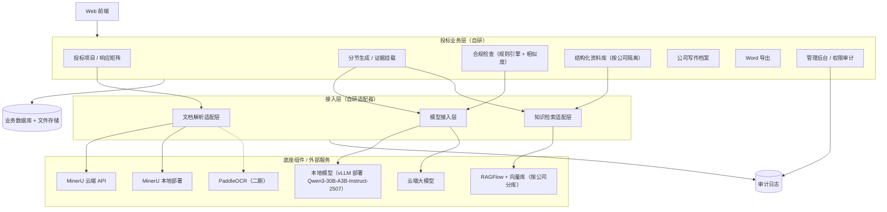
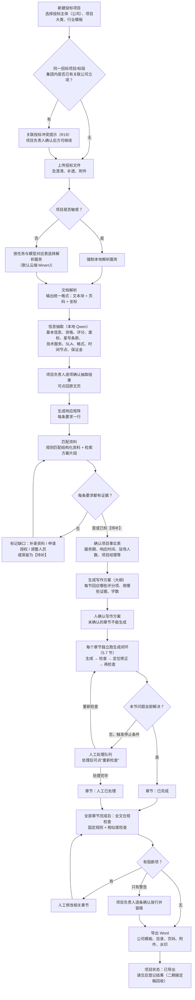
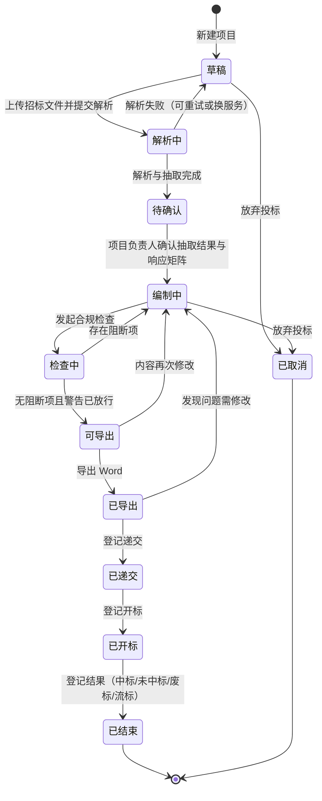
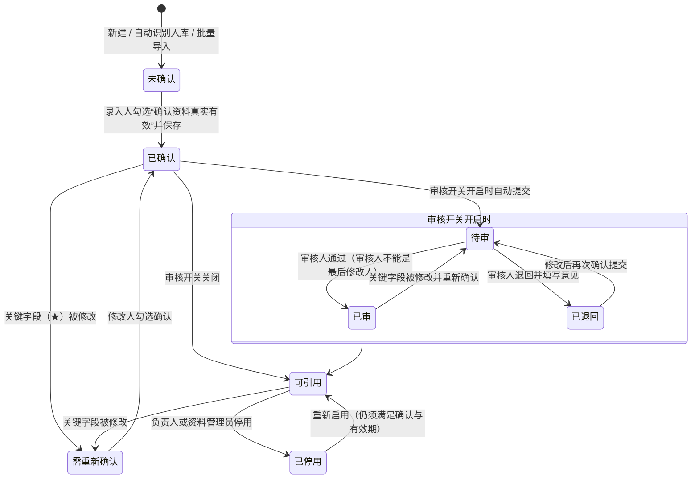
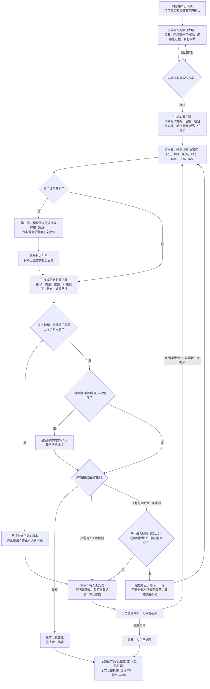
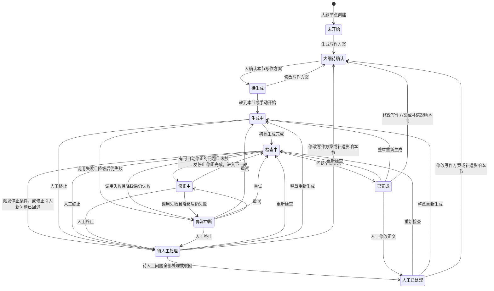
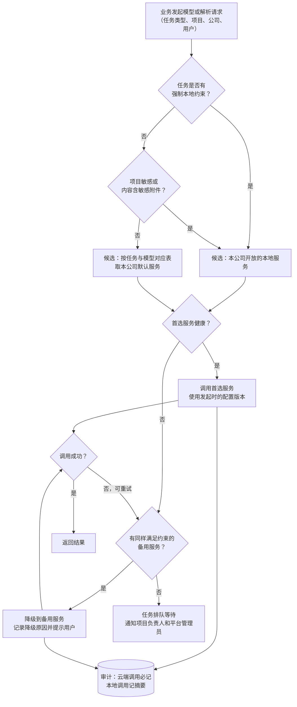

# 智能投标系统 第一期（MVP）PRD v1.1

| 项目 | 内容 |
|---|---|
| 文档版本 | v1.1（在 v1 基础上加入“生成闭环”设计，供评审） |
| 上一版本 | v1：/workspace/deliverables/prd-mvp-v1.md（保留不动，供对照） |
| 编写日期 | 2026-09-28（UTC+8） |
| 产品形态 | 私有化部署的智能投标（标书生成）系统，Web 端 |
| 适用范围 | 通用设计；当前以数据库维保、IT 运维服务类标为主，行业和标书类型做成可配置模板 |
| 配套文档 | 《企业投标资料库数据字典 v1.2》（/workspace/deliverables/kb-data-dictionary-v1.2.md，下称“字典”）；《Agent 闭环参考调研》（/workspace/research/agent-loop-reference-2026-09-28.md，下称“agent-loop 调研”）；《智能投标系统市场与技术调研》（bid-system-landscape-2026-09-28.md，下称“市场调研”）；《资料库设计借鉴调研》（kb-schema-references-2026-09-28.md） |
| 文档性质 | 产品需求文档。写到页面级和数据对象级，不含代码和建表脚本；技术选型只写已定方案，未定的交研发评估 |

## v1.1 变更记录

变更日期：2026-09-28（UTC+8）。v1 文件保留不动，供对照。本版把 neil 已确认的“生成闭环”设计及三个借鉴点（项目事实表与章节摘要接力、任务卡、人工确认的审查清单）写入 PRD，并把全文与之冲突或不一致的表述改为一致。

| 序号 | 变更内容 | 位置 | 依据 |
|---|---|---|---|
| 1 | 分节生成改为“由系统规则编排的章节闭环”：每个章节独立循环“写作方案确认 → 生成 → 检查 → 定位修正 → 再检查”；停止条件和转人工范围由系统规则决定，不由模型判断；不采用 Agent 全程自主形态 | 5.7 节（重写） | neil 已确认的生成闭环设计 |
| 2 | 新增写作方案与大纲确认门：每节回应哪些评分项、用哪些证据、写多少字须经人确认，未确认的章节不能生成 | 5.7.2 节；4.2 节主流程 | 同上 |
| 3 | 新增章节状态机（未开始、大纲待确认、待生成、生成中、检查中、修正中、已完成、待人工处理、人工已处理、异常中断），取代 v1 的“待编辑、编辑中、已完成（含待补）” | 5.7.5 节 | 同上 |
| 4 | 新增页面：写作方案与大纲确认、章节循环进度（每轮版本对比与问题清单）、人工处理队列（含“重新检查”按钮）、项目事实表 | 5.7.2、5.7.6～5.7.8 节；5.1.3 节页签 | 同上 |
| 5 | 新增项目事实表与章节摘要接力 | 5.7.8 节 | 借鉴点一（agent-loop 调研 4.1 节第 3 条） |
| 6 | 提示词改为带版本号的“任务卡”，存放在公司写作档案中，每次模型调用记录任务卡版本 | 5.6 节；5.7.9 节 | 借鉴点二 |
| 7 | 新增公司审查清单：人工处理中反复出现的问题，经公司管理员确认后加入，供以后的检查使用；不做自动长期记忆 | 5.6 节；5.7.7 节 | 借鉴点三 |
| 8 | 合规检查分为“章节循环内检查”和“全文检查”两个场景；规则表新增“章节循环”列；新增 R26 评分项覆盖度、R27 项目事实一致、R28 章节模型评审（辅助，只出提示）；R01、R02、R10、R15、R25 的检查时机增加章节循环 | 5.8 节开头；5.8.1、5.8.2、5.8.4、5.8.5 节；原 5.8.4 节改为 5.8.6 节 | 同 1 |
| 9 | 新增生成闭环配置项（最大轮数、模型评审开关、评审模型、同模型评审策略等）；任务与模型对应表新增章节摘要、章节模型评审、定位修正三类任务，“大纲生成”改称“写作方案（大纲）生成” | 6.4、6.9 节；5.10.5 节 | 同 1 |
| 10 | 风险清单新增 K15“模型自评不可靠”、K16“循环增加耗时与本地算力负载”；K03 补充应对；待确认新增 Q14～Q16 | 9.2 节；第 10 章 | agent-loop 调研 0、3.2、3.3、5 节 |
| 11 | 一致化修改：一页结论、成功指标、权限矩阵、MVP 范围与不做清单、主流程图、项目状态规则、项目工作台、项目设置、响应矩阵（新增条款性质）、写作档案、导出前提、模型分工、长度预算、三层防护中的叫法、审计范围、性能口径、里程碑、术语表 | 0、1.3、2.3、3.1、3.2、4.2、4.3、5.1.3～5.1.5、5.3.1、5.3.3、5.6、5.9.1、6.1、6.2、7.3、7.4、8.2、9.1 节；附录 A | 同 1 |
| 12 | 配套数据字典升级为 v1.2：新增 6 张表，并补充 PRD 生成模块现有表的字段 | 头部信息；5.7.12 节 | — |

说明：v1 没有设计自动修正循环，因此不存在需要删除的“修正最多 1 轮”一类旧表述；agent-loop 调研中“自动修正最多 1 轮”的建议未采纳，以本版 5.7.4 节的停止条件为准（默认最多 3 轮检查、2 次自动修正）。

---

> 阅读约定：
> - “公司”指法人主体，是系统里最高的数据隔离单位；“集团”指多家公司的上级管理视角。
> - 文中凡标「示例」的数值、名称，都只是为说明写法，不是事实或建议值；标「建议」的是本文作者的设计建议，需评审确认；标「待定」的在第 10 章跟踪。
> - 时间一律按 UTC+8。
> - 术语第一次出现时给出解释，全文汇总见附录 A。

---

## 0. 一页结论

1. **第一期做什么。** 做“从招标文件到可导出 Word 标书”的主链路：新建投标项目 → 上传并解析招标文件（结果带页码，可点回原文）→ 自动生成响应矩阵（把评分项、废标项、资格项、技术与服务要求逐条对应到标书章节和证据）→ 从本公司资料库匹配证据 → 人确认写作方案（大纲）→ 每个章节独立跑“生成 → 检查 → 定位修正 → 再检查”的闭环（有依据的挂证据，没依据的写【待补】，自动修不了的转人工）→ 全文合规检查（以固定规则为主）→ 导出 Word。配套做企业资料库、知识库与方案片段、公司写作档案、模型与解析配置、管理后台的必需部分。协同审核、定稿回收、更多规则放二期。
2. **差异化。** 一是“可追溯、不编造”：每一句承诺、每一个证书编号都能点回资料库记录或招标文件原页；找不到依据就写【待补】，【待补】没清零不能导出。二是数据库维保和 IT 运维专项：SLA 矩阵（招标要求、我方承诺、公司能力上限三列对照）、驻场人员与原厂认证匹配、多级原厂授权链校验、巡检与应急方案模板。市场调研没有查到任何产品公开提供这些功能。
3. **生成闭环由系统规则编排，不做黑盒 Agent。** 每个章节按“写作方案确认 → 生成 → 检查 → 定位修正 → 再检查”循环。检查以规则为主，大模型评审为辅，且每条评审意见必须引用正文原句、由系统核对。什么时候停（问题全部解决、默认最多 3 轮、问题数不再减少、同一问题改两次仍在则该问题转人工、修改引入新问题则回退）以及哪些问题直接交给人（缺证据的【待补】、星号和废标条款、金额与承诺数值、人员身份、商务偏离），都由系统规则决定，不由模型判断。依据是调研结论：没有外部反馈时，模型自评自改不可靠，收益集中在前 1～2 轮（5.7 节、K15）。
4. **按公司隔离。** 每家公司各自一套资料库、知识库、标书，默认互不可见、不可互相引用，生成时只检索本公司的库。集团管理员能看各公司，但生成时不能跨公司取资料。
5. **防串标。** 依据《招标投标法实施条例》第四十条（“不同投标人的投标文件异常一致”视为串通投标，原文已核实，见 8.2 节），做三层防护：数据隔离、每家公司单独配置写作档案、导出前与集团内其他公司同项目或同招标人的标书做相似度检查。另外补充一条核实后发现的更硬的约束：条例第三十四条规定存在控股、管理关系的不同单位不得参加同一标段投标，违反的相关投标均无效，系统在立项时就要拦截提示（见 8.3 节）。
6. **资料谁录入谁负责。** 不设专职审核员：录入人保存时勾选“确认资料真实有效”即可被引用，系统记录负责人和确认时间；关键字段被改后须由修改人重新确认。原审核流程保留为每家公司的可选开关，默认关闭。
7. **模型可切换。** 文档解析和大模型都能在前端切换云端或本地，统一在平台一级登记，各公司决定开放哪些。敏感项目强制使用本地模型，云端调用全部记审计日志，云端不可用时自动降级到备用模型，但**降级永远不会把敏感内容从本地切到云端**。
8. **还要业务确认的关键问题**集中在第 10 章，最影响设计的是：信创要求、集团内关联公司是否会投同一标段、相似度阈值和比对口径、哪些文件允许上云解析、敏感项目由谁判定；生成闭环中模型评审默认开还是关，建议试运行抽测后再定（Q14）。

---

## 1. 背景与目标

### 1.1 背景

公司主要投服务类标，具体是数据库维保项目和 IT 运维项目。这类标书的特点是：技术方案篇幅不算最重，但资格和证明材料非常多，而且必须逐条对得上，例如原厂授权要覆盖招标涉及的每一种数据库、驻场人员要持对应的原厂认证、SLA（服务级别协议，即对故障响应、到场、恢复时限等的书面承诺）要不低于招标下限、全文各处的承诺数字要一致（市场调研第 (e)5 节）。人工编写时最常见的问题是漏响应星号条款、引用了过期证书、各章节承诺数字前后不一、复制旧标书时带入了旧项目名称。

市场上的标书工具已经形成“读标 → 目录 → 写标 → 审查 → 知识库复用”的五段式，功能趋同；差异在行业模板深度、合规规则数量、证据溯源能力和部署形态（市场调研第 (e)1 节）。已定的总体方案是：以开源成熟组件做底座，投标业务层自研；不二次开发现成标书项目，不采购商业产品。

公司可能以多个法人主体投标，同一集团内的几家公司有时会面对同一个招标人。这带来两个要求：资料必须按公司隔离；不同公司生成的标书必须有实质区别，避免被认定为“投标文件异常一致”。

### 1.2 产品目标

| 编号 | 目标 | 说明 |
|---|---|---|
| G1 | 缩短从拿到招标文件到形成可审标书初稿的时间 | 解析、矩阵、匹配、初稿生成由系统完成，人主要做核对和补充 |
| G2 | 降低废标和扣分风险 | 星号条款、废标项、资格项逐条有响应、有证据；过期证书、授权不覆盖、SLA 不达标、【待补】未清零等问题在导出前被拦住 |
| G3 | 不编造 | 所有事实性内容（证书、人员、业绩、授权、承诺数值）只能来自资料库或招标文件，并可点回来源 |
| G4 | 知识可积累 | 资料库可从零开始积累；历史标书和方案片段可复用；不依赖已有标书数量 |
| G5 | 多公司安全可控 | 按公司隔离数据；不同公司标书有区别；云端调用可审计；敏感项目不出内网 |
| G6 | 好维护 | 行业、标书类型、章节模板、规则、模型、解析服务都通过配置调整，不改代码 |

### 1.3 成功指标

年投标量、历史标书数量都还未知，下表**不填目标数值**，只定义口径和采集方式；基线在试运行首月采集，目标值由产品经理与业务在试运行后确定。

| 指标 | 口径（怎么算） | 数据来源 | 目标值 |
|---|---|---|---|
| 初稿形成时长 | 从上传招标文件到所有章节均有初稿（允许含【待补】）的时长 | 项目操作日志 | 待定（先采基线） |
| 解析抽取准确率 | 抽样核对：抽取项被人工确认“无需修改”的比例；按抽取类型分别统计 | 解析确认记录 | 待定 |
| 响应覆盖率 | 导出时响应矩阵中“已响应且已确认”的条目数 ÷ 应响应条目数；星号条款、废标项单列 | 响应矩阵 | 星号与废标项要求 100%（这是导出闸门，不是统计目标）；其余待定 |
| 证据挂载率 | 标书中事实性语句带证据引用的比例 | 引用记录 | 待定 |
| 导出前拦截问题数 | 合规检查在导出前发现并被修正的问题数，按规则分类 | 合规检查记录 | 只观察，不设目标 |
| 废标（我方被否决）次数 | 开标后因我方文件问题被否决的次数 | 项目结果登记 | 待定（需历史数据做基线） |
| 相似度超阈值次数 | 导出前相似度检查超过阈值的次数及处理结果 | 相似度检查记录 | 只观察 |
| 资料库健康度 | 过期未更新、未确认、缺必备附件的资料占比 | 资料库统计 | 待定 |
| 用户采纳率 | 生成段落被保留（未整段删除）的比例 | 章节版本记录 | 待定 |
| 章节自动闭环完成率 | 首次循环即以“问题全部解决”停止的章节数 ÷ 已生成章节数 | 章节循环轮次记录 | 待定（先采基线） |
| 转人工原因分布 | 各停止原因、各转人工原因的次数占比 | 检查问题记录、轮次记录 | 只观察 |
| 模型评审意见有效率 | 通过引用核对且未被人工驳回的意见数 ÷ 模型评审意见总数；引用核对丢弃数单列 | 检查问题记录、轮次记录 | 只观察；与试运行抽测一起决定模型评审默认开关（Q14） |

示例（仅说明写法）：“2026 年第四季度试运行期间，初稿形成时长中位数为 X 小时”——X 由实测得出，不预设。

### 1.4 设计原则

1. **先证据，后文字。** 生成标书前先把要求和证据对齐（响应矩阵），生成时只能用对齐好的证据。
2. **规则优先，模型辅助。** 能用确定规则判断的（有效期、主体一致、数值比较、占位符清零）一律用规则；模型负责抽取、匹配建议和写作。规则的结论可复现，模型的结论一律标“建议”，需人确认。
3. **没有依据就写【待补】。** 不允许模型自行补全证书编号、人员姓名、业绩金额、承诺数值。
4. **按公司隔离是默认值。** 任何跨公司行为（查看、比对、授权借用）都必须是显式的、有权限的、留痕的。
5. **配置化。** 行业模板、章节模板、规则阈值、提醒天数、模型与解析服务都在后台配置。

---

## 2. 用户角色与权限

### 2.1 组织层级

系统有三个层级：**平台**（整套私有化部署的系统）→ **集团**（管理视角，可选）→ **公司**（法人主体，数据隔离单位）。用户分两类：平台级账号（平台管理员、集团管理员）不属于任何一家公司；公司级账号**只属于一家公司**，一个人如果需要在两家公司工作，需分别开两个账号（建议，见第 10 章）。分公司、事业部不单独隔离，作为公司内部的主体记录存在（字典 3.2.1 `org_entity`）。

### 2.2 角色定义

| 角色 | 层级 | 主要职责 | 典型人员 |
|---|---|---|---|
| 平台管理员 | 平台 | 开通公司；登记模型与解析服务、维护任务与模型对应表；维护平台级字典（厂商产品字典、证书类别、行业与服务分类、附件槽位）；查看系统运行与审计 | 信息部门系统管理员 |
| 集团管理员 | 集团 | 查看各公司的项目、资料和统计（只读）；查看相似度检查的双方对比；二期起对单条资料做跨公司授权 | 集团投标管理部门负责人 |
| 公司管理员 | 公司 | 管理本公司用户与角色；决定本公司开放哪些模型；配置审核开关、提醒规则、占用规则、写作档案、Word 模板；查看完整身份证号（留痕） | 公司投标部门负责人 |
| 资料管理员 | 公司 | 维护资料库和知识库的整体质量：分类、标签、到期跟进、批量导入、停用过期资料；查看完整身份证号（留痕） | 投标商务专员 |
| 项目负责人 | 公司 | 新建投标项目、分配编写人、确认解析结果和响应矩阵、上传合作伙伴资料、批准导出 | 投标项目经理 |
| 投标编写人 | 公司 | 编写与生成章节、挂接证据、处理【待补】、录入自己负责的资料 | 商务/技术标编写人员 |
| 审核人（可选） | 公司 | 仅当公司开启“资料审核”开关时出现：审核资料和方案片段 | 由公司管理员指定，可兼任 |
| 只读成员 | 公司 | 查看项目和资料，不能修改 | 领导、支持人员 |

角色可叠加（例如一个人既是项目负责人又是投标编写人）。“项目负责人”“投标编写人”在具体项目中还体现为项目成员身份：公司级角色决定能不能做某类操作，项目成员身份决定能在哪些项目里做。

### 2.3 权限矩阵（MVP）

“●”＝可以；“○”＝只读；“—”＝不可以；“项目内”＝只在自己参与的项目里可以。

| 功能 | 平台管理员 | 集团管理员 | 公司管理员 | 资料管理员 | 项目负责人 | 投标编写人 | 审核人 | 只读成员 |
|---|---|---|---|---|---|---|---|---|
| 开通/停用公司 | ● | — | — | — | — | — | — | — |
| 模型与解析服务登记、任务与模型对应表 | ● | — | — | — | — | — | — | — |
| 决定本公司开放哪些模型 | — | — | ● | — | — | — | — | — |
| 平台级字典（厂商产品、证书类别等） | ● | ○ | ○（可提新增申请） | ○ | ○ | ○ | ○ | ○ |
| 本公司用户与角色 | — | ○ | ● | — | — | — | — | — |
| 审核开关、提醒规则、占用规则 | — | ○ | ● | ○ | — | — | — | — |
| 公司写作档案、Word 模板 | — | ○ | ● | ○ | ○ | ○ | — | — |
| 资料库：新增、修改并确认 | — | ○ | ● | ● | ● | ●（本人录入或负责的） | ○ | ○ |
| 资料库：停用、删除、批量导入 | — | — | ● | ● | — | — | — | — |
| 查看完整身份证号 | — | — | ●（留痕） | ●（留痕） | — | — | — | — |
| 合作伙伴资料上传 | — | — | ● | ● | ●（项目内） | — | — | — |
| 知识库与方案片段 | — | ○ | ● | ● | ● | ● | ○ | ○ |
| 新建投标项目 | — | — | ● | — | ● | — | — | — |
| 解析结果、响应矩阵确认 | — | ○ | ● | — | ●（项目内） | 编辑（项目内），确认需项目负责人 | — | ○（项目内） |
| 章节生成与编辑 | — | ○ | ● | — | ●（项目内） | ●（项目内，被分配的章节） | — | ○（项目内） |
| 写作方案（大纲）确认 | — | ○ | ● | — | ●（项目内；大纲结构调整只有项目负责人可做） | ●（项目内，被分配章节的写作方案） | — | ○（项目内） |
| 项目事实表：编辑、确认 | — | ○ | ● | — | ●（项目内） | 编辑（项目内），确认需项目负责人 | — | ○（项目内） |
| 人工处理队列：处理问题、驳回模型评审意见、重新检查、终止章节循环 | — | ○ | ● | — | ●（项目内） | ●（项目内，被分配的章节） | — | ○（项目内） |
| 人工处理队列：驳回规则“警告”级问题 | — | — | ● | — | ●（项目内） | — | — | — |
| 审查清单：提出候选 | — | — | ● | ● | ● | ● | — | — |
| 审查清单：确认启用、停用 | — | ○ | ● | ○ | ○ | ○ | — | ○ |
| 生成闭环配置 | ●（平台默认值与上限） | ○ | ●（本公司，不超过平台上限） | — | 只能在本项目关闭模型评审、调整生成顺序 | — | — | — |
| 合规检查：运行 | — | ○ | ● | — | ●（项目内） | ●（项目内） | — | ○ |
| 合规检查：人工放行“警告” | — | — | ● | — | ●（项目内） | — | — | — |
| 导出 Word | — | — | ● | — | ●（项目内） | — | — | — |
| 资料审核（开关开启时） | — | — | ● | ● | — | — | ● | — |
| 相似度检查：看对方公司原文 | — | ● | — | — | — | — | — | — |
| 审计日志 | ●（平台级） | ○（各公司） | ○（本公司） | — | — | — | — | — |

权限规则：

1. **数据范围由公司决定。** 公司级角色的一切操作都自动限定在本公司；接口层按登录账号的公司强制过滤，前端传入的公司参数不作为依据。
2. **集团管理员只读且不能生成。** 集团管理员能查看各公司数据，但不能在任何项目中触发生成、检索或导出；这样“生成只检索本公司库”在权限层面也成立。
3. **平台管理员默认看不到公司业务数据**（资料正文、标书内容），只看配置、运行状态和审计（建议，职责分离，见第 10 章）。
4. **敏感资料单独授权。** 公司内部的方案片段 MVP 不分区授权（字典第 6 章第 16 项结论），但标为“受限”的资料（如涉及保密项目的片段、敏感附件）只有公司管理员、资料管理员和被指定的人能看。
5. **所有权限变更留痕**，进入审计日志。

---

## 3. 范围

### 3.1 MVP 做什么

| 模块 | MVP 范围 | 对应章节 |
|---|---|---|
| 投标项目 | 新建、项目信息、成员、合作方（联合体/分包）、拟派人员、SLA 取值改写、项目级规则覆盖、状态流转 | 5.1 |
| 招标文件解析 | 上传招标文件及澄清补遗；调用文档解析服务；抽取 10 类信息，结果带页码、可点回原文；人工确认 | 5.2 |
| 响应矩阵 | 自动生成要求清单；逐条对应章节和证据；SLA 矩阵；覆盖率统计；星号与废标项闸门 | 5.3 |
| 企业资料库 | 按字典 v1.2 实现 33 张原有表及新增表的录入、确认、到期提醒、缺资料标红；可选审核开关 | 5.4 |
| 知识库与方案片段 | 方案片段库、历史标书导入（手工）、RAGFlow 按公司分库、检索 | 5.5 |
| 公司写作档案 | 章节结构模板、服务体系叫法、术语、语气、任务卡（带版本号的提示词）、审查清单，每家公司单独配置 | 5.6 |
| 分节生成 | 写作方案（大纲）生成与人工确认；每章独立的“生成 → 检查 → 定位修正 → 再检查”闭环（默认最多 3 轮，停止条件和转人工范围由规则决定）；证据挂载、【待补】、按模型 token 上限自动分节；项目事实表与章节摘要接力；任务卡版本记录；章节循环进度页与人工处理队列；重新生成与局部改写、章节编辑锁 | 5.7 |
| 合规检查 | 章节循环内检查（规则为主，加可选的模型评审，意见须引用原文）和全文检查（固定规则为主，见 5.8 节 MVP 标记）；相似度检查；本单位人员核对；关联投标冲突检查 | 5.8 |
| Word 导出 | 公司 Word 模板、封面、目录、页码、页眉页脚、分册、附件插入与水印、文档属性清理 | 5.9 |
| 管理后台 | 公司与用户、字典配置、审核开关、提醒规则、占用规则、模型开放、审计查询 | 5.10 |
| 模型与解析配置 | 平台级登记与测试、任务与模型对应表、敏感项目强制本地、降级、审计、修改留痕与回滚 | 第 6 章 |

### 3.2 MVP 不做什么

| 不做 | 原因 / 替代做法 | 计划 |
|---|---|---|
| 多人协同审核流（批注、分派审核、会签） | MVP 用“章节分配 + 编辑锁 + 项目负责人确认”满足单项目多人分工 | 二期 |
| 定稿回收（上传最终递交版、拆解入库、中标来源标记） | MVP 可手工导入历史标书到知识库；字典中相关字段先保留 | 二期 |
| 报价编制与报价一致性检查 | 报价通常在专门工具或表格中完成；MVP 只做“报价 ≤ 最高限价”的提示字段预留 | 待定（第 10 章） |
| 电子投标平台专用格式（各地投标客户端格式）转换 | MVP 输出 .docx，由投标人导入投标客户端 | 待定 |
| Word 插件（在 Word 内写作） | — | 三期 |
| 工程类、货物类专项模板 | 结构已预留（项目大类、品目分类、扩展字段） | 三期 |
| 标讯订阅 | — | 三期 |
| 跨公司资料授权借用 | 默认不允许；数据结构预留（字典 `cross_company_grant`） | 二期或以后 |
| PaddleOCR 等其他解析服务适配器 | MVP 只做 MinerU 云端和本地两种适配器；接口已按“适配器”设计 | 二期 |
| 信创适配 | 要求未明确，不做假设 | 待定（第 10 章） |
| 移动端 | — | 不计划 |
| Agent 全程自主（由模型自己决定下一步做什么、调用哪个工具、何时停止） | 不可复现、难审计；调研显示本地模型多轮工具调用基准偏低（K15）。本期用规则编排的章节闭环替代（5.7 节） | 不计划 |
| 自动长期记忆（系统自动从使用记录中提炼内容并写入提示词） | 没有公司、项目隔离维度，且未经人审核。用项目事实表（项目级）和人工确认的审查清单（公司级）替代 | 不计划 |

### 3.3 分期路线

| 阶段 | 内容 | 前提 |
|---|---|---|
| MVP（第一期） | 3.1 节全部 | — |
| 二期 | 协同审核；定稿回收；更多合规规则（R05、R06、R20～R22 等，见 5.8 节）；PaddleOCR 适配器（证书、印章识别）；跨公司授权借用（如业务确认需要） | MVP 上线并试运行；二期需求评审 |
| 三期 | 工程和货物模板；标讯订阅；Word 插件 | 业务确认要扩展标类 |

---

## 4. 核心业务流程

### 4.1 系统架构（逻辑）

下图是已定总体方案的逻辑结构。“业务层”是自研部分；其余是开源组件或外部服务，通过适配层接入，可替换。RAG（检索增强生成）指先从知识库检索相关内容、再交给大模型参考写作的做法；向量库是按语义相似度检索文本的数据库。

### 4.2 主流程：从新建项目到导出 Word

说明：从“确认项目事实表”到“章节：已完成 / 人工已处理”的部分是 v1.1 新增的生成闭环，每个章节独立进行，规则见 5.7 节。

### 4.3 投标项目状态

状态规则：

1. “已导出”后任何章节被修改，项目自动回到“编制中”，上一次导出文件标记为“已过期”，但保留下载。
2. 招标方发布澄清或补遗时，项目负责人上传新文件，系统重新解析并标出与原抽取结果的差异（新增、修改、删除的要求），受影响的矩阵行和章节标为“需复核”，项目回到“待确认”。
3. “已递交”触发人员占用（字典 R12）；“已开标”触发在投占用自动释放；登记“中标”时转为履约占用（字典第 6 章第 13 项结论）。
4. 写作方案确认和各章节的生成闭环都在“编制中”进行（5.7 节）；“编制中 → 检查中”指发起全文检查，导出前必检要求全部章节处于“已完成”或“人工已处理”（5.8.5 节）。

---

## 5. 功能详述

本章按模块写到页面级。每个页面按“目的、主要元素、操作、状态流转、业务规则、异常与边界、验收标准”七项描述；某项不适用时注明“无”。

### 5.1 投标项目

#### 5.1.1 页面：项目列表

- **目的**：让用户看到本公司自己有权限的全部投标项目及其进度、风险，快速进入。
- **主要元素**：筛选区（状态、项目大类、招标人、递交截止时间范围、我参与的）；列表列（项目名称、招标编号/标段、招标人、投标主体、递交截止时间及倒计时、状态、响应覆盖率、阻断问题数、【待补】数、项目负责人）；右上角“新建项目”。
- **操作**：新建、查看、复制为新项目（只复制项目设置和大纲，不复制招标文件和生成内容）、取消项目、导出列表。
- **状态流转**：见 4.3 节。
- **业务规则**：只列当前公司项目；集团管理员有公司切换器，只读。递交截止时间在 3 天内的项目置顶并标红（天数可配置，示例 3 天）。
- **异常与边界**：项目数为 0 时显示引导（上传第一份招标文件）。
- **验收标准**：①公司 A 的用户在任何筛选条件下都看不到公司 B 的项目；②倒计时按 UTC+8 计算，截止时间过后显示“已截止”；③列表数据与项目详情一致。

#### 5.1.2 页面：新建项目

- **目的**：用最少的信息建立项目，其余信息在解析后自动带出。
- **主要元素**：投标主体（本公司的主体记录，默认本公司法人主体；分公司投标时可选分公司）；项目大类（服务/货物/工程，MVP 默认服务）；行业模板（数据库维保 / IT 运维 / 通用服务，来自写作档案的章节模板）；是否敏感项目（开关，见下）；是否联合体投标/是否有分包；上传招标文件（可稍后）。
- **操作**：保存为草稿；保存并上传解析。
- **状态流转**：新建后为“草稿”。
- **业务规则**：
  1. **敏感项目**：勾选后，本项目的解析、抽取、生成、检查全部只能用本地服务，降级也只能降到其他本地服务。敏感标记只能由项目负责人或公司管理员设置；从“敏感”改为“不敏感”需公司管理员操作并留痕。敏感项目的判定标准待业务确认（第 10 章），MVP 先由人工勾选，并支持公司管理员设置“本公司所有项目默认敏感”。
  2. **关联投标冲突检查（R19）**：保存时，系统用招标编号 + 标段编号（没有编号时用“招标人名称 + 项目名称”的规范化文本）在全平台查找集团内其他公司是否已有同一招标项目同一标段的项目。有则弹出提示：“集团内另一家公司已对同一标段立项。依据《招标投标法实施条例》第三十四条和《政府采购法实施条例》第十八条，存在控股、管理关系或单位负责人为同一人的不同单位不得参加同一标段投标。”项目负责人须选择“确认无上述关系并继续”或“取消”，选择继续需填写说明，全程留痕并通知集团管理员。提示中**只显示对方公司名称，不显示对方项目内容**。
- **异常与边界**：招标编号为空、标段为空时的匹配只能是近似匹配，提示语改为“可能是同一项目”。
- **验收标准**：①敏感项目在后续任何环节都不会产生云端调用（审计日志可验证）；②同标段已有关联公司立项时必定弹出提示，且无法跳过说明；③公司用户看不到对方项目的任何内容。

#### 5.1.3 页面：项目详情（工作台）

- **目的**：一个项目的总入口，按主流程分页签组织。
- **主要元素**：顶部摘要条（项目名、招标编号、投标主体、递交截止时间、状态、覆盖率、阻断数、【待补】数、待人工处理问题数、敏感标记）；页签：概览、招标文件、解析结果、响应矩阵、资料匹配、项目事实表、大纲与章节（含写作方案确认、章节循环进度）、人工处理队列、合规检查、导出、项目设置。
- **操作**：按页签进入各功能；项目负责人可变更状态（递交、开标、结果登记）。
- **状态流转**：见 4.3 节。
- **业务规则**：概览页展示“下一步该做什么”的待办清单（例如“3 条星号条款未响应”“2 张证书在截止时间前过期”“原厂专项授权需提前 X 天申请”“第 3.2 节待人工处理（2 个问题）”）。
- **异常与边界**：项目取消后只读。
- **验收标准**：待办清单中的每一项可一键跳转到对应位置。

#### 5.1.4 页面：项目设置

- **目的**：维护项目基础信息、成员、合作方、拟派人员、项目级规则覆盖和 SLA 取值。
- **主要元素**：
  1. **基本信息**：解析后自动带出（项目名称、编号、标段、招标人、代理机构、预算、最高限价、投标截止时间、开标时间、服务期、项目地点、招标涉及的厂商产品清单），可人工修改，修改处显示“已人工修改”。
  2. **成员与分工**：项目负责人、编写人；章节分配在“大纲与章节”页做。
  3. **合作方**：联合体成员或分包方（选择本公司资料库中主体范围为“合作伙伴”的主体），每个合作方**必须上传联合体协议或分包协议**才能引用其资料（字典第 6 章第 4 项结论）；合作方资料由项目负责人上传到本公司资料库，自动标为“合作伙伴提供”。
  4. **拟派人员**：从资料库选人并指定项目角色（项目经理、技术负责人、驻场工程师、DBA 等）；显示占用冲突提示（只提示不锁定）。
  5. **SLA 取值**：选定本项目使用的 SLA 模板；在项目内改写变量取值（例如把一级故障响应时限从模板默认值改为招标要求值），改写值只存在本项目（字典第 6 章第 17 项结论），不回写资料库。改写后的值严于模板“最严可承诺值”时显示“超出能力”警告。
  6. **项目级规则覆盖**：证明材料有效天数（招标文件有明确要求时以招标文件为准，覆盖材料类型默认值）；是否开启“有效期覆盖服务期”检查（默认关闭，开启后证书、授权须在整个服务期内有效）；本单位人员要求（是否要求拟派人员为本单位员工、是否需社保证明、要求连续缴纳月数）。
  7. **生成闭环（v1.1）**：是否在本项目关闭章节模型评审（只能关闭；公司已关闭时不能在项目中打开）；章节生成顺序（依次 / 并行，默认取公司设置）。见 6.9 节。
- **操作**：保存；从解析结果重新带出。
- **状态流转**：无独立状态。
- **业务规则**：投标主体一经进入“编制中”后修改，需项目负责人确认，且所有已挂证据重新做主体一致性检查（R02）。
- **异常与边界**：合作方协议缺失时，该合作方资料在匹配结果中显示但不可选，并提示“缺协议”。
- **验收标准**：①未上传协议的合作方资料无法被章节引用；②项目内 SLA 改写不影响资料库中的模板默认值；③覆盖规则生效后合规检查结果随之变化。

#### 5.1.5 数据对象（投标项目模块）

以下表属于投标项目模块，字段只列关键项，完整字典在开发阶段细化。所有表带字典 3.0 节的 A 组审计字段和 C 组 `company_id`（所属公司）。

| 表名 | 中文名 | 关键字段 | 与字典的对齐 |
|---|---|---|---|
| bid_project | 投标项目 | project_name、tender_no、lot_no、lot_name、tenderee_name、agency_name、bid_entity_id（→org_entity）、project_category_code、industry_template_id、is_sensitive、is_consortium、budget_amount、ceiling_amount、bid_deadline_at（投标截止时间）、open_at、service_start_date、service_end_date、project_region_code、product_ids、status、check_service_period（覆盖服务期检查开关）；v1.1 新增：model_review_disabled（本项目关闭模型评审）、chapter_generation_order（章节生成顺序） | 字典中的 `bid_project_ref`（person_assignment、bid_archive）取值为本表 `id` |
| bid_project_member | 项目成员 | project_id、user_id、project_role（负责人/编写人/只读） | user_id → sys_user |
| project_partner | 项目合作方 | project_id、partner_entity_id（→org_entity，主体范围须为合作伙伴）、relation_type（联合体成员/分包方）、work_share（分工说明）、agreement_attachment_id（协议文件，必填才能引用） | 附件槽位 `consortium_agreement`、`subcontract_agreement`（字典 4.9） |
| project_person | 拟派人员 | project_id、person_id、role_code、is_key_person、conflict_status（无/有冲突已知悉） | person、person_assignment（递交时写入） |
| project_sla_value | 项目 SLA 取值 | project_id、sla_template_id、template_version_no、var_key、project_value、tender_required_value、source（模板默认/招标要求/人工改写）、exceeds_capability | sla_template、sla_variable；导出后写入 bid_archive_ref.value_snapshot（二期定稿回收时） |
| project_rule_override | 项目规则覆盖 | project_id、rule_key（如 proof_valid_days.纳税证明、require_own_staff、social_insurance_months、check_service_period）、value、source_requirement_id（依据的招标要求） | org_proof_doc 有效期、R03、R11 |
| tender_file | 招标文件 | project_id、attachment_id、file_role（招标文件/澄清/补遗/附件）、version_no、supersedes_id、parse_status | attachment（字典 3.4.1） |

---

### 5.2 招标文件解析

#### 5.2.1 页面：招标文件

- **目的**：上传和管理本项目的招标文件、澄清、补遗，查看解析进度。
- **主要元素**：文件列表（文件名、类型、版本、页数、上传人、上传时间、解析服务、解析状态、耗时）；上传区；解析服务选择（只显示本公司已开放且符合敏感要求的服务，默认取任务与模型对应表）。
- **操作**：上传、重新解析（可换服务）、下载原件、设为被替代（上传新版补遗后）。
- **状态流转**：待解析 → 上传中 → 解析中 → 抽取中 → 已完成 / 失败。
- **业务规则**：
  1. 支持格式以所选解析服务能力为准（MinerU 云端精准解析 API 官方列出 PDF、图片、Doc、Docx、Ppt、PPTx、Xls、Xlsx，单文件 ≤200MB、≤200 页；本地 MinerU 4.0 另支持 OFD 等，见第 6 章）。超过云端页数限制时自动按页码范围分批提交并合并结果。
  2. 解析结果统一为系统格式（见 6.3.4 节），与具体解析服务无关。
  3. 同一文件（按 SHA-256 文件指纹判断）在本公司内已解析过且解析服务和参数相同时，直接复用结果；**不跨公司复用**。
- **异常与边界**：解析失败时显示服务返回的原因（例如“文件页数超过限制”），提供“换服务重试”；云端服务不可用时按第 6 章降级规则处理，敏感项目只等待本地服务并通知项目负责人。
- **验收标准**：①上传 1 份超过 200 页的 PDF，系统自动分批解析并得到完整结果，页码连续正确；②敏感项目的文件只出现在本地服务的调用记录中。

#### 5.2.2 页面：解析结果

- **目的**：按类别展示抽取出的信息，每条都能点回原文，供项目负责人确认。
- **主要元素**：左侧抽取项分类树（10 类，见下表）；中间抽取条目卡片（字段名、抽取值、原文摘录、页码、置信度、状态）；右侧原文预览，点击条目时跳到对应页并高亮对应区域（利用解析结果中的页码和坐标）。
- **操作**：确认、修改（修改后状态为“已人工修改”并加编辑锁，重新抽取时不覆盖）、删除（误抽取）、新增（漏抽取，手工框选原文区域或输入页码）、批量确认、“重新抽取本类”。
- **状态流转**：待确认 → 已确认 / 已人工修改 / 已删除。
- **业务规则**：
  1. 抽取由本地模型（任务与模型对应表中“信息抽取”任务的模型）按分块完成：解析文本按标题层级切块，每块不超过该模型 `max_input_tokens` 减去提示词和输出预留后的长度，相邻块保留少量重叠，避免条款被切断；每块抽取结果带回原始页码范围。
  2. 置信度低于阈值（可配置，示例 0.8）的条目高亮提示人工核对。
  3. 星号条款、废标条款、资格要求这三类**不允许批量确认**，必须逐条确认（防止漏看）。
  4. 招标文件中的“投标文件格式要求”既进入抽取结果，也作为 Word 导出和格式检查的输入。
- **异常与边界**：扫描件文字识别质量差导致原文摘录乱码时，条目标“原文不可读”，要求人工对照原页补录。
- **验收标准**：①任一抽取条目点击后，原文预览跳到正确页并高亮；②星号、废标、资格三类无批量确认按钮；③人工修改过的条目在“重新抽取”后保持不变。

**抽取项清单**（“字段”列为抽取目标；服务类标的专项字段加“〔运维〕”标记）：

| 类别 | 抽取字段 | 用途 |
|---|---|---|
| 1 项目基本信息 | 项目名称、招标/采购编号、标段（包）编号与名称、招标人/采购人、代理机构、项目地点、预算金额、最高限价、采购方式、项目大类、品目分类、服务期、是否接受联合体、是否允许分包、招标涉及的厂商产品与版本清单〔运维〕（如数据库品牌、版本、实例数量）、服务对象规模〔运维〕 | 带入项目设置；R07、R08 的输入 |
| 2 资格要求 | 每条资格条件原文；归类（营业执照/经营范围、资质证书、体系认证、ITSS 等级〔运维〕、原厂授权〔运维〕、人员及证书、业绩、财务、纳税社保、信用、联合体要求、其他）；数量或等级要求；时间要求（如“近三年”）；是否需原件 | 响应矩阵资格行；R03、R07、R08、R13、R16 |
| 3 评分办法与评分项 | 评分方法（综合评分/最低价等）；评分项树（分类、评分项名称、分值、评分标准原文、得分档次）；客观分/主观分标识 | 响应矩阵评分行；写作方案（大纲）生成 |
| 4 废标与无效标条款 | 每条否决投标/无效投标条款原文；归类（格式、签章、资格、实质性响应、报价、其他） | 响应矩阵废标行；导出闸门 |
| 5 星号实质性条款 | 带“★”“*”或明确“实质性要求”“不允许偏离”的条款原文；所属章节 | 响应矩阵星号行；导出闸门 |
| 6 技术服务要求 | 服务范围、服务内容清单、巡检要求〔运维〕（频次、内容、报告）、驻场要求〔运维〕（人数、时段、地点、资质）、应急要求〔运维〕（预案、演练频次）、备品备件〔运维〕、培训、原厂服务要求〔运维〕、交付物 | 响应矩阵技术行；章节生成 |
| 7 SLA 要求〔运维〕 | 服务时段（如 7×24）；故障分级及定义；各级响应、到场、恢复时限；报告周期；考核与罚则 | SLA 矩阵；R09、R10 |
| 8 投标文件格式要求 | 分册要求（商务/技术/资格/报价）；目录与章节顺序；格式文件（投标函、授权书、承诺函等模板）；字体字号、页边距、页码、装订、签章位置；页数限制；暗标要求；电子版格式 | 大纲、Word 导出、格式检查 |
| 9 时间节点 | 获取文件截止、答疑截止、投标截止、开标、保证金截止、踏勘时间 | 项目设置；倒计时与提醒 |
| 10 保证金 | 是否需要、金额、形式（转账/保函/保险）、缴纳截止时间、账户要求（如须从基本账户转出） | 项目待办；R22（二期） |

#### 5.2.3 数据对象（解析模块）

| 表名 | 中文名 | 关键字段 |
|---|---|---|
| parse_job | 解析任务 | project_id、tender_file_id、parse_service_id、service_config_version、request_params（快照）、external_job_id、status、pages_total、pages_done、started_at、finished_at、error_code、error_message、is_cloud |
| parse_block | 解析文本块（统一格式） | parse_job_id、block_no、page_no（从 1 起）、bbox（页内坐标）、block_type（标题/正文/表格/图片/公式/页眉页脚）、heading_level、text、table_html、image_ref、reading_order |
| tender_requirement | 招标要求（抽取条目） | project_id、category（10 类之一）、sub_type、field_key、value_text、value_structured（键值集合）、source_block_ids、page_from、page_to、quote_text（原文摘录）、confidence、status、is_locked、importance（星号/废标/资格/评分/一般）、score（分值）、supersedes_id（补遗替代） |

---

### 5.3 响应矩阵

响应矩阵是 MVP 的核心：它把招标文件的每一条要求变成一行，逐条回答“我们怎么响应、写在标书哪一章、用什么证据证明”。

#### 5.3.1 页面：响应矩阵

- **目的**：确保每条要求都被响应、每条响应都有证据，并把缺口暴露出来。
- **主要元素**：
  1. 顶部统计：应响应总数、已响应已确认数、星号条款未响应数、废标条款未核对数、缺证据数、【待补】数、覆盖率。
  2. 筛选：按类别（资格/评分/废标/星号/技术服务/SLA/格式）、状态、负责人、是否有证据。
  3. 表格列：序号；要求原文（可展开，带页码链接）；类别与重要性（★、废标、资格、分值）；响应方式（满足 / 优于 / 偏离 / 不适用）；响应要点（一句话，可由模型建议）；对应章节（可多选）；证据（资料库条目，显示名称、版本、有效期状态、确认状态）；责任人；状态；风险提示。
- **操作**：自动生成矩阵；逐行编辑；为某行挂接或移除证据；“智能匹配证据”（对选中行重新匹配）；指派责任人；确认；导出矩阵为 Excel（便于线下讨论）；标记“偏离”并填写偏离说明（偏离表自动汇总）。
- **状态流转**：未响应 → 已响应待确认 → 已确认；任一证据失效（过期、被停用、被修改待重新确认）时自动回到“已响应待确认”并标“证据失效”。
- **业务规则**：
  1. 矩阵从已确认的抽取结果生成；抽取结果变化（补遗）时，受影响行标“需复核”。
  2. 证据匹配分两类：**结构化资料**（资质、人员、人员证书、授权、业绩、证明材料、SLA 模板）按规则匹配，例如“要求 ISO/IEC 20000 认证”匹配证书类别并检查有效期覆盖投标截止时间；**方案片段和历史标书**通过 RAGFlow 在本公司知识库中检索，按相关度排序给出候选，由人选择。
  3. 只有“可引用”的资料能被挂为证据：已启用、未删除、录入人已确认（公司开启审核时还需已审核通过）、来源分级为本公司（合作伙伴资料须项目已登记合作方且有协议）、在投标截止时间有效（字典 1.5 节、R01～R03）。
  4. 星号条款和废标条款的“已确认”是导出闸门：任一行未确认，导出按钮不可用。
  5. 响应方式为“偏离”的星号条款直接列为阻断项，提示“星号条款不允许偏离”。
  6. 响应要点和章节对应可由模型建议，建议值显示“AI 建议”标签，确认后标签消失。
  7. 每行标注条款性质（技术 / 商务），抽取时由模型建议、项目负责人确认（v1.1）。响应方式为“偏离”且条款性质为“商务”的行即“商务偏离”，其相关段落的问题在生成闭环中一律直接转人工（5.7.4 节第 4 条）；生成闭环不会修改矩阵中的响应方式。
- **异常与边界**：同一条要求在招标文件中重复出现（如正文和附件各一次）时，系统按文本相似度提示“可能重复”，由人合并。
- **验收标准**：①任一星号行未确认时导出不可用；②把某张已挂证书的有效期改到投标截止时间之前，该行自动回到“待确认”并标“证据失效”；③未确认的资料不会出现在证据候选中。

#### 5.3.2 页面：SLA 矩阵〔运维专项〕

- **目的**：把招标的 SLA 要求、我方承诺和公司能力上限放在一张表里，一眼看出哪里不满足、哪里承诺过头。
- **主要元素**：按故障等级分行（P1～P4，名称来自 SLA 模板），另有服务时段、巡检频次、驻场人数、报告周期、备件到场时限等行；列：指标、招标要求值（带页码）、我方承诺值（项目取值）、公司最严可承诺值、单位、优劣方向、判定（满足 / 不满足 / 超出能力 / 招标未要求）。
- **操作**：选择 SLA 模板；逐项改写我方承诺值；一键“按招标要求取值”（把承诺值设为招标要求值，但不突破最严可承诺值）；导出为承诺函表格。
- **状态流转**：无独立状态；判定结果实时计算。
- **业务规则**：
  1. 单位统一后比较（分钟、小时、自然日、工作日按字典 `var_unit` 换算；“工作日”与“自然日”无法换算时标“需人工判断”）。
  2. 时限类“越小越好”、次数人数类“越大越好”（字典 `compare_direction`）。
  3. 承诺值劣于招标要求 → 不满足（阻断，R09）；承诺值严于最严可承诺值 → 超出能力（警告，需项目负责人确认，履约风险留痕）。
  4. SLA 矩阵中的承诺值是全文唯一数据源：章节正文、承诺函、偏离表中的 SLA 数字都以变量方式引用，导出前 R10 检查全文是否有与变量不一致的手写数字。
- **异常与边界**：招标文件只写“按行业标准”等无数值要求时，判定为“招标未量化”，提示人工确认。
- **验收标准**：①把 P1 响应承诺改为比招标要求更长，判定立即变为“不满足”；②章节正文中手工写入与变量不同的时限数字，R10 能检出并定位。

#### 5.3.3 数据对象（响应矩阵模块）

| 表名 | 中文名 | 关键字段 |
|---|---|---|
| response_matrix_item | 响应矩阵行 | project_id、requirement_id（→tender_requirement）、category、importance、response_type（满足/优于/偏离/不适用）、response_summary、deviation_note、chapter_ids、assignee_id、status、is_ai_suggested、risk_flags；v1.1 新增：term_nature（条款性质：技术/商务） |
| matrix_evidence | 矩阵证据 | matrix_item_id、ref_type（字典 owner_type）、ref_id、ref_version（引用时的记录版本号）、confirm_status_at_link、validity_status_at_deadline、linked_by、linked_at、match_method（规则/检索/人工）、match_score |

---

### 5.4 企业资料库

字段定义以字典 v1.2 为准，本节不重复字段表，只写页面、流程和规则。资料库按公司隔离：每家公司一套，默认互不可见、不可互相引用。

#### 5.4.1 资料“能不能被引用”的判定

一条资料能被标书引用，必须同时满足：已启用、未删除、**录入人已确认真实有效**（确认状态＝已确认）、公司开启审核开关时还须审核通过、来源分级为本公司（或为合作伙伴且项目已登记该合作方并上传协议）、在投标截止时间仍有效（有有效期的资料）。下图是确认与审核的状态关系。

规则：

1. **谁录入谁负责。** 确认动作记录确认人、确认时间和确认声明版本；确认人自动成为该资料的负责人（建议；负责人之后可由资料管理员转交，转交留痕）。
2. **关键字段修改须重新确认。** 字典中标 ★ 的字段被修改后，资料进入“需重新确认”，在修改人确认前不可被新引用；已挂在在编项目中的证据标“证据失效”，项目内提示。
3. **审核开关**（公司级，默认关闭）：开启后新增“待审、已审、已退回”三种状态，一级审核，审核人不能是该记录的最后修改人。开关开启时存量已确认资料的处理方式、关闭时待审资料的处理方式见 5.10.4 节。
4. **有效期与提醒**：系统每天计算有效期状态；到期前 90、30、7 天提醒资料负责人（天数可在公司设置或证书类别上调整）；在投项目缺资料时在项目待办和资料库首页标红，提醒发给资料负责人和项目负责人。
5. **人员占用**：同一人员被多个在投项目拟派时只提示不锁定；项目经理角色默认提示冲突；开标后自动释放在投占用；中标转为履约占用；规则在“资料库设置”中配置（字典第 6 章第 13 项结论）。

#### 5.4.2 页面：资料库首页

- **目的**：让资料管理员和负责人一眼看到资料库的健康状况和待办。
- **主要元素**：健康度卡片（未确认数、需重新确认数、临期数、过期数、待补录有效期数、缺必备附件数、复审逾期数；开关开启时加待审数）；“我负责的待办”列表；“在投项目缺资料”列表（项目、缺什么、截止时间）；分类入口（公司主体、证明材料、资质证书、人员、人员证书、原厂授权、业绩、SLA 模板、全局变量、中小企业划型、附件）。
- **操作**：点卡片进入对应筛选列表；一键催办（给负责人发站内提醒）。
- **状态流转**：无。
- **业务规则**：数据只统计本公司；集团管理员可切换公司查看。
- **异常与边界**：资料库为空时显示“从零开始”引导：先建公司主体 → 上传营业执照 → 录入资质 → 录入人员。
- **验收标准**：卡片数字与点击后的列表条数一致。

#### 5.4.3 页面：资料列表（各类通用）

- **目的**：按类别查找、筛选、批量维护资料。
- **主要元素**：筛选（负责人、确认状态、有效期状态、来源分级、标签、所属主体）；列表列按类别不同（例如资质：证书名称、等级、编号、持证主体、有效期止、状态、负责人、确认状态）；批量操作栏。
- **操作**：新增、查看、编辑、停用/启用、批量导入（Excel 模板）、批量转交负责人、导出清单（敏感字段脱敏）。
- **状态流转**：见 5.4.1 节。
- **业务规则**：敏感字段在列表中一律脱敏；导出清单不含完整敏感字段。
- **异常与边界**：批量导入的记录一律为“未确认”，须逐条或按批次由导入人确认（确认页面展示每条关键字段，防止盲确认）。
- **验收标准**：批量导入后，未确认的记录不出现在任何项目的证据候选中。

#### 5.4.4 页面：资料详情与编辑（各类通用）

- **目的**：录入或修改一条资料，并完成确认。
- **主要元素**：字段表单（按字典对应表生成，必填、条件必填按字典规则校验）；附件槽位区（必备槽位缺失时标红）；来源追溯信息（来源文件、页码、采集方式、识别置信度）；确认区（勾选框“本人确认以上资料真实有效，并对其准确性负责”，以及负责人、最近确认时间）；变更历史页签；“被引用情况”页签（哪些项目引用了哪个版本）。
- **操作**：保存；保存并确认；从附件智能识别填充（调用解析服务 + 本地模型抽取，识别结果进入表单待人工核对，低置信度字段高亮）；加/解人工编辑锁；停用。
- **状态流转**：见 5.4.1 节。
- **业务规则**：
  1. 智能识别只填表，不自动确认；识别出的字段标“待核对”，人工改过或确认后才去掉标记。
  2. 资质扫描件、身份证件等**敏感附件只能用本地解析服务识别**。
  3. 保存时如修改了 ★ 字段，确认勾选框自动清空，须重新勾选。
- **异常与边界**：同一身份证号在本公司已存在时阻止新建并提示去重；证书编号重复时提示可能重复。
- **验收标准**：①未勾选确认直接保存，确认状态为“未确认”；②修改 ★ 字段后确认状态自动变为“需重新确认”；③敏感附件的识别请求不会发往云端。

#### 5.4.5 页面：人员详情〔含敏感信息〕

- **目的**：在一处看到一名人员的全部投标相关信息，并安全地处理敏感字段。
- **主要元素**：基本信息（身份证号默认脱敏显示前 4 位和后 4 位）；人员归属（本单位/外包/合作伙伴，默认本单位）和社保缴纳单位、社保缴纳至月份；劳动合同期限；证书列表（含有效期、注册单位）；项目经历（来自业绩项目成员）；占用情况（在投、履约）；附件（身份证件、社保缴纳证明、劳动合同为最高级保护）。
- **操作**：“查看完整身份证号”（仅公司管理员、资料管理员可见此按钮，点击需填写查看原因，每次查看记入审计日志）；其余同 5.4.4。
- **状态流转**：同 5.4.1。
- **业务规则**：
  1. 敏感分级（字典第 6 章第 18 项结论）：身份证号、银行账号、劳动合同为最高级（加密存储、脱敏展示、仅两类角色可看完整值、每次查看留痕）；出生年月、甲方联系人电话为中级（脱敏展示、有权限的项目成员可看）。
  2. 生成标书时，需要完整身份证号的位置（如人员表格）由系统在导出时按需自动填入，编写人在编辑界面只看到脱敏值；导出动作记审计日志。
  3. 社保不记逐月明细，只记“缴纳至哪个月”并上传证明；招标要求“近 N 个月连续缴纳”时，合规检查提示人工核对证明（R11）。
- **异常与边界**：人员离职后自动不可被新项目拟派，已有拟派标红。
- **验收标准**：①编写人在任何页面、任何接口返回中都拿不到完整身份证号；②导出的 Word 中人员表身份证号完整；③每次“查看完整身份证号”在审计日志中有记录（谁、何时、原因）。

#### 5.4.6 页面：原厂授权与授权链〔运维专项〕

- **目的**：管理原厂授权，并把“原厂 → 总代理 → 我方”的多级授权链完整记录和校验。
- **主要元素**：授权列表（厂商、授权类型、被授权主体、覆盖产品、授权地域、有效期、链条层级）；授权详情中的“授权链”图示（每一级出具方、被授权方、有效期、覆盖产品和地域，任一级不满足的节点标红）。
- **操作**：新增授权；为转授权记录选择“上游授权”（即出具方自己从原厂获得的授权）；上传每一级的授权书。
- **状态流转**：同 5.4.1。
- **业务规则**：
  1. 授权地域选到地市（按 GB/T 2260），区县写在“地域备注”里（字典第 6 章第 14 项结论）。
  2. 链条校验（R07）：链上每一级都须在投标截止时间有效；下级授权的产品和地域不能超出上级；最终被授权主体须为投标主体。
  3. 需按项目单独申请专项授权的厂商，在立项时按“申请提前天数”提示倒排时间。
- **异常与边界**：上游授权缺失（只有总代给我方的授权书）时，链条标“上游未登记”，R07 给警告。
- **验收标准**：把链中原厂给总代的授权有效期改到截止时间之前，我方授权在该项目中的判定变为“链条失效”。

#### 5.4.7 其他页面

| 页面 | 要点 | 验收标准 |
|---|---|---|
| 公司主体 | 本公司法人主体、分公司、合作伙伴主体、第三方（渠道商，仅作授权链节点）分别管理；合作伙伴主体只能由公司管理员、资料管理员、项目负责人创建 | 合作伙伴主体下的资料来源分级自动为“合作伙伴” |
| 证明材料 | 按材料类型带出默认有效天数（材料类型属性，系统预置默认值），可按项目覆盖 | 项目覆盖后该项目的检查使用覆盖值 |
| 中小企业划型 | 按年度记录从业人员、营业收入、资产总额和划型结果，挂依据附件；划型标准按行业在平台配置 | 生成中小企业声明函时取投标截止时间所属年度适用的记录 |
| SLA 模板 | 模板、故障等级、变量三级维护；变量含默认值、单位、优劣方向、最严可承诺值 | 模板正文中引用不存在的变量时不能确认 |
| 全局变量 | 如“认证 DBA 人数”，可设自动计算规则 | 自动计算值随资料变化每日更新 |
| 附件库 | 按文件指纹在本公司内去重；显示每个文件挂在哪些记录上 | 两家公司上传同一文件各自独立存储、互不可见 |

---

### 5.5 知识库与方案片段

#### 5.5.1 设计要点

1. **按公司分库。** RAGFlow 中每家公司各建独立的知识库（数据集），向量库按公司分区；检索时业务层只传入本公司的知识库标识，并附加元数据过滤（启用、已确认/已审、已发布版本、来源分级非“仅供参考”才可进入正文）。集团管理员的账号不具备检索调用权限。
2. **正文双存。** 方案片段正文既存在数据库（片段版本表）也同步到知识检索库（字典第 6 章第 5 项结论）；数据库副本用于版本比对、备份、审计和检索库重建。
3. **“仅供参考”资料**（例如收集来的同行方案）可以入库供学习检索，但永远不进入标书正文，检索结果中带“仅供参考”标记。
4. 公司内部 MVP 不分区授权，受限资料除外（见 2.3 节规则 4）。

#### 5.5.2 页面：方案片段库

- **目的**：沉淀和复用可直接写进标书的段落（服务方案、巡检方案、应急预案、驻场管理、培训方案、备品备件方案等）。
- **主要元素**：左侧方案类型树（字典 `snippet_type`，包含运维专项：日常运维、巡检、故障处理流程、应急预案与演练、数据库备份恢复、性能优化、升级迁移、高可用、驻场管理）；列表（标题、类型、适用产品、适用行业、篇幅、新鲜度、引用次数、负责人、状态）；检索框（语义检索 + 关键词）。
- **操作**：新增、编辑（生成新版本）、发布、停用、关联长短版本、查看引用、对比版本。
- **状态流转**：版本：草稿 → 已发布 → 已被替代；开启审核时：草稿 → 待审 → 已发布 / 已退回。
- **业务规则**：
  1. 审核开关关闭时，编辑人确认即发布；新版本发布前，项目中继续使用上一已发布版本。
  2. 片段中的数值（如 DBA 人数、响应时限）必须写成变量占位（`{{...}}`），不允许直接写死；变量不存在或未确认时不能发布。
  3. 新鲜度随复审周期下降；过低的片段在检索结果中降权并提示复审。
- **异常与边界**：检索库同步失败时片段显示“同步失败”，不影响数据库中的版本；提供“重新同步”。
- **验收标准**：①公司 A 的检索结果中永远不出现公司 B 的片段；②未发布版本不会出现在检索结果中。

#### 5.5.3 页面：历史标书导入（MVP 手工导入）

- **目的**：把系统上线前的历史标书放进知识库，作为检索参考。
- **主要元素**：上传区；元数据表单（项目名称、招标人、投标主体、递交日期、投标结果等，字典 `bid_archive`）；解析状态。
- **操作**：上传、填写元数据、提交解析入库、从中手工摘取片段存为方案片段（生成“未确认”的片段草稿）。
- **状态流转**：待解析 → 已入库 / 失败。
- **业务规则**：历史标书整体入库后只作为检索参考（来源位置可追溯），不直接作为证据；要引用其中内容，须先摘取为方案片段并确认。历史标书中的人员、证书、业绩信息不自动写入结构化资料库。
- **异常与边界**：历史标书中含其他公司名称时（例如合作伙伴），提示编辑元数据中的投标主体。
- **验收标准**：历史标书中的段落可被检索到并能跳回原文页，但不能直接挂为矩阵证据。

---

### 5.6 公司写作档案

#### 5.6.1 目的与构成

写作档案让每家公司的标书在结构、叫法、用语和语气上有自己的特征，是防止不同公司标书“异常一致”的第二层措施（8.2 节）。每家公司单独配置，互不可见。

| 构成 | 内容 | 示例（仅示意） |
|---|---|---|
| 章节结构模板 | 按项目大类、行业模板定义的技术标和商务标章节树；每个节点有标题、写作要点、默认篇幅、关联评分维度、默认方案类型 | 示例：公司 A 的“数据库维保”模板以“服务体系→服务内容→SLA→驻场→巡检→应急→培训”排序，公司 B 以“项目理解→服务方案→保障措施”排序 |
| 服务体系名称与叫法 | 本公司对通用概念的专有叫法 | 示例：通用概念“服务台”，公司 A 叫“7×24 运维服务中心”，公司 B 叫“客户支持热线” |
| 常用术语 | 首选术语、禁用词、同义替换 | 示例：首选“故障”，禁用“bug” |
| 语气 | 人称（我公司/我方/本公司）、正式程度、句式偏好、篇幅偏好 | 示例：人称“我公司”，句式偏短 |
| 任务卡（提示词版本） | 按任务（写作方案、章节生成、章节摘要、章节模型评审、定位修正、改写、扩写、缩写、按指令修改）打包的一张卡：用途、需要喂给模型的材料、要求的输出结构、引用的提示词模板及其版本、1～2 个示例、建议参数；带版本号，发布后不可修改，修改即生成新版本（5.7.9 节）。提示词模板可引用写作档案变量 | 由平台提供默认任务卡和提示词模板，公司可复制后修改 |
| 审查清单 | 本公司沉淀的检查项。来自人工处理中反复出现的问题，由人提出或系统统计推荐为候选，经公司管理员确认后启用；模型评审时按章节类型取用，编写人也可作为自查清单（5.7.7 节）。不做自动长期记忆 | 示例：“运维方案须写明备件到场时限”（仅示意） |
| Word 模板 | 封面、样式（标题、正文、表格）、页眉页脚 | 每家公司上传自己的 .docx 模板 |

#### 5.6.2 页面：写作档案

- **目的**：公司管理员配置并发布本公司写作档案。
- **主要元素**：页签（章节模板、叫法与术语、语气、任务卡与提示词、审查清单、Word 模板）；版本信息（当前发布版本、草稿）；“与集团内其他公司档案的差异度”提示（仅比较章节结构和叫法，**不展示对方内容**，只给出“相似度偏高”的提示，建议）。
- **操作**：编辑草稿、预览（用一段示例要求试生成）、发布、回滚到历史版本。
- **状态流转**：草稿 → 已发布 → 已归档。
- **业务规则**：
  1. 项目在“编制中”使用创建大纲时的档案版本；档案新版本发布后，项目可选择“升级到新版本”，已生成内容不自动改写。
  2. 平台提供默认模板作为起点；公司首次使用时须至少修改章节模板或叫法之一，否则生成页提示“写作档案仍为平台默认，与其他公司可能雷同”（建议）。
  3. 任务卡发布后不可修改，修改即生成新版本；进行中的章节循环继续使用开始时的任务卡版本（5.7.9 节）。
  4. 审查清单条目只能由公司管理员确认启用、停用或拒绝；系统不会自动新增、修改或启用条目（5.7.7 节）。
- **异常与边界**：提示词模板引用了不存在的变量时不能发布；任务卡引用的提示词模板未发布时，任务卡不能发布。
- **验收标准**：①公司 A 与公司 B 各自发布档案后，对同一份招标文件生成的大纲结构不同；②档案回滚后新生成内容使用回滚后的版本；③任务卡发布新版本后，已开始的章节循环仍记录并使用旧版本；④未经公司管理员确认的审查清单候选不会出现在任何检查中。

#### 5.6.3 数据对象（写作档案模块）

写作档案的表定义在字典 v1.2 的 3.7 节，本节只列对应关系：`writing_profile`（写作档案，含自称、正式程度、句式与篇幅偏好、Word 模板、版本与发布状态）、`writing_outline_template` 与 `writing_outline_node`（章节结构模板及节点）、`writing_term`（叫法、首选术语、禁用词、同义替换）、`prompt_template`（按任务的提示词模板）；v1.1 新增 `task_card`（任务卡，每行是一张卡的一个版本，固定引用一个已发布的 `prompt_template` 版本）和 `review_checklist_item`（审查清单条目，公司级，不绑定写作档案版本），见字典 v1.2 的 3.7.6、3.7.7 节。平台默认档案和默认提示词的 `company_id` 为空，公司复制后修改。大纲节点通过 `bid_outline_node.writing_profile_version`、`outline_template_node_id` 记录使用的档案版本和模板节点（5.7.12 节）。

---

### 5.7 分节生成

**结论：分节生成采用“由系统规则编排的章节闭环”。** 每个章节的写作方案（大纲）经人确认后，该章节独立循环“生成 → 检查 → 定位修正 → 再检查”，直到问题全部解决或触发停止条件；自动修不了的问题，连同问题清单、每轮修改记录和停止原因交给人处理。循环什么时候停、哪些问题转人工，全部由本节规定的系统规则决定，不由模型判断。全部章节完成后再做全文合规检查（5.8 节），通过后导出。

本期不采用 Agent 全程自主的形态。Agent 指能自己规划步骤、决定调用哪个工具、决定什么时候停止的模型应用。不采用的原因见风险 K15：没有外部反馈时，模型自己评、自己改不可靠，迭代收益主要集中在前 1～2 轮；公司本地模型的多轮工具调用基准偏低。本设计中，模型每次只完成一件单步任务（写一节、评一节、改一段、写一段摘要）；编排、判断是否停止、决定问题交给谁，都由系统完成。

#### 5.7.1 生成闭环总览

| 环节 | 谁来做 | 说明 |
|---|---|---|
| 写作方案（大纲）生成 | 模型（任务卡“写作方案”）＋规则 | 模型按响应矩阵、评分办法和公司章节模板提出建议；规则校验评分项是否都分配到章节（R26） |
| 写作方案确认 | 人（本节编写人或项目负责人） | 未确认的章节不能生成（5.7.2 节） |
| 生成、定位修正、章节摘要 | 模型，每次一个单步调用 | 输入由系统组装，输出由系统校验 |
| 规则检查 | 系统规则引擎 | 结果可复现，是检查的主力 |
| 模型评审 | 模型，尽量与生成模型不同 | 只出提示；每条意见必须引用正文原句，由系统核对 |
| 问题分流、是否继续、何时停止、是否回退 | 系统规则 | 按 5.7.4 节执行，模型不参与判断 |
| 自动修不了的问题 | 人 | 在人工处理队列中处理（5.7.7 节） |

#### 5.7.2 页面：写作方案与大纲确认

- **目的**：在生成正文之前，让人确认“每一节回应哪些评分项、用哪些证据、写多少字”，避免整本生成后再推翻。
- **主要元素**：
  1. 左侧大纲树：章节号、标题、分册、负责人、章节状态（5.7.5 节）。
  2. 中间“本节写作方案”卡片：本节回应的矩阵行（评分项及分值、技术服务要求；星号条款和废标条款单独标出）；计划使用的证据（来自这些矩阵行已挂接的证据，显示名称、版本、有效期状态）；候选方案片段（从本公司知识库检索，默认不勾选，勾选后才会交给模型）；目标字数；写作要点（来自公司章节模板，可改）；本节会用到的项目事实（来自项目事实表，5.7.8 节）。
  3. 顶部提示：还没有分配到任何章节的评分项和技术服务要求行（R26 在大纲阶段的检查结果）；还没有确认的必备事实。
  4. 右侧：招标文件原文预览，点矩阵行跳到原页。
- **操作**：生成写作方案（整份生成，或单节重新生成）；调整大纲结构（增删、拖动、改标题，仅项目负责人）；分配章节负责人；编辑本节写作方案；确认本节；批量确认（仅项目负责人）；退回修改。
- **状态流转**：未开始 → 大纲待确认 → 待生成（5.7.5 节）。
- **业务规则**：
  1. 写作方案以评分办法（评分项顺序和分值）为主干，叠加招标文件格式要求（规定的章节顺序和格式文件）和公司章节模板；招标文件规定了目录的，严格按规定。每个大纲节点自动关联对应的矩阵行。
  2. 每个评分项和技术服务要求行都必须分配到至少一个章节。未分配的行在确认时提示，确认人须把它分配到章节，或标注“不适用/由其他文件响应”并写明理由，否则该行所属分册的写作方案不能确认（R26 大纲阶段）。星号条款和废标条款行必须分配到章节，不能标“不适用”。
  3. 确认前，项目事实表中标为“必备”的事实须已确认（5.7.8 节），否则“确认”按钮不可用，并提示去事实表确认。
  4. 本节编写人或项目负责人可以确认本节写作方案；大纲结构调整只能由项目负责人操作。确认人和确认时间写入审计日志。
  5. 确认后，若公司开启“大纲确认后自动开始生成”（默认开启，6.9 节），本节进入“待生成”排队；关闭时由人手动点“开始生成”。
  6. 确认后又修改写作方案（改回应的矩阵行、证据或目标字数）的，本节回到“大纲待确认”；已生成的内容保留为历史版本，重新确认后按新方案重新生成。
  7. 招标方发布澄清或补遗、受影响的矩阵行发生变化时，相关章节的写作方案标“需复核”，章节回到“大纲待确认”（与 4.3 节规则 2 一致）。
- **异常与边界**：某评分项确实无法由正文响应（例如纯报价项）时，允许标“不适用”，理由必填并留痕。矩阵行没有任何可用证据时，写作方案中该行标“缺证据”，允许确认；生成时对应位置写【待补】，检查时直接转人工（5.7.4 节第 4 条）。
- **验收标准**：①写作方案未确认的章节，任何人都无法触发生成；②存在未分配的评分项时，该分册不能完成确认，除非逐条标注“不适用”并填写理由；③必备事实未确认时“确认”按钮不可用；④确认后修改写作方案，章节回到“大纲待确认”。

#### 5.7.3 页面：大纲与章节

- **目的**：逐章查看和编辑已生成的正文，查看每章的闭环状态，完成人工修改。
- **主要元素**：左侧大纲树（章节号、标题、负责人、章节状态、当前轮次/最大轮数、【待补】数、待人工问题数、证据数）；中间编辑器（富文本，段落级显示证据标记、AI 生成标记和变量底色；被自动修正过的段落带“第 N 轮修正”标记，鼠标悬停可看修改前的文字）；右侧面板（本章关联的矩阵行、可用证据、写作要点、本章用到的项目事实、前序章节摘要、本章问题清单、审查清单（作为自查清单）、生成设置）。
- **操作**：开始生成（写作方案已确认时）；重新生成（整章）；选中段落后“局部改写”（改写、扩写、缩写、按指令修改、换一种说法）；插入证据；插入变量（含项目事实变量）；标记【待补】；锁定段落；查看版本、对比、回退；进入章节循环进度页（5.7.6 节）；重新检查；终止本章循环。
- **状态流转**：见 5.7.5 节。
- **业务规则**：
  1. **写作方案先行**：写作方案未确认时，本页不提供“开始生成”（5.7.2 节）。
  2. **证据挂载**：生成时只把写作方案中确认的证据（来自本章关联矩阵行）、勾选的本公司方案片段、公司写作档案、SLA 变量、项目事实和前序章节摘要交给模型；模型输出中的每处事实引用必须对应一条证据，系统在段落上显示证据标记，点击可打开资料库记录（显示引用时的版本）或招标文件原页。
  3. **【待补】**：模型在没有证据的地方必须写【待补：缺少什么】；系统对生成结果做校验：出现证书编号、人名、金额、日期、承诺数值等事实性内容但没有对应证据时，自动替换为【待补】并标红（建议实现方式：规则识别 + 与证据字段比对）。本规则同样适用于自动修正的结果（5.7.4 节第 5 条）。
  4. **按 token 上限分节**：token 是模型计量文本长度的单位（中文大致一两个字对应一个 token，具体因模型而异）。每次生成的输入预算＝所选模型的 `max_input_tokens` − 系统提示词 − 写作档案 − 证据材料 − 项目事实 − 前序章节摘要 − 安全余量（示例 10%）；输出预算＝`max_tokens`。本章所需材料或目标篇幅超出预算时，系统按三级标题（没有则按矩阵行）自动拆成若干子任务依次生成，再按顺序合并，合并处做衔接检查。预算按每个模型的配置动态计算，不写死（公司本地模型实测 16k token 效果最好，只作为该模型的默认配置值）。
  5. **段落与矩阵行对应**：生成时模型须为每个段落标明它回应的矩阵行，系统据此建立“段落—矩阵行”对应，供 R26 覆盖检查、问题定位和“直接转人工”判断使用；模型标注的矩阵行不在本节写作方案内的，该标注作废。
  6. **重新生成**：保留人工锁定的段落，只重写未锁定部分；每次生成保存为一个版本。整章重新生成会结束本章当前的循环，并以“整章重新生成”为触发原因开始新一次循环（5.7.4 节）。
  7. **局部改写（人工发起）**：只把选中段落、上下文摘要和相关证据发给模型；改写后证据标记必须保留，丢失证据的改写结果被拒绝并提示。人工发起的局部改写属于人工修改，章节随之进入“人工已处理”（5.7.5 节）；系统自动发起的定位修正按 5.7.4 节执行。
  8. **编辑锁**：同一章节同一时间只有一人可编辑，其他人只读并看到“某某正在编辑”（MVP 的协同方式）；锁 30 分钟无操作自动释放（示例值，可配置）。章节处于“生成中、检查中、修正中”时由系统持有编辑锁，人只能查看；人可点“终止本章循环”，本章进入“待人工处理”，停止原因为“人工终止”。
  9. **敏感与模型选择**：按任务与模型对应表选模型：不敏感项目的长文写作优先云端，敏感项目强制本地；用户只能在本公司开放的模型中选择。章节模型评审、定位修正、章节摘要的模型见 6.4 节。
  10. **变量**：SLA 数值、全局变量、项目事实以变量显示（带底色），导出时替换为取值。
- **异常与边界**：模型调用超时或失败时自动按降级规则换备用模型重试一次，仍失败则本章进入“异常中断”，保留已产生的版本和问题记录，可点“重试”从中断的步骤继续；生成中途用户离开页面，任务在后台继续。
- **验收标准**：①资料库中没有的人员姓名不会出现在生成正文中（出现即被替换为【待补】）；②所选模型 `max_input_tokens` 改小后，同一章节会被拆成更多子任务；③锁定段落在重新生成后内容不变；④敏感项目的生成请求全部落在本地模型；⑤章节处于生成中、检查中、修正中时编辑器只读，并显示当前步骤和轮次；⑥人工修改“已完成”章节的正文后，章节状态变为“人工已处理”。

#### 5.7.4 章节循环规则

本节是生成闭环的判定依据。下列规则由系统执行，模型不参与“是否继续、何时停止、交给谁”的判断。

**1. 循环与轮次**

- 一次“循环”指一个章节从开始自动处理到停止的全过程。首次生成是第 1 次循环；人点“重新检查”或整章重新生成，开始下一次循环。
- 一次循环由若干“轮”组成。每一轮对当前版本做一次检查（规则检查，加上开启时的模型评审）；需要继续时，再做一次定位修正，产生新版本，进入下一轮。首次循环的第 1 轮检查的是初稿；重新检查时，第 1 轮检查的是当前版本（不重新生成）。
- **最大轮数**（默认 3 轮，管理员可调，6.9 节）指一次循环内最多检查几轮。默认 3 轮即最多 3 次检查、2 次自动修正。达到最大轮数的那一轮只检查、不再修正，保证最后留下的版本一定经过检查。
- 最大轮数在循环开始时取值并记录；循环进行中修改配置，不影响进行中的循环。

示例（仅说明写法，数字不代表实测）：某节第 1 轮检查发现 6 个问题，其中 2 个直接转人工、4 个进入自动修正；第 2 轮复查，未解决 3 个（2 个待人工、1 个仍在），继续修正；第 3 轮复查，可自动修正的问题已清零，只剩 2 个待人工 → 本节停止，进入“待人工处理”，停止原因为“剩余问题需人工处理”。

**2. 每轮检查什么（两层）**

第一层：规则检查。必跑，结果可复现。规则编号与全文检查共用，完整分工见 5.8.4 节。

| 检查内容 | 规则 | 在本节范围内怎么判定 |
|---|---|---|
| 评分项覆盖 | R26 | 本节写作方案中的每个矩阵行，正文中至少有一个段落标注回应它；没有即“评分项未覆盖” |
| 与项目事实表一致 | R10、R27 | SLA 数值与 SLA 矩阵的变量取值一致（R10）；服务期、服务地点、项目经理、服务对象规模等其他事实与项目事实表一致（R27） |
| 没有混入别家公司内容（公司隔离） | R25（正文部分）、R01、R02 | 正文中不得出现集团内其他公司名称、其他招标人名称、旧项目名称（R25）；本节引用的证据须可引用、来源分级合规（R01、R02；正常情况下生成时已拦截，这里是复核） |
| 没有残留【待补】 | R15（本节部分） | 本节不得残留【待补】，引用的变量须存在且已确认 |

第二层：模型评审（R28）。可关闭，只出提示。

1. **按评分项逐条评**：每次输入本节正文（超过评审输入预算时按三级标题分片）、本节矩阵行原文和评分标准、适用的审查清单条目（5.7.7 节）、项目事实，要求模型按任务卡规定的结构输出意见列表。每条意见包括：对应的矩阵行、引用的正文原句、问题类型、问题说明、修改建议、严重程度（只能是“中”或“低”）。
2. **引用核对**：系统把“引用的正文原句”与本节当前版本逐字比对（忽略空格和标点差异）。找不到的、跨越多个段落的、短于最短引用字数（示例 10 字，6.9 节）的意见直接丢弃，只记丢弃数量和原因，不进入问题清单。这样可以过滤模型编造的问题。
3. 意见指出“正文没写某内容”时，也必须引用本节回应该评分项的段落中的一句原句作为定位；整个评分项都没有对应段落的情况由 R26 负责，模型评审不重复报。
4. **第 2 轮起只评审改过的段落**：第 2 轮起，模型评审只评审上一轮被修改的段落，并复核上一轮模型评审提出的问题是否已解决；没被修改的段落不重新评审。这样可以减少模型每轮随机提出不同意见造成的反复。
5. **评审尽量换模型**：评审模型尽量与生成模型不同（6.4 节“章节模型评审”任务）。非敏感项目没有可用的不同模型时，允许用同一模型评审，页面和记录上标“同模型评审”。敏感项目只能用本地模型；本地只有生成用的同一个模型时，默认跳过模型评审，以规则检查为主（公司管理员可改，6.9 节）。
6. **只出提示**：模型评审意见永远是“提示”级。它可以进入自动修正和人工处理队列，但不会阻断导出（与 5.8.2 节规则 1 一致）。

**3. 问题记录**

- 每个问题生成一条问题记录，字段包括：编号（项目内唯一，示例格式“3.2-007”，表示第 3.2 节第 7 个问题）、类型、位置（章节、段落和引用的原句）、严重程度、状态、处理路径（自动修正 / 直接转人工 / 升级转人工）、转人工原因、已自动修正次数、首次发现和最近出现的轮次、来源（规则编号或模型评审）。
- **严重程度**：规则检查的问题按规则级别换算，阻断级为“高”、警告级为“中”、提示级为“低”；模型评审的问题由模型给出，只能是“中”或“低”。
- **跨轮跟踪**：系统用“问题指纹”判断前后两轮是不是同一个问题。指纹由来源（规则编号或模型评审）、问题类型、关联的矩阵行或事实、所在段落组成（示例：R27＋与事实不一致＋事实“服务期”＋第 12 段）。同一次循环内指纹相同即视为同一问题，沿用原编号并累计修正次数；人点“重新检查”开始新一次循环时，指纹与历史问题相同的沿用原编号并重新打开，修正次数从 0 重新计算。
- **状态**：待修正、修正中、已解决、待人工、人工已处理、已驳回、已作废。某一轮复查时不再出现的问题记为“已解决”；因回退而失去对象的问题记为“已作废”（取值定义见字典 v1.2 4.12 节）。

**4. 哪些问题直接交给人（不进入自动修正）**

系统在问题产生时就判定处理路径。命中下表任一情形的问题，处理路径为“直接转人工”，自动修正永远不会改动它们：

| 情形 | 判定依据（系统规则） |
|---|---|
| 缺证据的【待补】（缺证书、缺业绩、缺人员等） | R15 问题中，【待补】所在段落对应的矩阵行没有可用证据；或模型评审的问题类型为“缺证据” |
| 星号实质性条款和废标条款的响应 | 问题所在段落对应的矩阵行重要性为“星号”或“废标” |
| 金额、承诺数值 | R10 的全部问题；R27 中事实类别为“金额”“SLA 承诺”的问题；其他涉及正文中金额或承诺数值（时限、次数、人数、比例）的问题 |
| 人员身份 | R27 中事实类别为“人员”的问题；其他涉及人员姓名、证件、证书、职务的问题 |
| 商务偏离 | 问题所在段落对应的矩阵行，响应方式为“偏离”且条款性质为“商务”（5.3.1 节规则 7） |
| 段落已被人工锁定 | 问题所在段落处于锁定状态（自动修正不能改锁定段落） |
| 证据引用问题 | R01、R02 的全部问题（需要人补资料或更换证据） |

其余问题走自动修正，例如：表述不准确、评分项响应不够具体、服务期写法与事实表不一致、残留旧项目名称、已有可用证据却仍写了【待补】。

**5. 定位修正：只改被指出问题的段落**

1. 每轮只处理处理路径为“自动修正”且状态为“待修正”的问题，按段落分组。每个段落一次单步调用，只把该段落原文、指向该段落的问题（含引用原句和建议）、该段落相关的证据、需要的项目事实和写作档案要点交给模型（任务卡“定位修正”）。
2. 模型只返回该段落的替换文字。系统合并时只替换这些段落，其他段落逐字不变：系统比对每个段落的内容指纹，未被问题点名的段落有任何变化即拒绝该次修正。
3. 修正结果同样要过 5.7.3 节规则 3（没有证据的事实自动换成【待补】）和规则 7 的证据标记检查；不通过的段落放弃修改，相关问题的修正次数照样加 1。
4. 定位修正不改响应矩阵、SLA 矩阵、项目事实表和证据挂接，这些只能由人改。
5. 问题每被自动修正一次，修正次数加 1。**同一问题自动修正 2 次后仍在，该问题单独转人工**（处理路径改为“升级转人工”），其他问题继续循环。修正次数上限固定为 2，MVP 不开放配置。
6. 修正产生一个新的章节版本，标明是第几次循环第几轮的修正、改了哪些段落。

**6. 停止条件**

每轮检查结束后，系统按下表顺序判断，任一条件满足即停止本次循环：

| 顺序 | 条件 | 系统处理 | 停止原因 |
|---|---|---|---|
| 1 | 第 2 轮起，本轮检查在上一轮被修改的段落上发现了上一轮没有的问题 | 回退到修正前的版本，本次循环停止，整章转人工 | 修正引入新问题 |
| 2 | 没有任何未解决的问题 | 停止，章节“已完成”，生成章节摘要 | 问题全部解决 |
| 3 | 可自动修正的问题已清零，但还有待人工的问题 | 停止，章节“待人工处理” | 剩余问题需人工处理 |
| 4 | 本轮已是最大轮数 | 停止，剩余问题全部转人工 | 达到最大轮数 |
| 5 | 第 2 轮起，本轮未解决问题数不少于上一轮（即相邻两轮问题数量没有减少） | 停止，剩余问题全部转人工 | 问题数量未减少 |
| — | 以上都不满足 | 对“待修正”的问题做定位修正，进入下一轮 | — |

说明：

- 条件 1 只看上一轮被修改过的段落，即由修改引起的新问题；因为第 2 轮起没被修改的段落不重新做模型评审，所以不会因为模型换了说法而误触发回退。被回退的修正版本保留在历史中，标“已回退”。
- 条件 5 中“未解决问题数”＝待修正＋修正中＋待人工的问题数，不含已驳回和已作废；已转人工的问题仍然计入，避免“转走就算减少”。
- “同一问题改两次仍在”不是整章的停止条件，只把该问题单独转人工（见第 5 条）。
- 另有两种停止：人点“终止本章循环”（停止原因“人工终止”）；模型调用失败且降级后仍失败（章节进入“异常中断”，停止原因“调用失败”，可重试）。

**7. 转人工时附带的内容**

章节进入“待人工处理”时，系统在人工处理队列中生成本节的处理包，并站内通知本节负责人和项目负责人：

1. **问题清单**：全部未解决问题，按处理路径和严重程度排序，每条带位置、引用原句、转人工原因和修改建议。
2. **每轮修改记录**：每一轮检查了哪个版本，发现和解决了哪些问题，改了哪些段落（可逐段对比修改前后），用了哪个模型和哪个任务卡版本。
3. **停止原因**：第 6 条表中的一种，或“人工终止”“调用失败”。发生回退的，另外标明“已回退到第 N 轮的版本”以及被回退的修改内容。

**8. 人工处理与重新检查**

1. 人在人工处理队列（5.7.7 节）逐条处理：修改正文；保留【待补】等资料补齐（导出前仍须清零，R15）；把手写的数字替换为变量（R10、R27）；或驳回（模型评审意见，以及规则“警告”级问题，须填写理由；“阻断”级问题不能驳回）。
2. 本节全部待人工问题都处理或驳回后，章节进入“人工已处理”。
3. 章节停止后（已完成、待人工处理、人工已处理），负责人可随时点“重新检查”：系统以当前版本为起点开始新一次循环，从检查开始，不重新生成，规则同上。仍有未处理的待人工问题时，系统提示“这些问题会再次出现”。
4. 重新检查不是必须的：人工处理完毕的章节可以直接参加全文检查，全文检查会重跑相关规则（5.8.5 节）。

**9. 章节摘要**：章节循环停止时生成本节摘要；章节内容之后又被修改的，在章节进入“已完成”或“人工已处理”时重新生成（5.7.8 节）。

#### 5.7.5 章节状态

| 状态 | 含义 | 可以做的操作 | 正文能否编辑 |
|---|---|---|---|
| 未开始 | 大纲节点已建立，写作方案还没生成 | 生成写作方案 | 不适用 |
| 大纲待确认 | 写作方案已生成或被修改，等人确认 | 编辑、确认、退回写作方案 | 否（已有正文作为历史版本保留） |
| 待生成 | 写作方案已确认，排队等待生成 | 修改写作方案（回到大纲待确认）；手动开始 | 否 |
| 生成中 | 模型正在生成初稿（可能分多个子任务） | 终止本章循环 | 否，系统持锁 |
| 检查中 | 正在做规则检查和模型评审 | 终止本章循环 | 否，系统持锁 |
| 修正中 | 正在对被点名的段落做定位修正 | 终止本章循环 | 否，系统持锁 |
| 已完成 | 本次循环以“问题全部解决”停止 | 编辑（编辑后变为人工已处理）、重新检查、整章重新生成 | 是 |
| 待人工处理 | 循环因停止条件、回退或人工终止而停止，还有问题等人处理 | 在人工处理队列处理问题、重新检查、整章重新生成 | 是 |
| 人工已处理 | 待人工问题已全部处理或驳回；或人在最近一次检查之后修改过正文 | 重新检查；可直接参加全文检查 | 是 |
| 异常中断 | 模型调用失败且降级后仍失败 | 重试（从中断步骤继续）、终止本章循环 | 否（可查看已产生的版本） |

状态规则：

1. 导出前的全文必检要求全部章节处于“已完成”或“人工已处理”（5.8.5 节）。
2. 与 v1 的对应：v1 的“待编辑、编辑中、已完成（含待补）”不再使用。“编辑中”改由章节编辑锁表示（5.7.3 节规则 8）；含【待补】的章节会停在“待人工处理”或“人工已处理”，大纲树显示【待补】数，导出前仍须清零（R15）。
3. 状态变化写入过程记录（5.7.10 节）；确认写作方案、人工终止、驳回、重新检查、手工回退另写审计日志。
4. 章节状态不直接改变项目状态：章节循环都在项目“编制中”进行（4.3 节）。

#### 5.7.6 页面：章节循环进度

- **目的**：看清一个章节每一轮检查了什么、改了什么、为什么停，并能对比任意两个版本。
- **主要元素**：
  1. 顶部摘要：章节状态、第几次循环、当前轮次/最大轮数、停止原因；生成模型和评审模型（相同时标“同模型评审”，跳过时显示原因）；本次循环使用的任务卡及版本号；问题统计（发现、已解决、待人工、已驳回、引用核对丢弃数）。
  2. 轮次时间线：每轮一张卡片，包括被检查的版本号；各条规则的结果（通过或问题数）；模型评审的意见数、通过引用核对数、丢弃数；本轮新发现、已解决、仍未解决的问题数；本轮修改的段落；本轮结论（继续修正、停止及原因、已回退）。
  3. 版本对比：默认对比相邻两轮的版本，也可任选两个版本；只高亮有变化的段落，未变化的段落折叠；每处修改旁显示它针对的问题编号。
  4. 问题清单：本节全部问题，可按状态、处理路径、严重程度、来源筛选；点开一条可看它在每一轮的状态变化，以及每次修正前后的文字。
- **操作**：重新检查；终止本章循环（运行中）；重试（异常中断时）；回退到任一历史版本（人工操作，回退后章节为“人工已处理”）；跳转到编辑器对应段落；导出本节过程记录（Excel）。
- **状态流转**：随章节状态实时刷新。
- **业务规则**：
  1. 本页只展示过程记录，历史记录不能修改。
  2. 被引用核对丢弃的模型意见默认只显示数量，项目负责人可展开查看原文和丢弃原因，用于评估模型评审的质量（K15）。
  3. 集团管理员和只读成员可看不可操作。
- **异常与边界**：历史版本很多时按循环分组折叠。
- **验收标准**：①任一轮的检查结果、修改段落和结论都能在时间线上查到，并与问题记录一致；②任选两个版本对比，只有被修改的段落显示差异；③显示的停止原因与 5.7.4 节第 6 条的判定结果一致。

#### 5.7.7 页面：人工处理队列

- **目的**：把各章节中自动修不了的问题集中起来，由人逐条处理，处理完可一键重新检查。
- **主要元素**：
  1. 顶部统计：待处理问题数（按转人工原因分组）、涉及章节数、递交截止倒计时。
  2. 按章节分组的队列：每组显示章节号、负责人、停止原因、第几次循环、是否发生回退；组内逐条列出问题：编号、类型、严重程度、位置与引用原句、转人工原因、修改建议、已自动修正次数，以及每轮修改记录的入口。
  3. 右侧详情：问题所在段落原文（可直接编辑）、相关证据与矩阵行、相关项目事实、该问题历次修正前后的文字。
- **操作**：
  1. **定位修改**：在详情中直接改段落，或跳到编辑器；改完标“已处理”，并选择处理方式（已修改正文 / 保留【待补】等资料补齐 / 已替换为变量）。
  2. **去补资料**：缺证据类问题提供跳转入口，直达资料库对应分类和响应矩阵对应行。
  3. **替换为变量**：R10、R27 的问题可一键把正文中手写的值替换为对应变量；取值仍由 SLA 矩阵或项目事实表决定。
  4. **驳回**：模型评审意见可由本节编写人驳回；规则“警告”级问题只能由项目负责人驳回；“阻断”级问题不能驳回。驳回须填写理由（误报 / 不采纳）。
  5. **建议加入审查清单**：处理人认为该问题以后还会出现时，可勾选并写一句检查项表述，作为公司审查清单的候选（见业务规则 3）。
  6. **重新检查**：对本节开始新一次循环（5.7.4 节第 8 条）。
- **状态流转**：问题：待人工 → 人工已处理 / 已驳回；章节：待人工处理 → 人工已处理（本节全部待人工问题处理完时自动变更）。
- **业务规则**：
  1. 问题默认分派给章节负责人；项目负责人能看到并处理全部章节的问题。章节进入“待人工处理”时，站内提醒章节负责人和项目负责人。
  2. 章节还在循环中时，已判定为直接转人工的问题会提前显示在队列中，但标“本节循环进行中”、不能操作，等本节停止后开放，避免人和系统同时改同一章节。
  3. **审查清单由人确认后沉淀，不做自动长期记忆**。候选有两种来源：处理人勾选“建议加入审查清单”；或系统统计到本公司同一类问题（同一规则编号，或同一问题类型＋同一评分维度）被人工处理的次数达到推荐阈值（示例 3 次，6.9 节），自动生成候选并附上这些问题作为依据。候选只有经公司管理员确认后才启用。启用的条目在以后的模型评审中按章节类型取用（每次最多取用条数见 6.9 节），并在编辑器右侧作为自查清单展示。系统不会自动新增、修改或启用任何条目，也不会把问题处理记录自动写进提示词。审查清单在写作档案页维护（5.6 节）。
  4. 处理记录（谁、何时、怎么处理、理由）不可删除，写入审计日志。
- **异常与边界**：同一段落有多个待人工问题时合并显示，改一次可同时把多条标为已处理；人工修改过的段落在下次检查中照常检查。
- **验收标准**：①缺证据的【待补】、星号和废标条款、金额与承诺数值、人员身份、商务偏离这五类问题，从不出现在任何自动修正记录中；②“阻断”级问题没有“驳回”按钮；③本节全部待人工问题处理完后，章节自动变为“人工已处理”；④未经公司管理员确认的审查清单候选不会出现在任何检查的输入中；⑤点“重新检查”后产生新一次循环，历史循环记录完整保留。

#### 5.7.8 项目事实表与章节摘要接力

**结论：每个项目维护一张“项目事实表”，各章节生成时都读取；每章完成后生成一段简短摘要，后面的章节读取前面章节的摘要。** 这样能在本地模型 16k 上下文内保持全文前后一致，而不是把整本标书塞给模型。

**项目事实表**

- **内容**：服务期、服务地点、响应时间等 SLA 承诺、驻场人数、项目经理、服务对象规模（如数据库实例数）、项目名称、招标人等关键事实。
- **来源**：解析结果（经人确认的抽取条目）、项目设置、SLA 矩阵、拟派人员，以及人工补充。来自项目设置、SLA 矩阵、拟派人员的事实**直接引用原数据**，事实表只显示、不另存一份可编辑的值，避免两处数据不一致；例如“一级故障响应时限”仍以 SLA 矩阵为唯一数据源（5.3.2 节规则 4）。
- **每条事实的信息**：名称、变量键、取值、单位、类别（项目基本信息、服务期与地点、SLA 承诺、人员、数量规模、金额、其他）、来源及原文页码、是否必备、确认状态（待确认、已确认、需复核）、允许的等价写法（例如同一日期的不同写法）。
- **使用方式**：生成、修正、评审时，系统只把本节写作方案中列出的事实和全部必备事实交给模型；正文中优先用变量引用事实，导出时替换。R27 按事实表检查正文中的手写值。
- **变化处理**：来源数据改变时（例如补遗改了服务期），事实自动更新为新值并标“需复核”，确认后生效；已使用该事实的章节在大纲树上提示，全文检查时 R27 会重新比对。
- 事实表不存放最高级敏感信息（身份证号、银行账号等）；人员只记姓名和项目角色。

**页面：项目事实表**（项目详情中的页签）

- **目的**：集中确认本项目的关键事实，作为全文唯一口径。
- **主要元素**：事实列表（名称、取值、单位、类别、来源（可点回原文或 SLA 矩阵）、是否必备、确认状态、使用该事实的章节数）；“从解析结果带出”按钮；“新增人工事实”按钮。
- **操作**：确认、批量确认（仅非必备项）、修改人工事实、新增、停用、查看使用位置。
- **状态流转**：待确认 → 已确认；来源数据变化后 → 需复核 → 已确认。
- **业务规则**：必备事实须由项目负责人逐条确认；引用型事实的取值只能到来源处修改（点击跳转）。
- **异常与边界**：解析结果中同一事实出现互相矛盾的取值（例如正文和附件的服务期不同）时，并列显示并要求人工选定一个，选定理由留痕。
- **验收标准**：①修改 SLA 矩阵中的承诺值后，事实表同步显示新值并标“需复核”；②必备事实未确认时写作方案无法确认；③正文中与事实表不一致的服务期写法，R27 能检出并定位到段落。

**章节摘要接力**

- 每节循环停止时（已完成或待人工处理），系统用本地模型（任务卡“章节摘要”）为当前版本生成摘要，不超过摘要字数上限（示例 300 字，6.9 节），并附“本章使用的事实”清单。章节内容之后又被修改的，在进入“已完成”或“人工已处理”时重新生成，旧摘要标“已过期”。
- 后面的章节在生成和修正时，系统按大纲顺序取同一分册中前面章节的最新摘要，在“前序摘要预算”（示例 1,500 token，6.9 节）内从近到远放入；放不下的更早章节略去，并在生成记录中注明。
- 章节生成顺序默认按大纲顺序依次进行：前一节循环停止后再开始下一节，以便摘要接力。可在 6.9 节改为并行；并行时后面的章节可能拿不到前面章节的摘要，生成记录中注明。
- 摘要只作衔接参考，不作证据，不进入正文；事实以项目事实表和资料库为准。前面章节的摘要更新后，后面已生成的章节只提示“前序内容有变化”，不自动重新生成。

#### 5.7.9 任务卡

- **结论**：每类模型任务配一张“任务卡”，存放在公司写作档案中，带版本号；每次模型调用都记录用的是哪张任务卡的哪个版本，结果可以追溯。
- **任务卡包括**：用途；需要系统喂给模型的材料（例如本节正文、矩阵行原文与评分标准、审查清单、项目事实、前序章节摘要）；要求模型输出的结构（写作方案、章节摘要、章节模型评审、定位修正必须是结构化输出，系统按此校验，不合格按一次调用失败处理）；引用的提示词模板及其版本；1～2 个示例；建议的模型参数（例如较低的温度，需试运行验证）；适用的章节类型。
- **任务类型**：写作方案（大纲）、章节生成、章节摘要、章节模型评审、定位修正、局部改写（改写、扩写、缩写、按指令修改）。
- **版本规则**：平台提供默认任务卡，公司复制后修改；发布后不可修改，修改即生成新版本；同一公司、同一任务类型、同一章节类型下只有一个启用版本。一次章节循环开始时锁定所用的任务卡版本，循环中途发布的新版本不影响本次循环（与“运行中的任务用发起时的配置版本”一致，6.6.1 节）。
- 只借鉴“按需加载、打包管理”的思路，不引入会自主调用工具的 Agent 运行时。
- **验收标准**：①任一写作方案、生成、评审、修正、摘要记录都能查到任务卡编号和版本号；②发布新版本后，新开始的循环使用新版本，进行中的循环不变。

#### 5.7.10 过程留痕

- 每一轮都保存：被检查的版本；规则检查结果（逐条规则）；模型评审的原始意见（含被丢弃的意见及丢弃原因）；问题记录及其状态变化；修正的输入范围（哪些段落、哪些问题）和输出；修正后的版本；本轮结论和停止原因；使用的模型及配置版本、任务卡版本、审查清单条目版本。
- 章节版本只追加、不覆盖；回退也是生成一个内容等于旧版本的新版本，被回退的版本标“已回退”并保留。
- 过程记录在章节循环进度页回看（5.7.6 节）；人工操作（确认写作方案、终止、驳回、处理、重新检查、手工回退）另写审计日志（7.3 节）。
- 过程记录的保留期限与项目数据相同（待定，Q13）。

#### 5.7.11 验收标准（生成闭环）

1. 写作方案未确认的章节无法生成；确认记录含确认人和确认时间。
2. 各章节独立循环：一个章节停在“待人工处理”，不影响其他章节继续循环。
3. 默认配置下，一次循环最多 3 轮检查、2 次自动修正；把最大轮数改为 2 后，新开始的循环最多 2 轮，进行中的循环不受影响。
4. 对比自动修正前后的版本：未被问题点名的段落逐字不变。
5. 构造一个“修正后在被改段落引入新问题”的样例：系统回退到修正前的版本，章节进入“待人工处理”，停止原因为“修正引入新问题”。
6. 构造一个两次修正都不能解决的问题：第 2 次修正后仍在时，该问题转为“待人工”，其他问题继续修正。
7. 构造一个第 2 轮未解决问题数不少于第 1 轮的样例：循环在第 2 轮后停止，停止原因为“问题数量未减少”。
8. 缺证据的【待补】、星号和废标条款、金额与承诺数值、人员身份、商务偏离五类问题，一律直接进入人工处理队列，自动修正记录中从不出现。
9. 模型评审意见引用的原句在正文中不存在时，该意见不进入问题清单，丢弃数量被记录。
10. 敏感项目的全部生成、评审、修正、摘要调用都落在本地模型（审计日志可验证）；本地只有一个模型时，敏感项目默认跳过模型评审，页面显示原因。
11. 问题记录跨轮跟踪：同一问题在各轮沿用同一编号，能查到每轮状态。
12. 每一轮的版本、检查结果、修改内容都能在章节循环进度页回看。
13. 人工处理后点“重新检查”，产生新一次循环，历史循环记录完整保留。
14. 存在任一章节不是“已完成”或“人工已处理”时，导出前必检不能开始，导出不可用。
15. 任一模型调用记录都能查到任务卡编号和版本号。

#### 5.7.12 数据对象（生成模块）

所有表带字典 3.0 节的 A 组审计字段和 C 组 `company_id`（所属公司）。v1.1 新增的表和字段的完整定义见字典 v1.2 第 3.7.6、3.7.7、3.8 节。

| 表名 | 中文名 | 关键字段 |
|---|---|---|
| bid_outline_node | 大纲节点 | project_id、parent_id、chapter_no、title、volume（分册）、writing_points、target_length、assignee_id、matrix_item_ids、writing_profile_version、outline_template_node_id；v1.1 新增：loop_status（章节状态，取代 v1 的 status）、plan_confirmed_by、plan_confirmed_at、planned_evidence_refs、selected_snippet_ids、fact_ids、not_applicable_items、current_version_id、current_run_no、current_round_no、stop_reason、stopped_at |
| chapter_version | 章节版本 | node_id、version_no、content（富文本/结构化段落）、created_by_type（人工/生成/改写）、generation_task_id、pending_count（【待补】数）、is_current；v1.1 新增：version_origin（首次生成/定位修正/人工编辑/局部改写/整章重新生成/回退）、parent_version_id、run_no、round_no、changed_paragraph_keys、paragraph_hashes（段落指纹）、paragraph_matrix_map（段落与矩阵行对应）、is_rolled_back |
| paragraph_lock | 段落锁定 | node_id、paragraph_key、locked_by、locked_at |
| citation | 证据引用 | project_id、node_id、paragraph_key、ref_type、ref_id、ref_version、tender_page（引用招标文件时）、quote_text |
| generation_task | 生成任务 | project_id、node_id、task_type（写作方案/章节/章节摘要/章节模型评审/定位修正/改写/扩写/缩写）、model_id、model_config_version、input_tokens、output_tokens、sub_task_no、status、error、is_cloud、started_at、finished_at；v1.1 新增：task_card_id（任务卡版本）、loop_round_id、target_paragraph_keys、is_fallback |
| edit_lock | 章节编辑锁 | node_id、user_id（v1.1 起可为空，为空表示章节循环进行中由系统持锁）、acquired_at、expires_at；v1.1 新增：lock_reason（系统持锁时的章节状态） |
| chapter_loop_round | 章节循环轮次（v1.1 新增） | 每轮一条：run_no、round_no、被检查版本、修正后版本、执行的规则、模型评审执行情况与跳过原因、评审模型、问题统计、引用核对丢弃数、修改的段落、本轮结论与停止原因、是否回退、任务卡版本快照 |
| chapter_check_issue | 检查问题记录（v1.1 新增） | 编号、问题指纹、来源层（规则/模型评审）、规则编号、问题类型、矩阵行、事实、段落、引用原句、严重程度、处理路径、转人工原因、状态、修正次数、首次与最近出现轮次、人工处理信息 |
| project_fact | 项目事实（v1.1 新增） | project_id、fact_key、fact_label、fact_category、source_type、来源引用、value_text、unit、aliases、is_required、confirm_status |
| chapter_summary | 章节摘要（v1.1 新增） | project_id、node_id、chapter_version_id、summary_text、facts_used、summary_status、generation_task_id |

---

### 5.8 合规检查

**结论：合规检查分两个场景，共用同一套规则编号。** 章节循环内检查在每个章节的每一轮自动运行，只跑与本节正文有关、能按章节判定的规则，外加可选的模型评审（5.7.4 节）；全文检查在全部章节完成后运行，跑全部启用的规则，包括跨章节一致性、跨公司相似度比对、附件与格式等，是导出前的闸门。哪些规则在哪个场景运行，见 5.8.1 节“章节循环”列和 5.8.4 节。

#### 5.8.1 规则清单与 MVP 范围

以字典第 5 章的 17 条规则为基础，v1 新增 8 条（R18～R25），v1.1 为生成闭环新增 3 条（R26～R28），共 28 条。结果级别：**阻断**＝不处理不能导出；**警告**＝标红，须项目负责人逐条确认放行并填写理由；**提示**＝仅提醒。“MVP”列：● 第一期完整实现；◐ 第一期实现简化版（说明见备注）；○ 二期。“章节循环”列（v1.1）：● 每轮在本节范围内运行；◐ 每轮只运行其中与正文有关的部分；— 不参与章节循环。完整分工见 5.8.4 节。

| 编号 | 规则 | 检查时机 | 章节循环 | 结果级别 | MVP | 备注 |
|---|---|---|---|---|---|---|
| R01 | 不可引用的资料禁止引用（未确认、需重新确认、开关开启时未审核、已停用、已删除、片段未发布） | 生成时实时拦截；章节循环每轮复核本节引用；导出前总检 | ◐（复核本节引用） | 阻断 | ● | 本轮改为以“录入人确认”为主，审核为可选开关 |
| R02 | 资料来源分级与投标主体一致；合作伙伴资料须项目已登记合作方且上传联合体协议或分包协议 | 挂证据时；章节循环每轮复核本节引用；导出前 | ◐（复核本节引用） | 仅供参考：阻断；合作伙伴无协议：阻断；合作伙伴有协议：提示注明来源 | ● | 按字典第 6 章第 4 项结论加强 |
| R03 | 有效期覆盖投标截止时间；项目开启时还须覆盖服务期 | 立项、挂证据、导出前 | — | 过期：阻断；待补录：警告 | ● | 基准日改为投标截止时间（第 6 章第 7 项） |
| R04 | 临期与复审提醒 | 每日定时 | — | 提示 | ● | 提醒发给资料负责人 |
| R05 | 年审/监督审核有效 | 导出前 | — | 警告 | ○ | |
| R06 | 持证单位与主体名称一致（含 OCR 文本比对） | 导出前 | — | 警告 | ○ | MVP 只比对录入字段，OCR 比对二期 |
| R07 | 原厂授权覆盖招标涉及的全部产品，授权链逐级有效，地域覆盖到地市 | 立项；导出前 | — | 招标要求原厂授权时缺失：阻断；其余：警告 | ● | 本轮加入多级授权链 |
| R08 | 拟派人员持有招标涉及产品的有效原厂认证 | 排人时；导出前 | — | 警告 | ● | 运维专项 |
| R09 | SLA 承诺满足招标下限；超出最严可承诺值提示 | SLA 矩阵实时；导出前 | — | 不满足：阻断；超出能力：警告 | ● | 运维专项 |
| R10 | SLA 承诺全文一致 | 章节循环每轮（本节）；导出前 | ● | 阻断 | ● | 运维专项 |
| R11 | 本单位人员与社保核对：招标要求本单位人员时，人员归属须为本单位、社保缴纳单位须为投标主体、劳动合同在截止时间有效；要求近 N 个月连续缴纳时提示人工核对证明 | 排人时；导出前 | — | 不一致：阻断；信息缺失：警告；连续缴纳：提示人工核对 | ● | 按字典第 6 章第 12 项和人员归属字段 |
| R12 | 人员占用冲突：只提示不锁定，项目经理默认提示；停用或离职人员不得拟派 | 排人时 | — | 停用/离职：阻断；冲突：提示 | ● | 按第 6 章第 13 项结论，冲突降为提示 |
| R13 | 业绩满足资格与评分条件（年限、主体、金额、类别、产品、证明材料） | 选业绩时；导出前 | — | 警告 | ◐ | MVP 只检查年限、签约主体、证明材料齐全 |
| R14 | 必备附件齐全；敏感附件导出加水印 | 导出前 | — | 阻断 | ● | |
| R15 | 占位符与【待补】清零 | 章节循环每轮（本节）；导出前 | ◐（本节【待补】与变量） | 阻断 | ● | |
| R16 | 主体基本资格与证明材料时效（存续、经营范围、财务年度、纳税社保期间） | 立项；导出前 | — | 警告 | ◐ | MVP 只检查主体状态与证明材料有效天数 |
| R17 | 使用提示与保密项目提醒 | 引用时 | — | 提示 | ● | |
| R18 | **相似度检查**：与集团内其他公司投同一项目或同一招标人的标书比对 | 手动发起；导出前必检 | — | 超阈值：警告（公司可设为阻断） | ● | 见 5.8.3 节 |
| R19 | **关联投标冲突**：集团内多家公司对同一标段立项 | 立项；导出前 | — | 警告（须填写说明并通知集团管理员） | ● | 依据条例第三十四条、政府采购法实施条例第十八条，见 8.3 节 |
| R20 | 同一编写人（同一自然人）参与集团内不同公司同一项目的编写 | 导出前 | — | 警告 | ○ | 对应条例第四十条第（一）项；需先确定跨公司识别同一自然人的口径 |
| R21 | 不同公司同一项目拟派人员为同一人（按身份证号的不可逆指纹比对，不暴露号码） | 导出前 | — | 警告 | ○ | 对应条例第四十条第（三）项 |
| R22 | 不同公司同一项目的保证金转出账户相同（按账号指纹比对） | 导出前 | — | 警告 | ○ | 对应条例第四十条第（六）项 |
| R23 | 星号条款、废标条款全部已确认响应；星号条款不得偏离 | 导出前 | — | 阻断 | ● | 导出闸门 |
| R24 | 格式要求：招标规定的格式文件（投标函、授权书、承诺函等）齐全；页数限制；章节顺序 | 导出前 | — | 缺格式文件：阻断；其余：警告 | ◐ | MVP 检查格式文件齐全和页数；字体字号等二期 |
| R25 | 文档残留与属性：正文中出现其他公司名称、其他招标人或旧项目名称；Word 文档属性（作者、单位）、修订痕迹、批注未清理 | 章节循环每轮（正文部分）；导出前 | ◐（正文中的名称残留） | 其他公司/旧项目名称：阻断；其余：导出时自动清理 | ● | 防止复制旧稿带入错误，也降低“异常一致”风险 |
| R26 | **评分项覆盖度**：写作方案中每个评分项和技术服务要求行都分配到章节；每个章节正文中都有段落回应其写作方案中的每个矩阵行 | 写作方案确认时；章节循环每轮；导出前 | ● | 大纲阶段未分配：该分册写作方案不能确认（可逐条标“不适用”并填理由）；正文未覆盖：警告 | ● | v1.1 新增。只判断“有没有段落回应”，“回应得是否实质”由 R28 提示 |
| R27 | **项目事实一致**：正文中的服务期、服务地点、项目名称、招标人、项目经理、服务对象规模等事实与项目事实表一致（SLA 数值由 R10 负责，不重复检查） | 章节循环每轮；导出前 | ● | 阻断 | ● | v1.1 新增。按“关键词＋取值模式”比对手写值，变量引用视为一致（实现细节由研发细化，建议） |
| R28 | **章节模型评审（辅助）**：模型按评分项逐条评审本节正文；每条意见须引用正文原句，系统核对引用，对不上的丢弃 | 章节循环每轮（可关闭） | ● | 提示（永不阻断） | ● | v1.1 新增。不是确定性规则，结果不可复现，只用于提示和自动修正；开关与评审模型见 6.9 节 |

#### 5.8.2 页面：合规检查

- **目的**：集中展示检查结果，逐条处理到可导出。
- **主要元素**：顶部结论（可导出 / 有 N 个阻断 / 有 M 个警告待放行）；按级别和规则分组的问题列表（规则编号、问题描述、位置：章节段落或资料记录、依据、建议处理方式）；放行记录。
- **操作**：运行全部检查；只重跑某条规则；定位到问题位置；“警告”逐条放行（填写理由）；导出检查报告（PDF/Excel）。
- **状态流转**：未检查 → 检查中 → 有阻断 / 仅警告 / 通过；内容修改后结果标“已过期”，导出前自动重跑。
- **业务规则**：
  1. 规则以固定规则为主，由规则引擎执行，结果可复现；模型只用于辅助判断（例如经营范围是否覆盖招标内容），辅助结论一律为“提示”，不产生阻断。章节模型评审（R28）同样只出提示。
  2. 规则的级别、阈值、是否启用在管理后台按公司配置（平台提供默认值）；阻断级规则 R01、R15、R23 不允许公司关闭；R26、R27 是生成闭环的基础检查，也不允许关闭（建议）；R28 的启用即模型评审开关（6.9 节）。
  3. 放行记录不可删除，进入审计日志。
  4. 本页展示的是全文检查的结果；导出前必检只有在全部章节处于“已完成”或“人工已处理”时才能开始（5.8.5 节）。章节循环内的检查结果在章节循环进度页和人工处理队列查看（5.7.6、5.7.7 节）。
- **异常与边界**：检查超时（大型标书）时分规则并行，部分规则失败时整体结论为“检查未完成”，不能导出。
- **验收标准**：①存在任一阻断时导出按钮不可用；②修改内容后未重跑检查不能导出；③放行记录包含放行人、时间、理由。

#### 5.8.3 相似度检查（R18）

- **比对范围**：集团内（即本平台内）其他公司的标书，满足以下任一条件：①同一项目：招标编号 + 标段相同，无编号时招标人与项目名称规范化后相同；②同一招标人：招标人名称（含曾用名、简称的归一）相同，且递交时间在设定窗口内（示例：近 12 个月，可配置）。比对对象包括其他公司系统内项目的当前章节内容和已导出版本；历史标书（`bid_archive`）按同样条件纳入（建议）。
- **比对内容**：按段落比对标书正文；**排除**招标文件原文引用、招标文件规定的格式文件固定文字、法定声明、表头等本应相同的内容（系统根据来源标记自动识别，可人工补充排除）。
- **比对方法**（建议，研发可调整）：文本层面用文本指纹（把段落切成短片段后计算重合度，能发现逐字雷同）；语义层面用向量相似度（能发现换词改写后的雷同）；另检查“特征一致”：相同的错别字、相同的特有编号或联系方式、相同的非常规格式。
- **阈值**：段落级和全文级各一个阈值，两层方法各自设定；默认值为示例，须在试运行中校准（第 10 章）。“异常一致”在法规中没有字数或比例标准（中国政府采购网 2025-08-01 刊文讨论过这一点：https://www.ccgp.gov.cn/llsw/202508/t20250801_25080591.htm ，属实务文章），系统阈值只是内部风险控制线，不代表法律判断。
- **结果展示与隔离**：公司用户看到本方被标出的段落、相似度分值和“与集团内某公司（显示公司名称）的标书相似”，**看不到对方原文**；集团管理员可以并排查看双方段落。处理方式：改写（可一键调用局部改写，改写时带上写作档案差异化要求）或填写理由放行。
- **后发现提醒**：公司 B 后导出时发现与公司 A 已导出的标书相似，A 的项目也收到提醒（建议）。
- **验收标准**：①把公司 A 标书中的一段原样复制到公司 B 同项目标书中，B 的检查必定标出该段；②公司 B 的用户界面和接口返回中不含公司 A 的原文；③招标文件原文引用段落不参与比对。

#### 5.8.4 章节循环内的检查

- **运行时机**：每个章节循环的每一轮（5.7.4 节）。
- **规则分工**（MVP 范围仍以 5.8.1 节“MVP”列为准，二期规则上线后按下表归类）：

| 分类 | 规则 | 说明 |
|---|---|---|
| 每轮章节循环都跑（本节范围） | R10、R26、R27；R28（可关闭） | 与本节正文直接相关、能按章节判定 |
| 每轮章节循环只跑与正文有关的部分 | R01、R02（复核本节引用的证据）；R15（本节的【待补】和变量）；R25（正文中的其他公司名称、其他招标人、旧项目名称；Word 文档属性部分只在导出时处理） | 全文范围的检查仍在全文检查中进行 |
| 只在全文检查时跑（导出前） | R03、R05、R06、R07、R08、R09、R11、R13、R14、R16、R18、R19、R20、R21、R22、R23、R24；以及 R01、R02、R10、R15、R25、R26、R27 的全文范围检查 | 需要跨章节、跨公司的数据，或资料、附件、格式信息；R28 不在全文检查中运行 |
| 在其他时机运行 | R04（每日定时）、R12（排人时）、R17（引用时）；R03、R07、R09、R11、R16、R19 另在立项、挂证据、排人、SLA 矩阵等环节实时提示 | 见 5.8.1 节“检查时机”列 |

- **结果去向**：章节循环的检查结果写入“检查问题记录”（`chapter_check_issue`），不写入全文检查的 `compliance_issue`；严重程度按规则级别换算（阻断→高、警告→中、提示→低），模型评审只能是中或低。
- **与导出的关系**：章节循环中的问题不直接阻断导出；导出是否被阻断只看全文检查的结果（5.8.5 节）。
- **模型评审（R28）**：输入、引用核对、分片、第 2 轮起只复核被修改的段落、评审模型的选择，见 5.7.4 节第 2 条。
- **审查清单**：模型评审时，按本节的评分维度和行业模板取用本公司已启用的审查清单条目（5.7.7 节），每次最多取用条数见 6.9 节；取用的条目及其版本记录在当轮记录中。
- **验收标准**：①章节循环中只运行上表前两类所列规则，实际运行的规则编号记录在每轮记录中；②关闭 R28（模型评审）后，循环照常以规则检查运行，页面标“模型评审已关闭”。

#### 5.8.5 全文检查

- **运行时机**：全部章节处于“已完成”或“人工已处理”后，由项目负责人发起，或在导出前自动运行（导出前必检）。任何时候也可以手动运行，用来提前查看问题，但只有满足上述章节状态条件的检查结果才能作为导出依据。
- **范围**：全部启用的规则（5.8.4 节第三类），包括 R18 跨公司相似度比对、R19 关联投标、R23 星号和废标闸门、R24 格式、R14 附件等；R10、R15、R25、R26、R27 在全文范围重跑，能发现跨章节的问题，例如第 2 章和第 5 章的服务期写法不一致。
- **与章节循环的关系**：
  1. 全文检查不做自动修正；发现的问题按 5.8.2 节处理：阻断须修改，警告由项目负责人逐条放行。
  2. 为处理全文检查问题而修改某章节时，该章节变为“人工已处理”，负责人可选择对该章“重新检查”；修改后全文检查结果标“已过期”，导出前自动重跑。
  3. 章节循环中已被驳回的模型评审意见不带入全文检查。章节循环中由项目负责人驳回的规则警告，在全文检查中遇到同一规则、同一位置的警告时，自动带入该放行记录（显示原理由和放行人），不需要重复放行。
- **验收标准**：①任一章节不是“已完成”或“人工已处理”时，导出前必检不能开始；②全文检查能发现跨章节的事实不一致（R27），并定位到两处位置；③章节循环中已放行的警告带入全文检查时，放行记录可追溯到原问题编号。

#### 5.8.6 数据对象（合规模块）

全文检查的结果存本节各表；章节循环内的检查结果存 `chapter_loop_round`、`chapter_check_issue`（5.7.12 节），两者不混用。

| 表名 | 中文名 | 关键字段 |
|---|---|---|
| compliance_rule_config | 规则配置 | company_id（空＝平台默认）、rule_code、enabled、level、params（阈值等）、version |
| compliance_run | 检查批次 | project_id、trigger（手动/导出前/定时）、content_version_hash、status、blocker_count、warning_count、started_at、finished_at |
| compliance_issue | 检查问题 | run_id、rule_code、level、target_type（章节段落/资料记录/矩阵行）、target_ref、message、evidence、status（未处理/已修正/已放行）、waived_by、waived_at、waive_reason；v1.1 新增：waived_from_loop_issue_id（从章节循环带入的放行记录，5.8.5 节） |
| similarity_check | 相似度检查 | run_id、project_id、compared_project_id 或 compared_archive_id、compared_company_id、match_basis（同项目/同招标人）、doc_score_text、doc_score_semantic、flagged_count |
| similarity_hit | 相似段落 | similarity_check_id、own_paragraph_key、other_paragraph_ref（仅集团管理员可解引用）、score_text、score_semantic、feature_flags、status、handled_by、handle_note |

---

### 5.9 Word 导出

#### 5.9.1 页面：导出

- **目的**：把检查通过的标书按公司模板和招标格式要求导出为 Word。
- **主要元素**：导出前检查结论（必须为“通过”或“仅警告且已放行”，且全部章节处于“已完成”或“人工已处理”）；分册选择（商务、技术、资格等，按招标格式要求）；模板选择（本公司 Word 模板）；选项（是否插入附件扫描件、水印文字、是否生成目录、页码样式）；导出历史（时间、导出人、版本、文件、是否已过期）。
- **操作**：导出、下载、查看导出日志。
- **状态流转**：排队 → 生成中 → 完成 / 失败。
- **业务规则**：
  1. **模板**：使用公司写作档案中的 Word 模板（样式、封面、页眉页脚）；招标文件规定了格式文件的，按规定格式填充。
  2. **目录与页码**：自动生成多级目录（按大纲），打开文档时提示更新域；页码按分册从 1 起或连续编号（按招标要求，默认分册独立）；页眉可带项目名称和投标人名称。
  3. **格式**：字体、字号、行距、页边距按招标格式要求（抽取项第 8 类）覆盖模板默认值；招标无要求时用模板。
  4. **附件**：证书、授权书、业绩证明等按引用插入对应位置；敏感附件加水印（取项目水印或主体默认水印，例如“仅用于××项目投标”）；多页附件只插入附件归属中指定的页码范围。
  5. **变量与敏感字段**：导出时替换全部变量；需要完整身份证号等敏感字段的位置此时才解密填入；导出动作写审计日志。
  6. **文档属性清理**：作者、单位、最后修改者等属性统一设为投标主体名称或留空（按公司设置）；清除修订痕迹、批注、隐藏文字和模板残留的自定义属性（R25）。
  7. 导出文件版本号与内容版本绑定；内容再修改后旧文件标“已过期”。
- **异常与边界**：附件图片过大时自动压缩（保持可辨认）；导出失败时保留日志并允许重试。
- **验收标准**：①导出的 Word 用 Microsoft Word 和 WPS 打开，目录可更新、页码正确；②文档属性中不含系统账号或模板作者信息；③未通过检查时无法导出；④敏感附件带水印。

---

### 5.10 管理后台

#### 5.10.1 页面：公司管理（平台管理员）

- **目的**：开通、停用公司，维护公司与集团的归属。
- **主要元素**：公司列表（公司名称、统一社会信用代码、所属集团、状态、用户数、开通时间）；详情。
- **操作**：新建公司（同时创建该公司的资料库空间、RAGFlow 知识库和默认设置）、停用（停用后该公司用户不能登录，数据保留）、指定首位公司管理员。
- **业务规则**：公司对应一个法人主体；新建时自动在该公司资料库中生成本公司主体记录（`org_entity`，主体范围＝本公司），由公司管理员补全并确认。
- **验收标准**：新建公司后，其资料库、知识库为空，且与其他公司完全隔离。

#### 5.10.2 页面：用户与角色（公司管理员）

- **目的**：管理本公司账号和角色。
- **主要元素**：用户列表（姓名、账号、角色、状态、最后登录）；角色分配。
- **操作**：新增、停用、重置密码、分配角色、转交负责资料（离职交接）。
- **业务规则**：用户只属于一家公司；停用用户前须把其负责的资料和项目转交他人（系统列出清单）；角色为 2.2 节固定角色，MVP 不支持自定义角色。
- **验收标准**：被停用用户负责的资料在转交前停用操作被阻止。

#### 5.10.3 页面：字典配置

- **目的**：维护代码表和可配置项。
- **主要元素**：平台级字典（厂商产品、证书类别、行业、服务分类、附件槽位、中小企业划型标准）只有平台管理员可改；公司级可扩展字典（标签分组、方案类型子类、SLA 版本类型等）公司管理员可在平台值基础上增加本公司项。
- **操作**：新增、停用（已使用的代码不能删除只能停用）、修改显示名称。
- **业务规则**：规范值修改需二次确认；示例值带“示例”标记（字典 1.3 节）。
- **验收标准**：公司新增的字典项只在本公司可见。

#### 5.10.4 页面：资料库设置（公司管理员）

| 设置项 | 默认 | 说明 |
|---|---|---|
| 资料审核开关 | 关闭 | 开启后新增待审、已审、已退回状态；一级审核；审核人不能是最后修改人。**开启时**：存量已确认资料默认保持可引用，公司管理员可选择“全部送审”（建议）；**关闭时**：待审和已退回的资料回到“已确认”（已退回的回到“需重新确认”）（建议） |
| 审核人 | 空 | 开关开启时必须至少指定一人 |
| 提醒天数 | 90、30、7 | 到期前提醒；证书类别可单独设置 |
| 提醒对象 | 资料负责人 | 可追加资料管理员 |
| 人员占用规则 | 项目经理默认提示冲突；开标后自动释放；中标转履约占用 | 可调整需提示冲突的角色、释放时点 |
| 证明材料默认有效天数 | 按材料类型预置 | 材料类型属性，项目可覆盖 |
| 定稿回收改写阈值 | 30% | 二期使用；段落人工修改超过该比例视为“改写较多” |
| 相似度阈值与比对窗口 | 示例值 | 见 5.8.3 节 |
| 默认敏感项目 | 否 | 开启后本公司新项目默认敏感 |

- **验收标准**：切换审核开关后，资料状态按上表规则变化，且变化记录进入审计日志。

#### 5.10.5 页面：模型开放与生成设置（公司管理员）

- **目的**：从平台已登记的模型和解析服务中，选择本公司开放哪些；设置本公司的生成闭环参数。
- **主要元素**：平台已登记服务列表（名称、类型：大模型/解析、部署：云端/本地、状态）；本公司开放勾选；本公司任务默认模型（只能从开放列表中选，且不能违反平台任务与模型对应表的强制约束）；“生成闭环”区域（最大轮数、模型评审开关、同模型评审策略、大纲确认后自动开始生成、章节生成顺序、摘要字数、审查清单取用条数与推荐阈值，字段和默认值见 6.9 节）。
- **业务规则**：公司关闭某模型后，本公司正在运行的任务继续用完，新任务不再使用；敏感项目强制本地的约束不可被公司设置覆盖。
- **验收标准**：①普通用户在生成设置中只能看到本公司开放的模型；②生成闭环参数不能超出平台上限，修改记入审计日志。

#### 5.10.6 页面：审计日志

- **目的**：查询关键操作和所有云端调用。
- **主要元素**：筛选（时间、用户、操作类型、对象、是否云端调用、公司）；列表（时间、用户、公司、操作、对象、结果、IP）。
- **业务规则**：审计日志只追加不可修改；平台管理员看平台级日志和各公司的云端调用记录（不含业务内容正文），公司管理员看本公司日志，集团管理员可看各公司日志。记录范围见 7.3 节。
- **验收标准**：任一云端模型或云端解析调用在日志中可查到调用方、项目、模型、token 数或页数、结果。

#### 5.10.7 数据对象（权限与系统模块）

| 表名 | 中文名 | 关键字段 | 与字典的对齐 |
|---|---|---|---|
| sys_user | 用户 | account、name、user_level（平台/集团/公司）、company_id（公司级必填）、group_id、status、last_login_at | 字典中所有“引用→用户”（created_by、owner_id、confirmed_by、reviewed_by 等）指向本表 |
| sys_role | 角色 | role_code、role_name、level | 固定角色 |
| sys_user_role | 用户角色 | user_id、role_id、company_id | |
| sys_permission | 权限点 | perm_code、module、description；角色与权限点对应关系 `sys_role_permission` | 2.3 节矩阵 |
| resource_acl | 受限资料授权 | company_id、ref_type、ref_id、user_id | 字典 `is_restricted` 资料的可见名单 |
| audit_log | 审计日志 | company_id、user_id、action、target_type、target_id、is_cloud_call、detail（不含敏感原文）、ip、occurred_at | 与字典 `change_log`（字段级变更）互补：audit_log 记操作，change_log 记字段变化 |
| notification | 站内提醒 | company_id、user_id、type、ref_type、ref_id、content、read_at | 到期提醒、缺资料提醒、相似度提醒 |
| sys_group | 集团 | group_name、status；公司与集团的归属在字典 `company.group_id` | |

---

## 6. 模型与解析配置

### 6.1 总体设计

1. **平台一级统一管理。** 大模型和文档解析服务都由平台管理员在平台一级登记、测试和维护；各公司管理员决定本公司开放哪些（5.10.5 节）；普通用户只能在本公司开放的范围内选择。
2. **云端或本地可切换、可替换。** 每个服务登记时标明部署方式（云端/本地）。解析先用云端 MinerU，以后可切到本地部署的 MinerU；大模型同时支持云端模型和公司本地模型。更换服务只需在前端登记新服务并调整任务与模型对应表，不改业务代码。
3. **统一系统字段 + 适配器。** 前端和业务层只认一套“系统字段”；每种服务写一个适配器（把系统字段翻译成该服务的官方参数、把返回结果翻译成系统统一格式）。MVP 适配器：大模型的 OpenAI 兼容接口适配器；解析的 MinerU 云端适配器、MinerU 本地适配器。
4. **按任务分工。** 本地 Qwen 负责信息抽取、要求与证据匹配、合规辅助判断、章节摘要、所有敏感项目的全部任务；不敏感项目的长文写作优先用云端模型；章节模型评审尽量使用与生成模型不同的模型（6.4 节）。
5. **安全边界。** 敏感项目强制本地；敏感附件（身份证件、社保、劳动合同、资质扫描件等）的解析强制本地；每次云端调用记审计日志；自动降级永远不会从本地降到云端。
6. **信创要求尚未明确**，本章不对国产芯片、操作系统、数据库做任何假设，列入第 10 章待确认。

### 6.2 大模型配置

#### 6.2.1 配置字段

以下字段在前端可实时调整（修改即时生效，见 6.6 节）。分块解析与分节生成的长度预算按每个模型自己的上限动态计算。

| 系统字段 | 中文名 | 类型 | 必填 | 说明 |
|---|---|---|---|---|
| name | 显示名称 | 文本 | 是 | 如“本地 Qwen3-30B-A3B” |
| deploy_type | 部署方式 | 枚举 | 是 | 云端 / 本地；决定能否用于敏感项目 |
| adapter_type | 接口类型 | 枚举 | 是 | MVP 只有“OpenAI 兼容” |
| base_url | 服务地址 | 文本 | 是 | 服务根地址，如本地 vLLM 的 `http://<内网地址>:<端口>/v1`（示例写法） |
| interface_url | 接口地址 | 文本 | 否 | 具体调用路径或完整地址；默认 `/chat/completions`，接入非标准网关时填写完整地址覆盖（本文对该字段含义的理解，待确认） |
| model | 模型名 | 文本 | 是 | 调用时传给服务的模型标识，如 `Qwen3-30B-A3B-Instruct-2507`（以部署时的实际名称为准） |
| api_key | 密钥 | 文本 | 否 | 加密存储；前端只显示掩码（如前 3 位 + **** + 后 4 位），编辑时只能整体替换，不能查看原值 |
| max_input_tokens | 最大输入 | 整数 | 是 | 每次调用允许的输入 token 上限；分块和分节预算以此计算。公司本地模型实测 16k 效果最好，作为该模型的默认值，可改 |
| max_tokens | 最大输出 | 整数 | 是 | 每次调用的输出 token 上限 |
| temperature | 温度 | 小数 | 是 | 控制输出随机性，越低越稳定；抽取类任务建议低值（建议） |
| enable_thinking | 开启思考 | 布尔 | 否 | 是否让模型先输出推理过程再作答；模型不支持时置灰。注意：Qwen3-30B-A3B-Instruct-2507 官方模型卡写明“只支持非思考模式，不会输出 `<think></think>` 块”，该模型此项应置灰 |
| thinking_budget | 思考预算 | 整数 | 否 | 思考过程的 token 上限，仅在开启思考且服务支持时生效；不同服务的传参方式不同，由适配器映射，服务不支持时测试连接会标出 |
| timeout_seconds | 超时 | 整数 | 是 | 单次调用超时 |
| max_concurrency | 并发上限 | 整数 | 是 | 本系统对该服务的并发调用上限，防止压垮本地 GPU |
| fallback_model_id | 备用模型 | 引用 | 否 | 不可用时降级到的模型；本地模型的备用只能是本地模型 |
| allowed_tasks | 允许任务 | 多选 | 是 | 抽取、匹配、合规辅助、写作方案（大纲）、章节生成、章节摘要、章节模型评审、定位修正、改写、向量化等 |
| status | 状态 | 枚举 | 系统 | 启用 / 停用 / 不可用（健康检查失败） |

来源：Qwen3-30B-A3B-Instruct-2507 的模式说明和原生上下文长度（262,144 token）取自 Hugging Face 官方模型卡 https://huggingface.co/Qwen/Qwen3-30B-A3B-Instruct-2507 （查阅日期 2026-09-28）。原生上下文长度远大于 16k，公司选择 16k 是效果实测结论，不是模型上限，因此只作为可改的默认值。

#### 6.2.2 长度预算的计算

- 输入预算 ＝ `max_input_tokens` − 系统提示词 − 写作档案 − 必带材料（矩阵行、证据；生成和修正时另含项目事实、前序章节摘要）− 安全余量（示例 10%，可配置）。
- 信息抽取：解析文本按标题切块，每块不超过输入预算，相邻块少量重叠。
- 分节生成：本章材料或目标篇幅超出预算时自动拆分（5.7.3 节规则 4）。
- 章节模型评审：本节正文超过评审输入预算时按三级标题分片评审，每片都带本节矩阵行和评分标准（5.7.4 节）。
- 定位修正：每次只输入一个段落及指向它的问题、相关证据和事实，输入很小。
- token 数按所选模型的计数方式估算（适配器提供计数；无法精确计数时按保守系数估算，建议）。

### 6.3 文档解析配置

#### 6.3.1 统一系统字段

配置页分“云端配置”和“本地配置”两组，两组共用下表的系统字段；每种服务的适配器负责映射到官方参数（映射见 6.3.2、6.3.3 节）。

| 系统字段 | 中文名 | 说明 |
|---|---|---|
| name | 显示名称 | |
| deploy_type | 部署方式 | 云端 / 本地 |
| adapter_type | 适配器 | `mineru_cloud_v4`（云端精准解析 API）/ `mineru_v1`（MinerU V1 API，云端和本地 4.0 共用）/ 预留 `paddleocr` |
| base_url | 服务地址 | |
| api_key | 密钥 | 加密存储、掩码显示 |
| quality_level | 解析质量档 | 映射到 v4 的 `model_version` 或 V1 的 `tier` |
| ocr_mode | 文字识别模式 | 自动 / 使用文本层 / 强制识别 |
| enable_table | 表格识别 | 仅部分服务支持按请求开关 |
| enable_formula | 公式识别 | 同上 |
| language | 文档语言 | 仅部分服务支持 |
| page_range | 页码范围 | 系统用于大文件分批 |
| output_formats | 输出格式 | 系统至少需要带页码和坐标的结构化结果 |
| max_file_mb / max_pages | 文件限制 | 按服务官方限制填写，系统据此分批 |
| timeout_seconds / poll_interval_seconds | 超时与轮询间隔 | |
| max_concurrency | 并发上限 | |
| delete_after_fetch | 取回后删除云端文件 | 仅云端；服务支持删除接口时生效 |
| allow_sensitive | 可用于敏感内容 | 云端服务固定为否 |
| fallback_service_id | 备用服务 | 本地服务的备用只能是本地服务 |

#### 6.3.2 云端配置：MinerU 字段核实表

查阅日期均为 2026-09-28。MinerU 官方云端目前同时公开两套接口：

- **精准解析 API（v4）**：mineru.net 接口文档 https://mineru.net/apiManage/docs 正式发布的接口。
- **V1 API**：开源项目文档 https://opendatalab.github.io/MinerU/next/api/ 描述的统一接口，写明“以 mineru.net 官方远程 API 为主线”，Base URL 为 `https://mineru.net/api`，文档状态标为 Draft（草案）。本文于 2026-09-28 调用 `GET https://mineru.net/api/v1/health` 返回 `status: ok`，`GET /v1/tiers` 返回仅 `standard` 一档（当前模型 `MinerU2.5-Pro-2605-1.2B`），说明 V1 已在线。

**建议**：云端优先用 V1 适配器，因为本地 MinerU 4.0 的服务接口也是 V1，一套适配器、两套配置即可覆盖云端和本地；v4 适配器作为备选（v4 文档更完整、是 mineru.net 正式发布的接口）。二选一需研发评估后确认（第 10 章）。另有“Agent 轻量解析 API”（免 Token、按 IP 限频、≤10MB、≤20 页、只输出 Markdown），不满足页码和坐标要求，**不采用**。

**表 6-1 云端精准解析 API（v4）参数**（来源：https://mineru.net/apiManage/docs ）

| 系统字段 | 官方参数名 | 含义 | 取值 / 默认 | 备注 |
|---|---|---|---|---|
| base_url | （接口地址） | 创建任务 `POST https://mineru.net/api/v4/extract/task`；查询 `GET /api/v4/extract/task/{task_id}`；批量上传申请 `POST /api/v4/file-urls/batch`；URL 批量 `POST /api/v4/extract/task/batch`；批量查询 `GET /api/v4/extract-results/batch/{batch_id}` | — | |
| api_key | `Authorization` 请求头 | Bearer + 空格 + Token | Token 在 API 管理页面创建 | 错误码 A0202 Token 错误、A0211 Token 过期 |
| （文件来源） | `url` | 文件 URL | 必填（单文件接口） | 单文件接口**不支持直接上传文件**；本地文件须走批量上传申请接口拿到上传链接后 PUT 上传，上传链接 24 小时有效，上传后系统自动提交解析 |
| （文件名） | `files[].name` | 批量上传时的文件名 | 必填，建议带正确后缀 | |
| quality_level | `model_version` | 模型版本 | `pipeline`（默认）/ `vlm`（文档标“推荐”）/ `MinerU-HTML`（HTML 文件必须用） | |
| ocr_mode | `is_ocr`（批量接口为 `files[].is_ocr`） | 是否启动 OCR | 布尔，默认 `false` | 仅对 pipeline、vlm 有效 |
| enable_formula | `enable_formula` | 公式识别 | 布尔，默认 `true` | 对 vlm 只影响行内公式 |
| enable_table | `enable_table` | 表格识别 | 布尔，默认 `true` | 仅对 pipeline、vlm 有效 |
| language | `language` | 文档语言 | 默认 `ch`；可选 `ch_server`、`en`、`japan`、`korean`、`chinese_cht`、`ta`、`te`、`ka`、`el`、`th`、`latin`、`arabic`、`cyrillic`、`east_slavic`、`devanagari` | 仅对 pipeline、vlm 有效 |
| page_range | `page_ranges`（批量为 `files[].page_ranges`） | 页码范围 | 字符串，如 `2,4-6`；`2--2` 表示第 2 页到倒数第 2 页 | |
| （业务标识） | `data_id` | 业务数据 ID | 字母数字及 `_-.`，≤128 字符 | 系统传入解析任务 ID，便于对账 |
| （回调） | `callback`、`seed` | 结果回调地址；回调签名随机串 | 使用 callback 时 seed 必填；回调失败最多重推 5 次 | 私有化部署内网地址通常无法被云端回调，MVP 用轮询（建议） |
| output_formats | `extra_formats` | 额外导出格式 | `docx`、`html`、`latex` 中的一个或多个；markdown、json 为默认输出 | |
| （缓存） | `no_cache`、`cache_tolerance` | 是否绕过 URL 缓存；缓存容忍秒数 | `false`；`900` | |
| （结果） | `full_zip_url`、`state`、`err_msg`、`extract_progress` | 结果压缩包地址、任务状态、失败原因、进度 | 状态：`pending`、`running`、`converting`、`done`、`failed`，批量另有 `waiting-file` | 压缩包含 `full.md`、`*_content_list.json`、`layout.json`（即 middle.json）、`*_model.json`，文档指向 https://opendatalab.github.io/MinerU/reference/output_files/ |
| max_file_mb / max_pages | （限制） | 文件限制 | 单文件 ≤200MB、≤200 页；每账号每天 1000 页最高优先级额度，超出部分优先级降低；支持 PDF、图片（png/jpg/jpeg/jp2/webp/gif/bmp）、Doc、Docx、Ppt、PPTx、Xls、Xlsx、HTML | 批量数量：文档对比表写“≤200 个”，接口说明写“单次申请链接不能超过 50 个”，两处不一致，适配器按 50 实现（建议） |

**表 6-2 云端 V1 API 参数**（来源：https://opendatalab.github.io/MinerU/next/api/ 、https://opendatalab.github.io/MinerU/next/api/parse-jobs/ 、https://opendatalab.github.io/MinerU/next/api/uploads-files/ 、https://opendatalab.github.io/MinerU/next/api/usage-limits/ ；Draft 文档，上线前需复核）

| 系统字段 | 官方参数名 | 含义 | 取值 / 默认 | 备注 |
|---|---|---|---|---|
| base_url | （Base URL） | 官方远程 `https://mineru.net/api`，所有接口带 `/v1` 前缀 | — | 健康检查 `GET /v1/health`，档位 `GET /v1/tiers` |
| api_key | `Authorization: Bearer <MINERU_API_KEY>` | 认证 | 不传视为匿名 | 匿名不能用 html/latex/docx 输出和回调 |
| （上传） | `POST /v1/uploads`：`filename`、`bytes`、`mime_type`、`purpose`、`sha256sum`、`expires_after` | 三段式上传：创建 → PUT 字节 → complete | `purpose` 取 `parse`；`expires_after.seconds` 范围 3600～2592000 | 提供 `sha256sum` 可“秒传”（租户内） |
| quality_level | `tier` | 解析档位 | 字符串或 null；官方远程当前只有 `standard` | |
| ocr_mode | `ocr_mode` | 解析模式 | `auto`（默认）/ `txt` / `ocr` | 同一任务内所有文件共用 |
| page_range | `files[].page_range` | 单个 PDF 的页码范围 | 如 `1-10`、`1,3,5-7`、`r5-r1`（`r1`＝最后一页） | 非 PDF 传入会报错 |
| （文件来源） | `files[].source.type` | 来源类型 | `file_id` / `url` / `inline`（≤1MB）/ `local`（仅本地服务） | 健康检查实测官方远程为 `file_id`、`url` |
| output_formats | `output_formats` | 输出格式 | 默认 `["markdown"]`；可选 `markdown`、`middle_json`、`structured_content`、`zip`，以及需 API Key 的 `html`、`latex`、`docx` | 健康检查实测另列出 `content_list` |
| （回调） | `callback.url`、`callback.secret` | Webhook | registered 用户可用 | |
| enable_table / enable_formula / language | — | — | **V1 文档未提供按请求的开关或语言参数** | 文档原文：“OCR 策略和图片分析能力由 tier 与服务端实际引擎自动决定” |
| （结果） | `status`、`files[].output_files`、`files[].parse.model_used`、`files[].error` | 任务状态与产物引用 | 状态 `queued`、`running`、`completed`、`partial`、`failed`、`canceled` | 产物通过 `GET /v1/files/{file_id}/content` 下载，官方远程返回 302 跳转 |
| delete_after_fetch | `DELETE /v1/files/{file_id}` | 删除文件 | — | 文档写“从当前租户视图删除”，**未说明是否物理删除** |
| max_file_mb / max_pages | （限制） | 单文件 1000 页、200MB；单任务 100 个文件；并发任务 10+；产物保留 30 天；限流 registered 每分钟创建任务 30 次 | — | 与 v4 的 200 页限制不同；以上线时实测为准 |

#### 6.3.3 本地配置：MinerU 本地部署字段核实表

本地部署以 MinerU 4.0 为准：GitHub 最新发布为 MinerU 4.0.8（发布时间 2026-09-28 03:50 UTC+8，https://github.com/opendatalab/MinerU/releases ）。4.0 的本地服务命令为 `mineru-kit api-server`，对外提供与云端相同结构的 V1 API；旧版的 `/file_parse`、`/tasks` 接口已移除（https://opendatalab.github.io/MinerU/reference/migration_4/ ）。

本地参数分两类：**部署参数**在服务启动时设定，运行中不能由本系统前端修改，配置页只读展示（通过 `/v1/health`、`/v1/tiers` 读取）并提示“由运维修改后重启”；**请求参数**随每次解析请求发送，可在前端配置。

**表 6-3 本地部署参数（启动参数与配置文件，前端只读）**（来源：https://opendatalab.github.io/MinerU/next/cli/mineru-kit-api-server/ 、https://opendatalab.github.io/MinerU/usage/tiers/ 、https://opendatalab.github.io/MinerU/next/config/ 、https://opendatalab.github.io/MinerU/usage/http_api/ ；默认值另对照 PyPI 发布包 mineru 4.0.8 中 `mineru/kit/commands/api_server.py` 的参数定义）

| 官方参数名 | 含义 | 取值 / 默认 | 备注 |
|---|---|---|---|
| `--host` / `--port` | 监听地址 / 端口 | `127.0.0.1` / `8000` | 对内网开放需改 host，并同时配置 `--api-key` 或带认证的反向代理（官方提示） |
| `--tier` | 启动能力上限 | `flash` / `basic` / `standard`；不传时按 `standard` 启动并提供 flash、basic、standard、advanced 四档 | 各档含义：flash 快速预览与原生文档；basic 小模型 OCR、表格、公式，可纯 CPU；standard 小模型 + VLM（视觉语言模型），复杂版面；advanced 更高算力的 standard |
| `--no-flash` / `--no-advanced` | 关闭 Flash / Advanced 档 | 默认不关闭 | |
| `--api-key` | 本地服务的固定密钥 | 默认不设置 | 设置后除健康、模型、档位接口外都要带 Bearer |
| `--concurrency` | 最大并发解析任务数 | `1` | |
| `--url-timeout` | URL 来源下载超时 | `60` | 文档和源码帮助都未写明单位（推测为秒，待部署时验证） |
| `--upload-dir` | 上传目录 | 空（使用临时目录，正常关闭时删除） | 服务重启后任务和文件标识不保留（官方说明），系统须在取回结果后自行保存 |
| `--allow-local-source` | 允许按服务器本地路径解析 | `false` | 开启后可读服务进程权限内任意路径，建议保持关闭 |
| `--max-inline-bytes` | 内嵌来源最大字节数 | 1MB | |
| `--allow-http-source` | 允许 http:// 的 URL 来源 | `false` | |
| `--disable-image-analysis` | 关闭图片分析 | `false` | |
| `--preload-models` | 启动时预加载模型 | `false` | |
| `--vlm-server-url`、`--vlm-api-key`、`--vlm-model`、`--vlm-http-timeout`、`--vlm-max-concurrency` | 使用独立部署的 VLM 推理服务 | 空、空、空（自动发现唯一模型）、`600` 秒、`100` | 远程 VLM 只用于 standard/advanced，本地仍需小模型 |
| `--log-level` | 服务日志级别 | 默认跟随全局 `log.level`（`info`） | |
| `model.source`（配置文件 `$MINERU_HOME/config.yaml`，环境变量 `MINERU_MODEL_SOURCE`） | 模型下载来源 | `auto` / `huggingface` / `modelscope` / `local` | 内网部署通常用 `local`（建议） |
| `model.base_dir` | 模型目录 | `~/.mineru/models` | |
| `model.small_backend` | 小模型后端 | `auto` / `onnx` / `torch` | |
| `model.vlm.engine` | 本地 VLM 引擎 | `auto` / `llama-cpp` / `vllm` / `lmdeploy` / `mlx` | |
| （硬件） | — | 官方写明高吞吐本地部署至少规划 16GB 系统内存；NVIDIA 部署 8GB 显存“只是规划起点，不保证” | AMD 及其他厂商加速卡的适配停留在 MinerU 4.0 以前的版本（官方原文），与信创相关，待确认 |

**表 6-4 本地请求参数（前端可配置）**：与表 6-2 的 V1 参数相同，差异如下（来源同表 6-2 各页“本地 Server 差异”一节）：

| 官方参数名 | 本地差异 |
|---|---|
| `tier` | 可用档位由启动参数决定；对 PDF/图片省略时默认 `standard`，只剩 flash 时返回 `quality_tier_unavailable`，不会静默降级 |
| `ocr_mode` | 同云端；启动参数 `--ocr-mode` 已移除 |
| `output_formats` | 本地当前支持 `markdown`、`middle_json`、`structured_content`、`zip` |
| `files[].source.type` | 额外支持 `local`（须开启 `--allow-local-source`） |
| `callback` | 本地不支持 Webhook，用轮询 |
| 文件格式 | 本地 4.0 另支持 RTF、ODT/ODS/ODP、EPUB、OFD、HTML/MHTML、CSV/TSV，这些格式固定按 flash 整本解析（https://opendatalab.github.io/MinerU/ ） |

**本轮查不到或未确认的项：**

1. V1 接口没有按请求的 `language`、`enable_table`、`enable_formula` 参数（文档写明由档位和引擎自动决定）；这三个系统字段在 V1 适配器中置灰。
2. `--url-timeout` 的单位文档未写明。
3. 云端 v4 接口的文件与结果保留期限、是否物理删除：文档未写明；V1 草案写“产物保留 30 天”，删除接口只写“从租户视图删除”。
4. V1 文档状态为 Draft，参数可能调整；两套云端接口的页数上限不同（200 页 / 1000 页）。
5. PaddleOCR 适配器的参数本轮未核实（二期）。

#### 6.3.4 解析结果统一格式

无论用哪种服务，适配器都输出同一结构（对应 5.2.3 节 `parse_block`）：文本块序号、页码（从 1 起）、页内坐标、块类型（标题、正文、表格、图片、公式、页眉页脚）、标题层级、文本、表格 HTML、图片引用、阅读顺序。MinerU 4.0 的 Middle JSON 中页码 `page_idx` 从 0 起（https://opendatalab.github.io/MinerU/reference/output_files/ ），适配器统一加 1；坐标用于“点回原文高亮”。原始返回文件（zip、middle_json 等）一并存档，便于换引擎重解析时比对。

### 6.4 任务与模型对应表

平台管理员维护默认对应关系；公司管理员可在不违反“强制约束”的前提下，从本公司开放的服务中调整本公司默认值。

| 任务 | 默认服务（建议） | 敏感项目 | 备用 | 强制约束 |
|---|---|---|---|---|
| 招标文件解析（非敏感） | 云端 MinerU | 本地 MinerU | 本地 MinerU | — |
| 敏感附件识别（证件、社保、合同、资质扫描件） | 本地 MinerU | 本地 MinerU | 另一本地解析服务（如有），否则排队等待 | 只能本地 |
| 信息抽取 | 本地 Qwen | 本地 Qwen | 其他本地模型 | 只能本地（按本轮分工，建议） |
| 要求与证据匹配 | 本地 Qwen | 本地 Qwen | 其他本地模型 | 只能本地 |
| 合规辅助判断 | 本地 Qwen | 本地 Qwen | 其他本地模型 | 只能本地 |
| 写作方案（大纲）生成 | 本地 Qwen | 本地 Qwen | 云端模型（非敏感时） | — |
| 章节长文写作 | 云端模型 | 本地 Qwen | 本地 Qwen | 敏感项目只能本地 |
| 局部改写、扩写、缩写 | 与章节写作相同 | 本地 Qwen | 本地 Qwen | 同上 |
| 定位修正（生成闭环） | 与章节写作相同 | 本地 Qwen | 本地 Qwen | 敏感项目只能本地 |
| 章节摘要 | 本地 Qwen | 本地 Qwen | 其他本地模型 | 只能本地（建议；摘要输入小，本地足够） |
| 章节模型评审 | 与本项目章节写作不同的模型（非敏感项目可用云端模型或另一本地模型） | 与生成模型不同的本地模型；本地只有同一个模型时默认跳过（6.9 节） | 其他满足约束的模型 | 敏感项目只能本地；评审模型与生成模型相同时须在记录和页面上标注 |
| 向量化（知识库检索） | 本地向量模型 | 本地向量模型 | — | 只能本地（资料库内容全部是公司资料，建议） |
| 相似度语义比对 | 本地向量模型 | 本地向量模型 | — | 只能本地 |

“章节模型评审”的默认服务由平台管理员配置为与“章节长文写作”不同的模型。路由时若选中的评审模型恰好与本章实际使用的生成模型相同（例如生成时发生了降级），按 6.9 节“同模型评审策略”处理。

### 6.5 路由、强制本地与降级

规则：

1. **强制本地优先于一切。** 敏感项目、敏感附件、强制本地的任务，候选集合里只有本地服务；备用也只能是本地。
2. **降级条件**：健康检查失败、调用超时、服务返回服务端错误或限流；参数错误等客户端错误不降级，直接报错。
3. **降级可见**：用户界面显示“已使用备用模型 X”，生成任务记录实际使用的模型。
4. **健康检查**：平台定时探测各服务（大模型用最小调用，MinerU 用 `/v1/health`，间隔可配置，示例 60 秒），连续失败标“不可用”，恢复后自动启用。

### 6.6 配置页面

#### 6.6.1 页面：模型登记（平台管理员）

- **目的**：登记、测试、维护大模型。
- **主要元素**：模型列表（名称、部署方式、模型名、状态、最近测试结果、被哪些公司开放、被哪些任务使用）；编辑表单（6.2.1 节字段）；配置历史。
- **操作**：新增、编辑、测试连接、启用/停用、查看历史、回滚到历史版本。
- **状态流转**：草稿 → 已启用 ⇄ 已停用；健康检查可把已启用标为“不可用”。
- **业务规则**：
  1. **测试连接**：用当前表单值（未保存也可测）发一次最小请求，返回连通性、耗时、模型名是否匹配、各参数是否被服务接受（例如 `enable_thinking` 不被支持时标出）。
  2. **修改即时生效**：保存后生成新的配置版本，新发起的任务使用新版本；**运行中的任务继续用发起时的旧版本**直到结束。
  3. **只有平台管理员能改**；每次修改记录修改人、时间、修改前后值（api_key 只记“已更换”）；可一键回滚到任一历史版本（回滚本身也是一次新版本）。
  4. api_key 加密存储，前端掩码显示，接口不返回明文。
  5. 停用一个正被任务对应表引用的模型时，系统要求先指定替代模型。
- **异常与边界**：测试连接失败仍允许保存为“草稿”，但不能启用。
- **验收标准**：①修改 `max_input_tokens` 后，新发起的生成任务按新值分节，修改前已开始的任务不受影响；②api_key 在页面、接口、日志中都不出现明文；③回滚后配置与所选历史版本一致。

#### 6.6.2 页面：文档解析服务（平台管理员）

- **目的**：登记、测试、维护解析服务，分“云端配置”和“本地配置”两组。
- **主要元素**：两组页签；每个服务的表单（6.3.1 节系统字段；按适配器显示对应官方参数说明和默认值，不支持的字段置灰并注明原因）；本地服务的“部署参数”只读区（从 `/v1/health`、`/v1/tiers` 读取）；测试解析（上传一份样例文件，显示页码、坐标、表格是否正常）。
- **操作**：同 6.6.1。
- **业务规则**：同 6.6.1 的规则 1～5；云端服务的“可用于敏感内容”固定为否且不可修改。
- **验收标准**：测试解析返回的统一格式结果中页码与原文一致、表格结构保留。

#### 6.6.3 页面：任务与模型对应表（平台管理员）

- **目的**：维护 6.4 节的对应关系和强制约束。
- **主要元素**：任务列表 × 默认服务、敏感项目服务、备用服务、强制约束。
- **操作**：编辑、查看历史、回滚。
- **业务规则**：修改即时生效（新任务用新规则）；强制约束只能由平台管理员修改，公司管理员不可覆盖。
- **验收标准**：把某任务设为“只能本地”后，公司管理员无法为该任务选择云端服务。

### 6.7 云端调用审计

每次云端调用（大模型和解析）写一条审计记录：时间、公司、用户、项目、任务类型、服务与配置版本、是否降级、输入 token 数与输出 token 数（解析为页数与文件大小）、耗时、结果（成功/失败及错误码）、内容摘要指纹（不存原文，建议）。审计记录只追加不可修改，平台管理员和公司管理员可按 5.10.6 节查询。本地调用只记摘要统计（建议）。

### 6.8 数据对象（模型与解析配置模块）

| 表名 | 中文名 | 关键字段 |
|---|---|---|
| llm_model | 大模型登记 | 6.2.1 节字段；current_config_version |
| llm_model_config_version | 大模型配置版本 | model_id、version_no、config（键值集合，api_key 为密文）、changed_by、changed_at、change_note、rollback_from |
| parse_service | 解析服务登记 | 6.3.1 节字段；current_config_version |
| parse_service_config_version | 解析服务配置版本 | 同上结构 |
| task_model_route | 任务与模型对应 | task_type、default_service_id、sensitive_service_id、fallback_service_id、force_local、version_no |
| company_model_grant | 公司开放的模型 | company_id、service_kind（大模型/解析）、service_id、enabled、company_default_for_tasks |
| service_health | 服务健康记录 | service_kind、service_id、checked_at、ok、latency_ms、error |
| model_call_audit | 云端调用审计 | 6.7 节字段 |

### 6.9 生成闭环配置

**结论：生成闭环的关键参数都可配置。** 平台管理员设默认值和上限，公司管理员在上限内按本公司调整（页面见 5.10.5 节），项目负责人只能在本项目中关闭模型评审。修改即时生效，但进行中的章节循环继续使用循环开始时的取值。

| 配置项 | 系统键 | 谁来配置 | 默认值 | 可调范围 | 说明 |
|---|---|---|---|---|---|
| 最大轮数 | loop_max_rounds | 平台设默认值和上限；公司在上限内调整 | 3 | 1～5（上限为建议值，平台管理员可改） | 一次循环最多检查几轮；默认 3 轮即最多 3 次检查、2 次自动修正（5.7.4 节）。上限不建议超过 5：调研显示迭代收益主要在前 1～2 轮 |
| 同一问题自动修正次数上限 | — | 固定 | 2 | 不开放 | 达到后该问题单独转人工 |
| 模型评审开关（即 R28 的启用） | model_review_enabled | 公司；项目负责人可在本项目关闭 | 试运行期间开启（只出提示），以便做抽测；正式默认值按抽测结果确定（Q14） | 开 / 关 | 关闭后章节循环只做规则检查。公司关闭时，项目中不能打开 |
| 评审模型 | 6.4 节“章节模型评审”任务 | 平台（任务与模型对应表）；公司在开放范围内选择 | 与章节写作不同的模型 | 本公司开放且满足敏感约束的模型 | 敏感项目只能用本地模型 |
| 同模型评审策略 | same_model_review_policy | 公司 | 非敏感项目：允许并标注“同模型评审”；敏感项目：跳过模型评审 | 允许并标注 / 跳过（两类项目分别设置） | 评审模型与本章实际使用的生成模型相同时生效（例如生成时发生了降级） |
| 大纲确认后自动开始生成 | auto_generate_after_plan_confirm | 公司 | 是 | 是 / 否 | 否：需人手动点“开始生成” |
| 章节生成顺序 | chapter_generation_order | 公司；项目负责人可在本项目修改 | 按大纲顺序依次进行 | 依次 / 并行 | 依次进行时摘要接力效果最好；并行受模型并发上限约束 |
| 章节摘要字数上限 | summary_max_chars | 公司 | 300 字（示例） | 100～800 字（示例） | 5.7.8 节 |
| 前序摘要预算 | prior_summary_token_budget | 公司 | 1,500 token（示例） | 不超过所用模型的输入预算 | 超出时从远到近略去更早章节的摘要 |
| 引用核对最短字数 | quote_min_chars | 平台 | 10 字（示例） | 5～30 字（示例） | 模型评审意见引用的原句短于此数即丢弃 |
| 审查清单每次取用条数上限 | checklist_max_items | 公司 | 15 条（示例） | 5～30 条（示例） | 按章节类型筛选后取用，避免占满模型上下文 |
| 审查清单推荐阈值 | checklist_suggest_threshold | 公司 | 3 次（示例） | 不少于 2 次 | 同类问题被人工处理达到该次数时生成候选，须公司管理员确认后才启用 |
| R26～R28 的级别与启用 | compliance_rule_config | 公司（平台提供默认值） | 见 5.8.1 节 | R26、R27 不允许关闭；R28 的启用即“模型评审开关” | 5.8.2 节规则 2 |

- **存放位置**：公司级取值存公司设置（字典 v1.2 4.10 节新增的键），平台默认值和上限存平台配置；项目级的两项存投标项目（`bid_project.model_review_disabled`、`chapter_generation_order`）。
- **留痕**：每次修改记录修改人、时间、修改前后的值，写入审计日志（7.3 节）。
- **验收标准**：①公司管理员不能把最大轮数设得高于平台上限；②修改最大轮数后，新开始的循环使用新值，进行中的循环不变；③公司关闭模型评审后，项目设置中没有“打开”的选项；④敏感项目在任何配置下都不会把评审请求发往云端。

---

---

## 7. 非功能需求

### 7.1 私有化部署

1. 全部组件（Web 前端、业务层、数据库、文件存储、RAGFlow 及向量库、规则引擎、vLLM 本地模型、本地 MinerU）部署在公司内网或公司自管的服务器上；业务数据不出内网，唯一例外是按 6.4 节规则发往云端模型或云端解析服务的非敏感内容。
2. 云端服务全部可关闭：关闭后系统在纯内网环境下仍能完成主链路（解析用本地 MinerU，生成用本地模型），只是速度或效果可能下降。
3. 以容器方式交付，提供一键部署脚本与部署文档（建议）；操作系统、芯片、数据库的信创适配待确认（第 10 章），本文不做假设。
4. 升级不丢数据：数据库结构变更用版本化迁移脚本；RAGFlow、MinerU、模型的升级可单独进行，不影响业务数据。

### 7.2 安全

| 方面 | 要求 |
|---|---|
| 登录 | 账号密码登录，密码加盐散列存储；登录失败次数限制与锁定；会话超时（示例 2 小时，可配置）。企业统一身份认证（如 LDAP）对接列为二期（建议） |
| 权限 | 按角色 + 公司 + 资源三层控制（第 2 章）；所有接口在服务端校验公司归属，不依赖前端隐藏 |
| 传输 | 浏览器到服务端、业务层到云端服务一律 HTTPS |
| 存储加密 | 最高级敏感字段（身份证号、银行账号）字段级加密存储；劳动合同等最高级附件加密存储；api_key 加密存储 |
| 脱敏 | 按字典 1.6 节敏感分级：最高级默认掩码，只有公司管理员和资料管理员能看完整值且每次查看留痕；中级在列表中掩码、详情中可见（建议） |
| 指纹 | 身份证号、银行账号另存带密钥的不可逆指纹，只用于跨公司冲突检查（R21、R22，二期），不能还原原值 |
| 导出 | 导出 Word 时按需解密填入；导出文件清理文档属性中的作者、公司等元数据（5.9 节）；附件图片可加水印 |
| 云端外发 | 敏感项目和敏感附件永不外发（6.4 节）；外发内容全部审计 |
| 删除 | 业务数据软删除（可恢复期内可找回，期满物理删除，期限待定）；云端解析服务支持删除接口时，取回结果后删除云端文件 |

### 7.3 审计

必须留痕的操作（写入只追加、不可修改的审计日志）：

1. 登录、登出、登录失败、密码修改；
2. 用户、角色、公司、权限的变更；
3. 查看完整身份证号等最高级敏感信息；
4. 资料的新增、修改、删除、确认、审核、恢复；
5. 投标项目的创建、敏感开关变更、成员变更、状态变更；
6. 生成、改写、章节摘要、章节模型评审、定位修正（记录模型、配置版本、任务卡版本、token 数，不记全文）；
7. 每次云端调用（6.7 节）；
8. 导出 Word；
9. 模型与解析配置、任务与模型对应表、公司开放范围、资料库设置（含审核开关）的变更；
10. 集团管理员查看各公司数据；相似度检查中集团管理员查看对方原文；
11. 生成闭环中的人工操作：写作方案确认、项目事实确认、终止章节循环、重新检查、问题的人工处理与驳回、手工回退版本；任务卡发布；审查清单条目的提出、确认启用、停用、拒绝；生成闭环配置的变更。

审计日志保留期限待定（第 10 章），建议不短于业务数据保留期。

### 7.4 性能与容量

年投标量、历史标书数量、并发用户数均未知，本节只定义测量口径，数值**待压测**后填写：

| 指标 | 口径 | 目标 |
|---|---|---|
| 页面响应 | 常用列表页、详情页打开时间（不含模型调用） | 待压测 |
| 招标文件解析耗时 | 每百页耗时，按云端/本地分别统计 | 待压测 |
| 章节生成耗时 | 每千字耗时，按模型分别统计 | 待压测 |
| 章节循环耗时 | 一个章节从开始生成到循环停止的耗时，按实际轮数、模型分别统计 | 待压测 |
| 合规检查耗时 | 一份标书全量检查耗时 | 待压测 |
| 并发 | 同时在线用户数、同时运行的生成任务数 | 待压测（取决于本地 GPU 数量和 vLLM 配置） |
| 容量 | 单公司资料条目数、附件总量、知识库文档数 | 待压测 |

设计要求：解析、生成、章节循环、合规检查、导出都是后台任务，页面不阻塞；任务可排队、可查看进度、可重试；本地模型并发由 6.2.1 节 `max_concurrency` 控制。

### 7.5 备份与恢复

| 备份对象 | 内容 | 频率 |
|---|---|---|
| 业务数据库 | 全部结构化数据 | 待定（建议每日全量 + 增量日志） |
| 文件存储 | 招标文件、附件、导出文件、解析原始结果 | 待定 |
| RAGFlow 与向量库 | 各公司知识库索引 | 待定；索引可由数据库正文副本和原文件重建，作为兜底 |
| 配置 | 模型与解析配置（含版本历史）、规则配置、写作档案、Word 模板 | 随数据库备份 |
| 密钥 | 字段加密密钥、指纹密钥 | 单独离线保管，不与数据备份放在一起 |

RPO（最多允许丢失多长时间的数据）和 RTO（故障后多长时间内恢复）待定。每季度做一次恢复演练（建议）。

### 7.6 可维护性

1. **配置驱动**：行业与标书类型模板、抽取项、合规规则的开关与阈值、字典、提醒规则、写作档案、模型与解析服务都在前端配置，不改代码。
2. **适配器隔离**：模型、解析服务、知识检索都通过适配器接入，替换组件只改适配器。
3. **可观测**：后台任务有统一的任务列表、日志、失败原因和重试入口；服务健康状态在管理后台可见。
4. **日志**：应用日志分级输出、按天滚动；日志中不得出现敏感字段明文和 api_key；应用日志保留期限待定。
5. **文档**：部署、升级、备份恢复、配置说明随版本交付。

---

## 8. 数据隔离与合规

### 8.1 按公司隔离

**结论：公司（法人主体）是最高隔离单位，默认互不可见、不可互相引用。** 具体口径：

1. **数据归属**：所有业务数据带所属公司（`company_id`）；平台级公共数据（厂商产品字典、平台级字典、附件槽位、平台预置证书类型、中小企业划型标准）不带公司，所有公司共用只读。表级口径见字典 1.7 节。
2. **用户归属**：普通用户只属于一家公司；一个人为多家公司工作时开多个账号（建议，第 10 章确认）。
3. **知识库**：RAGFlow 按公司分库（每家公司独立的数据集），检索时业务层只传入本公司的数据集编号，模型只能看到本公司的检索结果。
4. **附件去重**：只在本公司内去重（按文件指纹）。跨公司去重会暴露“另一家公司也有这个文件”，因此不做。
5. **合作伙伴、渠道商**：每家公司各自维护一份，不共享。
6. **集团管理员**：可只读查看所有公司的数据和统计；**不能**在生成、检索中跨公司取资料；查看行为留痕。
7. **平台管理员**：负责平台运维与公共配置，默认看不到公司业务数据（建议，第 10 章确认）。
8. **跨公司借用**：默认不允许。预留“跨公司授权”（`cross_company_grant`，二期启用）：由集团管理员对单条资料授权给指定公司、指定项目、指定期限使用，全程留痕，被授权方只能引用、不能修改。
9. **子公司借用母公司资质**：是否存在该业务尚不确定，按以上通用口径设计；如确认存在，走第 8 条的授权机制，不另开通道。
10. **公司内部**：MVP 公司内资料和方案片段不再分区授权；标为“受限资料”（`is_restricted`）的敏感资料只对被授权的人可见（字典 1.5 节）。

### 8.2 串通投标风险：第四十条核实结果与三层防护

**核实结论：第四十条原文已核实，与简报中的表述一致，“异常一致”是法定的“视为串通投标”情形之一。**

《中华人民共和国招标投标法实施条例》（2011 年国务院令第 613 号公布，2017 年、2018 年、2019 年三次修订）第四十条原文：

> 第四十条　有下列情形之一的，视为投标人相互串通投标：
> （一）不同投标人的投标文件由同一单位或者个人编制；
> （二）不同投标人委托同一单位或者个人办理投标事宜；
> （三）不同投标人的投标文件载明的项目管理成员为同一人；
> （四）不同投标人的投标文件异常一致或者投标报价呈规律性差异；
> （五）不同投标人的投标文件相互混装；
> （六）不同投标人的投标保证金从同一单位或者个人的账户转出。

来源：国家法律法规数据库之行政法规库（司法部）http://xzfg.moj.gov.cn/front/law/detail?LawID=339 （查阅日期 2026-09-28）。

相关条款（同一来源）：

- 第三十九条第二款第（四）项：“属于同一集团、协会、商会等组织成员的投标人按照该组织要求协同投标”属于投标人相互串通投标。
- 第六十七条规定了串通投标的法律责任（中标无效，按招标投标法处罚等）。

政府采购领域的对应规定：《政府采购货物和服务招标投标管理办法》（财政部令第 87 号）第三十七条列了同样的六种情形，其中第（三）项为“不同投标人的投标文件载明的项目管理成员或者联系人员为同一人”，并明确“其投标无效”。来源：财政部 http://www.mof.gov.cn/gp/xxgkml/tfs/201707/t20170718_2652766.htm （查阅日期 2026-09-28）。

对系统设计的含义：

1. **“异常一致”没有法定比例标准**，由评标委员会判断（参见中国政府采购网实务文章 https://www.ccgp.gov.cn/llsw/202508/t20250801_25080591.htm ）。所以系统的相似度阈值只能是内部预警线，不能宣称“低于阈值即合规”。
2. **第（一）项“由同一单位或者个人编制”** 对集团内多家公司共用一套系统、共用编写人员的场景有直接风险：同一人同时为两家公司编写同一项目的标书，即使内容不同，也可能被认定。这是“一人一公司账号”（8.1 第 2 条）和 R19 冲突检查的依据之一。导出文件清理作者等元数据（5.9 节）也是为此。
3. **第（三）项“项目管理成员为同一人”**：对应 R21（二期，跨公司人员冲突，用身份证号指纹比对）。
4. **第（六）项保证金账户**：对应 R22（二期，用银行账号指纹比对）。

**三层防护：**

| 层 | 做法 | 章节 |
|---|---|---|
| 第一层：数据隔离 | 每家公司独立的资料库、知识库、标书；生成只检索本公司 | 8.1 节 |
| 第二层：公司写作档案 | 每家公司单独配置章节结构模板、服务体系名称与叫法、常用术语、语气、任务卡（提示词）、Word 模板；首次使用须修改默认档案 | 5.6 节 |
| 第三层：导出前相似度检查 | 与集团内其他公司投同一项目或同一招标人的标书比对，超阈值提示并标出相似段落，纳入合规检查（R18） | 5.8.3 节 |

### 8.3 关联投标：比“异常一致”更硬的约束

**结论：集团内存在控股、管理关系的公司投同一标段，不论内容是否相似，相关投标都无效。系统在立项时就检查并提示（R19）。**

依据：

1. 《招标投标法实施条例》第三十四条第二款、第三款：“单位负责人为同一人或者存在控股、管理关系的不同单位，不得参加同一标段投标或者未划分标段的同一招标项目投标。违反前两款规定的，相关投标均无效。”来源同 8.2 节。
2. 《政府采购法实施条例》第十八条：“单位负责人为同一人或者存在直接控股、管理关系的不同供应商，不得参加同一合同项下的政府采购活动。”来源：中国政府网 https://www.gov.cn/gongbao/content/2015/content_2827183.htm （查阅日期 2026-09-28）。

系统落实：

| 规则 | 内容 | MVP |
|---|---|---|
| R19 关联投标冲突 | 立项和导出时，按招标项目编号/标段、招标人 + 项目名称匹配集团内其他公司的在投项目；公司之间有控股、管理关系或单位负责人相同（在公司管理中维护）时强提示，由项目负责人填写处理说明 | 是 |
| R20 同一编写人 | 同一用户（或同一自然人的多个账号）参与集团内多家公司同一项目 | 二期 |
| R21 同一项目管理成员 | 不同公司的标书中出现同一身份证号指纹 | 二期 |
| R22 同一保证金账户 | 不同公司的保证金账户指纹相同 | 二期 |

**不在本系统范围内的风险**（列入第 9 章风险清单）：电子招投标平台和投标客户端会采集的机器码、网卡地址、IP 等信息，以及用同一台电脑、同一网络为多家公司上传标书的行为，本系统无法控制，只能在导出页提示。

---

## 9. 里程碑与风险清单

### 9.1 里程碑（建议，相对周期）

以“需求评审通过”为第 0 周。以下周期是估算建议，需研发评估后确认。

| 阶段 | 建议周期 | 主要内容 | 完成标志 |
|---|---|---|---|
| M0 准备 | 第 0～2 周 | PRD 与字典评审定稿；第 10 章关键项（信创、上云范围、敏感判定）给出结论；准备 3～5 份真实招标文件和历史标书样本（其中历史标书最好已有评分结果，供 M6 模型评审抽测）；本地环境与 GPU 就绪 | 评审纪要；样本集 |
| M1 底座 | 第 2～6 周 | 公司隔离、用户权限、审计；模型与解析配置（云端 MinerU、本地 Qwen）；RAGFlow 按公司分库；文件存储 | 能登录、能配置模型并测试连接 |
| M2 资料库 | 第 4～9 周 | 企业资料库各页面、确认机制、可选审核开关、到期提醒、敏感信息保护 | 一家公司的资料录入完整 |
| M3 解析与矩阵 | 第 6～11 周 | 招标文件解析与 10 类抽取、原文定位、响应矩阵、SLA 矩阵、证据匹配 | 样本招标文件的矩阵经业务人员核对可用 |
| M4 生成 | 第 9～14 周 | 写作档案（含任务卡、审查清单）、项目事实表、写作方案与大纲确认、分节生成、证据挂载、【待补】、章节生成闭环（规则检查、模型评审与引用核对、定位修正、停止条件、人工处理队列、章节循环进度页）、章节摘要接力、局部改写、编辑锁 | 样本项目每章都跑完闭环，形成完整初稿 |
| M5 检查与导出 | 第 12～16 周 | MVP 合规规则（含 R26～R28 与章节循环/全文检查分工）、相似度检查、R19、Word 导出 | 样本项目导出可用的 Word |
| M6 试运行 | 第 16～20 周 | 选 1～2 家公司、若干真实项目试用；压测；阈值校准；用 3～5 份历史标书做模型评审人工标注抽测（K15）；修复 | 试运行报告；第 1.3 节指标有首批数据；模型评审默认开关的结论（Q14） |

M2～M5 可部分并行。v1.1 新增的生成闭环增加了 M4 的工作量，各阶段周期需研发重新评估后确认。

### 9.2 风险清单

| 编号 | 风险 | 影响 | 应对 |
|---|---|---|---|
| K01 | 信创要求后期明确，与已选组件（vLLM、GPU、数据库）不兼容 | 返工、延期 | M0 尽早确认；组件均通过适配器接入；MinerU 4.0 官方说明 AMD 等厂商加速卡适配仍停留在 4.0 以前版本，需提前评估 |
| K02 | 招标文件格式复杂（扫描件、表格跨页、图片型评分表），抽取准确率不足 | 矩阵漏项，可能导致废标 | 抽取结果必须人工核对后才能“确认矩阵”；每项可点回原文；废标项、星号项漏抽影响最大，重点测试 |
| K03 | 模型编造事实（证书编号、人员、业绩） | 虚假投标风险 | 证据挂载 + 【待补】自动替换；R15 要求【待补】清零后才能导出；自动修正不能改金额、承诺数值、人员身份，相关问题直接转人工（5.7.4 节） |
| K04 | 集团内公司标书相似被认定串标；或关联公司投同一标段导致投标无效 | 投标无效、法律责任 | 8.2、8.3 节三层防护与 R19；阈值只是预警线，不宣称合规 |
| K05 | 投标客户端采集的机器码、IP 等信息暴露关联（系统范围外） | 被认定串标 | 导出页提示；列入业务操作规范，由业务部门管理 |
| K06 | 本地 GPU 资源不足，生成慢、排队长 | 体验差、赶不上截止时间 | 非敏感项目长文写作走云端；并发控制与排队可视；压测后评估扩容 |
| K07 | 云端解析或模型服务不可用、接口变更（V1 API 文档仍是草案） | 解析或生成中断 | 适配器隔离；降级到本地；上线前按实际接口复核字段 |
| K08 | 敏感内容误发云端（敏感标记漏设） | 数据泄露 | 敏感附件按类型强制本地（不依赖人工标记）；项目敏感开关由项目负责人设定，修改留痕；云端调用全审计 |
| K09 | 资料录入质量依赖录入人自觉（不设专职审核） | 引用过期或错误资料 | 确认声明 + 关键字段修改须重新确认 + 到期提醒 + 截止时间有效性检查；可随时打开审核开关 |
| K10 | 知识库从零积累，初期方案片段少，生成内容空泛 | 初期效果不达预期 | 历史标书手工导入；写作档案与章节模板先行；定稿回收（二期）持续沉淀 |
| K11 | 编码与代码表原文未拿到（字典第 6 章剩余项） | 字段取值不规范 | 开发阶段拿原文核对，先以可配置字典上线 |
| K12 | 年投标量、并发量未知，容量规划失准 | 性能问题 | 7.4 节压测；架构按后台任务 + 可横向扩展设计 |
| K13 | 同一人为多家公司编写（第四十条第（一）项） | 串标认定风险 | 一人一公司账号；R20（二期）；导出清理作者元数据 |
| K14 | 编写人在导出的 Word 中能看到完整身份证号，与“只有管理员能看完整身份证号”的规则存在缺口 | 敏感信息扩散 | 见第 10 章待确认；可选方案：导出权限收窄、导出文件水印、导出留痕 |
| K15 | **模型自评不可靠**。agent-loop 调研（0、3.2、3.3 节）的结论：没有外部反馈时，模型“自己评、自己改”不可靠，可能把对的改成错的，迭代收益主要集中在前 1～2 轮；模型当评审有自我偏好和顺序偏差；公司本地模型 Qwen3-30B-A3B-Instruct-2507 的多轮工具调用基准偏低（官方模型卡 TAU2 Airline 38.0）。这些是通用基准，不能直接换算成标书场景的准确率 | 模型评审漏报、误报；自动修正把对的改错；循环空转、浪费算力 | ①**规则检查为主**：R10、R15、R25、R26、R27 等可复现的规则是检查主力，模型评审只出提示、永不阻断导出；②**引用核对**：模型意见必须引用正文原句，对不上的直接丢弃；③**轮数上限**：默认最多 3 轮，问题数不减即停，修正引入新问题即回退，同一问题改两次即转人工；④只改被点名的段落，其他段落逐字不变；⑤评审尽量用与生成不同的模型；⑥编排、停止、分流全部由系统规则决定（5.7.4 节）。**建议**：试运行时用 3～5 份已评分的历史标书，由业务人员人工标注问题，抽测模型评审的召回率（人工标注的问题中被模型正确指出的比例）和误报率（模型意见中不成立的比例），再决定模型评审默认开还是关（Q14） |
| K16 | 章节循环增加模型调用次数，本地 GPU 负载和生成耗时上升 | 赶不上递交截止时间 | 轮数上限；第 2 轮起模型评审只复核被修改的段落；定位修正每次只输入一个段落；并发控制与排队可视；可按项目关闭模型评审；压测后评估（7.4 节） |

---

## 10. 待确认事项

只列需要业务方给出结论的事项；已由本轮决定覆盖的不再列。

| 编号 | 事项 | 为什么需要确认 | 影响范围 | 本文当前处理 |
|---|---|---|---|---|
| Q01 | **信创要求**：是否要求国产芯片、操作系统、数据库、中间件，是否要求入选特定目录 | 决定组件选型和部署方案 | 7.1 节、6 章、全局 | 不做假设；字典中信创目录字段暂不启用 |
| Q02 | 是否存在子公司借用母公司资质（或反之）的业务 | 决定是否启用跨公司授权 | 8.1 节 | 按默认不允许设计，预留授权机制（二期） |
| Q03 | 集团内有控股、管理关系的公司，实际是否会投同一标段 | 若会，R19 需要升级为硬拦截或引入更严格流程 | 8.3 节、R19 | 立项时强提示 + 填写说明，不硬拦截 |
| Q04 | 相似度检查的阈值、比对窗口（多长时间内的标书）、比对范围（同项目、同招标人，是否纳入历史标书）；公司用户能否看到对方公司名称 | 阈值无法定标准，需按业务容忍度定 | 5.8.3 节 | 示例阈值；公司用户只见对方公司名称与相似位置，不见原文；集团管理员可见原文 |
| Q05 | 哪些文件允许上云解析；招标文件本身能否上云 | 决定云端解析的使用范围 | 6.4 节 | 招标文件（非敏感项目）默认云端，敏感附件强制本地 |
| Q06 | 敏感项目由谁判定、按什么标准 | 决定强制本地的范围 | 5.1 节、6 章 | 项目负责人或公司管理员人工勾选；改回“不敏感”只能由公司管理员操作并留痕；可设本公司默认敏感 |
| Q07 | 年投标量、同时在编项目数、并发用户数 | 压测和硬件规划 | 7.4 节 | 待压测 |
| Q08 | 报价是否纳入系统 | 影响数据范围、权限和安全等级 | 3.2 节 | MVP 不纳入 |
| Q09 | 常用电子招投标平台和投标客户端要求的文件格式 | 影响导出格式 | 5.9 节 | MVP 只导出 Word |
| Q10 | 一人为多家公司工作时，是否接受开多个账号 | 影响账号模型和 R20 | 8.1 节 | 按开多个账号设计 |
| Q11 | 平台管理员是否默认看不到业务数据 | 影响权限模型 | 2 章、8.1 节 | 默认看不到 |
| Q12 | 编写人通过导出的 Word 能看到完整身份证号，是否接受；如不接受选哪种控制方式 | 与敏感信息分级规则存在缺口 | 5.9 节、7.2 节 | 导出留痕 + 水印，待定 |
| Q13 | 审计日志、应用日志、软删除数据的保留期限；RPO、RTO | 合规与存储规划 | 7.3、7.5、7.6 节 | 待定 |
| Q14 | 模型评审（R28）默认开还是关 | 模型评审准确率没有直接证据，通用基准不能换算成标书场景 | 5.7.4、6.9 节；K15 | 试运行期间开启并只出提示；用 3～5 份历史标书人工标注抽测后决定 |
| Q15 | 是否为敏感项目再部署一个本地模型，专门用于与生成模型不同的评审 | 敏感项目只能用本地模型；本地只有一个模型时，敏感项目默认跳过模型评审 | 6.4、6.9 节；硬件规划 | 默认跳过，以规则检查为主 |
| Q16 | “商务偏离”的识别口径：哪些条款算商务条款（如付款方式、交付期限、质保、合同条款） | 商务偏离的问题必须转人工，口径影响分流 | 5.3.1、5.7.4 节 | 抽取时由模型建议条款性质，项目负责人确认 |

---

## 附录 A 术语表

| 术语 | 解释 |
|---|---|
| MVP | 最小可用产品，本文指第一期交付范围 |
| PRD | 产品需求文档 |
| 响应矩阵 | 把招标文件里的每一条要求（评分项、废标项、资格项、技术服务要求等）逐行列出，对应到标书章节和证明材料的对照表 |
| SLA | 服务水平协议，指响应时间、到场时间、恢复时间等服务承诺指标 |
| SLA 矩阵 | 招标要求、我方承诺、公司能力上限三列对照的 SLA 表（5.3.2 节） |
| 证据 | 支撑标书中某句承诺或事实的资料库记录、附件或招标文件原文 |
| 【待补】 | 标书中没有依据的地方由系统写入的占位标记，导出前必须清零 |
| 废标项 / 无效标条款 | 招标文件中规定的、不满足即投标无效的条款 |
| 星号条款（实质性条款） | 招标文件中用“★”等符号标出的必须满足的条款 |
| 写作档案 | 每家公司单独配置的章节模板、叫法、术语、语气、任务卡（提示词）、审查清单和 Word 模板 |
| 相似度检查 | 导出前把本标书与集团内其他公司同项目或同招标人的标书比对，找出相似段落 |
| 关联投标 | 单位负责人相同或存在控股、管理关系的不同单位投同一标段（条例第三十四条禁止） |
| RAGFlow | 开源的知识检索（检索增强生成）引擎，本系统用它按公司建知识库 |
| 检索增强生成（RAG） | 先从知识库检索相关内容，再交给大模型参考生成的做法 |
| 向量库 / 向量化 | 把文本转成数字向量存储，用于按语义检索和比较相似度 |
| 大模型 | 能理解和生成文本的人工智能模型 |
| token | 模型计量文本长度的单位，中文大致一两个字对应一个 token，因模型而异 |
| vLLM | 开源的大模型推理服务框架，用于在公司服务器上部署本地模型 |
| OpenAI 兼容接口 | 业界通用的大模型调用接口格式，多数模型服务都支持 |
| MinerU | 开源的文档解析工具，把 PDF 等文件转成带版面结构的文本，有云端服务和本地部署两种用法 |
| VLM | 视觉语言模型，能同时理解图片和文字，MinerU 用它解析复杂版面 |
| 适配器 | 把系统统一字段翻译成某个服务官方参数、并把结果翻译回统一格式的程序模块 |
| 降级 | 首选服务不可用时自动改用备用服务 |
| 敏感项目 | 由项目负责人标记、全部处理必须在本地完成的投标项目 |
| 受限资料 | 公司内只对被授权人员可见的敏感资料 |
| 指纹 | 用带密钥的不可逆算法从原值算出的短字符串，只能比较是否相同，不能还原原值 |
| 软删除 | 数据先标记为已删除、可在一定期限内恢复，而不是立即物理删除 |
| RPO / RTO | 故障时最多允许丢失多长时间的数据 / 故障后多长时间内恢复服务 |
| 信创 | 信息技术应用创新，指按国家要求使用国产化的软硬件 |
| 中小企业划型 | 按行业标准，依据从业人员、营业收入、资产总额判定企业属于大、中、小、微型 |
| 授权链 | 原厂授权总代理、总代理再转授权给我方的多级授权关系 |
| Agent | 能自己规划步骤、决定调用哪些工具、决定何时停止的模型应用形态；本系统不采用其全程自主的形态（5.7 节） |
| 生成闭环 / 章节循环 | 每个章节独立进行的“生成 → 检查 → 定位修正 → 再检查”过程，何时停止、哪些问题转人工由系统规则决定（5.7 节） |
| 循环 / 轮 | 一次循环是一个章节从开始自动处理到停止的全过程；一轮是其中一次检查（及需要时的一次修正）（5.7.4 节） |
| 写作方案 | 生成正文前为每节确定的内容：回应哪些评分项、用哪些证据、目标字数；须经人确认 |
| 规则检查 / 模型评审 | 章节检查的两层：规则检查由系统按固定规则判定，结果可复现；模型评审由大模型按评分项逐条提意见，只作提示 |
| 引用核对 | 系统核对模型评审意见所引用的正文原句是否真实存在，对不上的意见丢弃 |
| 定位修正 | 只改被问题点名的段落，其他段落逐字不变的自动修正方式 |
| 问题记录 / 问题指纹 | 章节检查发现的每个问题的记录；问题指纹用于判断前后两轮是不是同一个问题 |
| 项目事实表 | 每个项目的关键事实清单（服务期、响应时间、驻场人数、项目经理等），全文唯一口径 |
| 章节摘要接力 | 每章完成后生成简短摘要，后面章节生成时读取，用于保持前后一致 |
| 任务卡 | 把一类模型任务的提示词、输入材料、输出结构、示例打包并带版本号的配置，存放在公司写作档案中 |
| 审查清单 | 公司沉淀的检查项，来自人工处理中反复出现的问题，经公司管理员确认后启用 |
