# 智能投标系统 第一期（MVP）PRD v1.6

| 项目 | 内容 |
|---|---|
| 文档版本 | v1.6（在 v1.5 基础上做小修订：按 neil 2026-10-08 的 12 条修订要求和密码策略结论，处理设计规范 v1.1 第 11.2 节记录的不一致，并与研发实施方案 v1.4 的代码表建议和里程碑重估对齐；供评审） |
| 上一版本 | v1.5：/workspace/deliverables/prd-mvp-v1.5.md；v1.4：/workspace/deliverables/prd-mvp-v1.4.md；v1.3：/workspace/deliverables/prd-mvp-v1.3.md；v1.2：/workspace/deliverables/prd-mvp-v1.2.md；v1.1：/workspace/deliverables/prd-mvp-v1.1.md；v1：/workspace/deliverables/prd-mvp-v1.md（均保留不动，供对照） |
| 编写日期 | 2026-10-08（UTC+8） |
| 产品形态 | 私有化部署的智能投标（标书生成）系统，Web 端 |
| 适用范围 | 通用设计；当前以数据库维保、IT 运维服务类标为主，行业和标书类型做成可配置模板 |
| 配套文档 | 《企业投标资料库数据字典 v1.7》（/workspace/deliverables/kb-data-dictionary-v1.7.md，下称“字典”）；《智能投标系统 · 前端设计规范 v1.1》（/workspace/deliverables/design/design-spec-v1.1.md，下称“设计规范”）；《智能投标系统 第一期（MVP）研发实施方案》v1.4.1（/workspace/deliverables/tech/tech-plan-v1.md，下称“技术方案”）；《AI 标书“像人写”调研：案例、特征、检测风险与可落地方案》（/workspace/research/human-like-writing-2026-09-29.md，下称“像人写调研”）；《〈投标技术服务方案编写规范〉与 PRD v1.1 差距分析》（/workspace/research/spec-gap-analysis-2026-09-28.md，下称“差距分析”）；公司内部《投标技术服务方案编写规范》（文档管理号 RK-20260730-SH，下称“编写规范”；逐页原文 /workspace/bid_extracted.txt，引用页码写作“p.N”）；《Agent 闭环参考调研》（/workspace/research/agent-loop-reference-2026-09-28.md，下称“agent-loop 调研”）；《智能投标系统市场与技术调研》（bid-system-landscape-2026-09-28.md，下称“市场调研”）；《资料库设计借鉴调研》（kb-schema-references-2026-09-28.md） |
| 文档性质 | 产品需求文档。写到页面级和数据对象级，不含代码和建表脚本；技术选型只写已定方案，未定的交研发评估 |

## PRD 版本与字典版本对照表（v1.5 新增）

结论：PRD 和字典各自编号，同一轮修订中字典的版本号比 PRD 高一档。正文中的“vX 新增”“（vX）”一律按所在文档自己的版本号读：本 PRD 中的“v1.4 新增”指 PRD v1.4，对应字典 v1.5；字典中的“v1.5 新增”指字典 v1.5，对应 PRD v1.4。已有的历史标注不改写。下表已按各文件头部的“文档版本”“编写日期”“配套文档 / 主要依据”核对。

| PRD 版本 | PRD 编写日期 | 配套字典版本 | 字典编写日期 | 本轮主题 |
|---|---|---|---|---|
| —（字典 v1 早于 PRD） | — | 字典 v1 | 2026-09-28 | 资料库初稿 |
| PRD v1 | 2026-09-28 | 字典 v1.1 | 2026-09-28 | PRD 初稿；字典按本轮决定修订（按公司隔离、谁录入谁负责） |
| PRD v1.1 | 2026-09-28 | 字典 v1.2 | 2026-09-28 | 生成闭环 |
| PRD v1.2 | 2026-09-29 | 字典 v1.3 | 2026-09-29 | 编写规范差距分析；技术标、商务标分开编写 |
| PRD v1.3 | 2026-09-29 | 字典 v1.4 | 2026-09-29 | “像人写”第一期 |
| PRD v1.4 | 2026-09-29 | 字典 v1.5 | 2026-09-29 | 编辑台与对话助手 |
| PRD v1.5 | 2026-10-08 | 字典 v1.6 | 2026-10-08 | 与设计规范、技术方案对齐 |
| PRD v1.6（本版） | 2026-10-08 | 字典 v1.7 | 2026-10-08 | 小修订：处理设计规范 v1.1 第 11.2 节的不一致；密码策略、服务检测状态、Logo、任务与审计代码、里程碑对齐技术方案 |

## v1.6 变更记录（2026-10-08）

变更日期：2026-10-08（UTC+8）。v1.5 文件保留不动，供对照。本版是一次小修订，只改下表列出的点及其必要的连带同步，其余内容未改。输入有三项：①neil 2026-10-08 提出的 12 条修订要求（大多来自《智能投标系统 · 前端设计规范 v1.1》第 11.2 节记录的新不一致）；②neil 2026-10-08 对密码策略的结论（覆盖第 6 条原写法）和对兜底扫描词表维护人的确认；③《智能投标系统 第一期（MVP）研发实施方案》v1.4.1 的 8.23 节代码表建议、第 3 章里程碑重估（含 v1.4.1 的排期调整）、8.24 与 Q-T38（密码策略）、8.25（品牌主色校验）和 Q-T26、Q-T32。

**本版结论**：不新增合规规则（仍为 44 条），不改项目状态和章节状态，不新增页面。历史标书只能作为“参考”查看，不能勾选为证据；密码策略改为公司级安全设置；部署与服务状态页的状态有了代码表，并增加“已停用”；界面品牌的 Logo 分为横版和方形两项；里程碑改为引用技术方案的重估（GA 约第 47 周）。结构化直查的范围仍未定，写明与技术方案的分歧和两种方案，待 neil 确认。配套字典升级为 v1.7。

**修订结论表**

| 序号 | 来源 | 问题 | 结论 | 改动位置 |
|---|---|---|---|---|
| 1 | neil 修订要求第 1 条；设计规范 11.2 节第 1、2 项 | 字典 `kb_sync_status` 在 3.3.1 节缺“同步中”，没有英文代码；字典第 4 章部分代码表只有中文取值 | 只涉及字典：补“同步中”，代码为 not_synced 未同步、syncing 同步中、synced 已同步、sync_failed 同步失败；第 4 章全部代码表补齐英文代码 | 字典 3.3.1、3.4.1 节，第 4 章；PRD 无正文改动 |
| 2 | neil 修订要求第 2 条；设计规范 11.2 节第 3、5 项 | 5.4 节开头仍引用字典 v1.5；5.1.3 节页签仍用 v1.3 的旧名 | 正文中引用当前字典的地方一律改为字典 v1.7（“字典 v1.3 新增”等历史标注和各版变更记录不改）；项目页签和 5.7.3 节页面统一称“编辑台” | 头部；3.1、5.1.3、5.1.4、5.1.5、5.2.3、5.3.3、5.4、5.6.3、5.7.3、5.7.4、5.7.12、5.8.6、5.10.7、5.11 节开头、5.11.13、5.12.8、6.8、6.9、8.1 节；附录 A |
| 3 | neil 修订要求第 3 条；设计规范 11.2 节第 4 项 | 部署与服务状态页显示正常、异常、未检测、已停用，但服务健康记录只有布尔值，没有代码表 | 新增代码表 `service_health_status`：ok 正常、error 异常、unknown 未检测、disabled 已停用；`service_health.ok` 改为 `health_status`；检测超时记异常；已停用的服务不检测、不计入异常；“未检测”不写入记录，只在没有记录时显示；总览增加“已停用”计数 | 5.12.6、5.12.8、6.8 节；字典 3.10.8.7、4.16 节 |
| 4 | neil 修订要求第 4 条；设计规范 11.2 节第 6、7 项 | 5.12.7 节要求侧栏收起时用方形 Logo，但只有一个配置键；主色近色校验在字典中缺对话助手紫 | Logo 拆为 `brand_logo`（横版）和 `brand_logo_square`（方形，1:1，PNG 或 SVG，≤200KB 示例，用于侧栏收起时、浏览器标签页图标等；未上传时由横版裁切）；主色不能与 AI 紫 #6E4BD8、对话助手紫 #A23CC8 过于接近 | 5.12.1、5.12.7、5.12.8、6.9 节；字典 4.17 节 |
| 5 | neil 修订要求第 5 条；设计规范 11.2 节第 11 项 | 5.3.1 节规则 2、11 把历史标书列为证据候选，与 5.5.3 节“不能直接挂为证据”矛盾 | 以 5.5.3 节为准：“挂证据”抽屉中历史标书单列“历史标书（参考）”组，可查看原文，不能勾选；要作为证据，须把对应业绩、人员、证书等录入资料库并确认，或摘取为方案片段并确认，再从资料库或方案片段挂接。通扫全文，其余位置（5.5.3、5.11.4 节等）与此一致 | 5.3.1 节规则 2、11 和验收⑦；5.5.3 节规则 1；字典 3.3.4、3.10.3.2、3.10.4.4 节 |
| 6 | neil 2026-10-08 密码策略结论（覆盖修订要求第 6 条原写法） | 密码规则原为平台设置示例“至少 8 位，含字母和数字”，不能按公司调整 | 公司级安全设置，由公司管理员配置；默认最少 8 位、至少包含大写字母、小写字母、数字、符号中的三类，可调高到 12 位及以上，不允许低于默认值；多公司账号按最严的一家，平台级账号按平台默认值；修改后下次改密码时生效，不强制已有账号立即修改。字典新增公司设置 `password_min_length`、`password_min_char_classes`，取消平台设置 `password_policy`。默认值列为 Q28 待 neil 确认 | 2.2、2.3 节；5.10.2、5.12.1、5.12.8、6.9、7.2、7.3 节；10.1 节 Q28、10.2 节；字典 3.6.3、3.10.7.1、4.10、4.17 节 |
| 7 | neil 修订要求第 7 条 | 会话超时后登录页的提示文案没有定义 | 定稿文案：标题“由于长时间未操作，你已退出登录”；正文“为保护账号安全，超过 {N} 未操作时系统会自动退出。编辑台中的修改已自动保存；其他页面中还没点“保存”的内容需要重新填写。请重新登录，登录后将回到刚才的页面。”信息样式，只在因超时跳转时显示；与编辑台自动保存和锁释放自动提交的规则一致 | 5.12.1 节业务规则 6、异常与边界、验收⑥；7.2 节 |
| 8 | neil 修订要求第 8 条；技术方案 8.23 节 | `job_type` 缺技术方案已规划的任务类型 | 增加增量复查、证据匹配、附件识别、资料批量导入、检索索引重建、检索库对账、文本指纹构建、编辑锁清理、过期数据清理、审计锚点导出、招标文件索引构建（后者只在启用招标文件轻量索引时使用）；说明定时任务的发起人和重试 | 5.12.4 节；字典 4.16 节 |
| 9 | neil 修订要求第 9 条；技术方案 8.23 节 | `audit_action` 缺运维、密钥、清除类别 | 增加运维维护（重建索引、备份恢复、升级回滚、数据迁移）、密钥管理（密钥轮换等）、数据清除（到期清除等）；授权管理预留，产品化阶段启用 | 7.3 节第 15～18 项；字典 4.16 节 |
| 10 | neil 修订要求第 10 条 | `perm_module` 缺任务中心和授权；规则配置、兜底扫描词表、品牌、平台设置、服务状态、搜索、提醒的权限归属不清 | 增加“后台任务”（重试、取消）和“授权管理”（预留）；规则配置和兜底扫描词表归合规检查，界面品牌、平台设置、部署与服务状态归平台运维，全局搜索和站内提醒不单设权限点 | 2.3 节规则 10 和矩阵；字典 4.16 节 |
| 11 | neil 修订要求第 11 条；技术方案 Q-T28 | 兜底扫描词表由谁维护 | 由公司管理员维护（neil 已确认），平台提供初始词表；权限矩阵中把“兜底扫描词表”从规则配置行中单列 | 2.2 节、2.3 节矩阵；5.2.4 节规则 6；5.12.5 节；10.2 节 |
| 12 | neil 修订要求第 12 条；技术方案第 3 章 | 9.1 节仍是 20 周计划，并写着“不改周数、交研发估算” | 9.1 节改为产品视角的里程碑，周数取自技术方案 v1.4.1 第 3.2 节基准情景（GA 约 W47，WBS 约 1,944 人天），注明以技术方案为准；删除“不改周数、交研发估算”的表述；技术方案 v1.4.1 已写入的排期调整同步到 9.1 节：兜底扫描词表管理页基础版提前到 M3，增强部分留在 M5；部署与服务状态页拆为 M1 最小版和 M5 完整版 | 9.1 节；K19 |
| 13 | neil 修订要求“待定事项”；技术方案 Q-T26、Q-T32 | 知识库关闭时是否允许结构化直查：技术方案 Q-T26（neil 已确认）允许直查招标要求和项目事实表，PRD v1.5 简化版不允许 | 结论不改，写明分歧和两种方案（A 一期简化版；B 技术方案完整版，多约 6 人天），标“待 neil 确认（对应技术方案 Q-T32）”，须在约 W20 前决定 | 5.11.15 节第 1 部分第 1 条、第 3 部分第 8 条、新增第 5 部分；10.1 节 Q27；0 章第 11 条 |

**其他变更**

| 序号 | 变更内容 | 位置 | 依据 |
|---|---|---|---|
| 14 | 头部文档版本、上一版本、配套文档（字典 v1.7、设计规范 v1.1、技术方案 v1.4.1）；版本对照表增加 PRD v1.6 与字典 v1.7 一行 | 头部；版本对照表 | 本版 |
| 15 | 一页结论增加第 13 条，第 11 条补 Q27 的状态和 Q28 | 0 章 | 本版 |
| 16 | 术语表增加账号安全设置 / 密码策略、服务检测状态、横版 Logo / 方形 Logo；更新编辑台、界面品牌 | 附录 A | 第 2、3、4、6 条 |
| 17 | 新增 10.4 节“v1.6 设计判断（待评审）” | 10.4 节 | — |

说明：

- **技术方案版本**：修订要求中写的是技术方案 v1.3；/workspace/deliverables/tech/tech-plan-v1.md 当前文档头为 v1.4.1（2026-10-08：v1.4 开发改由 AI 工程师 bot 完成、里程碑按 bot 模式重算；v1.4.1 拆分兜底扫描词表和部署与服务状态的排期，各里程碑周数和 GA 不变）。本版按 v1.4.1 引用；1,944 人天是 v1.3 的 WBS 估算，v1.4、v1.4.1 沿用。
- **与技术方案仍不一致处**：除 Q27 外，v1.5 变更记录“说明”中列出的其余各项（R18 语义层、递交版导出人、通知渠道、心跳示例值）不变，仍以本 PRD 为准。技术方案 v1.4.1 的 8.24、Q-T38 把密码策略列为待产品经理和 neil 确认，项目经理建议与本版结论一致（公司管理员可配置，默认至少 8 位、至少 3 类字符，可调高到 12 位）；默认值仍列入 Q28。主色校验口径与技术方案 8.25 节一致（“信息”色不参与）。
- 本版自行做出的设计判断见 10.4 节，需评审。

## v1.5 变更记录（2026-10-08）

变更日期：2026-10-08（UTC+8）。v1.4 文件保留不动，供对照。本版的输入有三项：①《智能投标系统 · 前端设计规范 v1》（下称“设计规范”）第 11 章列出的 19 条 PRD、字典、技术方案之间的不一致与缺口，neil 已于 2026-10-08 给出逐条结论；②设计规范第 12 章 15 项设计决策（neil 2026-10-08 定稿），其中第 7、8、13、14 项和与 PRD 冲突的视觉决策需要 PRD 同步；③neil 于 2026-09-29 确认的 Q22、Q23、Q24、Q26。《智能投标系统 第一期（MVP）研发实施方案 v1》（下称“技术方案”）1.3、2.3.3、2.3.4、6.9 节和第 8 章作为参考。

**本版结论**：本版不新增合规规则（仍为 44 条），不改项目状态和章节状态。补齐此前没有页面定义的 5 个页面（登录、站内提醒列表、后台任务中心、规则配置、部署与服务状态）和 1 个设置页（界面品牌），新增“全局搜索”需求。招标文件解析增加“抽取后处理”（去重合并、交叉引用解析、冲突检测、星号和废标兜底扫描），冲突和疑似遗漏处理完才能确认解析结果。对话助手增加一期简化版“结构化直查与答案卡”。内部稿中的身份证件号码等高敏个人信息一律掩码，递交版只由项目负责人导出。通知第一期只做站内提醒；R18 一期只做文本层段落相似度。配套字典升级为 v1.6：PRD 提到的全部表在字典中都有完整列定义，全部枚举字段都有代码表。

**设计规范第 11 章 19 条对齐结论表**

| 序号 | 问题 | 结论 | PRD/字典改动位置 |
|---|---|---|---|
| 1 | 约 40 张 PRD 表在字典中没有完整列定义 | 字典 v1.6 新增 3.10 节，按字典现有体例给出 PRD 提到的全部 49 张表（原有 42 张、本轮新增 7 张）的完整列定义：字段、类型、必填、说明、代码表、索引与唯一约束、company_id 隔离口径；字段名以 PRD 为准，技术方案 8.16 节作参考；平台级表写明不带 company_id 的理由。PRD 各“数据对象”小节保留关键字段摘要，并注明完整定义见字典 | PRD 5.1.5、5.2.3、5.3.3、5.7.12、5.8.6、5.9.3、5.10.7、5.11.13、5.12.8、6.8 节；字典 1.7 节、第 2 章、3.8.5 节说明、新增 3.10 节 |
| 2 | 项目、解析、抽取条目、矩阵行、检查批次结论等状态没有代码表 | 字典第 4 章补齐全部状态代码表，代码与 PRD 中文取值一一对应；通扫 PRD 全文，凡枚举字段没有代码表的一律补齐 | PRD 4.3、5.2.1、5.2.2、5.3.1、5.8.2 节和各“数据对象”小节（补写中文取值）；字典 4.1 节、新增 4.16、4.17 节 |
| 3 | bid_export.export_status 缺“排队” | 补“排队”：排队 / 生成中 / 完成 / 失败 / 已过期，5.9.1 节与 5.9.3 节一致 | PRD 5.9.1、5.9.3 节；字典 3.10 节 bid_export、4.16 节 export_status |
| 4 | 历史标书的入库状态与字典不一致，且缺“解析中”过程态 | bid_archive 增加 parse_status（待解析 / 解析中 / 已解析 / 解析失败），kb_sync_status 增加“同步中”；页面只显示一个派生的“入库状态”：待解析 → 解析中 → 入库中 → 已入库 / 失败，并写明派生规则 | PRD 5.5.3 节；字典 3.3.4 节、4.1 节 kb_sync_status、4.16 节 archive_parse_status 与 archive_kb_display |
| 5 | 项目页签与页面定义不一致 | 取消“资料匹配”页签，功能并入响应矩阵的“挂证据”抽屉；SLA 矩阵作为“响应矩阵”页签内的二级切换；项目级写作观察统计放在“概览”底部折叠区 | PRD 5.1.3、5.3.1、5.3.2、5.7.13 节；第 5 章页面清单 |
| 6 | 规则配置、后台任务中心、服务健康、登录、站内提醒列表没有页面定义；全局搜索没有定义 | 5 个页面列为 MVP 必须，逐页写目的、入口、版式分区、字段、操作、权限、状态、异常、验收；新增“全局搜索”需求：第一期只搜项目名称和资料名称，按当前用户可见的公司和权限过滤，不跨公司 | 新增 PRD 5.12.1～5.12.6 节；2.3、7.2、7.6、8.1 节；字典 3.10 节 sys_user、notification、job、service_health |
| 7 | 解析结果页三栏的顺序 | 改为“左原文预览 · 中分类树 · 右条目卡片” | PRD 5.2.2 节 |
| 8 | 截止时间说法不统一：部分位置用“递交”代替“投标”，与字段 `bid_deadline_at` 的含义不一致 | 统一为“投标截止时间”（`bid_deadline_at`），全文替换以“递交”开头的截止时间说法；“递交版”“登记递交”等无关的词不动；术语表加注 | PRD 5.1.1、5.1.3、5.1.4、5.7.7 节、风险 K16、附录 A |
| 9 | PRD 与字典的版本标注错位一档 | 两份文档开头各加“PRD 版本与字典版本对照表”，说明“vX 新增”按所在文档自己的版本号读；历史标注不改写 | PRD 开头；字典开头 |
| 10 | 前端组件库（antd）版本未定 | 属于技术选型，由研发项目经理在 M0 确定；PRD 只写产品约束（离线内网部署可用、内置中文字体子集），不写版本号 | PRD 7.1 节第 5 条、9.1 节、10.2 节 |
| 11 | 降级规则前后矛盾 | 以 6.2.1 节为准：首选为本地的任务，备用只能是本地；敏感项目一律只用本地；首选为云端的任务，备用可以是云端或本地。修正 6.4 节“写作方案（大纲）生成”“截图文字识别”两行，并通扫全文 | PRD 0 章第 7 条、6.1、6.2.1、6.3.1、6.4、6.5 节 |
| 12 | R18 语义层属于一期还是二期不一致 | 一期只做文本层段落相似度，语义层放二期（已排在 3.3 节后续版本清单首位）；R18 规则表和结果展示写明一期只显示“段落相似度” | PRD 3.2、3.3、5.8.1、5.8.3、5.8.6、6.4 节；字典第 5 章 R18、3.10 节 similarity_check、similarity_hit |
| 13 | 内部稿的身份证号缺口 | 内部稿一律掩码（示例保留前 3 位和后 4 位，规则可配置），不提供关闭脱敏的开关；完整号码只在递交版中、且只在招标要求时填入；递交版只有项目负责人能导出，导出留痕；手机号等高敏个人信息按现有敏感分级同样处理；Q12 改为已确认 | PRD 2.3、5.1.4、5.4.5、5.9.1、6.9、7.2、7.3 节、K14、第 10 章；字典 1.6 节、4.10 节、3.10 节 bid_project 与 bid_export |
| 14 | 通知渠道 | 第一期只做站内提醒；邮件放二期（需要私有化 SMTP 配置）；提醒页不做渠道设置 | PRD 3.2、3.3、5.12.2 节 |
| 15 | 抽取后处理没有设计 | 一期做：新增 5.2.4 节，采纳技术方案 2.3.3 节的去重合并、交叉引用解析、冲突检测（人选定）、星号和废标兜底扫描（疑似遗漏）；解析结果页增加“冲突待选定”“疑似遗漏”“引用未解析”三个入口；确认解析结果（进入响应矩阵）前，必须处理完全部冲突，并逐条处理疑似遗漏（采纳，或忽略并写理由） | 新增 PRD 5.2.4 节；2.3、4.3、5.2.2、5.2.3、6.4、7.3 节；字典 3.10 节 tender_requirement_source、tender_requirement_ref、tender_conflict、tender_scan_hit、tender_scan_rule |
| 16 | 对话助手没有结构化直查和答案卡 | 一期做简化版：只在知识库开关打开、且问题指向本公司结构化资料（人员、证书、资质、业绩、SLA）时触发；系统直接查业务库，返回“答案卡”（结构化字段、来源链接、有效期与确认状态），模型不改写取值；可一键作为引用插入选区，走现有写入和增量复查；敏感字段按权限和掩码规则处理，无权限的资料不出现；开关关闭时不直查 | 新增 PRD 5.11.15 节；2.3、5.11.4、5.11.13、5.11.14、6.4 节；字典 3.9.2、3.9.4 节，4.15 节 |
| 17 | R24 的 Word 页数无法精确计算 | R24 的提示文案写“估算”；准确页数以商务合标后的 Word 为准 | PRD 5.8.1 节 R24、5.9.2 节第 2 项；字典第 5 章 R24 |
| 18 | 编辑锁的心跳间隔没有给出 | 6.9 节新增 `edit_lock_heartbeat_seconds`（示例 60 秒）；锁超时、自动保存仍为示例值；写明三者的关系和保存校验：自动保存间隔 ≤ 心跳间隔，心跳间隔 × 10 ≤ 锁超时 | PRD 5.7.3、5.11.9、6.9 节；字典 3.10 节 edit_lock、4.10 节 |
| 19 | 技术方案有“界面品牌”配置，PRD 没有对应页面或设置项 | 平台级配置，只换产品名、Logo、主色；功能色、AI 紫色、来源色不可改；只有平台管理员能改；新增设置页和配置键 | 新增 PRD 5.12.7 节；2.3、6.9 节；字典 3.10 节 platform_setting、4.17 节 |

**其他变更**

| 序号 | 变更内容 | 位置 | 依据 |
|---|---|---|---|
| 20 | 项目列表顶部 6 张统计卡（进行中、3 天内截止、阻断合计、【待补】合计、待我处理、资料临期/过期），点卡片即筛选 | 5.1.1 节 | 设计规范第 12 章第 9 项 |
| 21 | AI 内容标识在编辑台必须显示；导出 Word 默认不带标识，是否带取决于 Q20 的法务结论 | 5.9.1 节第 10 条、5.11.2 节、Q20 | 第 12 章第 15 项 |
| 22 | 编辑台布局断点按定稿写入：≥1680 像素四栏；1280～1679 像素三栏，右栏页签合并 | 5.11.2 节 | 第 12 章第 6 项 |
| 23 | 暗色模式第一期不做；前端内置中文字体子集 | 3.2 节；7.1 节第 5 条 | 第 12 章第 4、12 项 |
| 24 | Q22、Q23、Q24、Q26 由“建议”改为“已确认”：敏感项目的对话助手只用本地模型，忙时排队、不切云端；第一期沿用章节级独占编辑锁，不做实时协同；会话只对本人、项目负责人、公司管理员可见；对话助手写入的段落按模型所写处理。正文中对应的“建议”字样已删除 | 0 章第 10、11 条；2.3 节规则 7；3.2、3.3 节；5.7.3、5.11、5.11.1、5.11.4、5.11.7、5.11.9、5.11.11 节；6.1、6.4 节；第 10 章 | neil 2026-09-29 确认 |
| 25 | 第 5 章开头新增“页面清单”，与设计规范的页面编号对照 | 第 5 章开头 | 第 11 章第 5、6 条 |
| 26 | 一致化修改：一页结论、权限矩阵、范围与分期、架构图、项目状态规则、审计、私有化部署、安全、可维护性、隔离口径、里程碑（新增工作交研发估算，不改周数）、风险、待确认、术语表 | 0、2.3、3.1～3.3、4.1、4.3、7.1～7.3、7.6、8.1、9.1、9.2 节；第 10 章；附录 A | — |
| 27 | 配套字典升级为 v1.6；头部配套文档增加设计规范和技术方案 | 头部信息；各“数据对象”小节 | — |

说明：

- **与技术方案不一致处，以本版为准**（均为 neil 2026-10-08 的结论）：①技术方案 8.2 节建议 MVP 做 R18 语义层，本版一期只做文本层；②8.4 节建议递交版由项目负责人和合标负责人导出，本版只由项目负责人导出；③8.19 节建议 MVP 做邮件通知，本版只做站内提醒；④2.3.4 节和 Q-T26 第③项写知识库关闭时仍直查招标要求和项目事实表，并直查矩阵、合规问题等流水线结果，本版一期简化版只在知识库打开时直查本公司结构化资料，扩展范围列为 Q27；⑤技术方案 1.3 节按“每 10 秒一次心跳”设计编辑锁，本版心跳示例值为 60 秒，交研发确认。
- 本版自行做出的设计判断在正文中标“建议”，汇总见 10.3 节，需评审。

## v1.4 变更记录（2026-09-29）

变更日期：2026-09-29（UTC+8）。v1.3 文件保留不动，供对照。本版依据 neil 于 2026-09-29 提出的新需求：前端增加“编辑台”和“对话助手（chatbot）”。本版按已向 neil 说明的五点设计落地（5.11.1 节），其余补充设计在正文中标“建议”。

**本版结论**：AI 仍先按章节跑完生成闭环，形成完整标书；之后用户在编辑台中手改，或选中文字请对话助手给出 3～5 条（默认 3 条）修改样例，选择“替换选中内容”或“插在选中内容后”，确认差异后写入。每次采纳的修改都生成新的章节版本，并记录修改方式、知识库开关、引用来源、操作人和时间；写入后只对改动段落做增量复查，不重跑整章闭环。本版不新增合规规则（仍为 44 条），不新增章节状态；新增 1 节正文（5.11 节），配套数据字典升级为 v1.5（新增 5 张表）。

| 序号 | 变更内容 | 位置 | 依据 |
|---|---|---|---|
| 1 | 新增“编辑台”：章节目录、正文编辑区、问题/来源侧栏、可收起的对话面板四区布局；手改自动保存为草稿，提交后生成版本；版本对比与回退 | 新增 5.11 节；5.1.3、5.7.3 节 | neil 需求；布局、草稿、回退为建议 |
| 2 | 新增“对话助手”：不选中文字时只问答、不改正文；选中文字时给出 3～5 条修改样例（数量可配置，默认 3），每条可替换或插入，写入前显示差异并由用户确认；原“局部改写”并入对话助手快捷指令 | 5.11.4～5.11.6 节；5.7.3、6.4 节 | neil 需求、已定设计第 4 点；局部改写并入为建议 |
| 3 | 知识库开关：打开时只检索本公司 RAGFlow 中已启用、已确认、已发布的片段和本公司资料库（按规则匹配），样例必须附引用，严格按公司隔离；关闭时样例标“无知识库来源” | 5.11.4 节；8.1 节 | 已定设计第 2 点；检索范围细节和关闭时仍给本项目上下文为建议（Q21） |
| 4 | 每次采纳的修改生成新的章节版本，记录修改方式（手改 / 对话助手替换 / 对话助手增加，另加版本回退）、知识库开关、引用来源、操作人和时间；段落来源追加记录，追溯不断 | 5.11.6 节；5.7.3、5.7.9、5.7.10、5.7.12 节 | 已定设计第 1 点；“版本回退”作为第四种修改方式为建议 |
| 5 | 对话助手写入的段落按“模型所写”处理：段落来源新增“对话助手撰写”，R44 对不上来源的事实在样例预检时换成【待补】 | 5.11.7 节；5.8.7 节 | 已定设计第 2 点；归属判断为建议（Q26） |
| 6 | 五类系统生成表格、招标原文引用段、锁定段落在编辑台不可修改；选中时提示去数据源修改后重新生成 | 5.11.8 节 | 已定设计第 3 点 |
| 7 | 写入后对改动段落做增量复查（R01、R02、R10、R15、R25、R26、R27、R30、R31、R32、R34、R35、R39、R42、R43、R44 中适用的规则），不调用模型评审、不自动修正、不重跑整章闭环；手改提交同样复查 | 5.11.6 节；5.8、5.8.1、5.8.4 节 | 已定设计第 4 点；手改提交也复查为建议 |
| 8 | 样例应用本公司写作档案并给出不同写法；额外数值承诺、金额、人员身份等仍直接交给人工；要求修改数据源取值时不给样例 | 5.11.5 节；5.6.4 节 | 已定设计第 4 点；差异化做法为建议 |
| 9 | 状态映射：不新增章节状态，修改后章节变为“人工已处理”（即待复核），复查有直接转人工问题时变为“待人工处理”；已定稿分册须先解锁，修改后标“定稿后已修改” | 5.11.10 节；4.3、5.7.5、5.8.5 节 | 已定设计第 5 点；映射方式为建议 |
| 10 | 并发与权限：沿用章节级独占编辑锁，增加心跳、超时自动提交草稿、强制接管（须写原因）；分册负责人可编辑本分册全部章节；不做实时协同 | 5.11.9 节；2.3 节；3.2、3.3 节 | 建议（Q23） |
| 11 | 对话会话留痕：会话、消息、样例按公司和项目隔离，只追加、不删除；可见范围为本人、项目负责人、公司管理员 | 5.11.11 节；8.1 节；7.3 节 | 建议（Q24） |
| 12 | 模型：任务与模型对应表新增“对话助手问答”“对话助手修改样例”；两张任务卡放在写作档案中；上下文按公司设置的预算取舍，不写死 token 数；敏感项目强制本地模型 | 5.11.4 节；5.6.1、5.7.9 节；6.1、6.2、6.4、6.9 节 | 建议（Q22） |
| 13 | 观察指标：样例采纳率、知识库开关使用比例等；人工修改率计入对话助手修改并单列分项 | 1.3 节；5.7.13 节；5.11.12 节 | 建议（Q25） |
| 14 | 一致化修改：一页结论、背景、设计原则、角色、权限矩阵、范围、架构图、主流程图、状态规则、生成闭环各节、合规检查各节、导出、管理后台、模型配置、非功能、安全、里程碑、风险 K25～K30、待确认问题 Q21～Q26、术语表；配套数据字典升级为 v1.5（新增 5 张表，修改 3 张字典表，为 5 张 PRD 表补充字段，新增 11 个代码表和 11 个公司设置键） | 0、1、2、3、4、5.1、5.6～5.10、6、7、8、9、10 章；附录 A；头部信息 | — |

说明：

- **功能地图**：本文档没有单独的“功能地图”章节，本版以 3.1 节模块表和 4.1 节架构图作为功能地图同步更新。
- **规则与状态**：本版没有新增、删除或复用合规规则编号，规则总数仍为 44 条；没有新增章节状态和分册状态，只在状态图中补了转换条件（5.7.5、5.8.5 节）。
- **需重点评审的三项设计判断**：①对话助手写入的段落按“模型所写”处理（5.11.7 节，Q26）；②敏感项目的对话助手无论知识库开关如何都强制使用本地模型（5.11.4 节，Q22）；③并发编辑沿用章节级独占编辑锁、不做实时协同（5.11.9 节，Q23）。
- 本版在已定设计之外自行做出的判断，正文中标“建议”，需评审确认。新增功能的工作量未估算，交研发评估（9.1 节）。

## v1.3 变更记录（2026-09-29）

变更日期：2026-09-29（UTC+8）。v1.2 文件保留不动，供对照。本版依据像人写调研第六节“对 PRD 的建议增补”中的第一期内容修改，neil 已于 2026-09-29 确认全部采纳。

**本版结论**：标书“像人写”的做法是写满本项目可核验的具体事实，再用本公司风格样例和套话、句式检查兜底；不做 AI 检测，不做“降 AI 率”改写。新增的两条检查（R43、R44）只出警告，不阻断导出；新增的六项写作观察指标第一期只观察、不拦截，用于试运行后确定阈值。

| 序号 | 变更内容 | 位置 | 依据 |
|---|---|---|---|
| 1 | 新增规则 R43“AI 腔调检查”：与 R34 分开，只出警告；检查套话和空泛词的每千字密度（词表由平台预置、各公司可改，本项目招标原文中出现过的词自动放行），以及模式化句式（不是……而是……、不仅……更……、首先……其次……最后、三项排比、段末总结句、连续段落开头句式相同）；命中的句子交给定位修正，只改命中的句子，系统不自动删除 | 5.8.1、5.8.2、5.8.4、5.8.5 节；新增 5.8.7 节；5.7.1、5.7.4 节 | 像人写调研 6.2 节第 1 条 |
| 2 | 新增规则 R44“事实密度检查”：按得分要点所在小节统计可核验的具体事实（数字、型号、人员、案例、客户系统名），每条都要对应项目事实表、证据或招标原文，对不上的标【待补】，禁止为凑数编造；同时检查响应时限、数据库类型、人员配置等关键事实前后一致（已有规则负责的部分不重复报） | 同上；5.7.3、5.7.8 节 | 像人写调研 6.2 节第 2 条 |
| 3 | R28 模型评审增加意见类型“空泛表态、无具体措施”，默认严重程度为“低” | 5.7.4 节第 2 条；5.8.1 节 R28；5.6.4 节默认审查清单 | 像人写调研 6.2 节第 3 条 |
| 4 | 写作档案新增：风格样例库（每类章节 3～5 段，从本公司已定稿标书中人工挑选并脱敏，兼顾风格多样，按公司隔离）、套话类型（放在叫法与术语中，与禁用词分开）、句式偏好与禁用句式、总结句策略（默认每章只在开头和结尾各总结一次）、本公司惯用表达 | 5.6.1～5.6.4 节；新增 5.6.5 节；2.3 节 | 像人写调研 6.2 节第 4～8 条 |
| 5 | 任务卡：生成类参数先参照 Qwen 官方推荐值（温度 0.7、TopP 0.8、TopK 20，重复惩罚取小值），评审和抽取类用低温，具体数值由试运行确定，任务卡上标明是参考值；提示词中只写 5～10 条禁用表达，其余交给事后检查；大模型配置增加 TopP、TopK、重复惩罚三个字段 | 5.7.9 节；6.2.1 节；5.6.4 节 | 像人写调研 6.2 节第 9、10 条 |
| 6 | 新增六项写作观察指标（套话命中密度、事实密度、总结句比例、句长变化程度、段首句式重复数、人工修改率），只观察、不拦截，并提供统计页 | 1.3 节；新增 5.7.13 节；5.7.6 节 | 像人写调研 6.2 节第 11 条 |
| 7 | 明确不做：不接入 AI 检测工具，不做“降 AI 率”改写，不删除或篡改模型服务商加的 AI 生成标识 | 3.2 节；5.8.1 节 R34 备注；5.9.1 节第 10 条；1.4 节 | 像人写调研 6.2 节第 12 条 |
| 8 | 新增待确认问题 Q20：《人工智能生成合成内容标识办法》是否适用于公司内部自用的标书，需法务确认 | 第 10 章 | 像人写调研 4.4 节 |
| 9 | 后续版本清单：语义层查重排在最前，另加入自动找出模型爱用的表达、从定稿中自动推荐风格样例、按公司做 LoRA 风格微调、针对套话的偏好微调、用观察数据定阈值后再决定哪些检查升级为拦截 | 3.2、3.3 节 | 像人写调研 6.3 节 |
| 10 | 任务与模型对应表新增“事实锚点识别”（只能本地，供 R44 找客户系统名等规则难以识别的具体事实候选） | 6.4 节；5.7.9 节 | 本版设计（建议） |
| 11 | 一致化修改：一页结论、背景、设计原则、权限矩阵、MVP 范围、生成闭环各节（总览图、生成规则、循环规则、进度页、人工处理队列、事实表、过程留痕、验收、数据对象）、合规检查各节、生成闭环配置、公司生成设置页、审计范围、8.2 节第二层防护、里程碑、风险 K21～K24、术语表；配套数据字典升级为 v1.4（新增 3 张表） | 0、1.1、1.3、1.4、2.3、3.1、5.6～5.8、5.10.5、6.9、7.3、8.2、9.1、9.2 节；附录 A；头部信息 | — |

说明：

- **规则编号**：新增 R43、R44，规则总数由 42 条改为 44 条；本版没有删除规则，也没有复用编号。
- **与像人写调研建议不完全一致的地方**：①调研建议 R43“不可删除平台预置库”，本版落实为平台预置的词条和句式公司只能停用、不能删除，这样既满足“各公司可改”，又保留追溯（建议）；②调研把“工具名称”也列为事实锚点，本版按本次确认的范围只统计数字、型号、人员、案例、客户系统名五类；③调研建议“评审、抽取、修正类用低温”，本次确认的是“评审和抽取类用低温”；本版按调研把定位修正也归入低温类，另把写作方案、章节摘要归入低温类（建议）；④调研 6.2 节第 2 条写的是“锚点数为 0 且空泛词密度高时提示”，本版 R44 只按已核验事实个数判断（少于每小节最低个数即报），不叠加空泛词密度条件，空泛词由 R43 另行统计（建议）；⑤调研 6.3 节第 5 条中的“回溯式采样”、第 2 条中的“集团内公司间风格距离”指标不在本次确认的后续清单内，本版未列入。
- **R43、R44 的级别**：R43 按确认只出警告；R44 调研建议为警告级，本版同样设为最高“警告”（建议），其中对不上来源的具体事实被标为【待补】后，由已有的 R15 管到导出前清零。
- 本版在上述依据之外自行做出的设计判断，正文中标“建议”，需评审确认。

## v1.2 变更记录

变更日期：2026-09-29（UTC+8）。v1.1 文件保留不动，供对照。本版依据《〈投标技术服务方案编写规范〉与 PRD v1.1 差距分析》第 5 节的修改清单，把公司内部编写规范的要求和 neil 的追加需求（技术标逐条响应招标文件的四个痛点；技术标和商务标分开编写）写入 PRD，并把全文与之冲突的旧表述、旧引用改为一致。

**neil 已确认的三点**（优先于差距分析中的任何冲突内容）：

1. **本公司查重（R29）**：默认同一段连续 8 个字符相同即算重复；比对范围默认为本公司近 2 年的历史标书，外加同期在编的其他标书和“仅供参考”资料；字数和年限都可由管理员调整；招标原文、注明出处的引用、技术术语和命令不算重复。8 个字符的规则依据公司内部编写规范（p.25），编写规范没有说明这一规则的来源。
2. **合标在系统外完成**：技术标和商务标分开编写，系统分别导出技术标和商务标两本 Word，由商务在 Word 中人工合标；系统不做合标页面、不做合并导出、不在系统内更新合标后的页码。差距分析中的“合标步骤”和“合并导出”改写为：各分册分别定稿、分别导出；导出前系统做跨分册一致性检查（R36）；评审索引表（R40）在技术分册内生成，页码列留空或标“合标后由商务填写”，不做页码校验；随导出提供一份“合标核对清单”。合标责任人为商务负责人，在系统外完成。
3. **超范围（R30）**：写作方案中标为“增值”的章节不算超范围；正文中出现招标未要求的额外数值承诺一律转人工确认；其他未对应招标条款的段落给警告。

| 序号 | 变更内容 | 位置 | 依据 |
|---|---|---|---|
| 1 | 新增“项目分册”和“分册负责人”：分册按招标要求自动建立（招标未规定时默认技术、商务两册，建议），每个分册有负责人、内部截止时间、编制方式和状态（编制中 → 分册检查中 → 已定稿）；新增“合标负责人”（默认商务分册负责人），只接收导出文件和合标核对清单 | 2.2、2.3、5.1.3、5.1.4、5.1.5 节 | neil 追加需求；确认第 2 点；差距分析 2.5 节 |
| 2 | 响应矩阵按分册分流，并标出两个分册都要响应的“跨分册共用”行；评分项拆到得分要点子行；客观分项转成证明材料清单；界面同时显示正偏离、无偏离、负偏离，非星号条款负偏离给警告 | 5.2.2、5.2.3、5.3.1、5.3.3 节 | 差距分析 G03、G06、G07 |
| 3 | 主流程和项目状态改为“各分册并行编写 → 分册检查 → 分册定稿 → 全文检查（含跨分册一致性）→ 分别导出 → 商务在系统外合标”；项目状态不设“合标中”，分册状态不设“已合标” | 0、4.2、4.3、5.7 节开头、5.7.1、5.7.5、5.8.5 节 | 确认第 2 点 |
| 4 | 合规检查由两个场景改为三个：章节循环内检查、分册检查（新增，是分册定稿的前提）、全文检查（导出前检查）；新增定稿前交叉复核确认、分册解锁须写原因 | 5.8 节开头、5.8.2、5.8.4、5.8.5 节 | 差距分析 2.5 节第 5 条、G15；确认第 2 点 |
| 5 | 新增规则 R29～R42 共 14 条，规则总数由 28 条改为 42 条；修改 R09、R14、R18、R23～R28 | 5.8.1 节 | 差距分析 5.1、5.2 节 |
| 6 | 新增本公司查重（R29）的说明：与 R18 的区别、比对范围、不算重复的内容、可调参数 | 5.8.3 节；5.10.4 节 | 确认第 1 点 |
| 7 | 超范围按确认口径设计：新增“增值章节”标记（须写理由、留痕）；未对应招标条款的段落给警告；额外数值承诺在章节循环中直接转人工 | 5.7.2、5.7.3、5.7.4 节；R30 | 确认第 3 点 |
| 8 | 新增五类由系统按数据生成、不调用模型的章节：点对点应答、评审索引表、偏离表、年度服务计划表、证明材料清单 | 5.7.1、5.7.2 节 | 差距分析 G04、G09、G12、G34 |
| 9 | 来源可追溯：每段必须有对应的招标条款；新增段落来源记录、逐段追溯视图、内部用的响应追溯表（Excel） | 5.7.3、5.9.1 节 | 差距分析 2.3 节 |
| 10 | 直接转人工的情形增加：招标未要求的额外数值承诺、披露类条款、真实报告与敏感信息；R34 的问题由系统直接处理，不调用模型 | 5.7.4 节第 4 条；5.7.7、5.7.11 节 | 差距分析 5.2 节；确认第 3 点 |
| 11 | 导出改为按分册分别导出，不做合并导出；新增内部稿、递交版两种导出类型和“导出设置”：内部稿按“姓名_版本_日期_项目名称”命名，递交版不带编写人姓名；新增合标核对清单、暗标分册处理、Markdown 转 Word 样式、导出记录表 | 5.9 节（重写 5.9.1，新增 5.9.2、5.9.3） | 确认第 2 点；差距分析 G29、G42；8.2 节第四十条 |
| 12 | 招标文件新增“技术规范书”“合同条款”两种文件角色；抽取项增加结构化人员条件、证明材料清单、得分要点、评分项中的否决子句、质保培训与资源到位要求、合同中需响应的条款（并入类别 6）、正副本份数与密封要求 | 5.2.1、5.2.2 节 | 差距分析 5.3 节 |
| 13 | 新增“承诺类事实”：质保期、培训次数与课时、资源到位天数纳入项目事实表，R09 判定不劣于招标要求，R27 管全文一致 | 5.3.2、5.7.8 节 | 差距分析 G19 |
| 14 | 资料库新增“安全与合规事件记录”“工具与设备”两个页面；证书性质增加知识产权；人员增加学信网学历证明、简历槽位；附件增加盖章状态和功能点标签 | 5.4 节开头、5.4.2、5.4.5、5.4.7 节 | 差距分析 G21、G22、G44～G48 |
| 15 | 知识库：历史标书支持批量导入；导入时按标题切成“条款—应答”参考（简化版）；方案片段增加出处、内容性质、套话组和“报告模板（只含框架）”类型 | 5.5.2、5.5.3 节 | 差距分析 2.1 节、G24、G25、G31 |
| 16 | 写作档案增加对招标人称呼、采购人口吻自称禁用名单、内部稿命名模板、点对点应答样式；新增平台默认任务卡写作要求和默认审查清单 | 5.6.1、5.6.3 节；新增 5.6.4 节 | 差距分析 5.5 节 |
| 17 | 任务与模型对应表新增查重文本比对、截图文字识别、额外承诺候选识别 | 6.4 节 | 差距分析 5.3 节 |
| 18 | 一致化修改：一页结论、背景、成功指标、权限规则、MVP 范围与不做清单、分期、架构图、审计范围、性能口径、8.2 节、里程碑（加入 v1.2 工作量，去掉合标相关工作量）、风险 K17～K20、待确认 Q17～Q19、术语表；配套数据字典升级为 v1.3（新增 2 张表） | 0、1.1、1.3、1.4、2.3、3.1～3.3、4.1、5.10.4、5.10.7、6.9、7.3、7.4、8.2、9.1、9.2 节；第 10 章；附录 A；头部信息 | — |

说明：

- **规则编号**：新增 R29～R42，与 R01～R28 不冲突；本版没有删除规则，也没有复用编号。因合标改在系统外完成：R36 的检查时机由差距分析中的“合标后全文检查”改为“分册定稿时（只出提示）＋全文检查”；R40 删去“页码书签存在”的校验，页码不生成、不校验。差距分析中的“合标后全文检查”并入全文检查（导出前检查），不单设规则。
- **差距分析中未采用或已改写的建议**：合标页面、合标记录表 `bid_merge`（不做）；合并导出成一个文件（不做）；评审索引表页码的 Word 交叉引用与书签校验（不做）；项目状态“合标中”、分册状态“已合标”（不设）；R30 的“通用章节”豁免改为“增值章节”（确认第 3 点）；R29 中“有出处的重合降为提示”改为“不算重复”（确认第 1 点）；R29 的历史标书时间窗口默认近 2 年（确认第 1 点）；矩阵行字段 `volume_codes` 改为 `volume_ids`（引用分册表，建议）；公司设置 `out_of_scope_level` 不设，R30 的级别在规则配置中统一管理（建议）；转人工原因 `cross_volume` 不设，因为 R36 不参与章节循环（建议）；差距分析第 6 节的三个问题已由 neil 确认，不再列入第 10 章。
- **R42 暗标**是系统补充的规则，依据 PRD 已有的抽取项“暗标要求”，不是编写规范原文的要求。
- 本版在上述依据之外自行做出的设计判断，正文中标“建议”，需评审确认。

## v1.1 变更记录

变更日期：2026-09-28（UTC+8）。v1 文件保留不动，供对照。本版把 neil 已确认的“生成闭环”设计及三个借鉴点（项目事实表与章节摘要接力、任务卡、人工确认的审查清单）写入 PRD，并把全文与之冲突或不一致的表述改为一致。

| 序号 | 变更内容 | 位置 | 依据 |
|---|---|---|---|
| 1 | 分节生成改为“由系统规则编排的章节闭环”：每个章节独立循环“写作方案确认 → 生成 → 检查 → 定位修正 → 再检查”；停止条件和转人工范围由系统规则决定，不由模型判断；不采用 Agent 全程自主形态 | 5.7 节（重写） | neil 已确认的生成闭环设计 |
| 2 | 新增写作方案与大纲确认门：每节回应哪些评分项、用哪些证据、写多少字须经人确认，未确认的章节不能生成 | 5.7.2 节；4.2 节主流程 | 同上 |
| 3 | 新增章节状态机（未开始、大纲待确认、待生成、生成中、检查中、修正中、已完成、待人工处理、人工已处理、异常中断），取代 v1 的“待编辑、编辑中、已完成（含待补）” | 5.7.5 节 | 同上 |
| 4 | 新增页面：写作方案与大纲确认、章节循环进度（每轮版本对比与问题清单）、人工处理队列（含“重新检查”按钮）、项目事实表 | 5.7.2、5.7.6～5.7.8 节；5.1.3 节页签 | 同上 |
| 5 | 新增项目事实表与章节摘要接力 | 5.7.8 节 | 借鉴点一（agent-loop 调研 4.1 节第 3 条） |
| 6 | 提示词改为带版本号的“任务卡”，存放在公司写作档案中，每次模型调用记录任务卡版本 | 5.6 节；5.7.9 节 | 借鉴点二 |
| 7 | 新增公司审查清单：人工处理中反复出现的问题，经公司管理员确认后加入，供以后的检查使用；不做自动长期记忆 | 5.6 节；5.7.7 节 | 借鉴点三 |
| 8 | 合规检查分为“章节循环内检查”和“全文检查”两个场景；规则表新增“章节循环”列；新增 R26 评分项覆盖度、R27 项目事实一致、R28 章节模型评审（辅助，只出提示）；R01、R02、R10、R15、R25 的检查时机增加章节循环 | 5.8 节开头；5.8.1、5.8.2、5.8.4、5.8.5 节；原 5.8.4 节改为 5.8.6 节 | 同 1 |
| 9 | 新增生成闭环配置项（最大轮数、模型评审开关、评审模型、同模型评审策略等）；任务与模型对应表新增章节摘要、章节模型评审、定位修正三类任务，“大纲生成”改称“写作方案（大纲）生成” | 6.4、6.9 节；5.10.5 节 | 同 1 |
| 10 | 风险清单新增 K15“模型自评不可靠”、K16“循环增加耗时与本地算力负载”；K03 补充应对；待确认新增 Q14～Q16 | 9.2 节；第 10 章 | agent-loop 调研 0、3.2、3.3、5 节 |
| 11 | 一致化修改：一页结论、成功指标、权限矩阵、MVP 范围与不做清单、主流程图、项目状态规则、项目工作台、项目设置、响应矩阵（新增条款性质）、写作档案、导出前提、模型分工、长度预算、三层防护中的叫法、审计范围、性能口径、里程碑、术语表 | 0、1.3、2.3、3.1、3.2、4.2、4.3、5.1.3～5.1.5、5.3.1、5.3.3、5.6、5.9.1、6.1、6.2、7.3、7.4、8.2、9.1 节；附录 A | 同 1 |
| 12 | 配套数据字典升级为 v1.2：新增 6 张表，并补充 PRD 生成模块现有表的字段 | 头部信息；5.7.12 节 | — |

说明：v1 没有设计自动修正循环，因此不存在需要删除的“修正最多 1 轮”一类旧表述；agent-loop 调研中“自动修正最多 1 轮”的建议未采纳，以本版 5.7.4 节的停止条件为准（默认最多 3 轮检查、2 次自动修正）。

---

> 阅读约定：
> - “公司”指法人主体，是系统里最高的数据隔离单位；“集团”指多家公司的上级管理视角。
> - 文中凡标「示例」的数值、名称，都只是为说明写法，不是事实或建议值；标「建议」的是本文作者的设计建议，需评审确认；标「待定」的在第 10 章跟踪。
> - 时间一律按 UTC+8。
> - 术语第一次出现时给出解释，全文汇总见附录 A。

---

## 0. 一页结论

1. **第一期做什么。** 做“从招标文件到可导出 Word 标书”的主链路：新建投标项目 → 上传并解析招标文件（结果带页码，可点回原文）→ 自动生成响应矩阵（把评分项及其得分要点、废标项、资格项、技术与服务要求逐条对应到标书分册、章节和证据）→ 按分册分流（技术标、商务标分开编写，各有分册负责人）→ 从本公司资料库匹配证据 → 人确认写作方案（大纲）→ 每个章节独立跑“生成 → 检查 → 定位修正 → 再检查”的闭环（有依据的挂证据，没依据的写【待补】，自动修不了的转人工）→ 在编辑台中由人修改正文，可借助对话助手给出的修改样例（v1.4）→ 各分册分别检查、分别定稿 → 导出前全文检查（以固定规则为主，含跨分册一致性检查）→ 分别导出技术标和商务标两本 Word，并附一份“合标核对清单”，由商务负责人在 Word 中人工合标（系统不做合标）。配套做企业资料库、知识库与方案片段、公司写作档案、模型与解析配置、管理后台的必需部分。协同审核、定稿回收、更多规则放二期。
2. **差异化。** 一是“可追溯、不编造”：每一句承诺、每一个证书编号都能点回资料库记录或招标文件原页；找不到依据就写【待补】，【待补】没清零不能导出。二是数据库维保和 IT 运维专项：SLA 矩阵（招标要求、我方承诺、公司能力上限三列对照）、驻场人员与原厂认证匹配、多级原厂授权链校验、巡检与应急方案模板。市场调研没有查到任何产品公开提供这些功能。
3. **生成闭环由系统规则编排，不做黑盒 Agent。** 每个章节按“写作方案确认 → 生成 → 检查 → 定位修正 → 再检查”循环。检查以规则为主，大模型评审为辅，且每条评审意见必须引用正文原句、由系统核对。什么时候停（问题全部解决、默认最多 3 轮、问题数不再减少、同一问题改两次仍在则该问题转人工、修改引入新问题则回退）以及哪些问题直接交给人（缺证据的【待补】、星号和废标条款、金额与承诺数值（含招标未要求的额外数值承诺）、人员身份、商务偏离、披露类条款、真实报告与敏感信息），都由系统规则决定，不由模型判断。依据是调研结论：没有外部反馈时，模型自评自改不可靠，收益集中在前 1～2 轮（5.7 节、K15）。
4. **按公司隔离。** 每家公司各自一套资料库、知识库、标书，默认互不可见、不可互相引用，生成时只检索本公司的库。集团管理员能看各公司，但生成时不能跨公司取资料。
5. **防串标。** 依据《招标投标法实施条例》第四十条（“不同投标人的投标文件异常一致”视为串通投标，原文已核实，见 8.2 节），做三层防护：数据隔离、每家公司单独配置写作档案、导出前与集团内其他公司同项目或同招标人的标书做相似度检查。另外补充一条核实后发现的更硬的约束：条例第三十四条规定存在控股、管理关系的不同单位不得参加同一标段投标，违反的相关投标均无效，系统在立项时就要拦截提示（见 8.3 节）。
6. **资料谁录入谁负责。** 不设专职审核员：录入人保存时勾选“确认资料真实有效”即可被引用，系统记录负责人和确认时间；关键字段被改后须由修改人重新确认。原审核流程保留为每家公司的可选开关，默认关闭。
7. **模型可切换。** 文档解析和大模型都能在前端切换云端或本地，统一在平台一级登记，各公司决定开放哪些。敏感项目强制使用本地模型，云端调用全部记审计日志，首选服务不可用时自动降级到备用服务，但**降级永远不会把敏感内容从本地切到云端**：首选为本地的任务，备用也只能是本地（v1.5 统一口径，6.2.1 节）。
8. **按公司《投标技术服务方案编写规范》补齐质量检查（v1.2）。** 新增 14 条规则（R29～R42），规则总数由 28 条增至 42 条：本公司查重（默认同一段连续 8 个字符相同即算重复，依据公司内部编写规范）、超范围响应、真实报告与敏感信息残留、产品范围一致、拟派人员条件、AI 痕迹与格式符号残留、称呼一致、跨分册一致性、偏离表一致性、证明材料与评分要点对应、披露类条款、评审索引表、证明材料齐全与盖章、暗标（R42 为系统补充，不是编写规范原文）。评审索引表、偏离表、点对点应答、年度服务计划表、证明材料清单改由系统按数据生成；每段正文记录来源，可逐段追溯到招标条款（5.7、5.8 节）。
9. **“像人写”靠具体事实，不靠规避检测（v1.3）。** 新增 R43 AI 腔调检查（套话和空泛词的每千字密度、模式化句式）和 R44 事实密度检查（每个得分要点小节要写到可核验的具体事实，对不上项目事实表、证据或招标原文的标【待补】，不许凑数编造），两条都只出警告；R43 命中的句子由定位修正只改该句，系统不自动删除。写作档案增加本公司风格样例库、套话表、句式偏好与禁用句式、总结句策略和惯用表达；任务卡参数先用 Qwen 官方推荐值作参考。新增六项写作观察指标，第一期只观察、不拦截。明确不接入 AI 检测工具、不做“降 AI 率”改写、不删除或篡改模型服务商加的 AI 生成标识（5.6.5、5.7.13、5.8.7 节）。
10. **编辑台与对话助手（v1.4）。** AI 仍先按章节跑完生成闭环，形成完整标书；之后用户在“编辑台”中自己修改正文，或选中一段文字请“对话助手”给出 3～5 条（默认 3 条）写法不同的修改样例，选一条“替换选中内容”或“插在选中内容后”，看过差异并确认后才写入。对话有“知识库”开关：打开时只检索本公司知识库和资料库，样例必须附引用；关闭时样例标“无知识库来源”。每次采纳的修改生成新的章节版本，记录修改方式、知识库开关、引用来源、操作人和时间；写入后只对改动段落做增量复查（规则检查），不重跑整章闭环。系统生成的五类表格、招标原文引用段和锁定段落不能在编辑台修改；额外数值承诺、金额、人员身份仍直接交给人工。对话助手写入的文字按“模型所写”处理，对不上来源的具体事实换成【待补】；敏感项目的对话助手也强制使用本地模型；同一章节同一时间只允许一人编辑，不做实时协同（以上三点 neil 已于 2026-09-29 确认，5.11 节）。v1.5：知识库打开且问到本公司人员、证书、资质、业绩、SLA 时，对话助手直接查资料库返回“答案卡”，不经模型改写取值（5.11.15 节）。
11. **还要业务确认的关键问题**集中在第 10 章，最影响设计的是：信创要求、集团内关联公司是否会投同一标段、相似度阈值和比对口径、哪些文件允许上云解析、敏感项目由谁判定；生成闭环中模型评审默认开还是关，建议试运行抽测后再定（Q14）；v1.3 新增《人工智能生成合成内容标识办法》是否适用于公司内部自用标书，需法务确认（Q20）；v1.4 新增知识库关闭时是否仍给模型本项目上下文（Q21）、人工修改率如何计入对话助手修改（Q25）；v1.5 新增结构化直查是否扩展到招标要求、项目事实等项目数据（Q27，v1.6 起写明与技术方案的分歧，待 neil 确认，对应技术方案 Q-T32）；v1.6 新增密码策略默认值（Q28）。Q12、Q22、Q23、Q24、Q26 已确认（10.2 节）。
12. **与设计规范、技术方案对齐（v1.5）。** 按 neil 2026-10-08 的结论：补齐登录、站内提醒列表、后台任务中心、规则配置、部署与服务状态、界面品牌 6 个页面和全局搜索（5.12 节）；招标文件解析增加抽取后处理，冲突和疑似遗漏处理完才能确认解析结果（5.2.4 节）；内部稿中身份证件号码等高敏个人信息一律掩码，完整号码只在递交版中按招标要求填入，递交版只由项目负责人导出（5.9.1 节）；通知第一期只做站内提醒；R18 一期只做文本层段落相似度；统一使用“投标截止时间”。配套字典升级为 v1.6，PRD 提到的全部表都有完整列定义（v1.5 变更记录）。
13. **小修订（v1.6）。** 历史标书只能作为“参考”查看，不能勾选为证据（5.3.1 节）；密码策略改为公司级安全设置，默认最少 8 位、至少三类字符，只能调高（5.10.2、5.12.1 节）；服务状态增加“已停用”“未检测”的代码表（5.12.6 节）；Logo 分横版和方形两项（5.12.7 节）；兜底扫描词表由公司管理员维护（neil 已确认）；项目页签统一称“编辑台”；里程碑按技术方案重估，GA 约在第 47 周（9.1 节）。配套字典升级为 v1.7（v1.6 变更记录）。

---

## 1. 背景与目标

### 1.1 背景

公司主要投服务类标，具体是数据库维保项目和 IT 运维项目。这类标书的特点是：技术方案篇幅不算最重，但资格和证明材料非常多，而且必须逐条对得上，例如原厂授权要覆盖招标涉及的每一种数据库、驻场人员要持对应的原厂认证、SLA（服务级别协议，即对故障响应、到场、恢复时限等的书面承诺）要不低于招标下限、全文各处的承诺数字要一致（市场调研第 (e)5 节）。人工编写时最常见的问题是漏响应星号条款、引用了过期证书、各章节承诺数字前后不一、复制旧标书时带入了旧项目名称。

市场上的标书工具已经形成“读标 → 目录 → 写标 → 审查 → 知识库复用”的五段式，功能趋同；差异在行业模板深度、合规规则数量、证据溯源能力和部署形态（市场调研第 (e)1 节）。已定的总体方案是：以开源成熟组件做底座，投标业务层自研；不二次开发现成标书项目，不采购商业产品。

公司可能以多个法人主体投标，同一集团内的几家公司有时会面对同一个招标人。这带来两个要求：资料必须按公司隔离；不同公司生成的标书必须有实质区别，避免被认定为“投标文件异常一致”。

编写团队在实际编写中还有四个痛点（v1.2 补充，逐项对照见差距分析 2.1 节）：①撰写耗时，技术标要逐条响应招标书和技术规范书，靠人工一条条写；②知识沉淀难，历史标书和技术规范散落在个人电脑和共享盘；③质量不稳定，工程师水平参差，容易超范围响应（写了招标没有要求的内容）或缺项漏项；④来源不可追溯，审核人看不出某段话回应的是哪条招标要求、依据是什么。另外，公司的做法是技术标和商务标由不同人员分开编写，最后由商务把各部分合成一份完整的投标文件（下称“合标”）。公司内部《投标技术服务方案编写规范》对这些问题有明确要求，v1.2 据此补充功能和规则。

v1.3 补充：编写规范 p.30～p.31 列出的 AI 痕迹问题中，对话残留句和“##”符号已由 R34 处理；“一味的 AI 生成结果，造成语句不通顺”“AI 痕迹过于明显”还涉及套话腔、空泛表态和句式模式化，v1.2 只在提示层覆盖。像人写调研的结论是：投标中真实的风险是“异常一致”和残留错误，没有查到因“AI 生成”本身被废标的官方案例；标书要“像人写”，核心是写满本项目可核验的具体事实，其次才是句式；标书本身要求正式、规整，不应往口语化方向纠偏（像人写调研第一节、3.2 节）。

v1.4 补充：生成闭环产出的是初稿，编写人仍需大量改稿。v1.3 只提供“局部改写”和手工编辑，改稿时要在编辑区、问题面板和资料库之间来回切换。neil 于 2026-09-29 提出增加“编辑台”和“对话助手”：在同一页面改稿，并能针对选中的文字让 AI 给出几种写法供选择。

### 1.2 产品目标

| 编号 | 目标 | 说明 |
|---|---|---|
| G1 | 缩短从拿到招标文件到形成可审标书初稿的时间 | 解析、矩阵、匹配、初稿生成由系统完成，人主要做核对和补充 |
| G2 | 降低废标和扣分风险 | 星号条款、废标项、资格项逐条有响应、有证据；过期证书、授权不覆盖、SLA 不达标、【待补】未清零等问题在导出前被拦住 |
| G3 | 不编造 | 所有事实性内容（证书、人员、业绩、授权、承诺数值）只能来自资料库或招标文件，并可点回来源 |
| G4 | 知识可积累 | 资料库可从零开始积累；历史标书和方案片段可复用；不依赖已有标书数量 |
| G5 | 多公司安全可控 | 按公司隔离数据；不同公司标书有区别；云端调用可审计；敏感项目不出内网 |
| G6 | 好维护 | 行业、标书类型、章节模板、规则、模型、解析服务都通过配置调整，不改代码 |

### 1.3 成功指标

年投标量、历史标书数量都还未知，下表**不填目标数值**，只定义口径和采集方式；基线在试运行首月采集，目标值由产品经理与业务在试运行后确定。

| 指标 | 口径（怎么算） | 数据来源 | 目标值 |
|---|---|---|---|
| 初稿形成时长 | 从上传招标文件到所有章节均有初稿（允许含【待补】）的时长 | 项目操作日志 | 待定（先采基线） |
| 解析抽取准确率 | 抽样核对：抽取项被人工确认“无需修改”的比例；按抽取类型分别统计 | 解析确认记录 | 待定 |
| 响应覆盖率 | 导出时响应矩阵中“已响应且已确认”的条目数 ÷ 应响应条目数；星号条款、废标项单列 | 响应矩阵 | 星号与废标项要求 100%（这是导出闸门，不是统计目标）；其余待定 |
| 证据挂载率 | 标书中事实性语句带证据引用的比例 | 引用记录 | 待定 |
| 导出前拦截问题数 | 合规检查在导出前发现并被修正的问题数，按规则分类 | 合规检查记录 | 只观察，不设目标 |
| 废标（我方被否决）次数 | 开标后因我方文件问题被否决的次数 | 项目结果登记 | 待定（需历史数据做基线） |
| 相似度超阈值次数 | 导出前相似度检查超过阈值的次数及处理结果 | 相似度检查记录 | 只观察 |
| 资料库健康度 | 过期未更新、未确认、缺必备附件的资料占比 | 资料库统计 | 待定 |
| 用户采纳率 | 生成段落被保留（未整段删除）的比例；v1.4：被对话助手整段替换的生成段落计为未保留（建议） | 章节版本记录 | 待定 |
| 章节自动闭环完成率 | 首次循环即以“问题全部解决”停止的章节数 ÷ 已生成章节数 | 章节循环轮次记录 | 待定（先采基线） |
| 转人工原因分布 | 各停止原因、各转人工原因的次数占比 | 检查问题记录、轮次记录 | 只观察 |
| 模型评审意见有效率 | 通过引用核对且未被人工驳回的意见数 ÷ 模型评审意见总数；引用核对丢弃数单列 | 检查问题记录、轮次记录 | 只观察；与试运行抽测一起决定模型评审默认开关（Q14） |
| 超范围问题数（v1.2） | 每个项目 R30 报出的问题数及处理结果（改写、删除、放行），按“无对应条款”“额外数值承诺”分别统计 | 检查问题记录、合规检查记录 | 只观察 |
| 本公司查重命中数（v1.2） | 每次 R29 检查的重复处数、重复字数和比例，按比对对象（历史标书、在编标书、“仅供参考”资料）分别统计 | 查重记录 | 只观察 |
| AI 痕迹拦截数（v1.2） | R34 在章节循环、人工粘贴保存和全文检查中拦下的对话残留句和格式符号数 | 检查问题记录、合规检查记录 | 只观察 |
| 分册定稿到导出时长（v1.2） | 从最后一个系统编制的分册定稿到递交版导出的时长；合标在系统外完成，系统不统计合标时长 | 分册记录、导出记录 | 只观察 |
| 套话命中密度（v1.3） | 每千字正文中命中套话表（含空泛词）的次数；本项目招标原文中出现过的词、招标原文引用段落不计；按章节类别、生成模型、任务卡版本分别统计 | 写作观察指标记录 | 只观察，不拦截 |
| 事实密度（v1.3） | 平均每个得分要点小节中可核验的具体事实个数；只计能对应到项目事实表、证据或招标原文的事实 | 写作观察指标记录 | 只观察，不拦截 |
| 总结句比例（v1.3） | 带段末总结句的段落数 ÷ 段落数 | 写作观察指标记录 | 只观察，不拦截 |
| 句长变化程度（v1.3） | 句长变异系数，即句子字数的标准差 ÷ 平均句长；数值越小，句子长短越整齐划一 | 写作观察指标记录 | 只观察，不拦截 |
| 段首句式重复数（v1.3） | 连续若干段（段数取 R43 的设置，示例 3 段）开头用同一词语或句式的组数 | 写作观察指标记录 | 只观察，不拦截 |
| 人工修改率（v1.3） | AI 初稿与定稿之间的差异比例，按章节类别统计；口径见 5.7.13 节；v1.4：手改和对话助手写入都计入，另列“手改”“对话助手”两个分项 | 写作观察指标记录 | 只观察，不拦截；作为“像不像人写”的业务侧参考指标 |
| 样例采纳率（v1.4） | 被采纳的对话助手修改样例条数 ÷ 展示给用户的样例条数；按知识库开关、模型、章节类别分别统计 | 修改样例记录 | 只观察，不拦截 |
| 知识库开关使用比例（v1.4） | 知识库打开时发出的对话助手请求数 ÷ 对话助手请求总数；另统计被采纳样例中知识库打开时生成的占比 | 对话消息记录、修改样例记录 | 只观察，不拦截 |

示例（仅说明写法）：“2026 年第四季度试运行期间，初稿形成时长中位数为 X 小时”——X 由实测得出，不预设。

说明（v1.3）：上表标 v1.3 的六项是写作观察指标，第一期只采集和展示，不设阈值、不产生检查问题、不影响定稿和导出；试运行后结合人工修改率和中标、得分反馈，再决定 R43、R44 的阈值，以及哪些检查升级为拦截（3.3 节后续版本清单第 6 项）。计算口径见 5.7.13 节。系统不采集任何 AI 检测工具给出的“AI 率”（3.2 节）。

说明（v1.4）：标 v1.4 的两项是对话助手观察指标，同样只观察、不拦截；其他对话助手指标（请求采纳率、无知识库来源写入占比、增量复查问题数等）见 5.11.12 节。

### 1.4 设计原则

1. **先证据，后文字。** 生成标书前先把要求和证据对齐（响应矩阵），生成时只能用对齐好的证据。
2. **规则优先，模型辅助。** 能用确定规则判断的（有效期、主体一致、数值比较、占位符清零）一律用规则；模型负责抽取、匹配建议和写作。规则的结论可复现，模型的结论一律标“建议”，需人确认。
3. **没有依据就写【待补】。** 不允许模型自行补全证书编号、人员姓名、业绩金额、承诺数值。
4. **按公司隔离是默认值。** 任何跨公司行为（查看、比对、授权借用）都必须是显式的、有权限的、留痕的。
5. **配置化。** 行业模板、章节模板、规则阈值、提醒天数、模型与解析服务都在后台配置。
6. **只回应招标要求，每段可追溯（v1.2）。** 每段正文都要对应招标条款并记录来源；招标没有要求的内容须标为增值章节并写理由，招标未要求的额外数值承诺一律由人确认。
7. **系统管到交付文件为止（v1.2）。** 系统负责各分册的编写、检查、定稿和分别导出；合标由商务在系统外完成，系统用合标核对清单把需要人工核对的事项交代清楚。
8. **像人写靠具体事实，不靠规避检测（v1.3）。** 标书的针对性和差异来自本项目可核验的具体事实；系统用风格样例、套话与句式检查帮助写得具体，但不做 AI 检测、不做“降 AI 率”改写，也不删除或篡改 AI 生成标识。风格类检查只出警告，是否升级为拦截等试运行数据出来后再定。
9. **AI 给样例，人来定（v1.4）。** 编辑阶段的 AI 只给出几种可选写法，写不写、写在哪里由人决定，写入前必须看过差异；AI 写入的文字仍按模型所写接受规则检查，数据源决定的数值和系统生成的表格不能在编辑台绕开数据源修改。

---

## 2. 用户角色与权限

### 2.1 组织层级

系统有三个层级：**平台**（整套私有化部署的系统）→ **集团**（管理视角，可选）→ **公司**（法人主体，数据隔离单位）。用户分两类：平台级账号（平台管理员、集团管理员）不属于任何一家公司；公司级账号**只属于一家公司**，一个人如果需要在两家公司工作，需分别开两个账号（建议，见第 10 章）。分公司、事业部不单独隔离，作为公司内部的主体记录存在（字典 3.2.1 `org_entity`）。

### 2.2 角色定义

| 角色 | 层级 | 主要职责 | 典型人员 |
|---|---|---|---|
| 平台管理员 | 平台 | 开通公司；登记模型与解析服务、维护任务与模型对应表；维护平台级字典（厂商产品字典、证书类别、行业与服务分类、附件槽位）；维护界面品牌、平台设置（含密码策略平台默认值，v1.6）和平台初始兜底扫描词表；查看系统运行与审计 | 信息部门系统管理员 |
| 集团管理员 | 集团 | 查看各公司的项目、资料和统计（只读）；查看相似度检查的双方对比；二期起对单条资料做跨公司授权 | 集团投标管理部门负责人 |
| 公司管理员 | 公司 | 管理本公司用户与角色；决定本公司开放哪些模型；配置审核开关、提醒规则、占用规则、写作档案、Word 模板；配置合规规则，维护本公司兜底扫描词表（v1.6 明确，neil 已确认）；设置本公司密码策略（账号安全设置，v1.6）；查看完整身份证号（留痕） | 公司投标部门负责人 |
| 资料管理员 | 公司 | 维护资料库和知识库的整体质量：分类、标签、到期跟进、批量导入、停用过期资料；查看完整身份证号（留痕） | 投标商务专员 |
| 项目负责人 | 公司 | 新建投标项目、分配编写人、确认解析结果和响应矩阵、确认分册分流并指定分册负责人、上传合作伙伴资料、批准导出 | 投标项目经理 |
| 投标编写人 | 公司 | 编写与生成章节、挂接证据、处理【待补】、录入自己负责的资料；v1.4：在编辑台修改被分配的章节，使用对话助手 | 商务/技术标编写人员 |
| 审核人（可选） | 公司 | 仅当公司开启“资料审核”开关时出现：审核资料和方案片段 | 由公司管理员指定，可兼任 |
| 只读成员 | 公司 | 查看项目和资料，不能修改 | 领导、支持人员 |

角色可叠加（例如一个人既是项目负责人又是投标编写人）。“项目负责人”“投标编写人”在具体项目中还体现为项目成员身份：公司级角色决定能不能做某类操作，项目成员身份决定能在哪些项目里做。

v1.2 新增两种项目内分工，都不是新的公司级角色：

- **分册负责人**：项目成员身份，由项目负责人在项目中指定，通常技术分册为技术负责人、商务分册为商务负责人（编写规范 p.5、p.8：技术人员负责“服务方案”，客观分主要由商务填写）。分册负责人可以调整本分册的大纲、确认本分册的写作方案、给本分册分配章节、标记增值章节、发起本分册检查、定稿和解锁本分册、导出本分册内部稿。
- **合标负责人**：默认为商务分册负责人，负责在系统外把分别导出的技术标、商务标合成完整的投标文件；系统只向其提供导出文件和合标核对清单（5.9 节），不做合标。

### 2.3 权限矩阵（MVP）

“●”＝可以；“○”＝只读；“—”＝不可以；“项目内”＝只在自己参与的项目里可以。

| 功能 | 平台管理员 | 集团管理员 | 公司管理员 | 资料管理员 | 项目负责人 | 投标编写人 | 审核人 | 只读成员 |
|---|---|---|---|---|---|---|---|---|
| 开通/停用公司 | ● | — | — | — | — | — | — | — |
| 模型与解析服务登记、任务与模型对应表 | ● | — | — | — | — | — | — | — |
| 决定本公司开放哪些模型 | — | — | ● | — | — | — | — | — |
| 平台级字典（厂商产品、证书类别等） | ● | ○ | ○（可提新增申请） | ○ | ○ | ○ | ○ | ○ |
| 本公司用户与角色 | — | ○ | ● | — | — | — | — | — |
| 账号安全设置：密码策略（v1.6） | ●（平台默认值） | ○ | ●（本公司，不低于平台默认值） | — | — | — | — | — |
| 审核开关、提醒规则、占用规则 | — | ○ | ● | ○ | — | — | — | — |
| 公司写作档案、Word 模板 | — | ○ | ● | ○ | ○ | ○ | — | — |
| 风格样例库：挑选、脱敏、提交（v1.3） | — | ○ | ● | ● | ○ | ○ | — | — |
| 风格样例库：启用、停用（v1.3） | — | ○ | ● | ○ | ○ | ○ | — | — |
| 资料库：新增、修改并确认 | — | ○ | ● | ● | ● | ●（本人录入或负责的） | ○ | ○ |
| 资料库：停用、删除、批量导入 | — | — | ● | ● | — | — | — | — |
| 查看完整身份证号（资料库人员详情） | — | — | ●（留痕） | ●（留痕） | — | — | — | — |
| 合作伙伴资料上传 | — | — | ● | ● | ●（项目内） | — | — | — |
| 知识库与方案片段 | — | ○ | ● | ● | ● | ● | ○ | ○ |
| 历史标书批量导入（v1.2） | — | — | ● | ● | — | — | — | — |
| 新建投标项目 | — | — | ● | — | ● | — | — | — |
| 解析结果、响应矩阵确认 | — | ○ | ● | — | ●（项目内） | 编辑（项目内），确认需项目负责人 | — | ○（项目内） |
| 抽取后处理：冲突选定、疑似遗漏的新增或排除、手工指定引用目标（v1.5） | — | ○ | ● | — | ●（项目内） | 查看（项目内） | — | ○（项目内） |
| 分册设置、分册分流确认、指定分册负责人（v1.2） | — | ○ | ● | — | ●（项目内） | 编辑建议（项目内），确认需项目负责人 | — | ○（项目内） |
| 章节生成与编辑 | — | ○ | ● | — | ●（项目内） | ●（项目内，被分配的章节；分册负责人可编辑本分册全部章节，v1.4 建议） | — | ○（项目内） |
| 编辑台：提交修改、版本回退（v1.4） | — | ○ | ● | — | ●（项目内） | ●（项目内，被分配的章节；分册负责人，本分册） | — | ○（项目内） |
| 对话助手：自由提问（v1.4） | — | — | ● | — | ●（项目内） | ●（项目内） | — | — |
| 对话助手：生成修改样例并写入（v1.4，须持有编辑锁） | — | — | ● | — | ●（项目内） | ●（项目内，被分配的章节；分册负责人，本分册） | — | — |
| 对话助手：切换知识库开关（v1.4） | — | — | ● | — | ●（项目内） | ●（项目内） | — | — |
| 编辑锁强制接管（v1.4，须写原因） | — | — | ● | — | ●（项目内） | ●（分册负责人，本分册） | — | — |
| 对话会话：查看他人会话（v1.4，留痕） | — | — | ● | — | ●（项目内） | — | — | — |
| 编辑台与对话助手配置（v1.4） | ●（平台默认值） | ○ | ●（本公司） | — | — | — | — | — |
| 写作方案（大纲）确认 | — | ○ | ● | — | ●（项目内；大纲结构调整由项目负责人或本分册负责人做） | ●（项目内，被分配章节的写作方案；分册负责人可确认本分册全部章节并调整本分册大纲） | — | ○（项目内） |
| 增值章节标记（v1.2，须写理由） | — | ○ | ● | — | ●（项目内） | ●（分册负责人，本分册） | — | ○（项目内） |
| 分册检查、分册定稿（v1.2） | — | ○ | ● | — | ●（项目内） | ●（分册负责人，本分册） | — | ○（项目内） |
| 分册解锁（v1.2，须写原因） | — | — | ● | — | ●（项目内） | ●（分册负责人，本分册） | — | — |
| 定稿前交叉复核确认（v1.2） | — | — | — | — | ●（被指定时） | ●（被指定时，且不是该分册的编写人） | — | — |
| 项目事实表：编辑、确认 | — | ○ | ● | — | ●（项目内） | 编辑（项目内），确认需项目负责人 | — | ○（项目内） |
| 人工处理队列：处理问题、驳回模型评审意见、重新检查、终止章节循环 | — | ○ | ● | — | ●（项目内） | ●（项目内，被分配的章节） | — | ○（项目内） |
| 人工处理队列：驳回 R43 AI 腔调问题（v1.3，建议） | — | — | ● | — | ●（项目内） | ●（项目内，被分配的章节） | — | — |
| 人工处理队列：驳回规则“警告”级问题 | — | — | ● | — | ●（项目内） | — | — | — |
| 审查清单：提出候选 | — | — | ● | ● | ● | ● | — | — |
| 审查清单：确认启用、停用 | — | ○ | ● | ○ | ○ | ○ | — | ○ |
| 写作观察指标：查看、导出（v1.3） | — | ○（各公司） | ●（本公司） | — | ●（项目内） | ○（项目内，被分配的章节） | — | — |
| 生成闭环配置 | ●（平台默认值与上限） | ○ | ●（本公司，不超过平台上限） | — | 只能在本项目关闭模型评审、调整生成顺序 | — | — | — |
| 合规检查：运行 | — | ○ | ● | — | ●（项目内） | ●（项目内） | — | ○ |
| 合规检查：人工放行“警告” | — | — | ● | — | ●（项目内） | — | — | — |
| 导出 Word（递交版；v1.5 只由项目负责人导出，留痕） | — | — | —（兼任本项目负责人时可以） | — | ●（项目内） | — | — | — |
| 导出内部稿（v1.2） | — | — | ● | — | ●（项目内） | ●（分册负责人，本分册） | — | — |
| 下载合标核对清单、导出响应追溯表（v1.2） | — | — | ● | — | ●（项目内） | ●（分册负责人；合标负责人） | — | — |
| 资料审核（开关开启时） | — | — | ● | ● | — | — | ● | — |
| 相似度检查：看对方公司原文 | — | ● | — | — | — | — | — | — |
| 审计日志 | ●（平台级） | ○（各公司） | ○（本公司） | — | — | — | — | — |
| 规则配置：合规规则（v1.5） | ●（平台默认值） | ○ | ●（本公司） | — | ○ | — | — | — |
| 兜底扫描词表：维护、试扫、发布（v1.6 单列；公司管理员维护，neil 已确认） | ●（平台初始词表） | ○ | ●（本公司） | — | ○ | — | — | — |
| 后台任务中心：查看（v1.5） | ○（全部公司，只看脱敏摘要） | — | ●（本公司全部任务） | ●（本人发起） | ●（本人发起及负责项目） | ●（本人发起） | ●（本人发起） | ●（本人发起） |
| 后台任务中心：重试、取消（v1.5） | — | — | ● | ●（本人发起） | ●（本人发起及负责项目） | ●（本人发起） | ●（本人发起） | — |
| 部署与服务状态（v1.5） | ● | — | — | — | — | — | — | — |
| 界面品牌（v1.5） | ● | — | — | — | — | — | — | — |
| 全局搜索：项目名称和资料名称（v1.5） | — | ●（当前切换到的公司） | ● | ● | ● | ● | ● | ● |
| 站内提醒：查看本人提醒（v1.5） | ● | ● | ● | ● | ● | ● | ● | ● |
| 对话助手：结构化直查与插入答案卡（v1.5；插入须持有编辑锁） | — | — | ● | — | ●（项目内） | ●（项目内；插入限被分配的章节，分册负责人本分册） | — | — |

权限规则：

1. **数据范围由公司决定。** 公司级角色的一切操作都自动限定在本公司；接口层按登录账号的公司强制过滤，前端传入的公司参数不作为依据。
2. **集团管理员只读且不能生成。** 集团管理员能查看各公司数据，但不能在任何项目中触发生成、检索或导出；这样“生成只检索本公司库”在权限层面也成立。
3. **平台管理员默认看不到公司业务数据**（资料正文、标书内容），只看配置、运行状态和审计（建议，职责分离，见第 10 章）。
4. **敏感资料单独授权。** 公司内部的方案片段 MVP 不分区授权（字典第 6 章第 16 项结论），但标为“受限”的资料（如涉及保密项目的片段、敏感附件）只有公司管理员、资料管理员和被指定的人能看。
5. **所有权限变更留痕**，进入审计日志。
6. **分册负责人的权限只在本分册内有效**（v1.2）。上表标“分册负责人”的权限，由在该项目中担任分册负责人的成员行使（该成员的公司级角色须为投标编写人或项目负责人）；项目负责人对全部分册都有这些权限。
7. **编辑台与对话助手的权限（v1.4；会话可见范围 neil 已于 2026-09-29 确认，Q24）。** 能用对话助手写入正文的人，必须同时有该章节的编辑权限并持有编辑锁；自由提问不改正文，本项目的投标编写人都可以使用。只读成员和集团管理员不能使用对话助手（集团管理员见本节规则 2）。每人只能看到自己的对话会话；项目负责人和公司管理员查看他人会话时写审计日志；集团管理员只看统计，不看会话正文（Q24）。详见 5.11.9、5.11.11 节。
8. **递交版与高敏个人信息（v1.5，neil 2026-10-08 确认，Q12）。** 身份证件号码、手机号等高敏个人信息在系统内一律掩码显示，内部稿导出也一律掩码，不提供关闭掩码的开关；完整号码只在递交版中、且只在招标要求的位置填入。递交版只有项目负责人能导出，每次导出写审计日志。公司管理员兼任本项目负责人时按项目负责人处理。资料库中“查看完整身份证号”仍只对公司管理员、资料管理员开放（5.4.5 节）。
9. **平台管理员的运维视图（v1.5）。** 平台管理员在后台任务中心只看任务类型、所属公司、状态、耗时、错误码和脱敏后的失败摘要，看不到项目名称和业务内容；部署与服务状态页只显示组件和服务状态（5.12.4、5.12.6 节）。
10. **权限点归属（v1.6，字典 4.16 节 `perm_module`）。** 规则配置和兜底扫描词表归“合规检查”模块；界面品牌、平台设置、部署与服务状态归“平台运维”模块；账号安全设置（密码策略）归“管理后台”模块；后台任务中心的重试和取消单设“后台任务”模块（查看范围按 5.12.4 节自动限定，不单独授权）；全局搜索和站内提醒不单设权限点，全局搜索结果继承各对象的查看权限，站内提醒只看本人。“授权管理”（License）模块为预留，产品化阶段启用，第一期不出现在权限配置中。

---

## 3. 范围

### 3.1 MVP 做什么

| 模块 | MVP 范围 | 对应章节 |
|---|---|---|
| 投标项目 | 新建、项目信息、成员、合作方（联合体/分包）、拟派人员、SLA 取值改写、项目级规则覆盖、状态流转；项目分册与分册负责人（v1.2） | 5.1 |
| 招标文件解析 | 上传招标文件及澄清补遗；调用文档解析服务；抽取 10 类信息，结果带页码、可点回原文；人工确认；v1.2：技术规范书、合同条款单独标记文件角色，评分项拆到得分要点；v1.5：抽取后处理（去重合并、交叉引用解析、冲突检测、星号和废标兜底扫描），冲突和疑似遗漏处理完才能确认 | 5.2 |
| 响应矩阵 | 自动生成要求清单；逐条对应章节和证据（v1.5：资料匹配并入“挂证据”抽屉）；SLA 矩阵（v1.2 含承诺类事实；v1.5 为响应矩阵页签内的二级切换）；覆盖率统计；星号与废标项闸门；v1.2：按分册分流、得分要点子行、客观分转证明材料清单 | 5.3 |
| 企业资料库 | 按字典 v1.7 实现资料库各表（含字典 v1.3 新增的安全与合规事件记录、工具与设备）的录入、确认、到期提醒、缺资料标红；可选审核开关 | 5.4 |
| 知识库与方案片段 | 方案片段库、历史标书导入（手工，v1.2 支持批量，导入时切成“条款—应答”参考）、RAGFlow 按公司分库、检索 | 5.5 |
| 公司写作档案 | 章节结构模板、服务体系叫法、术语、语气、任务卡（带版本号的提示词）、审查清单，每家公司单独配置；v1.2：对招标人称呼、采购人口吻自称禁用名单、内部稿命名模板、点对点应答样式，平台默认任务卡与审查清单按编写规范预置；v1.3：风格样例库（每类章节 3～5 段，人工挑选并脱敏）、套话表、句式偏好与禁用句式、总结句策略、本公司惯用表达 | 5.6 |
| 分节生成 | 写作方案（大纲）生成与人工确认；每章独立的“生成 → 检查 → 定位修正 → 再检查”闭环（默认最多 3 轮，停止条件和转人工范围由规则决定）；证据挂载、【待补】、按模型 token 上限自动分节；项目事实表与章节摘要接力；任务卡版本记录；章节循环进度页与人工处理队列；重新生成与局部改写、章节编辑锁；v1.2：系统生成章节（点对点应答、评审索引表、偏离表、年度服务计划表、证明材料清单）、增值章节标记、段落来源与逐段追溯；v1.3：生成时注入本公司风格样例、任务卡参考参数、写作观察指标（只观察） | 5.7 |
| 合规检查 | 章节循环内检查（规则为主，加可选的模型评审，意见须引用原文）、分册检查（v1.2，分册定稿的前提）和全文检查（导出前检查，含跨分册一致性；固定规则为主，见 5.8 节 MVP 标记）；相似度检查（v1.5：一期只做文本层段落相似度）；规则配置页（v1.5）；本公司查重（v1.2）；本单位人员核对；关联投标冲突检查；v1.3：AI 腔调检查（R43）、事实密度检查（R44），只出警告 | 5.8 |
| Word 导出 | 公司 Word 模板、封面、目录、页码、页眉页脚、附件插入与水印、文档属性清理；v1.2：按分册分别导出（技术标、商务标各一本 Word）、内部稿与递交版分开命名、合标核对清单、暗标分册处理、响应追溯表（内部用） | 5.9 |
| 编辑台与对话助手（v1.4） | v1.5：对话助手结构化直查与答案卡（一期简化版）；编辑台（章节目录、正文编辑区、问题/来源侧栏、对话面板）；手改自动保存为草稿、提交生成版本、版本对比与回退；章节级编辑锁（心跳、超时、接管）；对话助手自由提问与选区修改；知识库开关（打开时只检索本公司知识库和资料库，样例附引用）；3～5 条修改样例（默认 3 条）、替换或插入、差异确认；每次写入生成新版本并记录修改方式；写入后增量复查；锁定内容不可改；会话留痕与隔离；对话助手观察指标 | 5.11 |
| 管理后台 | 公司与用户、字典配置、审核开关、提醒规则、占用规则、模型开放、审计查询 | 5.10 |
| 通用页面与平台运维（v1.5） | 登录、站内提醒列表（第一期只做站内提醒）、全局搜索（只搜项目名称和资料名称）、后台任务中心、规则配置、部署与服务状态、界面品牌 | 5.12 |
| 模型与解析配置 | 平台级登记与测试、任务与模型对应表、敏感项目强制本地、降级、审计、修改留痕与回滚 | 第 6 章 |

### 3.2 MVP 不做什么

| 不做 | 原因 / 替代做法 | 计划 |
|---|---|---|
| 多人协同审核流（批注、分派审核、会签） | MVP 用“章节分配 + 编辑锁 + 项目负责人确认”满足单项目多人分工；v1.2 增加分册负责人和分册定稿前的交叉复核确认（只确认、留痕，不含批注和会签） | 二期 |
| 定稿回收（上传最终递交版、拆解入库、中标来源标记） | MVP 可手工导入历史标书到知识库；字典中相关字段先保留 | 二期 |
| 报价编制与报价一致性检查 | 报价通常在专门工具或表格中完成；MVP 只做“报价 ≤ 最高限价”的提示字段预留 | 待定（第 10 章） |
| 电子投标平台专用格式（各地投标客户端格式）转换 | MVP 输出 .docx，由投标人导入投标客户端 | 待定 |
| Word 插件（在 Word 内写作） | — | 三期 |
| 工程类、货物类专项模板 | 结构已预留（项目大类、品目分类、扩展字段） | 三期 |
| 标讯订阅 | — | 三期 |
| 跨公司资料授权借用 | 默认不允许；数据结构预留（字典 `cross_company_grant`） | 二期或以后 |
| PaddleOCR 等其他解析服务适配器 | MVP 只做 MinerU 云端和本地两种适配器；接口已按“适配器”设计 | 二期 |
| 信创适配 | 要求未明确，不做假设 | 待定（第 10 章） |
| 移动端 | — | 不计划 |
| Agent 全程自主（由模型自己决定下一步做什么、调用哪个工具、何时停止） | 不可复现、难审计；调研显示本地模型多轮工具调用基准偏低（K15）。本期用规则编排的章节闭环替代（5.7 节） | 不计划 |
| 自动长期记忆（系统自动从使用记录中提炼内容并写入提示词） | 没有公司、项目隔离维度，且未经人审核。用项目事实表（项目级）和人工确认的审查清单（公司级）替代 | 不计划 |
| 系统内合标、合并导出为一个文件、合标后在系统内更新页码（v1.2） | 技术标、商务标按分册分别导出，由合标负责人（商务）在 Word 中人工合标；系统提供合标核对清单，评审索引表页码列留空或标“合标后由商务填写”（5.9 节） | 不计划（neil 已确认） |
| 印章自动识别、截图图像内容理解（v1.2） | 一期盖章状态由人工标记；截图只做文字识别和功能点标签核对（R38、R41） | 二期 |
| 语义层查重（v1.2；v1.5 明确同样适用于 R18） | 一期 R29 只做文本层比对（连续相同字符）；R18 一期只做文本层段落相似度，语义向量比对和“特征一致”检查都放二期（v1.5，neil 2026-10-08 确认） | 二期；v1.3 调整为后续版本中优先级最高（3.3 节） |
| 按评分规则计算客观分可得分数（v1.2） | 一期只显示招标要求值、我方承诺值和最严可承诺值 | 二期或以后 |
| 从网上查找内容替换重复的套话（编写规范 p.24 提到的做法） | 会带来新的重复和版权问题，还可能与其他投标人撞稿；改用本公司方案片段套话组的替代版本轮换，加局部改写“换一种说法” | 不计划 |
| 接入 AI 检测工具（AIGC 检测，即判断一段文字是否由 AI 写成的工具），或把“AI 率”作为系统指标（v1.3） | 权威媒体报道同一文本在不同检测平台上结果差异很大，人写的段落也会被误判；未找到评标委员会或公共资源交易平台对投标文件做 AIGC 检测的公开来源；把投标内容上传到外部检测平台还有泄密风险（像人写调研 4.2、4.3 节）。改用 R43、R44 和写作观察指标 | 不计划（neil 已确认） |
| “降 AI 率”改写（v1.3） | 以规避检测为目的的改写会损害数字和承诺的准确性（调研引用的报道中有把“占比50%”改成“占比半壁江山”的例子），这在标书中是硬伤。R18 的“一键改写”只用于处理集团内雷同，不用于“降 AI” | 不计划（neil 已确认） |
| 删除或篡改模型服务商添加的 AI 生成标识（v1.3） | 《人工智能生成合成内容标识办法》第十条规定任何组织和个人不得恶意删除、篡改、伪造、隐匿标识。R34 只清理对话残留句和 Markdown 符号，导出时的文档属性清理只处理作者、单位、修订痕迹等（5.9.1 节第 10 条），都不包括服务商添加的标识；该办法是否适用于公司内部自用标书待法务确认（Q20） | 不计划（neil 已确认） |
| 多人同时编辑同一章节（实时协同，v1.4） | 章节版本、段落来源和增量复查都以章节为单位；第一期沿用章节级独占编辑锁，写入前另做选区冲突校验（5.11.9 节；neil 2026-09-29 确认，Q23） | 二期视试运行情况评估 |
| 邮件、短信等站外通知（v1.5） | 私有化部署需要客户提供 SMTP 等配置；第一期只做站内提醒，提醒页不做渠道设置（5.12.2 节） | 二期（neil 2026-10-08 确认） |
| 全局搜索的全文检索（v1.5） | 第一期只搜项目名称和资料名称；方案片段、历史标书、正文内容在各自页面检索（5.12.3 节） | 二期视需要 |
| 暗色模式（v1.5） | 标书长时间阅读以浅色为主（设计规范第 12 章第 4 项） | 二期视需要 |
| 完整主题换肤（v1.5） | 界面品牌只换产品名、Logo、主色；功能色、AI 紫色、来源色不可改（5.12.7 节） | 不计划 |
| 对话助手直查招标要求、项目事实、矩阵、合规问题等项目数据（v1.5） | 一期简化版只直查本公司结构化资料（人员、证书、资质、业绩、SLA），且只在知识库打开时（5.11.15 节） | 视 Q27 结论 |
| 对话助手联网搜索，或检索本公司知识库和资料库以外的资料（v1.4） | 来源无法核实，可能带入其他单位内容或版权问题；知识库打开时只检索本公司知识库和资料库 | 不计划 |
| 对话助手自动写入、批量改写多个章节、自主调用工具（v1.4） | 与“不做 Agent 全程自主”一致；对话助手每次只做一件单步任务，写入必须由人选择样例并确认差异 | 不计划 |

### 3.3 分期路线

| 阶段 | 内容 | 前提 |
|---|---|---|
| MVP（第一期） | 3.1 节全部 | — |
| 二期 | 语义层查重（后续版本中优先级最高，v1.3 调整）；协同审核；定稿回收（含完整的条款应答库）；更多合规规则（R05、R06、R20～R22 等，见 5.8 节）；PaddleOCR 适配器（证书、印章识别）；截图图像内容理解；客观分得分计算；跨公司授权借用（如业务确认需要）；编辑台实时协同（第一期按 Q23 结论不做，二期视试运行情况评估，v1.4）；邮件通知（v1.5，需私有化 SMTP 配置）；R18 语义层与“特征一致”检查（v1.5，随语义层查重一并做）；对话助手结构化直查的扩展范围（v1.5，视 Q27 结论）；v1.3 后续版本清单中的其余各项按下表排序 | MVP 上线并试运行；二期需求评审 |
| 三期 | 工程和货物模板；标讯订阅；Word 插件 | 业务确认要扩展标类 |

**后续版本清单（v1.3 新增，与“像人写”相关，按优先级从高到低排列）**：第 1 项已排入二期且优先级最高；其余各项的期次在二期需求评审时按前提条件确定。

| 优先级 | 内容 | 为什么不在第一期做 | 前提 |
|---|---|---|---|
| 1 | 语义层查重：在文本指纹之外按意思比较段落，发现换词改写后的雷同，增强 R18（集团内防“异常一致”），也可用于 R29 | 发改法规〔2026〕195 号文提出用“技术方案语义相似性分析”识别围串标线索，重要性上升（像人写调研 4.3 节）；一期先把文本层做稳 | 本地向量模型；试运行确定阈值 |
| 2 | 自动找出模型爱用的表达：对比本公司人写的历史标书和模型输出的词语频率，找出模型用得明显偏多的表达，由管理员确认后加入套话表 | 需要足够的本公司人写标书和模型输出样本；套话因模型而异，换模型要重新统计（像人写调研 6.3 节） | 历史标书积累；只生成候选，管理员确认后才入表 |
| 3 | 从定稿中自动推荐风格样例，人工确认后入库 | 依赖定稿回收（二期） | 定稿回收上线 |
| 4 | 按公司做 LoRA 风格微调（LoRA 是一种只训练少量附加参数、让模型贴近某种写法的微调方法），每家公司一个 | 需要大量定稿样本；可能记住历史标书原句，带来查重和串名风险；模型升级后要重训；本地模型做这类微调的公开效果与成本数据未找到 | 样本足够；离线评估风格贴合度、查重命中、事实错误率 |
| 5 | 针对套话的偏好微调：用“同一内容的好写法和差写法”成对样本训练模型少用套话 | 需要训练设施，并按所用模型单独统计套话 | 自托管训练与推理能力 |
| 6 | 用写作观察指标定阈值，再决定 R43、R44 中哪些检查升级为拦截 | 第一期没有阈值依据，需先采集观察数据，并结合人工修改率和中标、得分反馈 | 试运行至少覆盖一个完整的投标周期（建议） |

---

## 4. 核心业务流程

### 4.1 系统架构（逻辑）

下图是已定总体方案的逻辑结构。“业务层”是自研部分；其余是开源组件或外部服务，通过适配层接入，可替换。RAG（检索增强生成）指先从知识库检索相关内容、再交给大模型参考写作的做法；向量库是按语义相似度检索文本的数据库。v1.4 新增“编辑台 / 对话助手”模块：对话助手通过模型接入层调用模型、通过知识检索适配层检索本公司知识库，写入后调用合规检查做增量复查。v1.5：投标项目模块增加抽取后处理；对话助手增加“结构化直查”，直接查本公司资料库，不经模型；管理后台增加规则配置；新增“平台运维”模块（后台任务中心、部署与服务状态、界面品牌），读取各服务的健康状态。

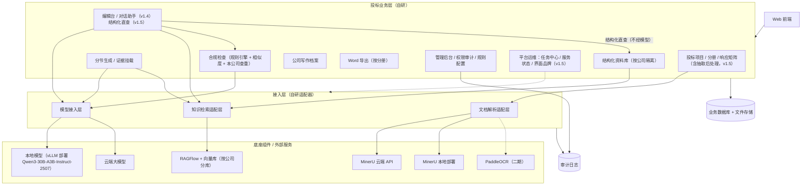

### 4.2 主流程：从新建项目到导出 Word

结论：v1.2 起，技术标和商务标按“分册”分开编写。各分册并行跑章节生成闭环，分别检查、分别定稿；全部系统编制的分册定稿后做导出前全文检查（含跨分册一致性），通过后分别导出两本 Word 和一份合标核对清单；合标由商务负责人在系统外完成。v1.4 起，章节生成闭环停止后，编写人在编辑台中修改正文（手改或借助对话助手），分册检查发现阻断项时也回到编辑台修改。

```mermaid
flowchart TD
    A["新建投标项目<br/>选择投标主体（公司）、项目大类、行业模板"] --> A1{"同一招标项目/标段<br/>集团内是否已有关联公司立项？"}
    A1 -- "有" --> A2["关联投标冲突提示（R19）<br/>项目负责人确认后方可继续"]
    A1 -- "无" --> B
    A2 --> B["上传招标文件<br/>及澄清、补遗、技术规范书、合同条款、附件"]
    B --> C{"项目是否敏感？"}
    C -- "是" --> C1["强制本地解析服务"]
    C -- "否" --> C2["按任务与模型对应表选择解析服务<br/>（默认云端 MinerU）"]
    C1 --> D["文档解析<br/>输出统一格式：文本块 + 页码 + 坐标"]
    C2 --> D
    D --> E["信息抽取（本地 Qwen）<br/>基本信息、资格、评分及得分要点、废标、星号条款、<br/>技术服务、SLA、格式与分册、时间节点、保证金"]
    E --> F["项目负责人逐项确认抽取结果<br/>可点回原文页"]
    F --> G["生成响应矩阵<br/>每条要求一行，评分项拆到得分要点"]
    G --> G1["分册分流确认<br/>每行归入技术分册、商务分册或两者共用<br/>指定分册负责人"]
    G1 --> H["匹配资料<br/>规则匹配结构化资料 + 检索方案片段"]
    H --> I{"每条要求都有证据？"}
    I -- "否" --> I1["标记缺口：补录资料 / 申请授权 / 调整人员<br/>或保留为【待补】"]
    I1 --> H
    I -- "是或已标【待补】" --> F1["确认项目事实表<br/>服务期、响应时间、驻场人数、项目经理、<br/>质保与培训等承诺"]
    F1 --> V1
    F1 --> V2
    subgraph TV["技术分册（技术负责人）"]
        V1["写作方案确认<br/>（可标增值章节）"] --> K1["各章节生成闭环（5.7 节）<br/>系统生成章节按数据生成"]
        K1 --> E1["编辑台修改（v1.4，5.11 节）<br/>手改或对话助手写入，写入后增量复查"]
        E1 --> Q1["技术分册检查"]
        Q1 -- "有阻断项" --> E1
        Q1 -- "无阻断项" --> S1["技术分册定稿<br/>（交叉复核确认）"]
    end
    subgraph BV["商务分册（商务负责人）"]
        V2["写作方案确认"] --> K2["各章节生成闭环（5.7 节）<br/>系统生成章节按数据生成"]
        K2 --> E2["编辑台修改（v1.4，5.11 节）<br/>手改或对话助手写入，写入后增量复查"]
        E2 --> Q2["商务分册检查"]
        Q2 -- "有阻断项" --> E2
        Q2 -- "无阻断项" --> S2["商务分册定稿<br/>（交叉复核确认）"]
    end
    S1 --> M["导出前全文检查（5.8.5 节）<br/>固定规则 + 相似度 + 本公司查重 + 跨分册一致性"]
    S2 --> M
    M --> N{"有阻断项？"}
    N -- "有" --> L["解锁相关分册<br/>修改后重新定稿"]
    L --> M
    N -- "只有警告" --> N1["项目负责人逐条确认放行并留痕"]
    N -- "无" --> O
    N1 --> O["分别导出技术标、商务标两本 Word（递交版）<br/>附合标核对清单"]
    O --> P["项目状态：已导出"]
    P --> P1["系统外：商务负责人在 Word 中人工合标<br/>按合标核对清单核对页码、索引表等"]
    P1 --> P2["登记递交<br/>（二期接定稿回收）"]
```

说明：

1. 从“确认项目事实表”到“分册定稿”的部分在“编制中”状态进行。每个章节独立跑生成闭环，规则见 5.7 节；分册检查、定稿和全文检查的规则见 5.8.5 节。
2. 图中以技术、商务两个分册为例（招标未规定分册时的默认设置，建议）。招标要求更多分册（例如资格证明文件单独成册）时，按同样的方式并行。系统外编制的分册（例如报价文件）不在系统内生成、检查和定稿，只在合标核对清单中列为“需人工核对”。
3. 图中标“系统外”的步骤不在系统中操作。系统不做合标页面、不做合并导出、不在系统内更新合标后的页码（neil 已确认）。
4. 任何时候都可以按分册导出“内部稿”供内部传阅（5.9.1 节），内部稿不改变项目状态，图中未画出。
5. **编辑台修改（v1.4）**：生成闭环停止后（章节为已完成、待人工处理或人工已处理），编写人可在编辑台中手改，或选中文字请对话助手给出修改样例，确认差异后写入；每次写入生成新版本并做增量复查，不重跑整章闭环（5.11 节）。编辑台修改不是必经步骤，章节无需修改时可直接进入分册检查。

### 4.3 投标项目状态

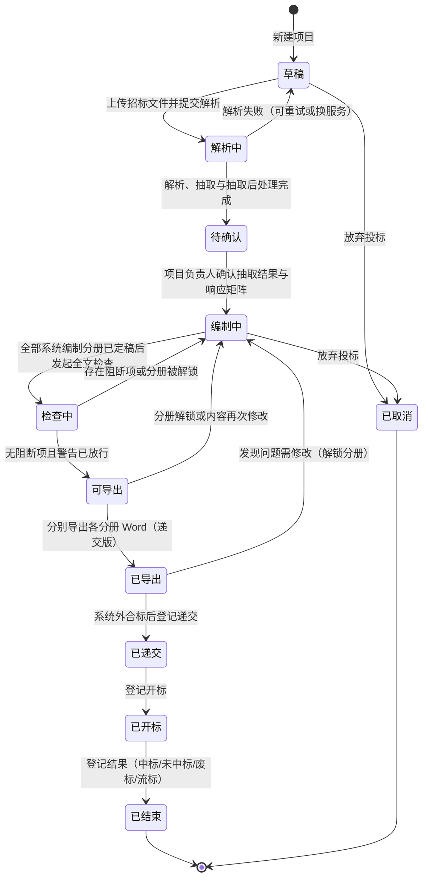

状态规则：

1. “已导出”后任何章节被修改（须先解锁所在分册），项目自动回到“编制中”，上一次导出的文件和合标核对清单都标记为“已过期”，但保留下载。
2. 招标方发布澄清或补遗时，项目负责人上传新文件，系统重新解析并标出与原抽取结果的差异（新增、修改、删除的要求），受影响的矩阵行和章节标为“需复核”，项目回到“待确认”。v1.5：补遗上传后重跑抽取后处理（5.2.4 节），新产生的冲突和疑似遗漏处理完之前，项目负责人不能再次确认解析结果。
3. “已递交”触发人员占用（字典 R12）；“已开标”触发在投占用自动释放；登记“中标”时转为履约占用（字典第 6 章第 13 项结论）。
4. 写作方案确认、各章节的生成闭环、分册检查和分册定稿都在“编制中”进行（5.7 节、5.8.5 节）；“编制中 → 检查中”指发起导出前全文检查，前提是全部系统编制的分册都已定稿（分册定稿又要求本分册全部章节处于“已完成”或“人工已处理”且分册检查无阻断项）。
5. 项目状态不设“合标中”（v1.2）。合标在“已导出”之后、“已递交”之前由商务负责人在系统外完成；分册有自己的状态（编制中 → 分册检查中 → 已定稿），见 5.8.5 节。
6. **编辑台修改不改变项目状态流转（v1.4）**。编辑台中的修改都在“编制中”进行；修改已定稿分册中的章节须先解锁分册（5.8.5 节），项目随之回到“编制中”（与本节规则 1 一致），修改后的章节标“定稿后已修改”，须重新做分册检查和定稿（5.11.10 节）。

---

## 5. 功能详述

本章按模块写到页面级。每个页面按“目的、主要元素、操作、状态流转、业务规则、异常与边界、验收标准”七项描述；某项不适用时注明“无”。v1.5 新增的通用页面和平台运维页面（5.12 节）在七项之外另写“入口”和“版式分区”。

**页面清单（v1.5 新增）**：下表列出第一期全部页面。“设计编号”是设计规范第 5 章的页面编号，便于设计和研发对照。

| 设计编号 | 页面 | 所属模块 | PRD 章节 | 主要角色 |
|---|---|---|---|---|
| G-01 | 登录 | 全局 | 5.12.1 | 全部 |
| G-02 | 站内提醒列表 | 全局 | 5.12.2 | 全部 |
| —（顶栏） | 全局搜索 | 全局 | 5.12.3 | 平台管理员以外的全部角色 |
| G-03 | 后台任务中心 | 全局 | 5.12.4 | 全部（按权限看本人或本公司任务；平台管理员只看脱敏摘要） |
| P-01 | 项目列表（工作台，含 6 张统计卡） | 投标项目 | 5.1.1 | 项目负责人、编写人、只读成员、集团管理员（只读） |
| P-02 | 新建项目 | 投标项目 | 5.1.2 | 项目负责人、公司管理员 |
| P-03 | 项目概览（底部折叠区为项目级写作观察统计） | 投标项目 | 5.1.3、5.7.13 | 项目成员 |
| P-04 | 招标文件 | 招标文件解析 | 5.2.1 | 项目负责人 |
| P-05 | 解析结果（含冲突待选定、疑似遗漏、引用未解析） | 招标文件解析 | 5.2.2、5.2.4 | 项目负责人（确认）、编写人（编辑） |
| P-06 | 响应矩阵（含“挂证据”抽屉） | 响应矩阵 | 5.3.1 | 项目负责人、编写人 |
| P-07 | SLA 矩阵（“响应矩阵”页签内的二级切换） | 响应矩阵 | 5.3.2 | 项目负责人 |
| P-08 | 资料匹配：v1.5 取消独立页签，并入 P-06 的“挂证据”抽屉 | 响应矩阵 | 5.3.1 规则 11 | — |
| P-09 | 项目事实表 | 分节生成 | 5.7.8 | 项目负责人 |
| P-10 | 写作方案与大纲确认 | 分节生成 | 5.7.2 | 项目负责人、分册负责人 |
| P-11 | 编辑台与对话助手（含答案卡） | 编辑台 | 5.11.2、5.11.15 | 编写人、分册负责人、项目负责人 |
| P-12 | 章节循环进度 | 分节生成 | 5.7.6 | 项目负责人、分册负责人 |
| P-13 | 人工处理队列 | 分节生成 | 5.7.7 | 编写人、分册负责人 |
| P-14 | 合规检查 | 合规检查 | 5.8.2 | 项目负责人、分册负责人 |
| P-15 | 导出 | Word 导出 | 5.9.1 | 项目负责人（递交版）、分册负责人（内部稿） |
| P-16 | 项目设置 | 投标项目 | 5.1.4 | 项目负责人 |
| P-17 | 写作观察统计（项目级）：v1.5 放在 P-03 底部折叠区 | 分节生成 | 5.7.13 | 项目负责人 |
| P-18 | 分册分流确认 | 响应矩阵 | 5.3.1 规则 8 | 项目负责人 |
| K-01 | 资料库首页 | 企业资料库 | 5.4.2 | 资料管理员、公司管理员 |
| K-02 | 资料列表（各类通用） | 企业资料库 | 5.4.3 | 资料管理员、编写人 |
| K-03 | 资料详情与编辑 | 企业资料库 | 5.4.4 | 资料管理员、编写人 |
| K-04 | 人员详情 | 企业资料库 | 5.4.5 | 资料管理员、公司管理员 |
| K-05 | 原厂授权与授权链 | 企业资料库 | 5.4.6 | 资料管理员 |
| K-06～K-14 | 公司主体、证明材料、中小企业划型、SLA 模板、全局变量、附件库、安全与合规事件、工具与设备、业绩 | 企业资料库 | 5.4.3、5.4.7 | 资料管理员 |
| K-15 | 方案片段库 | 知识库 | 5.5.2 | 编写人、资料管理员 |
| K-16 | 历史标书导入 | 知识库 | 5.5.3 | 资料管理员、公司管理员 |
| W-01 | 写作档案 | 写作档案 | 5.6.2 | 公司管理员 |
| W-02 | 风格样例库 | 写作档案 | 5.6.5 | 公司管理员、资料管理员 |
| W-03 | 写作观察统计（公司级） | 写作档案 | 5.7.13 | 公司管理员 |
| A-01 | 公司管理 | 平台管理 | 5.10.1 | 平台管理员 |
| A-02 | 用户与角色 | 管理后台 | 5.10.2 | 公司管理员 |
| A-03 | 字典配置 | 管理后台 | 5.10.3 | 平台管理员、公司管理员 |
| A-04 | 资料库设置 | 管理后台 | 5.10.4 | 公司管理员 |
| A-05 | 模型开放与生成设置 | 管理后台 | 5.10.5、6.9 | 公司管理员 |
| A-06 | 审计日志 | 管理后台 | 5.10.6 | 公司管理员、平台管理员、集团管理员 |
| A-07 | 规则配置（含“兜底扫描词表”页签） | 管理后台 | 5.12.5 | 公司管理员；平台管理员（平台默认值） |
| A-08 | 模型登记 | 平台管理 | 6.6.1 | 平台管理员 |
| A-09 | 文档解析服务 | 平台管理 | 6.6.2 | 平台管理员 |
| A-10 | 任务与模型对应表 | 平台管理 | 6.6.3 | 平台管理员 |
| A-11 | 部署与服务状态 | 平台管理 | 5.12.6 | 平台管理员 |
| A-12 | 界面品牌 | 平台管理 | 5.12.7 | 平台管理员 |

### 5.1 投标项目

#### 5.1.1 页面：项目列表

- **目的**：让用户看到本公司自己有权限的全部投标项目及其进度、风险，快速进入。
- **主要元素**：顶部 6 张统计卡（v1.5，设计规范第 12 章第 9 项，见下表），点击卡片即按该口径筛选列表，再次点击取消；筛选区（状态、项目大类、招标人、投标截止时间范围、我参与的）；列表列（项目名称、招标编号/标段、招标人、投标主体、投标截止时间及倒计时、状态、响应覆盖率、阻断问题数、【待补】数、项目负责人）；右上角“新建项目”。
- **操作**：新建、查看、复制为新项目（只复制项目设置和大纲，不复制招标文件和生成内容）、取消项目、导出列表。
- **状态流转**：见 4.3 节。
- **业务规则**：只列当前公司项目；集团管理员有公司切换器，只读。投标截止时间（`bid_deadline_at`）在 3 天内的项目置顶并标红（天数可配置，示例 3 天）。统计卡只统计当前用户在列表中可见的项目，与列表口径一致。
- **异常与边界**：项目数为 0 时显示引导（上传第一份招标文件）。
- **验收标准**：①公司 A 的用户在任何筛选条件下都看不到公司 B 的项目；②倒计时按 UTC+8 计算，截止时间过后显示“已截止”；③列表数据与项目详情一致；④（v1.5）每张统计卡的数字等于点击该卡后列表中的项目数（“阻断合计”“【待补】合计”“资料临期/过期”三张卡的数字是合计数，点击后列出涉及的项目）。

**统计卡口径（v1.5）**：口径为建议，研发实现时与业务确认。

| 统计卡 | 数字的含义 | 点击后列表筛选 |
|---|---|---|
| 进行中 | 状态不是“已递交”“已开标”“已结束”“已取消”的项目数 | 这些项目 |
| 3 天内截止 | 进行中的项目中，投标截止时间距现在不超过设定天数（示例 3 天，与置顶标红天数相同）的项目数 | 这些项目，按截止时间升序 |
| 阻断合计 | 进行中项目的阻断问题数之和（取各项目最近一次分册检查或全文检查的未处理阻断数） | 阻断数大于 0 的项目 |
| 【待补】合计 | 进行中项目当前章节版本中【待补】数之和 | 【待补】数大于 0 的项目 |
| 待我处理 | 需要当前用户处理的事项所在的项目数：分配给本人的待人工处理问题、待本人确认的写作方案或解析结果、待本人交叉复核的分册、本人负责且已到截止提醒天数的分册 | 这些项目 |
| 资料临期/过期 | 进行中项目已挂证据中，在投标截止时间前到期或已过期的资料条数 | 存在这类证据的项目 |

#### 5.1.2 页面：新建项目

- **目的**：用最少的信息建立项目，其余信息在解析后自动带出。
- **主要元素**：投标主体（本公司的主体记录，默认本公司法人主体；分公司投标时可选分公司）；项目大类（服务/货物/工程，MVP 默认服务）；行业模板（数据库维保 / IT 运维 / 通用服务，来自写作档案的章节模板）；是否敏感项目（开关，见下）；是否联合体投标/是否有分包；上传招标文件（可稍后）。
- **操作**：保存为草稿；保存并上传解析。
- **状态流转**：新建后为“草稿”。新建时系统先按默认分册集合（技术分册、商务分册，建议，见 Q19）建立分册，解析后按招标文件的分册要求调整（5.1.4 节第 8 项）。
- **业务规则**：
  1. **敏感项目**：勾选后，本项目的解析、抽取、生成、检查全部只能用本地服务，降级也只能降到其他本地服务。敏感标记只能由项目负责人或公司管理员设置；从“敏感”改为“不敏感”需公司管理员操作并留痕。敏感项目的判定标准待业务确认（第 10 章），MVP 先由人工勾选，并支持公司管理员设置“本公司所有项目默认敏感”。
  2. **关联投标冲突检查（R19）**：保存时，系统用招标编号 + 标段编号（没有编号时用“招标人名称 + 项目名称”的规范化文本）在全平台查找集团内其他公司是否已有同一招标项目同一标段的项目。有则弹出提示：“集团内另一家公司已对同一标段立项。依据《招标投标法实施条例》第三十四条和《政府采购法实施条例》第十八条，存在控股、管理关系或单位负责人为同一人的不同单位不得参加同一标段投标。”项目负责人须选择“确认无上述关系并继续”或“取消”，选择继续需填写说明，全程留痕并通知集团管理员。提示中**只显示对方公司名称，不显示对方项目内容**。
- **异常与边界**：招标编号为空、标段为空时的匹配只能是近似匹配，提示语改为“可能是同一项目”。
- **验收标准**：①敏感项目在后续任何环节都不会产生云端调用（审计日志可验证）；②同标段已有关联公司立项时必定弹出提示，且无法跳过说明；③公司用户看不到对方项目的任何内容。

#### 5.1.3 页面：项目详情（工作台）

- **目的**：一个项目的总入口，按主流程分页签组织。
- **主要元素**：顶部摘要条（项目名、招标编号、投标主体、投标截止时间、状态、覆盖率、阻断数、【待补】数、待人工处理问题数、敏感标记）；页签：概览、招标文件、解析结果、响应矩阵（含“SLA 矩阵”二级切换）、项目事实表、编辑台（含写作方案确认、章节循环进度；v1.6 统一页签名称，设计规范 11.2 节第 5 项）、人工处理队列、合规检查、导出、项目设置。v1.5：取消“资料匹配”页签，资料匹配并入响应矩阵的“挂证据”抽屉（5.3.1 节规则 11）；SLA 矩阵作为“响应矩阵”页签内的二级切换（5.3.2 节）；项目级写作观察统计放在“概览”底部的折叠区，默认收起（5.7.13 节）。v1.2：顶部摘要条增加“分册进度”（每个分册的负责人、内部截止时间、状态、阻断数、待人工处理数），编辑台、人工处理队列、合规检查、导出页签都可按分册筛选。v1.4：v1.3 的章节页签升级为“编辑台”（章节目录、正文编辑区、问题/来源侧栏、对话面板，5.11.2 节）；概览页待办增加“定稿后已修改，待复核”的章节。
- **操作**：按页签进入各功能；项目负责人可变更状态（递交、开标、结果登记）。
- **状态流转**：见 4.3 节。
- **业务规则**：概览页展示“下一步该做什么”的待办清单（例如“3 条星号条款未响应”“2 张证书在截止时间前过期”“原厂专项授权需提前 X 天申请”“第 3.2 节待人工处理（2 个问题）”；v1.2 增加分册类待办，例如“商务分册内部截止时间还剩 1 天，尚未定稿”“技术分册已定稿，等待交叉复核确认”，示例）。
- **异常与边界**：项目取消后只读。
- **验收标准**：①待办清单中的每一项可一键跳转到对应位置；②（v1.5）项目详情中没有“资料匹配”页签和单独的“SLA 矩阵”“写作观察统计”页签，对应功能分别在“挂证据”抽屉、响应矩阵二级切换和概览底部折叠区中可用。

#### 5.1.4 页面：项目设置

- **目的**：维护项目基础信息、成员、合作方、拟派人员、项目级规则覆盖和 SLA 取值。
- **主要元素**：
  1. **基本信息**：解析后自动带出（项目名称、编号、标段、招标人、代理机构、预算、最高限价、投标截止时间、开标时间、服务期、项目地点、招标涉及的厂商产品清单），可人工修改，修改处显示“已人工修改”；v1.2 增加“对招标人称呼”（默认取写作档案的默认值，可按本项目修改，例如“贵行”，示例），R35 按此检查全文称呼。
  2. **成员与分工**：项目负责人、编写人；章节分配在“编辑台”页签做。v1.2：合标负责人（默认为商务分册负责人，可改为其他项目成员），只用于接收导出文件和合标核对清单。
  3. **合作方**：联合体成员或分包方（选择本公司资料库中主体范围为“合作伙伴”的主体），每个合作方**必须上传联合体协议或分包协议**才能引用其资料（字典第 6 章第 4 项结论）；合作方资料由项目负责人上传到本公司资料库，自动标为“合作伙伴提供”。
  4. **拟派人员**：从资料库选人并指定项目角色（项目经理、技术负责人、驻场工程师、DBA 等）；显示占用冲突提示（只提示不锁定）。
  5. **SLA 取值**：选定本项目使用的 SLA 模板；在项目内改写变量取值（例如把一级故障响应时限从模板默认值改为招标要求值），改写值只存在本项目（字典第 6 章第 17 项结论），不回写资料库。改写后的值严于模板“最严可承诺值”时显示“超出能力”警告。
  6. **项目级规则覆盖**：证明材料有效天数（招标文件有明确要求时以招标文件为准，覆盖材料类型默认值）；是否开启“有效期覆盖服务期”检查（默认关闭，开启后证书、授权须在整个服务期内有效）；本单位人员要求（是否要求拟派人员为本单位员工、是否需社保证明、要求连续缴纳月数）。
  7. **生成闭环（v1.1）**：是否在本项目关闭章节模型评审（只能关闭；公司已关闭时不能在项目中打开）；章节生成顺序（依次 / 并行，默认取公司设置）。见 6.9 节。
  8. **分册（v1.2）**：分册列表，每个分册包括名称（例如技术分册、商务分册、资格证明文件）、类型（技术/商务/资格/报价/其他）、编制方式（系统编制 / 系统外编制，报价文件通常为系统外编制）、分册负责人、内部截止时间、是否单独密封、页码方式（默认每册从 1 起）、是否暗标、封面模板、递交文件名。解析后系统按招标文件的“格式要求”（分册、密封、份数、暗标）自动建议分册，项目负责人确认；招标未规定分册时，默认建技术、商务两册，资格证明材料归入商务分册（建议，见 Q19）。
  9. **导出设置（v1.2）**：内部稿命名模板（默认取写作档案的“内部稿命名模板”，默认值“{编写人}_{版本}_{日期}_{项目名称}”，依据编写规范 p.27）；递交版命名规则（按招标文件要求填写；招标无要求时默认“{项目名称}_{分册名称}”，建议）。递交版命名规则**不允许**使用 {编写人} 变量，保存时校验，与 8.2 节第四十条的防护一致。见 5.9.1 节。v1.5：**递交版需填完整值的敏感字段**——招标要求在递交文件中填写完整身份证件号码、手机号等高敏个人信息时，由项目负责人勾选需要填完整值的字段类别（身份证件号码、手机号、银行账号，字典 `sensitive_export_field`）并确认依据（关联的招标要求条目），记录确认人和时间；未勾选的字段在递交版中同样掩码（5.9.1 节第 8 条）。
- **操作**：保存；从解析结果重新带出。
- **状态流转**：无独立状态。
- **业务规则**：
  1. 投标主体一经进入“编制中”后修改，需项目负责人确认，且所有已挂证据重新做主体一致性检查（R02）。
  2. 系统编制的分册未指定分册负责人时，该分册的写作方案不能确认（v1.2，建议）。
  3. 删除分册前须先把该分册的章节和矩阵行转到其他分册；已定稿的分册不能删除，须先解锁。
  4. 分册内部截止时间晚于项目投标截止时间时给警告；截止前 1 天（天数可配置，示例 1 天）未定稿的分册进入概览待办。
- **异常与边界**：合作方协议缺失时，该合作方资料在匹配结果中显示但不可选，并提示“缺协议”。招标文件要求的分册无法识别时，保留默认两册并在概览待办中提示“请核对分册要求”。
- **验收标准**：①未上传协议的合作方资料无法被章节引用；②项目内 SLA 改写不影响资料库中的模板默认值；③覆盖规则生效后合规检查结果随之变化；④递交版命名规则中含 {编写人} 时无法保存；⑤未指定负责人的系统编制分册，其写作方案无法确认。

#### 5.1.5 数据对象（投标项目模块）

以下表属于投标项目模块，字段只列关键项；完整列定义（字段、类型、必填、说明、代码表、索引与唯一约束、隔离口径）见字典 v1.7 3.10 节，字段名以本 PRD 为准。所有表带字典 3.0 节的 A 组审计字段和 C 组 `company_id`（所属公司）。

| 表名 | 中文名 | 关键字段 | 与字典的对齐 |
|---|---|---|---|
| bid_project | 投标项目 | project_name、tender_no、lot_no、lot_name、tenderee_name、agency_name、bid_entity_id（→org_entity）、project_category_code、industry_template_id、is_sensitive、is_consortium、budget_amount、ceiling_amount、bid_deadline_at（投标截止时间）、open_at、service_start_date、service_end_date、project_region_code、product_ids、status（项目状态，4.3 节：草稿/解析中/待确认/编制中/检查中/可导出/已导出/已递交/已开标/已结束/已取消）、check_service_period（覆盖服务期检查开关）；v1.1 新增：model_review_disabled（本项目关闭模型评审）、chapter_generation_order（章节生成顺序）；v1.2 新增：client_address（对招标人称呼，空则取写作档案默认值）、merge_owner_id（合标负责人，→sys_user，默认商务分册负责人）、internal_naming_template（内部稿命名模板，空则取写作档案）、submit_naming_rule（递交版命名规则，不得含 {编写人}）；v1.5 新增：submit_full_value_fields（递交版需填完整值的敏感字段类别）、submit_full_value_basis_ids（依据的招标要求）、submit_full_value_confirmed_by、submit_full_value_confirmed_at（确认人和时间） | 字典中的 `bid_project_ref`（person_assignment、bid_archive）取值为本表 `id` |
| bid_project_member | 项目成员 | project_id、user_id、project_role（负责人/编写人/只读）；v1.2 新增：volume_ids（参与的分册，多值引用 bid_volume；分册负责人身份以 bid_volume.owner_user_id 为准） | user_id → sys_user |
| project_partner | 项目合作方 | project_id、partner_entity_id（→org_entity，主体范围须为合作伙伴）、relation_type（联合体成员/分包方）、work_share（分工说明）、agreement_attachment_id（协议文件，必填才能引用） | 附件槽位 `consortium_agreement`、`subcontract_agreement`（字典 4.9） |
| project_person | 拟派人员 | project_id、person_id、role_code、is_key_person、conflict_status（无/有冲突已知悉） | person、person_assignment（递交时写入） |
| project_sla_value | 项目 SLA 取值 | project_id、sla_template_id、template_version_no、var_key、project_value、tender_required_value、source（模板默认/招标要求/人工改写）、exceeds_capability | sla_template、sla_variable；导出后写入 bid_archive_ref.value_snapshot（二期定稿回收时） |
| project_rule_override | 项目规则覆盖 | project_id、rule_key（如 proof_valid_days.纳税证明、require_own_staff、social_insurance_months、check_service_period）、value、source_requirement_id（依据的招标要求） | org_proof_doc 有效期、R03、R11 |
| tender_file | 招标文件 | project_id、attachment_id、file_role（招标文件/澄清/补遗/技术规范书/合同条款/附件；v1.2 新增技术规范书、合同条款）、version_no、supersedes_id、parse_status（待解析/上传中/解析中/抽取中/已完成/失败，5.2.1 节） | attachment（字典 3.4.1） |
| bid_volume | 项目分册（v1.2） | project_id、volume_name（例如技术分册）、volume_type（技术/商务/资格/报价/其他，字典 bid_volume_type）、compile_mode（系统编制/系统外编制）、owner_user_id（分册负责人，→sys_user）、internal_deadline_at（内部截止时间）、volume_status（编制中/分册检查中/已定稿）、sort_order、is_separately_sealed（是否单独密封）、page_numbering（页码方式，默认每册从 1 起）、is_blind（是否暗标）、cover_template_ref（封面模板）、submit_file_name（递交文件名）、source_requirement_ids（依据的招标要求）、cross_reviewer_id、cross_reviewed_at（交叉复核人和时间）、finalized_by、finalized_at、finalized_version_snapshot（定稿时的章节版本快照）、unlocked_by、unlocked_at、unlock_reason（最近一次解锁） | 字典 4.11 节 bid_volume_type；4.13 节 volume_status、volume_compile_mode；字典 3.8.5 节对齐说明 |

---

### 5.2 招标文件解析

#### 5.2.1 页面：招标文件

- **目的**：上传和管理本项目的招标文件、澄清、补遗（v1.2 起技术规范书、合同条款单独标记），查看解析进度。
- **主要元素**：文件列表（文件名、类型、版本、页数、上传人、上传时间、解析服务、解析状态、耗时）；上传区；解析服务选择（只显示本公司已开放且符合敏感要求的服务，默认取任务与模型对应表）。
- **操作**：上传、重新解析（可换服务）、下载原件、设为被替代（上传新版补遗后）。
- **状态流转**：待解析 → 上传中 → 解析中 → 抽取中 → 已完成 / 失败。v1.5：抽取后处理（5.2.4 节）在“抽取中”内完成，后处理结束才进入“已完成”；每次解析任务（`parse_job`）自身的状态为排队 / 解析中 / 已完成 / 失败 / 已取消，进度在后台任务中心可见（5.12.4 节）。
- **业务规则**：
  1. 支持格式以所选解析服务能力为准（MinerU 云端精准解析 API 官方列出 PDF、图片、Doc、Docx、Ppt、PPTx、Xls、Xlsx，单文件 ≤200MB、≤200 页；本地 MinerU 4.0 另支持 OFD 等，见第 6 章）。超过云端页数限制时自动按页码范围分批提交并合并结果。
  2. 解析结果统一为系统格式（见 6.3.4 节），与具体解析服务无关。
  3. 同一文件（按 SHA-256 文件指纹判断）在本公司内已解析过且解析服务和参数相同时，直接复用结果；**不跨公司复用**。
  4. 文件角色增加“技术规范书”“合同条款”（v1.2）。技术规范书是点对点应答（5.7.2 节）的逐条来源，也是 R29 查重中“招标原文”的一部分（编写规范 p.24：来自技术规格书的内容可以无视）；合同条款中需要投标人响应的条款进入抽取类别 6。
- **异常与边界**：解析失败时显示服务返回的原因（例如“文件页数超过限制”），提供“换服务重试”；云端服务不可用时按第 6 章降级规则处理，敏感项目只等待本地服务并通知项目负责人。
- **验收标准**：①上传 1 份超过 200 页的 PDF，系统自动分批解析并得到完整结果，页码连续正确；②敏感项目的文件只出现在本地服务的调用记录中。

#### 5.2.2 页面：解析结果

- **目的**：按类别展示抽取出的信息，每条都能点回原文，供项目负责人确认。
- **主要元素**（v1.5 调整为“左原文预览 · 中分类树 · 右条目卡片”，设计规范第 12 章第 7 项）：左侧原文预览，点击条目时跳到对应页并高亮对应区域（利用解析结果中的页码和坐标）；中间抽取项分类树（10 类，见下表），每类显示条目数和待确认数；右侧抽取条目卡片（字段名、抽取值、原文摘录、页码、置信度、状态；经合并的条目显示“已合并 N 条”，经引用补齐的显示“经引用补齐”）。顶部三个入口（v1.5，5.2.4 节）：“冲突待选定 N”“疑似遗漏 N”“引用未解析 N”，数字为待处理条数，点击打开对应列表；右上角“确认解析结果”按钮。
- **操作**：确认、修改（修改后状态为“已人工修改”并加编辑锁，重新抽取时不覆盖）、删除（误抽取）、新增（漏抽取，手工框选原文区域或输入页码）、批量确认、“重新抽取本类”；v1.5：选定冲突（填写理由）、疑似遗漏“新增为条目”或“排除”（填写理由）、为未解析的引用手工指定目标、拆分已合并的条目、确认解析结果（项目负责人）。
- **状态流转**：待确认 → 已确认 / 已人工修改 / 已删除。
- **业务规则**：
  1. 抽取由本地模型（任务与模型对应表中“信息抽取”任务的模型）按分块完成：解析文本按标题层级切块，每块不超过该模型 `max_input_tokens` 减去提示词和输出预留后的长度，相邻块保留少量重叠，避免条款被切断；每块抽取结果带回原始页码范围。
  2. 置信度低于阈值（可配置，示例 0.8）的条目高亮提示人工核对。
  3. 星号条款、废标条款、资格要求这三类**不允许批量确认**，必须逐条确认（防止漏看）。
  4. 招标文件中的“投标文件格式要求”既进入抽取结果，也作为 Word 导出和格式检查的输入。
  5. 评分项拆到“得分要点”（v1.2）：一条评分项的评分标准中列出多个可得分的内容时，每个内容抽成一个得分要点子条目，挂在该评分项下，沿用评分标准原文用词；得分要点是写作方案中小标题和 R26 覆盖检查的最小单位。
  6. 评分项中的否决子句（例如编写规范 p.13 所示评分表中的“隐瞒上述涉及生产安全的重大隐患、行政处罚、责任事故的将被否决响应”）单独抽成一条废标条款，并标为“披露类”，进入 R23 导出闸门和 R39 检查（v1.2）。
  7. **确认解析结果的前提（v1.5）**：没有状态为“待处理”的冲突；疑似遗漏已逐条处理；星号、废标、资格三类条目已逐条确认；冲突涉及的条目在冲突处理前不能确认。“引用未解析”不阻断，确认时提示条数。确认后系统生成或更新响应矩阵，项目进入“编制中”的前置条件之一（4.3 节）。
  8. **补遗后重跑（v1.5）**：上传补遗后重跑抽取和抽取后处理，规则见 5.2.4 节规则 4。
- **异常与边界**：扫描件文字识别质量差导致原文摘录乱码时，条目标“原文不可读”，要求人工对照原页补录。
- **验收标准**：①任一抽取条目点击后，原文预览跳到正确页并高亮；②星号、废标、资格三类无批量确认按钮；③人工修改过的条目在“重新抽取”后保持不变；④（v1.5）页面从左到右依次为原文预览、分类树、条目卡片；⑤（v1.5）存在待处理的冲突或未处理的疑似遗漏时，“确认解析结果”不可用，并提示还剩几条；⑥（v1.5）三个入口的数字与对应列表中的待处理条数一致。

**抽取项清单**（“字段”列为抽取目标；服务类标的专项字段加“〔运维〕”标记）：

| 类别 | 抽取字段 | 用途 |
|---|---|---|
| 1 项目基本信息 | 项目名称、招标/采购编号、标段（包）编号与名称、招标人/采购人、代理机构、项目地点、预算金额、最高限价、采购方式、项目大类、品目分类、服务期、是否接受联合体、是否允许分包、招标涉及的厂商产品与版本清单〔运维〕（如数据库品牌、版本、实例数量）、服务对象规模〔运维〕 | 带入项目设置；R07、R08 的输入 |
| 2 资格要求 | 每条资格条件原文；归类（营业执照/经营范围、资质证书、体系认证、ITSS 等级〔运维〕、原厂授权〔运维〕、人员及证书、业绩、财务、纳税社保、信用、联合体要求、其他）；数量或等级要求；时间要求（如“近三年”）；是否需原件；v1.2：结构化人员条件（学历、专业、工作年限、证书、人数、角色、AB 角、不得兼任）；需提供的证明材料清单（材料名称、是否盖章、是否原件） | 响应矩阵资格行；R03、R07、R08、R13、R16；v1.2：R33、R41 |
| 3 评分办法与评分项 | 评分方法（综合评分/最低价等）；评分项树（分类、评分项名称、分值、评分标准原文、得分档次）；客观分/主观分标识；v1.2：得分要点（子条目）；结构化人员条件与证明材料清单（同类别 2）；是否要求截图证明及功能点关键词；是否要求评审索引表 | 响应矩阵评分行；写作方案（大纲）生成；v1.2：R26、R33、R38、R40、R41 |
| 4 废标与无效标条款 | 每条否决投标/无效投标条款原文；归类（格式、签章、资格、实质性响应、报价、其他）；v1.2：评分项中的否决子句（标“披露类”） | 响应矩阵废标行；导出闸门；v1.2：R39 |
| 5 星号实质性条款 | 带“★”“*”或明确“实质性要求”“不允许偏离”的条款原文；所属章节 | 响应矩阵星号行；导出闸门 |
| 6 技术服务要求 | 服务范围、服务内容清单、巡检要求〔运维〕（频次、内容、报告）、驻场要求〔运维〕（人数、时段、地点、资质）、应急要求〔运维〕（预案、演练频次）、备品备件〔运维〕、培训、原厂服务要求〔运维〕、交付物；v1.2：质保期、培训次数和课时、资源到位时限（进入承诺类事实）；技术规范书逐条条款（点对点应答的来源）；合同条款中需投标人响应的条款（并入本类，建议） | 响应矩阵技术行；章节生成；v1.2：R09、R27、R30 |
| 7 SLA 要求〔运维〕 | 服务时段（如 7×24）；故障分级及定义；各级响应、到场、恢复时限；报告周期；考核与罚则 | SLA 矩阵；R09、R10 |
| 8 投标文件格式要求 | 分册要求（商务/技术/资格/报价）；目录与章节顺序；格式文件（投标函、授权书、承诺函、偏离表、评审索引表等模板）；字体字号、页边距、页码、装订、签章位置；页数限制；暗标要求；电子版格式；v1.2：正本和副本份数、分开密封要求、递交文件命名要求 | 大纲、Word 导出、格式检查；v1.2：分册建议（5.1.4 节）、合标核对清单（5.9.2 节）、R42 |
| 9 时间节点 | 获取文件截止、答疑截止、投标截止、开标、保证金截止、踏勘时间 | 项目设置；倒计时与提醒 |
| 10 保证金 | 是否需要、金额、形式（转账/保函/保险）、缴纳截止时间、账户要求（如须从基本账户转出） | 项目待办；R22（二期） |

#### 5.2.3 数据对象（解析模块）

| 表名 | 中文名 | 关键字段 |
|---|---|---|
| parse_job | 解析任务 | project_id、tender_file_id、parse_service_id、service_config_version、request_params（快照）、external_job_id、status（排队/解析中/已完成/失败/已取消）、pages_total、pages_done、started_at、finished_at、error_code、error_message、is_cloud |
| parse_block | 解析文本块（统一格式） | parse_job_id、block_no、page_no（从 1 起）、bbox（页内坐标）、block_type（标题/正文/表格/图片/公式/页眉页脚）、heading_level、text、table_html、image_ref、reading_order |
| tender_requirement | 招标要求（抽取条目） | project_id、category（10 类之一）、sub_type、field_key、value_text、value_structured（键值集合）、source_block_ids、page_from、page_to、quote_text（原文摘录）、confidence、status（待确认/已确认/已人工修改/已删除）、is_locked、importance（星号/废标/资格/评分/一般）、score（分值）、supersedes_id（补遗替代）；v1.2 新增：parent_requirement_id（得分要点挂在评分项下时指向评分项）；结构化人员条件、证明材料清单、截图功能点关键词存在 value_structured 中；v1.5 新增：merge_status（独立/主条目/已并入）、merged_into_id（并入的主条目）、effective_status（有效/已被补遗替代）、filled_by_ref_id（经引用补齐时指向 tender_requirement_ref）、source_scan_hit_id（由疑似遗漏新增时指向 tender_scan_hit） |
| tender_requirement_source | 抽取条目来源（v1.5） | requirement_id、tender_file_id、parse_job_id、parse_block_id、page_no、bbox、quote_text、chunk_no（分块序号）；一条主条目可有多条来源 |
| tender_requirement_ref | 交叉引用（v1.5） | requirement_id、ref_text（引用原文）、ref_kind（章节/条款/附件/表格/其他文件）、target_file_id、target_path（目标标题路径）、target_block_from、target_block_to、target_requirement_ids、status（已解析/多义/未解析/目标缺失）、method（规则/索引候选/人工指定） |
| tender_conflict | 抽取冲突（v1.5） | project_id、conflict_type（补遗覆盖/字段取值不同/文本条款不一致）、requirement_ids、field_key、values（各方取值快照）、detect_method（规则/模型候选）、status（待处理/已选定/不构成冲突/已按补遗处理）、chosen_requirement_id、reason、decided_by、decided_at |
| tender_scan_hit | 兜底扫描命中（v1.5） | project_id、tender_file_id、parse_block_id、rule_id（→tender_scan_rule）、rule_version、matched_text、page_no、guessed_category（星号/废标）、covered_by_requirement_id、status（已覆盖/疑似遗漏/已新增为条目/已排除）、reason、handled_by、handled_at |
| tender_scan_rule | 兜底扫描词表（v1.5） | company_id（空＝平台初始词表）、rule_kind（关键词/正则）、pattern、target_category（星号/废标）、enabled、version_no、published_at、published_by；公司管理员维护，见 5.12.5 节 |

以上表的完整列定义见字典 v1.7 3.10 节；v1.5 新增的 5 张表都带 C 组 `company_id`（`tender_scan_rule` 为可混合表，空值表示平台初始词表）。

#### 5.2.4 抽取后处理（v1.5）

**结论：分块抽取完成后、条目交给人确认之前，系统自动做四步后处理：去重合并、交叉引用解析、冲突检测、星号和废标兜底扫描。** 前三步减少重复、补齐引用、找出前后矛盾；第四步给星号、废标条款加一道不依赖模型的召回保障。冲突由项目负责人选定，疑似遗漏由项目负责人逐条处理，处理完才能确认解析结果、生成响应矩阵。本节采纳技术方案 2.3.3 节的设计。后处理是一个后台任务，在招标文件状态“抽取中”内完成；上传补遗后重跑。

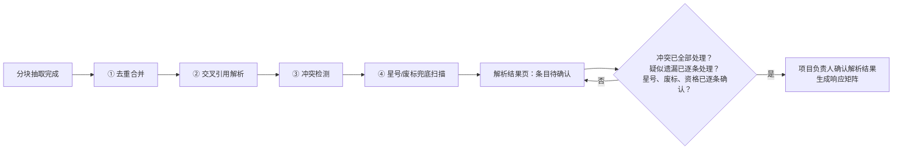

| 步骤 | 做什么 | 规则要点 | 结果在哪里处理 |
|---|---|---|---|
| ① 去重合并 | 同一要求被不同分块重复抽出时，合并为一条 | 候选条件：同一类别且同一单值字段键；或规范化后的文本相似度达到阈值（示例 0.85），或一条包含另一条；或来源文本块重叠。**取值不同的不合并**，交给第③步判断冲突。合并后保留一条“主条目”，其余标“已并入”，全部来源都挂在主条目上；重要性取最高的一档（星号 > 废标 > 资格 > 评分 > 一般）。人工修改过或已加编辑锁的条目只给“建议合并”，不自动合并 | 条目卡片显示“已合并 N 条”，可一键拆分 |
| ② 交叉引用解析 | 解析“详见第X章”“按附件N”“见技术规范书第X条”一类引用 | 按规则识别引用说法（技术方案列出约 30 种），在本项目招标文件的标题树中定位目标；最多追两层，发现循环即停止。结果分为已解析 / 多义 / 未解析 / 目标缺失；能唯一定位时把目标内容补到条目上，标“经引用补齐” | “引用未解析”入口列出多义、未解析、目标缺失的引用，项目负责人可手工指定目标 |
| ③ 冲突检测 | 找出同一事项的不同说法 | (a) 补遗覆盖原文：按招标文件的版本链处理，被修改的原条目标“已被补遗替代”，不删除，同时记一条状态为“已按补遗处理”的冲突供核对；无法定位被改条款时转人工。(b) 结构化字段（金额、时长、数量、日期等）统一单位后比较，同一字段键取值不同即为冲突。(c) 文本类条款不一致由本地模型给出候选（只能本地；每份文件最多 50 对候选，示例），是否构成冲突由人决定 | “冲突待选定”入口并列显示各方取值、原文和页码；项目负责人选定一方，或标“不构成冲突”，都须填写理由 |
| ④ 星号/废标兜底扫描 | 用关键词和正则全量扫描解析文本（不含页眉页脚） | 词表由公司管理员维护、带版本；平台提供初始词表（“★”、条款开头的“*”、“实质性要求”“不允许偏离”“否决投标”“无效投标”“废标”“不予受理”等，示例）。命中的文本块已被某条星号或废标条目覆盖的，记“已覆盖”；没有被覆盖的，记“疑似遗漏” | “疑似遗漏”入口逐条列出命中原文和页码；项目负责人逐条“新增为条目”或“排除”（须填写理由），不提供批量处理 |

**规则**：

1. **冲突处理完才能确认解析结果。** 存在状态为“待处理”的冲突时，“确认解析结果”不可用。冲突涉及的星号、废标、资格条目，在冲突处理完之前不能单独确认；其他类别的条目只提示（技术方案 Q-T27）。状态为“已按补遗处理”的冲突不阻断，供项目负责人核对。
2. **疑似遗漏逐条处理。** 每条疑似遗漏都要“新增为条目”（系统按命中原文预填类别和原文摘录，类别默认取星号或废标，人核对后保存，建议），或“排除”并写明理由；全部处理完才能确认解析结果。
3. **引用未解析不阻断。** 确认时提示还有几条引用未解析，由项目负责人核对；条目上“经引用补齐”的内容同样需要人确认。
4. **人工结果不被覆盖。** 重新抽取或补遗后重跑时，人工修改过或已加锁的条目、已选定的冲突、已处理的疑似遗漏都保持不变；补遗只会新增冲突记录和新的疑似遗漏。已确认的解析结果中受补遗影响的条目回到“待确认”，须重新确认（与 4.3 节规则 2 一致）。
5. **模型只给候选。** 只有第③步中的文本类冲突调用模型（任务与模型对应表“抽取冲突判定”，只能本地，6.4 节），模型的结论只是候选；其余三步不调用模型。
6. **兜底扫描词表。** 在规则配置页的“兜底扫描词表”页签维护（5.12.5 节），只有公司管理员能修改（v1.6：neil 已确认由公司管理员维护，对应技术方案 Q-T28；权限见 2.3 节“兜底扫描词表”行）；平台提供初始词表，公司在此基础上新增或停用词条；每次发布生成新版本，扫描结果记录所用的版本号。
7. **全程留痕。** 冲突选定、疑似遗漏的新增或排除（含理由）、拆分合并、手工指定引用目标、确认解析结果、词表修改都写审计日志（7.3 节第 14 条）。

**异常与边界**：

- 后处理任务失败时，解析结果仍可查看，但“确认解析结果”不可用，页面提示“抽取后处理未完成”，可在后台任务中心重试（5.12.4 节）。
- 兜底扫描命中过多时（示例：单份文件超过 30 条）照常列出，并提示公司管理员复核词表（技术方案风险 R-29）。

**验收标准**：①同一条款被两个分块重复抽出、取值相同时，结果中只有一条主条目，卡片显示“已合并 2 条”，并可拆分；②取值不同的两条（例如服务期 3 年和 2 年，示例）不合并，而是出现在“冲突待选定”中；③补遗修改某条款后，原条目标“已被补遗替代”，并产生一条“已按补遗处理”的冲突记录；④在招标文件中加入一条带“★”、但未被抽取的条款，兜底扫描把它列为“疑似遗漏”；⑤“疑似遗漏”中没有批量处理按钮，排除时不填理由无法保存；⑥存在“待处理”的冲突或未处理的疑似遗漏时，无法确认解析结果；⑦敏感项目的文本类冲突判定只调用本地模型。

---

### 5.3 响应矩阵

响应矩阵是 MVP 的核心：它把招标文件的每一条要求变成一行，逐条回答“我们怎么响应、写在标书哪个分册哪一章、用什么证据证明”。v1.2 起，矩阵还是分册分流的依据：每行归入一个或多个分册，写作方案按分册从矩阵取行。

#### 5.3.1 页面：响应矩阵

- **目的**：确保每条要求都被响应、每条响应都有证据，并把缺口暴露出来。
- **主要元素**：
  1. 顶部统计：应响应总数、已响应已确认数、星号条款未响应数、废标条款未核对数、缺证据数、【待补】数、覆盖率。
  2. 筛选：按类别（资格/评分/废标/星号/技术服务/SLA/格式）、状态、负责人、是否有证据；v1.2 增加按分册、客观/主观、是否跨分册共用、是否披露类筛选。
  3. 表格列：序号；要求原文（可展开，带页码链接）；类别与重要性（★、废标、资格、分值）；v1.2 新增：归属分册（可多选）、跨分册共用标记、客观/主观、得分要点（评分行下的子行）、证明材料要求；响应方式（满足 / 优于 / 偏离 / 不适用；v1.2 起在界面和偏离表中同时显示为“无偏离 / 正偏离 / 负偏离”，“满足”对应无偏离，“优于”对应正偏离，“偏离”对应负偏离）；响应要点（一句话，可由模型建议）；对应章节（可多选）；证据（资料库条目，显示名称、版本、有效期状态、确认状态）；责任人；状态；风险提示。
  4. 二级切换（v1.5）：“要求矩阵 / SLA 矩阵”，SLA 矩阵见 5.3.2 节。
- **操作**：自动生成矩阵；逐行编辑；为某行挂接或移除证据（在“挂证据”抽屉中进行，v1.5，见规则 11）；“智能匹配证据”（对选中行重新匹配）；指派责任人；确认；导出矩阵为 Excel（便于线下讨论）；标记“偏离”并填写偏离说明（偏离表自动汇总）。
- **状态流转**：未响应 → 已响应待确认 → 已确认；任一证据失效（过期、被停用、被修改待重新确认）时自动回到“已响应待确认”并标“证据失效”。
- **业务规则**：
  1. 矩阵从已确认的抽取结果生成；抽取结果变化（补遗）时，受影响行标“需复核”。
  2. 证据匹配分两类：**结构化资料**（资质、人员、人员证书、授权、业绩、证明材料、SLA 模板）按规则匹配，例如“要求 ISO/IEC 20000 认证”匹配证书类别并检查有效期覆盖投标截止时间；**方案片段**通过 RAGFlow 在本公司知识库中检索，按相关度排序给出候选，由人选择。v1.6 更正：**历史标书**（含导入时切出的“条款—应答”参考）同样参与检索，但只作为“参考”显示，不是证据候选，不能挂为证据（以 5.5.3 节规则 1 为准）。
  3. 只有“可引用”的资料能被挂为证据：已启用、未删除、录入人已确认（公司开启审核时还需已审核通过）、来源分级为本公司（合作伙伴资料须项目已登记合作方且有协议）、在投标截止时间有效（字典 1.5 节、R01～R03）。
  4. 星号条款和废标条款的“已确认”是导出闸门：任一行未确认，导出按钮不可用。
  5. 响应方式为“偏离”的星号条款直接列为阻断项，提示“星号条款不允许偏离”。
  6. 响应要点和章节对应可由模型建议，建议值显示“AI 建议”标签，确认后标签消失。
  7. 每行标注条款性质（技术 / 商务），抽取时由模型建议、项目负责人确认（v1.1）。响应方式为“偏离”且条款性质为“商务”的行即“商务偏离”，其相关段落的问题在生成闭环中一律直接转人工（5.7.4 节第 4 条）；生成闭环不会修改矩阵中的响应方式。
  8. **分册分流（v1.2）**：矩阵生成后，系统按默认规则建议每行的归属分册，项目负责人在“分流确认”中确认（分册负责人可提出修改建议）。默认规则：主观分评分项归技术分册，进入章节写作；客观分评分项归商务分册，转成证明材料清单（编写规范 p.8）；资格要求归商务分册（未单设资格分册时）；技术服务、SLA 行归技术分册；格式要求按所指分册。同一要求需要两个分册都响应的（例如拟派人员、服务期、质保、培训承诺），标为“跨分册共用”，两个分册引用同一份项目事实和人员名单，由 R36 检查一致。未确认分流的行不能进入写作方案。
  9. **非星号条款负偏离（v1.2）**：响应方式为“偏离”的非星号条款给警告，须项目负责人逐条确认并填写偏离说明（R37）；星号条款偏离仍按第 5 条阻断（R23）。
  10. **偏离表由系统生成（v1.2）**：偏离表不再由人手工汇总，而是作为“系统生成章节”按招标给定的格式从矩阵生成；没有偏离时按编制要求填写“无偏离”（5.7.2 节、R37）。
  11. **“挂证据”抽屉（v1.5，取代原“资料匹配”页签）**：在矩阵行上点“挂证据”，从右侧打开抽屉。抽屉上部为本行要求原文和证明材料要求；中部为候选证据，分“结构化资料”（按规则匹配，显示名称、版本、有效期状态、确认状态、是否在投标截止时间有效）和“方案片段”（按相关度排序）两组，另有“历史标书（参考）”一组（v1.6）：列出相关的历史标书段落，可点开查看原文页，但没有勾选框，不能挂为证据；要把其中的内容作为证据，须先把对应的业绩、人员、证书等录入资料库并确认，或按 5.5.3 节规则 1 摘取为方案片段并确认，再从资料库或方案片段中挂接。下部为本行已挂证据，可移除。只有满足 5.4.1 节“可引用”条件的记录能被选中；合作方缺协议的资料显示但不可选并提示“缺协议”；候选为空时显示“资料库没有可引用的记录”并提供“去补录”入口。多选行时可批量“智能匹配证据”，结果逐行确认。
- **异常与边界**：同一条要求在招标文件中重复出现（如正文和附件各一次）时，系统按文本相似度提示“可能重复”，由人合并。“挂证据”抽屉打开期间该行被他人修改时，保存时提示刷新（v1.5）。
- **验收标准**：①任一星号行未确认时导出不可用；②把某张已挂证书的有效期改到投标截止时间之前，该行自动回到“待确认”并标“证据失效”；③未确认的资料不会出现在证据候选中；④未确认分流的矩阵行不出现在任何分册的写作方案候选中；⑤标为跨分册共用的行在两个分册的写作方案中都能选到；⑥（v1.5）在“挂证据”抽屉中能完成原“资料匹配”页的全部操作（查看候选、挂接、移除、智能匹配），不满足可引用条件的记录不可选；⑦（v1.6）“挂证据”抽屉中的历史标书段落只出现在“历史标书（参考）”组，可以查看原文，不能勾选，“智能匹配证据”也不会把历史标书挂为证据。

#### 5.3.2 页面：SLA 矩阵〔运维专项〕

- **入口（v1.5）**：“响应矩阵”页签内的二级切换“SLA 矩阵”，不单设页签。

- **目的**：把招标的 SLA 要求、我方承诺和公司能力上限放在一张表里，一眼看出哪里不满足、哪里承诺过头。
- **主要元素**：按故障等级分行（P1～P4，名称来自 SLA 模板），另有服务时段、巡检频次、驻场人数、报告周期、备件到场时限等行；v1.2 增加承诺类事实行（质保期、培训次数和课时、资源到位天数），取值来自项目事实表（5.7.8 节），SLA 模板中已有同一指标变量时以 SLA 变量为准；列：指标、招标要求值（带页码）、我方承诺值（项目取值）、公司最严可承诺值、单位、优劣方向、判定（满足 / 不满足 / 超出能力 / 招标未要求）。
- **操作**：选择 SLA 模板；逐项改写我方承诺值；一键“按招标要求取值”（把承诺值设为招标要求值，但不突破最严可承诺值）；导出为承诺函表格。
- **状态流转**：无独立状态；判定结果实时计算。
- **业务规则**：
  1. 单位统一后比较（分钟、小时、自然日、工作日按字典 `var_unit` 换算；“工作日”与“自然日”无法换算时标“需人工判断”）。
  2. 时限类“越小越好”、次数人数类“越大越好”（字典 `compare_direction`）。
  3. 承诺值劣于招标要求 → 不满足（阻断，R09）；承诺值严于最严可承诺值 → 超出能力（警告，需项目负责人确认，履约风险留痕）。
  4. SLA 矩阵中的承诺值是全文唯一数据源：章节正文、承诺函、偏离表中的 SLA 数字都以变量方式引用，导出前 R10 检查全文是否有与变量不一致的手写数字。
- **异常与边界**：招标文件只写“按行业标准”等无数值要求时，判定为“招标未量化”，提示人工确认。按评分规则计算客观分可得分数的列不在一期（3.2 节）。
- **验收标准**：①把 P1 响应承诺改为比招标要求更长，判定立即变为“不满足”；②章节正文中手工写入与变量不同的时限数字，R10 能检出并定位。

#### 5.3.3 数据对象（响应矩阵模块）

| 表名 | 中文名 | 关键字段 |
|---|---|---|
| response_matrix_item | 响应矩阵行 | project_id、requirement_id（→tender_requirement）、category、importance、response_type（满足/优于/偏离/不适用）、response_summary、deviation_note、chapter_ids、assignee_id、status（未响应/已响应待确认/已确认）、is_ai_suggested、risk_flags（证据失效/需复核/星号条款偏离/缺证据，多值，v1.5 补写取值，建议）；v1.1 新增：term_nature（条款性质：技术/商务）；v1.2 新增：volume_ids（归属分册，多值引用 bid_volume）、is_cross_volume（跨分册共用）、score_type（客观/主观）、parent_item_id（得分要点子行指向评分行）、proof_requirements（证明材料要求，结构化）、is_disclosure（披露类条款）、volume_confirmed_by、volume_confirmed_at（分流确认人和时间） |
| matrix_evidence | 矩阵证据（v1.5：由“挂证据”抽屉写入） | matrix_item_id、ref_type（字典 owner_type）、ref_id、ref_version（引用时的记录版本号）、confirm_status_at_link、validity_status_at_deadline、linked_by、linked_at、match_method（规则/检索/人工）、match_score |

以上表的完整列定义见字典 v1.7 3.10 节。

---

### 5.4 企业资料库

字段定义以字典 v1.7 为准，本节不重复字段表，只写页面、流程和规则。字典 v1.3 新增两类资料：安全与合规事件记录（字典 3.2.17 节）和工具与设备（字典 3.2.18 节），页面见 5.4.7 节。资料库按公司隔离：每家公司一套，默认互不可见、不可互相引用。

#### 5.4.1 资料“能不能被引用”的判定

一条资料能被标书引用，必须同时满足：已启用、未删除、**录入人已确认真实有效**（确认状态＝已确认）、公司开启审核开关时还须审核通过、来源分级为本公司（或为合作伙伴且项目已登记该合作方并上传协议）、在投标截止时间仍有效（有有效期的资料）。下图是确认与审核的状态关系。

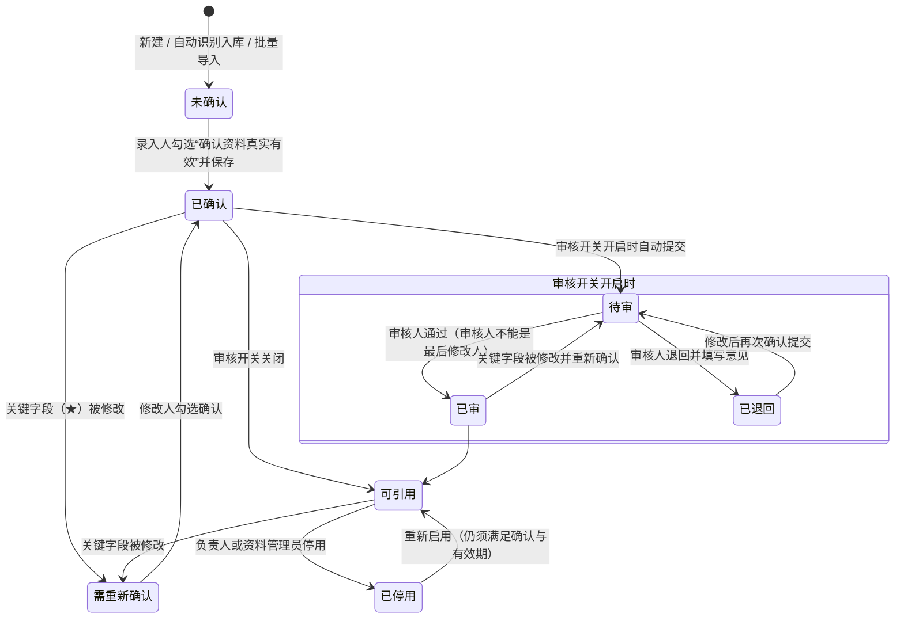

规则：

1. **谁录入谁负责。** 确认动作记录确认人、确认时间和确认声明版本；确认人自动成为该资料的负责人（建议；负责人之后可由资料管理员转交，转交留痕）。
2. **关键字段修改须重新确认。** 字典中标 ★ 的字段被修改后，资料进入“需重新确认”，在修改人确认前不可被新引用；已挂在在编项目中的证据标“证据失效”，项目内提示。
3. **审核开关**（公司级，默认关闭）：开启后新增“待审、已审、已退回”三种状态，一级审核，审核人不能是该记录的最后修改人。开关开启时存量已确认资料的处理方式、关闭时待审资料的处理方式见 5.10.4 节。
4. **有效期与提醒**：系统每天计算有效期状态；到期前 90、30、7 天提醒资料负责人（天数可在公司设置或证书类别上调整）；在投项目缺资料时在项目待办和资料库首页标红，提醒发给资料负责人和项目负责人。
5. **人员占用**：同一人员被多个在投项目拟派时只提示不锁定；项目经理角色默认提示冲突；开标后自动释放在投占用；中标转为履约占用；规则在“资料库设置”中配置（字典第 6 章第 13 项结论）。

#### 5.4.2 页面：资料库首页

- **目的**：让资料管理员和负责人一眼看到资料库的健康状况和待办。
- **主要元素**：健康度卡片（未确认数、需重新确认数、临期数、过期数、待补录有效期数、缺必备附件数、复审逾期数；开关开启时加待审数）；“我负责的待办”列表；“在投项目缺资料”列表（项目、缺什么、截止时间）；分类入口（公司主体、证明材料、资质证书、人员、人员证书、原厂授权、业绩、SLA 模板、全局变量、中小企业划型、附件；v1.2 增加安全与合规事件记录、工具与设备）。
- **操作**：点卡片进入对应筛选列表；一键催办（给负责人发站内提醒）。
- **状态流转**：无。
- **业务规则**：数据只统计本公司；集团管理员可切换公司查看。
- **异常与边界**：资料库为空时显示“从零开始”引导：先建公司主体 → 上传营业执照 → 录入资质 → 录入人员。
- **验收标准**：卡片数字与点击后的列表条数一致。

#### 5.4.3 页面：资料列表（各类通用）

- **目的**：按类别查找、筛选、批量维护资料。
- **主要元素**：筛选（负责人、确认状态、有效期状态、来源分级、标签、所属主体）；列表列按类别不同（例如资质：证书名称、等级、编号、持证主体、有效期止、状态、负责人、确认状态）；批量操作栏。
- **操作**：新增、查看、编辑、停用/启用、批量导入（Excel 模板）、批量转交负责人、导出清单（敏感字段脱敏）。
- **状态流转**：见 5.4.1 节。
- **业务规则**：敏感字段在列表中一律脱敏；导出清单不含完整敏感字段。
- **异常与边界**：批量导入的记录一律为“未确认”，须逐条或按批次由导入人确认（确认页面展示每条关键字段，防止盲确认）。
- **验收标准**：批量导入后，未确认的记录不出现在任何项目的证据候选中。

#### 5.4.4 页面：资料详情与编辑（各类通用）

- **目的**：录入或修改一条资料，并完成确认。
- **主要元素**：字段表单（按字典对应表生成，必填、条件必填按字典规则校验）；附件槽位区（必备槽位缺失时标红）；来源追溯信息（来源文件、页码、采集方式、识别置信度）；确认区（勾选框“本人确认以上资料真实有效，并对其准确性负责”，以及负责人、最近确认时间）；变更历史页签；“被引用情况”页签（哪些项目引用了哪个版本）。
- **操作**：保存；保存并确认；从附件智能识别填充（调用解析服务 + 本地模型抽取，识别结果进入表单待人工核对，低置信度字段高亮）；加/解人工编辑锁；停用。
- **状态流转**：见 5.4.1 节。
- **业务规则**：
  1. 智能识别只填表，不自动确认；识别出的字段标“待核对”，人工改过或确认后才去掉标记。
  2. 资质扫描件、身份证件等**敏感附件只能用本地解析服务识别**。
  3. 保存时如修改了 ★ 字段，确认勾选框自动清空，须重新勾选。
- **异常与边界**：同一身份证号在本公司已存在时阻止新建并提示去重；证书编号重复时提示可能重复。
- **验收标准**：①未勾选确认直接保存，确认状态为“未确认”；②修改 ★ 字段后确认状态自动变为“需重新确认”；③敏感附件的识别请求不会发往云端。

#### 5.4.5 页面：人员详情〔含敏感信息〕

- **目的**：在一处看到一名人员的全部投标相关信息，并安全地处理敏感字段。
- **主要元素**：基本信息（身份证号默认掩码显示，掩码规则取公司设置 `sensitive_mask_rules`，示例保留前 3 位和后 4 位，v1.5）；人员归属（本单位/外包/合作伙伴，默认本单位）和社保缴纳单位、社保缴纳至月份；劳动合同期限；证书列表（含有效期、注册单位）；项目经历（来自业绩项目成员）；占用情况（在投、履约）；附件（身份证件、社保缴纳证明、劳动合同为最高级保护；v1.2 增加学信网学历证明、简历槽位，供 R33、R41 核对）。
- **操作**：“查看完整身份证号”（仅公司管理员、资料管理员可见此按钮，点击需填写查看原因，每次查看记入审计日志）；其余同 5.4.4。
- **状态流转**：同 5.4.1。
- **业务规则**：
  1. 敏感分级（字典第 6 章第 18 项结论）：身份证号、银行账号、劳动合同为最高级（加密存储、脱敏展示、仅两类角色可看完整值、每次查看留痕）；出生年月、甲方联系人电话、人员手机号为中级（脱敏展示、有权限的项目成员可看；手机号按 `sensitive_mask_rules` 掩码，示例保留前 3 位和后 4 位）。
  2. **高敏个人信息在标书中的处理（v1.5，neil 2026-10-08 确认，Q12）**：正文和表格中的身份证件号码、手机号等个人信息一律以“敏感字段变量”存放，编辑界面和内部稿只显示掩码，不提供关闭掩码的开关；完整值只在项目负责人导出递交版时、且只在项目设置中确认过“需填完整值”的字段类别（5.1.4 节第 9 项）中填入，其余仍为掩码；每次导出递交版写审计日志（5.9.1 节第 8 条）。
  3. 社保不记逐月明细，只记“缴纳至哪个月”并上传证明；招标要求“近 N 个月连续缴纳”时，合规检查提示人工核对证明（R11）。
- **异常与边界**：人员离职后自动不可被新项目拟派，已有拟派标红。
- **验收标准**：①编写人在任何页面、任何接口返回中都拿不到完整身份证号；②（v1.5）内部稿中人员表身份证号为掩码；项目负责人确认“身份证件号码需填完整值”后导出的递交版中，人员表身份证号完整；未确认时递交版中也为掩码；③每次“查看完整身份证号”在审计日志中有记录（谁、何时、原因）。

#### 5.4.6 页面：原厂授权与授权链〔运维专项〕

- **目的**：管理原厂授权，并把“原厂 → 总代理 → 我方”的多级授权链完整记录和校验。
- **主要元素**：授权列表（厂商、授权类型、被授权主体、覆盖产品、授权地域、有效期、链条层级）；授权详情中的“授权链”图示（每一级出具方、被授权方、有效期、覆盖产品和地域，任一级不满足的节点标红）。
- **操作**：新增授权；为转授权记录选择“上游授权”（即出具方自己从原厂获得的授权）；上传每一级的授权书。
- **状态流转**：同 5.4.1。
- **业务规则**：
  1. 授权地域选到地市（按 GB/T 2260），区县写在“地域备注”里（字典第 6 章第 14 项结论）。
  2. 链条校验（R07）：链上每一级都须在投标截止时间有效；下级授权的产品和地域不能超出上级；最终被授权主体须为投标主体。
  3. 需按项目单独申请专项授权的厂商，在立项时按“申请提前天数”提示倒排时间。
- **异常与边界**：上游授权缺失（只有总代给我方的授权书）时，链条标“上游未登记”，R07 给警告。
- **验收标准**：把链中原厂给总代的授权有效期改到截止时间之前，我方授权在该项目中的判定变为“链条失效”。

#### 5.4.7 其他页面

| 页面 | 要点 | 验收标准 |
|---|---|---|
| 公司主体 | 本公司法人主体、分公司、合作伙伴主体、第三方（渠道商，仅作授权链节点）分别管理；合作伙伴主体只能由公司管理员、资料管理员、项目负责人创建 | 合作伙伴主体下的资料来源分级自动为“合作伙伴” |
| 证明材料 | 按材料类型带出默认有效天数（材料类型属性，系统预置默认值），可按项目覆盖 | 项目覆盖后该项目的检查使用覆盖值 |
| 中小企业划型 | 按年度记录从业人员、营业收入、资产总额和划型结果，挂依据附件；划型标准按行业在平台配置 | 生成中小企业声明函时取投标截止时间所属年度适用的记录 |
| SLA 模板 | 模板、故障等级、变量三级维护；变量含默认值、单位、优劣方向、最严可承诺值 | 模板正文中引用不存在的变量时不能确认 |
| 全局变量 | 如“认证 DBA 人数”，可设自动计算规则 | 自动计算值随资料变化每日更新 |
| 附件库 | 按文件指纹在本公司内去重；显示每个文件挂在哪些记录上；v1.2：附件挂到记录上时可标“盖章状态”（未盖章 / 已盖章 / 电子章，人工标记，R41 使用）和“功能点标签”（例如截图体现的功能，R38 使用） | 两家公司上传同一文件各自独立存储、互不可见 |
| 资质证书（v1.2 补充） | 证书性质增加“知识产权”（计算机软件著作权登记证书、发明专利证书等，示例）；可关联相关产品，挂证据时提示与本项目产品是否相关 | 知识产权证书可按相关产品筛选 |
| 业绩项目成员（v1.2 补充） | 记录合同中体现该成员姓名和日期的页码；可上传第三方工作年限证明 | 证明页码可在导出时定位到附件页 |
| 安全与合规事件记录（v1.2 新增） | 记录本公司及分公司在安全生产、网络安全领域的重大隐患通报、行政处罚、生产安全责任事故、网络安全通报等；文书编号和事件说明按“中级”敏感处理（建议，见 Q18）；R39 按投标截止时间前 N 年（取招标要求）读取 | 招标要求披露时，R39 能列出期间内的全部记录；无记录时提示“须项目负责人确认已核实” |
| 工具与设备（v1.2 新增） | 记录自研软件、外购软件、笔记本电脑、服务器等工具设备，含归属方式（自购 / 租赁 / 自研）、功能点清单、支持的产品、关联软著；自购须挂发票，租赁须挂租赁合同并维护租赁有效期 | 评分项要求工具截图时，能按功能点筛出工具及截图附件 |

---

### 5.5 知识库与方案片段

#### 5.5.1 设计要点

1. **按公司分库。** RAGFlow 中每家公司各建独立的知识库（数据集），向量库按公司分区；检索时业务层只传入本公司的知识库标识，并附加元数据过滤（启用、已确认/已审、已发布版本、来源分级非“仅供参考”才可进入正文）。集团管理员的账号不具备检索调用权限。
2. **正文双存。** 方案片段正文既存在数据库（片段版本表）也同步到知识检索库（字典第 6 章第 5 项结论）；数据库副本用于版本比对、备份、审计和检索库重建。
3. **“仅供参考”资料**（例如收集来的同行方案）可以入库供学习检索，但永远不进入标书正文，检索结果中带“仅供参考”标记。
4. 公司内部 MVP 不分区授权，受限资料除外（见 2.3 节规则 4）。

#### 5.5.2 页面：方案片段库

- **目的**：沉淀和复用可直接写进标书的段落（服务方案、巡检方案、应急预案、驻场管理、培训方案、备品备件方案等）。
- **主要元素**：左侧方案类型树（字典 `snippet_type`，包含运维专项：日常运维、巡检、故障处理流程、应急预案与演练、数据库备份恢复、性能优化、升级迁移、高可用、驻场管理）；列表（标题、类型、适用产品、适用行业、篇幅、新鲜度、引用次数、负责人、状态）；检索框（语义检索 + 关键词）。
- **操作**：新增、编辑（生成新版本）、发布、停用、关联长短版本、查看引用、对比版本。
- **状态流转**：版本：草稿 → 已发布 → 已被替代；开启审核时：草稿 → 待审 → 已发布 / 已退回。
- **业务规则**：
  1. 审核开关关闭时，编辑人确认即发布；新版本发布前，项目中继续使用上一已发布版本。
  2. 片段中的数值（如 DBA 人数、响应时限）必须写成变量占位（`{{...}}`），不允许直接写死；变量不存在或未确认时不能发布。
  3. 新鲜度随复审周期下降；过低的片段在检索结果中降权并提示复审。
  4. **v1.2 新增字段与类型**：方案类型增加“报告模板（只含框架）”；片段可填写“出处”（公开标准、产品手册等，R29 中注明出处的内容不算重复）、“内容性质”（方法论 / 报告模板 / 案例 / 公司介绍 / 通用承诺）、“套话组”（同一类套话的多个替代版本归为一组，生成时优先选近期没有在同一招标人标书中用过的版本，用于降低 R29 重复）。
  5. **真实报告不能入库（v1.2）**：“报告模板”类片段发布前，编辑人须确认“不含真实报告数据”；片段正文命中 R31 的真实报告特征（具体巡检日期加检查结果数值、主机名、实例名、IP 等）时不能发布，脱敏后的真实报告同样不能发布（编写规范 p.27）。
- **异常与边界**：检索库同步失败时片段显示“同步失败”，不影响数据库中的版本；提供“重新同步”。
- **验收标准**：①公司 A 的检索结果中永远不出现公司 B 的片段；②未发布版本不会出现在检索结果中；③“报告模板”类片段未确认“不含真实报告数据”时不能发布。

#### 5.5.3 页面：历史标书导入（MVP 手工导入，v1.2 支持批量）

- **目的**：把系统上线前的历史标书放进知识库，作为检索参考。
- **主要元素**：上传区；元数据表单（项目名称、招标人、投标主体、递交日期、投标结果等，字典 `bid_archive`）；解析状态。
- **操作**：上传、填写元数据、提交解析入库、从中手工摘取片段存为方案片段（生成“未确认”的片段草稿）；v1.2 增加批量导入（选择文件夹或上传压缩包，元数据用 Excel 模板批量填写），批量导入只对公司管理员、资料管理员开放。
- **状态流转**（v1.5）：页面只显示一个“入库状态”：待解析 → 解析中 → 入库中 → 已入库 / 失败。“入库状态”不单独存储，由历史标书的解析状态（`bid_archive.parse_status`：待解析 / 解析中 / 已解析 / 解析失败）和检索库同步状态（`bid_archive.kb_sync_status`：未同步 / 同步中 / 已同步 / 同步失败）派生：

| 入库状态 | 解析状态 | 检索库同步状态 |
|---|---|---|
| 待解析 | 待解析 | 未同步 |
| 解析中 | 解析中 | 任意 |
| 入库中 | 已解析 | 未同步或同步中 |
| 已入库 | 已解析 | 已同步 |
| 失败 | 解析失败；或已解析但同步失败 | 任意；同步失败 |

  失败时显示失败环节（解析或同步）和原因；“重试”从失败环节继续：解析失败重新解析，同步失败只重新同步。
- **业务规则**：
  1. 历史标书整体入库后只作为检索参考（来源位置可追溯），不直接作为证据；要引用其中内容，须先摘取为方案片段并确认。历史标书中的人员、证书、业绩信息不自动写入结构化资料库；要作为证据，须由人录入资料库并确认后引用资料库记录。v1.6：在响应矩阵的“挂证据”抽屉中，历史标书只作为“参考”显示，可查看原文，不可勾选（5.3.1 节规则 2、11）。
  2. **“条款—应答”参考（v1.2，简化版）**：导入时系统按标题层级把历史标书切成检索单元，每个单元记录标题（通常是评分项或技术条款名称）和其下的应答正文，写入本公司知识库；写作方案和章节生成检索时，可按条款名称找到历史上的应答写法作为参考。一期不单独建表，不做人工校对和发布流程；完整的条款应答库随二期定稿回收建设。
  3. 入库的历史标书是 R29 本公司查重的比对对象，默认取递交日期在近 24 个月内的标书（5.8.3 节）。
- **异常与边界**：历史标书中含其他公司名称时（例如合作伙伴），提示编辑元数据中的投标主体。
- **验收标准**：①历史标书中的段落可被检索到并能跳回原文页，但不能直接挂为矩阵证据；②（v1.5）入库状态按上表由两个状态派生，同步失败的标书显示“失败（同步）”，重试时不重新解析。

---

### 5.6 公司写作档案

#### 5.6.1 目的与构成

写作档案让每家公司的标书在结构、叫法、用语和语气上有自己的特征，是防止不同公司标书“异常一致”的第二层措施（8.2 节）。每家公司单独配置，互不可见。v1.3 增加风格样例库、套话表、句式偏好与禁用句式、总结句策略和本公司惯用表达五项，用于让生成内容更贴近本公司人写的标书，并为 R43 提供词表和句式规则（5.6.5 节）。

| 构成 | 内容 | 示例（仅示意） |
|---|---|---|
| 章节结构模板 | 按项目大类、行业模板定义的技术标和商务标章节树；每个节点有标题、写作要点、默认篇幅、关联评分维度、默认方案类型 | 示例：公司 A 的“数据库维保”模板以“服务体系→服务内容→SLA→驻场→巡检→应急→培训”排序，公司 B 以“项目理解→服务方案→保障措施”排序 |
| 服务体系名称与叫法 | 本公司对通用概念的专有叫法 | 示例：通用概念“服务台”，公司 A 叫“7×24 运维服务中心”，公司 B 叫“客户支持热线” |
| 常用术语 | 首选术语、禁用词、同义替换 | 示例：首选“故障”，禁用“bug” |
| 套话表（v1.3） | 放在叫法与术语中，与禁用词分开：分“套话”和“空泛词”两类，每条可配推荐改法；平台预置、公司可追加或停用；R43 按每千字密度统计（5.6.5 节） | 示例：套话“全方位保障”，推荐改法“写明具体保障措施”；空泛词“高度重视” |
| 本公司惯用表达（v1.3） | 本公司常用、希望在标书中保留的说法，写入生成提示词作为优先用语，不做检查（5.6.5 节） | 示例：“双人复核”“变更三审” |
| 语气 | 人称（我公司/我方/本公司）、正式程度、句式偏好（自由描述句子长短等）、篇幅偏好 | 示例：人称“我公司”，句式偏短 |
| 句式偏好与禁用句式（v1.3） | 偏好的段落结构写入生成提示词；禁用句式（否定对比、递进、序列、三项排比、段末总结句、段首重复等）设允许次数，超出部分由 R43 逐句报（5.6.5 节） | 示例：偏好“结论→措施→保障”；“不是……而是……”每章允许 1 次 |
| 总结句策略（v1.3） | 默认每章只在开头和结尾各总结一次；可改为每个小节末尾允许总结一次（5.6.5 节） | 示例：每章只在开头和结尾各总结一次 |
| 称呼（v1.2） | 对招标人的称呼默认值（项目中可改）；采购人口吻自称禁用名单（R35 使用） | 示例：对招标人称“贵行”；禁用“我行、我院、我局” |
| 点对点应答样式（v1.2） | 表格式或逐条式（编写规范 p.16：响应格式可按偏好选择） | 示例：表格式，列为“条款号、招标要求、应答、说明” |
| 内部稿命名模板（v1.2） | 内部稿导出文件名模板，只用于内部稿，递交版不使用（5.9.1 节） | 示例：{编写人}_{版本}_{日期}_{项目名称} |
| 任务卡（提示词版本） | 按任务（写作方案、章节生成、章节摘要、章节模型评审、定位修正、改写、扩写、缩写、按指令修改；v1.3 补充额外承诺候选识别、事实锚点识别；v1.4 补充对话助手问答、对话助手修改样例，5.11.4 节）打包的一张卡：用途、需要喂给模型的材料、要求的输出结构、引用的提示词模板及其版本、1～2 个示例、建议参数（v1.3：标明参数依据，如“厂商参考值”）、提示词禁用表达（v1.3，5～10 条）；带版本号，发布后不可修改，修改即生成新版本（5.7.9 节）。提示词模板可引用写作档案变量 | 由平台提供默认任务卡和提示词模板，公司可复制后修改 |
| 审查清单 | 本公司沉淀的检查项。来自人工处理中反复出现的问题，由人提出或系统统计推荐为候选，经公司管理员确认后启用；模型评审时按章节类型取用，编写人也可作为自查清单（5.7.7 节）。不做自动长期记忆 | 示例：“运维方案须写明备件到场时限”（仅示意） |
| 风格样例库（v1.3） | 每类章节 3～5 段范文，从本公司已定稿标书中人工挑选并脱敏，挑选时兼顾风格多样；生成时注入同类样例，提示“学语气和结构，不照抄句子”；只属于本公司，不绑定写作档案版本（5.6.5 节） | 示例：“应急响应”类启用 4 段，风格特征分别为结论先行、流程递进、表格为主、案例说明 |
| Word 模板 | 封面、样式（标题、正文、表格）、页眉页脚；v1.2：平台默认模板预置一至八级标题样式（编写规范 p.31） | 每家公司上传自己的 .docx 模板 |

#### 5.6.2 页面：写作档案

- **目的**：公司管理员配置并发布本公司写作档案。
- **主要元素**：页签（章节模板、叫法与术语（v1.3 含套话表、惯用表达）、语气与称呼（v1.3 含总结句策略）、句式规则（v1.3）、风格样例（v1.3）、任务卡与提示词、审查清单、Word 模板、导出命名）；版本信息（当前发布版本、草稿）；“与集团内其他公司档案的差异度”提示（仅比较章节结构和叫法，**不展示对方内容**，只给出“相似度偏高”的提示，建议）。
- **操作**：编辑草稿、预览（用一段示例要求试生成）、发布、回滚到历史版本。
- **状态流转**：草稿 → 已发布 → 已归档。
- **业务规则**：
  1. 项目在“编制中”使用创建大纲时的档案版本；档案新版本发布后，项目可选择“升级到新版本”，已生成内容不自动改写。
  2. 平台提供默认模板作为起点；公司首次使用时须至少修改章节模板或叫法之一，否则生成页提示“写作档案仍为平台默认，与其他公司可能雷同”（建议）。
  3. 任务卡发布后不可修改，修改即生成新版本；进行中的章节循环继续使用开始时的任务卡版本（5.7.9 节）。
  4. 审查清单条目只能由公司管理员确认启用、停用或拒绝；系统不会自动新增、修改或启用条目（5.7.7 节）。
  5. **套话表、惯用表达、句式规则、总结句策略（v1.3）**随写作档案版本发布和回滚；平台预置的套话条目和句式规则，公司只能停用或复制为本公司条目后修改，不能删除（5.6.5 节）。
  6. **风格样例（v1.3）**不随写作档案版本走：启用、停用立即对之后的生成生效，不影响已生成的内容；资料管理员可挑选、脱敏、提交，只有公司管理员可启用、停用（2.3 节）。
- **异常与边界**：提示词模板引用了不存在的变量时不能发布；任务卡引用的提示词模板未发布时，任务卡不能发布；v1.3：任务卡的提示词禁用表达超过 10 条时不能发布。
- **验收标准**：①公司 A 与公司 B 各自发布档案后，对同一份招标文件生成的大纲结构不同；②档案回滚后新生成内容使用回滚后的版本；③任务卡发布新版本后，已开始的章节循环仍记录并使用旧版本；④未经公司管理员确认的审查清单候选不会出现在任何检查中；⑤（v1.3）风格样例、套话表、句式规则的验收见 5.6.5 节。

#### 5.6.3 数据对象（写作档案模块）

写作档案的表定义在字典 v1.7 的 3.7 节，本节只列对应关系：`writing_profile`（写作档案，含自称、正式程度、句式与篇幅偏好、Word 模板、版本与发布状态）、`writing_outline_template` 与 `writing_outline_node`（章节结构模板及节点）、`writing_term`（叫法、首选术语、禁用词、同义替换）、`prompt_template`（按任务的提示词模板）；v1.1 新增 `task_card`（任务卡，每行是一张卡的一个版本，固定引用一个已发布的 `prompt_template` 版本）和 `review_checklist_item`（审查清单条目，公司级，不绑定写作档案版本），见字典 3.7.6、3.7.7 节；v1.2 在 `writing_profile` 上新增 `client_address_default`（对招标人称呼默认值）、`banned_self_terms`（采购人口吻自称禁用名单）、`internal_file_naming_template`（内部稿命名模板）、`point_response_style`（点对点应答样式），见字典 3.7.1 节。v1.3 新增：`writing_profile.summary_policy`（总结句策略）；`writing_term.term_kind` 增加 `cliche`（套话）和 `habitual`（惯用表达），并新增 `cliche_class`（套话细分）、`suggested_rewrite`（推荐改法）、`term_enabled`（是否启用）、`term_origin`（平台预置 / 公司添加）、`based_on_term_id`（复制来源）；新表 `writing_sentence_pattern`（句式规则，含偏好与禁用句式，平台预置的 `company_id` 为空）和 `writing_style_sample`（风格样例，公司级，`company_id` 必填），见字典 3.7.8、3.7.9 节；`task_card` 新增 `model_params_basis`（参数依据）和 `prompt_banned_expressions`（提示词禁用表达），见字典 3.7.6 节。平台默认档案和默认提示词的 `company_id` 为空，公司复制后修改。大纲节点通过 `bid_outline_node.writing_profile_version`、`outline_template_node_id` 记录使用的档案版本和模板节点（5.7.12 节）。v1.4：`task_card.task_type` 增加 `assistant_qa`（对话助手问答）和 `assistant_suggest`（对话助手修改样例），`input_items` 增加选区原文、选区前后文、对应招标条款、检索结果、对话历史、用户指令六项，`prompt_banned_expressions` 同样适用于对话助手修改样例，见字典 3.7.6 节；对话助手的修改样例按 `writing_sentence_pattern` 的偏好句式和 `writing_style_sample` 的风格特征指定写法方向（5.11.5 节）。

#### 5.6.4 平台默认任务卡写作要求与默认审查清单（v1.2，v1.3 补充）

结论：编写规范中不适合由系统判定的要求（差距分析 3.2 节 N01～N09），通过平台默认任务卡的写作要求和平台预置的默认审查清单体现。默认任务卡由平台提供，公司可复制后修改；默认审查清单条目由平台预置，公司管理员确认后才启用，只出提示（5.6.2 节第 4 条、R28）。

**默认任务卡增加的写作要求**：

| 序号 | 写作要求 | 适用任务卡 | 依据 |
|---|---|---|---|
| 1 | 每个得分要点单独成小标题，标题沿用评分标准原文用词 | 写作方案、章节生成 | 编写规范；差距分析 G07 |
| 2 | 每个得分要点按“应答结论（满足/优于）→ 具体措施 → 保障与成效”写 | 章节生成 | 编写规范 p.14；N02 |
| 3 | 只回应本节写作方案列出的条款，不写招标未要求的内容；增值章节须在写作方案中标注；不自行增加招标未要求的数值承诺 | 写作方案、章节生成、定位修正 | R30；neil 确认第 3 点 |
| 4 | 结合招标文件中的客户业务、系统和数据库环境来写，不写空泛的通用描述 | 章节生成 | 编写规范 p.21；N03 |
| 5 | 统一使用写作档案规定的自称和对招标人的称呼 | 章节生成、改写类 | R35 |
| 6 | 不输出任何对话式语句，不使用 Markdown 符号 | 全部生成类任务卡 | R34 |
| 7 | 不编造巡检数据、报告结论、IP、主机名；涉及报告的只写框架 | 章节生成 | 编写规范 p.27；R31 |
| 8 | 数据库和中间件只写招标涉及的产品 | 章节生成 | R32 |
| 9 | 写作方案中把章节区分为“专项内容”和“通用内容”；通用内容（公共部分）优先从方案片段选用 | 写作方案 | 编写规范 p.12；N01 |
| 10 | 学习随附的本公司风格样例的语气和结构，不照抄样例中的句子，不带入样例中的项目、客户和人员信息（v1.3） | 章节生成、对话助手修改样例（v1.4，原局部改写） | 像人写调研 6.2 节第 4 条；R43 |
| 11 | 每个得分要点写出可核验的具体事实（数字、型号、人员、案例、客户系统名），事实只取自本节证据、项目事实表或招标原文；没有可用事实时写【待补：缺少什么】，不为凑数编造（v1.3） | 章节生成、定位修正 | 像人写调研 6.2 节第 2 条；R44 |
| 12 | 按写作档案的总结句策略写总结句：默认只在本章开头和结尾各总结一次，其余段落不以“综上所述”“总之”一类总结句收尾；按写作档案的句式偏好组织段落（v1.3） | 章节生成 | 像人写调研 6.2 节第 6、7 条；R43 |
| 13 | 提示词中只列 5～10 条本公司禁用表达（取任务卡“提示词禁用表达”），其余套话和句式交给 R43 事后检查，不在提示词中堆砌长词表（v1.3） | 章节生成、对话助手修改样例（v1.4，原局部改写）、定位修正 | 像人写调研 6.2 节第 10 条 |
| 14 | 每条修改样例按系统指定的写法方向写，样例之间写法要有明显差异，不能只换几个词（v1.4） | 对话助手修改样例 | 已定设计第 4 点；5.11.5 节 |
| 15 | 保留选区中的变量和证据标记，不改变变量取值，不修改 SLA 数值、项目事实、金额、人员等由数据源决定的内容；用户要求改这些内容时，回复去数据源修改（v1.4） | 对话助手修改样例、对话助手问答 | 5.11.5 节第 4、7 项；R10、R27 |
| 16 | 知识库打开时，具体事实只取自本次检索结果、项目事实表、招标条款和选区原文，并标出引用的检索结果编号；知识库关闭时不自行编写产品型号、人员、案例、客户系统名、数字等具体事实，缺少时写【待补：缺少什么】（v1.4） | 对话助手修改样例、对话助手问答 | 已定设计第 2 点；R44 |

**默认审查清单条目**（平台预置，公司管理员确认后启用，只出提示）：

1. 开头有针对本项目的概述，结尾有总结（编写规范 p.21，N03）。
2. 方案内容与客户的实际业务、系统环境对应，不是通用模板（N03）。
3. 每个得分要点都有具体措施，而不只是表态（N06）。v1.3：模型评审时，针对这一条的意见归为意见类型“空泛表态、无具体措施”（5.7.4 节第 2 条）。
4. 响应形式适当使用表格、流程图（G13）。
5. 语句通顺，没有明显的机器翻译或拼接痕迹（G40）。
6. 案例的数据库类型和行业与本项目匹配（G32）。
7. 人员分工写明了角色、AB 角和职责（G33）。
8. 年度服务计划写明了巡检、培训、总结的频次（G34）。
9. 截图和证明材料能直接看到评分要求中的功能关键词（G44）。
10. 质保、培训、保密等套话中的时间和承诺与招标要求一致（G19）。
11. 相邻段落没有反复使用同一种句式，段落开头不雷同；关键事实（响应时限、数据库类型、人员配置等）全章前后一致（v1.3，像人写调研 6.2 节第 1、2 条；R43、R44 只报超出允许次数或对不上的部分，本条供人整体判断）。

说明：编写规范 p.24 提到“套话重复可以在网上找对应内容替换”，系统不做（3.2 节），改用方案片段套话组的替代版本轮换，加局部改写“换一种说法”。

#### 5.6.5 风格样例库、套话表与句式规则（v1.3）

结论：写作档案新增的五项内容分两种用法。风格样例、句式偏好、本公司惯用表达写进生成提示，让模型学本公司的写法；套话表、禁用句式、总结句策略供 R43 事后检查（5.8.7 节）。五项都按公司隔离；平台预置的套话和句式公司可以停用或复制后修改，风格样例平台不预置。

**1. 风格样例库**

- **用途**：生成章节时，把同类章节的本公司样例作为范文一起交给模型（这种做法称为 few-shot，即在提示词中附几段示范文字让模型模仿），提示词写明“学语气和结构，不照抄句子”。
- **来源**：只能是本公司已定稿的标书，包括导入的历史标书和本系统中已定稿分册的项目；由人工挑选，不自动入库（从定稿中自动推荐样例列入后续版本，3.3 节）。
- **章节类别**：按评分维度（字典 `scoring_dimension`，示例：服务方案、人员配置、应急响应）分类，一段样例属于一个类别，另可标注适用的方案类型。“每类 3～5 段”按评分维度计数。
- **数量**：每类启用 3～5 段。少于 3 段时，写作档案页和生成页提示“样例不足”，仍可生成；已启用 5 段时，须先停用一段才能再启用新的。
- **兼顾风格多样**：挑选时看写法是否不同，不只看主题是否相近（像人写调研 6.2 节第 4 条）。每段样例须标注风格特征（示例：结论先行、流程递进、表格为主、问题—方案—效果、案例说明，可多选）。同一类中有 2 段以上来自同一份标书，或全部样例的风格特征完全相同时，提示“样例写法单一”，不阻止启用（建议）。
- **脱敏**：挑选人把客户名称、项目名称、人名、联系方式、IP、主机名、金额等换成通用说法（示例：“某省级商业银行”），并勾选“已脱敏确认”。保存时系统用 R25（其他单位名称）、R31（真实报告特征）、R35（采购人口吻自称）的识别方法扫描样例正文，命中项须修改，或由挑选人逐条说明“不是敏感信息”后才能提交（建议）。
- **状态**：草稿 → 已启用 → 已停用。资料管理员、公司管理员可以挑选、脱敏、提交草稿；只有公司管理员可以启用、停用（2.3 节）。
- **按公司隔离**：样例只属于一家公司，只在本公司项目中使用，集团管理员也不能把一家公司的样例用到另一家公司。平台不预置样例（建议），因为各公司共用同一批范文会让写法趋同，与防“异常一致”的目标相反。
- **注入方式**：生成时按本节关联的评分维度取本公司已启用的样例，总长度控制在公司设置 `style_sample_token_budget` 以内（示例：1200 token）；放不下时优先取近期用得少、风格特征互不相同的样例（建议）。本次注入了哪些样例记录在生成任务上（5.7.10 节）。
- **防照抄**：R43 检查生成正文与本次注入样例的连续相同字数，阈值沿用 R29 的设置（默认 8 个字），超过即报“照抄风格样例”（建议）。
- **与任务卡示例的区别**：任务卡的 1～2 个示例说明输出的格式和结构，随任务卡版本固定；风格样例示范本公司的写法，按章节类别变化，由样例库维护（5.7.9 节）。

**2. 套话表**

- 放在“叫法与术语”页签，词条类型为“套话”，与“禁用词”分开：禁用词逐个命中、逐个警告（R35）；套话按每千字密度统计，超过阈值才报（R43）。
- 套话细分两类：套话（示例：“全方位保障”“为……提供坚实保障”）和空泛词（示例：“高度重视”“行业领先”）。每条可填推荐改法（示例：“全方位保障 → 写明具体保障措施”）。
- **平台预置、各公司可改**：平台预置一份初始词表，公司可以追加本公司条目，也可以停用平台条目；平台条目不能删除，也不能直接修改，要改时复制为本公司条目再改，系统记录复制来源（建议，便于追溯）。平台词表更新后，提示公司管理员查看新增条目并决定是否启用，不覆盖公司已做的停用设置（建议）。
- **初始词表只是候选**：中文模型高频套话目前没有权威的量化研究，网上流传的清单只能作参考（像人写调研 3.3 节）；初始词表在试运行中按误报情况调整，自动找出模型爱用的表达列入后续版本（3.3 节）。
- **招标原文自动放行**：本项目招标文件（含澄清、补遗）原文中出现过的词，在本项目中不计为命中（示例：招标文件自己写了“全方位”，本项目标书中的“全方位”不算套话）。

**3. 句式偏好与禁用句式**

- **禁用句式**：平台预置七类检测方式——否定对比（“不是……而是……”）、递进（“不仅……更……”）、序列（“首先……其次……最后”）、三项排比、段末总结句、连续段落开头相同、自定义关联词组合。每类可设允许次数（示例：否定对比每章允许 1 次），超出部分由 R43 逐句报；段首重复的判定段数在 R43 的规则参数中设置（示例：连续 3 段开头相同即算一组重复，5.8.7 节）。公司可停用、调整次数，或追加本公司的关联词组合。
- **句式偏好**：本公司偏好的段落结构（示例：“结论→措施→保障”“问题→方案→效果”），写入生成提示词，不做检查。集团内各公司选用不同组合，也有助于拉开写法差异（R18）。
- 语气中原有的“句式偏好”是自由文字描述（示例：句子偏短、多用条目），继续保留；v1.3 新增的是结构化的句式规则，两者并存。

**4. 总结句策略**

- 默认“每章只在开头和结尾各总结一次”：本章第一段可以概述，最后一段可以总结，其余段落不以总结句收尾；可改为“每个小节末尾允许总结一次”。
- 段末总结句的识别依据：段落最后一句以总结用语开头（示例：“综上所述”“总之”），或是“为……提供坚实保障”一类句式；识别用语取自禁用句式中的“段末总结句”一类，公司可调整。
- 这与编写规范 p.21“开头结尾写好、多总结”一致，同时避免每段都有总结句（像人写调研 6.2 节第 7 条）。默认审查清单第 1 条“开头有概述，结尾有总结”不变。

**5. 本公司惯用表达**

- 本公司常用、希望保留的说法（示例：“双人复核”“变更三审”），写入生成提示词作为优先用语，用来提高本公司辨识度；不做检查。
- 与“叫法”的区别：叫法对应一个通用概念，R35 检查全文叫法是否一致；惯用表达不必对应通用概念，也不检查。

- **验收标准**：①公司 A 的风格样例、套话条目和句式规则不出现在公司 B 的生成请求、检查和页面中；②同一类已启用 5 段样例时，不能再启用新样例；③未勾选“已脱敏确认”或扫描命中未处理的样例不能提交；④平台预置的套话条目和句式规则，在公司端只能停用或复制，不能删除；⑤本项目招标原文中出现过的套话不计入本项目的密度；⑥资料管理员不能启用样例；⑦停用一段样例后，之后的生成请求中不再出现该样例。

---

### 5.7 分节生成

**结论：分节生成采用“由系统规则编排的章节闭环”。** 每个章节的写作方案（大纲）经人确认后，该章节独立循环“生成 → 检查 → 定位修正 → 再检查”，直到问题全部解决或触发停止条件；自动修不了的问题，连同问题清单、每轮修改记录和停止原因交给人处理。循环什么时候停、哪些问题转人工，全部由本节规定的系统规则决定，不由模型判断。v1.2 起章节按分册组织：一个分册的全部章节完成后做分册检查、分册定稿；全部系统编制的分册定稿后做导出前全文检查（5.8 节），通过后按分册分别导出（5.9 节）。v1.3 起生成时注入本公司风格样例，每轮检查增加 R43（AI 腔调）和 R44（事实密度）两条警告级检查，并在初稿、循环停止和分册定稿三个时点记录写作观察指标（5.7.13 节）。v1.4 起，章节循环停止后，用户在编辑台中手改或借助对话助手修改正文；每次写入生成新版本，只对改动段落做增量复查，不重跑整章闭环（5.11 节）。

本期不采用 Agent 全程自主的形态。Agent 指能自己规划步骤、决定调用哪个工具、决定什么时候停止的模型应用。不采用的原因见风险 K15：没有外部反馈时，模型自己评、自己改不可靠，迭代收益主要集中在前 1～2 轮；公司本地模型的多轮工具调用基准偏低。本设计中，模型每次只完成一件单步任务（写一节、评一节、改一段、写一段摘要）；编排、判断是否停止、决定问题交给谁，都由系统完成。

#### 5.7.1 生成闭环总览

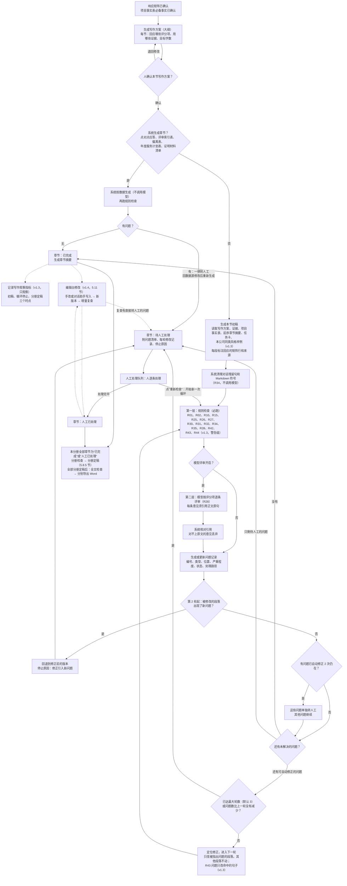

| 环节 | 谁来做 | 说明 |
|---|---|---|
| 写作方案（大纲）生成 | 模型（任务卡“写作方案”）＋规则 | 模型按响应矩阵、评分办法和公司章节模板提出建议；规则校验评分项是否都分配到章节（R26） |
| 写作方案确认 | 人（本节编写人、本分册负责人或项目负责人） | 未确认的章节不能生成（5.7.2 节）；增值章节须在此标注并写理由 |
| 系统生成章节（v1.2） | 系统，不调用模型 | 点对点应答、评审索引表、偏离表、年度服务计划表、证明材料清单按数据生成；只跑规则检查，问题一律转人工，要改内容须回数据源修改后重新生成（5.7.2 节） |
| 生成、定位修正、章节摘要 | 模型，每次一个单步调用 | 输入由系统组装，输出由系统校验；v1.3：生成时按本节评分维度注入本公司风格样例（5.6.5 节）；R43 问题的定位修正只改命中的句子 |
| 规则检查 | 系统规则引擎 | 结果可复现，是检查的主力；R34 的问题由系统直接删除或转换，不调用模型；v1.3 的 R43、R44 只出警告，R43 命中的句子系统不自动删除；R44 中客户系统名的候选由本地模型识别（6.4 节“事实锚点识别”），是否对得上来源由规则判断 |
| 模型评审 | 模型，尽量与生成模型不同 | 只出提示；每条意见必须引用正文原句，由系统核对 |
| 问题分流、是否继续、何时停止、是否回退 | 系统规则 | 按 5.7.4 节执行，模型不参与判断 |
| 自动修不了的问题 | 人 | 在人工处理队列中处理（5.7.7 节） |
| 写作观察指标（v1.3） | 系统 | 只采集、不拦截，不影响循环判断（5.7.13 节） |
| 编辑台修改（v1.4） | 人（手改，或选择对话助手样例并确认差异）＋系统（写入、增量复查） | 章节循环停止后进行；每次写入生成新版本，只对改动段落做增量复查，不调用模型评审、不自动修正（5.11 节） |

说明：图中 R39 只检查披露段落，R42 只在招标要求暗标的分册启用；R43、R44 只出警告（v1.3），公司可关闭 R43，不可关闭 R44；章节循环中各规则的检查范围见 5.7.4 节第 2 条。虚线表示记录写作观察指标，不影响流程走向。v1.4：图中“编辑台修改”用虚线连接，表示这是章节循环之外、由人发起的可选步骤：写入后增量复查发现直接转人工的问题时，章节进入“待人工处理”，否则为“人工已处理”（5.11.10 节）。

#### 5.7.2 页面：写作方案与大纲确认

- **目的**：在生成正文之前，让人确认“每一节回应哪些评分项、用哪些证据、写多少字”，避免整本生成后再推翻。
- **主要元素**：
  1. 左侧大纲树：章节号、标题、分册、负责人、章节状态（5.7.5 节）；v1.2 增加章节类型（普通 / 系统生成的五类）、“增值”标记，可按分册切换。
  2. 中间“本节写作方案”卡片：本节回应的矩阵行（评分项及分值、得分要点、技术服务要求；星号条款和废标条款单独标出）；计划使用的证据（来自这些矩阵行已挂接的证据，显示名称、版本、有效期状态）；候选方案片段（从本公司知识库检索，默认不勾选，勾选后才会交给模型）；目标字数；写作要点（来自公司章节模板，可改）；本节会用到的项目事实（来自项目事实表，5.7.8 节）。
  3. 顶部提示：还没有分配到任何章节的评分项和技术服务要求行（R26 在大纲阶段的检查结果）；还没有确认的必备事实。
  4. 右侧：招标文件原文预览，点矩阵行跳到原页。
- **操作**：生成写作方案（整份生成，或单节重新生成）；调整大纲结构（增删、拖动、改标题，项目负责人可调整全部分册，分册负责人只能调整本分册）；分配章节负责人；编辑本节写作方案；标记或取消“增值章节”（v1.2，须写理由）；确认本节；批量确认（项目负责人，或本分册负责人确认本分册）；退回修改。
- **状态流转**：未开始 → 大纲待确认 → 待生成（5.7.5 节）。
- **业务规则**：
  1. 写作方案以评分办法（评分项顺序和分值）为主干，叠加招标文件格式要求（规定的章节顺序和格式文件）和公司章节模板；招标文件规定了目录的，严格按规定。每个大纲节点自动关联对应的矩阵行。
  2. 每个评分项和技术服务要求行都必须分配到至少一个章节。未分配的行在确认时提示，确认人须把它分配到章节，或标注“不适用/由其他文件响应”并写明理由，否则该行所属分册的写作方案不能确认（R26 大纲阶段）。星号条款和废标条款行必须分配到章节，不能标“不适用”。
  3. 确认前，项目事实表中标为“必备”的事实须已确认（5.7.8 节），否则“确认”按钮不可用，并提示去事实表确认。
  4. 本节编写人、本分册负责人或项目负责人可以确认本节写作方案；大纲结构调整由项目负责人或本分册负责人操作。确认人和确认时间写入审计日志。系统编制的分册未指定分册负责人时，该分册的写作方案不能确认（v1.2）。
  5. 确认后，若公司开启“大纲确认后自动开始生成”（默认开启，6.9 节），本节进入“待生成”排队；关闭时由人手动点“开始生成”。
  6. 确认后又修改写作方案（改回应的矩阵行、证据或目标字数）的，本节回到“大纲待确认”；已生成的内容保留为历史版本，重新确认后按新方案重新生成。
  7. 招标方发布澄清或补遗、受影响的矩阵行发生变化时，相关章节的写作方案标“需复核”，章节回到“大纲待确认”（与 4.3 节规则 2 一致）。
  8. **得分要点做小标题（v1.2）**：写作方案默认一个得分要点一个小标题，标题沿用评分标准原文用词（编写规范 p.14 第三、四步）；人可以合并或改写，改写后 R26 仍按得分要点检查覆盖。
  9. **系统生成章节（v1.2）**：章节类型除“普通”外还有五类，由系统按数据生成，不交给模型：
     - 点对点应答：按技术规范书原顺序逐条列出条款和应答（样式取写作档案“点对点应答样式”），应答内容取对应矩阵行的响应方式和响应要点；
     - 评审索引表：按评审标准的顺序逐项列出评分项、得分要点和对应的章节号，页码列留空或标“合标后由商务填写”（系统不在合标后更新页码），见 R40、5.9.1 节；
     - 偏离表：按招标给定的格式从矩阵中响应方式为“偏离”的行生成，没有偏离时按编制要求填写“无偏离”，见 R37；
     - 年度服务计划表：按服务期和 SLA、项目事实中的巡检、培训、总结频次生成，数值以变量引用，见 R10、R27；
     - 证明材料清单：按客观分评分项和资格项的证明材料要求，逐人逐项列出应附材料及资料库中对应的附件，见 R41。
     系统生成章节只跑规则检查，发现的问题一律直接转人工；要改内容，须回到数据源（矩阵、项目事实、资料库）修改后重新生成，不能在正文中手改（手改的内容在重新生成时会被覆盖，系统提示）。系统生成章节没有模型调用记录。
  10. **增值章节（v1.2）**：招标没有要求、但有利于得分的内容（例如增值服务、额外案例），须在写作方案中把该章节标为“增值”并写明理由；标记人和时间留痕。增值章节不算超范围（R30 不对其报“无对应条款”），但其中出现的招标未要求的数值承诺仍按 R30 转人工确认（neil 确认第 3 点）。
  11. **专项内容与通用内容（v1.2）**：写作方案把章节区分为“专项内容”（针对本项目技术要求的内容）和“通用内容”（公司介绍、质量保障等公共部分，编写规范 p.12 称“技术公共部分”）；通用内容优先从本公司方案片段选用（5.6.4 节第 9 条）。这是写作方案的提示，记录在写作要点中，不单设字段，也不参与规则判定。
- **异常与边界**：某评分项确实无法由正文响应（例如纯报价项）时，允许标“不适用”，理由必填并留痕。矩阵行没有任何可用证据时，写作方案中该行标“缺证据”，允许确认；生成时对应位置写【待补】，检查时直接转人工（5.7.4 节第 4 条）。
- **验收标准**：①写作方案未确认的章节，任何人都无法触发生成；②存在未分配的评分项时，该分册不能完成确认，除非逐条标注“不适用”并填写理由；③必备事实未确认时“确认”按钮不可用；④确认后修改写作方案，章节回到“大纲待确认”；⑤标为增值的章节未填写理由时不能确认；⑥系统生成章节在任何环节都不产生模型调用记录；⑦分册负责人不能调整其他分册的大纲。

#### 5.7.3 页面：编辑台（章节查看与编辑）

- **目的**：逐章查看和编辑已生成的正文，查看每章的闭环状态，完成人工修改。v1.6：本页与项目页签统一称“编辑台”。v1.4：本页升级为“编辑台”，增加对话面板、编辑草稿与自动保存、版本回退；页面布局、对话助手和写入规则见 5.11 节，本节规则继续适用，与 5.11 节不一致处以 5.11 节为准。
- **主要元素**：左侧大纲树（章节号、标题、分册、负责人、章节状态、当前轮次/最大轮数、【待补】数、待人工问题数、证据数）；中间编辑器（富文本，段落级显示证据标记、AI 生成标记和变量底色；被自动修正过的段落带“第 N 轮修正”标记，鼠标悬停可看修改前的文字）；右侧面板（本章关联的矩阵行、可用证据、写作要点、本章用到的项目事实、前序章节摘要、本章问题清单、审查清单（作为自查清单）、生成设置）。
- **操作**：开始生成（写作方案已确认时）；重新生成（整章）；选中段落后“局部改写”（改写、扩写、缩写、按指令修改、换一种说法）；插入证据；插入变量（含项目事实变量）；标记【待补】；锁定段落；查看版本、对比、回退；进入章节循环进度页（5.7.6 节）；重新检查；终止本章循环；v1.2：打开“逐段追溯”视图（每段旁显示它回应的招标条款原文和页码、使用的证据或片段、来源类型，点击跳到招标原文）。
- **状态流转**：见 5.7.5 节。
- **业务规则**：
  1. **写作方案先行**：写作方案未确认时，本页不提供“开始生成”（5.7.2 节）。
  2. **证据挂载**：生成时只把写作方案中确认的证据（来自本章关联矩阵行）、勾选的本公司方案片段、公司写作档案、SLA 变量、项目事实和前序章节摘要交给模型；v1.3 另附本公司同类风格样例，样例只作写法示范，不是证据，其中的内容不能作为事实引用（5.6.5 节）；模型输出中的每处事实引用必须对应一条证据，系统在段落上显示证据标记，点击可打开资料库记录（显示引用时的版本）或招标文件原页。
  3. **【待补】**：模型在没有证据的地方必须写【待补：缺少什么】；系统对生成结果做校验：出现证书编号、人名、金额、日期、承诺数值等事实性内容但没有对应证据时，自动替换为【待补】并标红（建议实现方式：规则识别 + 与证据字段比对）。本规则同样适用于自动修正的结果（5.7.4 节第 5 条）。v1.3：R44 把核对范围扩大到型号、案例和客户系统名等具体事实，并按得分要点小节检查事实个数（5.8.7 节）；为凑够个数而写出的、对不上来源的事实同样被替换为【待补】。
  4. **按 token 上限分节**：token 是模型计量文本长度的单位（中文大致一两个字对应一个 token，具体因模型而异）。每次生成的输入预算＝所选模型的 `max_input_tokens` − 系统提示词 − 写作档案 − 证据材料 − 项目事实 − 前序章节摘要 − 风格样例（v1.3，不超过公司设置 `style_sample_token_budget`）− 安全余量（示例 10%）；输出预算＝`max_tokens`。本章所需材料或目标篇幅超出预算时，系统按三级标题（没有则按矩阵行）自动拆成若干子任务依次生成，再按顺序合并，合并处做衔接检查。预算按每个模型的配置动态计算，不写死（公司本地模型实测 16k token 效果最好，只作为该模型的默认配置值）。
  5. **每段必须有对应条款（v1.2 修改）**：生成时模型须为每个段落标明它回应的矩阵行，系统据此建立“段落—矩阵行”对应，供 R26 覆盖检查、问题定位和“直接转人工”判断使用；模型标注的矩阵行不在本节写作方案内的，该标注作废。没有对应矩阵行的段落交 R30 判定（增值章节中的段落除外），过渡句、章节开头的概述和结尾的总结可以对应本节整体（系统按本节写作方案的全部矩阵行处理，建议）。
  6. **重新生成**：保留人工锁定的段落，只重写未锁定部分；每次生成保存为一个版本。整章重新生成会结束本章当前的循环，并以“整章重新生成”为触发原因开始新一次循环（5.7.4 节）。
  7. **局部改写（人工发起）**：只把选中段落、上下文摘要和相关证据发给模型；改写后证据标记必须保留，丢失证据的改写结果被拒绝并提示。人工发起的局部改写属于人工修改，章节随之进入“人工已处理”（5.7.5 节）；系统自动发起的定位修正按 5.7.4 节执行。v1.4：局部改写并入对话助手的快捷指令，给出修改样例、确认差异后写入，修改方式记为“对话助手替换”（建议，5.11.4 节）。
  8. **编辑锁**：同一章节同一时间只有一人可编辑，其他人只读并看到“某某正在编辑”（MVP 的协同方式）；锁 30 分钟无操作自动释放（示例值，可配置）。v1.4：超时时间改为公司设置 `edit_lock_timeout_minutes`；增加心跳、释放前提示、释放时自动把草稿提交为“手改”版本，以及项目负责人和本分册负责人强制接管（须写原因），见 5.11.9 节（章节级独占锁 neil 已于 2026-09-29 确认，Q23；v1.5 心跳间隔为公司设置 `edit_lock_heartbeat_seconds`，6.9 节）。章节处于“生成中、检查中、修正中”时由系统持有编辑锁，人只能查看；人可点“终止本章循环”，本章进入“待人工处理”，停止原因为“人工终止”。
  9. **敏感与模型选择**：按任务与模型对应表选模型：不敏感项目的长文写作优先云端，敏感项目强制本地；用户只能在本公司开放的模型中选择。章节模型评审、定位修正、章节摘要的模型见 6.4 节。
  10. **变量**：SLA 数值、全局变量、项目事实以变量显示（带底色），导出时替换为取值。
  11. **段落来源（v1.2）**：每个章节版本记录每段的来源，包括来源类型（证据 / 方案片段 / 招标原文引用 / 模型撰写 / 人工编写 / 系统生成）、来源编号和版本、回应的矩阵行。v1.4：来源类型增加“对话助手撰写”，每条来源另记修改方式、知识库开关、引用来源、操作人和时间，同一段落的多次来源依次追加、不覆盖（5.11.6 节）。来源类型为“招标原文引用”的段落，R29 不计为重复；审核人可在逐段追溯视图中核对，也可在导出时生成响应追溯表（5.9.1 节）。
  12. **Markdown 清理（v1.2）**：模型生成或修正的结果先由系统清理再进入检查：删除对话残留句（例如“以下是……”“希望对你有帮助”，示例），把标题符号、加粗符号、列表符、表格竖线转换为编辑器样式。清理不调用模型，清理动作记入本轮记录（R34）。
  13. **人工粘贴保存时检查（v1.2）**：人工粘贴或手写内容保存时，系统即时跑 R34（对话残留、格式符号）和 R35（称呼），对话残留句须删除后才能保存，格式符号自动转换，称呼问题给警告。v1.4：手改先自动保存为编辑草稿，保存草稿时即时跑 R34、R35；提交为版本时再对改动段落做增量复查（5.11.6 节第 6 项，建议）；粘贴内容与近期对话助手输出高度重合时，该段来源记为“对话助手撰写”（5.11.7 节）。
  14. **AI 腔调与事实密度提示（v1.3）**：编辑器中 R43 命中的句子用浅色波浪线标出，悬停显示命中的套话或句式和推荐改法；R44 标出本节每个得分要点小节的已核验事实个数，以及对不上来源的事实。两者都只是警告，不影响保存；人工编写的段落中，R44 不自动替换原文（5.8.7 节）。v1.4：对话助手撰写的段落按模型所写处理，对不上来源的具体事实在样例预检时即换成【待补】（5.11.7 节）。
- **异常与边界**：模型调用超时或失败时自动按降级规则换备用模型重试一次，仍失败则本章进入“异常中断”，保留已产生的版本和问题记录，可点“重试”从中断的步骤继续；生成中途用户离开页面，任务在后台继续。
- **验收标准**：①资料库中没有的人员姓名不会出现在生成正文中（出现即被替换为【待补】）；②所选模型 `max_input_tokens` 改小后，同一章节会被拆成更多子任务；③锁定段落在重新生成后内容不变；④敏感项目的生成请求全部落在本地模型；⑤章节处于生成中、检查中、修正中时编辑器只读，并显示当前步骤和轮次；⑥人工修改“已完成”章节的正文后（v1.4：手改或对话助手写入），章节状态变为“人工已处理”；⑦任一段落都能在逐段追溯视图中看到回应的招标条款和来源；⑧粘贴含“以下是”“希望对你有帮助”（示例）等对话残留句的内容时无法保存，并定位到该句；⑨（v1.3）生成请求中只包含本公司、本节评分维度下已启用的风格样例，且总长度不超过 `style_sample_token_budget`。

#### 5.7.4 章节循环规则

本节是生成闭环的判定依据。下列规则由系统执行，模型不参与“是否继续、何时停止、交给谁”的判断。

**1. 循环与轮次**

- 一次“循环”指一个章节从开始自动处理到停止的全过程。首次生成是第 1 次循环；人点“重新检查”或整章重新生成，开始下一次循环。
- 一次循环由若干“轮”组成。每一轮对当前版本做一次检查（规则检查，加上开启时的模型评审）；需要继续时，再做一次定位修正，产生新版本，进入下一轮。首次循环的第 1 轮检查的是初稿；重新检查时，第 1 轮检查的是当前版本（不重新生成）。
- **最大轮数**（默认 3 轮，管理员可调，6.9 节）指一次循环内最多检查几轮。默认 3 轮即最多 3 次检查、2 次自动修正。达到最大轮数的那一轮只检查、不再修正，保证最后留下的版本一定经过检查。
- 最大轮数在循环开始时取值并记录；循环进行中修改配置，不影响进行中的循环。

示例（仅说明写法，数字不代表实测）：某节第 1 轮检查发现 6 个问题，其中 2 个直接转人工、4 个进入自动修正；第 2 轮复查，未解决 3 个（2 个待人工、1 个仍在），继续修正；第 3 轮复查，可自动修正的问题已清零，只剩 2 个待人工 → 本节停止，进入“待人工处理”，停止原因为“剩余问题需人工处理”。

**2. 每轮检查什么（两层）**

第一层：规则检查。必跑，结果可复现。规则编号与全文检查共用，完整分工见 5.8.4 节。

| 检查内容 | 规则 | 在本节范围内怎么判定 |
|---|---|---|
| 评分项覆盖 | R26 | 本节写作方案中的每个矩阵行（评分项拆到得分要点一级），正文中至少有一个段落标注回应它；没有即“评分项未覆盖” |
| 与项目事实表一致 | R10、R27 | SLA 数值与 SLA 矩阵的变量取值一致（R10）；服务期、服务地点、项目经理、服务对象规模，以及质保期、培训次数和课时、资源到位天数等承诺类事实与项目事实表一致（R27） |
| 没有混入别家公司内容（公司隔离） | R25（正文部分）、R01、R02 | 正文中不得出现集团内其他公司名称、其他招标人名称、旧项目名称（R25）；v1.2 另做机构名称识别，识别出的未知机构名给警告；本节引用的证据须可引用、来源分级合规（R01、R02；正常情况下生成时已拦截，这里是复核） |
| 没有残留【待补】 | R15（本节部分） | 本节不得残留【待补】，引用的变量须存在且已确认 |
| 超范围（v1.2） | R30 | 非增值章节中没有对应矩阵行的段落给警告；正文中出现招标未要求的额外数值承诺（例如招标未要求而写“免费延长质保 12 个月”，示例）直接转人工 |
| 真实报告与敏感信息（v1.2） | R31（正文部分） | 正文中的 IP 地址、主机名和实例名样式、账号口令字样、手机号、身份证号样式、邮箱，以及整段真实报告特征；插图文字在全文检查中查 |
| 产品范围（v1.2） | R32（清单外品牌） | 正文出现招标产品清单以外的数据库或中间件品牌；清单内产品是否都覆盖在全文检查中查 |
| AI 痕迹与格式符号（v1.2） | R34 | 对话残留句、Markdown 符号；由系统直接删除或转换，不调用模型 |
| 称呼（v1.2） | R35 | 自称与写作档案一致；没有采购人口吻的自称；对招标人的称呼按项目统一；没有其他单位简称；写作档案禁用词 |
| 披露类条款（v1.2） | R39（披露段落） | 回应披露类矩阵行的段落与资料库安全与合规事件记录一致 |
| 暗标（v1.2） | R42（暗标分册正文） | 招标要求暗标的分册，正文中不得出现投标人名称和简称、人员姓名、联系方式 |
| AI 腔调（v1.3） | R43（警告，公司可关闭） | 套话和空泛词的每千字密度超过阈值时，每个命中句记一个问题；禁用句式（否定对比、递进、序列、三项排比、段末总结句、段首重复、自定义关联词组合）超过允许次数的部分逐句记问题；与本次注入的风格样例连续相同字数超过阈值的记“照抄风格样例”。招标原文引用段落、锁定段落不检查；本项目招标原文中出现过的词不计（5.8.7 节） |
| 事实密度与关键事实一致（v1.3） | R44（警告，不可关闭） | 按得分要点小节统计已核验的具体事实个数，少于每小节最低个数（默认 1 个，建议）的记“事实密度不足”；对不上项目事实表、本段证据或招标原文的具体事实记“事实无来源”；未登记为项目事实的关键事实（示例：数据库版本）在本节前后矛盾的记“关键事实前后矛盾”。已由 R10、R27、R30 负责的数值和事实不重复报（5.8.7 节） |

第二层：模型评审（R28）。可关闭，只出提示。

1. **按评分项逐条评**：每次输入本节正文（超过评审输入预算时按三级标题分片）、本节矩阵行原文和评分标准、适用的审查清单条目（5.7.7 节）、项目事实，要求模型按任务卡规定的结构输出意见列表。每条意见包括：对应的矩阵行、引用的正文原句、问题类型、问题说明、修改建议、严重程度（只能是“中”或“低”）。
2. **引用核对**：系统把“引用的正文原句”与本节当前版本逐字比对（忽略空格和标点差异）。找不到的、跨越多个段落的、短于最短引用字数（示例 10 字，6.9 节）的意见直接丢弃，只记丢弃数量和原因，不进入问题清单。这样可以过滤模型编造的问题。
3. 意见指出“正文没写某内容”时，也必须引用本节回应该评分项的段落中的一句原句作为定位；整个评分项都没有对应段落的情况由 R26 负责，模型评审不重复报。
4. **第 2 轮起只评审改过的段落**：第 2 轮起，模型评审只评审上一轮被修改的段落，并复核上一轮模型评审提出的问题是否已解决；没被修改的段落不重新评审。这样可以减少模型每轮随机提出不同意见造成的反复。
5. **评审尽量换模型**：评审模型尽量与生成模型不同（6.4 节“章节模型评审”任务）。非敏感项目没有可用的不同模型时，允许用同一模型评审，页面和记录上标“同模型评审”。敏感项目只能用本地模型；本地只有生成用的同一个模型时，默认跳过模型评审，以规则检查为主（公司管理员可改，6.9 节）。
6. **只出提示**：模型评审意见永远是“提示”级。它可以进入自动修正和人工处理队列，但不会阻断导出（与 5.8.2 节规则 1 一致）。
7. **意见类型“空泛表态、无具体措施”（v1.3）**：正文只有表态（示例：“我公司高度重视，将全力保障”），没有写做什么、谁来做、什么时限或频次时，模型按此类型提出意见，默认严重程度为“低”，修改建议须指出缺哪类措施；它与已有的“响应不具体”类型的区别是：“响应不具体”指评分项要求的内容写得不全或不够细（示例：只写了巡检，没写巡检频次），“空泛表态”指这一段只有态度和口号，没有任何措施（建议按此口径在评审任务卡中区分）。对应默认审查清单第 3 条（5.6.4 节）。这类意见走自动修正，修正时只能用本节证据和项目事实补写措施，没有可用内容时写【待补】。

**3. 问题记录**

- 每个问题生成一条问题记录，字段包括：编号（项目内唯一，示例格式“3.2-007”，表示第 3.2 节第 7 个问题）、类型、位置（章节、段落和引用的原句）、严重程度、状态、处理路径（自动修正 / 直接转人工 / 升级转人工）、转人工原因、已自动修正次数、首次发现和最近出现的轮次、来源（规则编号或模型评审）；v1.3 增加修正范围（整段 / 只改命中句，R43 的问题为“只改命中句”）和风格命中明细（命中的套话条目或句式规则）。
- **严重程度**：规则检查的问题按规则级别换算，阻断级为“高”、警告级为“中”、提示级为“低”；模型评审的问题由模型给出，只能是“中”或“低”。
- **跨轮跟踪**：系统用“问题指纹”判断前后两轮是不是同一个问题。指纹由来源（规则编号或模型评审）、问题类型、关联的矩阵行或事实、所在段落组成（示例：R27＋与事实不一致＋事实“服务期”＋第 12 段）。R43 的问题另加命中的文字，避免同一段内不同命中句被当成同一问题（v1.3）。同一次循环内指纹相同即视为同一问题，沿用原编号并累计修正次数；人点“重新检查”开始新一次循环时，指纹与历史问题相同的沿用原编号并重新打开，修正次数从 0 重新计算。
- **状态**：待修正、修正中、已解决、待人工、人工已处理、已驳回、已作废。某一轮复查时不再出现的问题记为“已解决”；因回退而失去对象的问题记为“已作废”（取值定义见字典 v1.7 4.12 节）。

**4. 哪些问题直接交给人（不进入自动修正）**

系统在问题产生时就判定处理路径。命中下表任一情形的问题，处理路径为“直接转人工”，自动修正永远不会改动它们：

| 情形 | 判定依据（系统规则） |
|---|---|
| 缺证据的【待补】（缺证书、缺业绩、缺人员等） | R15 问题中，【待补】所在段落对应的矩阵行没有可用证据；或模型评审的问题类型为“缺证据” |
| 星号实质性条款和废标条款的响应 | 问题所在段落对应的矩阵行重要性为“星号”或“废标” |
| 金额、承诺数值 | R10 的全部问题；R27 中事实类别为“金额”“SLA 承诺”的问题；其他涉及正文中金额或承诺数值（时限、次数、人数、比例）的问题 |
| 人员身份 | R27 中事实类别为“人员”的问题；其他涉及人员姓名、证件、证书、职务的问题 |
| 商务偏离 | 问题所在段落对应的矩阵行，响应方式为“偏离”且条款性质为“商务”（5.3.1 节规则 7） |
| 段落已被人工锁定 | 问题所在段落处于锁定状态（自动修正不能改锁定段落） |
| 证据引用问题 | R01、R02 的全部问题（需要人补资料或更换证据） |
| 额外数值承诺（v1.2） | R30 中“招标未要求的额外数值承诺”的全部问题（含增值章节中的），须项目负责人逐条确认保留或删除（neil 确认第 3 点） |
| 披露类条款（v1.2） | R39 的全部问题；问题所在段落对应的矩阵行标为“披露类” |
| 真实报告与敏感信息（v1.2） | R31 的全部问题（需要人判断是否为真实数据并替换为框架或示意，建议） |
| 系统生成章节（v1.2） | 问题所在章节的类型为五类系统生成章节之一（须回数据源修改后重新生成） |
| 事实无来源（v1.3） | R44 中人工编写段落里对不上来源的具体事实（转人工原因：缺证据）；模型撰写段落里的此类事实已被系统替换为【待补】，按上面第一行由 R15 转人工，R44 不再单独报；v1.4：对话助手撰写的段落与模型撰写段落同样处理，对不上来源的事实在样例预检时已换成【待补】（5.11.7 节） |
| 关键事实前后矛盾（v1.3） | R44 的“关键事实前后矛盾”问题（转人工原因：关键事实前后矛盾），由人确定正确值，建议同时登记为项目事实 |

其余问题走自动修正，例如：表述不准确、评分项响应不够具体、服务期写法与事实表不一致、残留旧项目名称、已有可用证据却仍写了【待补】；v1.2 新增规则中，R30 的“无对应条款段落”、R32、R35、R42 的问题走自动修正（改写或删除相关文字）；v1.3 新增的 R43 问题和 R44 的“事实密度不足”问题、R28 的“空泛表态”意见走自动修正，其中 R43 只改命中的句子，系统不删除命中句（第 5 条第 7 项）。R34 的问题不交给模型，由系统直接删除对话残留句、转换格式符号，每轮检查前完成。R33、R36 不参与章节循环（分别在排人时、分册定稿时和全文检查时运行）。

**5. 定位修正：只改被指出问题的段落**

1. 每轮只处理处理路径为“自动修正”且状态为“待修正”的问题，按段落分组。每个段落一次单步调用，只把该段落原文、指向该段落的问题（含引用原句和建议）、该段落相关的证据、需要的项目事实和写作档案要点交给模型（任务卡“定位修正”）。
2. 模型只返回该段落的替换文字。系统合并时只替换这些段落，其他段落逐字不变：系统比对每个段落的内容指纹，未被问题点名的段落有任何变化即拒绝该次修正。
3. 修正结果同样要过 5.7.3 节规则 3（没有证据的事实自动换成【待补】）和规则 7 的证据标记检查；不通过的段落放弃修改，相关问题的修正次数照样加 1。
4. 定位修正不改响应矩阵、SLA 矩阵、项目事实表和证据挂接，这些只能由人改。
5. 问题每被自动修正一次，修正次数加 1。**同一问题自动修正 2 次后仍在，该问题单独转人工**（处理路径改为“升级转人工”），其他问题继续循环。修正次数上限固定为 2，MVP 不开放配置。
6. 修正产生一个新的章节版本，标明是第几次循环第几轮的修正、改了哪些段落。
7. **R43 问题只改命中的句子（v1.3）**：修正范围为“只改命中句”的问题，交给模型的是命中句、所在段落（作上下文）、命中的套话或句式和推荐改法；模型只返回命中句的替换文字。系统合并时，同段其他句子也要逐字不变，有变化即拒绝该次修正。系统不删除任何命中句，改写结果可以与原句同义但不能丢掉原句中的事实和数值（由第 3 项的检查把关）。
8. **R44“事实密度不足”的修正（v1.3）**：交给模型的是该得分要点小节、本节证据和相关项目事实，要求用这些材料补写具体事实；没有可用材料时写【待补：缺少什么】，不能编造。补写结果同样过第 3 项检查。

**6. 停止条件**

每轮检查结束后，系统按下表顺序判断，任一条件满足即停止本次循环：

| 顺序 | 条件 | 系统处理 | 停止原因 |
|---|---|---|---|
| 1 | 第 2 轮起，本轮检查在上一轮被修改的段落上发现了上一轮没有的问题 | 回退到修正前的版本，本次循环停止，整章转人工 | 修正引入新问题 |
| 2 | 没有任何未解决的问题 | 停止，章节“已完成”，生成章节摘要 | 问题全部解决 |
| 3 | 可自动修正的问题已清零，但还有待人工的问题 | 停止，章节“待人工处理” | 剩余问题需人工处理 |
| 4 | 本轮已是最大轮数 | 停止，剩余问题全部转人工 | 达到最大轮数 |
| 5 | 第 2 轮起，本轮未解决问题数不少于上一轮（即相邻两轮问题数量没有减少） | 停止，剩余问题全部转人工 | 问题数量未减少 |
| — | 以上都不满足 | 对“待修正”的问题做定位修正，进入下一轮 | — |

说明：

- 条件 1 只看上一轮被修改过的段落，即由修改引起的新问题；因为第 2 轮起没被修改的段落不重新做模型评审，所以不会因为模型换了说法而误触发回退。被回退的修正版本保留在历史中，标“已回退”。v1.3：修正后新出现的 R43 问题（例如换成了另一种套话）不触发条件 1，只作为新问题进入下一轮（建议），避免风格类警告导致整章回退。
- 条件 5 中“未解决问题数”＝待修正＋修正中＋待人工的问题数，不含已驳回和已作废；已转人工的问题仍然计入，避免“转走就算减少”。
- “同一问题改两次仍在”不是整章的停止条件，只把该问题单独转人工（见第 5 条）。
- 另有两种停止：人点“终止本章循环”（停止原因“人工终止”）；模型调用失败且降级后仍失败（章节进入“异常中断”，停止原因“调用失败”，可重试）。

**7. 转人工时附带的内容**

章节进入“待人工处理”时，系统在人工处理队列中生成本节的处理包，并站内通知本节负责人和项目负责人：

1. **问题清单**：全部未解决问题，按处理路径和严重程度排序，每条带位置、引用原句、转人工原因和修改建议。
2. **每轮修改记录**：每一轮检查了哪个版本，发现和解决了哪些问题，改了哪些段落（可逐段对比修改前后），用了哪个模型和哪个任务卡版本。
3. **停止原因**：第 6 条表中的一种，或“人工终止”“调用失败”。发生回退的，另外标明“已回退到第 N 轮的版本”以及被回退的修改内容。

**8. 人工处理与重新检查**

1. 人在人工处理队列（5.7.7 节）逐条处理：修改正文；保留【待补】等资料补齐（导出前仍须清零，R15）；把手写的数字替换为变量（R10、R27）；或驳回（模型评审意见，以及规则“警告”级问题，须填写理由；“阻断”级问题不能驳回）。v1.3：R43 的问题可由本节编写人、项目负责人驳回，驳回后同一位置的同一命中在后续循环和分册检查中不再报（建议）；R44 的“事实无来源”和“关键事实前后矛盾”须修改正文或登记事实，不建议驳回，驳回时理由必填并记入审计。
2. 本节全部待人工问题都处理或驳回后，章节进入“人工已处理”。
3. 章节停止后（已完成、待人工处理、人工已处理），负责人可随时点“重新检查”：系统以当前版本为起点开始新一次循环，从检查开始，不重新生成，规则同上。仍有未处理的待人工问题时，系统提示“这些问题会再次出现”。
4. 重新检查不是必须的：人工处理完毕的章节可以直接参加分册检查，分册检查和全文检查会重跑相关规则（5.8.5 节）。
5. **编辑台修改（v1.4）**：章节停止后，人也可以在编辑台中手改或借助对话助手修改正文。每次写入生成新版本，只对改动段落做增量复查（规则检查，不调用模型评审、不自动修正、不增加轮次）；复查发现直接转人工的问题时，章节进入“待人工处理”，否则为“人工已处理”（5.11.6、5.11.10 节）。需要系统自动修正时，仍须点“重新检查”。

**9. 章节摘要**：章节循环停止时生成本节摘要；章节内容之后又被修改的，在章节进入“已完成”或“人工已处理”时重新生成（5.7.8 节）。

#### 5.7.5 章节状态

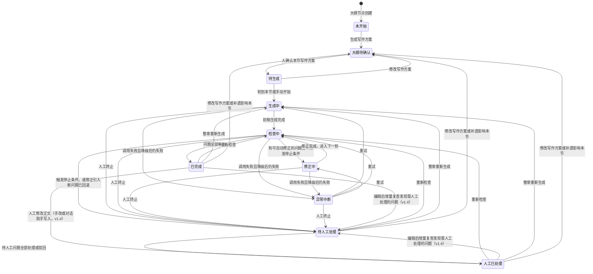

| 状态 | 含义 | 可以做的操作 | 正文能否编辑 |
|---|---|---|---|
| 未开始 | 大纲节点已建立，写作方案还没生成 | 生成写作方案 | 不适用 |
| 大纲待确认 | 写作方案已生成或被修改，等人确认 | 编辑、确认、退回写作方案 | 否（已有正文作为历史版本保留） |
| 待生成 | 写作方案已确认，排队等待生成 | 修改写作方案（回到大纲待确认）；手动开始 | 否 |
| 生成中 | 模型正在生成初稿（可能分多个子任务） | 终止本章循环 | 否，系统持锁 |
| 检查中 | 正在做规则检查和模型评审 | 终止本章循环 | 否，系统持锁 |
| 修正中 | 正在对被点名的段落做定位修正 | 终止本章循环 | 否，系统持锁 |
| 已完成 | 本次循环以“问题全部解决”停止 | 编辑（v1.4：在编辑台手改或用对话助手写入，编辑后变为人工已处理；增量复查有直接转人工的问题时变为待人工处理）、重新检查、整章重新生成 | 是 |
| 待人工处理 | 循环因停止条件、回退或人工终止而停止，还有问题等人处理 | 在人工处理队列处理问题、重新检查、整章重新生成；v1.4：在编辑台修改 | 是 |
| 人工已处理 | 待人工问题已全部处理或驳回；或人在最近一次检查之后修改过正文 | 重新检查；可直接参加分册检查；v1.4：在编辑台修改（增量复查有直接转人工的问题时变为待人工处理）；所在分册定稿后又解锁修改的，界面显示“定稿后已修改，待复核” | 是 |
| 异常中断 | 模型调用失败且降级后仍失败 | 重试（从中断步骤继续）、终止本章循环 | 否（可查看已产生的版本） |

状态规则：

1. 分册检查要求本分册全部章节处于“已完成”或“人工已处理”；导出前全文检查要求全部系统编制的分册已定稿（5.8.5 节）。
2. 与 v1 的对应：v1 的“待编辑、编辑中、已完成（含待补）”不再使用。“编辑中”改由章节编辑锁表示（5.7.3 节规则 8）；含【待补】的章节会停在“待人工处理”或“人工已处理”，大纲树显示【待补】数，导出前仍须清零（R15）。
3. 状态变化写入过程记录（5.7.10 节）；确认写作方案、人工终止、驳回、重新检查、手工回退另写审计日志；v1.4：编辑台提交修改、对话助手写入、编辑锁接管另写审计日志（7.3 节）。
4. 章节状态不直接改变项目状态：章节循环都在项目“编制中”进行（4.3 节）。
5. 所在分册处于“分册检查中”或“已定稿”时（v1.2），本分册章节正文只读，重新检查、整章重新生成、修改写作方案都不可用；须先解锁分册（5.8.5 节）。章节状态保持不变。
6. **编辑台修改后的状态（v1.4）**：不新增章节状态，“人工已处理”即待复核（人在最近一次检查之后修改过正文）。手改提交、对话助手写入、版本回退都按 5.11.10 节映射；章节有编辑锁或未提交草稿时，所在分册不能发起分册检查（建议）。

#### 5.7.6 页面：章节循环进度

- **目的**：看清一个章节每一轮检查了什么、改了什么、为什么停，并能对比任意两个版本。
- **主要元素**：
  1. 顶部摘要：章节状态、第几次循环、当前轮次/最大轮数、停止原因；生成模型和评审模型（相同时标“同模型评审”，跳过时显示原因）；本次循环使用的任务卡及版本号；问题统计（发现、已解决、待人工、已驳回、引用核对丢弃数）；v1.3：本次生成注入的风格样例（标题和类别），以及本章最新一次记录的写作观察指标（只读，5.7.13 节）。
  2. 轮次时间线：每轮一张卡片，包括被检查的版本号；各条规则的结果（通过或问题数）；模型评审的意见数、通过引用核对数、丢弃数；本轮新发现、已解决、仍未解决的问题数；本轮修改的段落；本轮结论（继续修正、停止及原因、已回退）。
  3. 版本对比：默认对比相邻两轮的版本，也可任选两个版本；只高亮有变化的段落，未变化的段落折叠；每处修改旁显示它针对的问题编号。
  4. 问题清单：本节全部问题，可按状态、处理路径、严重程度、来源筛选；点开一条可看它在每一轮的状态变化，以及每次修正前后的文字。
- **操作**：重新检查；终止本章循环（运行中）；重试（异常中断时）；回退到任一历史版本（人工操作，回退后章节为“人工已处理”）；跳转到编辑器对应段落；导出本节过程记录（Excel）。
- **状态流转**：随章节状态实时刷新。
- **业务规则**：
  1. 本页只展示过程记录，历史记录不能修改。
  2. 被引用核对丢弃的模型意见默认只显示数量，项目负责人可展开查看原文和丢弃原因，用于评估模型评审的质量（K15）。
  3. 集团管理员和只读成员可看不可操作。
  4. 写作观察指标只展示，不标红、不排名，也不参与本页任何判断（v1.3）。
- **异常与边界**：历史版本很多时按循环分组折叠。
- **验收标准**：①任一轮的检查结果、修改段落和结论都能在时间线上查到，并与问题记录一致；②任选两个版本对比，只有被修改的段落显示差异；③显示的停止原因与 5.7.4 节第 6 条的判定结果一致。

#### 5.7.7 页面：人工处理队列

- **目的**：把各章节中自动修不了的问题集中起来，由人逐条处理，处理完可一键重新检查。
- **主要元素**：
  1. 顶部统计：待处理问题数（按转人工原因分组）、涉及章节数、投标截止倒计时；v1.2 可按分册筛选，并显示各分册内部截止倒计时。
  2. 按章节分组的队列：每组显示章节号、负责人、停止原因、第几次循环、是否发生回退；组内逐条列出问题：编号、类型、严重程度、位置与引用原句、转人工原因、修改建议、已自动修正次数，以及每轮修改记录的入口。
  3. 右侧详情：问题所在段落原文（可直接编辑）、相关证据与矩阵行、相关项目事实、该问题历次修正前后的文字。
- **操作**：
  1. **定位修改**：在详情中直接改段落，或跳到编辑器；改完标“已处理”，并选择处理方式（已修改正文 / 保留【待补】等资料补齐 / 已替换为变量）。
  2. **去补资料**：缺证据类问题提供跳转入口，直达资料库对应分类和响应矩阵对应行。
  3. **替换为变量**：R10、R27 的问题可一键把正文中手写的值替换为对应变量；取值仍由 SLA 矩阵或项目事实表决定。
  4. **驳回**：模型评审意见可由本节编写人驳回；规则“警告”级问题只能由项目负责人驳回；“阻断”级问题不能驳回。驳回须填写理由（误报 / 不采纳）。v1.3 例外：R43 的问题本节编写人也可驳回（建议，风格判断以写的人为主），驳回后同一位置的同一命中不再报；R44 的问题仍只能由项目负责人驳回。
  5. **建议加入审查清单**：处理人认为该问题以后还会出现时，可勾选并写一句检查项表述，作为公司审查清单的候选（见业务规则 3）。
  6. **重新检查**：对本节开始新一次循环（5.7.4 节第 8 条）。
  7. **用对话助手改（v1.4）**：跳到编辑台并选中问题所在的文字，由对话助手针对该问题给出修改样例（5.11 节）。缺证据的【待补】、星号和废标条款、金额与承诺数值（含额外数值承诺）、人员身份、商务偏离、披露类条款、真实报告与敏感信息七类直接转人工的问题，以及系统生成章节的问题，不提供这个入口。
- **状态流转**：问题：待人工 → 人工已处理 / 已驳回；章节：待人工处理 → 人工已处理（本节全部待人工问题处理完时自动变更）。
- **业务规则**：
  1. 问题默认分派给章节负责人；项目负责人能看到并处理全部章节的问题。章节进入“待人工处理”时，站内提醒章节负责人和项目负责人。
  2. 章节还在循环中时，已判定为直接转人工的问题会提前显示在队列中，但标“本节循环进行中”、不能操作，等本节停止后开放，避免人和系统同时改同一章节。
  3. **审查清单由人确认后沉淀，不做自动长期记忆**。候选有两种来源：处理人勾选“建议加入审查清单”；或系统统计到本公司同一类问题（同一规则编号，或同一问题类型＋同一评分维度）被人工处理的次数达到推荐阈值（示例 3 次，6.9 节），自动生成候选并附上这些问题作为依据。候选只有经公司管理员确认后才启用。启用的条目在以后的模型评审中按章节类型取用（每次最多取用条数见 6.9 节），并在编辑器右侧作为自查清单展示。系统不会自动新增、修改或启用任何条目，也不会把问题处理记录自动写进提示词。审查清单在写作档案页维护（5.6 节）。
  4. 处理记录（谁、何时、怎么处理、理由）不可删除，写入审计日志。
  5. **额外数值承诺（v1.2）**：R30 转来的额外数值承诺只能由项目负责人处理，处理方式为“确认保留”（须写理由，例如“公司决定作为增值承诺”，示例）或“删除”；确认保留的承诺由项目负责人决定是否登记为项目事实，登记后由 R27 管全文一致。
  6. **披露类条款（v1.2）**：R39 转来的问题只能由项目负责人处理；资料库在要求期间内没有记录时，项目负责人须勾选“已核实本期间确无相关记录”，因为资料库无记录不等于没有发生。
  7. **事实类问题（v1.3）**：R44 转来的“事实无来源”问题，处理方式为补登证据或项目事实后保留原文、改为有来源的写法，或替换为【待补】；“关键事实前后矛盾”问题，处理人选定正确值并统一全文写法，系统提示“是否登记为项目事实”，登记后由 R27 管全文一致。
- **异常与边界**：同一段落有多个待人工问题时合并显示，改一次可同时把多条标为已处理；人工修改过的段落在下次检查中照常检查。
- **验收标准**：①缺证据的【待补】、星号和废标条款、金额与承诺数值（含招标未要求的额外数值承诺）、人员身份、商务偏离、披露类条款、真实报告与敏感信息这七类问题，从不出现在任何自动修正记录中；②“阻断”级问题没有“驳回”按钮；③本节全部待人工问题处理完后，章节自动变为“人工已处理”；④未经公司管理员确认的审查清单候选不会出现在任何检查的输入中；⑤点“重新检查”后产生新一次循环，历史循环记录完整保留；⑥（v1.3）本节编写人驳回一条 R43 问题后，重新检查时同一位置的同一命中不再出现。

#### 5.7.8 项目事实表与章节摘要接力

**结论：每个项目维护一张“项目事实表”，各章节生成时都读取；每章完成后生成一段简短摘要，后面的章节读取前面章节的摘要。** 这样能在本地模型 16k 上下文内保持全文前后一致，而不是把整本标书塞给模型。

**项目事实表**

- **内容**：服务期、服务地点、响应时间等 SLA 承诺、驻场人数、项目经理、服务对象规模（如数据库实例数）、项目名称、招标人等关键事实；v1.2 增加承诺类事实：质保期、培训次数和课时、资源到位天数等（平台预置为承诺类事实模板，招标有要求时自动带出）。
- **来源**：解析结果（经人确认的抽取条目）、项目设置、SLA 矩阵、拟派人员，以及人工补充。来自项目设置、SLA 矩阵、拟派人员的事实**直接引用原数据**，事实表只显示、不另存一份可编辑的值，避免两处数据不一致；例如“一级故障响应时限”仍以 SLA 矩阵为唯一数据源（5.3.2 节规则 4）。
- **每条事实的信息**：名称、变量键、取值、单位、类别（项目基本信息、服务期与地点、SLA 承诺、人员、数量规模、金额、承诺（v1.2）、其他）、来源及原文页码、是否必备、确认状态（待确认、已确认、需复核）、允许的等价写法（例如同一日期的不同写法）；承诺类事实另有招标要求值和优劣方向（v1.2）。
- **使用方式**：生成、修正、评审时，系统只把本节写作方案中列出的事实和全部必备事实交给模型；正文中优先用变量引用事实，导出时替换。R27 按事实表检查正文中的手写值。v1.3：R44 核对正文中的具体事实时，项目事实表（含允许的等价写法）是三个来源之一，另外两个是本段证据和招标原文；R44 发现未登记的关键事实（示例：数据库版本、驻场地点楼层）前后矛盾时，提示登记为项目事实（5.8.7 节）。
- **承诺类事实的判定（v1.2）**：承诺类事实的我方取值劣于招标要求值时为“不满足”，由 R09 阻断（优劣方向与 SLA 变量相同：时限类越小越好、次数课时类越大越好）；SLA 模板中已有同一指标的变量时，以 SLA 变量为准，事实表只引用、不另存（与本节“来源”一条一致）。承诺类事实在技术、商务两个分册中都可能出现，R27 在全文检查中跨分册重跑。
- **变化处理**：来源数据改变时（例如补遗改了服务期），事实自动更新为新值并标“需复核”，确认后生效；已使用该事实的章节在大纲树上提示，分册检查和全文检查时 R27 会重新比对。
- 事实表不存放最高级敏感信息（身份证号、银行账号等）；人员只记姓名和项目角色。

**页面：项目事实表**（项目详情中的页签）

- **目的**：集中确认本项目的关键事实，作为全文唯一口径。
- **主要元素**：事实列表（名称、取值、单位、类别、来源（可点回原文或 SLA 矩阵）、是否必备、确认状态、使用该事实的章节数）；“从解析结果带出”按钮；“新增人工事实”按钮。
- **操作**：确认、批量确认（仅非必备项）、修改人工事实、新增、停用、查看使用位置。
- **状态流转**：待确认 → 已确认；来源数据变化后 → 需复核 → 已确认。
- **业务规则**：必备事实须由项目负责人逐条确认；引用型事实的取值只能到来源处修改（点击跳转）。
- **异常与边界**：解析结果中同一事实出现互相矛盾的取值（例如正文和附件的服务期不同）时，并列显示并要求人工选定一个，选定理由留痕。
- **验收标准**：①修改 SLA 矩阵中的承诺值后，事实表同步显示新值并标“需复核”；②必备事实未确认时写作方案无法确认；③正文中与事实表不一致的服务期写法，R27 能检出并定位到段落。

**章节摘要接力**

- 每节循环停止时（已完成或待人工处理），系统用本地模型（任务卡“章节摘要”）为当前版本生成摘要，不超过摘要字数上限（示例 300 字，6.9 节），并附“本章使用的事实”清单。章节内容之后又被修改的，在进入“已完成”或“人工已处理”时重新生成，旧摘要标“已过期”。
- 后面的章节在生成和修正时，系统按大纲顺序取同一分册中前面章节的最新摘要，在“前序摘要预算”（示例 1,500 token，6.9 节）内从近到远放入；放不下的更早章节略去，并在生成记录中注明。
- 章节生成顺序默认按大纲顺序依次进行：前一节循环停止后再开始下一节，以便摘要接力。可在 6.9 节改为并行；并行时后面的章节可能拿不到前面章节的摘要，生成记录中注明。
- 摘要只作衔接参考，不作证据，不进入正文；事实以项目事实表和资料库为准。前面章节的摘要更新后，后面已生成的章节只提示“前序内容有变化”，不自动重新生成。

#### 5.7.9 任务卡

- **结论**：每类模型任务配一张“任务卡”，存放在公司写作档案中，带版本号；每次模型调用都记录用的是哪张任务卡的哪个版本，结果可以追溯。
- **任务卡包括**：用途；需要系统喂给模型的材料（例如本节正文、矩阵行原文与评分标准、审查清单、项目事实、前序章节摘要）；要求模型输出的结构（写作方案、章节摘要、章节模型评审、定位修正必须是结构化输出，系统按此校验，不合格按一次调用失败处理）；引用的提示词模板及其版本；1～2 个示例；建议的模型参数及其依据（v1.3，见下文）；提示词禁用表达（v1.3，5～10 条）；适用的章节类型。
- **任务类型**：写作方案（大纲）、章节生成、章节摘要、章节模型评审、定位修正、局部改写（改写、扩写、缩写、按指令修改）；v1.2 新增“额外承诺候选识别”（从正文中找出招标未要求的数值承诺候选，供 R30 使用，6.4 节）；v1.3 新增“事实锚点识别”（从正文中找出客户系统名等规则难以识别的具体事实候选，只输出候选文字和所在句子，不判断真假；是否对得上来源由 R44 按规则核对，6.4 节）；v1.4 新增“对话助手问答”和“对话助手修改样例”（5.11.4 节），原“局部改写”并入“对话助手修改样例”的快捷指令（建议）。系统生成章节不使用任务卡（5.7.2 节第 9 条）。
- **模型参数（v1.3）**：平台默认任务卡按下表预置参数。表中数值都是参考值，标书场景的最佳取值没有公开来源，具体数值由试运行确定；任务卡上用“参数依据”标明来源，页面显示“参考值，待试运行确定”，试运行验证后改为“试运行确定”。

| 任务类别 | 适用任务卡 | 参考参数 | 依据 |
|---|---|---|---|
| 生成类 | 章节生成；局部改写（改写、扩写、缩写、按指令修改、换一种说法；v1.4 并入对话助手修改样例）；对话助手修改样例（v1.4） | 温度 0.7、TopP 0.8、TopK 20；重复惩罚取小值（示例：0.5） | Qwen 官方推荐值：Qwen3-30B-A3B-Instruct-2507 模型卡推荐温度 0.7、TopP 0.8、TopK 20、MinP 0，并说明重复惩罚（presence_penalty）可在 0～2 之间调整，调高可减少重复，但可能出现中英文混杂、效果略降（查阅日期 2026-09-29）。依据类型：厂商参考值 |
| 评审和抽取类 | 章节模型评审；额外承诺候选识别；事实锚点识别 | 低温（示例：温度 0.2）；其余参数取模型配置 | 本次确认“评审和抽取类用低温”；依据类型：平台参考值 |
| 其他（建议） | 写作方案；章节摘要；定位修正 | 低温（示例：温度 0.3）；其余参数取模型配置 | 像人写调研建议修正类用低温；写作方案、章节摘要要求结构化输出，按低温处理（建议）；依据类型：平台参考值 |
| 问答类（v1.4，建议） | 对话助手问答 | 低温（示例：温度 0.3）；其余参数取模型配置 | 问答以准确为主，不需要写法变化；依据类型：平台参考值 |

- **参数的取值顺序（v1.3）**：调用时以任务卡上填写的参数为准；任务卡没填的参数取模型配置的默认值（6.2.1 节）；所选模型或接口不支持的参数不传，并在生成任务的参数快照中注明（建议）。实际使用的参数全部记入生成任务（5.7.12 节）。调高温度不能解决“AI 味”：像人写调研引用的研究显示温度与新颖性只有弱正相关，与不连贯中度相关，所以本版不靠调温度来“去 AI 味”。
- **提示词禁用表达（v1.3）**：生成类（v1.4 含对话助手修改样例）和定位修正任务卡的提示词中只写 5～10 条本公司最想避免的表达（示例：“全方位保障”“保驾护航”“综上所述”），取自本公司套话表中命中较多的条目（建议）；超过 10 条的任务卡不能发布，少于 5 条时提示。其余套话和句式交给 R43 事后检查（像人写调研 6.2 节第 10 条）。
- **示例与风格样例的区别（v1.3）**：任务卡的 1～2 个示例用于说明输出的格式和结构，随任务卡版本固定；风格样例用于示范本公司的写法，按章节类别从风格样例库中取，不写在任务卡里（5.6.5 节）。生成类任务卡的“需要喂给模型的材料”中增加“风格样例”一项。
- **版本规则**：平台提供默认任务卡，公司复制后修改；发布后不可修改，修改即生成新版本；同一公司、同一任务类型、同一章节类型下只有一个启用版本。一次章节循环开始时锁定所用的任务卡版本，循环中途发布的新版本不影响本次循环（与“运行中的任务用发起时的配置版本”一致，6.6.1 节）。v1.4：对话助手没有循环，每次请求开始时取当时启用的任务卡版本并记入生成任务。
- 只借鉴“按需加载、打包管理”的思路，不引入会自主调用工具的 Agent 运行时。
- **验收标准**：①任一写作方案、生成、评审、修正、摘要记录都能查到任务卡编号和版本号；②发布新版本后，新开始的循环使用新版本，进行中的循环不变；③（v1.3）任一生成任务都能查到实际使用的温度、TopP、TopK、重复惩罚和参数依据；④（v1.3）提示词禁用表达超过 10 条的任务卡不能发布；⑤（v1.4）任一对话助手请求都能查到任务卡编号和版本号、实际使用的模型和知识库开关。

#### 5.7.10 过程留痕

- 每一轮都保存：被检查的版本（含段落来源，v1.2）；系统清理的对话残留句和格式符号（v1.2）；规则检查结果（逐条规则）；模型评审的原始意见（含被丢弃的意见及丢弃原因）；问题记录及其状态变化；修正的输入范围（哪些段落、哪些问题）和输出；修正后的版本；本轮结论和停止原因；使用的模型及配置版本、任务卡版本、审查清单条目版本；v1.3：本次生成注入的风格样例编号、实际使用的模型参数，以及各记录时点的写作观察指标（5.7.13 节）。
- 章节版本只追加、不覆盖；回退也是生成一个内容等于旧版本的新版本，被回退的版本标“已回退”并保留。
- 过程记录在章节循环进度页回看（5.7.6 节）；人工操作（确认写作方案、终止、驳回、处理、重新检查、手工回退）另写审计日志（7.3 节）。
- **编辑台留痕（v1.4）**：每次手改提交、对话助手写入、版本回退都写一条编辑操作记录（修改方式、基础版本和结果版本、改动段落、用户确认的差异、知识库开关、引用来源、操作人和时间、增量复查结果），段落来源追加不覆盖；对话会话、消息和样例单独留存（5.11.6、5.11.11 节）。编辑草稿不是版本，提交后才进入版本历史。
- 过程记录的保留期限与项目数据相同（待定，Q13）。

#### 5.7.11 验收标准（生成闭环）

1. 写作方案未确认的章节无法生成；确认记录含确认人和确认时间。
2. 各章节独立循环：一个章节停在“待人工处理”，不影响其他章节继续循环。
3. 默认配置下，一次循环最多 3 轮检查、2 次自动修正；把最大轮数改为 2 后，新开始的循环最多 2 轮，进行中的循环不受影响。
4. 对比自动修正前后的版本：未被问题点名的段落逐字不变。
5. 构造一个“修正后在被改段落引入新问题”的样例：系统回退到修正前的版本，章节进入“待人工处理”，停止原因为“修正引入新问题”。
6. 构造一个两次修正都不能解决的问题：第 2 次修正后仍在时，该问题转为“待人工”，其他问题继续修正。
7. 构造一个第 2 轮未解决问题数不少于第 1 轮的样例：循环在第 2 轮后停止，停止原因为“问题数量未减少”。
8. 缺证据的【待补】、星号和废标条款、金额与承诺数值（含招标未要求的额外数值承诺）、人员身份、商务偏离、披露类条款、真实报告与敏感信息七类问题，一律直接进入人工处理队列，自动修正记录中从不出现。
9. 模型评审意见引用的原句在正文中不存在时，该意见不进入问题清单，丢弃数量被记录。
10. 敏感项目的全部生成、评审、修正、摘要调用都落在本地模型（审计日志可验证）；本地只有一个模型时，敏感项目默认跳过模型评审，页面显示原因。
11. 问题记录跨轮跟踪：同一问题在各轮沿用同一编号，能查到每轮状态。
12. 每一轮的版本、检查结果、修改内容都能在章节循环进度页回看。
13. 人工处理后点“重新检查”，产生新一次循环，历史循环记录完整保留。
14. 分册内存在任一章节不是“已完成”或“人工已处理”时，该分册不能发起分册检查、不能定稿；存在任一系统编制的分册未定稿时，导出前全文检查不能开始，递交版导出不可用（v1.2）。
15. 任一模型调用记录都能查到任务卡编号和版本号。
16. 系统生成章节（点对点应答、评审索引表、偏离表、年度服务计划表、证明材料清单）没有任何模型调用记录（v1.2）。
17. 任一章节版本的每个段落都有来源记录（来源类型和回应的矩阵行）（v1.2）。
18. 构造一个含 R43 命中句的段落：定位修正只改命中的句子，同段其他句子逐字不变；系统不删除命中句；修正后出现新的 R43 问题时不触发整章回退（v1.3）。
19. 构造一个对不上任何来源的型号或客户系统名：模型撰写段落中被替换为【待补】并由 R15 转人工；人工编写段落中保留原文，R44 报“事实无来源”并直接转人工（v1.3）。
20. 每个非系统生成章节在初稿、循环停止两个时点都有一条写作观察指标记录，分册定稿后再有一条含人工修改率的记录；指标数值不影响任何状态流转（v1.3）。
21. 章节循环停止后，在编辑台中每次手改提交、对话助手写入、版本回退都产生一个新版本和一条编辑操作记录，且只对改动段落做增量复查，章节循环的轮次记录不增加（v1.4）。
22. 对话助手写入含招标未要求的额外数值承诺、金额或人员身份的样例后，增量复查产生“直接转人工”的问题，章节进入“待人工处理”，自动修正记录中从不出现（v1.4）。
23. 编辑台的其余验收见 5.11.14 节（v1.4）。

#### 5.7.12 数据对象（生成模块）

所有表带字典 3.0 节的 A 组审计字段和 C 组 `company_id`（所属公司）。v1.1 新增的表和字段的完整定义见字典 v1.7 第 3.7.6、3.7.7、3.8 节；v1.2 新增的字段见字典 3.8.5 节；v1.3 新增的字段见字典 3.8.4、3.8.5 节，写作观察指标表见字典 3.8.6 节；v1.4 补充的字段见字典 3.8.4、3.8.5、3.8.6 节，编辑台与对话助手的 5 张新表见 5.11.13 节和字典 3.9 节。v1.5：本节全部表的完整列定义见字典 v1.7 3.10 节（字典 3.9 节的 5 张表和 3.8 节本字典表除外）。

| 表名 | 中文名 | 关键字段 |
|---|---|---|
| bid_outline_node | 大纲节点 | project_id、parent_id、chapter_no、title、volume（分册）、writing_points、target_length、assignee_id、matrix_item_ids、writing_profile_version、outline_template_node_id；v1.1 新增：loop_status（章节状态，取代 v1 的 status）、plan_confirmed_by、plan_confirmed_at、planned_evidence_refs、selected_snippet_ids、fact_ids、not_applicable_items、current_version_id、current_run_no、current_round_no、stop_reason、stopped_at；v1.2 新增：volume_id（→bid_volume，取代 volume 文本）、chapter_kind（章节类型：普通 / 点对点应答 / 评审索引表 / 偏离表 / 年度服务计划表 / 证明材料清单）、is_value_added（增值章节）、value_added_reason、value_added_by、value_added_at；v1.4 新增：last_edit_mode（最近一次修改方式）、last_edited_by、last_edited_at、edited_after_finalize（定稿后已修改） |
| chapter_version | 章节版本 | node_id、version_no、content（富文本/结构化段落）、created_by_type（人工/生成/改写）、generation_task_id、pending_count（【待补】数）、is_current；v1.1 新增：version_origin（首次生成/定位修正/人工编辑/局部改写/整章重新生成/回退）、parent_version_id、run_no、round_no、changed_paragraph_keys、paragraph_hashes（段落指纹）、paragraph_matrix_map（段落与矩阵行对应）、is_rolled_back；v1.2 新增：paragraph_sources（段落来源：每段的来源类型、来源编号与版本、回应的矩阵行）；v1.4 新增：edit_mode（修改方式：手改 / 对话助手替换 / 对话助手增加 / 版本回退）、edit_operation_id（→chapter_edit_operation），version_origin 增加 assistant_edit（对话助手修改），paragraph_sources 每条来源增加 edit_mode（修改方式）、kb_enabled（知识库开关）、citation_refs（引用来源）、no_kb_source（无知识库来源）、operated_by（操作人）、operated_at（操作时间）、span（字符区间）、is_pasted（是否粘贴），来源类型增加 assistant（对话助手撰写） |
| paragraph_lock | 段落锁定 | node_id、paragraph_key、locked_by、locked_at |
| citation | 证据引用 | project_id、node_id、paragraph_key、ref_type、ref_id、ref_version、tender_page（引用招标文件时）、quote_text；v1.4 新增：origin_edit_operation_id（由哪次编辑台写入产生） |
| generation_task | 生成任务 | project_id、node_id、task_type（写作方案/章节/章节摘要/章节模型评审/定位修正/改写/扩写/缩写；v1.3 补齐：按指令修改、额外承诺候选识别、事实锚点识别）、model_id、model_config_version、input_tokens、output_tokens、sub_task_no、status（排队/运行中/已完成/失败/已取消）、error、is_cloud、started_at、finished_at；v1.1 新增：task_card_id（任务卡版本）、loop_round_id、target_paragraph_keys、is_fallback；v1.3 新增：style_sample_ids（本次注入的风格样例）、model_params_snapshot（实际使用的模型参数及参数依据）；v1.4：task_type 增加 assistant_qa（对话助手问答）、assistant_suggest（对话助手修改样例），新增 assistant_message_id（→assistant_message）、kb_enabled（知识库开关） |
| edit_lock | 章节编辑锁 | node_id、user_id（v1.1 起可为空，为空表示章节循环进行中由系统持锁）、acquired_at、expires_at；v1.1 新增：lock_reason（系统持锁时的章节状态）；v1.4 新增：heartbeat_at（最近心跳时间）、taken_over_from_user_id（被接管的原持有人）、takeover_reason（接管原因） |
| chapter_loop_round | 章节循环轮次（v1.1 新增） | 每轮一条：run_no、round_no、被检查版本、修正后版本、执行的规则、模型评审执行情况与跳过原因、评审模型、问题统计、引用核对丢弃数、修改的段落、本轮结论与停止原因、是否回退、任务卡版本快照 |
| chapter_check_issue | 检查问题记录（v1.1 新增） | 编号、问题指纹、来源层（规则/模型评审）、规则编号、问题类型、矩阵行、事实、段落、引用原句、严重程度、处理路径、转人工原因、状态、修正次数、首次与最近出现轮次、人工处理信息；v1.3 新增：fix_scope（修正范围：整段 / 只改命中句）、style_hit_refs（风格命中明细：命中的套话条目或句式规则）；v1.4 新增：check_context（检查场景：章节循环 / 编辑后增量复查）、found_by_edit_operation_id（由哪次编辑操作的增量复查发现） |
| project_fact | 项目事实（v1.1 新增） | project_id、fact_key、fact_label、fact_category、source_type、来源引用、value_text、unit、aliases、is_required、confirm_status；v1.2 新增：tender_required_value（招标要求值）、compare_direction（优劣方向），fact_category 增加 commitment（承诺） |
| chapter_summary | 章节摘要（v1.1 新增） | project_id、node_id、chapter_version_id、summary_text、facts_used、summary_status、generation_task_id |
| writing_style_metric | 写作观察指标（v1.3 新增） | project_id、node_id、chapter_version_id、scoring_dimension_codes（章节类别，统计用）、measure_point（记录时点）、metric_version、char_count、paragraph_count、sentence_count、cliche_hit_count、cliche_allowed_count、cliche_density、scoring_section_count、fact_anchor_count、fact_anchor_verified_count、fact_density、summary_sentence_count、summary_ratio、sentence_length_mean、sentence_length_cv、opening_repeat_count、pattern_hit_detail、baseline_version_id、manual_edit_ratio、generation_model_id、task_card_id、style_sample_ids、measured_at；v1.4 新增：edit_distance_by_mode（按修改方式累计的编辑距离）、edit_ratio_manual_part（人工修改率中手改分项）、edit_ratio_assistant_part（对话助手分项）、assistant_adopted_count（对话助手写入次数） |

#### 5.7.13 写作观察指标（v1.3）

结论：系统为每个章节记录六项写作观察指标，第一期只观察、不拦截：不设阈值，不产生检查问题，不影响章节状态、定稿和导出。目的是积累本公司数据，试运行后再定 R43、R44 的阈值，并决定哪些检查升级为拦截（3.3 节后续版本清单第 6 项）。

**1. 记录时点**

| 时点 | 何时记录 | 记录哪些指标 |
|---|---|---|
| 初稿 | 首次生成（含整章重新生成）完成、R34 清理之后，第 1 轮检查之前 | 前五项 |
| 循环停止 | 每次章节循环停止时，对当时的当前版本 | 前五项 |
| 分册定稿 | 分册定稿时，对每个章节的定稿版本 | 六项全部 |

系统生成章节（点对点应答、评审索引表等五类）不记录，因为它们不是模型写的，也不许手改。

**2. 口径**

| 指标 | 计算方法 | 说明 |
|---|---|---|
| 套话命中密度 | 套话表（含空泛词）命中次数 ÷ 正文字数 × 1000 | 与 R43 用同一套词表和放行规则：本项目招标原文中出现过的词、招标原文引用段落不计；放行的次数另记，便于评估词表误报 |
| 事实密度 | 已核验的具体事实个数 ÷ 得分要点小节数 | 与 R44 同口径；同时记录识别出的事实总数，差值即对不上来源的个数 |
| 总结句比例 | 带段末总结句的段落数 ÷ 段落数 | 段末总结句的识别与 R43 相同（5.6.5 节第 4 项） |
| 句长变化程度 | 句长变异系数＝句子字数的标准差 ÷ 平均句长 | 同时记录平均句长；表格中的单元格和标题不计入句子 |
| 段首句式重复数 | 连续若干段（段数取 R43 设置，示例 3 段）开头使用同一词语或句式的组数 | 与 R43 的“段首重复”同口径 |
| 人工修改率 | AI 初稿与定稿之间的字符编辑距离 ÷ 两者中较长一方的字数 | “编辑距离”指把一段文字改成另一段最少需要增、删、换多少个字；“AI 初稿”指人第一次修改前的最后一个 AI 版本（包括系统自动定位修正产生的版本）；“定稿”指分册定稿时的版本（建议）。没有人工修改的章节记为 0。v1.4：“人第一次修改”包括手改和对话助手写入，二者都计入总数（建议，5.11.7 节） |

- 每条记录注明计算口径版本（`metric_version`）。口径调整后，旧记录不重算，统计页按口径版本分开显示（建议）。
- 每条记录同时记下生成模型、任务卡版本和注入的风格样例，用于比较不同模型、任务卡和样例组合的效果。
- R43 被公司关闭时，套话命中密度、总结句比例、段首句式重复数照常计算（建议），保证观察数据连续。
- **人工修改率分项（v1.4，建议）**：总数口径不变。另按修改方式拆出“手改”和“对话助手”两个分项：系统把 AI 初稿之后每次编辑操作的编辑距离按修改方式累计，再按累计值的比例拆分总数（两个分项之和等于总数）。这是近似拆分，因为后一次修改可能覆盖前一次；版本回退计入手改。同时记录对话助手写入次数。

**3. 页面：写作观察统计**（项目概览底部折叠区和公司管理后台各一处；v1.5 起项目级不再单设页签，5.1.3 节）

- **目的**：按章节类别、生成模型、任务卡版本、时间段查看六项指标的分布和趋势，比较“初稿”与“定稿”的差异。
- **主要元素**：筛选条件（项目、分册、章节类别即评分维度、生成模型、任务卡版本、时间段）；六项指标的均值、中位数和分布；按章节列出的明细（可跳转到章节循环进度页）。v1.4：新增“对话助手”分组，展示 5.11.12 节的指标（样例采纳率、知识库开关使用比例等），可按知识库开关、模型筛选；人工修改率同时显示总数和两个分项。
- **操作**：查看、导出 Excel。
- **业务规则**：
  1. 统计页只读，不设阈值，不标红，不排名。
  2. 人工修改率反映的是 AI 初稿离定稿有多远，不与个人绩效挂钩，页面不按编写人排名（建议）。
  3. 公司管理员看本公司全部项目，项目负责人看本项目，集团管理员可看各公司汇总但不看正文（2.3 节）。
- **验收标准**：①同一章节在初稿、循环停止、分册定稿三个时点的记录都能查到；②修改套话表后，新记录按新词表计算，旧记录不变；③统计页上没有任何会影响章节状态、定稿或导出的操作；④公司 A 的指标记录不出现在公司 B 的统计页中。

---

### 5.8 合规检查

**结论：v1.2 起合规检查分三个场景，共用同一套规则编号（v1.3 起为 R01～R44）。** 章节循环内检查在每个章节的每一轮自动运行，只跑与本节正文有关、能按章节判定的规则，外加可选的模型评审（5.7.4 节）；分册检查（v1.2 新增）在一个分册的全部章节完成后运行，只跑与本分册有关的规则，是分册定稿的前提；全文检查（导出前检查）在全部系统编制的分册定稿后运行，跑全部启用的规则，包括跨分册一致性、跨公司相似度比对、本公司查重、附件与格式等，是递交版导出的闸门。合标在系统外完成，系统不做合标后的检查（neil 确认第 2 点）。哪些规则在哪个场景运行，见 5.8.1 节“章节循环”列、5.8.4 节和 5.8.5 节。v1.4 新增“编辑台写入后的增量复查”：在编辑台每次手改提交、对话助手写入或版本回退后，只对改动段落重跑章节循环规则中的适用部分（不含 R28），结果写入检查问题记录。它是章节层面的补充检查，不是第四个检查场景，不影响分册检查和全文检查的范围和闸门（5.8.4 节、5.11.6 节）。

#### 5.8.1 规则清单与 MVP 范围

以字典第 5 章的 17 条规则为基础，v1 新增 8 条（R18～R25），v1.1 为生成闭环新增 3 条（R26～R28），v1.2 按公司《投标技术服务方案编写规范》和分册设计新增 14 条（R29～R42），v1.3 按像人写调研新增 2 条（R43、R44），共 44 条；本版没有删除规则，编号不复用。结果级别：**阻断**＝不处理不能导出；**警告**＝标红，须项目负责人逐条确认放行并填写理由；**提示**＝仅提醒。“MVP”列：● 第一期完整实现；◐ 第一期实现简化版（说明见备注）；○ 二期。“章节循环”列（v1.1）：● 每轮在本节范围内运行；◐ 每轮只运行其中与正文有关的部分；— 不参与章节循环。完整分工见 5.8.4 节。“检查时机”列中的“导出前”即全文检查（导出前检查）；分册检查的规则范围见 5.8.5 节。

| 编号 | 规则 | 检查时机 | 章节循环 | 结果级别 | MVP | 备注 |
|---|---|---|---|---|---|---|
| R01 | 不可引用的资料禁止引用（未确认、需重新确认、开关开启时未审核、已停用、已删除、片段未发布） | 生成时实时拦截；章节循环每轮复核本节引用；v1.4：对话助手检索时只取可引用的记录，写入后增量复查本次引用；导出前总检 | ◐（复核本节引用） | 阻断 | ● | 本轮改为以“录入人确认”为主，审核为可选开关 |
| R02 | 资料来源分级与投标主体一致；合作伙伴资料须项目已登记合作方且上传联合体协议或分包协议 | 挂证据时；章节循环每轮复核本节引用；导出前 | ◐（复核本节引用） | 仅供参考：阻断；合作伙伴无协议：阻断；合作伙伴有协议：提示注明来源 | ● | 按字典第 6 章第 4 项结论加强 |
| R03 | 有效期覆盖投标截止时间；项目开启时还须覆盖服务期 | 立项、挂证据、导出前 | — | 过期：阻断；待补录：警告 | ● | 基准日改为投标截止时间（第 6 章第 7 项） |
| R04 | 临期与复审提醒 | 每日定时 | — | 提示 | ● | 提醒发给资料负责人 |
| R05 | 年审/监督审核有效 | 导出前 | — | 警告 | ○ | |
| R06 | 持证单位与主体名称一致（含 OCR 文本比对） | 导出前 | — | 警告 | ○ | MVP 只比对录入字段，OCR 比对二期 |
| R07 | 原厂授权覆盖招标涉及的全部产品，授权链逐级有效，地域覆盖到地市 | 立项；导出前 | — | 招标要求原厂授权时缺失：阻断；其余：警告 | ● | 本轮加入多级授权链 |
| R08 | 拟派人员持有招标涉及产品的有效原厂认证 | 排人时；导出前 | — | 警告 | ● | 运维专项 |
| R09 | SLA 承诺和承诺类事实满足招标要求；超出最严可承诺值提示 | SLA 矩阵和项目事实表实时；导出前 | — | 不满足：阻断；超出能力：警告 | ● | 运维专项；v1.2 范围扩展到承诺类事实（质保期、培训次数和课时、资源到位天数等），不得劣于招标要求 |
| R10 | SLA 承诺全文一致 | 章节循环每轮（本节）；导出前 | ● | 阻断 | ● | 运维专项 |
| R11 | 本单位人员与社保核对：招标要求本单位人员时，人员归属须为本单位、社保缴纳单位须为投标主体、劳动合同在截止时间有效；要求近 N 个月连续缴纳时提示人工核对证明 | 排人时；导出前 | — | 不一致：阻断；信息缺失：警告；连续缴纳：提示人工核对 | ● | 按字典第 6 章第 12 项和人员归属字段 |
| R12 | 人员占用冲突：只提示不锁定，项目经理默认提示；停用或离职人员不得拟派 | 排人时 | — | 停用/离职：阻断；冲突：提示 | ● | 按第 6 章第 13 项结论，冲突降为提示 |
| R13 | 业绩满足资格与评分条件（年限、主体、金额、类别、产品、证明材料） | 选业绩时；导出前 | — | 警告 | ◐ | MVP 只检查年限、签约主体、证明材料齐全 |
| R14 | 必备附件齐全；敏感附件导出加水印 | 分册检查；导出前 | — | 阻断；同一附件在同一分册插入多次：提示 | ● | v1.2 增加“同一附件在同一分册中插入多次”的提示 |
| R15 | 占位符与【待补】清零 | 章节循环每轮（本节）；导出前 | ◐（本节【待补】与变量） | 阻断 | ● | |
| R16 | 主体基本资格与证明材料时效（存续、经营范围、财务年度、纳税社保期间） | 立项；导出前 | — | 警告 | ◐ | MVP 只检查主体状态与证明材料有效天数 |
| R17 | 使用提示与保密项目提醒 | 引用时 | — | 提示 | ● | |
| R18 | **相似度检查**：与集团内其他公司投同一项目或同一招标人的标书比对 | 手动发起；导出前必检 | — | 超阈值：警告（公司可设为阻断） | ● | 见 5.8.3 节；v1.2 写明与 R29 的分工：R18 防集团内不同公司“异常一致”，R29 查本公司内部重复，文本指纹能力两条规则共用；v1.5：一期只做文本层段落相似度，结果只显示“段落相似度”，语义层放二期 |
| R19 | **关联投标冲突**：集团内多家公司对同一标段立项 | 立项；导出前 | — | 警告（须填写说明并通知集团管理员） | ● | 依据条例第三十四条、政府采购法实施条例第十八条，见 8.3 节 |
| R20 | 同一编写人（同一自然人）参与集团内不同公司同一项目的编写 | 导出前 | — | 警告 | ○ | 对应条例第四十条第（一）项；需先确定跨公司识别同一自然人的口径 |
| R21 | 不同公司同一项目拟派人员为同一人（按身份证号的不可逆指纹比对，不暴露号码） | 导出前 | — | 警告 | ○ | 对应条例第四十条第（三）项 |
| R22 | 不同公司同一项目的保证金转出账户相同（按账号指纹比对） | 导出前 | — | 警告 | ○ | 对应条例第四十条第（六）项 |
| R23 | 星号条款、废标条款全部已确认响应；星号条款不得偏离 | 分册检查（本分册的行）；导出前 | — | 阻断 | ● | 导出闸门；v1.2 纳入从评分项中抽出的否决子句（例如隐瞒安全隐患、行政处罚将被否决） |
| R24 | 格式要求：招标规定的格式文件（投标函、授权书、承诺函等）齐全；页数限制（v1.5：系统给出的页数为估算值，提示文案写“估算”）；章节顺序 | 分册检查（本分册）；导出前 | — | 缺格式文件：阻断；其余：警告 | ◐ | MVP 检查格式文件齐全和页数；字体字号等二期；v1.2：偏离表、评审索引表、点对点应答作为格式文件时纳入检查，按分册分别检查；页数按分册计；v1.5：系统在导出前无法得到 Word 排版后的准确页数，页数按估算给出，准确页数以商务合标后的 Word 为准（5.9.2 节第 2 项） |
| R25 | 文档残留与属性：正文中出现其他公司名称、其他招标人或旧项目名称；Word 文档属性（作者、单位）、修订痕迹、批注未清理 | 章节循环每轮（正文部分）；分册检查；导出前 | ◐（正文中的名称残留） | 其他公司/旧项目名称：阻断；识别出的未知机构名：警告；其余：导出时自动清理 | ● | 防止复制旧稿带入错误，也降低“异常一致”风险；v1.2 在已知名单比对之外增加机构名称识别（按“公司、中心、局、行、院”等机构后缀识别，后缀表由平台维护，示例），编写规范 p.30 示例中残留了其他单位名称 |
| R26 | **评分项覆盖度**：写作方案中每个评分项（v1.2 起到得分要点一级）和技术服务要求行都分配到章节；每个章节正文中都有段落回应其写作方案中的每个矩阵行 | 写作方案确认时；章节循环每轮；分册检查；导出前 | ● | 大纲阶段未分配：该分册写作方案不能确认（可逐条标“不适用”并填理由）；正文未覆盖：警告 | ● | v1.1 新增。只判断“有没有段落回应”，“回应得是否实质”由 R28 提示 |
| R27 | **项目事实一致**：正文中的服务期、服务地点、项目名称、招标人、项目经理、服务对象规模，以及 v1.2 新增的承诺类事实（质保期、培训次数和课时、资源到位天数等）与项目事实表一致（SLA 数值由 R10 负责，不重复检查） | 章节循环每轮；分册检查；导出前（跨分册重跑） | ● | 阻断 | ● | v1.1 新增。按“关键词＋取值模式”比对手写值，变量引用视为一致（实现细节由研发细化，建议）；v1.2 在全文检查中跨分册重跑 |
| R28 | **章节模型评审（辅助）**：模型按评分项逐条评审本节正文；每条意见须引用正文原句，系统核对引用，对不上的丢弃 | 章节循环每轮（可关闭） | ● | 提示（永不阻断） | ● | v1.1 新增。不是确定性规则，结果不可复现，只用于提示和自动修正；开关与评审模型见 6.9 节；v1.2 问题类型增加“语句不通顺”，默认审查清单增加编写规范相关条目（5.6.4 节）；v1.3 问题类型增加“空泛表态、无具体措施”，默认严重程度为“低”（5.7.4 节第 2 条） |
| R29 | **本公司查重**：与本公司近 2 年的历史标书、同期在编的其他标书和“仅供参考”资料比对，默认同一段连续 8 个字符相同即记为一处重复；招标原文、注明出处的引用、技术术语和命令不算重复 | 手动发起；导出前 | — | 与“仅供参考”资料重复超阈值：警告；与本公司历史标书或在编标书重复超阈值：提示 | ●（文本层；语义层二期） | v1.2 新增。8 个字符的规则依据公司内部编写规范（p.25）；字数和年限可由管理员调整（5.10.4 节）；见 5.8.3 节 |
| R30 | **超范围响应**：①非增值章节中没有对应招标条款的段落，或承诺了招标没有要求的服务内容；②正文中招标未要求的额外数值承诺（时限、次数、人数、比例、期限在 SLA 矩阵和承诺类事实中都找不到对应的招标要求）；③产品超范围交 R32 | 章节循环每轮；编辑台写入后增量复查（v1.4）；分册检查；导出前 | ● | ①警告；②章节循环中直接转人工，分册检查和全文检查中为警告，须项目负责人逐条确认 | ● | v1.2 新增。写作方案中标为“增值”的章节不算超范围，但其中的额外数值承诺仍按②处理（neil 确认第 3 点）；v1.4：对话助手样例中的额外数值承诺在预检时标出，写入后由增量复查报出并直接转人工；额外承诺候选由本地模型找出、规则核对矩阵（6.4 节）；依据编写规范 p.27“每条技术需求和技术评分都响应到就可以，不用增加其它无关紧要的资料凑页数（销售有要求除外）” |
| R31 | **真实报告与敏感信息残留**：正文和插图识别文字中的 IP 地址、主机名和实例名样式、账号口令字样、手机号、身份证号样式、邮箱；整段真实报告特征（具体巡检日期加检查结果数值等） | 章节循环每轮（正文）；分册检查；导出前（含插图） | ◐（正文） | 证件号、口令：阻断；其余：警告 | ● | v1.2 新增。依据编写规范 p.27（不要直接用现成巡检报告，脱敏后也不行）；章节循环中一律直接转人工（建议）；通过证据引用、变量插入的本公司信息不报 |
| R32 | **产品范围一致**：正文出现招标产品清单以外的数据库或中间件品牌；清单内每个产品在服务方案、人员、服务计划、案例中至少出现一次 | 章节循环每轮（清单外品牌）；分册检查；导出前 | ◐（清单外品牌） | 清单外品牌：警告（招标写“包含但不限于”时为提示）；清单内产品未覆盖：提示 | ● | v1.2 新增。按厂商产品字典的别名识别；与 R08、R13 联动 |
| R33 | **拟派人员条件**：学历、专业、工作年限（算到投标截止时间）、证书、人数、角色、AB 角、不得兼任，与招标的结构化人员条件逐项核对 | 排人时；导出前 | — | 资格要求不满足：阻断；评分要求不满足：提示；资料缺失：警告 | ● | v1.2 新增。不参与章节循环 |
| R34 | **AI 痕迹与格式符号残留**：对话残留句（例如“以下是……”“希望对你有帮助”，示例；语句库由平台维护，公司可追加）；Markdown 符号（行首“#”、成对“**”、代码块标记、行首“- ”列表符、表格竖线） | 章节循环每轮；人工粘贴保存时（v1.4 含编辑草稿自动保存）；对话助手样例预检（v1.4）；编辑台写入后增量复查（v1.4）；分册检查；导出前 | ● | 对话残留：阻断；格式符号：警告（导出时自动转换） | ● | v1.2 新增。由系统直接删除或转换，不调用模型；不允许公司关闭。v1.3：只处理确定的残留，套话腔、空泛表态、句式模式化由 R43 处理；R34 不删除、不改动模型服务商添加的 AI 生成标识（3.2 节） |
| R35 | **称呼一致**：自称等于写作档案设定；不得出现采购人口吻的自称（例如“我行、我院、我局”，示例，名单可配置）；对招标人的称呼按项目统一；不得出现其他单位的简称；写作档案禁用词 | 章节循环每轮；人工粘贴保存时（v1.4 含编辑草稿自动保存）；对话助手样例预检（v1.4，只标出）；编辑台写入后增量复查（v1.4）；分册检查；导出前 | ● | 警告 | ● | v1.2 新增。v1.3：禁用词逐个命中、逐个警告，仍由本条负责；套话表中的条目按密度统计，由 R43 负责，两者不重复报 |
| R43 | **AI 腔调检查**：①套话和空泛词的每千字密度超过阈值（词表平台预置、公司可改，本项目招标原文中出现过的词自动放行）；②禁用句式超过允许次数：否定对比“不是……而是……”、递进“不仅……更……”、序列“首先……其次……最后”、三项排比、段末总结句（按写作档案总结句策略）、连续段落开头句式相同、自定义关联词组合；③与本次注入的风格样例连续相同字数超过阈值 | 章节循环每轮；对话助手样例预检（v1.4，只标出）；编辑台写入后增量复查（v1.4）；分册检查；导出前 | ● | 警告（公司不能设为阻断） | ● | v1.3 新增。与 R34 分开；命中的句子交给定位修正，只改命中的句子，系统不自动删除；公司可关闭（关闭后观察指标照常计算，建议）；阈值和允许次数为示例值，试运行校准；详见 5.8.7 节 |
| R44 | **事实密度检查**：①按得分要点小节统计可核验的具体事实（数字、型号、人员、案例、客户系统名），已核验个数少于每小节最低个数时报；②每条具体事实须对应项目事实表、本段证据或招标原文，对不上的标【待补】，禁止为凑数编造；③未登记为项目事实的关键事实（响应时限、数据库类型、人员配置等中不归 R10、R27、R36 管的部分）前后一致 | 章节循环每轮；对话助手样例预检（v1.4）；编辑台写入后增量复查（v1.4）；分册检查；导出前（跨分册） | ● | 警告 | ● | v1.3 新增。不允许公司关闭（建议）；已由 R10、R27、R30、R36 负责的数值和事实不重复报；客户系统名的候选由本地模型识别（6.4 节）；详见 5.8.7 节。v1.4：对话助手撰写的段落按模型撰写段落处理（5.11.7 节） |
| R36 | **跨分册一致性**：技术分册提到的资质、证书、授权，在商务（或资格）分册中都有对应证明材料；技术分册的人员名单和角色与商务分册的人员一览表一致；两个分册的偏离口径一致；同一评分项在两个分册都有响应时引用同一证据的同一版本 | 分册定稿时（另一分册已定稿时运行，只出提示）；导出前 | — | 人员、资质不一致：阻断；其余：警告 | ● | v1.2 新增。服务期、质保期、SLA 等事实继续由 R10、R27 负责，不重复检查；只有一个分册在系统内编制时跳过，并在合标核对清单中写明须人工核对 |
| R37 | **偏离表一致性**：偏离表与矩阵中响应方式为“偏离”的行一一对应；没有偏离时按编制要求填“无偏离”；正文与矩阵的响应方式矛盾即报错；非星号条款负偏离逐条确认 | 分册检查；导出前 | — | 不一致：阻断；非星号条款负偏离：警告（星号条款偏离仍由 R23 阻断） | ● | v1.2 新增。不允许公司关闭 |
| R38 | **证明材料与评分要点对应**：评分项要求截图或证明的，每个功能点至少挂一份附件，附件的功能点标签或文字识别结果中能找到该功能点的关键词（同义词可配置） | 挂证据时；分册检查；导出前 | — | 警告 | ●（关键词加人工标签） | v1.2 新增。截图图像内容理解放二期 |
| R39 | **披露类条款**：招标要求披露安全隐患、行政处罚、责任事故等情况时，正文须有披露段落，并与资料库中截止时间前 N 年（取招标要求）的安全与合规事件记录一致 | 章节循环每轮（披露段落）；分册检查；导出前 | ◐（披露段落） | 有记录却写“无”或未披露：阻断；资料库该期间无记录：警告，须项目负责人确认已核实 | ● | v1.2 新增。依据编写规范 p.13 所示评分表（隐瞒将被否决响应）；章节循环中相关问题一律直接转人工；资料库无记录不等于没有发生，所以不能自动判为通过（建议）；不允许公司关闭 |
| R40 | **评审索引表**：招标要求评审索引表时，索引表逐项覆盖评分项，顺序与评审标准一致，指向的章节存在 | 分册检查（索引表所在分册）；导出前 | — | 缺表、漏项、指向的章节不存在：阻断；顺序与评审标准不一致：警告 | ● | v1.2 新增。索引表在技术分册内由系统生成；页码列留空或标“合标后由商务填写”，系统不做页码校验（neil 确认第 2 点；编写规范 p.15“页码标记出来，后期商务合标后，统一更改”）；招标要求索引表时不允许公司关闭 |
| R41 | **证明材料齐全与盖章**：按评分项、资格项抽取的证明材料清单逐人逐项核对附件；招标要求盖章而附件未标“已盖章”的列入提示 | 排人时；分册检查；导出前 | — | 资格项缺失：阻断；评分项缺失：警告；盖章：提示 | ●（盖章为人工标记） | v1.2 新增 |
| R42 | **暗标**：招标要求暗标的分册，正文、页眉页脚、水印、文档属性、插入的附件中不得出现投标人名称和简称、人员姓名、logo、联系方式 | 章节循环每轮（暗标分册正文）；分册检查；导出前 | ◐（暗标分册正文） | 阻断 | ●（仅在招标要求暗标时启用） | v1.2 新增。**系统补充的规则**，依据 PRD 抽取类别 8 的“暗标要求”，不是编写规范原文的要求 |

#### 5.8.2 页面：合规检查

- **目的**：集中展示分册检查和全文检查的结果，逐条处理到可定稿、可导出。
- **主要元素**：检查范围切换（各分册的分册检查 / 全文检查，v1.2）；顶部结论（可定稿或可导出 / 有 N 个阻断 / 有 M 个警告待放行）；按级别和规则分组的问题列表（规则编号、问题描述、位置：章节段落或资料记录、依据、建议处理方式）；放行记录。
- **操作**：运行分册检查（分册负责人或项目负责人）或全文检查（项目负责人）；运行本公司查重（R29，手动发起）；只重跑某条规则；定位到问题位置；“警告”逐条放行（填写理由）；导出检查报告（PDF/Excel）。
- **状态流转**：未检查 → 检查中 → 有阻断 / 仅警告 / 通过；内容修改后结果标“已过期”，导出前自动重跑。v1.5：检查批次（`compliance_run`）的运行状态为排队 / 运行中 / 已完成 / 未完成 / 失败；“有阻断 / 仅警告 / 通过”是已完成批次的结论（`conclusion`），由未处理的阻断数和未放行的警告数得出；“已过期”记在 `is_expired`。
- **业务规则**：
  1. 规则以固定规则为主，由规则引擎执行，结果可复现；模型只用于辅助判断（例如经营范围是否覆盖招标内容），辅助结论一律为“提示”，不产生阻断。章节模型评审（R28）同样只出提示。
  2. 规则的级别、阈值、是否启用在管理后台按公司配置（平台提供默认值）；阻断级规则 R01、R15、R23 不允许公司关闭；R26、R27 是生成闭环的基础检查，也不允许关闭（建议）；v1.2 新增的 R34、R37、R39，以及招标要求评审索引表时的 R40，也不允许公司关闭（建议）；v1.3 新增的 R44 不允许公司关闭（建议），R43 允许关闭，但级别最高只能设为“警告”，不能设为阻断；R28 的启用即模型评审开关（6.9 节）。配置页面见 5.12.5 节（v1.5）。
  3. 放行记录不可删除，进入审计日志。
  4. 本页展示的是分册检查和全文检查的结果；分册检查只有在本分册全部章节处于“已完成”或“人工已处理”时才能开始，全文检查只有在全部系统编制的分册已定稿时才能作为导出依据（5.8.5 节）。章节循环内的检查结果在章节循环进度页和人工处理队列查看（5.7.6、5.7.7 节）。
  5. 警告的放行人：分册检查中的警告由项目负责人放行（建议；分册负责人可以提出放行建议）；全文检查中的警告由项目负责人放行。
- **异常与边界**：检查超时（大型标书）时分规则并行，部分规则失败时整体结论为“检查未完成”，不能导出。
- **验收标准**：①存在任一阻断时，分册不能定稿、递交版导出按钮不可用；②修改内容后未重跑检查不能导出；③放行记录包含放行人、时间、理由；④R34、R37、R39、R44（v1.3）在公司规则配置中没有“关闭”选项；⑤（v1.3）R43 的级别选项中没有“阻断”。

#### 5.8.3 相似度检查（R18）与本公司查重（R29）

结论：R18 和 R29 是两件事。R18 防集团内不同公司的标书“异常一致”，被认定为串通投标；R29（v1.2 新增）查本公司标书与本公司历史标书、在编标书和“仅供参考”资料的重复，防止在多份标书查重中被判重复。两条规则共用文本指纹能力，比对对象不重叠。

**R18 相似度检查**

- **比对范围**：集团内（即本平台内）其他公司的标书，满足以下任一条件：①同一项目：招标编号 + 标段相同，无编号时招标人与项目名称规范化后相同；②同一招标人：招标人名称（含曾用名、简称的归一）相同，且递交时间在设定窗口内（示例：近 12 个月，可配置）。比对对象包括其他公司系统内项目的当前章节内容和已导出版本；历史标书（`bid_archive`）按同样条件纳入（建议）。
- **比对内容**：按段落比对标书正文；**排除**招标文件原文引用、招标文件规定的格式文件固定文字、法定声明、表头等本应相同的内容（系统根据来源标记自动识别，可人工补充排除）。
- **比对方法**（v1.5，neil 2026-10-08 确认）：一期只做文本层，用文本指纹（把段落切成短片段后计算重合度，能发现逐字雷同），得出每个段落的“段落相似度”。语义层（用向量相似度发现换词改写后的雷同）放二期，随语义层查重一并做（3.3 节）；“特征一致”检查（相同的错别字、相同的特有编号或联系方式、相同的非常规格式）也放二期（建议：特有编号、错别字的识别同样需要试运行数据校准，一期先把文本层做稳）。
- **阈值**：段落级和全文级各一个阈值（一期只有文本层，v1.5）；默认值为示例，须在试运行中校准（第 10 章）。“异常一致”在法规中没有字数或比例标准（中国政府采购网 2025-08-01 刊文讨论过这一点：https://www.ccgp.gov.cn/llsw/202508/t20250801_25080591.htm ，属实务文章），系统阈值只是内部风险控制线，不代表法律判断。
- **结果展示与隔离**：公司用户看到本方被标出的段落、“段落相似度”分值（一期只显示这一项，v1.5）和“与集团内某公司（显示公司名称）的标书相似”，**看不到对方原文**；集团管理员可以并排查看双方段落。处理方式：改写（可一键调用局部改写，改写时带上写作档案差异化要求）或填写理由放行。
- **后发现提醒**：公司 B 后导出时发现与公司 A 已导出的标书相似，A 的项目也收到提醒（建议）。
- **验收标准**：①把公司 A 标书中的一段原样复制到公司 B 同项目标书中，B 的检查必定标出该段；②公司 B 的用户界面和接口返回中不含公司 A 的原文；③招标文件原文引用段落不参与比对；④（v1.5）结果页只显示“段落相似度”，没有语义相似度或特征一致的分值。

**R29 本公司查重（v1.2）**

| 对比项 | R18 相似度检查 | R29 本公司查重 |
|---|---|---|
| 要防什么 | 集团内不同公司的标书“异常一致”，被认定为串通投标（条例第四十条第（四）项） | 抄案例、抄方案、抄报告，以及套话和结构雷同，在多份标书查重中被判重复（编写规范 p.24～p.25） |
| 和谁比 | 集团内其他公司同项目、同招标人的标书 | 本公司近 2 年的历史标书、本公司同期在编的其他标书、本公司知识库中来源为“仅供参考”的资料；集团内其他公司仍由 R18 负责，不重复比对 |
| 怎么比 | 一期：文本指纹，结果显示“段落相似度”；语义向量和特征一致放二期（v1.5） | 去掉空格和标点后，同一段连续 8 个字符相同即记为一处重复（字数可调）；按段落和全文统计重复字数和比例；一期只做文本层 |
| 什么不算 | 招标原文引用、格式文件固定文字、法定声明、表头 | 招标原文（含技术规范书）、注明出处的引用、技术术语和命令不算重复；格式文件固定文字、法定声明、表头同 R18 |
| 结果 | 公司用户看不到对方原文；超阈值给警告 | 本公司内部数据，可以看到双方原文；与“仅供参考”资料重复超阈值给警告，与本公司历史标书或在编标书重复超阈值给提示 |

- **依据**：8 个字符的规则依据公司内部编写规范（p.25：“多份标书查重规则是8个字符，就会判定重复”）。编写规范没有说明这一规则的来源（例如哪个评审平台或招标方的规则），默认值按 neil 的确认设定，阈值须在试运行中校准（Q17）。
- **比对范围（默认，管理员可调）**：
  1. 本公司历史标书：知识库中递交日期在近 24 个月内的历史标书（`bid_archive`，5.5.3 节），年限可调；
  2. 同期在编的其他标书：本公司状态为“编制中”“检查中”“可导出”“已导出”的其他项目（即尚未登记递交或结果的项目）的当前章节内容；
  3. “仅供参考”资料：本公司知识库中来源分级为“仅供参考”的资料（例如收集来的同行方案、网上资料），这类内容其他投标人也可能在用，撞稿风险最大。
- **不算重复的内容**：
  1. 招标原文：段落来源为“招标原文引用”的内容，以及与本项目招标文件、技术规范书逐字相同的片段（编写规范 p.24：来自技术规格书可以无视）；
  2. 注明出处的引用：段落或方案片段上填写了“出处”的内容（编写规范 p.24：能够提供出处也可以规避）；
  3. 技术术语和命令：命中术语白名单的片段不计入连续相同字符。白名单包括平台基础名单（产品名、命令、参数、错误码、标准号）和公司追加名单，示例“MySQL”“ALTER SYSTEM”“TLS1.2”（编写规范 p.25 提到关键词重复、语句命令重复有容忍度）。
- **可调参数**（公司管理员在 5.10.4 节设置）：连续相同字数（默认 8）、历史标书年限（默认 24 个月）、比对范围（三类可分别开关，默认全开）、段落阈值和全文阈值（示例值，试运行校准）、术语白名单。
- **运行方式**：手动发起，或在全文检查时运行；不在章节循环和分册检查中运行（比对量大，见风险 K18）。比对只能用本地服务（6.4 节“查重文本比对”）。
- **结果处理**：命中段落显示重复片段、比对对象（历史标书名称和递交日期、在编项目名称、“仅供参考”资料名称）和双方原文；可一键局部改写（“换一种说法”），或从方案片段套话组中换用替代版本；警告须项目负责人放行并填写理由。
- **验收标准**：①把本公司 20 个月前的一份历史标书中连续 8 个字符以上的一段原样写入正文，R29 标出该段并显示比对对象；②同样的内容来自 30 个月前的历史标书时，默认设置下不报；③段落来源为“招标原文引用”的段落、填写了出处的段落不报；④把连续相同字数改为 10 后，重新检查的结果按新设置计算；⑤命中白名单的术语不计入连续相同字符。

#### 5.8.4 章节循环内的检查

- **运行时机**：每个章节循环的每一轮（5.7.4 节）。
- **规则分工**（MVP 范围仍以 5.8.1 节“MVP”列为准，二期规则上线后按下表归类）：

| 分类 | 规则 | 说明 |
|---|---|---|
| 每轮章节循环都跑（本节范围） | R10、R26、R27、R30、R34、R35；R28（可关闭）；v1.3：R43（可关闭）、R44 | 与本节正文直接相关、能按章节判定；R43、R44 的判定细节见 5.8.7 节 |
| 每轮章节循环只跑与正文有关的部分 | R01、R02（复核本节引用的证据）；R15（本节的【待补】和变量）；R25（正文中的其他公司名称、其他招标人、旧项目名称，以及机构名称识别；Word 文档属性部分只在导出时处理）；v1.2：R31（正文）、R32（清单外品牌）、R39（披露段落）、R42（暗标分册正文） | 分册范围、全文范围的检查仍在分册检查和全文检查中进行 |
| 在分册检查和全文检查中跑（v1.2） | 见 5.8.5 节分册检查范围 | 分册检查是分册定稿的前提 |
| 只在全文检查时跑（导出前） | R03、R05、R06、R07、R08、R09、R11、R13、R16、R18、R19、R20、R21、R22、R29、R33、R36；以及分册检查各规则的全文范围重跑 | 需要跨分册、跨公司的数据，或资料信息；R28 不在分册检查和全文检查中运行 |
| 在其他时机运行 | R04（每日定时）、R12（排人时）、R17（引用时）；R03、R07、R09、R11、R16、R19 另在立项、挂证据、排人、SLA 矩阵等环节实时提示；v1.2：R33、R41 在排人时提示，R38 在挂证据时提示，R34、R35 在人工粘贴保存时检查，R36 在分册定稿时（另一分册已定稿）出提示，R29 可手动发起 | 见 5.8.1 节“检查时机”列 |
| 编辑台写入后的增量复查（v1.4） | R01、R02、R10、R15、R25（正文）、R26（改动段落回应的矩阵行）、R27、R30、R31、R32、R34、R35、R39、R42、R43、R44 中适用于改动段落的部分；不含 R28 | 只查改动段落，不自动修正、不增加轮次；结果写入 `chapter_check_issue`（`check_context`＝编辑后增量复查）；编辑草稿自动保存时只查 R34、R35（5.11.6 节） |

- **结果去向**：章节循环的检查结果写入“检查问题记录”（`chapter_check_issue`），不写入全文检查的 `compliance_issue`；严重程度按规则级别换算（阻断→高、警告→中、提示→低），模型评审只能是中或低。R43 的问题修正范围为“只改命中句”（`fix_scope`），命中明细记入 `style_hit_refs`（v1.3）。
- **与定稿和导出的关系**：章节循环中的问题不直接阻断定稿和导出；分册能否定稿只看分册检查的结果，递交版能否导出只看全文检查的结果（5.8.5 节）。
- **模型评审（R28）**：输入、引用核对、分片、第 2 轮起只复核被修改的段落、评审模型的选择，见 5.7.4 节第 2 条。
- **审查清单**：模型评审时，按本节的评分维度和行业模板取用本公司已启用的审查清单条目（5.7.7 节），每次最多取用条数见 6.9 节；取用的条目及其版本记录在当轮记录中。
- **验收标准**：①章节循环中只运行上表前两类所列规则，实际运行的规则编号记录在每轮记录中；②关闭 R28（模型评审）后，循环照常以规则检查运行，页面标“模型评审已关闭”；③（v1.4）编辑台写入后的增量复查记录中只出现上表“编辑台写入后的增量复查”所列规则，且只针对改动段落。

#### 5.8.5 分册检查与全文检查（导出前检查）

结论：v1.2 起，每个系统编制的分册先做分册检查、再定稿；全部系统编制的分册定稿后，做导出前的全文检查；全文检查通过后分别导出各分册。系统不做合标，也不做合标后的检查（neil 确认第 2 点）。

**分册状态**

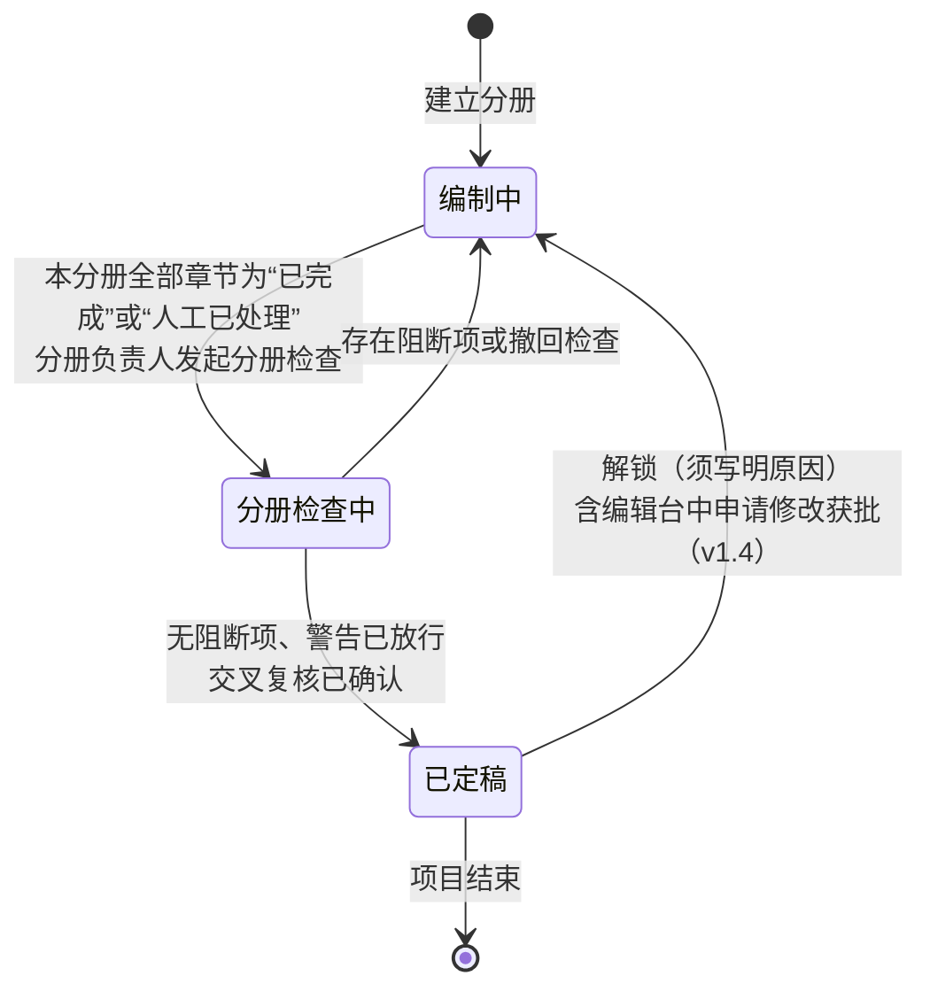

| 分册状态 | 含义 | 章节能否编辑 |
|---|---|---|
| 编制中 | 本分册的章节在跑生成闭环或人工修改 | 能（v1.4：在编辑台手改或用对话助手写入） |
| 分册检查中 | 已发起分册检查，正在处理检查问题 | 否（须先撤回检查或检查结论为有阻断项，分册回到编制中后修改）；v1.4：编辑台只读，对话助手只能自由提问；有章节持有编辑锁或有未提交草稿时不能发起分册检查（建议） |
| 已定稿 | 分册检查通过，章节版本已锁定 | 否（须先解锁）；v1.4：编辑台中可“申请解锁”，解锁后修改的章节标“定稿后已修改，待复核”，分册须重新检查、重新定稿（5.11.10 节） |

说明：分册状态不设“已合标”，项目状态也不设“合标中”。系统外编制的分册（例如报价文件）只登记，不参与分册检查、定稿和全文检查，在合标核对清单中列为“需人工核对”。

**分册检查**

- **运行时机**：本分册全部章节处于“已完成”或“人工已处理”后，由分册负责人或项目负责人发起。
- **范围**：与本分册有关的规则，在本分册范围内运行：R01、R02、R03（本分册引用的资料）、R10、R14、R15、R23（本分册的行）、R24（本分册的格式文件）、R25、R26、R27、R30、R31、R32、R34、R35、R37、R38、R39、R40（评审索引表所在分册）、R41、R43、R44（v1.3）；暗标分册另跑 R42；另一分册已定稿时加跑 R36（只出提示）。R28 不在分册检查中运行。
- **结果处理**：不做自动修正；阻断须修改，警告由项目负责人逐条放行（5.8.2 节）。为处理问题须修改章节时，分册回到“编制中”。v1.3：R43 的结果按章节汇总为一条警告（列出该章各项命中数和命中句），项目负责人按章节放行一次即可，不必逐句放行（建议）；章节循环中已驳回的 R43 命中不再计入。
- **验收标准**：①分册内任一章节不是“已完成”或“人工已处理”时，不能发起分册检查；②分册检查只报本分册范围内的问题；③另一分册未定稿时，分册检查不运行 R36。

**分册定稿与解锁**

1. **定稿条件**：分册检查无阻断项，警告已全部放行；公司开启“定稿前交叉复核”时（设置键 `cross_review_required`，默认开启，建议），还须由一名非本分册编写人的项目成员确认已通读本分册（编写规范 p.20 的“交互检查”，对应差距分析 N09）。交叉复核只做确认和留痕，不含批注和会签（3.2 节）。
2. **定稿动作**：由分册负责人或项目负责人操作；系统记录定稿人、时间和各章节当前版本的快照，本分册章节只读。
3. **解锁**：由分册负责人或项目负责人操作，须写明原因；解锁后分册回到“编制中”，项目回到“编制中”，已生成的导出文件和合标核对清单标“已过期”（保留下载），已完成的全文检查结果标“已过期”。解锁记录写入审计日志。
4. **内部截止时间**：分册有内部截止时间，到期未定稿时在工作台待办中提醒分册负责人和项目负责人（5.1.4 节）。

**全文检查（导出前检查）**

- **运行时机**：全部系统编制的分册都已定稿后，由项目负责人发起，或在递交版导出前自动运行。任何时候也可以手动运行，用来提前查看问题，但只有全部系统编制的分册都已定稿时的检查结果才能作为导出依据。
- **范围**：全部启用的规则（5.8.4 节），即分册检查的全部规则在全文范围重跑，外加 R03、R05～R09、R11、R13、R16、R18、R19、R20～R22、R29、R33、R36 等需要跨分册、跨公司数据或资料信息的规则。R10、R27 跨分册重跑，能发现例如技术分册和商务分册的服务期、质保期写法不一致；R44 的关键事实一致检查也跨分册重跑（v1.3）；R36 检查两个分册之间的人员、资质、偏离口径和证据版本一致。只有一个分册在系统内编制时，R36 跳过，并在合标核对清单中写明“须人工核对”。
- **与章节循环、分册检查的关系**：
  1. 全文检查不做自动修正；发现的问题按 5.8.2 节处理：阻断须修改，警告由项目负责人逐条放行。
  2. 为处理全文检查问题须修改某章节时，先解锁所在分册；修改后该章节变为“人工已处理”，分册须重新检查、重新定稿，全文检查结果标“已过期”，导出前自动重跑。
  3. 章节循环中已被驳回的模型评审意见不带入分册检查和全文检查。章节循环或分册检查中由项目负责人放行的规则警告，在后续检查中遇到同一规则、同一位置的警告时，自动带入该放行记录（显示原理由和放行人），不需要重复放行。
- **验收标准**：①任一系统编制的分册未定稿时，全文检查结果不能作为导出依据，递交版导出不可用；②全文检查能发现跨分册的事实不一致（R27），并定位到两处位置；③技术分册的人员名单与商务分册人员一览表不一致时，R36 报阻断；④章节循环或分册检查中已放行的警告带入全文检查时，放行记录可追溯到原问题编号；⑤分册解锁后，已导出文件和合标核对清单都显示“已过期”。

#### 5.8.6 数据对象（合规模块）

分册检查和全文检查的结果存本节各表；章节循环内的检查结果存 `chapter_loop_round`、`chapter_check_issue`（5.7.12 节），两者不混用。完整列定义见字典 v1.7 3.10 节。

| 表名 | 中文名 | 关键字段 |
|---|---|---|
| compliance_rule_config | 规则配置 | company_id（空＝平台默认）、rule_code、enabled、level、params（阈值等；v1.3 R43 的键：cliche_density_threshold 套话每千字密度阈值、opening_repeat_paragraphs 段首重复判定段数、sample_copy_min_chars 照抄样例判定字数；R44 的键：min_facts_per_section 每小节最低事实个数，见字典 5.2 节）、version |
| compliance_run | 检查批次 | project_id、trigger（手动/导出前/定时）、content_version_hash、status（排队/运行中/已完成/未完成/失败）、blocker_count、warning_count、started_at、finished_at；v1.2 新增：check_scope（检查范围：分册检查/全文检查）、volume_id（分册检查时的分册，→bid_volume）；v1.5 新增：conclusion（结论：有阻断/仅警告/通过）、is_expired（已过期）、expired_at |
| compliance_issue | 检查问题 | run_id、rule_code、level、target_type（章节段落/资料记录/矩阵行）、target_ref、message、evidence、status（未处理/已修正/已放行）、waived_by、waived_at、waive_reason；v1.1 新增：waived_from_loop_issue_id（从章节循环带入的放行记录，5.8.5 节） |
| similarity_check | 相似度检查 | run_id、project_id、compared_project_id 或 compared_archive_id、compared_company_id、match_basis（同项目/同招标人；v1.2 为 R29 增加：本公司历史标书/本公司在编项目/仅供参考资料）、doc_score_text、doc_score_semantic（二期启用，一期为空，v1.5）、flagged_count；v1.2 新增：rule_code（R18/R29）、dup_params_snapshot（R29 检查时的连续字数、年限、阈值快照）、dup_char_count（重复字数） |
| similarity_hit | 相似段落 | similarity_check_id、own_paragraph_key、other_paragraph_ref（R18 时仅集团管理员可解引用；R29 时本公司用户可查看）、score_text（段落相似度）、score_semantic（二期启用）、feature_flags（二期启用）、status（待处理/已改写/已放行/已排除）、handled_by、handle_note；v1.2 新增：whitelist_hit（命中白名单）、has_citation（有出处）、matched_text（R29 的重复片段） |

#### 5.8.7 R43 AI 腔调检查与 R44 事实密度检查（v1.3）

结论：R43 管“写法像不像模板”，R44 管“内容是不是具体、有来源”。两条都只出警告，不阻断定稿和导出；R43 命中的句子交给定位修正只改该句，系统不删除；R44 对不上来源的事实标【待补】，禁止为凑数编造。阈值和允许次数第一期都是示例值，用写作观察指标（5.7.13 节）积累数据后再校准。

**1. R43 与 R34 的区别**

| 对比项 | R34 AI 痕迹与格式符号残留 | R43 AI 腔调检查 |
|---|---|---|
| 管什么 | 确定的错误：对话残留句、Markdown 符号 | 风格问题：套话、空泛词、模式化句式 |
| 会不会误伤 | 基本不会 | 会（标书本身要求正式、规整，部分句式属于正常写法），需要人判断 |
| 谁来处理 | 系统直接删除或转换，不调用模型 | 定位修正只改命中的句子；改不了或人不同意时转人工或驳回；系统不删除 |
| 级别 | 对话残留阻断；格式符号警告 | 只出警告，公司不能设为阻断 |
| 能否关闭 | 不能 | 公司可关闭 |

**2. R43 检查什么**

1. **套话和空泛词密度**：用本公司启用的套话表（含平台预置条目，5.6.5 节）逐词匹配，套话命中密度＝命中次数 ÷ 正文字数 × 1000。本项目招标文件（含澄清、补遗）原文中出现过的词自动放行，不计入命中。密度超过阈值（`cliche_density_threshold`，示例：每千字 3 次）时，每个命中句记一个问题（问题类型“套话或空泛词过多”）；未超阈值时不报问题，只计入观察指标。
2. **禁用句式**：按本公司启用的句式规则（5.6.5 节）检查，超出允许次数的部分逐句报：
   - 否定对比“不是……而是……”、递进“不仅……更……”、序列“首先……其次……最后”：按关联词识别（问题类型“模式化句式”）；
   - 三项排比：一句中三个结构相同的并列短语（示例：“专业、高效、稳定”）；
   - 段末总结句：按写作档案的总结句策略判断，默认只允许本章首段和末段出现，其余段落段末的总结句都报（问题类型“总结句过多”）；
   - 段首重复：连续若干段（示例：3 段，`opening_repeat_paragraphs`）以同一词语或句式开头（问题类型“段首句式重复”）；
   - 自定义关联词组合：公司追加的前后呼应关联词。
3. **照抄风格样例**：生成正文与本次注入的风格样例连续相同的字数超过阈值（`sample_copy_min_chars`，默认沿用 R29 的 8 个字，建议）时报（问题类型“照抄风格样例”）；R29 术语白名单中的内容不计。
4. **不检查的内容**：段落来源为“招标原文引用”的段落；人工锁定的段落（建议，锁定表示人已确认）；五类系统生成章节。

**3. R43 的处理**

- **章节循环中**：问题走自动修正，修正范围为“只改命中句”：只改命中的句子，同段其他句子逐字不变，系统不删除任何命中句（5.7.4 节第 5 条第 7 项）。命中段落来自方案片段套话组时，问题说明中提示可以换用同组的替代版本。修正后新出现的 R43 问题不触发整章回退（建议）；同一问题改两次仍在，按通用规则升级转人工。
- **驳回**：本节编写人或项目负责人可以驳回，驳回后同一位置的同一命中在后续循环和分册检查中不再报（建议）。
- **分册检查和全文检查中**：按章节汇总为一条警告，项目负责人按章节放行一次即可（建议）。
- **不是“降 AI 率”**：R43 的目的是减少套话和模式化写法，让标书更具体；不以任何 AI 检测工具的结果为目标，也不引入 AI 检测（3.2 节）。

**4. R44 检查什么**

1. **可核验的具体事实**分五类：
   - 数字：时限、次数、人数、比例、容量、日期、金额等；R29 术语白名单中的标准号、命令、版本号写法不计；
   - 型号：数据库、中间件、硬件的产品名称和版本，按厂商产品字典（含别名）识别；
   - 人员：人员姓名、角色、证书；
   - 案例：业绩合同的项目名称和客户；
   - 客户系统名：招标人的业务系统名称（示例：“核心账务系统”），由本地模型任务“事实锚点识别”找出候选（6.4 节），再由规则核对来源。
2. **来源核对**：每条具体事实须能对应以下三个来源之一：项目事实表（含允许的等价写法）、本段挂接的证据、招标原文。对不上时：
   - 数值承诺类的对不上，已由 R10、R27、R30 负责，R44 不重复报；
   - 模型撰写的段落，系统把该事实替换为【待补：缺少什么】（与 5.7.3 节规则 3 一致），之后由 R15 按缺证据的【待补】直接转人工；
   - 人工编写的段落，保留原文，只报问题（问题类型“事实无来源”），直接转人工，转人工原因为“缺证据”（建议：人写的内容可能有系统外依据，不宜由系统改写）。
   - 对话助手撰写的段落（v1.4）：按模型撰写的段落处理。样例预检时即把对不上来源的事实换成【待补：缺少什么】，用户在差异确认界面看到的就是替换后的文字；知识库打开时，本次引用的检索结果也算作“本段挂接的证据”。写入后人又手改的部分按人工编写处理。理由见 5.11.7 节（建议）。
3. **事实密度**：按得分要点小节统计已核验的具体事实个数，少于每小节最低个数（`min_facts_per_section`，默认 1 个，建议）时报警告（问题类型“事实密度不足”）。该问题走自动修正：用本节证据和项目事实补写；没有可用材料时写【待补：缺少什么】。**禁止为了凑够个数编造事实**，补写结果同样经过来源核对。
4. **关键事实前后一致**：分工如下，避免重复报——SLA 数值（响应时限等）归 R10；已登记为项目事实的（服务期、项目经理、承诺类事实等）归 R27；跨分册的人员名单和角色归 R36；上述以外、未登记为项目事实的关键事实（示例：数据库类型和版本、驻场人数的不同写法）在本节或全文中前后矛盾时，由 R44 报警告（问题类型“关键事实前后矛盾”），直接转人工，转人工原因为“关键事实前后矛盾”，并建议登记为项目事实。

**5. 为什么是这两条、不是更多**

- 像人写调研的结论是：标书“像人写”的核心是写满本项目可核验的具体事实，其次才是句式；标书本身要求正式、规整，“结构工整”不是问题，不应为了“像人”而口语化（像人写调研 3.2 节）。所以 R44 比 R43 更重要，R44 不允许关闭。
- 套话表和句式规则在不同模型上表现不同，第一期不追求全面，先用平台初始词表加公司调整，再用观察数据校准（3.3 节后续版本清单第 2、6 项）。

**6. 问题类型与字典代码对照**（字典 4.12 节）

| 规则 | 问题类型 | 字典代码 | 处理路径 |
|---|---|---|---|
| R43 | 套话或空泛词过多 | ai_tone_phrase | 自动修正（只改命中句） |
| R43 | 模式化句式 | ai_tone_pattern | 同上 |
| R43 | 总结句过多 | summary_overuse | 同上 |
| R43 | 段首句式重复 | opening_repetition | 同上 |
| R43 | 照抄风格样例 | style_sample_copied | 同上 |
| R44 | 事实密度不足 | low_fact_density | 自动修正（用给定材料补写，没有则写【待补】） |
| R44 | 事实无来源（人工编写段落） | unverified_fact | 直接转人工，转人工原因 missing_evidence（缺证据） |
| R44 | 关键事实前后矛盾 | fact_conflict | 直接转人工，转人工原因 fact_conflict（关键事实前后矛盾） |
| R28 | 空泛表态、无具体措施 | vague_commitment | 自动修正 |

**7. 验收标准**

①在一段模型生成的正文中放入超过阈值密度的套话：R43 逐句报出，定位修正后只有命中句被改写，同段其他句子逐字不变，没有任何句子被系统删除；②招标文件原文中出现过的“全方位”在本项目标书中不计入套话密度；③一章中有 3 个“不是……而是……”，允许 1 次时报出后 2 处；④默认总结句策略下，中间段落以“综上所述”开头的段末句被报出，本章首段和末段的总结句不报；⑤模型撰写的段落中出现项目事实表、证据和招标原文中都没有的产品型号时被替换为【待补】，人工编写段落中的同类情况只报问题不改原文；⑥某得分要点小节没有任何已核验事实时报“事实密度不足”，自动修正的结果中没有来源不明的新事实；⑦同一章中数据库版本前后写法矛盾且该事实未登记时，R44 报“关键事实前后矛盾”并直接转人工；已登记为项目事实的同类矛盾只由 R27 报；⑧公司关闭 R43 后，写作观察指标中的套话命中密度照常记录；公司规则配置中 R44 没有关闭选项；⑨（v1.4）知识库关闭时生成的对话助手样例中，对不上项目事实表、招标原文或选区原有来源的产品型号在展示前已被替换为【待补】，写入后由 R15 按缺证据的【待补】直接转人工。

---

### 5.9 Word 导出

结论：v1.2 起按分册分别导出，不做合并导出。系统编制的每个分册各导出一个 Word 文件；导出分“内部稿”和“递交版”两种，命名规则分开，递交版不带编写人姓名；递交版随附一份“合标核对清单”，由合标负责人（商务）在 Word 中人工合标时逐项核对。系统不做合标页面，也不在系统内更新合标后的页码（neil 确认第 2 点）。

#### 5.9.1 页面：导出

- **目的**：把检查通过的各分册按公司模板和招标格式要求分别导出为 Word，供商务在系统外合标。
- **主要元素**：
  1. 导出前检查结论：递交版要求全文检查为“通过”或“仅警告且已放行”，且全部系统编制的分册都已定稿；
  2. 分册列表：每个分册的名称、编制方式（系统编制 / 系统外编制）、状态、负责人、将生成的文件名；系统外编制的分册显示“系统外编制，不导出”；
  3. 导出类型：内部稿 / 递交版（v1.2）；
  4. 导出设置（v1.2）：内部稿命名模板、递交版命名规则（取项目设置 5.1.4 节第 9 项，可在此修改，修改时同样校验）；
  5. 模板选择（本公司 Word 模板）；选项（是否插入附件扫描件、水印文字、是否生成目录、页码样式）；
  6. 导出历史：批次号、类型、时间、导出人、分册、文件、是否已过期；合标核对清单和响应追溯表的下载入口。
- **操作**：导出内部稿（选一个或多个分册）；导出递交版（一次生成每个系统编制分册的 Word 各一个，外加合标核对清单）；下载；导出响应追溯表（Excel）；查看导出日志。
- **状态流转**：排队 → 生成中 → 完成 / 失败；完成的文件在内容修改或分册解锁后标“已过期”。导出记录的 `export_status` 取同样五个值（排队 / 生成中 / 完成 / 失败 / 已过期），与 5.9.3 节一致（v1.5）。
- **业务规则**：
  1. **模板**：使用公司写作档案中的 Word 模板（样式、封面、页眉页脚）；招标文件规定了格式文件的，按规定格式填充。平台默认模板预置一至八级标题样式（5.6.1 节）。
  2. **按分册分别导出（v1.2）**：每个系统编制的分册单独成一个 Word 文件，各有封面、目录和页码；页码每册从 1 起（招标另有要求时按招标要求）。系统不提供“合并成一个文件”的导出方式；招标要求把某些分册装订在一起的，由合标负责人在系统外处理，合标核对清单中列出该要求。
  3. **目录与页码**：自动生成多级目录（按大纲），打开文档时提示更新域；页眉可带项目名称和投标人名称（暗标分册除外，见第 9 条）。
  4. **评审索引表（v1.2）**：评审索引表作为系统生成章节放在技术分册内（5.7.2 节第 9 条）；页码列留空，或按公司设置填“合标后由商务填写”；系统不生成交叉引用和书签，不做页码校验（R40 只检查覆盖、顺序和指向的章节）。
  5. **格式**：字体、字号、行距、页边距按招标格式要求（抽取项第 8 类）覆盖模板默认值；招标无要求时用模板。
  6. **Markdown 转换（v1.2）**：导出时把正文中残留的 Markdown 格式（标题、加粗、列表、表格）转换为 Word 样式；导出前 R34 已检查，正常情况下不应残留。
  7. **附件**：证书、授权书、业绩证明等按引用插入对应位置；敏感附件加水印（取项目水印或主体默认水印，例如“仅用于××项目投标”）；多页附件只插入附件归属中指定的页码范围。
  8. **变量与敏感字段**（v1.5 改写，neil 2026-10-08 确认，Q12）：导出时替换全部变量。身份证件号码、手机号、银行账号等高敏个人信息：内部稿一律按 `sensitive_mask_rules` 掩码（示例保留前 3 位和后 4 位），不提供关闭掩码的开关；递交版只在项目设置中确认过“需填完整值”的字段类别（5.1.4 节第 9 项）且招标要求的位置解密填入完整值，其余位置仍为掩码；本批次实际填入完整值的字段类别记入导出记录（`bid_export.full_value_fields`）。导出动作写审计日志，递交版另记填入完整值的字段类别和数量（7.3 节）。
  9. **暗标分册（v1.2）**：R42 检查通过后才能导出；不加带公司名称的页眉和水印，文档属性清空，不插入带公司名称或 logo 的附件，封面使用招标规定的暗标封面。
  10. **文档属性清理**：作者、单位、最后修改者等属性统一设为投标主体名称或留空（按公司设置；暗标分册一律留空）；清除修订痕迹、批注、隐藏文字和模板残留的自定义属性（R25）。v1.3：本条不删除、不改动模型服务商添加的 AI 生成标识（例如隐式标识，即写在文件元数据中的标识）；系统能识别的此类元数据原样保留，清理范围只限于上述作者、单位等属性（3.2 节；《人工智能生成合成内容标识办法》对内部自用标书是否适用待法务确认，Q20）。v1.5：编辑台中的 AI 内容标识（段落来源标记）必须显示；导出 Word（内部稿和递交版）默认不带这类标识，是否需要带取决于 Q20 的法务结论（设计规范第 12 章第 15 项）。
  11. **内部稿与递交版（v1.2）**：

| 项目 | 内部稿 | 递交版 |
|---|---|---|
| 用途 | 内部传阅、审阅、线下修改参考 | 交给合标负责人合标后递交 |
| 谁能导出 | 项目负责人；分册负责人（本分册） | 只有项目负责人（v1.5；公司管理员兼任本项目负责人时可以），每次导出写审计日志 |
| 高敏个人信息（v1.5） | 一律掩码 | 只在已确认“需填完整值”的字段类别和招标要求的位置填完整值，其余掩码 |
| 前提 | 任何时候都可导出，不要求检查通过 | 全部系统编制的分册已定稿，全文检查通过或仅警告且已放行 |
| 范围 | 选一个或多个分册 | 一次生成每个系统编制分册的 Word 各一个，外加合标核对清单 |
| 命名 | 内部稿命名模板，默认“{编写人}_{版本}_{日期}_{项目名称}”（依据编写规范 p.27 的文件名命名规则） | 按招标文件要求；招标无要求时默认“{项目名称}_{分册名称}”（建议）；**不允许使用 {编写人} 变量**，保存时校验 |
| 水印 | 加“内部稿”水印（建议），防止误递交 | 只加敏感附件水印（第 7 条） |
| 项目状态 | 不改变 | 导出后项目进入“已导出” |

内部稿命名变量说明：{编写人} 默认取分册负责人的姓名；{版本} 为本分册内部稿的导出序号，写作“V1.0”“V2.0”；{日期} 为导出日期（UTC+8，格式 YYYYMMDD）；{项目名称} 取项目设置；{分册名称} 取分册设置。示例（取自编写规范 p.27 的样例）：“张三_V1.0_20250520_甘肃农信服务升级采购项目2025-2027.docx”。递交版不带编写人姓名，与 8.2 节第四十条的防护一致：投标文件中出现编写人信息，可能被用来判断不同投标人的文件是否由同一人编制。
  12. **响应追溯表（v1.2，内部用）**：Excel，列为招标条款、所属文件（招标文件或技术规范书）和页码、响应方式、所在分册、对应章节和段落、证据与片段来源、负责人、确认人；只供内部审核，不进入投标文件，任何时候都可导出。
  13. 导出文件版本号与内容版本绑定；内容再修改或分册解锁后旧文件标“已过期”（保留下载）。
  14. **编辑草稿不进入导出（v1.4）**：导出（含内部稿）只取各章节已提交的当前版本；编辑台中未提交的草稿不进入任何导出。导出内部稿时，有章节存在他人未提交草稿的，提示“以下章节有未提交的修改”。
- **异常与边界**：附件图片过大时自动压缩（保持可辨认）；导出失败时保留日志并允许重试；递交版中某个分册生成失败时，本批次整体标“失败”，不产生部分成功的递交版批次（建议）。
- **验收标准**：①导出的 Word 用 Microsoft Word 和 WPS 打开，目录可更新、页码正确（每册从 1 起）；②文档属性中不含系统账号或模板作者信息；③未通过全文检查时无法导出递交版，内部稿不受限制但带“内部稿”水印；④敏感附件带水印；⑤递交版文件名中不含任何编写人姓名，递交版命名规则含 {编写人} 时无法保存；⑥导出递交版时每个系统编制分册各生成一个文件，并同时生成合标核对清单；⑦评审索引表的页码列为空或为“合标后由商务填写”；⑧暗标分册的页眉、水印、文档属性中不出现投标人名称；⑨（v1.5）内部稿中的身份证件号码、手机号全部为掩码；递交版只在已确认的字段类别中出现完整值；⑩（v1.5）非项目负责人看不到“导出递交版”按钮，接口直接调用也被拒绝。

#### 5.9.2 合标核对清单（v1.2）

结论：合标由合标负责人（默认商务分册负责人）在系统外完成。系统在导出递交版时同时生成一份合标核对清单（Excel，建议；也可在导出页查看），列出合标时需要人工核对的项目和系统已得出的检查结论。清单随导出批次保存，分册解锁后标“已过期”。

| 序号 | 核对项 | 清单内容（系统生成） | 合标时由人做什么 |
|---|---|---|---|
| 1 | 分册与文件 | 本批次导出的文件名、分册名称、页数；系统外编制的分册（例如报价文件）列为“需人工插入或另行递交” | 核对文件齐全，插入系统外编制的内容 |
| 2 | 页码与目录 | 各分册页码从 1 起；招标对页码方式的要求（连续编号或分册编号）；各分册页数为估算值，并列出招标的页数限制（R24，v1.5） | 按招标要求调整页码，更新目录；以合标后的 Word 核对准确页数是否满足页数限制 |
| 3 | 评审索引表 | 索引表所在分册和章节；索引表逐项列出的评分项和对应章节号；页码列为空 | 合标后填写索引表页码 |
| 4 | 两本之间的一致性结论 | R36（人员、资质、偏离口径、证据版本）、R10（SLA 数值）、R27（服务期、质保期等事实）的全文检查结论及已放行的警告；只有一个分册在系统内编制时，写明“R36 未运行，须人工核对” | 复核合标后没有引入不一致（例如替换了人员表） |
| 5 | 偏离表与点对点应答 | 偏离表所在分册、偏离条数（或“无偏离”）；点对点应答所在分册 | 核对合标后偏离表与正文仍一致 |
| 6 | 密封、份数、装订 | 招标要求的正本和副本份数、分开密封要求、装订要求（来自抽取类别 8，带原文页码） | 按要求打印、装订、密封 |
| 7 | 签章 | 招标要求签字或盖章的位置清单；附件的盖章状态（R41 结论） | 完成签章 |
| 8 | 暗标 | 暗标分册名称和 R42 结论 | 确认合标时没有把带公司名称的内容放入暗标分册 |
| 9 | 文件命名 | 递交版文件名；招标对电子文件命名的要求 | 核对合标后的文件名符合招标要求，且不含编写人姓名 |

- **业务规则**：
  1. 清单只列事实和系统检查结论，不替代人工核对；合标结果不回传系统（系统不接收合标后的文件，建议）。
  2. 合标负责人和项目负责人可以下载；清单中的检查结论引用本批次的全文检查批次。
- **验收标准**：①导出递交版时必定生成合标核对清单；②清单中“两本之间的一致性结论”与本批次全文检查结果一致；③只有一个分册在系统内编制时，清单写明 R36 未运行、须人工核对；④分册解锁后，清单标“已过期”。

#### 5.9.3 数据对象（导出模块，v1.2）

所有表带字典 3.0 节的 A 组审计字段和 C 组 `company_id`（所属公司）。

| 表名 | 中文名 | 关键字段 | 与字典的对齐 |
|---|---|---|---|
| bid_export | 导出记录 | project_id、export_batch_no（导出批次号，同一次递交版导出的各分册文件同号）、export_kind（内部稿/递交版/响应追溯表）、volume_id（→bid_volume，响应追溯表为空）、file_attachment_id（→attachment）、file_name、naming_rule_snapshot（命名规则快照）、content_version_hash（导出时的内容版本）、compliance_run_id（递交版依据的全文检查批次）、merge_checklist_attachment_id（合标核对清单文件，递交版批次）、exported_by、exported_at、export_status（排队/生成中/完成/失败/已过期，v1.5 补“排队”）；v1.5 新增：full_value_fields（递交版本批次实际填入完整值的敏感字段类别）、error_message | 字典 4.13 节 export_kind；v1.6 完整列定义见字典 3.10 节，export_status 见 4.16 节 |

### 5.10 管理后台

#### 5.10.1 页面：公司管理（平台管理员）

- **目的**：开通、停用公司，维护公司与集团的归属。
- **主要元素**：公司列表（公司名称、统一社会信用代码、所属集团、状态、用户数、开通时间）；详情。
- **操作**：新建公司（同时创建该公司的资料库空间、RAGFlow 知识库和默认设置）、停用（停用后该公司用户不能登录，数据保留）、指定首位公司管理员。
- **业务规则**：公司对应一个法人主体；新建时自动在该公司资料库中生成本公司主体记录（`org_entity`，主体范围＝本公司），由公司管理员补全并确认。
- **验收标准**：新建公司后，其资料库、知识库为空，且与其他公司完全隔离。

#### 5.10.2 页面：用户与角色（公司管理员）

- **目的**：管理本公司账号和角色。
- **主要元素**：用户列表（姓名、账号、角色、状态、最后登录）；角色分配；v1.6：“账号安全设置”区域（本公司密码策略）。
- **操作**：新增、停用、重置密码、分配角色、转交负责资料（离职交接）；v1.6：修改本公司密码策略。
- **业务规则**：用户只属于一家公司；停用用户前须把其负责的资料和项目转交他人（系统列出清单）；角色为 2.2 节固定角色，MVP 不支持自定义角色。
- **账号安全设置（v1.6，neil 2026-10-08 结论）**：公司管理员设置本公司的密码策略，两项都是公司设置（6.9 节“v1.6 新增配置项”）：
  1. 密码最少位数 `password_min_length`：默认 8 位，可以调高到 12 位及以上（上限 32 位为示例），不能低于平台默认值。
  2. 至少包含的字符类数 `password_min_char_classes`：字符分大写字母、小写字母、数字、符号四类，默认至少包含其中任意三类，可以设为四类全含，不能低于平台默认值。
  3. 保存后，本公司账号在下次修改密码时按新规则校验（含首次登录和被重置后的修改），不强制已有账号立即修改；保存时提示这一点。
  4. 修改写审计日志（7.3 节第 9 条）。密码策略的完整规则（多公司账号、平台级账号）见 5.12.1 节业务规则 3。
- **验收标准**：被停用用户负责的资料在转交前停用操作被阻止；（v1.6）账号安全设置中不能把最少位数设为低于 8 位、字符类数设为低于 3 类（以平台默认值为准）；调高最少位数后，已有账号仍能用原密码登录，下次修改密码时按新规则校验。

#### 5.10.3 页面：字典配置

- **目的**：维护代码表和可配置项。
- **主要元素**：平台级字典（厂商产品、证书类别、行业、服务分类、附件槽位、中小企业划型标准）只有平台管理员可改；公司级可扩展字典（标签分组、方案类型子类、SLA 版本类型等）公司管理员可在平台值基础上增加本公司项。
- **操作**：新增、停用（已使用的代码不能删除只能停用）、修改显示名称。
- **业务规则**：规范值修改需二次确认；示例值带“示例”标记（字典 1.3 节）。
- **验收标准**：公司新增的字典项只在本公司可见。

#### 5.10.4 页面：资料库设置（公司管理员）

| 设置项 | 默认 | 说明 |
|---|---|---|
| 资料审核开关 | 关闭 | 开启后新增待审、已审、已退回状态；一级审核；审核人不能是最后修改人。**开启时**：存量已确认资料默认保持可引用，公司管理员可选择“全部送审”（建议）；**关闭时**：待审和已退回的资料回到“已确认”（已退回的回到“需重新确认”）（建议） |
| 审核人 | 空 | 开关开启时必须至少指定一人 |
| 提醒天数 | 90、30、7 | 到期前提醒；证书类别可单独设置 |
| 提醒对象 | 资料负责人 | 可追加资料管理员 |
| 人员占用规则 | 项目经理默认提示冲突；开标后自动释放；中标转履约占用 | 可调整需提示冲突的角色、释放时点 |
| 证明材料默认有效天数 | 按材料类型预置 | 材料类型属性，项目可覆盖 |
| 定稿回收改写阈值 | 30% | 二期使用；段落人工修改超过该比例视为“改写较多” |
| 相似度阈值与比对窗口 | 示例值 | 见 5.8.3 节 |
| 本公司查重：连续相同字数（v1.2） | 8 个字符 | 依据公司内部编写规范；R29（5.8.3 节）。字典键 `dup_min_chars` |
| 本公司查重：历史标书年限（v1.2） | 24 个月 | 只比对递交日期在此期间内的本公司历史标书。字典键 `dup_history_months` |
| 本公司查重：比对范围（v1.2） | 历史标书、同期在编标书、“仅供参考”资料三类全开 | 三类可分别开关。字典键 `dup_scope` |
| 本公司查重：段落阈值与全文阈值（v1.2） | 示例值，试运行校准 | 超过阈值才报警告或提示（Q17）。字典键 `dup_paragraph_threshold`、`dup_document_threshold` |
| 本公司查重：术语白名单（v1.2） | 平台基础名单 | 公司可追加产品名、命令、参数等，示例“MySQL”“ALTER SYSTEM”“TLS1.2”。字典键 `dup_whitelist_terms` |
| 定稿前交叉复核（v1.2） | 开启（建议） | 开启时分册定稿须由一名非本分册编写人的项目成员确认（5.8.5 节）。字典键 `cross_review_required` |
| 默认敏感项目 | 否 | 开启后本公司新项目默认敏感 |

- **验收标准**：切换审核开关后，资料状态按上表规则变化，且变化记录进入审计日志；修改查重参数后，新发起的 R29 检查使用新值。

#### 5.10.5 页面：模型开放与生成设置（公司管理员）

- **目的**：从平台已登记的模型和解析服务中，选择本公司开放哪些；设置本公司的生成闭环参数。
- **主要元素**：平台已登记服务列表（名称、类型：大模型/解析、部署：云端/本地、状态）；本公司开放勾选；本公司任务默认模型（只能从开放列表中选，且不能违反平台任务与模型对应表的强制约束）；“生成闭环”区域（最大轮数、模型评审开关、同模型评审策略、大纲确认后自动开始生成、章节生成顺序、摘要字数、审查清单取用条数与推荐阈值；v1.3：风格样例注入预算、R43 的启用与阈值、R44 的每小节最低事实个数；字段和默认值见 6.9 节）；v1.4：“编辑台与对话助手”区域（是否启用对话助手、样例条数、知识库开关默认值与是否允许关闭、上下文和检索预算、粘贴识别比例、自动保存间隔、编辑锁超时；字段和默认值见 6.9 节“编辑台与对话助手配置”），以及对话助手问答、修改样例两类任务的默认模型。
- **业务规则**：公司关闭某模型后，本公司正在运行的任务继续用完，新任务不再使用；敏感项目强制本地的约束不可被公司设置覆盖。
- **验收标准**：①普通用户在生成设置中只能看到本公司开放的模型；②生成闭环参数不能超出平台上限，修改记入审计日志。

#### 5.10.6 页面：审计日志

- **目的**：查询关键操作和所有云端调用。
- **主要元素**：筛选（时间、用户、操作类型、对象、是否云端调用、公司）；列表（时间、用户、公司、操作、对象、结果、IP）。
- **业务规则**：审计日志只追加不可修改；平台管理员看平台级日志和各公司的云端调用记录（不含业务内容正文），公司管理员看本公司日志，集团管理员可看各公司日志。记录范围见 7.3 节。
- **验收标准**：任一云端模型或云端解析调用在日志中可查到调用方、项目、模型、token 数或页数、结果。

#### 5.10.7 数据对象（权限与系统模块）

完整列定义见字典 v1.7 3.10 节；平台级表（不带 `company_id`）的理由见字典 1.7 节。v1.5 新增的 `job`（后台任务）、`platform_setting`（平台设置）见 5.12.8 节。

| 表名 | 中文名 | 关键字段 | 与字典的对齐 |
|---|---|---|---|
| sys_user | 用户 | account、name、user_level（平台/集团/公司）、company_id（公司级必填）、group_id、status（启用/停用/锁定）、last_login_at；v1.5 新增：password_hash、must_change_password、failed_login_count、locked_until、password_changed_at | 字典中所有“引用→用户”（created_by、owner_id、confirmed_by、reviewed_by 等）指向本表 |
| sys_role | 角色 | role_code、role_name、level | 固定角色 |
| sys_user_role | 用户角色 | user_id、role_id、company_id | |
| sys_permission | 权限点 | perm_code、module（字典 4.16 节 `perm_module`；v1.6 增加后台任务、授权管理（预留））、description；角色与权限点对应关系 `sys_role_permission` | 2.3 节矩阵；归属见 2.3 节规则 10 |
| resource_acl | 受限资料授权 | company_id、ref_type、ref_id、user_id | 字典 `is_restricted` 资料的可见名单 |
| audit_log | 审计日志 | company_id、user_id、action、target_type、target_id、is_cloud_call、detail（不含敏感原文）、ip、occurred_at | 与字典 `change_log`（字段级变更）互补：audit_log 记操作，change_log 记字段变化 |
| notification | 站内提醒 | company_id、user_id、type、ref_type、ref_id、content、read_at；v1.5 新增：title、project_id | 到期提醒、缺资料提醒、相似度提醒；v1.2 增加分册内部截止提醒、交叉复核提醒、导出文件过期提醒；v1.4 增加编辑锁被接管提醒、草稿已过期提醒、分册解锁申请提醒；v1.5 提醒类型的完整清单见 5.12.2 节 |
| sys_group | 集团 | group_name、status；公司与集团的归属在字典 `company.group_id` | |

### 5.11 编辑台与对话助手（v1.4）

**结论：AI 仍先按章节跑完生成闭环（5.7 节），形成完整标书；之后用户在「编辑台」中修改正文。** 修改有两种方式：自己手改；或选中一段文字，让「对话助手」给出 3～5 条（默认 3 条）写法不同的修改样例，用户选一条“替换选中内容”或“插在选中内容后”，看过与原文的差异并确认后才写入。每次采纳的修改都生成新的章节版本，并记录修改方式、知识库开关状态、引用来源、操作人和时间，段落来源始终可以追溯。写入后只对改动的段落做增量复查（只跑规则检查），不重跑整章闭环。系统生成的五类表格、招标原文引用段和锁定段落在编辑台中不能修改。对话助手写入的文字按“模型所写”处理，对不上来源的具体事实换成【待补】（neil 已于 2026-09-29 确认，Q26，理由见 5.11.7 节）。v1.5：知识库打开时，对本公司结构化资料的提问由系统直查并返回答案卡（5.11.15 节）。

本节用到的几个说法：

- **编辑台**：查看和修改章节正文的页面，由 5.7.3 节 v1.3 章节页的编辑区升级而来，另加对话面板；v1.6 起项目页签和页面统一称“编辑台”。
- **对话助手（chatbot）**：编辑台右侧的对话面板。用户可以直接提问，也可以选中正文后让它给出修改样例；它只给建议，不自己写入正文。
- **知识库开关**：对话面板上的开关。打开时，对话助手先检索本公司知识库和资料库，再依据检索结果回答；关闭时，对话助手不检索，只凭模型自身能力回答。
- **修改样例**：对话助手针对选中内容给出的候选改写文字，每条写法不同。
- **增量复查**：修改写入后，系统只对改动的段落重跑适用的规则检查，不调用模型评审，不做自动修正。
- **编辑草稿**：手改过程中自动保存、尚未提交为章节版本的内容。

#### 5.11.1 已定设计与边界

以下五点已向 neil 说明并按此设计（2026-09-29）。本节其余内容中标“建议”的，是在此基础上的补充设计，需评审。v1.5：其中 Q22（敏感项目强制本地模型）、Q23（章节级独占编辑锁）、Q24（会话可见范围）、Q26（对话助手写入按模型所写处理）已由 neil 于 2026-09-29 确认，相应内容不再标“建议”。

1. 每次采纳的修改生成新的章节版本，记录修改方式（手改 / 对话助手替换 / 对话助手增加）、知识库开关状态、引用来源、操作人和时间，段落来源追溯不断。
2. 知识库关闭时生成的样例标“无知识库来源”；采纳后其中的具体事实仍走 R44，对不上来源的标【待补】。知识库打开时只检索本公司知识库（RAGFlow 中已启用、已确认、已发布的片段）和本公司资料库（按规则匹配），样例必须附引用；严格按公司隔离。
3. 系统按数据生成的五类表格（点对点应答、评审索引表、偏离表、年度服务计划表、证明材料清单）在编辑台锁定，选中时对话助手提示去数据源修改后重新生成；招标原文引用段、锁定段落同样不可改。
4. 样例 3～5 条（数量可配置，默认 3 条），每条可“替换选中内容”或“插在选中内容后”，写入前显示与原文的差异并由用户确认；采纳后只对改动段落做增量复查（规则检查，含 R43、R44、R30、R34 等适用规则），不重跑整章闭环。样例应用本公司写作档案（风格样例、套话表、禁用句式），并给出不同写法。额外数值承诺、金额、人员身份等仍按“直接交给人工”的规则处理。
5. 已定稿章节被修改后自动回到“待复核”类状态；导出前全文检查照常。

边界：

- 对话助手每次只做一件单步任务：回答一个问题，或针对一个选区给出一组样例。它不自己决定下一步、不调用其他工具、不跨章节批量改写，也不自动写入正文。这与 5.7 节“不采用 Agent 全程自主形态”的原则一致。
- 对话助手不联网搜索，也不检索本公司知识库和资料库以外的资料（3.2 节）。
- 编辑台不改变生成闭环本身：章节仍先经过写作方案确认和生成闭环；只有章节停止后（已完成、待人工处理、人工已处理）才能在编辑台修改。

#### 5.11.2 页面：编辑台

- **目的**：在一个页面里完成看稿、改稿、查问题、查来源和借助对话助手改写，每一次改动都有版本、有来源。
- **主要元素**（页面布局为建议）：

| 区域 | 位置 | 内容 | 说明 |
|---|---|---|---|
| 章节目录 | 左栏 | 大纲树：章节号、标题、分册、负责人、章节状态、【待补】数、待人工问题数、编辑锁持有人、“定稿后已修改”标记；系统生成章节显示锁形图标 | 可按分册筛选；点击切换章节，切换前自动保存草稿 |
| 正文编辑区 | 中栏 | 富文本正文。段落左侧显示来源标记（证据、方案片段、招标原文引用、模型撰写、对话助手撰写、人工编写、系统生成）；变量带底色；证据标记可点开；锁定内容灰底、不可编辑；R43 命中句用浅色波浪线标出；每个得分要点小节显示 R44 已核验事实个数。顶部工具栏：编辑锁状态与持有人、自动保存状态、提交修改、版本历史、版本对比、回退、重新检查、逐段追溯 | 选中文字后出现浮动按钮“问对话助手” |
| 问题/来源侧栏 | 右栏，两个页签 | “问题”页签：本章问题清单，含编辑后增量复查新发现的问题（标“编辑后复查”），可按状态、处理路径、规则筛选，点击定位到段落。“来源”页签：光标所在段落的来源记录（历次来源类型、修改方式、知识库开关、引用、操作人和时间）、回应的招标条款原文和页码、挂接的证据、用到的项目事实 | 与 5.7.3 节右侧面板内容一致，另加来源历史 |
| 对话面板 | 最右栏，可收起 | 知识库开关；当前使用的模型（敏感项目显示“本地模型”，发生降级时显示“已使用备用模型”）；本项目中本人的会话列表；消息流；样例卡片（写法标签、样例正文、与原文的差异、引用来源或“无知识库来源”、预检提示、“替换选中内容”和“插在选中内容后”两个按钮） | 屏幕宽度 ≥1680 像素时四栏并列；1280～1679 像素时三栏，对话面板与问题/来源侧栏合并为右栏的页签（v1.5，设计规范第 12 章第 6 项） |

- **操作**：开始编辑（取得编辑锁）；手改正文；提交修改；丢弃草稿；查看版本历史、对比任意两个版本、回退到某个版本；选中文字问对话助手；不选中文字直接提问；切换知识库开关；采纳样例（替换或插入）；放弃样例；从问题侧栏“用对话助手改”；重新检查（开始新一次章节循环，5.7.4 节第 8 条）；逐段追溯；项目负责人或本分册负责人强制接管编辑锁；分册已定稿时“申请解锁”（站内提醒分册负责人和项目负责人）。
- **状态流转**：章节状态的映射见 5.11.10 节和 5.7.5 节；修改样例的状态见 5.11.10 节。
- **业务规则**：见 5.11.4～5.11.9 节。要点：只有持有本章编辑锁的人能改正文和写入样例；手改先自动保存为编辑草稿，提交后才成为章节版本；锁定内容不可改；每次写入后做增量复查。v1.5：段落左侧的来源标记即 AI 内容标识，在编辑台中必须显示，用户不能关闭；导出 Word 默认不带（5.9.1 节第 10 条，Q20）。
- **异常与边界**：见 5.11.8 节。
- **验收标准**：见 5.11.14 节。

#### 5.11.3 交互流程

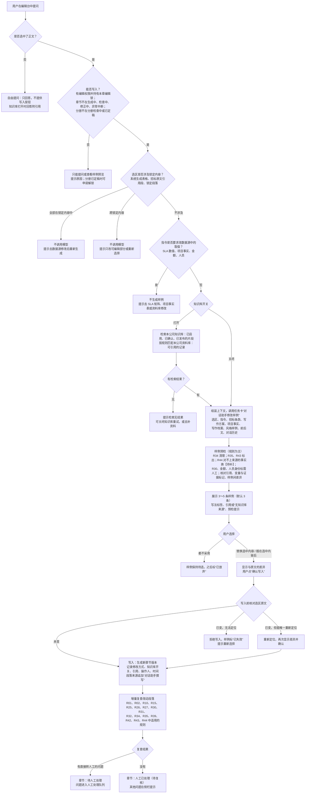

说明：

1. 图中“能否写入”的判断在调用模型之前完成；不能写入时，用户仍可以提问或查看样例预览，但“替换”“插入”按钮不可用。
2. 手改不经过对话助手：手改先自动保存为编辑草稿，用户点“提交修改”后生成章节版本（修改方式“手改”），同样做增量复查（5.11.6 节第 6 项）。
3. 已定稿分册中的章节须先解锁分册才能修改，状态变化见 5.11.10 节。

#### 5.11.4 对话助手：两种用法、知识库开关与上下文

**1. 两种用法**

| 用法 | 触发方式 | 对话助手做什么 | 能否改正文 |
|---|---|---|---|
| 自由提问 | 不选中文字，直接在对话框输入问题 | 只回答问题，例如解释某条招标要求、说明某个运维术语、查本公司有哪些相关方案片段（示例） | 不能。回答下方不出现写入按钮，只提供“复制” |
| 选区修改 | 在正文中选中文字后提问或下指令，例如“写得更具体一些”“改成表格化的写法”“补一段应急演练安排”（示例） | 给出 3～5 条修改样例 | 能，但须用户选择样例并确认差异后才写入（5.11.6 节） |

原 5.7.3 节的“局部改写”（改写、扩写、缩写、按指令修改、换一种说法）改为对话面板中的快捷指令：点击后相当于用预设指令发起一次选区修改，同样给出样例、确认差异后写入，修改方式记为“对话助手替换”（建议，这样凡是由模型产生的改写都走同一套预检、确认和留痕）。R18、R29 命中段落的“一键改写”“换一种说法”也走这条路径。

**2. 知识库开关**

- **默认值**：取公司设置 `assistant_kb_default`，默认打开（建议：打开时每条样例都附引用，更容易核对）。公司可以设置不允许关闭（`assistant_allow_kb_off`），此时面板上不显示“关闭”。
- **每条消息单独记录开关状态**（`assistant_message.kb_enabled`）；切换开关只影响之后的消息。
- **打开时检索什么**（依据已定设计第 2 点）：
  1. 本公司知识库：只检索本公司在 RAGFlow 中的数据集（`company.kb_dataset_ref`），元数据过滤条件为已启用、已确认（公司开启审核时还须已审）、已发布版本、来源分级不是“仅供参考”的方案片段。历史标书整体和导入时切出的“条款—应答”参考不进入对话助手的检索（建议：已定设计只列了已发布片段；历史标书按 5.5.3 节规则 1 也不能直接作为依据）。
  2. 本公司资料库：按规则匹配，不做语义检索。候选只取满足 5.4.1 节“可引用”条件的记录，匹配来源有两类：本节写作方案中计划使用的证据和选区段落已挂的证据；用户指令或选区中出现的证书、产品、人员角色、业绩类别等关键词，按 5.3.1 节规则 2 的方式匹配（例如“ISO/IEC 20000”匹配证书类别并检查有效期覆盖投标截止时间，示例）（建议）。合作伙伴资料须项目已登记该合作方并上传协议（R02）；敏感字段一律脱敏后才交给模型。
  3. **严格按公司隔离**：检索和匹配的公司条件由服务端按登录账号强制附加，前端传入的公司参数不作为依据；集团管理员不能使用对话助手（2.3 节规则 2）。
  4. **结构化直查（v1.5）**：问题指向本公司人员、证书、资质、业绩、SLA 时，系统不调用模型，直接查资料库返回答案卡，见 5.11.15 节。
- **关闭时**：不检索知识库，也不匹配资料库，也不做结构化直查（v1.5，5.11.15 节）；回答和样例标“无知识库来源”。但仍把本项目的上下文（选区、前后文、本节写作方案、项目事实、对应招标条款）交给模型，因为这些是本项目自己的内容，不属于知识库；不给这些内容，样例容易与本项目事实矛盾（建议；是否这样理解“基于模型自身能力回答”待确认，Q21）。

**3. 选区修改时交给模型的材料（上下文）**

| 材料 | 内容 | 长度控制 | 说明 |
|---|---|---|---|
| 选区原文 | 用户选中的文字，保留其中的变量和证据标记 | 必带；超出预算时提示用户缩小选区 | — |
| 用户指令 | 本次输入的要求或快捷指令 | 必带 | — |
| 对应招标条款 | 选区所在段落回应的矩阵行原文和评分标准（按段落与矩阵行的对应关系取，5.7.3 节规则 5） | 必带 | 让改写后的文字仍回应同一条款 |
| 本节写作方案 | 回应的矩阵行和得分要点、写作要点、目标字数 | 必带（只取要点） | — |
| 项目事实 | 本节写作方案列出的事实和全部必备事实（5.7.8 节） | 必带 | 防止与项目事实表矛盾 |
| 检索结果 | 知识库打开时检索到的片段和资料库记录，带编号 | 不超过 `assistant_retrieval_token_budget`，最多 `assistant_retrieval_top_k` 条 | 知识库关闭时没有这一项 |
| 写作档案 | 自称、对招标人的称呼、叫法、任务卡中的 5～10 条提示词禁用表达、句式偏好、本公司惯用表达、同类风格样例 | 风格样例不超过 `style_sample_token_budget` | 与章节生成相同（5.6.5 节） |
| 选区前后文 | 选区前后的段落，从近到远 | 不超过 `assistant_context_token_budget` | — |
| 对话历史 | 本会话最近几轮 | 不超过 `assistant_history_token_budget`，从近到远 | 只取同一会话，不跨会话、不跨项目 |

- **预算计算**：输入预算＝所选模型的 `max_input_tokens` − 系统提示词 − 上表各项 − 安全余量（示例 10%），与 6.2.2 节相同；输出预算＝`max_tokens`。各项预算都是公司设置中的示例值，并受所用模型的输入上限约束，不写死 token 数。
- **放不下时的取舍顺序**（建议）：从表的末尾往前略去——先减对话历史，再减前后文、风格样例、写作档案要点、检索结果；选区原文、用户指令、对应招标条款、写作方案要点、项目事实不略去。被略去的内容记在 `assistant_message.context_snapshot` 中，面板提示“上下文已截取”。
- **输出放不下时**：预计全部样例所需的输出超过输出预算时，系统把样例分几次调用生成，每次调用仍是单步任务（建议）。
- **自由提问时的材料**：用户问题、本会话对话历史、当前章节的写作方案要点和本章对应的招标条款；知识库打开时另加检索结果。不附整章正文（建议：控制预算；需要讨论某一段时，请选中后提问）。

**4. 模型选择**

- 任务与模型对应表新增两类任务：“对话助手问答”和“对话助手修改样例”（6.4 节）。默认服务与“章节长文写作”相同；用户可以在本公司开放、且满足敏感约束的模型中切换，面板显示实际使用的模型；降级按 6.5 节执行。
- **敏感项目强制使用本地模型**（neil 已于 2026-09-29 确认，Q22），知识库打开或关闭都一样。理由：①对话内容包含选区原文、前后文、项目事实和招标条款，本身就是项目内容，与 5.1.2 节“敏感项目的解析、抽取、生成、检查全部只能用本地服务”属于同一类数据；②知识库关闭只是不检索，并不减少外发的项目内容；③“降级永远不会把敏感内容从本地切到云端”是第 0 章已定的原则。代价是敏感项目的对话助手受本地算力限制，可能排队（K28）；本地模型不可用时请求排队并提示，不改走云端。
- 每次调用都记录任务卡版本、模型及配置版本、实际使用的参数、知识库开关和 token 数（`generation_task`）。

**5. 对话助手任务卡（放在写作档案中）**

对话助手的两类调用各用一张任务卡，放在公司写作档案中，规则与其他任务卡相同（5.7.9 节）：带版本号，发布后不可修改；平台提供默认卡，公司复制后修改；对话助手没有循环，每次请求开始时取当时启用的版本并记录。

| 任务卡 | 输入材料 | 输出结构 | 参考参数 | 适用的写作要求 |
|---|---|---|---|---|
| 对话助手修改样例 | 选区原文、用户指令、选区前后文、对应招标条款、写作方案、项目事实、检索结果（知识库打开时）、写作档案要点、风格样例、对话历史 | 结构化输出（系统校验）：样例列表，每条含写法方向、样例正文、引用的检索结果编号、回应的矩阵行 | 同生成类：温度 0.7、TopP 0.8、TopK 20（参考值，待试运行确定）；样例之间的差异靠系统指定不同的写法方向，不靠调高温度 | 5.6.4 节第 3、5、6、10～16 条 |
| 对话助手问答 | 用户问题、对话历史、写作方案要点、对应招标条款、检索结果（知识库打开时） | 回答正文；知识库打开时另附引用的检索结果编号 | 低温（示例：温度 0.3，平台参考值） | 5.6.4 节第 6、15、16 条 |

#### 5.11.5 修改样例：生成、预检与差异化

1. **条数**：每次选区修改给出的样例条数取公司设置 `assistant_suggestion_count`，默认 3 条，可在 3～5 条之间调整。用户对某条样例继续追问（例如“第 2 条再短一些”，示例）时，系统以该条样例为基础重新发起一次请求，生成新的一组样例。
2. **应用写作档案**：样例与章节生成使用同样的写作档案内容——本公司同类风格样例（按选区所在章节的评分维度取，5.6.5 节）、提示词禁用表达、句式偏好、本公司惯用表达、叫法、自称和对招标人的称呼；套话表和禁用句式在预检中检查（第 4 项）。
3. **差异化写法**（建议）：
   - 生成前，系统为每条样例指定一个不同的“写法方向”，从本公司句式偏好（`writing_sentence_pattern` 中的偏好句式）和本章同类风格样例的风格特征中选取（示例：结论先行、流程递进、表格化、问题—方案—效果、案例说明），写入任务卡输入；样例卡片上显示这一写法标签。
   - 生成后，系统两两比较样例：两条样例中连续相同字数达到 R29 设置（默认 8 个字）的片段，累计占较短一条的比例超过阈值（示例 50%）时，视为“写法相近”，只保留一条。保留下来的少于设定条数时，系统补请求一次；仍不够时照常展示已有的样例，并注明“写法相近的样例已合并”。
4. **预检**（展示前由系统完成，以规则为主；只有 R44 的客户系统名候选调用本地模型的“事实锚点识别”任务）：

| 检查 | 处理 | 样例卡片上显示 |
|---|---|---|
| R34 对话残留、格式符号 | 系统直接删除对话残留句、转换格式符号 | 不显示 |
| R35 称呼、禁用词 | 不改文字 | 标出命中的词 |
| R43 套话、禁用句式、照抄风格样例 | 不改文字，也不删除命中句 | 标出命中句和推荐改法 |
| R44 具体事实的来源 | 样例按模型所写处理（5.11.7 节）：数字、型号、人员、案例、客户系统名对不上项目事实表、本次引用的来源、招标原文或选区原文中已有来源的事实时，换成【待补：缺少什么】 | 显示换成【待补】的个数和位置 |
| R30 招标未要求的额外数值承诺 | 不改文字 | 标“含招标未要求的数值承诺，采纳后须项目负责人确认保留或删除” |
| 金额、人员身份（R27 中金额类、人员类事实不一致等） | 不改文字 | 标“涉及金额或人员身份，采纳后转人工” |
| R25 已知的其他公司名称、其他招标人、旧项目名称；R31 证件号、口令 | 该样例不展示（过滤） | 面板提示过滤条数和原因 |
| 变量与证据标记 | 替换方式下，选区中的变量和证据标记必须全部保留（位置可调整，与 5.7.3 节规则 7 一致）；改动了变量取值，或把变量改成手写数字的样例不展示 | 同上 |
| 引用（知识库打开时） | 每条样例至少引用 1 条本次检索结果，引用编号必须在本次检索结果之内；不满足的样例不展示 | 显示引用来源的名称和版本，可点开原文 |

5. **样例卡片**：写法标签；样例正文（预检后的文字）；与选区原文的差异；引用来源（知识库打开时）或“无知识库来源”（知识库关闭时）；预检提示；字数；“替换选中内容”和“插在选中内容后”两个按钮。
6. **直接交给人工的规则不变**：额外数值承诺（R30）、金额与承诺数值（R10，以及 R27 中金额类和 SLA 类事实）、人员身份（R27 中人员类事实）、星号和废标条款、商务偏离、披露类条款、真实报告与敏感信息，仍按 5.7.4 节第 4 条“直接转人工”处理。对话助手不替人决定这些内容：样例中出现这些情形时在卡片上标出，采纳后由增量复查生成“直接转人工”的问题；额外数值承诺仍只能由项目负责人确认保留或删除（5.7.7 节业务规则 5）。在人工处理队列中，这些类型的问题不提供“用对话助手改”的入口。
7. **用户要求修改数据源中的取值时**：用户指令要求修改 SLA 数值、项目事实、金额、人员等由数据源决定的内容时（例如“把一级故障响应时限改成 15 分钟”，示例），对话助手不生成样例，回复“该数值以 SLA 矩阵（或项目事实表、资料库）为准，请到数据源修改”，并给出跳转入口（拒绝原因记为 `data_source_value`）。

#### 5.11.6 写入、版本与增量复查

1. **两种写入方式**：
   - **替换选中内容**：用样例替换选区；选区所在段落与矩阵行的对应关系保持不变。
   - **插在选中内容后**：选区在段落中间时，样例接在选区之后、仍在同一段落内；样例有多段，或选区结束于段末时，样例作为新段落插在选区所在段落之后，新段落继承选区所在段落回应的矩阵行（建议）。
2. **差异确认**：点按钮后弹出差异视图：删除的文字标红、增加的文字标绿，【待补】、变量和证据标记另行高亮；同时列出修改方式、知识库开关、引用来源（或“无知识库来源”）、将新增的【待补】个数，以及需要人工确认的事项。选区所在段落回应星号条款、废标条款、商务偏离或披露类条款时，须再勾选“已逐字核对”才能确认（建议）。用户点“确认写入”才写入；关闭视图即不写入。
3. **写入前的冲突校验**：样例生成时记录了选区所在的章节版本和选区内容指纹（`selection_hash`，由选中文字计算出的短字符串，用来判断原文是否被改过）。写入前，系统先把本人未提交的编辑草稿提交为一个“手改”版本（保证一个版本只对应一种修改方式），再在最新内容中核对选区：内容未变，直接写入；内容变了，但原文在本章中仍能唯一找到，重新定位后再次显示差异，由用户确认；找不到或找到多处，拒绝写入，提示“原文已被改动，请重新选择”（5.11.8 节）。
4. **写入的结果**：
   - 生成一个新的章节版本：`version_origin`＝对话助手修改（`assistant_edit`），`edit_mode`＝对话助手替换或对话助手增加；
   - 写一条编辑操作记录（`chapter_edit_operation`）：修改方式、基础版本和结果版本、改动段落、用户确认的差异、所用样例和会话、知识库开关、引用来源或“无知识库来源”、操作人和时间；
   - 段落来源（`paragraph_sources`）追加一条“对话助手撰写”，记录知识库开关、引用来源、操作人、时间和选区的字符区间；原有来源保留，所以逐段追溯视图能看到这一段的全部历史来源；
   - 知识库打开时，样例引用的资料库记录和方案片段写入证据引用（`citation`，其 `origin_edit_operation_id` 指向本次操作），在段落上显示证据标记；
   - 样例状态变为“已采纳”；同一组其他样例的状态见 5.11.10 节。
5. **增量复查**：写入后系统立即对改动的段落重跑适用的规则；不调用模型评审（R28），不做自动修正，也不增加章节循环的轮次记录。

| 规则 | 在增量复查中查什么 |
|---|---|
| R01、R02 | 本次写入引用的资料是否可引用、来源分级是否合规 |
| R10、R27 | 改动段落中的 SLA 数值、项目事实是否与 SLA 矩阵、项目事实表一致 |
| R15 | 改动段落中的【待补】和变量 |
| R25（正文） | 其他公司名称、其他招标人、旧项目名称、未知机构名 |
| R26 | 改动段落原来回应的矩阵行，在全章中是否仍有段落回应（防止替换或删改后漏掉得分要点） |
| R30 | 没有对应条款的段落；招标未要求的额外数值承诺 |
| R31、R32 | 敏感信息与真实报告特征；清单外品牌 |
| R34、R35 | 对话残留与格式符号；称呼与禁用词 |
| R39、R42 | 披露段落；暗标分册正文（启用时） |
| R43 | 改动段落中的套话、禁用句式、照抄风格样例；每章允许次数、段首重复按全章计算，只报落在改动段落上的问题 |
| R44 | 改动段落中具体事实的来源；所在得分要点小节的事实个数；关键事实与全章其他段落是否矛盾 |

   复查结果写入章节检查问题记录（`chapter_check_issue`，`check_context`＝编辑后增量复查，`found_by_edit_operation_id` 指向本次操作），处理路径按 5.7.4 节第 4 条判定；改动段落上原有的问题在复查中不再出现的，状态改为“已解决”。章节状态随之变化（5.11.10 节）。复查通常在数秒内完成；R44 需要本地模型识别客户系统名候选，这部分结果稍后补上，侧栏显示“复查中”。
6. **手改提交也做增量复查（建议）**：手改提交为版本时，系统同样对改动段落做上述增量复查，保证两种修改方式的检查口径一致；手改自动保存为草稿时，仍只即时检查 R34、R35（沿用 5.7.3 节规则 13）。
7. **不重跑整章闭环**：增量复查不会重新生成、不会自动修正，也不会让章节进入“检查中”。需要系统自动修正时，用户点“重新检查”，按 5.7.4 节第 8 条开始新一次循环。
8. **导出**：导出前全文检查照常运行（5.8.5 节）；编辑草稿中未提交的内容不进入任何导出（5.9.1 节第 14 条）。

#### 5.11.7 段落归属：对话助手写入的段落算谁写的（neil 已于 2026-09-29 确认，Q26）

**结论：对话助手写入的文字按“模型所写”处理。** 段落来源类型新增“对话助手撰写”，在 R44 等按来源区分处理的规则中与“模型撰写”同等对待；用户在写入之后又手改的部分，按“人工编写”处理。章节状态仍按“谁发起修改”判断：对话助手写入是人发起、人确认的修改，所以章节照常变为“人工已处理”（5.11.10 节）。v1.5：插入答案卡的文字直接取自资料库记录，段落来源类型为“证据”，不按模型所写处理（5.11.15 节）。

理由：

1. 文字是模型产生的。用户确认的是“选哪一条、放在哪里”，并没有逐条核实其中的型号、人名、案例和数字。如果按人写处理，R44 对不上来源的事实只报问题、不改原文（5.8.7 节），模型编造的内容就可能留在正文中，这与 v1.3“模型写的段落替换【待补】，人写的段落只报问题”的初衷相反。
2. 已定设计第 2 点要求知识库关闭时的样例采纳后“具体事实仍走 R44，对不上来源的标【待补】”，这一要求只有按“模型所写”处理才能成立；知识库打开时同样适用，口径统一。
3. 替换在预检阶段就已完成，差异确认界面显示的就是最终写入的文字（含【待补】）。用户确认之后系统不会再改动它，不会出现“确认后又被系统改掉”的情况。
4. 单设“对话助手撰写”而不直接并入“模型撰写”，便于区分生成闭环写的段落和编辑阶段写的段落，统计样例采纳率和知识库开关使用比例，并在逐段追溯中看到知识库开关和引用来源。

由此带来的几条规则：

- **自动修正**：之后用户点“重新检查”开始新一次循环时，对话助手撰写的段落和模型撰写的段落一样可以被定位修正（锁定段落除外）。
- **R43**：对对话助手撰写的段落照常检查。
- **粘贴识别**（建议）：用户把对话助手的回答复制后手工粘贴进正文时，如果粘贴内容与本会话近期的对话助手输出的重合比例达到公司设置 `assistant_paste_match_ratio`（示例 80%），该段来源记为“对话助手撰写”并标“粘贴”，避免借粘贴绕开 R44 的处理；达不到的按“人工编写”处理。
- **人工修改率**：总数的计算公式不变（5.7.13 节），“人第一次修改”包括手改和对话助手写入，二者都计入；另按修改方式列出“手改”“对话助手”两个分项。理由：人工修改率反映生成闭环的初稿离定稿有多远，用户用对话助手改写，说明初稿没有被原样接受，应当计入；但对话助手写的仍是模型文字，所以单列分项，避免把“用模型改模型”误读为“人改得多”。
- **用户采纳率**（1.3 节）：被对话助手整段替换的生成段落，计为“未保留”（建议）。

#### 5.11.8 锁定内容与异常处理

**1. 编辑台中不可修改的内容**

| 内容 | 编辑台中的表现 | 选中后问对话助手 | 要改怎么办 |
|---|---|---|---|
| 五类系统生成章节：点对点应答、评审索引表、偏离表、年度服务计划表、证明材料清单 | 整章只读，显示锁形图标 | 不生成样例，提示“本表由系统按数据生成，请到数据源修改后重新生成”，并给出跳转入口 | 点对点应答、偏离表、评审索引表回到响应矩阵（响应方式、响应要点、偏离说明、章节对应）修改；年度服务计划表回到项目事实表和 SLA 矩阵；证明材料清单回到响应矩阵的证明材料要求和资料库附件；改完后点“重新生成”（5.7.2 节第 9 条） |
| 招标原文引用段（段落来源为“招标原文引用”） | 灰底只读 | 不生成样例，提示“招标原文引用段不可修改” | 只能整段删除或移动（建议）；需要改写时另起一段自己写 |
| 锁定段落 | 灰底只读，显示锁定人 | 不生成样例，提示“段落已锁定” | 由锁定人或项目负责人先解除锁定 |
| 变量和证据标记 | 作为一个整体显示，可以整个删除或移动，不能在正文中改变量的取值 | 替换时必须保留（5.11.5 节第 4 项） | 变量取值到 SLA 矩阵、项目事实表修改；证据到响应矩阵或资料库更换 |

**2. 异常处理**

| 异常 | 系统处理 | 用户看到什么 |
|---|---|---|
| 选区全部落在锁定内容中 | 不调用模型 | 按上表提示，并给出数据源跳转入口 |
| 选区跨锁定内容（一部分可编辑、一部分锁定） | 不调用模型；可编辑部分连续时，提供“只改可编辑部分”，由用户确认缩小后的选区（建议） | “选区包含不可修改的内容，是否只修改可编辑部分？” |
| 原文已被改动，导致替换冲突 | 按 5.11.6 节第 3 项：能唯一重新定位的，再次显示差异；否则拒绝写入，样例标“已失效” | “原文已被改动，请重新选择后再问” |
| 知识库打开，但检索无结果 | 不调用模型生成样例（没有可引用的来源，样例必然不满足“必须附引用”），记录“检索无结果” | “本公司知识库和资料库中没有找到相关内容。可以关闭知识库后重试（样例将标“无知识库来源”），或去资料库、方案片段库补充资料”；公司不允许关闭知识库时只显示后一项 |
| 样例全部被预检过滤 | 补请求一次；仍全部被过滤时不展示 | 过滤原因（例如“样例改动了变量取值”）和建议 |
| 选区超出上下文预算 | 不调用模型 | “选中的内容过长，请分段选择” |
| 没有编辑权限、没有持有编辑锁、章节处于生成中/检查中/修正中/异常中断、分册处于分册检查中或已定稿 | 可以自由提问和查看样例预览，“替换”“插入”按钮不可用 | 说明原因；分册已定稿时提供“申请解锁” |
| 公司关闭了对话助手 | 不显示对话面板 | — |
| 模型调用失败 | 按 6.5 节降级重试一次，仍失败则本次请求失败 | “对话助手暂时不可用，请稍后重试”；敏感项目只在本地模型之间降级，本地不可用时排队等待 |
| 自动保存失败（例如网络中断） | 在浏览器本地暂存，恢复连接后重试保存 | 工具栏显示“未保存”，离开页面时提醒 |
| 编辑锁超时或被接管 | 自动把草稿提交为“手改”版本后释放锁；草稿因含 R34 对话残留句而不能提交时，草稿保留并标“已过期”，通知本人 | 编辑区变为只读，提示原因 |
| 有人持有编辑锁或有未提交草稿时发起分册检查 | 不允许发起（建议），列出正在编辑的章节 | “以下章节正在编辑，请先提交或释放” |

#### 5.11.9 并发编辑、权限、自动保存与版本回退（章节级独占锁 neil 已于 2026-09-29 确认，Q23）

**1. 并发编辑：沿用章节级独占编辑锁，不做实时协同**

- 同一章节同一时间只有一人可以编辑（沿用 5.7.3 节规则 8）；其他人只读，看到“某某正在编辑”和最近一次提交的版本。
- 用户点击正文开始编辑时取得锁；编辑期间，只要用户在页面上有操作（输入、选中、滚动等），页面每隔公司设置 `edit_lock_heartbeat_seconds`（示例 60 秒，v1.5）发送一次心跳，刷新锁的最近心跳时间；无操作时不发心跳。距最近一次心跳超过公司设置 `edit_lock_timeout_minutes`（示例 30 分钟）自动释放，释放前 5 分钟提示。三项设置的关系和保存校验见 6.9 节。
- 锁释放（主动离开、超时、被接管）时，未提交的草稿自动提交为一个“手改”版本（操作说明“自动提交”），避免下一位编辑者在旧版本上修改。
- 项目负责人和本分册负责人可以强制接管他人的编辑锁，须填写原因；原持有人的草稿先自动提交，系统站内通知原持有人，并写审计日志。
- 同一人在两个浏览器窗口打开同一章节时，只有取得锁的窗口可以编辑，另一个窗口只读。
- 对话助手写入以持有编辑锁为前提；写入前另按选区内容指纹做冲突校验（5.11.6 节第 3 项），作为锁之外的第二道保护。
- 人点“重新检查”或“整章重新生成”时，系统先提交草稿、释放人的编辑锁，再由系统持锁（5.7.3 节规则 8）。

选择章节级独占锁、不做多人同时编辑同一章节，理由：①章节版本、段落来源、增量复查和生成闭环都以章节为单位，独占锁下每个版本只有一个操作人、一种修改方式，追溯简单；②投标编写按章节分配负责人（5.7.2 节），同一章节多人同时改的需求不强；③实时协同需要处理多人同时编辑的合并冲突，再叠加“每次采纳生成新版本并记录修改方式”的要求，复杂度高，工期风险大（K27）。neil 已于 2026-09-29 确认第一期按此执行（Q23）；是否在二期引入实时协同，视试运行情况评估。

**2. 权限**

| 操作 | 谁可以 |
|---|---|
| 在编辑台修改正文、提交版本、回退版本 | 公司管理员；项目负责人（全部章节）；分册负责人（本分册全部章节，建议）；投标编写人（被分配的章节） |
| 对话助手自由提问 | 以上人员，以及本项目的其他投标编写人 |
| 对话助手生成样例并写入 | 有该章节编辑权限且持有编辑锁的人 |
| 切换知识库开关 | 能使用对话助手的人；公司不允许关闭时，任何人都不能关闭 |
| 强制接管编辑锁 | 公司管理员；项目负责人；本分册负责人（本分册） |
| 解锁已定稿分册 | 公司管理员；项目负责人；本分册负责人（沿用 5.8.5 节，须写原因） |
| 查看对话会话 | 见 5.11.11 节 |

只读成员和集团管理员不能使用对话助手（集团管理员不能触发生成和检索，2.3 节规则 2；只读成员的职责是查看，建议）。完整权限见 2.3 节。

**3. 自动保存与提交**

- 手改内容在停止输入后，以及每隔公司设置 `editor_autosave_seconds`（示例 10 秒）自动保存到编辑草稿（`chapter_edit_draft`）。草稿不是章节版本，只有本人可见；其他人看到的是最近一次提交的版本。
- 用户点“提交修改”，或发生锁释放、对话助手写入前的自动提交时，草稿成为一个新的章节版本（修改方式“手改”），并触发增量复查。提交时仍即时检查 R34、R35：含对话残留句的不能提交（沿用 5.7.3 节规则 13）。
- 用户可以“丢弃草稿”，回到最近一次提交的版本。
- 每人每个章节最多一份未提交的草稿。草稿的基础版本已被其他版本取代时（例如锁被接管后他人提交了新版本），草稿标“已过期”，用户可以打开对比后手工合并，系统不自动合并。

**4. 版本历史与回退**

- 版本历史列出本章全部版本：版本号、产生方式（首次生成、定位修正、手改、对话助手替换、对话助手增加、整章重新生成、回退等）、操作人或“系统”、时间、改动段落数；可以任选两个版本对比。
- 回退：选中一个历史版本点“回退”，系统生成一个内容等于该版本的新版本（`edit_mode`＝版本回退，与 5.7.10 节“回退也是生成新版本”一致），段落来源恢复为该版本的来源并追加“回退”记录；对改动段落做增量复查；章节变为“人工已处理”（与 5.7.6 节一致）。回退写审计日志。
- 版本只追加、不覆盖；被回退的版本保留。

#### 5.11.10 状态

**1. 章节状态的映射**

结论：不新增章节状态。编辑台中的修改映射到现有的章节状态和分册状态：章节层面的“待复核”就是“人工已处理”，含义是“人在最近一次检查之后修改过正文，等待重新检查或分册检查复核”；已定稿分册中的章节要先解锁分册才能修改（建议，理由见表后说明）。

| 修改时所处状态 | 能否在编辑台修改 | 修改提交或写入后 |
|---|---|---|
| 未开始、大纲待确认、待生成 | 否（还没有正文，或已有正文作为历史版本保留） | — |
| 生成中、检查中、修正中 | 否（系统持锁）；可以自由提问 | — |
| 异常中断 | 否；可以自由提问 | — |
| 已完成 | 能 | 变为“人工已处理”；增量复查发现需要直接转人工的问题时，变为“待人工处理” |
| 待人工处理 | 能 | 保持“待人工处理”；新发现的直接转人工问题进入人工处理队列；全部待人工问题处理或驳回后，按原规则变为“人工已处理” |
| 人工已处理 | 能 | 保持“人工已处理”；增量复查发现需要直接转人工的问题时，变为“待人工处理” |
| 所在分册处于“分册检查中” | 否；须先撤回分册检查（分册回到“编制中”） | 撤回后按以上各行处理 |
| 所在分册处于“已定稿” | 否；须由分册负责人或项目负责人解锁分册，并写明原因（5.8.5 节） | 解锁后分册和项目回到“编制中”，已导出文件、合标核对清单和全文检查结果标“已过期”；章节修改后按以上各行变化，并标“定稿后已修改”（`edited_after_finalize`）；分册须重新检查、重新定稿，导出前全文检查照常 |

说明：

- 增量复查只发现可自动修正类问题（例如 R43）时，章节状态不因此改变；问题在侧栏显示为“待修正”，用户可以自己改、用对话助手改，或点“重新检查”交给闭环处理；分册检查也会重跑这些规则。
- 不新增“待复核”状态的理由：“人工已处理”已经表示“人在最近一次检查之后改过正文”，分册检查的前提（全部章节为“已完成”或“人工已处理”）和全文检查的前提都不需要改；新增状态会牵动分册检查条件、人工处理队列和统计口径。界面上对“人工已处理”且“定稿后已修改”的章节显示“定稿后已修改，待复核”。
- 章节状态图的改动见 5.7.5 节，分册状态图的改动见 5.8.5 节。

**2. 修改样例的状态**

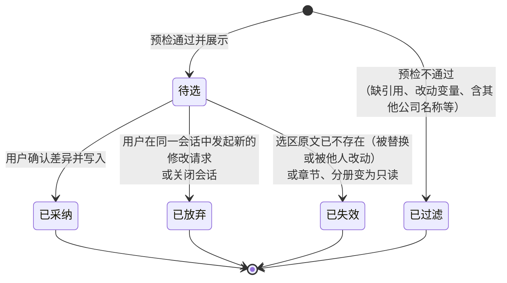

说明：采纳一条样例后，同一组其他样例仍为“待选”。如果选区原文还在（例如上一条是“插在选中内容后”），可以继续采纳另一条（替换或插入），这就是已定设计中的“可替换或增加”；如果选区原文已被替换，写入时的冲突校验会使它们变为“已失效”。

#### 5.11.11 对话会话留痕与隔离（可见范围 neil 已于 2026-09-29 确认，Q24）

1. **归属**：每个会话属于一家公司、一个项目、一个用户（`assistant_session`）；每条消息记录所在章节、知识库开关、选区快照、交给模型的材料清单、检索结果快照和调用记录（`assistant_message`）；每条样例单独记录预检结果和处理结果（`assistant_suggestion`）。三张表都带所属公司（`company_id`）和所属项目（`project_id`）。
2. **隔离**：会话列表只显示本项目中本人的会话；对话历史只在同一会话内交给模型，不跨会话、不跨项目、不跨公司；知识库检索只针对本公司（5.11.4 节）。
3. **可见范围**：会话正文对本人、本项目负责人和本公司管理员可见；项目负责人和公司管理员查看他人会话时写审计日志；集团管理员只看对话助手统计，不看会话正文（理由：会话中有大量未采纳的草稿和提问，不属于标书内容，这样可以缩小跨公司的查看范围；neil 已于 2026-09-29 确认，Q24）；平台管理员看不到会话正文（2.3 节规则 3）。
4. **只追加、不删除**：用户可以“归档”会话（从列表中隐藏），但不能删除消息和样例；保留期限与项目数据相同（待定，Q13）。
5. **不做长期记忆**：会话内容不会被自动提炼后写入提示词、写作档案或审查清单（与 3.2 节“不做自动长期记忆”一致）。
6. **审计**：对话助手的每次调用、样例采纳、冲突处理、锁接管、查看他人会话都写审计日志，内容见 7.3 节第 13 条；审计日志不记对话全文，全文只存在会话相关的表中。

#### 5.11.12 观察指标（只观察、不拦截）

与 5.7.13 节的写作观察指标一样，下列指标第一期只采集和展示，不设阈值，不影响任何状态流转，不与个人绩效挂钩；在“写作观察统计”页新增“对话助手”分组展示（建议）。

| 指标 | 口径 | 说明 |
|---|---|---|
| 样例采纳率 | 被采纳的样例条数 ÷ 展示给用户的样例条数（不含被预检过滤的） | 按知识库开关、模型、章节类别、写法标签分别统计 |
| 请求采纳率 | 至少采纳一条样例的修改请求数 ÷ 修改请求数 | 反映对话助手是否帮上了忙 |
| 知识库开关使用比例 | 知识库打开时发出的请求数 ÷ 对话助手请求总数；另按采纳口径统计：被采纳的样例中，知识库打开时生成的占比 | 分自由提问和选区修改两类统计 |
| 无知识库来源写入占比 | 知识库关闭时由对话助手写入的段落数 ÷ 对话助手写入的段落数 | 用于判断是否需要默认打开或禁止关闭知识库 |
| 【待补】引入数 | 对话助手写入时带入的【待补】个数（预检中替换的） | 按知识库开关分别统计 |
| 增量复查问题数 | 每次写入后增量复查发现的问题数，按规则和处理路径分别统计 | 用于评估预检是否足够 |
| 替换冲突次数 | 写入时冲突校验的结果，分“已重新定位”“冲突已拒绝”统计 | 用于评估并发方式（Q23） |
| 检索无结果比例 | 知识库打开时“检索无结果”的请求数 ÷ 知识库打开时的请求数 | 用于发现知识库的缺口 |
| 人工修改率分项 | 见 5.7.13 节 | “手改”“对话助手”两个分项 |

#### 5.11.13 数据对象（编辑台与对话助手模块）

以下 5 张表的完整定义见字典 v1.7 的 3.9 节；全部带字典 3.0 节的 A 组审计字段和 C 组 `company_id`（所属公司，必填），并冗余 `project_id`，便于按项目隔离。PRD 已有表的补充字段见 5.7.12 节。

| 表名 | 中文名 | 关键字段 | 与字典的对齐 |
|---|---|---|---|
| assistant_session | 对话会话 | project_id、node_id（创建时所在章节）、owner_user_id、session_title、session_status（进行中 / 已归档）、sensitive_at_create（创建时项目是否敏感）、message_count、last_message_at、archived_at | 字典 3.9.1 节；4.15 节 assistant_session_status |
| assistant_message | 对话消息 | session_id、project_id、node_id、seq_no、message_role、message_kind、content_text、kb_enabled、base_version_id、selection_paragraph_keys、selection_range、selection_text、selection_hash、context_snapshot、retrieval_snapshot、no_kb_source、generation_task_id、message_status、refusal_reason、requested_count、reply_to_message_id；v1.5 新增：direct_query_domain（直查对象：人员/证书/资质/业绩/SLA）、direct_query_intent（命中的意图）、direct_query_intent_version（意图词表版本）、answer_card（答案卡内容：记录编号与版本、字段取值快照、确认与有效期状态、是否可引用）；message_kind 增加“答案卡” | 字典 3.9.2 节；4.15 节 assistant_message_role、assistant_message_kind、assistant_message_status、assistant_refusal_reason |
| assistant_suggestion | 修改样例 | message_id、session_id、project_id、node_id、suggestion_no、style_label、style_feature_code、raw_text、suggestion_text、base_version_id、target_paragraph_keys、selection_hash、kb_enabled、no_kb_source、citation_refs、matrix_item_ids、precheck_result、placeholder_added_count、needs_human_items、similar_to_suggestion_no、suggestion_status、filter_reason、adopted_edit_mode、edit_operation_id、char_count、decided_by、decided_at | 字典 3.9.3 节；4.15 节 suggestion_status、edit_mode |
| chapter_edit_operation | 编辑操作记录 | project_id、volume_id、node_id、edit_mode、base_version_id、result_version_id、changed_paragraph_keys、inserted_paragraph_keys、diff_snapshot、diff_confirmed、suggestion_id、session_id、kb_enabled、citation_refs、no_kb_source、rollback_to_version_id、edit_distance_chars、conflict_status、loop_status_before、loop_status_after、volume_status_at_edit、edited_after_finalize、second_confirm_items、recheck_status、recheck_rules_run、recheck_issue_ids、recheck_finished_at、operated_by、operated_at、operation_note；v1.5 新增：answer_card_message_id（插入答案卡时指向答案卡消息）、answer_card_item_refs（插入的记录及版本）；edit_mode 增加“插入答案卡” | 字典 3.9.4 节；4.15 节 edit_mode、edit_conflict_status、recheck_status |
| chapter_edit_draft | 编辑草稿 | project_id、node_id、user_id、edit_lock_id、base_version_id、draft_content、draft_paragraph_sources、changed_paragraph_keys、autosaved_at、draft_status、submitted_operation_id | 字典 3.9.5 节；4.15 节 draft_status |

#### 5.11.14 验收标准

1. 章节处于“已完成”“待人工处理”“人工已处理”时可以在编辑台修改；处于生成中、检查中、修正中、异常中断，或所在分册处于分册检查中、已定稿时，编辑区只读，对话助手只能自由提问，“替换”“插入”按钮不可用。
2. 不选中文字提问时，回答下方没有任何写入按钮。
3. 选中文字提问后，默认给出 3 条样例；公司把条数改为 5 后，新请求给出 5 条（被预检过滤或合并的除外，面板显示原因）；条数设置不能低于 3 或高于 5。
4. 每条样例都有写法标签；同一组展示的样例中，没有按 5.11.5 节第 3 项口径判为“写法相近”却未合并的情况。
5. 知识库打开时，展示的每条样例都至少附 1 条引用，引用的记录都属于本公司、满足已启用已确认已发布（资料库记录满足可引用条件），且在本次检索结果之内；公司 A 的检索结果中永远不出现公司 B 的任何内容。
6. 知识库打开但检索无结果时，不展示样例，提示“检索无结果”和可选的处理方式；公司不允许关闭知识库时，提示中没有“关闭知识库重试”。
7. 知识库关闭时生成的样例都标“无知识库来源”；样例中对不上项目事实表、招标原文或选区原有来源的产品型号、人员姓名被换成【待补】，差异确认界面显示的就是替换后的文字。
8. 点“替换选中内容”或“插在选中内容后”都先显示差异视图；不点“确认写入”时，正文不变，也不产生新版本。
9. 每次确认写入都产生一个新的章节版本和一条编辑操作记录，能查到修改方式、知识库开关、引用来源（或“无知识库来源”）、操作人和时间；逐段追溯视图中该段落的历史来源完整保留，并新增一条“对话助手撰写”。
10. 手改只自动保存为草稿，点“提交修改”后才产生版本，修改方式为“手改”；对话助手写入前若有未提交的手改，先产生一个“手改”版本，再产生“对话助手替换”或“对话助手增加”版本，任一版本只对应一种修改方式。
11. 写入后只对改动段落做增量复查：复查记录中执行的规则只有 5.11.6 节第 5 项表中的规则，没有模型评审，没有自动修正，章节循环的轮次记录不增加。
12. 样例中含招标未要求的额外数值承诺时，采纳后产生一条处理路径为“直接转人工”的 R30 问题，章节进入“待人工处理”，该问题只能由项目负责人处理。
13. 改动了 SLA 变量取值或把变量改成手写数字的样例不会展示；用户要求“把一级故障响应时限改成 15 分钟”（示例）时，对话助手不给样例，只提示去 SLA 矩阵修改。
14. 选中五类系统生成章节中的任意内容时，对话助手不调用模型，提示去数据源修改后重新生成；选中招标原文引用段或锁定段落时同样不调用模型；选区跨锁定内容时提示缩小选区。
15. 样例生成后，另一人（接管锁后）修改了选区原文：写入时能唯一重新定位的，再次显示差异；不能定位的，拒绝写入，样例变为“已失效”。
16. 同一章节同一时间只有一人能编辑；锁超时或被接管时，草稿自动提交为“手改”版本；接管须填写原因并通知原持有人，审计日志中可查。
17. 修改已定稿分册中的章节前必须先解锁分册；修改后章节显示“定稿后已修改，待复核”，分册回到“编制中”，已导出文件和合标核对清单标“已过期”，递交版导出须重新经过分册检查、分册定稿和全文检查。
18. 敏感项目的对话助手调用（知识库打开或关闭）全部落在本地模型，审计日志可验证；本地模型不可用时请求排队，不会发往云端。
19. 公司 A 的用户看不到公司 B 的任何会话；投标编写人看不到同项目其他人的会话；项目负责人查看他人会话时写审计日志；集团管理员看不到会话正文。
20. 对话助手撰写的段落中，对不上来源的具体事实在写入前已换成【待补】；用户之后手工改写的部分按人工编写处理，R44 只报问题。
21. 回退到历史版本后产生一个新版本，修改方式为“版本回退”，章节变为“人工已处理”，并对改动段落做增量复查。
22. 写作观察统计页能按知识库开关查到样例采纳率和知识库开关使用比例；人工修改率同时显示总数和“手改”“对话助手”两个分项。
23. （v1.5）结构化直查与答案卡的验收标准见 5.11.15 节第 4 项；编辑台在 1280～1679 像素宽度下为三栏，对话面板与问题/来源侧栏合并为右栏页签。
24. （v1.5）用户在编辑页面持续操作时，编辑锁不会因超时释放；停止操作超过锁超时时间后锁被释放，草稿自动提交。

#### 5.11.15 结构化直查与答案卡（v1.5，一期简化版）

**结论：知识库开关打开、且问题指向本公司结构化资料时，对话助手不调用模型，而是直接查本公司资料库，返回一张“答案卡”。** 答案卡上的取值原样来自资料库记录，模型不改写；用户可以一键把答案卡作为引用插入选区，插入走现有的差异确认、写入和增量复查。本节是技术方案 2.3.4 节“路一：结构化直查”的一期简化版，范围差异见 Q27。

**1. 触发条件**（全部满足才直查）

1. 知识库开关为打开。知识库关闭时不直查，按 5.11.4 节处理（与技术方案 2.3.4 节不一致，待 neil 确认，见本节第 5 部分）。
2. 问题指向本公司结构化资料的五类对象之一：人员、证书（人员证书）、资质（企业资质证书）、业绩、SLA（SLA 模板及其故障等级和变量）。例如“我司 ISO/IEC 20000 证书有效期到哪天”“张三有哪些 Oracle 证书”“近三年的数据库维保业绩有哪些”（均为示例）。
3. 系统用平台维护的“直查意图词表”按关键词和实体（证书类别、产品、人员角色等）规则匹配问题，不调用模型。词表带版本（平台设置 `direct_query_intents`）；一期由平台维护，公司补充同义词放二期（建议）。
4. 没有命中意图，或命中但查无结果时，按原路径处理：自由提问走检索加模型回答，选区修改走修改样例；面板提示“未找到对应的结构化资料，已改为检索”。

**2. 答案卡内容**

| 区域 | 内容 |
|---|---|
| 标题 | 直查对象和命中的意图，例如“人员证书 · 张三”（示例） |
| 结构化字段 | 按对象类型展示固定字段。示例：人员证书显示证书类别、证书名称、证书编号、发证机构、有效期止；资质显示证书名称、等级、证书编号、持证主体、有效期止；业绩显示项目名称、甲方、签约日期、合同金额、服务内容；SLA 显示模板名称、故障等级、响应、到场、恢复时限。多条记录逐条列出，最多 10 条（示例），其余提示“去资料库查看全部” |
| 来源链接 | 每条记录可在新窗口打开资料详情（不离开编辑台），并显示记录版本号 |
| 状态 | 每条记录的确认状态（已确认 / 未确认 / 需重新确认）和有效期状态（有效 / 临期 / 过期 / 待补录），并按本项目的投标截止时间标出“截止前到期”；不可引用的记录写明原因，例如“未确认”“已过期” |
| 操作 | “插入为引用”（只对可引用的记录可用）；“不是我要的”（改为检索）；“继续问”（由用户发起一次新的模型请求，把答案卡作为材料） |

**3. 规则**

1. **不经模型。** 答案卡由系统直接查询生成，取值、单位、日期原样展示，不交给模型改写或总结。用户点“继续问”时，答案卡作为材料交给模型，但答案卡本身不变。
2. **权限与隔离。** 查询的公司条件由服务端按登录账号附加，只查本公司；受限资料只对授权名单内的人出现，无权限的记录不出现，也不提示其存在；合作伙伴资料须项目已登记该合作方并上传协议（R02）。
3. **敏感字段。** 身份证件号码等最高级字段只显示掩码；中级字段（如手机号）按用户权限显示，无权限时显示掩码（字典 1.6 节）。插入正文时，敏感字段一律作为“敏感字段变量”插入，编辑区显示掩码，导出时按 5.9.1 节第 8 条处理。
4. **插入为引用。** 须有该章节的编辑权限并持有编辑锁；只能插入满足 5.4.1 节“可引用”条件的记录。点击后按平台预置的插入格式（每类对象一种，示例：“项目经理张三持有 Oracle OCP 证书，有效期至 2027-12-31”）生成文字，带证据引用标记；先显示差异视图（替换选中内容 / 插在选中内容后），确认后写入并生成新版本。修改方式记为“插入答案卡”；段落来源类型为“证据”，不按模型所写处理（建议，因为文字直接取自资料库记录）；同时写入证据引用（`citation`）；对改动段落做增量复查（R01～R03 等适用规则，5.11.6 节）。
5. **章节状态。** 插入答案卡与对话助手写入相同，章节变为“人工已处理”（5.11.10 节）。
6. **敏感项目。** 直查不调用模型，敏感项目同样可用。
7. **留痕。** 每张答案卡记为一条对话消息（消息类型“答案卡”），记录命中的意图、词表版本、返回的记录及其版本；插入时记一条编辑操作和审计日志。
8. **范围外。** 招标要求、项目事实、矩阵、合规问题等项目数据的直查不在一期简化版范围内（技术方案 2.3.4 节有此设计，是否纳入待 neil 确认，见本节第 5 部分和 Q27）。

**4. 验收标准**

1. 知识库打开时问“我司 ISO/IEC 20000 证书什么时候到期”（示例），对话面板返回答案卡，审计记录中本次请求没有模型调用；
2. 知识库关闭时问同一问题，不返回答案卡；
3. 答案卡中的证书编号、有效期与资料库记录逐字一致；
4. 受限资料不会出现在授权名单以外用户的答案卡中；公司 A 的答案卡中永远不出现公司 B 的记录；
5. 答案卡中的身份证件号码只显示掩码，插入正文后编辑区仍是掩码；
6. 未确认或已过期的记录在答案卡中标出状态，“插入为引用”不可用；
7. 插入答案卡先显示差异视图，确认后产生新版本，修改方式为“插入答案卡”，段落来源为“证据”，并触发增量复查；
8. 没有持有编辑锁时可以查看答案卡，但“插入为引用”不可用。

**5. 待定分歧：知识库关闭时是否仍可直查（待 neil 确认，对应技术方案 Q-T32）**

本节第 1～4 部分沿用 v1.5 的一期简化版，v1.6 不改结论。技术方案 2.3.4 节和 Q-T26 第③项（neil 2026-10-08 已确认）的写法是：知识库开关关闭时，仍然允许直查招标要求和项目事实表，只停查资料库结构化字段。两处不一致，需要 neil 在下面两种方案中选定一种：

| 方案 | 内容 | 工作量与时点 |
|---|---|---|
| A：一期简化版（本节当前写法） | 只在知识库打开时直查；只查本公司人员、证书、资质、业绩、SLA 五类结构化资料；招标要求、项目事实、矩阵、合规问题等项目数据不直查 | 比方案 B 少约 6 人天（技术方案 8.22 节：合计 1,944 人天减为 1,938 人天，关键路径和 GA 不变）；选 A 时技术方案 2.3.4 节和 Q-T26 第③项需相应修改 |
| B：技术方案完整版（技术方案 2.3.4 节） | 在方案 A 的基础上，直查招标要求（只取生效条目）和项目事实表，并可直查矩阵、合规问题等流水线结果；知识库关闭时仍直查招标要求和项目事实表；取值有冲突时并列显示，未确认的值标“待确认” | 技术方案已按此排期；选 B 时本节和 Q27 需要更新 |

技术方案建议保留完整版的数据结构和路由框架，项目数据直查放在特性开关后，并请 neil 在任务 B05a 开工（约第 20 周）前决定。决定前，产品验收按本节第 4 部分（方案 A）执行（建议）。

### 5.12 通用页面与平台运维页面（v1.5）

**结论：以下 6 个页面和 1 项全局功能在 v1.4 中只有零散要求、没有页面定义，v1.5 按 neil 2026-10-08 的结论补齐，都是第一期必须交付的内容。** 每个页面在七项描述之外另写“入口”和“版式分区”；版式与设计规范 6.2 节一致。

#### 5.12.1 页面：登录（G-01）

- **目的**：用账号和密码进入系统；进入后按本人所属公司和角色落到对应首页。
- **入口**：未登录或会话超时后访问任何页面，都跳转到登录页；退出登录后回到登录页。
- **版式分区**：左侧品牌区（产品名、横版 Logo，取界面品牌设置，5.12.7 节）；右侧登录卡（账号、密码、登录按钮、“忘记密码请联系公司管理员”提示）；底部为版本号和环境标记（例如“试运行”，示例）。
- **字段**：账号（必填）；密码（必填，输入时隐藏）。不提供“记住密码”。验证码第一期不做，以失败次数锁定替代（建议）。
- **操作**：登录；首次登录或密码被重置后，必须先修改密码（新密码输入两次；页面显示当前适用的密码规则，v1.6）；退出登录（顶栏用户菜单）。
- **权限**：所有账号。所属公司被停用（5.10.1 节）、账号被停用或被锁定时不能登录。
- **状态**：账号为启用 / 停用 / 锁定。连续登录失败达到 `login_max_failures`（示例 5 次）时锁定 `login_lock_minutes`（示例 15 分钟），到期自动解锁，公司管理员可以提前解锁；会话无操作超过 `session_timeout_minutes`（示例 120 分钟，即 7.2 节的 2 小时）后失效。三项都是平台设置（6.9 节）。
- **业务规则**：
  1. 登录后的首页：平台管理员进入“平台管理”；集团管理员进入工作台，并显示公司切换器；其他角色进入工作台（项目列表）。
  2. 登录失败时不区分“账号不存在”和“密码错误”，统一提示“账号或密码错误”，避免暴露账号是否存在（建议）。
  3. 密码加盐散列存储（7.2 节）。**密码策略（v1.6，neil 2026-10-08 结论，取代 v1.5 的平台设置 `password_policy`）**：做成公司级安全设置，由公司管理员在“用户与角色”页的“账号安全设置”中配置（5.10.2 节）。默认最少 8 位，且至少包含大写字母、小写字母、数字、符号四类中的任意三类；公司可以调高到 12 位及以上，或要求四类全含，不允许低于默认值。一个账号属于多家公司时按最严的一家执行，位数和字符类数分别取最高值（按 2.1 节，公司级账号目前只属于一家公司，本条作为兜底规则）；平台管理员、集团管理员等平台级账号按平台默认值执行。策略修改后，在账号下次修改密码时生效（含首次登录和被重置后的修改），不强制已有账号立即修改。设置新密码时页面显示当前适用的规则，不符合时就近提示缺少哪一项。默认值待 neil 确认（Q28）。
  4. 登录、登出、登录失败、锁定、解锁、修改密码都写审计日志（7.3 节第 1、14 条）。
  5. 企业统一身份认证（如 LDAP）对接为二期（7.2 节）。
  6. **会话超时提示（v1.6）。** 因会话超时跳转到登录页时，在登录卡上方显示一条信息类提示（蓝色信息样式，不用错误红色）；主动退出登录或直接打开登录页时不显示。文案如下，其中 {N} 按 `session_timeout_minutes` 换算显示（示例：120 分钟显示为“2 小时”）：
     - 标题：由于长时间未操作，你已退出登录
     - 正文：为保护账号安全，超过 {N} 未操作时系统会自动退出。编辑台中的修改已自动保存；其他页面中还没点“保存”的内容需要重新填写。请重新登录，登录后将回到刚才的页面。

     文案与编辑台规则一致：编辑台的手改内容在停止输入后和每隔 `editor_autosave_seconds` 自动保存为本人草稿（5.11.9 节第 3 部分）。会话超时时，如果编辑锁已先超时释放（锁超时示例 30 分钟，短于会话超时示例 120 分钟），草稿已自动提交为“手改”版本；如果编辑锁尚未释放，草稿仍保留。两种情况下，重新登录后打开该章节都能看到刚才的修改。
- **异常与边界**：锁定期间登录时提示“账号已锁定，请 N 分钟后重试或联系公司管理员”；公司已停用时提示“所属公司已停用”；会话超时后重新登录，回到超时前的页面（未保存的表单内容不保留；编辑台草稿已自动保存，5.11.9 节；提示文案见业务规则 6）。
- **验收标准**：①连续输错密码达到设置次数后账号被锁定，锁定期满自动解锁；②账号不存在和密码错误时的提示文字相同；③停用公司的用户无法登录；④首次登录必须修改密码后才能进入系统；⑤登录页显示的产品名和 Logo 随界面品牌设置变化；⑥（v1.6）因会话超时跳到登录页时显示业务规则 6 的信息类提示，重新登录后回到超时前的页面；在编辑台修改后静置到会话超时，重新登录后打开该章节能看到修改；⑦（v1.6）公司调高密码策略后，该公司已有账号仍能用原密码登录，下次修改密码时按新规则校验；平台管理员修改密码时按平台默认值校验。

#### 5.12.2 页面：站内提醒列表（G-02）

- **目的**：集中查看发给本人的提醒，并一键跳到需要处理的位置。第一期只做站内提醒；邮件等站外渠道放二期（需要私有化部署的 SMTP 配置，3.2 节），本页不做渠道设置。
- **入口**：顶栏铃铛图标（徽标显示未读数），点开下拉显示最近 10 条（示例）；下拉底部“查看全部”进入本页。
- **版式分区**：顶部筛选条（类型、已读 / 未读、所属项目、时间范围）；主体为提醒列表，按时间倒序；右上角“全部标为已读”。
- **字段**：类型；标题；内容摘要；所属项目（可为空）；时间；已读状态。
- **提醒类型**（字典 4.16 节 `notification_type`）：资料到期提醒；在投项目缺资料；相似度提醒；分册内部截止提醒；交叉复核提醒；导出文件已过期；编辑锁被接管；草稿已过期；分册解锁申请；章节待人工处理；关联投标冲突（发给集团管理员）；本地任务排队（6.5 节）；资料催办（5.4.2 节）；后台任务完成；后台任务失败；解析结果待处理（冲突待选定、疑似遗漏，v1.5）；服务异常（发给平台管理员，v1.5）。
- **操作**：点击提醒跳到对应对象，同时标为已读；标为已读 / 未读；全部标为已读。
- **权限**：每人只看到发给本人的提醒；提醒只涉及本人有权查看的对象，跳转时再次校验权限。
- **状态**：未读 → 已读（可改回未读）。
- **业务规则**：
  1. 提醒按公司隔离；集团管理员和平台管理员的提醒不属于任何一家公司。
  2. 同一对象、同一类型的提醒在未读期间不重复发送，只更新时间和内容（建议，避免刷屏）。
  3. 提醒不能删除；保留期限与审计日志相同（待定，Q13）。
  4. 第一期没有站外渠道，本页和个人设置中都不出现“邮件”“短信”等渠道选项。
- **异常与边界**：跳转对象已被删除或已无权限时，提示“对象已不存在或你没有查看权限”，提醒仍标为已读。
- **验收标准**：①顶栏未读数与列表中的未读条数一致；②点击提醒跳到对应位置并标为已读；③公司 A 的用户看不到发给公司 B 用户的提醒；④页面中没有任何站外渠道设置。

#### 5.12.3 全局搜索（v1.5 新增需求）

- **目的**：在任何页面快速找到项目或资料并直接打开。
- **入口**：顶栏搜索框（快捷键示例 Ctrl+K），输入时下拉显示结果。
- **版式分区**：下拉结果按“项目”“资料”两组显示，每组最多 5 条（示例）；组底“查看更多”打开完整结果页（同样分两组，可分页）。
- **搜索范围（第一期只搜名称）**：
  1. 项目：项目名称。
  2. 资料：企业资料库各类记录的名称字段，包括公司主体名称、资质证书名称、人员姓名、人员证书名称、原厂授权名称、业绩项目名称、证明材料名称、SLA 模板名称、工具与设备名称（字段以字典各表的名称字段为准）。方案片段、历史标书、招标文件和章节正文的内容不在全局搜索范围内，在各自页面检索（建议）。
- **字段**：每条结果显示名称（命中部分高亮）、类型（项目 / 资料分类）和补充信息（项目：状态、投标截止时间；资料：有效期状态、确认状态）。
- **操作**：点击结果打开项目工作台或资料详情；“查看更多”。
- **权限与隔离**：
  1. 只在当前用户可见的一家公司内搜索：公司级用户只搜本公司；集团管理员只搜公司切换器当前选中的公司，**不跨公司汇总**；平台管理员不显示搜索框（看不到业务数据，2.3 节规则 3）。
  2. 项目只返回用户有权查看的项目（公司管理员可见本公司全部项目，其他角色按项目成员关系）；资料只返回用户有权查看的记录，受限资料只对授权名单内的人返回，无权限的记录不出现、也不计数。
  3. 公司条件由服务端按登录账号附加，前端传入的公司参数不作为依据。
- **状态**：无独立状态。
- **业务规则**：至少输入 2 个字（示例）才开始搜索；名称开头匹配的排在前，包含匹配的其次（建议）；已删除的项目和资料不返回，已停用的资料不返回（可在资料列表中查到）。
- **异常与边界**：无结果时显示“没有找到名称包含 ×× 的项目或资料”；搜索服务异常时提示重试，不影响其他功能。
- **验收标准**：①公司 A 的用户搜索公司 B 的项目名称或资料名称，结果为空；②集团管理员只能搜到当前切换到的公司的数据；③受限资料只对授权名单内的人出现；④输入只出现在资料正文中、不在名称中的文字，搜不到结果；⑤平台管理员界面没有搜索框。

#### 5.12.4 页面：后台任务中心（G-03）

- **目的**：统一查看解析、抽取、抽取后处理、生成、检查、查重、导出、历史标书导入、资料批量导入、证据匹配等后台任务的进度和结果；失败时看到原因并重试（7.4 节设计要求、7.6 节第 3 条）。
- **入口**：顶栏“后台任务”图标（徽标为本人运行中的任务数）点开右侧抽屉；抽屉底部“查看全部”进入完整页面；平台管理员从“平台管理”菜单进入。
- **版式分区**：页签“运行中 / 排队 / 失败 / 已完成”，每个页签是一张任务列表；点开任务看详情（步骤进度、开始和结束时间、耗时、使用的服务、失败原因、重试记录）。
- **字段**：任务类型（字典 4.16 节 `job_type`；v1.6 按技术方案 8.23 节增加：增量复查、证据匹配、附件识别、资料批量导入、检索索引重建、检索库对账、文本指纹构建、编辑锁清理、过期数据清理、审计锚点导出，以及只在启用招标文件轻量索引时出现的招标文件索引构建）；所属项目（可为空）；发起人；状态；进度（如“分块 31/43”，示例）；排队原因（如“本地模型繁忙，排队第 6 位”，示例）；开始时间、已运行时长；失败原因。
- **操作**：查看详情；跳到任务所属页面（例如解析结果页、合规检查页）；重试失败任务（从失败步骤继续）；取消排队中或运行中的任务；在发起页面点“在后台运行”后离开。
- **权限**：
  1. 用户看本人发起的任务；项目负责人另看本人负责项目的全部任务；公司管理员看本公司全部任务；集团管理员没有本页（不能触发任务）。
  2. 重试、取消：发起人、所属项目的项目负责人、公司管理员；系统定时任务（如每日到期计算）只有公司管理员能重试。
  3. 平台管理员看全部公司的任务，但只显示任务类型、所属公司、状态、阶段、耗时、错误码和脱敏后的失败摘要，不显示项目名称、文件名和任何业务内容（2.3 节规则 9）；平台管理员不能重试或取消公司的任务（建议）。
- **状态**：排队 → 运行中 → 已完成 / 失败 / 已取消；失败任务可以重试，重试后回到排队。
- **业务规则**：
  1. 任务状态以后端任务表（`job`，5.12.8 节）为准；各业务页面的进度卡、列表状态与本页一致。
  2. 任务完成或失败时给发起人发站内提醒（5.12.2 节）。
  3. 已完成的任务保留 `job_retention_days`（示例 30 天）后从列表中隐藏，业务结果不受影响。
  4. 敏感项目的任务排队时，排队原因如实显示“只能使用本地服务”。
  5. （v1.6）检索库对账、编辑锁清理、过期数据清理、审计锚点导出是系统按计划发起的定时任务，发起人显示“系统”；按公司执行的记入所属公司，按本节权限第 2 项由公司管理员重试；不属于任何公司的（如审计锚点导出）只在平台管理员视图中出现，失败时给平台管理员发服务异常提醒（建议）。检索索引重建由运维触发，写审计日志（7.3 节第 15 条）。
- **异常与边界**：任务所属对象已被删除时显示“对象已删除”，不能重试；实时进度断开时显示“实时进度已断开，正在重连”（设计规范 9.7 节）。
- **验收标准**：①解析一份招标文件时，本页能看到该任务及其进度，完成后进入“已完成”页签；②失败任务显示失败原因，重试后从失败步骤继续；③编写人看不到他人发起的任务；④平台管理员看到的任务中没有项目名称和业务内容；⑤顶栏徽标数等于本人运行中的任务数。

#### 5.12.5 页面：规则配置（A-07）

- **目的**：按公司配置 R01～R44 的启用、级别和阈值（5.8.2 节规则 2），并维护星号和废标兜底扫描词表（5.2.4 节）。
- **入口**：管理后台 → 规则配置（公司管理员）；平台管理 → 规则默认值（平台管理员）。
- **版式分区**：两个页签。“合规规则”页签：按模块分组的规则表，右侧为选中规则的参数编辑区和修改历史。“兜底扫描词表”页签：当前生效版本号、词条列表、草稿区和“发布新版本”按钮。
- **字段**：
  - 合规规则：编号；名称；MVP 标记；适用场景（章节循环 / 分册检查 / 全文检查）；级别（阻断 / 警告 / 提示）；启用开关；参数（阈值等，因规则而异，例如 R43 的套话密度阈值，键名见字典 3.10 节 `compliance_rule_config.params`）；来源（平台默认 / 本公司已修改）；版本号。
  - 兜底扫描词表：词条（关键词或正则）；类型（关键词 / 正则）；目标类别（星号 / 废标）；启用；来源（平台初始 / 本公司新增）。
- **操作**：修改级别、启用和参数后保存；单条“恢复平台默认”；查看修改历史；兜底扫描词表新增、停用词条，“试扫”（用样例文本查看命中），发布新版本。
- **权限**：公司管理员编辑本公司的规则和词表（兜底扫描词表由公司管理员维护，neil 已确认，v1.6）；平台管理员编辑平台默认值和平台初始词表；集团管理员只读；项目负责人只读查看本公司规则（建议，便于理解检查结果）。
- **状态**：合规规则没有独立状态，每次保存版本号加 1；兜底扫描词表有草稿 / 已发布两个状态，发布后生成新版本。
- **业务规则**：
  1. 不允许关闭的规则（R01、R15、R23、R26、R27、R34、R37、R39、R44，以及招标要求评审索引表时的 R40）的启用开关置灰并显示锁形图标；R43 的级别选项中没有“阻断”（5.8.2 节规则 2）。
  2. R28 的启用即“模型评审开关”，与 5.10.5 节是同一个设置，两处显示一致。
  3. 修改只影响之后发起的检查；已完成的检查结果不重算，合规检查页提示“规则配置已修改，建议重新检查”（建议）；递交版导出前的全文检查自动使用最新配置。
  4. 兜底扫描词表修改后，只对之后上传或重新解析的招标文件生效；已处理的扫描结果不变。
  5. 所有修改写审计日志（7.3 节第 9 条）。
- **异常与边界**：参数超出允许范围时就近报错，不能保存；平台修改默认值时，公司已修改过的规则不受影响，未修改的随平台默认值变化（建议）。
- **验收标准**：①不允许关闭的规则没有可用的关闭开关；②R43 的级别下拉中没有“阻断”；③修改某条规则的阈值后，新发起的检查按新值计算，旧结果不变并显示提示；④只有公司管理员能修改本公司的兜底扫描词表，发布后新解析的文件使用新版本，扫描结果中记录版本号；⑤修改记录可在审计日志中查到。

#### 5.12.6 页面：部署与服务状态（A-11）

- **目的**：让平台管理员在一处看到系统各组件、已登记的模型和解析服务的健康状态与版本，及早发现故障（7.6 节第 3 条）。
- **入口**：平台管理 → 部署与服务状态。
- **版式分区**：顶部总览（正常、异常、未检测、已停用的数量，最近一次检测时间；v1.6 增加“已停用”）；“平台组件”区（Web 前端、业务服务、数据库、文件存储、知识检索服务与向量库、任务队列等，示例清单，以实际部署为准）；“模型与解析服务”区（6.6 节登记的全部大模型和解析服务）；右侧为选中项的检测历史（最近 24 小时，示例）。
- **字段**：名称；类型（平台组件 / 大模型 / 解析服务）；部署方式（本地 / 云端）；版本号（能获取时）；状态（正常 / 异常 / 未检测 / 已停用，字典 4.16 节 `service_health_status`，代码依次为 ok / error / unknown / disabled，v1.6）；最近检测时间；响应耗时；最近错误摘要；本地模型和本地解析服务另显示当前并发数和排队数。
- **操作**：“立即检测”（单项或全部）；查看检测历史；跳到模型登记或文档解析服务页修改配置。本页不提供启停、重启服务等运维操作，这些由运维人员在服务器上处理。
- **权限**：只有平台管理员。
- **状态**：每项为正常 / 异常 / 未检测 / 已停用（v1.6）：显示该项最近一条检测记录的状态；还没有任何检测记录时显示“未检测”；模型或解析服务在 6.6 节的登记状态为“已停用”，或纯内网部署关闭了云端服务时，不发起检测，显示“已停用”，不计入异常。模型或解析服务连续检测失败时自动标为“不可用”，触发 6.5 节的降级。
- **业务规则**：
  1. 定时检测，间隔为平台设置 `health_check_interval_seconds`（示例 60 秒，与 6.5 节规则 4 一致）；检测结果写服务健康记录（`service_health.health_status`，v1.6：检测成功记“正常”，失败或超时记“异常”，已停用的服务不发起检测、记“已停用”；“未检测”不写入记录，只在没有记录时显示）。
  2. 错误摘要不含业务内容和密钥。
  3. 组件异常时给平台管理员发站内提醒（建议）。
  4. 页面只显示状态，不显示任何公司的业务数据（2.3 节规则 3）。
- **异常与边界**：检测本身超时记为“异常”并注明“检测超时”；纯内网部署关闭全部云端服务时，云端服务显示“已停用”，不计入异常。
- **验收标准**：①停掉本地解析服务后，一个检测间隔内本页显示“异常”，新的解析任务按 6.5 节降级或排队；②“立即检测”能刷新状态；③非平台管理员访问本页时提示没有权限；④页面上没有任何公司的项目或资料内容；⑤（v1.6）在模型登记页停用某个模型后，本页该项显示“已停用”，总览的异常数不增加；新登记、尚未检测的服务显示“未检测”。

#### 5.12.7 页面：界面品牌（A-12）

- **目的**：私有化部署时按客户要求更换产品名、Logo（横版和方形，v1.6）和主色（设计规范第 12 章第 3 项，选项 B）。
- **入口**：平台管理 → 界面品牌。
- **版式分区**：左侧设置表单；右侧实时预览（登录页、顶栏和侧栏，以及一个按钮和一张表格的示意）。
- **字段**（平台设置，6.9 节）：
  1. 产品名 `brand_product_name`：必填，最长 20 个字（示例）；显示在登录页、侧栏顶部、浏览器标签页标题。
  2. 横版 Logo `brand_logo`：上传图片（PNG 或 SVG，大小上限示例 200KB）；用于登录页品牌区和侧栏展开时的顶部。
  3. 方形 Logo `brand_logo_square`（v1.6 新增，设计规范 11.2 节第 6 项）：上传宽高比 1:1 的图片，格式和大小要求与横版相同（PNG 或 SVG，大小上限示例 200KB）；用于侧栏收起时、浏览器标签页图标等方形位置。未上传时由横版 Logo 按比例裁切。最小像素尺寸本文不规定，由设计规范确定。
  4. 主色 `brand_primary_color`：颜色值；系统自动派生悬停、按下、浅底、描边等色阶。
- **操作**：保存；恢复默认（产品名和 Logo 为占位值，主色为设计规范的默认深海蓝 #1E4DB7）；预览。
- **权限**：只有平台管理员能修改；其他角色只看到效果。
- **状态**：无独立状态；保存后对全部公司生效，用户刷新页面后看到。
- **业务规则**：
  1. 只能改产品名、Logo（横版和方形）、主色三项。功能色（成功、警告、错误、信息）、AI 专用紫色、对话助手紫色和段落来源色不可修改，保证风险语义和 AI 内容标识在任何部署中都一致。
  2. 主色校验：与白色文字的对比度不低于 4.5:1，保证按钮文字可读（建议）；与功能色（成功、警告、错误）、AI 紫（#6E4BD8）、对话助手紫（#A23CC8）过于接近时不能保存（v1.6 写明色值，取设计规范 7.4 节；色差阈值由研发在 M0 确定，技术方案 8.25 节暂定 CIE76 ΔE 20）；“信息”色不参与比较，因为默认主色与信息色同值（技术方案 8.25 节、设计规范 11.3 节第 3 项，建议），避免主按钮被误认为风险提示或 AI 标识。
  3. 品牌是平台级设置，所有公司共用，不支持按公司分别设置（建议）。
  4. 导出的 Word 不受影响，Word 样式取公司写作档案中的模板。
  5. 修改写审计日志（7.3 节第 9 条）。
- **异常与边界**：Logo 的格式或大小不符合要求、方形 Logo 宽高比不是 1:1 时就近报错；没有设置时使用占位产品名和 Logo。
- **验收标准**：①修改产品名后，登录页、侧栏、浏览器标签页都显示新名称；②修改主色后，按钮、链接、选中态变色，阻断红、警告橙、AI 紫色和段落来源色不变；③与 AI 紫或对话助手紫过于接近的主色无法保存；④非平台管理员看不到本页；⑤（v1.6）上传方形 Logo 后，侧栏收起时和浏览器标签页图标显示方形 Logo；未上传时显示由横版裁切的图。

#### 5.12.8 数据对象（通用与平台运维模块，v1.5）

完整列定义见字典 v1.7 3.10 节。

| 表名 | 中文名 | 关键字段 | 说明 |
|---|---|---|---|
| job | 后台任务 | company_id（平台任务为空）、project_id、job_type、ref_type、ref_id、status（排队/运行中/已完成/失败/已取消）、progress_done、progress_total、step_detail、queue_reason、initiated_by、started_at、finished_at、retry_of_job_id、retry_count、error_code、error_summary（脱敏）、is_sensitive_project | 后台任务中心的数据源（5.12.4 节）；各业务任务表（parse_job、generation_task、compliance_run、bid_export 等）通过 ref_type、ref_id 关联 |
| platform_setting | 平台设置 | setting_key、setting_scope（平台专用 / 公司设置默认值）、setting_value、value_min、value_max、version_no | 平台级表，不带 company_id；存界面品牌（v1.6 含方形 Logo）、登录与会话、健康检测间隔、任务保留天数、直查意图词表，以及公司设置键的平台默认值和上限（v1.6 含密码策略的平台默认值） |
| notification | 站内提醒 | 见 5.10.7 节 | v1.5 增加提醒类型，见 5.12.2 节 |
| service_health | 服务健康记录 | 见 6.8 节 | v1.5：service_kind 增加“平台组件”；v1.6：`ok` 改为 `health_status`（代码表 `service_health_status`） |
| sys_user | 用户 | 见 5.10.7 节 | v1.5 增加登录锁定相关字段；v1.6：设置密码时按适用的密码策略校验（5.12.1 节） |

---

## 6. 模型与解析配置

### 6.1 总体设计

1. **平台一级统一管理。** 大模型和文档解析服务都由平台管理员在平台一级登记、测试和维护；各公司管理员决定本公司开放哪些（5.10.5 节）；普通用户只能在本公司开放的范围内选择。
2. **云端或本地可切换、可替换。** 每个服务登记时标明部署方式（云端/本地）。解析先用云端 MinerU，以后可切到本地部署的 MinerU；大模型同时支持云端模型和公司本地模型。更换服务只需在前端登记新服务并调整任务与模型对应表，不改业务代码。
3. **统一系统字段 + 适配器。** 前端和业务层只认一套“系统字段”；每种服务写一个适配器（把系统字段翻译成该服务的官方参数、把返回结果翻译成系统统一格式）。MVP 适配器：大模型的 OpenAI 兼容接口适配器；解析的 MinerU 云端适配器、MinerU 本地适配器。
4. **按任务分工。** 本地 Qwen 负责信息抽取、要求与证据匹配、合规辅助判断、章节摘要、所有敏感项目的全部任务；不敏感项目的长文写作优先用云端模型；章节模型评审尽量使用与生成模型不同的模型（6.4 节）；v1.4：对话助手问答和修改样例默认与章节长文写作使用同一服务，敏感项目强制本地（neil 已于 2026-09-29 确认，Q22，5.11.4 节）；v1.5：抽取冲突判定只用本地模型；对话助手的结构化直查不调用模型（5.11.15 节）。
5. **安全边界。** 敏感项目强制本地；敏感附件（身份证件、社保、劳动合同、资质扫描件等）的解析强制本地；每次云端调用记审计日志；自动降级永远不会从本地降到云端。**降级口径以 6.2.1 节为准（v1.5 统一）**：首选为本地的任务，备用只能是本地；敏感项目和敏感附件一律只用本地；只有首选为云端、且不涉及敏感内容的任务，备用才可以是云端或本地。
6. **信创要求尚未明确**，本章不对国产芯片、操作系统、数据库做任何假设，列入第 10 章待确认。

### 6.2 大模型配置

#### 6.2.1 配置字段

以下字段在前端可实时调整（修改即时生效，见 6.6 节）。分块解析与分节生成的长度预算按每个模型自己的上限动态计算。

| 系统字段 | 中文名 | 类型 | 必填 | 说明 |
|---|---|---|---|---|
| name | 显示名称 | 文本 | 是 | 如“本地 Qwen3-30B-A3B” |
| deploy_type | 部署方式 | 枚举 | 是 | 云端 / 本地；决定能否用于敏感项目 |
| adapter_type | 接口类型 | 枚举 | 是 | MVP 只有“OpenAI 兼容” |
| base_url | 服务地址 | 文本 | 是 | 服务根地址，如本地 vLLM 的 `http://<内网地址>:<端口>/v1`（示例写法） |
| interface_url | 接口地址 | 文本 | 否 | 具体调用路径或完整地址；默认 `/chat/completions`，接入非标准网关时填写完整地址覆盖（本文对该字段含义的理解，待确认） |
| model | 模型名 | 文本 | 是 | 调用时传给服务的模型标识，如 `Qwen3-30B-A3B-Instruct-2507`（以部署时的实际名称为准） |
| api_key | 密钥 | 文本 | 否 | 加密存储；前端只显示掩码（如前 3 位 + **** + 后 4 位），编辑时只能整体替换，不能查看原值 |
| max_input_tokens | 最大输入 | 整数 | 是 | 每次调用允许的输入 token 上限；分块和分节预算以此计算。公司本地模型实测 16k 效果最好，作为该模型的默认值，可改 |
| max_tokens | 最大输出 | 整数 | 是 | 每次调用的输出 token 上限 |
| temperature | 温度 | 小数 | 是 | 控制输出随机性，越低越稳定；抽取类任务建议低值（建议）。v1.3：任务卡填写了温度时以任务卡为准（5.7.9 节） |
| top_p | TopP（v1.3） | 小数 | 否 | 只从累计概率达到该值的候选词中取词，值越小越保守；任务卡填写时以任务卡为准；模型或接口不支持时置灰 |
| top_k | TopK（v1.3） | 整数 | 否 | 只从概率最高的前 K 个候选词中取词；任务卡填写时以任务卡为准；部分云端接口不支持此参数，不支持时置灰 |
| presence_penalty | 重复惩罚（v1.3） | 小数 | 否 | 调高可减少重复用词；Qwen 官方模型卡说明可在 0～2 之间调整，过高可能出现语言混杂、效果略降；任务卡填写时以任务卡为准 |
| enable_thinking | 开启思考 | 布尔 | 否 | 是否让模型先输出推理过程再作答；模型不支持时置灰。注意：Qwen3-30B-A3B-Instruct-2507 官方模型卡写明“只支持非思考模式，不会输出 `<think></think>` 块”，该模型此项应置灰 |
| thinking_budget | 思考预算 | 整数 | 否 | 思考过程的 token 上限，仅在开启思考且服务支持时生效；不同服务的传参方式不同，由适配器映射，服务不支持时测试连接会标出 |
| timeout_seconds | 超时 | 整数 | 是 | 单次调用超时 |
| max_concurrency | 并发上限 | 整数 | 是 | 本系统对该服务的并发调用上限，防止压垮本地 GPU |
| fallback_model_id | 备用模型 | 引用 | 否 | 不可用时降级到的模型；本地模型的备用只能是本地模型，保存时校验（v1.5：本条是全文降级口径的依据，6.4、6.5 节与此一致） |
| allowed_tasks | 允许任务 | 多选 | 是 | 抽取、匹配、合规辅助、写作方案（大纲）、章节生成、章节摘要、章节模型评审、定位修正、改写、向量化、对话助手问答、对话助手修改样例（v1.4）等 |
| status | 状态 | 枚举 | 系统 | 启用 / 停用 / 不可用（健康检查失败） |

来源：Qwen3-30B-A3B-Instruct-2507 的模式说明和原生上下文长度（262,144 token）取自 Hugging Face 官方模型卡 https://huggingface.co/Qwen/Qwen3-30B-A3B-Instruct-2507 （查阅日期 2026-09-28）。原生上下文长度远大于 16k，公司选择 16k 是效果实测结论，不是模型上限，因此只作为可改的默认值。

#### 6.2.2 长度预算的计算

- 输入预算 ＝ `max_input_tokens` − 系统提示词 − 写作档案 − 必带材料（矩阵行、证据；生成和修正时另含项目事实、前序章节摘要）− 安全余量（示例 10%，可配置）。
- 信息抽取：解析文本按标题切块，每块不超过输入预算，相邻块少量重叠。
- 分节生成：本章材料或目标篇幅超出预算时自动拆分（5.7.3 节规则 4）。
- 章节模型评审：本节正文超过评审输入预算时按三级标题分片评审，每片都带本节矩阵行和评分标准（5.7.4 节）。
- 定位修正：每次只输入一个段落及指向它的问题、相关证据和事实，输入很小。
- 对话助手（v1.4）：必带选区原文、用户指令、对应招标条款、写作方案要点和项目事实；检索结果、写作档案与风格样例、选区前后文、对话历史各有预算上限（公司设置 `assistant_retrieval_token_budget`、`style_sample_token_budget`、`assistant_context_token_budget`、`assistant_history_token_budget`），放不下时按对话历史、前后文、风格样例、写作档案要点、检索结果的顺序略去；全部样例所需输出超过 `max_tokens` 时分批调用（5.11.4 节）。预算都受所用模型的输入上限约束，不写死 token 数。
- token 数按所选模型的计数方式估算（适配器提供计数；无法精确计数时按保守系数估算，建议）。

### 6.3 文档解析配置

#### 6.3.1 统一系统字段

配置页分“云端配置”和“本地配置”两组，两组共用下表的系统字段；每种服务的适配器负责映射到官方参数（映射见 6.3.2、6.3.3 节）。

| 系统字段 | 中文名 | 说明 |
|---|---|---|
| name | 显示名称 | |
| deploy_type | 部署方式 | 云端 / 本地 |
| adapter_type | 适配器 | `mineru_cloud_v4`（云端精准解析 API）/ `mineru_v1`（MinerU V1 API，云端和本地 4.0 共用）/ 预留 `paddleocr` |
| base_url | 服务地址 | |
| api_key | 密钥 | 加密存储、掩码显示 |
| quality_level | 解析质量档 | 映射到 v4 的 `model_version` 或 V1 的 `tier` |
| ocr_mode | 文字识别模式 | 自动 / 使用文本层 / 强制识别 |
| enable_table | 表格识别 | 仅部分服务支持按请求开关 |
| enable_formula | 公式识别 | 同上 |
| language | 文档语言 | 仅部分服务支持 |
| page_range | 页码范围 | 系统用于大文件分批 |
| output_formats | 输出格式 | 系统至少需要带页码和坐标的结构化结果 |
| max_file_mb / max_pages | 文件限制 | 按服务官方限制填写，系统据此分批 |
| timeout_seconds / poll_interval_seconds | 超时与轮询间隔 | |
| max_concurrency | 并发上限 | |
| delete_after_fetch | 取回后删除云端文件 | 仅云端；服务支持删除接口时生效 |
| allow_sensitive | 可用于敏感内容 | 云端服务固定为否 |
| fallback_service_id | 备用服务 | 本地服务的备用只能是本地服务，保存时校验（与 6.2.1 节同一口径） |

#### 6.3.2 云端配置：MinerU 字段核实表

查阅日期均为 2026-09-28。MinerU 官方云端目前同时公开两套接口：

- **精准解析 API（v4）**：mineru.net 接口文档 https://mineru.net/apiManage/docs 正式发布的接口。
- **V1 API**：开源项目文档 https://opendatalab.github.io/MinerU/next/api/ 描述的统一接口，写明“以 mineru.net 官方远程 API 为主线”，Base URL 为 `https://mineru.net/api`，文档状态标为 Draft（草案）。本文于 2026-09-28 调用 `GET https://mineru.net/api/v1/health` 返回 `status: ok`，`GET /v1/tiers` 返回仅 `standard` 一档（当前模型 `MinerU2.5-Pro-2605-1.2B`），说明 V1 已在线。

**建议**：云端优先用 V1 适配器，因为本地 MinerU 4.0 的服务接口也是 V1，一套适配器、两套配置即可覆盖云端和本地；v4 适配器作为备选（v4 文档更完整、是 mineru.net 正式发布的接口）。二选一需研发评估后确认（第 10 章）。另有“Agent 轻量解析 API”（免 Token、按 IP 限频、≤10MB、≤20 页、只输出 Markdown），不满足页码和坐标要求，**不采用**。

**表 6-1 云端精准解析 API（v4）参数**（来源：https://mineru.net/apiManage/docs ）

| 系统字段 | 官方参数名 | 含义 | 取值 / 默认 | 备注 |
|---|---|---|---|---|
| base_url | （接口地址） | 创建任务 `POST https://mineru.net/api/v4/extract/task`；查询 `GET /api/v4/extract/task/{task_id}`；批量上传申请 `POST /api/v4/file-urls/batch`；URL 批量 `POST /api/v4/extract/task/batch`；批量查询 `GET /api/v4/extract-results/batch/{batch_id}` | — | |
| api_key | `Authorization` 请求头 | Bearer + 空格 + Token | Token 在 API 管理页面创建 | 错误码 A0202 Token 错误、A0211 Token 过期 |
| （文件来源） | `url` | 文件 URL | 必填（单文件接口） | 单文件接口**不支持直接上传文件**；本地文件须走批量上传申请接口拿到上传链接后 PUT 上传，上传链接 24 小时有效，上传后系统自动提交解析 |
| （文件名） | `files[].name` | 批量上传时的文件名 | 必填，建议带正确后缀 | |
| quality_level | `model_version` | 模型版本 | `pipeline`（默认）/ `vlm`（文档标“推荐”）/ `MinerU-HTML`（HTML 文件必须用） | |
| ocr_mode | `is_ocr`（批量接口为 `files[].is_ocr`） | 是否启动 OCR | 布尔，默认 `false` | 仅对 pipeline、vlm 有效 |
| enable_formula | `enable_formula` | 公式识别 | 布尔，默认 `true` | 对 vlm 只影响行内公式 |
| enable_table | `enable_table` | 表格识别 | 布尔，默认 `true` | 仅对 pipeline、vlm 有效 |
| language | `language` | 文档语言 | 默认 `ch`；可选 `ch_server`、`en`、`japan`、`korean`、`chinese_cht`、`ta`、`te`、`ka`、`el`、`th`、`latin`、`arabic`、`cyrillic`、`east_slavic`、`devanagari` | 仅对 pipeline、vlm 有效 |
| page_range | `page_ranges`（批量为 `files[].page_ranges`） | 页码范围 | 字符串，如 `2,4-6`；`2--2` 表示第 2 页到倒数第 2 页 | |
| （业务标识） | `data_id` | 业务数据 ID | 字母数字及 `_-.`，≤128 字符 | 系统传入解析任务 ID，便于对账 |
| （回调） | `callback`、`seed` | 结果回调地址；回调签名随机串 | 使用 callback 时 seed 必填；回调失败最多重推 5 次 | 私有化部署内网地址通常无法被云端回调，MVP 用轮询（建议） |
| output_formats | `extra_formats` | 额外导出格式 | `docx`、`html`、`latex` 中的一个或多个；markdown、json 为默认输出 | |
| （缓存） | `no_cache`、`cache_tolerance` | 是否绕过 URL 缓存；缓存容忍秒数 | `false`；`900` | |
| （结果） | `full_zip_url`、`state`、`err_msg`、`extract_progress` | 结果压缩包地址、任务状态、失败原因、进度 | 状态：`pending`、`running`、`converting`、`done`、`failed`，批量另有 `waiting-file` | 压缩包含 `full.md`、`*_content_list.json`、`layout.json`（即 middle.json）、`*_model.json`，文档指向 https://opendatalab.github.io/MinerU/reference/output_files/ |
| max_file_mb / max_pages | （限制） | 文件限制 | 单文件 ≤200MB、≤200 页；每账号每天 1000 页最高优先级额度，超出部分优先级降低；支持 PDF、图片（png/jpg/jpeg/jp2/webp/gif/bmp）、Doc、Docx、Ppt、PPTx、Xls、Xlsx、HTML | 批量数量：文档对比表写“≤200 个”，接口说明写“单次申请链接不能超过 50 个”，两处不一致，适配器按 50 实现（建议） |

**表 6-2 云端 V1 API 参数**（来源：https://opendatalab.github.io/MinerU/next/api/ 、https://opendatalab.github.io/MinerU/next/api/parse-jobs/ 、https://opendatalab.github.io/MinerU/next/api/uploads-files/ 、https://opendatalab.github.io/MinerU/next/api/usage-limits/ ；Draft 文档，上线前需复核）

| 系统字段 | 官方参数名 | 含义 | 取值 / 默认 | 备注 |
|---|---|---|---|---|
| base_url | （Base URL） | 官方远程 `https://mineru.net/api`，所有接口带 `/v1` 前缀 | — | 健康检查 `GET /v1/health`，档位 `GET /v1/tiers` |
| api_key | `Authorization: Bearer <MINERU_API_KEY>` | 认证 | 不传视为匿名 | 匿名不能用 html/latex/docx 输出和回调 |
| （上传） | `POST /v1/uploads`：`filename`、`bytes`、`mime_type`、`purpose`、`sha256sum`、`expires_after` | 三段式上传：创建 → PUT 字节 → complete | `purpose` 取 `parse`；`expires_after.seconds` 范围 3600～2592000 | 提供 `sha256sum` 可“秒传”（租户内） |
| quality_level | `tier` | 解析档位 | 字符串或 null；官方远程当前只有 `standard` | |
| ocr_mode | `ocr_mode` | 解析模式 | `auto`（默认）/ `txt` / `ocr` | 同一任务内所有文件共用 |
| page_range | `files[].page_range` | 单个 PDF 的页码范围 | 如 `1-10`、`1,3,5-7`、`r5-r1`（`r1`＝最后一页） | 非 PDF 传入会报错 |
| （文件来源） | `files[].source.type` | 来源类型 | `file_id` / `url` / `inline`（≤1MB）/ `local`（仅本地服务） | 健康检查实测官方远程为 `file_id`、`url` |
| output_formats | `output_formats` | 输出格式 | 默认 `["markdown"]`；可选 `markdown`、`middle_json`、`structured_content`、`zip`，以及需 API Key 的 `html`、`latex`、`docx` | 健康检查实测另列出 `content_list` |
| （回调） | `callback.url`、`callback.secret` | Webhook | registered 用户可用 | |
| enable_table / enable_formula / language | — | — | **V1 文档未提供按请求的开关或语言参数** | 文档原文：“OCR 策略和图片分析能力由 tier 与服务端实际引擎自动决定” |
| （结果） | `status`、`files[].output_files`、`files[].parse.model_used`、`files[].error` | 任务状态与产物引用 | 状态 `queued`、`running`、`completed`、`partial`、`failed`、`canceled` | 产物通过 `GET /v1/files/{file_id}/content` 下载，官方远程返回 302 跳转 |
| delete_after_fetch | `DELETE /v1/files/{file_id}` | 删除文件 | — | 文档写“从当前租户视图删除”，**未说明是否物理删除** |
| max_file_mb / max_pages | （限制） | 单文件 1000 页、200MB；单任务 100 个文件；并发任务 10+；产物保留 30 天；限流 registered 每分钟创建任务 30 次 | — | 与 v4 的 200 页限制不同；以上线时实测为准 |

#### 6.3.3 本地配置：MinerU 本地部署字段核实表

本地部署以 MinerU 4.0 为准：GitHub 最新发布为 MinerU 4.0.8（发布时间 2026-09-28 03:50 UTC+8，https://github.com/opendatalab/MinerU/releases ）。4.0 的本地服务命令为 `mineru-kit api-server`，对外提供与云端相同结构的 V1 API；旧版的 `/file_parse`、`/tasks` 接口已移除（https://opendatalab.github.io/MinerU/reference/migration_4/ ）。

本地参数分两类：**部署参数**在服务启动时设定，运行中不能由本系统前端修改，配置页只读展示（通过 `/v1/health`、`/v1/tiers` 读取）并提示“由运维修改后重启”；**请求参数**随每次解析请求发送，可在前端配置。

**表 6-3 本地部署参数（启动参数与配置文件，前端只读）**（来源：https://opendatalab.github.io/MinerU/next/cli/mineru-kit-api-server/ 、https://opendatalab.github.io/MinerU/usage/tiers/ 、https://opendatalab.github.io/MinerU/next/config/ 、https://opendatalab.github.io/MinerU/usage/http_api/ ；默认值另对照 PyPI 发布包 mineru 4.0.8 中 `mineru/kit/commands/api_server.py` 的参数定义）

| 官方参数名 | 含义 | 取值 / 默认 | 备注 |
|---|---|---|---|
| `--host` / `--port` | 监听地址 / 端口 | `127.0.0.1` / `8000` | 对内网开放需改 host，并同时配置 `--api-key` 或带认证的反向代理（官方提示） |
| `--tier` | 启动能力上限 | `flash` / `basic` / `standard`；不传时按 `standard` 启动并提供 flash、basic、standard、advanced 四档 | 各档含义：flash 快速预览与原生文档；basic 小模型 OCR、表格、公式，可纯 CPU；standard 小模型 + VLM（视觉语言模型），复杂版面；advanced 更高算力的 standard |
| `--no-flash` / `--no-advanced` | 关闭 Flash / Advanced 档 | 默认不关闭 | |
| `--api-key` | 本地服务的固定密钥 | 默认不设置 | 设置后除健康、模型、档位接口外都要带 Bearer |
| `--concurrency` | 最大并发解析任务数 | `1` | |
| `--url-timeout` | URL 来源下载超时 | `60` | 文档和源码帮助都未写明单位（推测为秒，待部署时验证） |
| `--upload-dir` | 上传目录 | 空（使用临时目录，正常关闭时删除） | 服务重启后任务和文件标识不保留（官方说明），系统须在取回结果后自行保存 |
| `--allow-local-source` | 允许按服务器本地路径解析 | `false` | 开启后可读服务进程权限内任意路径，建议保持关闭 |
| `--max-inline-bytes` | 内嵌来源最大字节数 | 1MB | |
| `--allow-http-source` | 允许 http:// 的 URL 来源 | `false` | |
| `--disable-image-analysis` | 关闭图片分析 | `false` | |
| `--preload-models` | 启动时预加载模型 | `false` | |
| `--vlm-server-url`、`--vlm-api-key`、`--vlm-model`、`--vlm-http-timeout`、`--vlm-max-concurrency` | 使用独立部署的 VLM 推理服务 | 空、空、空（自动发现唯一模型）、`600` 秒、`100` | 远程 VLM 只用于 standard/advanced，本地仍需小模型 |
| `--log-level` | 服务日志级别 | 默认跟随全局 `log.level`（`info`） | |
| `model.source`（配置文件 `$MINERU_HOME/config.yaml`，环境变量 `MINERU_MODEL_SOURCE`） | 模型下载来源 | `auto` / `huggingface` / `modelscope` / `local` | 内网部署通常用 `local`（建议） |
| `model.base_dir` | 模型目录 | `~/.mineru/models` | |
| `model.small_backend` | 小模型后端 | `auto` / `onnx` / `torch` | |
| `model.vlm.engine` | 本地 VLM 引擎 | `auto` / `llama-cpp` / `vllm` / `lmdeploy` / `mlx` | |
| （硬件） | — | 官方写明高吞吐本地部署至少规划 16GB 系统内存；NVIDIA 部署 8GB 显存“只是规划起点，不保证” | AMD 及其他厂商加速卡的适配停留在 MinerU 4.0 以前的版本（官方原文），与信创相关，待确认 |

**表 6-4 本地请求参数（前端可配置）**：与表 6-2 的 V1 参数相同，差异如下（来源同表 6-2 各页“本地 Server 差异”一节）：

| 官方参数名 | 本地差异 |
|---|---|
| `tier` | 可用档位由启动参数决定；对 PDF/图片省略时默认 `standard`，只剩 flash 时返回 `quality_tier_unavailable`，不会静默降级 |
| `ocr_mode` | 同云端；启动参数 `--ocr-mode` 已移除 |
| `output_formats` | 本地当前支持 `markdown`、`middle_json`、`structured_content`、`zip` |
| `files[].source.type` | 额外支持 `local`（须开启 `--allow-local-source`） |
| `callback` | 本地不支持 Webhook，用轮询 |
| 文件格式 | 本地 4.0 另支持 RTF、ODT/ODS/ODP、EPUB、OFD、HTML/MHTML、CSV/TSV，这些格式固定按 flash 整本解析（https://opendatalab.github.io/MinerU/ ） |

**本轮查不到或未确认的项：**

1. V1 接口没有按请求的 `language`、`enable_table`、`enable_formula` 参数（文档写明由档位和引擎自动决定）；这三个系统字段在 V1 适配器中置灰。
2. `--url-timeout` 的单位文档未写明。
3. 云端 v4 接口的文件与结果保留期限、是否物理删除：文档未写明；V1 草案写“产物保留 30 天”，删除接口只写“从租户视图删除”。
4. V1 文档状态为 Draft，参数可能调整；两套云端接口的页数上限不同（200 页 / 1000 页）。
5. PaddleOCR 适配器的参数本轮未核实（二期）。

#### 6.3.4 解析结果统一格式

无论用哪种服务，适配器都输出同一结构（对应 5.2.3 节 `parse_block`）：文本块序号、页码（从 1 起）、页内坐标、块类型（标题、正文、表格、图片、公式、页眉页脚）、标题层级、文本、表格 HTML、图片引用、阅读顺序。MinerU 4.0 的 Middle JSON 中页码 `page_idx` 从 0 起（https://opendatalab.github.io/MinerU/reference/output_files/ ），适配器统一加 1；坐标用于“点回原文高亮”。原始返回文件（zip、middle_json 等）一并存档，便于换引擎重解析时比对。

### 6.4 任务与模型对应表

平台管理员维护默认对应关系；公司管理员可在不违反“强制约束”的前提下，从本公司开放的服务中调整本公司默认值。

| 任务 | 默认服务（建议） | 敏感项目 | 备用 | 强制约束 |
|---|---|---|---|---|
| 招标文件解析（非敏感） | 云端 MinerU | 本地 MinerU | 本地 MinerU | — |
| 敏感附件识别（证件、社保、合同、资质扫描件） | 本地 MinerU | 本地 MinerU | 另一本地解析服务（如有），否则排队等待 | 只能本地 |
| 信息抽取 | 本地 Qwen | 本地 Qwen | 其他本地模型 | 只能本地（按本轮分工，建议） |
| 要求与证据匹配 | 本地 Qwen | 本地 Qwen | 其他本地模型 | 只能本地 |
| 合规辅助判断 | 本地 Qwen | 本地 Qwen | 其他本地模型 | 只能本地 |
| 写作方案（大纲）生成 | 本地 Qwen | 本地 Qwen | 其他本地模型 | 首选为本地，备用只能是本地（v1.5 修正：v1.4 写的“云端模型（非敏感时）”与 6.2.1 节矛盾） |
| 章节长文写作 | 云端模型 | 本地 Qwen | 本地 Qwen | 敏感项目只能本地 |
| 局部改写、扩写、缩写（v1.4 并入对话助手修改样例） | 与章节写作相同 | 本地 Qwen | 本地 Qwen | 同上 |
| 定位修正（生成闭环） | 与章节写作相同 | 本地 Qwen | 本地 Qwen | 敏感项目只能本地 |
| 章节摘要 | 本地 Qwen | 本地 Qwen | 其他本地模型 | 只能本地（建议；摘要输入小，本地足够） |
| 章节模型评审 | 与本项目章节写作不同的模型（非敏感项目可用云端模型或另一本地模型） | 与生成模型不同的本地模型；本地只有同一个模型时默认跳过（6.9 节） | 其他满足约束的模型（首选为本地时只能是本地，v1.5） | 敏感项目只能本地；评审模型与生成模型相同时须在记录和页面上标注 |
| 向量化（知识库检索） | 本地向量模型 | 本地向量模型 | — | 只能本地（资料库内容全部是公司资料，建议） |
| 相似度语义比对（v1.5：二期启用） | 本地向量模型 | 本地向量模型 | — | 只能本地；一期 R18 只做文本层，不调用 |
| 查重文本比对（v1.2，R29） | 本地文本指纹服务（不调用大模型） | 同左 | — | 只能本地（比对对象是本公司历史标书和在编标书） |
| 截图文字识别（v1.2，R31、R38） | 本地 MinerU | 本地 MinerU | 另一本地解析服务（如有），否则排队等待（v1.5 修正：v1.4 写的云端 MinerU 与 6.2.1 节矛盾） | 敏感附件和敏感项目只能本地（与“敏感附件识别”一致） |
| 额外承诺候选识别（v1.2，R30） | 本地 Qwen | 本地 Qwen | 其他本地模型 | 只能本地；模型只找候选，是否超范围由规则核对矩阵判定 |
| 事实锚点识别（v1.3，R44） | 本地 Qwen | 本地 Qwen | 其他本地模型 | 只能本地（建议，与额外承诺候选识别一致）；模型只找客户系统名等具体事实的候选，是否对得上来源由规则判定 |
| 对话助手问答（v1.4） | 与章节写作相同 | 本地 Qwen | 满足约束的其他模型（敏感项目只能是本地模型；首选为本地时只能是本地） | 敏感项目只能本地，知识库打开或关闭都一样（neil 已于 2026-09-29 确认，Q22）；用户可在本公司开放且满足约束的模型中切换 |
| 对话助手修改样例（v1.4） | 与章节写作相同 | 本地 Qwen | 满足约束的其他模型（敏感项目只能是本地模型；首选为本地时只能是本地） | 同上；本地模型不可用时请求排队，不改走云端 |
| 抽取冲突判定（v1.5，5.2.4 节） | 本地 Qwen | 本地 Qwen | 其他本地模型 | 只能本地；模型只给文本类冲突的候选，是否构成冲突由人决定 |
| 结构化直查（v1.5，5.11.15 节） | 不调用模型（系统直接查询资料库） | 同左 | — | — |

“章节模型评审”的默认服务由平台管理员配置为与“章节长文写作”不同的模型。路由时若选中的评审模型恰好与本章实际使用的生成模型相同（例如生成时发生了降级），按 6.9 节“同模型评审策略”处理。

**降级口径（v1.5 统一，以 6.2.1 节为准）**：表中“备用”一列一律遵守三条：①首选为本地的任务，备用只能是本地；②敏感项目、敏感附件的任务一律只用本地；③只有首选为云端、且不涉及敏感内容的任务，备用才可以是云端或本地。没有满足约束的备用服务时任务排队等待（6.5 节）。v1.5 已按此修正“写作方案（大纲）生成”“截图文字识别”两行，并通扫第 0 章第 7 条、6.1、6.2.1、6.3.1、6.5 节，口径一致。技术方案 8.1 节允许“本地首选在显式配置时降级到云端”，与本口径不一致，以本 PRD 为准。

### 6.5 路由、强制本地与降级

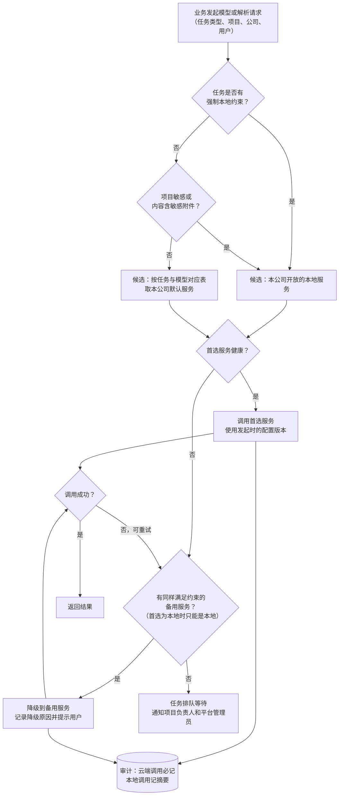

规则：

1. **强制本地优先于一切。** 敏感项目、敏感附件、强制本地的任务，候选集合里只有本地服务；备用也只能是本地。首选为本地的任务，即使项目不敏感，备用也只能是本地（v1.5，6.2.1 节）。
2. **降级条件**：健康检查失败、调用超时、服务返回服务端错误或限流；参数错误等客户端错误不降级，直接报错。
3. **降级可见**：用户界面显示“已使用备用模型 X”，生成任务记录实际使用的模型。
4. **健康检查**：平台定时探测各服务（大模型用最小调用，MinerU 用 `/v1/health`，间隔为平台设置 `health_check_interval_seconds`，示例 60 秒；结果在部署与服务状态页可见，5.12.6 节），连续失败标“不可用”，恢复后自动启用。

### 6.6 配置页面

#### 6.6.1 页面：模型登记（平台管理员）

- **目的**：登记、测试、维护大模型。
- **主要元素**：模型列表（名称、部署方式、模型名、状态、最近测试结果、被哪些公司开放、被哪些任务使用）；编辑表单（6.2.1 节字段）；配置历史。
- **操作**：新增、编辑、测试连接、启用/停用、查看历史、回滚到历史版本。
- **状态流转**：草稿 → 已启用 ⇄ 已停用；健康检查可把已启用标为“不可用”。
- **业务规则**：
  1. **测试连接**：用当前表单值（未保存也可测）发一次最小请求，返回连通性、耗时、模型名是否匹配、各参数是否被服务接受（例如 `enable_thinking` 不被支持时标出）。
  2. **修改即时生效**：保存后生成新的配置版本，新发起的任务使用新版本；**运行中的任务继续用发起时的旧版本**直到结束。
  3. **只有平台管理员能改**；每次修改记录修改人、时间、修改前后值（api_key 只记“已更换”）；可一键回滚到任一历史版本（回滚本身也是一次新版本）。
  4. api_key 加密存储，前端掩码显示，接口不返回明文。
  5. 停用一个正被任务对应表引用的模型时，系统要求先指定替代模型。
- **异常与边界**：测试连接失败仍允许保存为“草稿”，但不能启用。
- **验收标准**：①修改 `max_input_tokens` 后，新发起的生成任务按新值分节，修改前已开始的任务不受影响；②api_key 在页面、接口、日志中都不出现明文；③回滚后配置与所选历史版本一致。

#### 6.6.2 页面：文档解析服务（平台管理员）

- **目的**：登记、测试、维护解析服务，分“云端配置”和“本地配置”两组。
- **主要元素**：两组页签；每个服务的表单（6.3.1 节系统字段；按适配器显示对应官方参数说明和默认值，不支持的字段置灰并注明原因）；本地服务的“部署参数”只读区（从 `/v1/health`、`/v1/tiers` 读取）；测试解析（上传一份样例文件，显示页码、坐标、表格是否正常）。
- **操作**：同 6.6.1。
- **业务规则**：同 6.6.1 的规则 1～5；云端服务的“可用于敏感内容”固定为否且不可修改。
- **验收标准**：测试解析返回的统一格式结果中页码与原文一致、表格结构保留。

#### 6.6.3 页面：任务与模型对应表（平台管理员）

- **目的**：维护 6.4 节的对应关系和强制约束。
- **主要元素**：任务列表 × 默认服务、敏感项目服务、备用服务、强制约束。
- **操作**：编辑、查看历史、回滚。
- **业务规则**：修改即时生效（新任务用新规则）；强制约束只能由平台管理员修改，公司管理员不可覆盖。
- **验收标准**：把某任务设为“只能本地”后，公司管理员无法为该任务选择云端服务。

### 6.7 云端调用审计

每次云端调用（大模型和解析）写一条审计记录：时间、公司、用户、项目、任务类型、服务与配置版本、是否降级、输入 token 数与输出 token 数（解析为页数与文件大小）、耗时、结果（成功/失败及错误码）、内容摘要指纹（不存原文，建议）。审计记录只追加不可修改，平台管理员和公司管理员可按 5.10.6 节查询。本地调用只记摘要统计（建议）。

### 6.8 数据对象（模型与解析配置模块）

| 表名 | 中文名 | 关键字段 |
|---|---|---|
| llm_model | 大模型登记 | 6.2.1 节字段；current_config_version |
| llm_model_config_version | 大模型配置版本 | model_id、version_no、config（键值集合，api_key 为密文）、changed_by、changed_at、change_note、rollback_from |
| parse_service | 解析服务登记 | 6.3.1 节字段；current_config_version |
| parse_service_config_version | 解析服务配置版本 | 同上结构 |
| task_model_route | 任务与模型对应 | task_type、default_service_id、sensitive_service_id、fallback_service_id、force_local、version_no |
| company_model_grant | 公司开放的模型 | company_id、service_kind（大模型/解析）、service_id、enabled、company_default_for_tasks |
| service_health | 服务健康记录 | service_kind（大模型/解析/平台组件，v1.5 增加平台组件）、service_id（平台组件时为组件编码）、checked_at、health_status（正常/异常/已停用，v1.6 取代 ok；“未检测”不写入，5.12.6 节）、latency_ms、error |
| model_call_audit | 云端调用审计 | 6.7 节字段 |

以上表的完整列定义见字典 v1.7 3.10 节；其中 llm_model、llm_model_config_version、parse_service、parse_service_config_version、task_model_route、service_health 是平台级表，不带 `company_id`，理由见字典 1.7 节。

### 6.9 生成闭环配置

**结论：生成闭环的关键参数都可配置。** 平台管理员设默认值和上限，公司管理员在上限内按本公司调整（页面见 5.10.5 节），项目负责人只能在本项目中关闭模型评审。修改即时生效，但进行中的章节循环继续使用循环开始时的取值。

| 配置项 | 系统键 | 谁来配置 | 默认值 | 可调范围 | 说明 |
|---|---|---|---|---|---|
| 最大轮数 | loop_max_rounds | 平台设默认值和上限；公司在上限内调整 | 3 | 1～5（上限为建议值，平台管理员可改） | 一次循环最多检查几轮；默认 3 轮即最多 3 次检查、2 次自动修正（5.7.4 节）。上限不建议超过 5：调研显示迭代收益主要在前 1～2 轮 |
| 同一问题自动修正次数上限 | — | 固定 | 2 | 不开放 | 达到后该问题单独转人工 |
| 模型评审开关（即 R28 的启用） | model_review_enabled | 公司；项目负责人可在本项目关闭 | 试运行期间开启（只出提示），以便做抽测；正式默认值按抽测结果确定（Q14） | 开 / 关 | 关闭后章节循环只做规则检查。公司关闭时，项目中不能打开 |
| 评审模型 | 6.4 节“章节模型评审”任务 | 平台（任务与模型对应表）；公司在开放范围内选择 | 与章节写作不同的模型 | 本公司开放且满足敏感约束的模型 | 敏感项目只能用本地模型 |
| 同模型评审策略 | same_model_review_policy | 公司 | 非敏感项目：允许并标注“同模型评审”；敏感项目：跳过模型评审 | 允许并标注 / 跳过（两类项目分别设置） | 评审模型与本章实际使用的生成模型相同时生效（例如生成时发生了降级） |
| 大纲确认后自动开始生成 | auto_generate_after_plan_confirm | 公司 | 是 | 是 / 否 | 否：需人手动点“开始生成” |
| 章节生成顺序 | chapter_generation_order | 公司；项目负责人可在本项目修改 | 按大纲顺序依次进行 | 依次 / 并行 | 依次进行时摘要接力效果最好；并行受模型并发上限约束 |
| 章节摘要字数上限 | summary_max_chars | 公司 | 300 字（示例） | 100～800 字（示例） | 5.7.8 节 |
| 前序摘要预算 | prior_summary_token_budget | 公司 | 1,500 token（示例） | 不超过所用模型的输入预算 | 超出时从远到近略去更早章节的摘要 |
| 引用核对最短字数 | quote_min_chars | 平台 | 10 字（示例） | 5～30 字（示例） | 模型评审意见引用的原句短于此数即丢弃 |
| 审查清单每次取用条数上限 | checklist_max_items | 公司 | 15 条（示例） | 5～30 条（示例） | 按章节类型筛选后取用，避免占满模型上下文 |
| 审查清单推荐阈值 | checklist_suggest_threshold | 公司 | 3 次（示例） | 不少于 2 次 | 同类问题被人工处理达到该次数时生成候选，须公司管理员确认后才启用 |
| R26～R28 的级别与启用 | compliance_rule_config | 公司（平台提供默认值） | 见 5.8.1 节 | R26、R27 不允许关闭；R28 的启用即“模型评审开关” | 5.8.2 节规则 2 |
| R29～R42 的级别与启用（v1.2） | compliance_rule_config | 公司（平台提供默认值） | 见 5.8.1 节 | R34、R37、R39，以及招标要求评审索引表时的 R40 不允许关闭（建议）；R42 只在招标要求暗标时启用 | 5.8.2 节规则 2；R29 的参数见 5.10.4 节 |
| R43、R44 的启用与参数（v1.3） | compliance_rule_config（params 中的 cliche_density_threshold、opening_repeat_paragraphs、sample_copy_min_chars、min_facts_per_section） | 公司（平台提供默认值） | R43 开启，套话每千字密度阈值 3 次（示例）、段首重复 3 段（示例）、照抄样例 8 个字（沿用 R29，建议）；R44 开启，每小节最低 1 个已核验事实（建议） | R43 可关闭，级别最高为警告；R44 不允许关闭 | 5.8.7 节；阈值在试运行中用写作观察指标校准 |
| 风格样例注入预算（v1.3） | style_sample_token_budget | 公司 | 1,200 token（示例） | 不超过所用模型的输入预算 | 每次生成注入的风格样例总长度上限；超出时按“近期少用、风格特征不同”取样例（5.6.5 节） |

**编辑台与对话助手配置（v1.4）**：公司管理员在 5.10.5 节“编辑台与对话助手”区域设置；平台提供默认值。表中标“示例”的数值待试运行确定。

| 配置项 | 系统键 | 谁来配置 | 默认值 | 可调范围 | 说明 |
|---|---|---|---|---|---|
| 启用对话助手 | assistant_enabled | 公司 | 是 | 是 / 否 | 否：编辑台不显示对话面板，编辑台其余功能照常 |
| 修改样例条数 | assistant_suggestion_count | 公司 | 3 | 3～5 | 每次选区修改展示的样例条数（5.11.5 节） |
| 知识库开关默认值 | assistant_kb_default | 公司 | 打开（建议） | 打开 / 关闭 | 新会话中知识库开关的初始状态 |
| 允许关闭知识库 | assistant_allow_kb_off | 公司 | 允许 | 允许 / 不允许 | 不允许时面板上不显示“关闭” |
| 选区前后文预算 | assistant_context_token_budget | 公司 | 1,500 token（示例） | 不超过所用模型的输入预算 | 5.11.4 节 |
| 检索结果预算 | assistant_retrieval_token_budget | 公司 | 2,000 token（示例） | 不超过所用模型的输入预算 | 知识库打开时生效 |
| 检索结果条数上限 | assistant_retrieval_top_k | 公司 | 5 条（示例） | 1～20 条（示例） | 知识库和资料库结果合计 |
| 对话历史预算 | assistant_history_token_budget | 公司 | 1,000 token（示例） | 不超过所用模型的输入预算 | 只取同一会话 |
| 粘贴识别重合比例 | assistant_paste_match_ratio | 公司 | 80%（示例） | 50%～100%（示例） | 粘贴内容与近期对话助手输出的重合比例达到该值时，来源记为“对话助手撰写”（5.11.7 节） |
| 自动保存间隔 | editor_autosave_seconds | 公司 | 10 秒（示例） | 5～60 秒（示例） | 编辑草稿的自动保存间隔（5.11.9 节） |
| 编辑锁超时 | edit_lock_timeout_minutes | 公司 | 30 分钟（示例） | 10～120 分钟（示例） | v1.3 已有示例值，v1.4 补设为设置键；超时后自动提交草稿并释放锁 |
| 编辑锁心跳间隔（v1.5） | edit_lock_heartbeat_seconds | 公司 | 60 秒（示例） | 15～120 秒（示例） | 用户在编辑页面有操作时按此间隔发送心跳，刷新锁的最近心跳时间；无操作不发心跳（5.11.9 节） |

**心跳、自动保存与锁超时的关系（v1.5）**：

- 锁超时从最近一次心跳算起：用户持续操作时心跳不断刷新，锁不会释放；停止操作后不再发心跳，超过锁超时时间即释放，释放前 5 分钟提示，释放时草稿自动提交为“手改”版本。
- 自动保存和心跳相互独立：自动保存只保存草稿内容，不刷新锁；心跳只刷新锁，不保存内容。
- 保存设置时校验两条：①自动保存间隔不大于心跳间隔（`editor_autosave_seconds` ≤ `edit_lock_heartbeat_seconds`），保证锁释放前最近一次操作已保存；②心跳间隔的 10 倍不大于锁超时时间（`edit_lock_heartbeat_seconds` × 10 ≤ `edit_lock_timeout_minutes` × 60），保证网络偶有中断时不会误释放锁。另外锁超时必须大于“释放前提示”的 5 分钟。不满足时就近报错，不能保存。以示例值核对：10 秒 ≤ 60 秒；60 秒 × 10 ＝ 600 秒 ≤ 1,800 秒。
- 技术方案 1.3 节按“每 10 秒一次心跳”设计；本版取 60 秒为示例值，实际取值由研发压测后确定，但须满足以上校验。

**v1.5 新增配置项**：

| 配置项 | 系统键 | 谁来配置 | 默认值 | 可调范围 | 说明 |
|---|---|---|---|---|---|
| 高敏个人信息掩码规则 | sensitive_mask_rules | 公司（平台提供默认值） | 身份证件号码保留前 3 位和后 4 位；手机号保留前 3 位和后 4 位；银行账号只保留后 4 位（均为示例） | 每类保留的前后位数可调，但不能设为“不掩码” | 适用于系统内显示、内部稿和递交版中未确认完整值的位置（5.4.5、5.9.1 节）；不提供关闭掩码的开关 |
| 产品名 | brand_product_name | 平台管理员 | 占位“智能投标系统” | 1～20 个字（示例） | 界面品牌（5.12.7 节） |
| Logo（横版） | brand_logo | 平台管理员 | 占位图标 | PNG 或 SVG，≤200KB（示例） | 同上 |
| 主色 | brand_primary_color | 平台管理员 | #1E4DB7 | 与白色文字对比度 ≥4.5:1；不能与功能色、AI 紫（#6E4BD8）、对话助手紫（#A23CC8）过于接近（v1.6 补对话助手紫） | 同上；功能色、AI 紫、对话助手紫、来源色不可改 |
| 登录失败锁定次数 | login_max_failures | 平台管理员 | 5 次（示例） | 3～10 次（示例） | 5.12.1 节 |
| 登录锁定时长 | login_lock_minutes | 平台管理员 | 15 分钟（示例） | 5～60 分钟（示例） | 同上 |
| 会话超时 | session_timeout_minutes | 平台管理员 | 120 分钟（示例） | 30～480 分钟（示例） | 7.2 节 |
| 密码规则（v1.6 取消） | password_policy | — | — | — | v1.6 改为公司设置 `password_min_length`、`password_min_char_classes`，见下方“v1.6 新增配置项” |
| 健康检测间隔 | health_check_interval_seconds | 平台管理员 | 60 秒（示例） | 15～600 秒（示例） | 6.5 节规则 4、5.12.6 节 |
| 已完成任务保留天数 | job_retention_days | 平台管理员 | 30 天（示例） | 7～180 天（示例） | 后台任务中心中已完成任务的显示期限（5.12.4 节） |
| 直查意图词表 | direct_query_intents | 平台管理员 | 平台预置（人员、证书、资质、业绩、SLA 五类的关键词和实体规则） | 带版本 | 5.11.15 节 |

**v1.6 新增配置项**：

| 配置项 | 系统键 | 谁来配置 | 默认值 | 可调范围 | 说明 |
|---|---|---|---|---|---|
| 方形 Logo | brand_logo_square | 平台管理员 | 空（由横版 Logo 按比例裁切） | 宽高比 1:1；PNG 或 SVG，≤200KB（示例） | 侧栏收起时、浏览器标签页图标（5.12.7 节） |
| 密码最少位数 | password_min_length | 公司（平台提供默认值） | 8 位（默认值待 neil 确认，Q28） | 不低于平台默认值；可调高到 12 位及以上，上限 32 位（示例） | 账号安全设置（5.10.2 节）；下次修改密码时生效，不强制已有账号立即修改；多公司账号取最严，平台级账号按平台默认值（5.12.1 节） |
| 密码至少包含的字符类数 | password_min_char_classes | 公司（平台提供默认值） | 3 类（默认值待 neil 确认，Q28） | 3～4 类；字符分大写字母、小写字母、数字、符号四类 | 同上 |

- 两项密码策略的平台默认值由平台管理员维护，可以调高，平台默认值的下限（8 位、3 类）不能修改（建议）；平台默认值同时用于平台管理员、集团管理员等平台级账号。

- **存放位置**：公司级取值存公司设置（字典 v1.7 4.10 节中 v1.2、v1.3、v1.5、v1.6、v1.7 新增的键），平台默认值、上限和平台专用配置存平台设置（`platform_setting`，字典 v1.7 3.10 节、4.17 节，v1.5 明确）；项目级的两项存投标项目（`bid_project.model_review_disabled`、`chapter_generation_order`）。
- **留痕**：每次修改记录修改人、时间、修改前后的值，写入审计日志（7.3 节）。
- **验收标准**：①公司管理员不能把最大轮数设得高于平台上限；②修改最大轮数后，新开始的循环使用新值，进行中的循环不变；③公司关闭模型评审后，项目设置中没有“打开”的选项；④敏感项目在任何配置下都不会把评审请求发往云端；⑤（v1.4）样例条数不能设为小于 3 或大于 5；公司设为不允许关闭知识库后，对话面板上没有“关闭”选项；⑥（v1.5）自动保存间隔大于心跳间隔，或心跳间隔的 10 倍大于锁超时时间时，设置无法保存；掩码规则中没有“不掩码”选项；⑦（v1.6）公司的密码最少位数、字符类数不能设为低于平台默认值。

---

---

## 7. 非功能需求

### 7.1 私有化部署

1. 全部组件（Web 前端、业务层、数据库、文件存储、RAGFlow 及向量库、规则引擎、vLLM 本地模型、本地 MinerU）部署在公司内网或公司自管的服务器上；业务数据不出内网，唯一例外是按 6.4 节规则发往云端模型或云端解析服务的非敏感内容。
2. 云端服务全部可关闭：关闭后系统在纯内网环境下仍能完成主链路（解析用本地 MinerU，生成用本地模型），只是速度或效果可能下降。
3. 以容器方式交付，提供一键部署脚本与部署文档（建议）；操作系统、芯片、数据库的信创适配待确认（第 10 章），本文不做假设。
4. 升级不丢数据：数据库结构变更用版本化迁移脚本；RAGFlow、MinerU、模型的升级可单独进行，不影响业务数据。
5. **前端离线可用（v1.5）**：前端全部资源（组件库、图标、字体）随系统打包，在不能访问互联网的内网环境中可完整使用，不依赖任何外网资源；内置中文字体子集（设计规范第 12 章第 12 项：思源黑体子集），信创 Linux 等缺少中文字体的机器上显示一致。前端组件库（Ant Design）的具体版本属于技术选型，由研发项目经理在 M0 确定，本文不规定。

### 7.2 安全

| 方面 | 要求 |
|---|---|
| 登录 | 账号密码登录，密码加盐散列存储；登录失败次数限制与锁定；会话超时（示例 2 小时，可配置）。企业统一身份认证（如 LDAP）对接列为二期（建议）。v1.5：页面定义和三项设置见 5.12.1 节。v1.6：密码策略为公司级安全设置，默认最少 8 位、至少包含四类字符中的三类，只能调高（5.10.2、5.12.1 节）；会话超时提示文案见 5.12.1 节业务规则 6 |
| 权限 | 按角色 + 公司 + 资源三层控制（第 2 章）；所有接口在服务端校验公司归属，不依赖前端隐藏 |
| 传输 | 浏览器到服务端、业务层到云端服务一律 HTTPS |
| 存储加密 | 最高级敏感字段（身份证号、银行账号）字段级加密存储；劳动合同等最高级附件加密存储；api_key 加密存储 |
| 脱敏 | 按字典 1.6 节敏感分级：最高级默认掩码，只有公司管理员和资料管理员能看完整值且每次查看留痕；中级在列表中掩码、详情中可见（建议）。v1.5：掩码规则取公司设置 `sensitive_mask_rules`（示例：身份证件号码、手机号保留前 3 位和后 4 位），不提供关闭掩码的开关；标书编辑界面和内部稿一律掩码 |
| 指纹 | 身份证号、银行账号另存带密钥的不可逆指纹，只用于跨公司冲突检查（R21、R22，二期），不能还原原值 |
| 导出 | v1.5：内部稿一律掩码；递交版只由项目负责人导出，只在已确认“需填完整值”的字段类别和招标要求的位置解密填入，每次导出留痕（5.9.1 节第 8 条）；导出文件清理文档属性中的作者、公司等元数据（5.9 节）；附件图片可加水印 |
| 云端外发 | 敏感项目和敏感附件永不外发（6.4 节）；外发内容全部审计 |
| 删除 | 业务数据软删除（可恢复期内可找回，期满物理删除，期限待定）；云端解析服务支持删除接口时，取回结果后删除云端文件 |

### 7.3 审计

必须留痕的操作（写入只追加、不可修改的审计日志）：

1. 登录、登出、登录失败、密码修改；
2. 用户、角色、公司、权限的变更；
3. 查看完整身份证号等最高级敏感信息；
4. 资料的新增、修改、删除、确认、审核、恢复；
5. 投标项目的创建、敏感开关变更、成员变更、状态变更；
6. 生成、改写、章节摘要、章节模型评审、定位修正、额外承诺候选识别、事实锚点识别（记录模型、配置版本、任务卡版本、token 数，v1.3 另记实际使用的模型参数和注入的风格样例编号，不记全文）；v1.4：对话助手问答和修改样例（另记知识库开关、检索结果条数、样例条数）；
7. 每次云端调用（6.7 节）；
8. 导出 Word（v1.2 起分内部稿和递交版，细项见第 12 条）；v1.5：递交版另记填入完整值的敏感字段类别和数量，以及“需填完整值”字段类别的确认和修改；
9. 模型与解析配置、任务与模型对应表、公司开放范围、资料库设置（含审核开关）的变更；v1.5：规则配置（合规规则和兜底扫描词表）、界面品牌、平台设置、掩码规则的变更；v1.6：账号安全设置（密码策略）的变更；
10. 集团管理员查看各公司数据；相似度检查中集团管理员查看对方原文；
11. 生成闭环中的人工操作：写作方案确认、项目事实确认、终止章节循环、重新检查、问题的人工处理与驳回、手工回退版本；任务卡发布；审查清单条目的提出、确认启用、停用、拒绝；生成闭环配置的变更；v1.3：风格样例的提交、启用、停用和脱敏确认，套话条目和句式规则的新增、停用、复制，R43 问题的驳回，R43 按章节放行，写作观察指标的导出；
12. 分册与导出相关操作（v1.2）：分册设置变更、分册负责人和合标负责人的指定、分流确认、增值章节的标记与取消、分册检查的发起、分册定稿与解锁（含解锁原因）、交叉复核确认、R29～R42 问题的放行与人工处理（含额外数值承诺的确认保留）、历史标书批量导入、内部稿和递交版导出、合标核对清单和响应追溯表下载。
13. 编辑台与对话助手（v1.4）：手改提交、对话助手写入（替换或插入，含修改方式、知识库开关、引用来源、差异确认和二次确认）、版本回退、写入冲突的处理结果、编辑锁的取得、超时释放和强制接管（含接管原因）、分册解锁申请、项目负责人或公司管理员查看他人对话会话、会话归档、编辑台与对话助手配置的变更。审计日志只记操作和对象，不记对话全文。
14. 通用页面与抽取后处理（v1.5）：登录锁定与解锁、强制修改密码；后台任务的重试和取消；冲突选定、疑似遗漏的新增或排除（含理由）、条目拆分与合并、手工指定引用目标、确认解析结果；结构化直查（记命中的意图和返回的记录编号，不记字段取值）和插入答案卡。
15. 运维维护（v1.6，字典 `audit_action` 的 maintenance）：按公司重建检索索引、备份恢复、升级与回滚、数据迁移。
16. 密钥管理（v1.6，key_mgmt）：数据密钥轮换、指纹密钥变更、密钥服务解封。
17. 数据清除（v1.6，data_purge）：软删除到期后的物理删除、导出文件过期清理、云端文件删除请求及结果。
18. 授权管理（v1.6 预留，license）：License 导入、续期、变更绑定；产品化阶段启用，第一期不产生。

审计日志保留期限待定（第 10 章），建议不短于业务数据保留期。

### 7.4 性能与容量

年投标量、历史标书数量、并发用户数均未知，本节只定义测量口径，数值**待压测**后填写：

| 指标 | 口径 | 目标 |
|---|---|---|
| 页面响应 | 常用列表页、详情页打开时间（不含模型调用） | 待压测 |
| 招标文件解析耗时 | 每百页耗时，按云端/本地分别统计 | 待压测 |
| 章节生成耗时 | 每千字耗时，按模型分别统计 | 待压测 |
| 章节循环耗时 | 一个章节从开始生成到循环停止的耗时，按实际轮数、模型分别统计 | 待压测 |
| 合规检查耗时 | 一份标书全量检查耗时；v1.2 分别统计分册检查和全文检查 | 待压测 |
| 本公司查重耗时（v1.2） | 一次 R29 检查的耗时，按比对的历史标书份数和总字数分别统计 | 待压测 |
| 对话助手响应耗时（v1.4） | 从发出请求到样例全部展示的耗时，按知识库开关、模型、样例条数分别统计；自由提问单独统计 | 待压测 |
| 增量复查耗时（v1.4） | 从确认写入到增量复查结果全部返回的耗时，按改动段落数统计 | 待压测 |
| 并发 | 同时在线用户数、同时运行的生成任务数 | 待压测（取决于本地 GPU 数量和 vLLM 配置） |
| 容量 | 单公司资料条目数、附件总量、知识库文档数 | 待压测 |

设计要求：解析、生成、章节循环、合规检查（含本公司查重）、导出都是后台任务，页面不阻塞；任务可排队、可查看进度、可重试；本地模型并发由 6.2.1 节 `max_concurrency` 控制。

### 7.5 备份与恢复

| 备份对象 | 内容 | 频率 |
|---|---|---|
| 业务数据库 | 全部结构化数据 | 待定（建议每日全量 + 增量日志） |
| 文件存储 | 招标文件、附件、导出文件、解析原始结果 | 待定 |
| RAGFlow 与向量库 | 各公司知识库索引 | 待定；索引可由数据库正文副本和原文件重建，作为兜底 |
| 配置 | 模型与解析配置（含版本历史）、规则配置、写作档案、Word 模板 | 随数据库备份 |
| 密钥 | 字段加密密钥、指纹密钥 | 单独离线保管，不与数据备份放在一起 |

RPO（最多允许丢失多长时间的数据）和 RTO（故障后多长时间内恢复）待定。每季度做一次恢复演练（建议）。

### 7.6 可维护性

1. **配置驱动**：行业与标书类型模板、抽取项、合规规则的开关与阈值、字典、提醒规则、写作档案、模型与解析服务都在前端配置，不改代码。
2. **适配器隔离**：模型、解析服务、知识检索都通过适配器接入，替换组件只改适配器。
3. **可观测**：后台任务有统一的任务列表、日志、失败原因和重试入口；服务健康状态在管理后台可见。v1.5：页面见 5.12.4 节“后台任务中心”和 5.12.6 节“部署与服务状态”。
4. **日志**：应用日志分级输出、按天滚动；日志中不得出现敏感字段明文和 api_key；应用日志保留期限待定。
5. **文档**：部署、升级、备份恢复、配置说明随版本交付。

---

## 8. 数据隔离与合规

### 8.1 按公司隔离

**结论：公司（法人主体）是最高隔离单位，默认互不可见、不可互相引用。** 具体口径：

1. **数据归属**：所有业务数据带所属公司（`company_id`）；平台级公共数据（厂商产品字典、平台级字典、附件槽位、平台预置证书类型、中小企业划型标准）不带公司，所有公司共用只读。表级口径见字典 1.7 节。
2. **用户归属**：普通用户只属于一家公司；一个人为多家公司工作时开多个账号（建议，第 10 章确认）。
3. **知识库**：RAGFlow 按公司分库（每家公司独立的数据集），检索时业务层只传入本公司的数据集编号，模型只能看到本公司的检索结果。
4. **附件去重**：只在本公司内去重（按文件指纹）。跨公司去重会暴露“另一家公司也有这个文件”，因此不做。
5. **合作伙伴、渠道商**：每家公司各自维护一份，不共享。
6. **集团管理员**：可只读查看所有公司的数据和统计；**不能**在生成、检索中跨公司取资料；查看行为留痕。
7. **平台管理员**：负责平台运维与公共配置，默认看不到公司业务数据（建议，第 10 章确认）。
8. **跨公司借用**：默认不允许。预留“跨公司授权”（`cross_company_grant`，二期启用）：由集团管理员对单条资料授权给指定公司、指定项目、指定期限使用，全程留痕，被授权方只能引用、不能修改。
9. **子公司借用母公司资质**：是否存在该业务尚不确定，按以上通用口径设计；如确认存在，走第 8 条的授权机制，不另开通道。
10. **公司内部**：MVP 公司内资料和方案片段不再分区授权；标为“受限资料”（`is_restricted`）的敏感资料只对被授权的人可见（字典 1.5 节）。
11. **对话助手（v1.4）**：知识库打开时，检索和资料库匹配的公司条件由服务端按登录账号强制附加，只取本公司已启用、已确认、已发布的片段和可引用的资料库记录；受限资料只对被授权的人可见的规则同样适用于检索结果；对话会话、消息和样例都带所属公司和所属项目，对话历史不跨会话、不跨项目、不跨公司交给模型；集团管理员不能使用对话助手，只看统计（5.11.4、5.11.11 节）。
12. **全局搜索与结构化直查（v1.5）**：全局搜索只在当前用户可见的一家公司内搜索项目名称和资料名称，集团管理员只搜当前切换到的公司，不跨公司汇总（5.12.3 节）；对话助手的结构化直查只查本公司资料库，受限资料只对授权名单内的人出现（5.11.15 节）；后台任务、站内提醒按公司隔离，平台管理员只看任务的脱敏摘要。PRD 全部表的隔离口径（公司级、平台级、可混合）见字典 v1.7 1.7 节和 3.10 节各表。

### 8.2 串通投标风险：第四十条核实结果与三层防护

**核实结论：第四十条原文已核实，与简报中的表述一致，“异常一致”是法定的“视为串通投标”情形之一。**

《中华人民共和国招标投标法实施条例》（2011 年国务院令第 613 号公布，2017 年、2018 年、2019 年三次修订）第四十条原文：

> 第四十条　有下列情形之一的，视为投标人相互串通投标：
> （一）不同投标人的投标文件由同一单位或者个人编制；
> （二）不同投标人委托同一单位或者个人办理投标事宜；
> （三）不同投标人的投标文件载明的项目管理成员为同一人；
> （四）不同投标人的投标文件异常一致或者投标报价呈规律性差异；
> （五）不同投标人的投标文件相互混装；
> （六）不同投标人的投标保证金从同一单位或者个人的账户转出。

来源：国家法律法规数据库之行政法规库（司法部）http://xzfg.moj.gov.cn/front/law/detail?LawID=339 （查阅日期 2026-09-28）。

相关条款（同一来源）：

- 第三十九条第二款第（四）项：“属于同一集团、协会、商会等组织成员的投标人按照该组织要求协同投标”属于投标人相互串通投标。
- 第六十七条规定了串通投标的法律责任（中标无效，按招标投标法处罚等）。

政府采购领域的对应规定：《政府采购货物和服务招标投标管理办法》（财政部令第 87 号）第三十七条列了同样的六种情形，其中第（三）项为“不同投标人的投标文件载明的项目管理成员或者联系人员为同一人”，并明确“其投标无效”。来源：财政部 http://www.mof.gov.cn/gp/xxgkml/tfs/201707/t20170718_2652766.htm （查阅日期 2026-09-28）。

对系统设计的含义：

1. **“异常一致”没有法定比例标准**，由评标委员会判断（参见中国政府采购网实务文章 https://www.ccgp.gov.cn/llsw/202508/t20250801_25080591.htm ）。所以系统的相似度阈值只能是内部预警线，不能宣称“低于阈值即合规”。
2. **第（一）项“由同一单位或者个人编制”** 对集团内多家公司共用一套系统、共用编写人员的场景有直接风险：同一人同时为两家公司编写同一项目的标书，即使内容不同，也可能被认定。这是“一人一公司账号”（8.1 第 2 条）和 R19 冲突检查的依据之一。导出文件清理作者等元数据（5.9 节）也是为此；v1.2 起递交版文件名也不带编写人姓名，“姓名_版本_日期_项目名称”的命名只用于内部稿（5.9.1 节第 11 条）。
3. **第（三）项“项目管理成员为同一人”**：对应 R21（二期，跨公司人员冲突，用身份证号指纹比对）。
4. **第（六）项保证金账户**：对应 R22（二期，用银行账号指纹比对）。

**三层防护：**

| 层 | 做法 | 章节 |
|---|---|---|
| 第一层：数据隔离 | 每家公司独立的资料库、知识库、标书；生成只检索本公司 | 8.1 节 |
| 第二层：公司写作档案 | 每家公司单独配置章节结构模板、服务体系名称与叫法、常用术语、语气、任务卡（提示词）、Word 模板；首次使用须修改默认档案；v1.3 增加本公司风格样例库（平台不预置，按公司隔离）、套话表、句式偏好与禁用句式、总结句策略、本公司惯用表达 | 5.6 节 |
| 第三层：导出前相似度检查 | 与集团内其他公司投同一项目或同一招标人的标书比对，超阈值提示并标出相似段落，纳入合规检查（R18） | 5.8.3 节 |

补充（v1.3）：同一模型写出的套话会趋同，是“异常一致”的来源之一（像人写调研 3.2 节）。R43 减少套话和模式化句式，R44 要求写入本项目具体事实，风格样例让各公司的写法向本公司人写的标书靠拢，三者共同加强第二层防护；它们不替代第三层的相似度检查。发改法规〔2026〕195 号文提出用“技术方案语义相似性分析”识别围串标线索，语义层查重因此排在后续版本最前（3.3 节）。

补充（v1.4）：对话助手的修改样例按本公司写作档案（风格样例、套话表、禁用句式）生成，写法方向取自本公司句式偏好；知识库关闭时样例只凭模型自身能力写，不同公司之间的写法可能趋同（K29），但样例写入后仍经分册检查和全文检查，相似度检查（第三层）照常运行。

### 8.3 关联投标：比“异常一致”更硬的约束

**结论：集团内存在控股、管理关系的公司投同一标段，不论内容是否相似，相关投标都无效。系统在立项时就检查并提示（R19）。**

依据：

1. 《招标投标法实施条例》第三十四条第二款、第三款：“单位负责人为同一人或者存在控股、管理关系的不同单位，不得参加同一标段投标或者未划分标段的同一招标项目投标。违反前两款规定的，相关投标均无效。”来源同 8.2 节。
2. 《政府采购法实施条例》第十八条：“单位负责人为同一人或者存在直接控股、管理关系的不同供应商，不得参加同一合同项下的政府采购活动。”来源：中国政府网 https://www.gov.cn/gongbao/content/2015/content_2827183.htm （查阅日期 2026-09-28）。

系统落实：

| 规则 | 内容 | MVP |
|---|---|---|
| R19 关联投标冲突 | 立项和导出时，按招标项目编号/标段、招标人 + 项目名称匹配集团内其他公司的在投项目；公司之间有控股、管理关系或单位负责人相同（在公司管理中维护）时强提示，由项目负责人填写处理说明 | 是 |
| R20 同一编写人 | 同一用户（或同一自然人的多个账号）参与集团内多家公司同一项目 | 二期 |
| R21 同一项目管理成员 | 不同公司的标书中出现同一身份证号指纹 | 二期 |
| R22 同一保证金账户 | 不同公司的保证金账户指纹相同 | 二期 |

**不在本系统范围内的风险**（列入第 9 章风险清单）：电子招投标平台和投标客户端会采集的机器码、网卡地址、IP 等信息，以及用同一台电脑、同一网络为多家公司上传标书的行为，本系统无法控制，只能在导出页提示。

---

## 9. 里程碑与风险清单

### 9.1 里程碑（以技术方案为准）

v1.6：本节改为产品视角的里程碑，周期取自技术方案 v1.4.1 第 3.2 节“里程碑总表”的基准情景（开发由 AI 工程师 bot 完成，1 名全职合并审批人、每天合并约 6 个 PR）。各里程碑的详细范围、质量门禁、乐观和保守情景以技术方案第 3 章、5.3 节和 10.7 节为准；两者不一致时以技术方案为准，本节不另做估算。第 0 周（W0）的定义见技术方案 3.1 节：需求评审通过，且技术方案第 9 章的阻塞级问题已有答复或同意采用其假设。

| 里程碑 | 周期（基准） | 产品视角的主要内容 | 完成标志（产品视角） |
|---|---|---|---|
| M0 启动与技术验证 | W0～W6 | PRD 与字典评审定稿；第 10 章关键项（信创、上云范围、敏感判定）给出结论；准备真实招标文件和历史标书样本（历史标书最好已有评分结果，供 M8 模型评审抽测）；推理、解析、检索、编辑器、导出、信创基线等技术验证；前端组件库版本确定（7.1 节第 5 条） | 技术方案 G0 门禁通过；样本集就绪 |
| M1 平台底座 | W2.5～W10 | 公司隔离、用户权限、审计；模型与解析服务登记和路由（6.6 节）；文件存储；5.12 节通用页面：登录、站内提醒列表、后台任务中心、全局搜索、部署与服务状态最小版（汇总各服务现有的健康检查结果，显示运行状态、最近检测时间、耗时与错误摘要，手动刷新；技术方案 J01a）、平台设置与界面品牌 | 能登录、能配置模型并测试连接；6.6 节三个页面和 5.12 节 M1 页面的验收标准通过 |
| M2 资料库、知识库与写作档案 | W4～W16 | 企业资料库各页面、确认机制、可选审核开关、到期提醒、敏感信息保护、批量导入、附件识别；方案片段库、历史标书导入；写作档案、任务卡、审查清单、风格样例库 | 5.4～5.6 节验收标准通过；一家试点公司的真实资料录入完整 |
| M3 解析与矩阵 | W6～W23 | 招标文件解析与 10 类抽取、原文定位、补遗差异；抽取后处理与星号、废标兜底扫描（技术方案 E03d）；兜底扫描词表管理页基础版（平台初始词表，公司管理员增删改查，每次保存生成新的生效版本号；技术方案 G06a）；响应矩阵与分册分流、“挂证据”抽屉、SLA 矩阵、项目事实表；第一批发布 R1（约 W23，区间 W16.5～W31），供试点公司录入资料、导入历史标书、挑选风格样例 | 样本招标文件的矩阵经业务人员核对可用，分册分流结果经项目负责人确认；R1 在试点环境稳定运行 |
| M4 生成闭环 | W5～W28 | 写作方案与大纲确认、分节生成、证据挂载与【待补】、章节生成闭环、系统生成章节、章节循环进度页、人工处理队列、章节摘要接力、写作观察指标 | 样本项目技术、商务两个分册的每章都跑完闭环，形成完整初稿 |
| M5 合规检查与导出 | W7.5～W29.5 | MVP 合规规则、R18（一期只做文本层）、R29、分册检查与定稿（含交叉复核、解锁）、按分册导出 Word、合标核对清单、响应追溯表、暗标分册处理；规则配置页（含兜底扫描词表增强：导入导出、草稿与发布、版本历史与回滚、试扫；技术方案 G06）；部署与服务状态完整版（版本号与组件明细、24 小时检测历史、立即检测、本地模型并发与排队数；技术方案 J01、J01b）；递交版高敏字段处理与“需填完整值”确认、导出“排队”、项目列表统计卡与概览折叠区 | 5.8、5.9 节验收标准通过；样本项目分别导出可用的技术标、商务标 Word 和合标核对清单 |
| M6 编辑台与对话助手 | W4.5～W35（编辑台约 W31 交付，对话助手约 W34 交付） | 编辑台（编辑草稿与自动保存、版本对比与回退、编辑锁心跳与接管、增量复查、状态映射）；对话助手（自由提问、选区修改、知识库开关、样例预检、差异确认与写入、冲突校验、留痕）；结构化直查与答案卡（范围待 Q27） | 5.11.14 节验收标准通过 |
| M7 集成与发布候选（RC） | W35～W39（RC 约 W39，区间 W28～W55） | 全量回归、压测、渗透测试、高可用与备份恢复演练、部署和运维手册、离线交付包 | 技术方案 G7 发布门禁通过 |
| M8 试运行与验收 | 试运行 W39～W45，验收 W45～W47（GA 约 W47，区间 W36～W63） | 选 1～2 家公司用真实项目试用；阈值校准；用 3～5 份历史标书做模型评审人工标注抽测（K15）；任务卡参数、R43 与 R44 阈值和套话表校准；对话助手试运行（样例条数、知识库开关默认值、上下文预算） | 至少 3 个真实项目走完“立项到导出”全流程；1.3 节指标有首批数据；模型评审默认开关的结论（Q14）；neil 签署上线确认 |

说明：

1. **工作量**：技术方案 WBS 合计约 1,944 人天（v1.3 估算，v1.4、v1.4.1 沿用；不含 15% 管理储备），拆为 760 张任务卡（v1.4 为 758 张，v1.4.1 拆分排期后为 760 张），前后端开发由 AI 工程师 bot 完成，仍需由人承担约 500 人天（合并审批、运维、评测、测试、业务样本与验收、法务）。PRD v1.5 及以前的 20 周计划已由技术方案判定不可行（技术方案 3.1 节）。
2. **并行**：M1～M6 有较多并行；M4、M6 开始得早，是因为规则引擎框架、编辑器前端等没有前置依赖的工作先开工，里程碑仍按 M0 → M8 的顺序依次通过门禁（技术方案 3.3 节）。
3. **范围增减**：合标在系统外完成，合标页面、合并导出等工作不在范围内；R18 语义层和邮件通知不在一期范围内（3.2 节）。结构化直查如按技术方案完整版实施，比一期简化版多约 6 人天，关键路径和 GA 不变（5.11.15 节第 5 部分、Q27）。
4. **先编辑台、后对话助手**：对话助手的写入、留痕和复查都依赖编辑台的版本与复查能力，技术方案按编辑台约 W31、对话助手约 W34 排期。
5. **试运行前置条件**：各公司须在 R1 发布后、试运行开始前挑选风格样例（每类至少 3 段），否则生成页只提示“样例不足”，不影响试运行。
6. **分两步交付的页面（技术方案 v1.4.1 排期调整）**：①兜底扫描词表管理页：M3 交付基础版，保存即生效（每次保存生成新的生效版本号，扫描结果照常记录版本号），满足抽取后处理和 R1 试点使用；5.12.5 节的草稿与发布、试扫、版本历史等在 M5 补齐，5.12.5 节验收标准在 M5 验收。②部署与服务状态页：M1 交付最小版，显示各组件和服务的运行状态；5.12.6 节的检测历史、立即检测、并发与排队数、版本号等在 M5 补齐，5.12.6 节验收标准在 M5 验收。两项调整不改变各里程碑周数和 GA。

### 9.2 风险清单

| 编号 | 风险 | 影响 | 应对 |
|---|---|---|---|
| K01 | 信创要求后期明确，与已选组件（vLLM、GPU、数据库）不兼容 | 返工、延期 | M0 尽早确认；组件均通过适配器接入；MinerU 4.0 官方说明 AMD 等厂商加速卡适配仍停留在 4.0 以前版本，需提前评估 |
| K02 | 招标文件格式复杂（扫描件、表格跨页、图片型评分表），抽取准确率不足 | 矩阵漏项，可能导致废标 | 抽取结果必须人工核对后才能“确认矩阵”；每项可点回原文；废标项、星号项漏抽影响最大，重点测试 |
| K03 | 模型编造事实（证书编号、人员、业绩） | 虚假投标风险 | 证据挂载 + 【待补】自动替换；R15 要求【待补】清零后才能导出；自动修正不能改金额、承诺数值、人员身份，相关问题直接转人工（5.7.4 节） |
| K04 | 集团内公司标书相似被认定串标；或关联公司投同一标段导致投标无效 | 投标无效、法律责任 | 8.2、8.3 节三层防护与 R19；阈值只是预警线，不宣称合规 |
| K05 | 投标客户端采集的机器码、IP 等信息暴露关联（系统范围外） | 被认定串标 | 导出页提示；列入业务操作规范，由业务部门管理 |
| K06 | 本地 GPU 资源不足，生成慢、排队长 | 体验差、赶不上截止时间 | 非敏感项目长文写作走云端；并发控制与排队可视；压测后评估扩容 |
| K07 | 云端解析或模型服务不可用、接口变更（V1 API 文档仍是草案） | 解析或生成中断 | 适配器隔离；降级到本地；上线前按实际接口复核字段 |
| K08 | 敏感内容误发云端（敏感标记漏设） | 数据泄露 | 敏感附件按类型强制本地（不依赖人工标记）；项目敏感开关由项目负责人设定，修改留痕；云端调用全审计 |
| K09 | 资料录入质量依赖录入人自觉（不设专职审核） | 引用过期或错误资料 | 确认声明 + 关键字段修改须重新确认 + 到期提醒 + 截止时间有效性检查；可随时打开审核开关 |
| K10 | 知识库从零积累，初期方案片段少，生成内容空泛 | 初期效果不达预期 | 历史标书手工导入；写作档案与章节模板先行；定稿回收（二期）持续沉淀 |
| K11 | 编码与代码表原文未拿到（字典第 6 章剩余项） | 字段取值不规范 | 开发阶段拿原文核对，先以可配置字典上线 |
| K12 | 年投标量、并发量未知，容量规划失准 | 性能问题 | 7.4 节压测；架构按后台任务 + 可横向扩展设计 |
| K13 | 同一人为多家公司编写（第四十条第（一）项） | 串标认定风险 | 一人一公司账号；R20（二期）；导出清理作者元数据 |
| K14 | 编写人在导出的 Word 中能看到完整身份证号，与“只有管理员能看完整身份证号”的规则存在缺口 | 敏感信息扩散 | v1.5 已关闭（Q12 已确认）：内部稿一律掩码；递交版只由项目负责人导出，只在已确认的字段类别和招标要求的位置填完整值，每次导出留痕（5.9.1 节第 8 条） |
| K15 | **模型自评不可靠**。agent-loop 调研（0、3.2、3.3 节）的结论：没有外部反馈时，模型“自己评、自己改”不可靠，可能把对的改成错的，迭代收益主要集中在前 1～2 轮；模型当评审有自我偏好和顺序偏差；公司本地模型 Qwen3-30B-A3B-Instruct-2507 的多轮工具调用基准偏低（官方模型卡 TAU2 Airline 38.0）。这些是通用基准，不能直接换算成标书场景的准确率 | 模型评审漏报、误报；自动修正把对的改错；循环空转、浪费算力 | ①**规则检查为主**：R10、R15、R25、R26、R27 等可复现的规则是检查主力，模型评审只出提示、永不阻断导出；②**引用核对**：模型意见必须引用正文原句，对不上的直接丢弃；③**轮数上限**：默认最多 3 轮，问题数不减即停，修正引入新问题即回退，同一问题改两次即转人工；④只改被点名的段落，其他段落逐字不变；⑤评审尽量用与生成不同的模型；⑥编排、停止、分流全部由系统规则决定（5.7.4 节）。**建议**：试运行时用 3～5 份已评分的历史标书，由业务人员人工标注问题，抽测模型评审的召回率（人工标注的问题中被模型正确指出的比例）和误报率（模型意见中不成立的比例），再决定模型评审默认开还是关（Q14） |
| K16 | 章节循环增加模型调用次数，本地 GPU 负载和生成耗时上升 | 赶不上投标截止时间 | 轮数上限；第 2 轮起模型评审只复核被修改的段落；定位修正每次只输入一个段落；并发控制与排队可视；可按项目关闭模型评审；压测后评估（7.4 节） |
| K17 | 超范围（R30）、机构名称识别（R25）、称呼（R35）等规则误报多，编写人和项目负责人放行疲劳，真正的问题被一并放行（v1.2） | 检查形同虚设 | 这类规则只给警告；增值章节不报超范围；放行记录带入后续检查不重复放行；试运行中按误报率校准规则和名单；1.3 节统计超范围问题数和处理结果 |
| K18 | 本公司查重（R29）比对量大，影响全文检查耗时（v1.2） | 临近截止时间检查排队 | 只在手动发起和全文检查时运行，不在章节循环和分册检查中运行；建立本地文本指纹索引；按历史标书年限限定比对范围；7.4 节统计查重耗时 |
| K19 | v1.2 新增 14 条规则、分册和系统生成章节，一期工作量上升（v1.2） | 延期 | 按优先级分批排期（例如先做 R34、R36、R37、R40、R41 等与废标和递交直接相关的规则，建议）；各阶段周期以技术方案为准（9.1 节，v1.6） |
| K20 | 合标在系统外人工完成，合标时可能引入错误（漏插页、页码与评审索引表不符、替换了人员表、密封份数不对）（v1.2） | 废标或失分 | 提供合标核对清单（5.9.2 节），列出页码、评审索引表、两本之间一致性结论、密封份数等核对项；合标负责人明确为商务分册负责人；系统内的跨分册一致性在导出前由 R36、R10、R27 检查 |
| K21 | R43 误报多（标书本身要求正式，部分排比和总结属于正常写法）；或定位修正把一种套话换成另一种（v1.3） | 放行疲劳；风格检查形同虚设 | R43 只出警告，公司可关闭、可调阈值和允许次数；编写人可驳回，驳回后不再报；分册和全文检查中按章节放行一次；修正后新出现的 R43 问题不触发回退；用观察指标中的放行次数和人工修改率校准词表 |
| K22 | R44 的事实密度要求诱导模型为凑数编造事实（v1.3） | 虚假投标风险 | 每条事实须对应项目事实表、证据或招标原文，对不上的在模型撰写段落中替换为【待补】并由 R15 管到导出前清零；最低个数默认只有 1 个（建议）；自动修正只能用给定的材料补写 |
| K23 | 风格样例被照抄，或把样例来源标书中的旧客户、旧项目信息带入新标书（v1.3） | 串名、雷同、泄密 | 入库前人工脱敏并用 R25、R31、R35 扫描；提示词写明“不照抄句子”；R43 检查与样例的连续相同字数；R25 继续检查旧项目名称；样例只在本公司使用 |
| K24 | 《人工智能生成合成内容标识办法》是否适用于公司内部自用的标书尚未确认；如适用，可能需要在导出文件中保留或添加标识（v1.3） | 合规风险，或需要调整导出功能 | 本版不删除、不篡改服务商添加的标识（3.2 节、5.9.1 节第 10 条），不做“降 AI 率”改写；请法务确认（Q20），确认后再定是否需要增加标识功能 |
| K25 | 对话助手在样例中编造事实或写入额外承诺，用户只看写法、未核对事实就采纳（v1.4） | 虚假投标、超范围承诺 | 对话助手写入的段落按模型所写处理，对不上来源的事实在预检时换成【待补】；额外数值承诺、金额、人员身份标出并在写入后直接转人工；知识库打开时样例必须附引用；星号、废标、商务偏离、披露类段落写入前二次确认（5.11.5～5.11.7 节） |
| K26 | 用户把对话助手的回答复制后手工粘贴，绕开“模型所写”的处理（v1.4） | R44 替换失效，编造事实留在正文 | 粘贴识别：与近期对话助手输出重合比例达到阈值的，来源记为“对话助手撰写”；R44 对人工编写段落仍报“事实无来源”并直接转人工；分册检查和全文检查照常 |
| K27 | 章节级独占编辑锁导致等待；锁被长期占用或被误接管（v1.4） | 编写效率下降；草稿丢失 | 心跳与超时自动提交草稿；接管须写原因并通知原持有人；草稿过期时保留供对比；统计替换冲突次数和等锁情况，二期视情况评估实时协同（Q23） |
| K28 | 敏感项目强制本地模型，对话助手请求增加本地 GPU 负载，与章节生成争抢（v1.4） | 响应慢、排队 | 受 `max_concurrency` 约束；样例条数默认 3；对话助手请求与章节生成分别排队（建议）；试运行中观察负载，必要时增加本地算力（Q15、Q22） |
| K29 | 知识库关闭时样例只凭模型自身能力写，不同公司之间写法趋同，或内容空泛（v1.4） | 异常一致风险；得分偏低 | 样例仍应用本公司写作档案并按不同写法方向生成；公司可设知识库默认打开或不允许关闭；统计无知识库来源写入占比；相似度检查照常（8.2 节） |
| K30 | 增量复查只查改动段落，漏掉修改对全章其他部分的影响（例如删掉了唯一回应某得分要点的段落）（v1.4） | 漏响应、前后矛盾 | 增量复查中 R26 按改动段落原来回应的矩阵行查全章覆盖，R43、R44 的全章计数照常计算；分册检查和全文检查重跑完整规则；需要时人点“重新检查” |
| K31 | 抽取后处理的兜底扫描命中过多（例如招标文件大量使用“★”作版式符号），项目负责人逐条处理疑似遗漏负担重（v1.5） | 确认解析结果延后；或为赶进度随意排除 | 已被条目覆盖的命中自动记“已覆盖”，不进入疑似遗漏；词表由公司管理员维护并带版本；命中过多时提示复核词表；排除须写理由并留痕；试运行中统计命中数和排除比例（技术方案风险 R-29） |
| K32 | 冲突必须处理完才能确认解析结果，补遗多的项目反复卡在解析确认（v1.5） | 编制开始时间推迟 | “已按补遗处理”的冲突不阻断；文本类冲突只给模型候选，每份文件候选数有上限；已选定的冲突在重跑时保持不变 |
| K33 | 递交版只由项目负责人导出，项目负责人不在时无法导出（v1.5） | 临近截止时间无法递交 | 公司管理员可把自己或他人设为本项目负责人后导出（变更留痕，建议）；内部稿不受影响 |
| K34 | 一期 R18 只做文本层，换词改写后的雷同查不出（v1.5） | 集团内“异常一致”漏报 | 写作档案按公司差异化配置；语义层排在二期首位；试运行中由集团管理员抽查同招标人项目 |

---

## 10. 待确认事项

只列需要业务方给出结论的事项；已由本轮决定覆盖的不再列。v1.5：已确认的事项移到 10.2 节；v1.5 自行做出、需要评审的设计判断列在 10.3 节；v1.6 的设计判断列在 10.4 节。差距分析第 6 节提出的三个问题（查重的口径和范围、合标在哪里完成和由谁负责、“超范围”的口径）已由 neil 确认，结论见 v1.2 变更记录，不再列入。

### 10.1 待确认事项

| 编号 | 事项 | 为什么需要确认 | 影响范围 | 本文当前处理 |
|---|---|---|---|---|
| Q01 | **信创要求**：是否要求国产芯片、操作系统、数据库、中间件，是否要求入选特定目录 | 决定组件选型和部署方案 | 7.1 节、6 章、全局 | 不做假设；字典中信创目录字段暂不启用 |
| Q02 | 是否存在子公司借用母公司资质（或反之）的业务 | 决定是否启用跨公司授权 | 8.1 节 | 按默认不允许设计，预留授权机制（二期） |
| Q03 | 集团内有控股、管理关系的公司，实际是否会投同一标段 | 若会，R19 需要升级为硬拦截或引入更严格流程 | 8.3 节、R19 | 立项时强提示 + 填写说明，不硬拦截 |
| Q04 | 相似度检查的阈值、比对窗口（多长时间内的标书）、比对范围（同项目、同招标人，是否纳入历史标书）；公司用户能否看到对方公司名称 | 阈值无法定标准，需按业务容忍度定 | 5.8.3 节 | 示例阈值；公司用户只见对方公司名称与相似位置，不见原文；集团管理员可见原文 |
| Q05 | 哪些文件允许上云解析；招标文件本身能否上云 | 决定云端解析的使用范围 | 6.4 节 | 招标文件（非敏感项目）默认云端，敏感附件强制本地 |
| Q06 | 敏感项目由谁判定、按什么标准 | 决定强制本地的范围 | 5.1 节、6 章 | 项目负责人或公司管理员人工勾选；改回“不敏感”只能由公司管理员操作并留痕；可设本公司默认敏感 |
| Q07 | 年投标量、同时在编项目数、并发用户数 | 压测和硬件规划 | 7.4 节 | 待压测 |
| Q08 | 报价是否纳入系统 | 影响数据范围、权限和安全等级 | 3.2 节 | MVP 不纳入 |
| Q09 | 常用电子招投标平台和投标客户端要求的文件格式 | 影响导出格式 | 5.9 节 | MVP 只导出 Word |
| Q10 | 一人为多家公司工作时，是否接受开多个账号 | 影响账号模型和 R20 | 8.1 节 | 按开多个账号设计 |
| Q11 | 平台管理员是否默认看不到业务数据 | 影响权限模型 | 2 章、8.1 节 | 默认看不到 |
| Q13 | 审计日志、应用日志、软删除数据的保留期限；RPO、RTO | 合规与存储规划 | 7.3、7.5、7.6 节 | 待定 |
| Q14 | 模型评审（R28）默认开还是关 | 模型评审准确率没有直接证据，通用基准不能换算成标书场景 | 5.7.4、6.9 节；K15 | 试运行期间开启并只出提示；用 3～5 份历史标书人工标注抽测后决定 |
| Q15 | 是否为敏感项目再部署一个本地模型，专门用于与生成模型不同的评审 | 敏感项目只能用本地模型；本地只有一个模型时，敏感项目默认跳过模型评审 | 6.4、6.9 节；硬件规划 | 默认跳过，以规则检查为主 |
| Q16 | “商务偏离”的识别口径：哪些条款算商务条款（如付款方式、交付期限、质保、合同条款） | 商务偏离的问题必须转人工，口径影响分流 | 5.3.1、5.7.4 节 | 抽取时由模型建议条款性质，项目负责人确认 |
| Q17 | R29 本公司查重的段落阈值、全文阈值，以及告警级别（与“仅供参考”资料重复为警告、与本公司历史或在编标书重复为提示）是否合适 | 连续字数和年限已确认，但阈值和级别影响误报量与放行工作量 | 5.8.3、5.10.4 节；K17、K18 | 阈值用示例值，试运行校准；级别按差距分析建议 |
| Q18 | 安全与合规事件记录（文书编号、事件说明）的敏感级别 | 行政处罚等信息对外敏感，定级影响谁能查看 | 5.4.7 节；字典 3.2.17 节 | 按“中级”处理（脱敏展示、有权限的项目成员可看），建议 |
| Q19 | 招标未规定分册时的默认分册集合（是否默认技术、商务两册，资格证明材料是否归入商务分册，是否另设资格分册） | 影响分流默认规则和合标工作 | 5.1.4、5.3.1 节 | 默认技术、商务两册，资格证明材料归入商务分册，建议 |
| Q20 | **《人工智能生成合成内容标识办法》是否适用于公司内部自用的标书**（v1.3，需法务确认） | 该办法（国信办通字〔2025〕2号，2025-09-01 施行）规范的是提供生成合成服务的“服务提供者”，第十条规定任何组织和个人不得恶意删除、篡改、伪造、隐匿标识；企业内部私有化部署、为自身投标生成文本是否属于该办法所说的情形，像人写调研未找到权威解释（4.4 节） | 3.2 节、5.9.1 节、K24 | 不删除、不篡改服务商添加的标识；不做“降 AI 率”改写；本版不主动添加标识；接入云端模型时核对其用户协议中的标识条款（建议）；待法务结论后再定；v1.5：编辑台必须显示 AI 内容标识，导出 Word 默认不带，是否带待法务结论（设计规范第 12 章第 15 项） |
| Q21 | 知识库关闭时，是否仍把本项目上下文（选区、前后文、写作方案、项目事实、招标条款）交给模型（v1.4） | “基于模型自身能力回答”可理解为不检索知识库，也可理解为什么都不给；不给本项目上下文时样例容易与项目事实矛盾 | 5.11.4 节 | 不检索知识库和资料库，但仍给本项目上下文（建议） |
| Q25 | 人工修改率是否计入对话助手的修改（v1.4） | 影响“像不像人写”指标的含义和与 v1.3 基线的可比性 | 1.3、5.7.13 节 | 计入总数，另列“手改”“对话助手”两个分项（建议） |
| Q27 | 对话助手的结构化直查是否扩展到招标要求、项目事实表、响应矩阵、合规问题等项目数据，以及知识库关闭时是否仍可直查（v1.5；v1.6：**待 neil 确认（对应技术方案 Q-T32）**） | 两处结论不一致：PRD v1.5 按 neil 2026-10-08 的结论写一期简化版，只在知识库打开时直查本公司结构化资料；技术方案 Q-T26 第③项（neil 2026-10-08 已确认）写的是知识库关闭时仍允许直查招标要求和项目事实表，2.3.4 节按完整版排期。两种方案：A 一期简化版（本文当前写法，比 B 少约 6 人天）；B 技术方案完整版（直查招标要求、项目事实表和流水线结果，知识库关闭时仍直查招标要求和项目事实表）。关键路径和 GA 不受影响（技术方案 8.22 节） | 5.11.4、5.11.15 节；技术方案 2.3.4、8.22 节，Q-T26、Q-T32；9.1 节 | 暂按方案 A 写，产品验收按 5.11.15 节第 4 部分（建议）；两种方案的对照见 5.11.15 节第 5 部分；须在技术方案任务 B05a 开工（约第 20 周）前决定 |
| Q28 | **密码策略默认值待 neil 确认**（v1.6） | neil 2026-10-08 定了密码策略的做法（公司级、只能调高、多公司取最严、下次改密生效），默认值暂定最少 8 位、至少三类字符；技术方案原建议按等保三级把初始值设为 12 位、3 类字符，v1.4.1 在 8.24、Q-T38 中改为与本版相同的建议（默认至少 8 位、至少 3 类字符，可调高到 12 位），仍待产品经理和 neil 确认；技术方案 2.6 节另有 90 天轮换、管理员账号强制 TOTP 的建议，本版未采纳。Keycloak 的密码策略是 realm 级的，按公司分别生效需要自定义策略或在业务层校验，技术方案估计约增加 2～3 人天 | 5.10.2、5.12.1、6.9、7.2 节；字典 4.10、4.17 节；技术方案 8.24 节、Q-T38 | 默认最少 8 位、至少包含大写字母、小写字母、数字、符号中的三类；平台默认值的下限按此设置；不做定期强制改密 |

### 10.2 已确认事项（v1.5 新增）

| 编号 | 事项 | 结论 | 确认人与日期 | 落实位置 |
|---|---|---|---|---|
| Q12 | 编写人通过导出的 Word 能看到完整身份证号的缺口 | 内部稿一律掩码（示例保留前 3 位和后 4 位，规则可配置），不提供关闭掩码的开关；完整号码只在递交版中、且只在招标要求时填入；递交版只有项目负责人能导出，导出留痕；手机号等高敏个人信息同样处理 | neil，2026-10-08 | 2.3 节规则 8；5.1.4、5.4.5、5.9.1、6.9、7.2、7.3 节；K14 |
| Q22 | 敏感项目的对话助手是否强制使用本地模型 | 强制本地，知识库打开或关闭都一样；本地模型不可用时请求排队，不改走云端 | neil，2026-09-29 | 5.11.4、6.1、6.4 节；K28 |
| Q23 | 并发编辑方式 | 第一期沿用章节级独占编辑锁，加心跳、超时自动提交和强制接管；不做实时协同，二期视试运行情况评估 | neil，2026-09-29 | 3.2、3.3、5.7.3、5.11.9、6.9 节；K27 |
| Q24 | 对话会话的可见范围 | 会话正文对本人、本项目负责人、本公司管理员可见，查看他人会话留痕；集团管理员只看统计，不看正文 | neil，2026-09-29 | 2.3 节规则 7；5.11.11 节 |
| Q26 | 对话助手写入的段落算谁写的 | 按模型所写处理，段落来源类型为“对话助手撰写”；写入后又手改的部分按人工编写处理 | neil，2026-09-29 | 5.11.7、5.8.7 节 |
| — | 前端组件库版本 | 属于技术选型，由研发项目经理在 M0 确定；PRD 只规定离线内网可用、内置中文字体子集 | neil，2026-10-08 | 7.1 节第 5 条 |
| — | 兜底扫描词表由谁维护（v1.6 列入） | 由公司管理员维护，平台提供初始词表；集团管理员、项目负责人只读（技术方案 Q-T28） | neil，2026-10-08 | 2.2 节、2.3 节“兜底扫描词表”行；5.2.4 节规则 6；5.12.5 节 |
| — | 密码策略的做法（v1.6 列入；默认值见 Q28） | 公司级安全设置，由公司管理员配置；默认最少 8 位、至少三类字符，可调高到 12 位及以上，不允许低于默认值；多公司账号按最严的一家，平台级账号按平台默认值；修改后下次改密码时生效，不强制已有账号立即修改 | neil，2026-10-08 | 2.3 节；5.10.2、5.12.1、6.9、7.2 节 |

设计规范第 11 章 19 条问题的其余结论见本文开头“v1.5 变更记录”。

### 10.3 v1.5 设计判断（待评审）

以下是本版在 neil 结论之外自行补充的设计，正文中标“建议”，需评审：

1. **项目列表统计卡的口径**（5.1.1 节）：“进行中”按项目状态判定；“阻断合计”取最近一次分册检查或全文检查的未处理阻断数；“资料临期/过期”按已挂证据在投标截止时间前是否到期统计。
2. **“需填完整值”的确认机制**（5.1.4 节第 9 项）：由项目负责人在项目设置中按字段类别（身份证件号码、手机号、银行账号）勾选并关联招标要求，未勾选的类别在递交版中也掩码。这是落实“只在招标要求时填完整值”的方式，Q12 结论没有规定具体做法。
3. **疑似遗漏不提供批量处理**，“新增为条目”时按命中原文预填类别（5.2.4 节规则 2）。
4. **抽取后处理的示例参数**：合并的文本相似度阈值 0.85、每份文件文本类冲突候选最多 50 对、兜底扫描命中超过 30 条时提示复核词表（均为示例，5.2.4 节）。
5. **“引用未解析”不阻断确认解析结果**，只在确认时提示条数（5.2.4 节规则 3）。neil 的结论只要求冲突和疑似遗漏处理完。
6. **插入答案卡的段落来源为“证据”**，不按模型所写处理（5.11.15 节规则 4），因为文字直接取自资料库记录，由平台预置格式生成，不经模型。
7. **直查意图词表一期由平台维护**，公司补充同义词放二期；答案卡每次最多列 10 条记录（示例，5.11.15 节）。
8. **登录不做验证码**，以失败次数锁定替代；账号不存在和密码错误统一提示（5.12.1 节）。
9. **全局搜索不含方案片段、历史标书和正文内容**；至少输入 2 个字；平台管理员不显示搜索框（5.12.3 节）。
10. **平台管理员在后台任务中心只看脱敏摘要，不能重试或取消公司的任务**（5.12.4 节）。
11. **规则配置修改只影响之后发起的检查**；项目负责人可只读查看本公司规则；平台修改默认值时，公司未修改过的规则跟随变化（5.12.5 节）。
12. **界面品牌只做平台级**，不按公司分别设置；主色须满足与白色文字对比度 ≥4.5:1（5.12.7 节）。
13. **R18 的“特征一致”检查也放二期**（5.8.3 节）。neil 的结论只写了语义层放二期；特征一致同样需要试运行数据校准，一期先把文本层做稳。
14. **公司管理员不再直接导出递交版**，兼任本项目负责人时可以（2.3 节）。这是“递交版只有项目负责人能导出”的直接推论，与 v1.4 权限矩阵不同。
15. **心跳只在用户有操作时发送**，以及两条保存校验：自动保存间隔 ≤ 心跳间隔，心跳间隔 × 10 ≤ 锁超时（6.9 节）。
16. **站内提醒在未读期间不重复发送**同一对象、同一类型的提醒（5.12.2 节）。

### 10.4 v1.6 设计判断（待评审）

以下是本版在 neil 2026-10-08 的修订要求和密码策略结论之外，自行做出的判断，需评审：

1. **会话超时提示用信息样式，不用错误样式**，标题不出现“会话”“超时”等技术词，只说明发生了什么、未保存内容怎么处理、下一步做什么（5.12.1 节业务规则 6）。设计规范原型的提示（“会话已超时，请重新登录”，信息类）方向一致，本版补充了未保存内容的处理说明并改写为日常用语。
2. **多公司账号的密码策略按位数和字符类数分别取最高值**；2.1 节规定公司级账号只属于一家公司，本条作为兜底规则写入，不改变账号模型（5.12.1 节业务规则 3）。
3. **平台管理员可以调高密码策略的平台默认值，下限 8 位、3 类不能修改**（6.9 节）。neil 的结论只规定了公司不能低于默认值。
4. **账号安全设置放在“用户与角色”页**（A-02，5.10.2 节），不新增页面。
5. **“未检测”不写入检测记录**，只在某项还没有任何检测记录时显示；已停用的服务不发起检测，记“已停用”（5.12.6 节；字典 6.8 节）。
6. **方形 Logo 未上传时由横版按比例裁切**，最小像素尺寸由设计规范确定（5.12.7 节）。
7. **“挂证据”抽屉保留“历史标书（参考）”一组**，可查看原文但不能勾选，而不是把历史标书从抽屉中去掉；这样编写人仍能参考历史写法，并按提示把需要的内容录入资料库或摘取为方案片段（5.3.1 节规则 11）。
8. **定时任务的归属与重试**：按公司执行的定时任务由公司管理员重试；不属于任何公司的只在平台管理员视图中出现（5.12.4 节业务规则 5）。
9. **Q27 决定前，产品验收按一期简化版执行**（5.11.15 节第 5 部分）。
10. **主色近色校验不比较“信息”色**（5.12.7 节规则 2），采纳技术方案 8.25 节；设计规范 11.3 节第 3 项把此项列为待 neil 或产品决定。
11. **两步交付页面的验收时点**：兜底扫描词表管理页和部署与服务状态页的完整验收标准放在 M5，M3、M1 只验收基础版和最小版（9.1 节说明 6）。

---

## 附录 A 术语表

| 术语 | 解释 |
|---|---|
| MVP | 最小可用产品，本文指第一期交付范围 |
| PRD | 产品需求文档 |
| 响应矩阵 | 把招标文件里的每一条要求（评分项、废标项、资格项、技术服务要求等）逐行列出，对应到标书章节和证明材料的对照表 |
| SLA | 服务水平协议，指响应时间、到场时间、恢复时间等服务承诺指标 |
| SLA 矩阵 | 招标要求、我方承诺、公司能力上限三列对照的 SLA 表（5.3.2 节） |
| 证据 | 支撑标书中某句承诺或事实的资料库记录、附件或招标文件原文 |
| 【待补】 | 标书中没有依据的地方由系统写入的占位标记，导出前必须清零 |
| 废标项 / 无效标条款 | 招标文件中规定的、不满足即投标无效的条款 |
| 星号条款（实质性条款） | 招标文件中用“★”等符号标出的必须满足的条款 |
| 写作档案 | 每家公司单独配置的章节模板、叫法、术语、语气、任务卡（提示词）、审查清单和 Word 模板 |
| 相似度检查 | 导出前把本标书与集团内其他公司同项目或同招标人的标书比对，找出相似段落 |
| 关联投标 | 单位负责人相同或存在控股、管理关系的不同单位投同一标段（条例第三十四条禁止） |
| RAGFlow | 开源的知识检索（检索增强生成）引擎，本系统用它按公司建知识库 |
| 检索增强生成（RAG） | 先从知识库检索相关内容，再交给大模型参考生成的做法 |
| 向量库 / 向量化 | 把文本转成数字向量存储，用于按语义检索和比较相似度 |
| 大模型 | 能理解和生成文本的人工智能模型 |
| token | 模型计量文本长度的单位，中文大致一两个字对应一个 token，因模型而异 |
| vLLM | 开源的大模型推理服务框架，用于在公司服务器上部署本地模型 |
| OpenAI 兼容接口 | 业界通用的大模型调用接口格式，多数模型服务都支持 |
| MinerU | 开源的文档解析工具，把 PDF 等文件转成带版面结构的文本，有云端服务和本地部署两种用法 |
| VLM | 视觉语言模型，能同时理解图片和文字，MinerU 用它解析复杂版面 |
| 适配器 | 把系统统一字段翻译成某个服务官方参数、并把结果翻译回统一格式的程序模块 |
| 降级 | 首选服务不可用时自动改用备用服务 |
| 敏感项目 | 由项目负责人标记、全部处理必须在本地完成的投标项目 |
| 受限资料 | 公司内只对被授权人员可见的敏感资料 |
| 指纹 | 用带密钥的不可逆算法从原值算出的短字符串，只能比较是否相同，不能还原原值 |
| 软删除 | 数据先标记为已删除、可在一定期限内恢复，而不是立即物理删除 |
| RPO / RTO | 故障时最多允许丢失多长时间的数据 / 故障后多长时间内恢复服务 |
| 信创 | 信息技术应用创新，指按国家要求使用国产化的软硬件 |
| 中小企业划型 | 按行业标准，依据从业人员、营业收入、资产总额判定企业属于大、中、小、微型 |
| 授权链 | 原厂授权总代理、总代理再转授权给我方的多级授权关系 |
| Agent | 能自己规划步骤、决定调用哪些工具、决定何时停止的模型应用形态；本系统不采用其全程自主的形态（5.7 节） |
| 生成闭环 / 章节循环 | 每个章节独立进行的“生成 → 检查 → 定位修正 → 再检查”过程，何时停止、哪些问题转人工由系统规则决定（5.7 节） |
| 循环 / 轮 | 一次循环是一个章节从开始自动处理到停止的全过程；一轮是其中一次检查（及需要时的一次修正）（5.7.4 节） |
| 写作方案 | 生成正文前为每节确定的内容：回应哪些评分项、用哪些证据、目标字数；须经人确认 |
| 规则检查 / 模型评审 | 章节检查的两层：规则检查由系统按固定规则判定，结果可复现；模型评审由大模型按评分项逐条提意见，只作提示 |
| 引用核对 | 系统核对模型评审意见所引用的正文原句是否真实存在，对不上的意见丢弃 |
| 定位修正 | 只改被问题点名的段落，其他段落逐字不变的自动修正方式；v1.3 起 R43 的问题只改命中的句子，同段其他句子也不变 |
| 问题记录 / 问题指纹 | 章节检查发现的每个问题的记录；问题指纹用于判断前后两轮是不是同一个问题 |
| 项目事实表 | 每个项目的关键事实清单（服务期、响应时间、驻场人数、项目经理等），全文唯一口径 |
| 章节摘要接力 | 每章完成后生成简短摘要，后面章节生成时读取，用于保持前后一致 |
| 任务卡 | 把一类模型任务的提示词、输入材料、输出结构、示例打包并带版本号的配置，存放在公司写作档案中 |
| 审查清单 | 公司沉淀的检查项，来自人工处理中反复出现的问题，经公司管理员确认后启用 |
| 分册 | 一份投标文件中按招标要求分开编制、分开装订或分开密封的部分，例如技术分册、商务分册（v1.2） |
| 分册负责人 | 项目中负责某个分册的成员，通常技术分册为技术负责人、商务分册为商务负责人；不是公司级角色（2.2 节） |
| 分册检查 / 分册定稿 | 一个分册的全部章节完成后，在本分册范围内做的合规检查；检查通过并经交叉复核后锁定本分册，称为定稿（5.8.5 节） |
| 合标 | 把分别编写的技术标、商务标等合成一份完整投标文件的工作；本系统不做合标，由合标负责人（商务）在 Word 中人工完成 |
| 合标核对清单 | 导出递交版时系统生成的清单，列出合标时须人工核对的页码、评审索引表、两本之间一致性结论、密封份数等（5.9.2 节） |
| 跨分册共用 | 需要两个分册都响应的招标要求，例如拟派人员、服务期、质保；两个分册引用同一份数据 |
| 超范围响应 | 写了招标没有要求的内容，或做出招标没有要求的额外承诺（R30） |
| 增值章节 | 招标没有要求、但有利于得分，经写作方案标注并写明理由的章节；不算超范围 |
| 本公司查重 | 把本标书与本公司历史标书、在编标书和“仅供参考”资料比对，找出连续相同的文字（R29），与防集团内“异常一致”的相似度检查（R18）不同 |
| 评审索引表 | 按评审标准的顺序列出每个评分项在投标文件中对应的章节和页码的表；系统生成时页码留空，由商务合标后填写 |
| 点对点应答 | 按技术规范书的原顺序逐条列出条款并逐条应答的内容 |
| 正偏离 / 无偏离 / 负偏离 | 响应优于招标要求 / 与招标要求一致 / 不满足招标要求 |
| 得分要点 | 一条评分项的评分标准中列出的各个可得分内容，是写作方案小标题和覆盖检查的最小单位 |
| 承诺类事实 | 质保期、培训次数和课时、资源到位天数等不在 SLA 模板中的承诺，纳入项目事实表统一管理 |
| 段落来源 | 每段正文的来源记录：证据、方案片段、招标原文引用、模型撰写、人工编写或系统生成，以及回应的招标条款 |
| 暗标 | 评审时不让评委知道投标人身份的评标方式，要求相应分册中不出现投标人名称、人员姓名、logo 等 |
| 内部稿 / 递交版 | 内部稿供内部传阅，按“姓名_版本_日期_项目名称”命名并加“内部稿”水印；递交版交给合标负责人合标后递交，文件名不带编写人姓名 |
| AI 腔调（v1.3） | 模型写作中常见的套话、空泛表态和模式化句式，例如“为……提供坚实保障”“不是……而是……”；由 R43 检查 |
| 套话（v1.3） | 在标书中反复出现、不带具体信息的固定说法，例如“全方位保障”；写作档案中与禁用词分开管理，按每千字密度统计 |
| 空泛词（v1.3） | 只表态、不说明具体内容的词语，例如“高度重视”“行业领先”；是套话表的一类 |
| 套话命中密度（v1.3） | 每千字正文中命中套话表的次数，即命中次数 ÷ 正文字数 × 1000 |
| 禁用句式（v1.3） | 写作档案中设了允许次数的句式，例如否定对比、递进、序列、三项排比、段末总结句、段首重复；超出次数的部分由 R43 报出 |
| 段末总结句（v1.3） | 段落最后一句用“综上所述”“总之”等开头或以“为……提供坚实保障”一类句式收尾的总结；默认每章只在首段和末段允许出现 |
| 三项排比（v1.3） | 一句中连续三个结构相同的并列短语，例如“专业、高效、稳定” |
| 总结句策略（v1.3） | 写作档案中规定的总结句出现位置，默认每章只在开头和结尾各总结一次 |
| 风格样例（v1.3） | 从本公司已定稿标书中人工挑选并脱敏的范文段落，每类章节 3～5 段；生成时注入，供模型学习本公司的语气和结构，不作为证据 |
| few-shot（v1.3） | 在提示词中附几段示范文字，让模型模仿其写法的做法；本系统的风格样例即按此方式使用 |
| 本公司惯用表达（v1.3） | 本公司常用、希望在标书中保留的说法，写入生成提示词作为优先用语，不做检查 |
| 可核验的具体事实（v1.3） | 能对照来源核实的内容，分数字、型号、人员、案例、客户系统名五类；本文也称“事实锚点” |
| 事实密度（v1.3） | 平均每个得分要点小节中已核验的具体事实个数；由 R44 检查，并作为观察指标记录 |
| 写作观察指标（v1.3） | 套话命中密度、事实密度、总结句比例、句长变化程度、段首句式重复数、人工修改率六项指标，第一期只观察、不拦截 |
| 句长变异系数（v1.3） | 句子字数的标准差 ÷ 平均句长，用来衡量句子长短是否整齐划一；数值越小越整齐 |
| 人工修改率（v1.3） | AI 初稿与定稿之间的差异比例：字符编辑距离 ÷ 两者中较长一方的字数 |
| 编辑距离（v1.3） | 把一段文字改成另一段最少需要增加、删除、替换的字数 |
| 模型参数：温度、TopP、TopK、重复惩罚（v1.3） | 控制模型取词方式的参数。温度越低输出越稳定；TopP、TopK 限定每次从哪些候选词中取词；重复惩罚调高可减少重复用词 |
| 参考值（v1.3） | 任务卡中暂取厂商推荐或平台建议、尚未经试运行验证的参数值 |
| AI 检测（AIGC 检测）（v1.3） | 判断一段文字是否由 AI 写成的工具；本系统不接入，也不以“AI 率”作为指标 |
| 降 AI 率改写（v1.3） | 以让 AI 检测工具判为“人写”为目的的改写；本系统不提供 |
| AI 生成标识（v1.3） | 按《人工智能生成合成内容标识办法》由服务提供者在生成内容中添加的显式或隐式标识；本系统不删除、不篡改 |
| LoRA（v1.3） | 一种只训练少量附加参数、让模型贴近某种写法的微调方法；列入后续版本 |
| 编辑台（v1.4） | 查看和修改章节正文的页面，包括章节目录、正文编辑区、问题/来源侧栏和对话面板；由 v1.3 的章节查看与编辑页升级而来；v1.6 起项目页签和页面统一称“编辑台” |
| 对话助手（chatbot）（v1.4） | 编辑台中的对话面板。可自由提问，也可针对选中的文字给出修改样例；只给建议，不自己写入正文 |
| 自由提问（v1.4） | 不选中正文时向对话助手提问，只回答、不改正文 |
| 知识库开关（v1.4） | 对话面板上的开关。打开时先检索本公司知识库和资料库、样例必须附引用；关闭时不检索，样例标“无知识库来源” |
| 无知识库来源（v1.4） | 知识库关闭时生成的回答和样例上的标记，表示内容没有经过本公司知识库检索 |
| 修改样例（v1.4） | 对话助手针对选区给出的候选改写文字，每次 3～5 条（默认 3 条），写法各不相同 |
| 替换选中内容 / 插在选中内容后（v1.4） | 采纳样例的两种写入方式：用样例替换选区，或把样例插在选区之后 |
| 差异确认（v1.4） | 写入前显示样例与原文的差异（删除标红、增加标绿），用户点“确认写入”后才写入 |
| 修改方式（v1.4） | 每个编辑台版本的产生方式：手改、对话助手替换、对话助手增加、版本回退 |
| 对话助手撰写（v1.4） | 段落来源类型之一，表示该段文字由对话助手写入；按模型所写处理 |
| 增量复查（v1.4） | 编辑台写入后，只对改动段落重跑适用的规则检查；不调用模型评审，不自动修正，不重跑整章闭环 |
| 编辑草稿 / 自动保存（v1.4） | 手改过程中定时自动保存、只本人可见、尚未提交为版本的内容；点“提交修改”后才成为章节版本 |
| 编辑锁接管（v1.4） | 项目负责人或本分册负责人强制取得他人持有的章节编辑锁，须写原因，原持有人的草稿先自动提交 |
| 对话会话（v1.4） | 一个用户在一个项目中与对话助手的一组连续对话，按公司和项目隔离，只追加、不删除 |
| 选区内容指纹（v1.4） | 由选中文字计算出的短字符串，写入前用来判断原文是否已被改动 |
| 样例采纳率（v1.4） | 被采纳的修改样例条数 ÷ 展示给用户的样例条数，只观察、不拦截 |
| 定稿后已修改（v1.4） | 分册定稿后又解锁并修改过的章节上的标记，界面显示“定稿后已修改，待复核” |
| 投标截止时间（v1.5） | 招标文件规定的递交投标文件的截止时间，系统字段为 `bid_deadline_at`；倒计时、证据有效期判断都以此为准。v1.5 起全文统一用这一说法，不再用“递交”代替“投标”来称呼截止时间；“递交版”“登记递交”中的“递交”指递交投标文件这一动作，含义不变 |
| 抽取后处理（v1.5） | 分块抽取完成后、交给人确认之前，系统自动做的去重合并、交叉引用解析、冲突检测和星号、废标兜底扫描（5.2.4 节） |
| 交叉引用（v1.5） | 招标文件中“详见第X章”“按附件N”一类指向其他位置的说法；系统找到目标后把内容补到条目上 |
| 抽取冲突（v1.5） | 同一事项在招标文件不同位置或补遗中说法不同，例如服务期一处写 3 年、一处写 2 年（示例）；由项目负责人选定 |
| 兜底扫描 / 疑似遗漏（v1.5） | 用关键词和正则全量扫描招标文件，找出可能没有被抽取的星号、废标条款；没有被已有条目覆盖的命中称为疑似遗漏，须逐条处理 |
| 结构化直查 / 答案卡（v1.5） | 对话助手在知识库打开时，对本公司人员、证书、资质、业绩、SLA 的提问不调用模型，直接查资料库，结果以卡片形式展示，称为答案卡（5.11.15 节） |
| 掩码（v1.5） | 只显示部分字符、其余用 * 代替的显示方式，例如身份证件号码保留前 3 位和后 4 位（示例）；本文中“脱敏显示”与“掩码”同义 |
| 心跳（v1.5） | 编辑页面在用户有操作时定时发给系统的信号，表示“仍在编辑”，用来维持编辑锁 |
| 后台任务中心（v1.5） | 统一查看解析、生成、检查、导出等后台任务进度和失败原因、并可重试的页面（5.12.4 节） |
| 界面品牌（白标）（v1.5） | 私有化部署时更换产品名、Logo 和主色的平台级设置；功能色、AI 紫色、对话助手紫色、来源色不可改（5.12.7 节） |
| 全局搜索（v1.5） | 顶栏搜索框，第一期只搜当前公司内有权查看的项目名称和资料名称（5.12.3 节） |
| 统计卡（v1.5） | 项目列表顶部的 6 张数字卡片，点击即按对应口径筛选项目（5.1.1 节） |
| 账号安全设置 / 密码策略（v1.6） | 公司管理员在“用户与角色”页设置的本公司密码要求：最少位数和至少包含的字符类数（大写字母、小写字母、数字、符号四类），只能高于或等于平台默认值，在下次修改密码时生效（5.10.2、5.12.1 节） |
| 服务检测状态（v1.6） | 部署与服务状态页上每个组件或服务的状态：正常、异常（含检测超时）、未检测（还没有检测记录）、已停用（不检测、不计入异常）（5.12.6 节） |
| 横版 Logo / 方形 Logo（v1.6） | 界面品牌中的两种 Logo：横版用于登录页和侧栏展开时，方形（1:1）用于侧栏收起时和浏览器标签页图标；未上传方形 Logo 时由横版裁切（5.12.7 节） |
