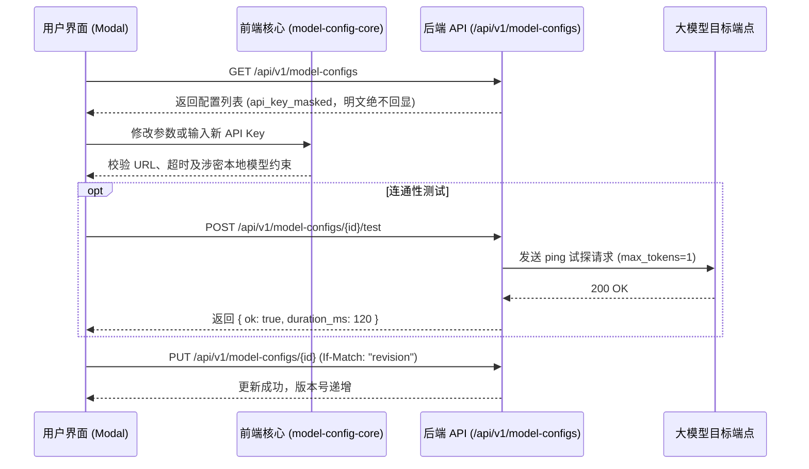
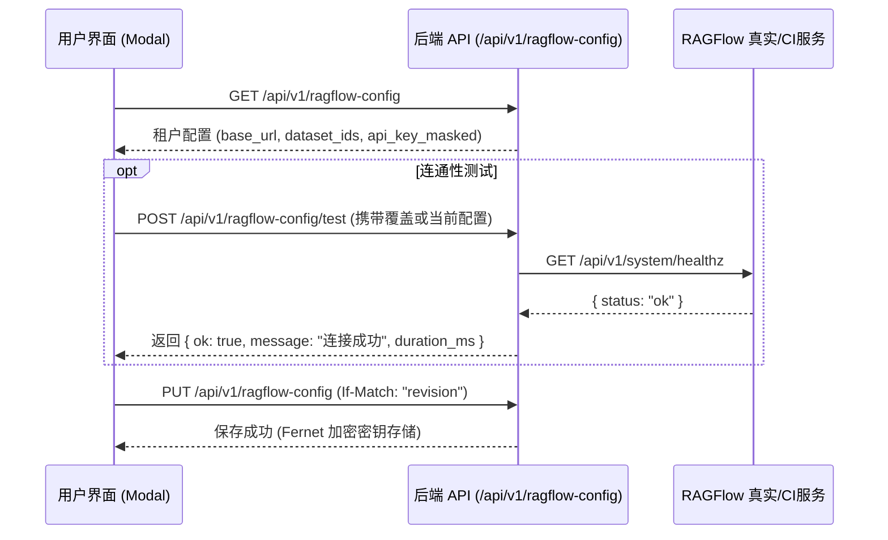

# 代码解释：大模型服务与 RAGFlow 知识库弹窗配置及连通性闭环

## 1. 结构与架构分层

依据 `AGENTS.md` 现行骨架约束：
- **前端八域划分**：弹窗组件 `ModelConfigModal.tsx`、`RagflowConfigModal.tsx` 及纯计算核心 `model-config-core.ts`、`ragflow-config-core.ts` 全部位于 `frontend/web/src/admin/`，顶栏胶水位于 `frontend/web/src/app/App.tsx`，无平铺于根目录；
- **后端上下文分包**：实体与服务实现位于 `backend/bid-core/icg/domain/ragflow_config.py`，对外 API 契约位于 `backend/bid-core/icg/api/ragflow.py`，严禁再往 `icg_demo` 根目录平铺业务逻辑；
- **契约收敛**：新端点统一落在 `/api/v1` 前缀下（`/api/v1/ragflow-config`、`/api/v1/ragflow-config/test`），`operationId` 遵循 lowerCamelCase 命名。

## 2. 核心状态与数据流

### 2.1 大模型配置交互（ModelConfigModal）

### 2.2 RAGFlow 检索配置交互（RagflowConfigModal）

## 3. 安全与合规底线

1. **API Key 零泄露机制**：
   - 数据库与内存中密文存储（Fernet 算法，使用 `ICG_SECRET_KEY` 对称加密）；
   - GET 响应及日志排查绝不输出明文密钥，仅暴露掩码（如 `rag***-xyz`）与布尔标识 `has_api_key`；
   - 客户端提交掩码原样回传时不重新加密，避免掩码覆盖真密钥。
2. **多租户数据隔离**：
   - RAGFlow 配置严格绑定 `principal.user.company_id`，Alpha 公司与 Beta 公司各自持有独立的 RAGFlow 服务端点与 Dataset 集合，杜绝跨租户越权召回；
3. **并发安全与版本保护**：
   - 更新操作强制要求 `If-Match: "<revision>"` 头；若被其他管理员提前更新，立即抛出 409 `REVISION_CONFLICT`，彻底防止脏写覆盖。
