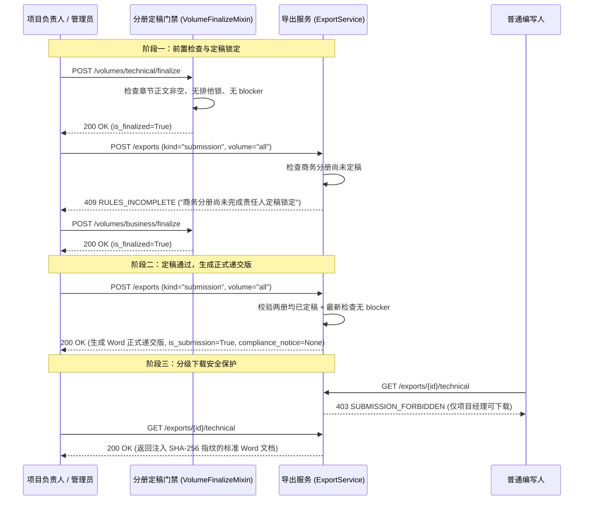

# 代码解释：规则最小可递交集与分册定稿闸门端到端闭环

## 1. 业务逻辑与时序链路

落实 PRD §5.8.5 分册定稿与整本递交导出的安全状态机：



## 2. 关键代码变更点

### 2.1 动态定稿状态校验 (`backend/bid-core/icg/domain/export_service.py`)
```python
            if payload.get("kind") == "submission":
                # 分册定稿闸门（PRD §5.8.5）：所选分册必须全部经负责人或管理员定稿锁定
                volumes_state = workflow.get("volumes", {})
                unfinalized = [
                    vol for vol in sorted(required_volumes)
                    if not volumes_state.get(vol, {}).get("is_finalized")
                ]
                if unfinalized:
                    unfinalized_names = "、".join("技术分册" if v == "technical" else "商务分册" for v in unfinalized)
                    raise DomainError(
                        409,
                        "RULES_INCOMPLETE",
                        f"完整合规规则与分册定稿未完成：{unfinalized_names}尚未完成责任人定稿锁定，不能把本地内部稿冒充递交版。"
                    )
```

### 2.2 契约模式对齐 (`backend/bid-core/icg_demo/workflow_schemas.py`)
在 `ProjectExport` 响应体中明确定义 `is_submission: bool = False`，确保在导出正式递交版时，序列化输出准确反映正式版标志，且契约与 OpenAPI demo-v1.json 保持 100% 一致。
