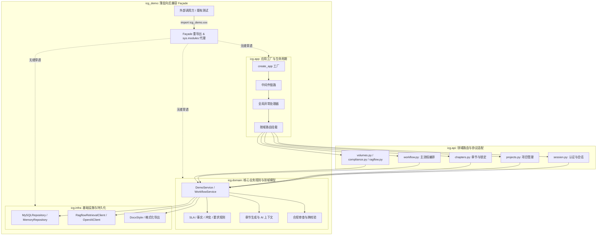

# 代码说明：后端去平铺、包重命名与分层架构演进（D2）

为什么有这个文件：配合交付文档 `docs/delivery/2026-10-26-backend-unflatten-progress.md`，深度说明 2026-10-26 落实用户官方拍板 B1 的后端分层重构实现细节、入口调用链、数据与状态流、解决循环依赖与动态模块代理的机制。

它解决什么问题：
1. 详细阐述 `backend/bid-core/icg/` 下 `app/`、`api/`、`domain/`、`infra/` 四大分层的职责边界与交互顺序；
2. 解释 `icg_demo/` 兼容 Façade 层的穿透代理设计与行数压缩机制；
3. 记录领域模块与仓储层之间循环导入（Circular Import）的排查与解除方案。

---

## 1. 架构分层设计与入口调用链

根据官方拍板决策 B1 与项目规范，后端代码全面迁入 `backend/bid-core/icg/` 包，形成清晰的分层架构：



### 1.1 应用工厂 `icg.app.main:create_app`

- **入口位置**：[`backend/bid-core/icg/app/main.py`](../../backend/bid-core/icg/app/main.py)
- **核心职责**：
  1. **服务初始化**：接收 `repository`、`model_provider`、`parser_provider` 等依赖注入参数；若未指定则通过 `resolve_repository()` 自动探测持久化模式（遵循 `ICG_REQUIRE_MYSQL=1` 生产门禁）；
  2. **中间件装配**：注入 `request_identity` 请求追踪中间件，生成并透传 `X-Request-ID`，处理 `/api/demo` 的 RFC 8594 `Deprecation` 与 `Sunset` 响应头；
  3. **标准错误体收敛**：全局捕获 `DomainError`、`RequestValidationError`、`HTTPException` 与未知异常，统一下发符合 OpenAPI 契约的 `{code, message, details, traceId}` 规范错误体；
  4. **按域路由收口**：调用 `include_session_routes`、`include_project_routes`、`include_chapter_routes`、`include_workflow_routes` 等子路由函数，完成整体装配；
  5. **契约增强**：装配 `custom_openapi`，调用 `enrich_openapi` 注入扩展元数据与冻结状态保护。

---

## 2. 关键判断与循环依赖解除

### 2.1 循环依赖现象与根因

在将主领域模块与仓储实现彻底拆入 `icg.domain` 与 `icg.infra` 时，`export_openapi.py --check` 在启动加载模块时遭遇循环依赖异常：
```
ImportError: cannot import name 'MemoryRepository' from partially initialized module 'icg.infra.memory_repository' (circular import)
```
- **依赖环分析**：
  1. `icg.infra.memory_repository` 依赖 `icg.domain.domain`；
  2. `icg.domain.domain` 依赖 `icg.domain.workflow_orchestrator`；
  3. `icg.domain.workflow_orchestrator` 在顶部导入了 `from icg.infra.repositories.chapters import decompose_paragraphs`；
  4. `icg.infra.repositories.chapters` 依赖 `mysql_repository` 与 `memory_repository`；
  5. 导致在 `MemoryRepository` 尚未定义完成前，又递归重入了 `memory_repository`。

- **排查与修复**：
  审查发现，`workflow_orchestrator.py`、`export_service.py`、`generation_service.py`、`outline_service.py` 顶部的 `decompose_paragraphs` 导入实际上完全未被使用（`workflow_orchestrator.py` 在需要执行段落拆解的局部函数内已做了惰性局部导入 `from icg.infra.database import decompose_paragraphs`）。
  因此，果断移除了这 4 个领域模块顶部的静态无用导入，彻底打破了 domain -> infra -> domain 的循环依赖链条。

---

## 3. 兼容层 Façade 与动态模块代理机制

为彻底杜绝修改包路径对已有 650+ 测试用例和外部调用的破坏，`backend/bid-core/icg_demo/` 保留为纯过渡 Façade。

### 3.1 动态代理实现原理

```python
# backend/bid-core/icg_demo/idempotency.py
import sys
import icg.domain.idempotency as _src_0
from icg.domain.idempotency import *

globals().update({_k: _v for _k, _v in _src_0.__dict__.items() if not _k.startswith('__')})
sys.modules[__name__] = _src_0
```

1. **`from ... import *`**：将目标模块公开符号加载入本模块命名空间；
2. **`globals().update(...)`**：将下划线开头的非 `__` 内部辅助函数（如 `_project_snapshot`）同步注入，避免单测访问内部成员时报错；
3. **`sys.modules[__name__] = _src_0`**：
   在 Python 导入机制中，当测试执行 `import icg_demo.idempotency as idempotency` 并使用 `monkeypatch.setattr(idempotency, "MAX_IDEMPOTENCY_RECEIPTS", 1)` 修改配置常量时，如果仅通过命名空间复制，修改只会落在 Façade 模块而无法影响正在运行的真实业务模块。通过将当前模块在 `sys.modules` 中的入口直接重定向为实际业务模块实例 `_src_0`，使得 monkeypatch 与反射修改能够 100% 作用于实际业务代码，真正做到了“完全无感等价代理”。

---

## 4. 路由契约严格对齐

在路由拆分至 `icg/api/` 的过程中，严格保持与 `spec/openapi/demo-v1.json` 的 1:1 对齐：
1. **端点路径与 HTTP 动词**：严禁私自修改路径（例如保持 `/projects/{project_id}/chapters/{chapter_id}` 为章节详情，而不是改写为 `/detail`）；
2. **`include_in_schema` 标志保护**：对私有或内部测试端点（如 `/tender/search`、`/tender/indexing-switch`、`/accept-ai-suggestion`、`/compliance-cross-check`）严格设置 `include_in_schema=False`，避免干扰对外发布的 OpenAPI 契约；
3. **Operation ID 与响应模型一致性**：完整保留原有的 `operation_id`（如 `getWorkspace`、`getChapterEditDetail`）与响应模型，保证前端 SDK 生成工具不受任何影响。

---

## 5. 依赖与限制

1. **业务实现唯一性**：严禁向 `icg_demo/` 新增任何业务实现逻辑，所有新逻辑只能在 `backend/bid-core/icg/{api,app,domain,infra}` 中增加；
2. **新接口规范**：新接口只允许注册在 `/api/v1` 体系下，禁止向已废弃的 `/api/demo` 追加端点；
3. **下线规划**：按照 B4 拍板决策，`icg_demo` 兼容 Façade 与 `/api/demo` 端点将作为过渡支持持续至 2026-11-15 窗口期，届时将进行整体清理。
