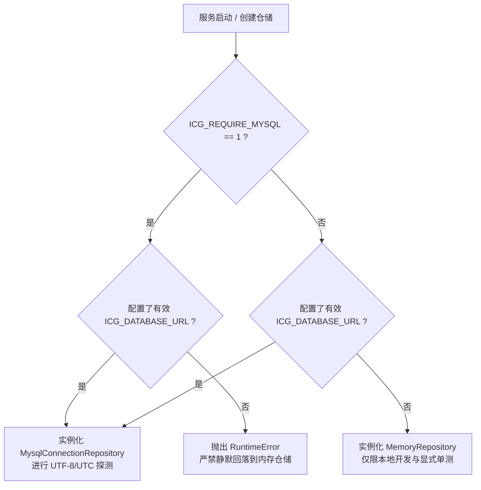
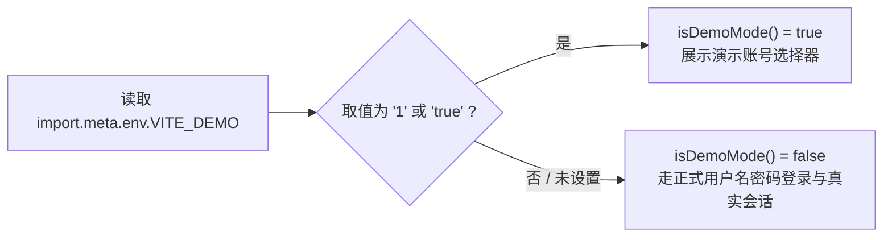

# 代码说明：默认路径诚实化与 MySQL 门禁严格化（D1）

为什么有这个文件：记录 D1 默认路径诚实化与 MySQL 门禁严格化涉及的代码入口、时序流转、错误防护与测试覆盖，供前后端协作者核对。

它解决什么问题：清晰解释 `mysql_gate.py` 严格抛错机制、`main.py` 生产实例初始化逻辑、前端 `roles.ts` 的 `isDemoMode()` 判定逻辑，避免后续修改再次引入静默回退缺陷。

<!-- code-explanation:start -->
| 项目 | 记录 |
|---|---|
| 关联任务 | DEMO-MYSQL-DEFAULTS-2026-10-26 / D1 |
| 交付文件 | `docs/delivery/2026-10-26-demo-mysql-defaults.md` |
| 影响模块 | `backend/bid-core/icg/infra/mysql_gate.py`、`backend/bid-core/icg_demo/main.py`、`frontend/web/src/shared/roles.ts`、`AGENTS.md` |
<!-- code-explanation:end -->

## 1. 核心代码变更清单

| 文件 | 变更类型 | 核心逻辑 |
|---|---|---|
| [`backend/bid-core/icg/infra/mysql_gate.py`](../../backend/bid-core/icg/infra/mysql_gate.py) | 核心门禁修改 | 移除 `and "pytest" not in sys.modules` 漏洞分支，在 `mysql_required()` 且无 URL 时强制抛出 `RuntimeError` |
| [`backend/bid-core/icg_demo/main.py`](../../backend/bid-core/icg_demo/main.py) | 入口保护 | 顶层 `app = create_app(...)` 调整为测试环境惰性挂载，生产环境立即挂载 |
| [`frontend/web/src/shared/roles.ts`](../../frontend/web/src/shared/roles.ts) | 策略对齐 | `isDemoMode()` 在 `VITE_DEMO` 未定义或非 `'1'`/`'true'` 时统一返回 `false` |
| [`tests/backend/test_mysql_gate.py`](../../tests/backend/test_mysql_gate.py) | 单元测试 | 新增 `test_repository_from_environment_raises_when_required_and_url_missing` 与 `test_repository_from_environment_allows_memory_when_not_required` 断言 |
| [`frontend/web/tests/unit/roles-codes-convergence.test.mjs`](../../frontend/web/tests/unit/roles-codes-convergence.test.mjs) | 单元测试 | 新增 `isDemoMode defaults to false when unset` 断言 |

---

## 2. 门禁决策与状态流转

---

## 3. 前端演示开关逻辑对齐

该逻辑彻底杜绝了未设环境变量时默认进入演示模式的问题，落实了企业级正式路径作为系统第一公民的标准。
