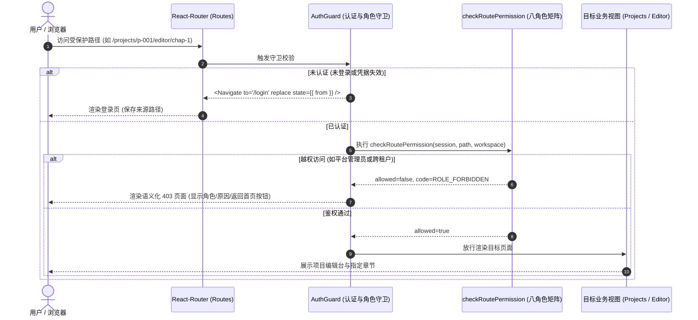
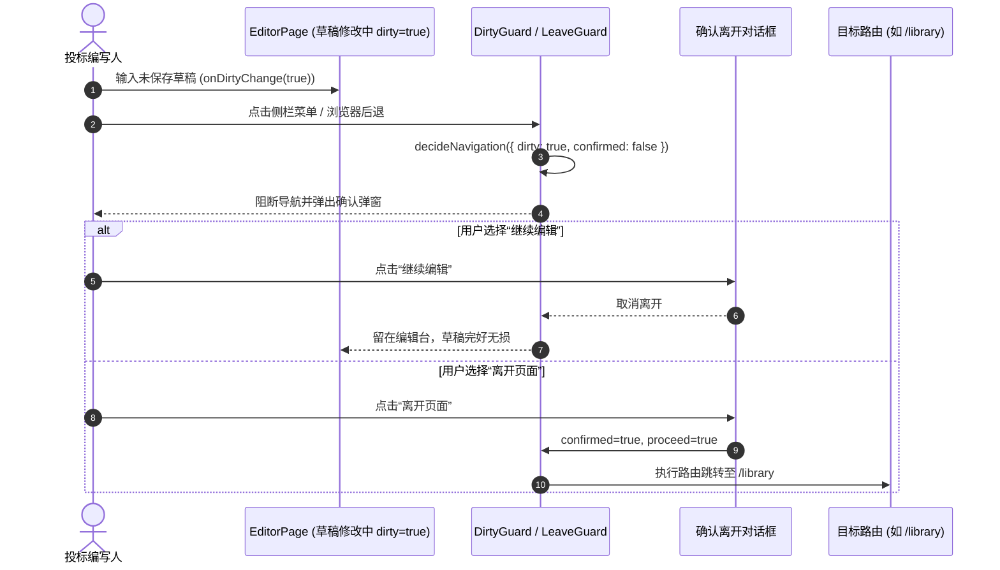

# 代码说明：React-Router 现代化路由体系与可信守卫落地（D5）

## 1. 为什么有这个文件

落实 2026-10-26 用户审计与官方拍板 B2（确定引入 React-Router）：将此前前端简易的字符串手动路由分发解耦为现代化的结构化 React-Router 体系，提供八角色可信守卫（`AuthGuard`）与脏状态拦截（`DirtyGuard`），实现深链接导航与参数化解析。

## 2. 架构设计与目录划分

严格遵循 AGENTS.md 前端八域架构与 Layout First 原则，所有改动严格收敛于 `frontend/web/src/app/`、`frontend/web/src/editor/` 与 `frontend/web/src/shell/`：

- **纯逻辑与常量层**：`frontend/web/src/app/routes-core.ts`
  - 导出 `APP_ROUTES` 路径常量字典；
  - 路径生成函数：`buildProjectPath(projectId, tab?)`、`buildEditorChapterPath(projectId, chapterId)`、`buildGlobalPath(routeId)`；
  - 语义化页面中文标题推导纯函数：`getRouteTitle(pathname)`；
  - 零 JSX 依赖，完美支持 Node 24 权威单元测试。
- **守卫组件与视图层**：`frontend/web/src/app/routes.tsx`
  - `AuthGuard`：
    1. 认证守卫：拦截未登录状态，自动重定向至 `/login`，并保留原目标路径到 `location.state.from`，登录后原路返回；
    2. RBAC 八角色守卫：配合现有 `roles.ts` 与 `route-guard.ts`，拦截越权访问（如平台管理员访问业务数据、只读成员创建项目、跨租户项目调阅），精准渲染语义化 `Forbidden403` 页面；
  - `DirtyGuard`：
    - 针对编辑器未保存修改，拦截页面切换与回退，通过二次确认弹窗（`modal.confirm`）保护编写人输入不丢失；
- **路径解析与兼容层**：`frontend/web/src/app/app-route.ts`
  - 扩展 `AppRoute` 类型：新增 `{ kind: 'login' }` 与项目深层章节编辑器 `{ kind: 'project', chapterId }`；
  - 双向兼容映射：
    - `/projects` 与 `/workbench`（投标项目工作台）；
    - `/writing-archive` 与 `/writing`（写作档案与规范）；
    - `/admin` 与 `/admin/rules`（企业合规与审计中心）；
    - `/projects/:projectId` 缺省自动定向至 `overview`；
    - `/projects/:projectId/proposal` 兼容映射至 `editor`；
    - `/projects/:projectId/editor/:chapterId` 提取 `chapterId` 供章节编辑器深层定位；
- **顶层装配与全局环境**：`frontend/web/src/main.tsx`
  - 使用 `<BrowserRouter>` 包裹整个应用根组件，为全站提供标准 HTML5 History 驱动上下文；
- **应用主入口对接**：`frontend/web/src/app/App.tsx`
  - 响应式监听 `location.pathname` 变化，自动触发项目工作区、标签页与公司资料集的按需载入；
  - `EditorPage` 接通 `initialChapterId` 深度链接；
  - 顶栏、模态弹窗（`ModelConfigModal`, `RagflowConfigModal`）及侧栏导航完整联动；
- **权威单测工程**：`frontend/web/tests/unit/react-router.test.mjs`
  - 覆盖路径常量完整性、深层章节构造、别名映射、标题推导、八角色越权拦截、跨公司隔离与脏状态拦截。

---

## 3. 核心机制时序图

### 3.1 认证与权限守卫流转



### 3.2 脏数据未保存离开拦截



---

## 4. 关键接口与模型契约

```typescript
// 规范化路由路径定义
export const APP_ROUTES = {
  ROOT: '/',
  LOGIN: '/login',
  PROJECTS: '/projects',
  WORKBENCH: '/workbench',
  PROJECT_DETAIL: '/projects/:projectId',
  PROJECT_TAB: '/projects/:projectId/:tab',
  PROJECT_EDITOR_CHAPTER: '/projects/:projectId/editor/:chapterId',
  LIBRARY: '/library',
  KNOWLEDGE: '/knowledge',
  WRITING_ARCHIVE: '/writing-archive',
  WRITING: '/writing',
  ADMIN: '/admin',
  ADMIN_RULES: '/admin/rules',
  JOBS: '/jobs',
} as const;

// 守卫组件接口定义
export interface AuthGuardProps {
  session: ApplicationSession | null;
  token: string | null;
  user: Account | null;
  workspace?: Workspace | null;
  children?: React.ReactNode;
  onNavigate?: (path: string) => void;
  onSwitchRole?: () => void;
}
```
