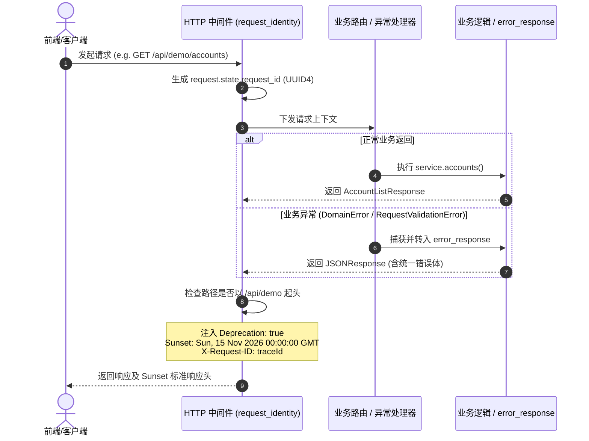
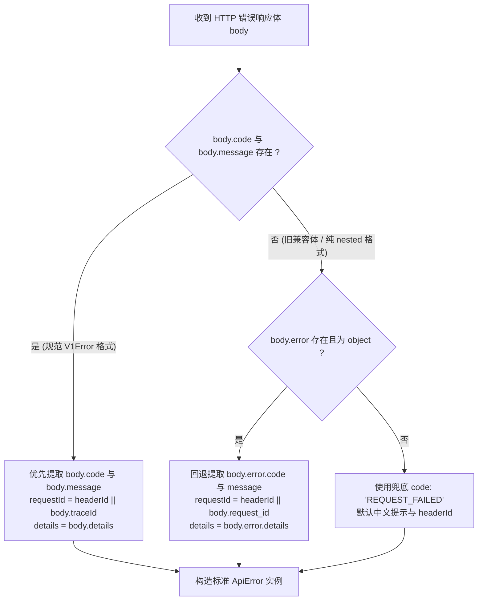

# 代码说明：双错误体收口、统一规范错误体与 /api/demo 废弃生命周期治理（D3）

为什么有这个文件：记录 D3 双错误体收敛、OpenAPI V1Error 标准解构优先化、以及 `/api/demo` 端点按 RFC 8594 Sunset 标准下线的关键代码变更与架构约束。

它解决什么问题：阐明前后端胶水层对错误体的优先解构时序、HTTP 响应头注入点、单测设计思路与向后兼容保障，杜绝后续迭代将新逻辑误写回废弃的 demo 端点。

<!-- code-explanation:start -->
| 项目 | 记录 |
|---|---|
| 关联任务 | PERSISTENCE-AND-ERROR-BODY-2026-10-26 / D3 |
| 交付文件 | `docs/delivery/2026-10-26-persistence-and-error-body.md` |
| 影响模块 | `backend/bid-core/icg_demo/main.py`、`backend/bid-core/README.md`、`frontend/web/src/shared/api.ts`、`frontend/web/src/status/status-views.ts`、`tests/backend/test_deprecated_demo_api.py`、`frontend/web/tests/unit/error-body-convergence.test.mjs` |
<!-- code-explanation:end -->

## 1. 核心代码变更清单

| 文件 | 变更类型 | 核心逻辑 |
|---|---|---|
| [`backend/bid-core/icg_demo/main.py`](../../backend/bid-core/icg_demo/main.py) | 中间件与错误响应 | 在 `request_identity` 中间件与 `error_response` 函数中为 `/api/demo` 路径注入 `Sunset: Sun, 15 Nov 2026 00:00:00 GMT` 与 `Deprecation: true` 响应头 |
| [`backend/bid-core/README.md`](../../backend/bid-core/README.md) | 接口说明同步 | 在接口说明表格中同步更新 `/api/demo` 端点的 Sunset 2026-11-15 废弃窗口期说明 |
| [`frontend/web/src/shared/api.ts`](../../frontend/web/src/shared/api.ts) | 错误拦截器优先级 | 调整 `apiFailure` 解构顺序，严格以顶层规范错误体 `{code, message, details, traceId}` 为第一优先级，仅当不存在时回退至旧 `nested` / `request_id` |
| [`frontend/web/src/status/status-views.ts`](../../frontend/web/src/status/status-views.ts) | 通用状态视图错误解构 | 调整 `extractErrorInfo`，确保展示层组件解构错误信息时与请求层保持相同的绝对规范优先序 |
| [`tests/backend/test_deprecated_demo_api.py`](../../tests/backend/test_deprecated_demo_api.py) | 专属联调测试 | 新增 5 项测试：验证 OpenAPI 契约 deprecated 元数据、成功/失败响应 Sunset 与 Deprecation 头下发、RFC 8594 日期合规性、以及 /api/v1 隔离性 |
| [`frontend/web/tests/unit/error-body-convergence.test.mjs`](../../frontend/web/tests/unit/error-body-convergence.test.mjs) | 专属前端单测 | 新增 5 项测试：纯规范体解构、双错误体共存时规范绝对优先、纯旧版兼容兜底、`extractErrorInfo` 优先级校验 |

---

## 2. 架构时序与错误体解构流转

### 2.1 请求生命周期与 Sunset 响应头注入

### 2.2 前端错误体双结构解析优先级

---

## 3. RFC 8594 Sunset 标准说明

依据 [RFC 8594: The Sunset HTTP Header Field](https://datatracker.ietf.org/doc/html/rfc8594)：
1. **Sunset 格式**：使用 RFC 7231 §7.1.1.1 规定的 IMF-fixdate 格式。
   - 拍板日期：2026 年 11 月 15 日 00:00:00 GMT（星期日）。
   - 报文头：`Sunset: Sun, 15 Nov 2026 00:00:00 GMT`。
2. **Deprecation 格式**：`Deprecation: true`。
3. **下线生命周期**：
   - 现阶段（2026-10-26 至 2026-11-15）：保留只读兼容，禁止增加任何新接口；
   - 到期后（2026-11-15 之后）：彻底移除 `/api/demo` 相关端点代码与兼容层。
