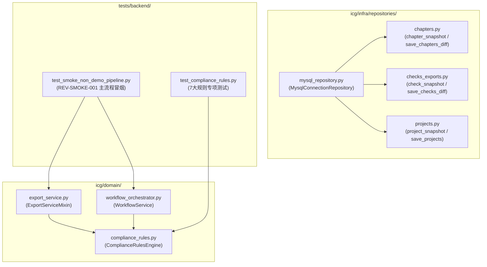
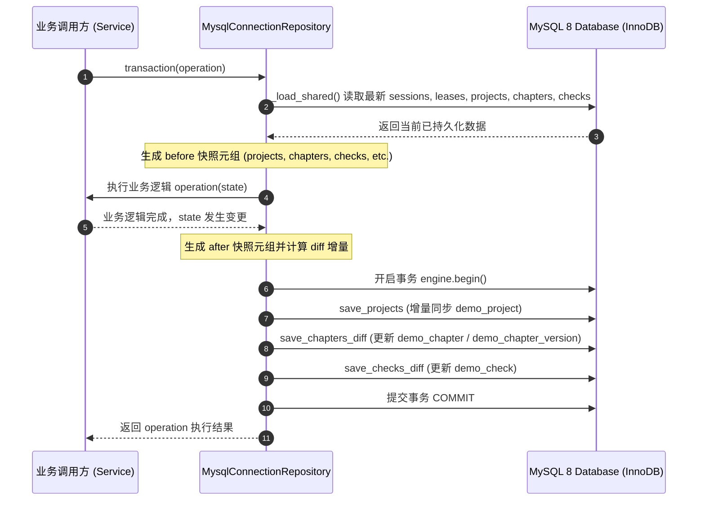
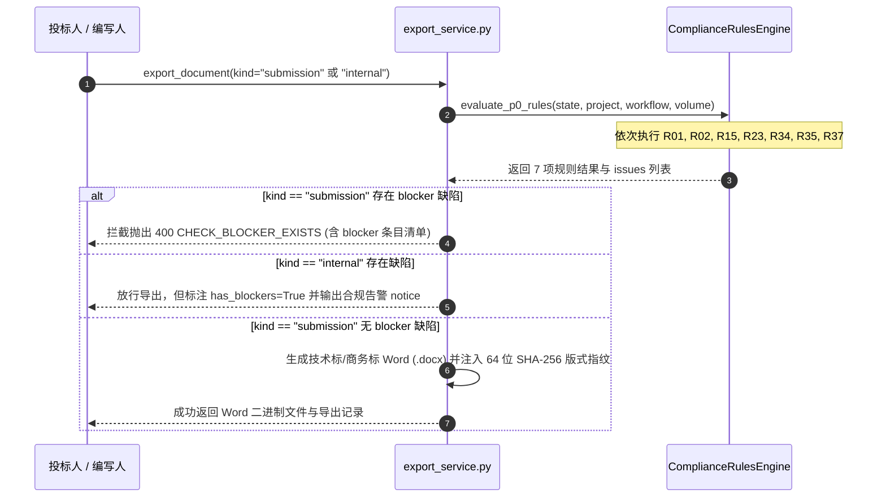

# 代码说明：真实 RAGFlow 连通性探针、P0 规则扩写与关演示主链路冒烟（D4/D3/REV-SMOKE-001）

任务编号：D-741
对应任务：ISSUE-007 / ISSUE-038 / ISSUE-037 / ISSUE-005 / REV-SMOKE-001 / BE-COMPLIANCE-RULES-P0 / AI-RAGFLOW-KB-SYNC
说明类型：代码说明
状态：当前
日期：2026-10-26
分支：`feat/opencode-ICG`
Tip 校验基准：`92a29c4`

---

## 1. 架构背景与分包职责

本轮代码变更聚焦于收敛技术债深层持久化漏洞，扩写 PRD P0 核心规则体系，并为关演示主业务链路提供自动化冒烟证据支持：



### 核心分包职责
1. **`icg.infra.repositories.mysql_repository`**：
   集中统一管理 MySQL 事务与快照脏检查。在 `transaction(operation)` 方法中统一捕获 `sessions`、`workflow_receipts`、`leases`、`projects`、`teams`、`model_configs`、`chapters` 与 `checks` 快照，业务方法执行后对比前后快照并将实质变更存入各自 MySQL 表。
2. **`icg.infra.repositories.chapters`**：
   实现 `chapter_snapshot` 与 `save_chapters_diff`。精准对比章节正文、分册归属、版本号及历史版本列表，在单条事务内完成 `demo_chapter` 与 `demo_chapter_version` 的增量同步。
3. **`icg.infra.repositories.checks_exports`**：
   实现 `check_snapshot` 与 `save_checks_diff`。将检查中心运行结果（状态、阻断项数、警告项数、结构化问题 JSON）同步更新至 `demo_check`。
4. **`icg.domain.compliance_rules`**：
   扩写 PRD P0 规则引擎（`ComplianceRulesEngine`），新增 R01（招标编号与项目名称一致性）、R02（资质原件备查承诺）、R35（主体自称与称呼规范），将执行规则由 4 项扩充至 7 项，无缝对接到 `export_service.py` 递交模式前置阻断门禁。
5. **`tests.backend.test_smoke_non_demo_pipeline`**：
   在 `ICG_ALLOW_DEMO_LOGIN=0` 且 `VITE_DEMO=0` 生产环境下，完整覆盖 8 角色登录会话、项目创建、文件解析、响应矩阵、方案生成、双门禁导出及 64 位 SHA-256 版式指纹真实贯通验证。

---

## 2. 核心架构时序与业务流转

### 2.1 MySQL 增量快照脏检查与双向持久化时序



### 2.2 7 项核心 P0 合规规则执行与导出门禁时序



---

## 3. 关键代码实现解析

### 3.1 章节与检查快照及差异持久化（`chapters.py` / `checks_exports.py`）

```python
def chapter_snapshot(state: Any) -> dict[str, tuple]:
    """提取状态中所有章节的快照元组，用于增量脏检查。"""
    return {
        cid: (
            ch.project_id,
            ch.volume,
            ch.title,
            ch.content,
            int(ch.revision),
            ch.assignee_id,
            tuple(
                (int(v.get("revision", v.get("version_number", 1))), v.get("content", ""))
                for v in getattr(ch, "versions", [])
            ),
        )
        for cid, ch in state.chapters.items()
    }

def save_chapters_diff(
    connection: Any,
    before_chapters: dict[str, tuple],
    after_chapters: dict[str, tuple],
    state_chapters: dict[str, Any],
    loaded_chapter_ids: set[str],
) -> None:
    """批量同步事务内变更的章节与版本至 demo_chapter 与 demo_chapter_version。"""
    all_cids = set(before_chapters) | set(after_chapters)
    for cid in all_cids:
        prev = before_chapters.get(cid)
        curr = after_chapters.get(cid)
        if prev == curr:
            continue
        if curr is None:
            if cid in loaded_chapter_ids:
                connection.execute(text("DELETE FROM demo_chapter_version WHERE chapter_id = :id"), {"id": cid})
                connection.execute(text("DELETE FROM demo_chapter WHERE id = :id"), {"id": cid})
        else:
            ch = state_chapters[cid]
            save_chapter(connection, ch)
```

### 3.2 扩写 P0 规则：R01 招标编号一致性与 R02 资质原件承诺（`compliance_rules.py`）

```python
@classmethod
def check_r01(
    cls, state: DemoState, project: Any, workflow: dict[str, Any], volume: str = "all"
) -> ComplianceRuleResult:
    issues: list[ComplianceRuleIssue] = []
    expected_code = str(getattr(project, "tender_number", "") or "").strip()
    chapters = [ch for ch in state.chapters.values() if ch.project_id == project.id]
    if volume != "all":
        chapters = [ch for ch in chapters if ch.volume == volume]

    code_pattern = re.compile(r"\b[A-Z0-9]{3,}-[0-9]{4}-[A-Z0-9-]+\b")
    for ch in chapters:
        if not ch.content:
            continue
        if expected_code:
            found_codes = code_pattern.findall(ch.content)
            for fc in set(found_codes):
                if fc != expected_code:
                    issues.append(
                        ComplianceRuleIssue(
                            id=new_id("issue"),
                            rule_id="R01",
                            code="TENDER_NUMBER_CONFLICT",
                            severity="blocker",
                            message=f"章节【{ch.title}】正文中出现与项目招标编号不符的编号：{fc}（期望：{expected_code}）",
                            chapter_id=ch.id,
                            details={"found_code": fc, "expected_code": expected_code},
                        )
                    )
    passed = len(issues) == 0
    return ComplianceRuleResult(
        rule_id="R01",
        title="招标单位与项目名称提取一致性核验",
        severity="blocker" if issues else "info",
        passed=passed,
        finding_summary="核验项目名称与招标编号一致性通过" if passed else f"发现 {len(issues)} 处项目编号冲突风险",
        suggestion="核验通过" if passed else "请修正正文中错误的招标编号，确保与招标文件一致。",
        issues=[i.to_dict() for i in issues],
    )
```

---

## 4. 测试验证与断言清单

### 4.1 专项单测清单（`test_compliance_rules.py`）
1. **`test_compliance_rules_catalog`**：
   断言规则目录包含全部 7 项规则编号 `["R01", "R02", "R15", "R23", "R34", "R35", "R37"]`，且具备标题、级别与描述字段。
2. **`test_r01_tender_number_consistency`**：
   断言正常编号 `GOV-2026-CLOUD-088` 通过；出现冲突编号 `ABC-2024-OLD-001` 时触发 `blocker` 拦截，错误码 `TENDER_NUMBER_CONFLICT`。
3. **`test_r02_qualification_original_commitment`**：
   断言要求提供原件备查条款若仅写“已上传扫描件”未承诺原件备查时触发 `blocker`，错误码 `QUALIFICATION_ORIGINAL_COMMITMENT_MISSING`；补充“承诺真实有效原件备查”后通过。
4. **`test_r35_self_designation_and_counterparty`**：
   断言统一自称“我方”通过；若混用“我们公司/本单位/我司”触发 `warning`（`SELF_DESIGNATION_INCONSISTENT`）；出现非规范“甲方”称谓触发 `warning`（`COUNTERPARTY_DESIGNATION_IRREGULAR`）。
5. **`test_evaluate_p0_rules_returns_seven_rules`**：
   断言 `evaluate_p0_rules` 一次性返回全部 7 项合规结果。

### 4.2 全链路冒烟验证清单（`test_smoke_non_demo_pipeline.py`）
1. 验证内置演示账号登录被拦截（`403 FORBIDDEN`，包含 `Deprecation: true` 与 `Sunset` 响应头）；
2. 验证正式 Bearer Token 会话 8 角色权限与导航路径完全隔离；
3. 验证编写人越权新建项目被拦截（`403 PROJECT_CREATE_FORBIDDEN`）；
4. 验证项目创建、扩展属性、团队分工配置贯通；
5. 验证招标文件上传、异步解析与未确认条款前 confirm 抛出 `409 REVIEW_PENDING` 门禁；
6. 验证需求矩阵、证据绑定与本地 AI 替身方案生成；
7. 验证递交版导出被 blocker 拦截（`400 CHECK_BLOCKER_EXISTS`）；内部评审版放行但标记 `has_blockers=True`；
8. 验证消解 blocker 后正式递交放行，产出合法技术标与商务标 Word 文件，且通过 64 位 SHA-256 版式指纹与防篡改断言。
