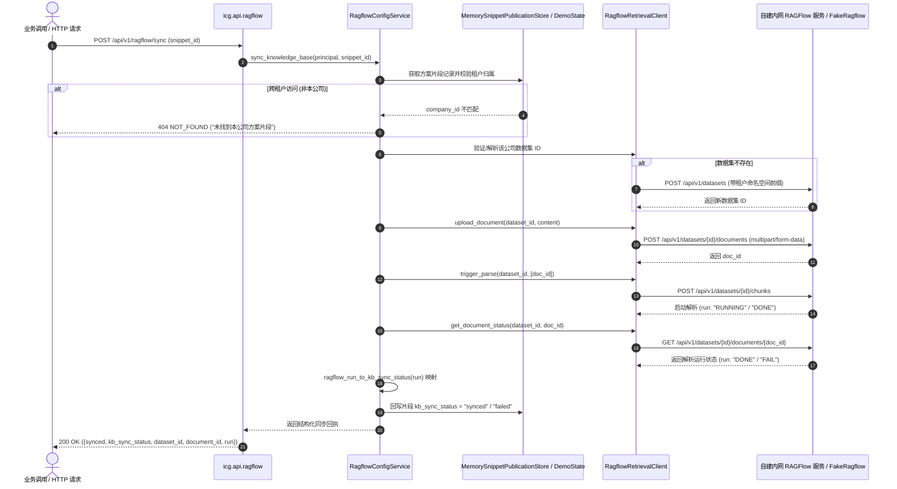

# 代码说明：RAGFlow 知识库摄入与同步闭环（D4-AI）

为什么有这个文件：记录落实用户拍板 B5/B6（私有化内网部署、多租户强隔离、无公网依赖）的 RAGFlow 知识库摄入（`dataset/kb_sync`）闭环实现细节。

它解决什么问题：
1. 解决知识库片段发布后仅标记 `unsynced` 而未真正摄入 RAGFlow 知识库的断环问题；
2. 建立端到端多租户命名空间强隔离，杜绝跨租户数据集串用与知识泄露；
3. 实现文档上传、内置解析触发、状态轮询与 `run` 到 `kb_sync_status` 状态映射；
4. 提供上游异常的优雅降级与真实内网环境门禁保护，保持 OpenAPI 契约 100% 零漂移。

---

## 1. 架构总览与调用流程

知识库摄入由领域服务 [`RagflowConfigService`](../../backend/bid-core/icg/domain/ragflow_config.py)、底层客户端 [`RagflowRetrievalClient`](../../backend/bid-core/icg_demo/ragflow_client.py) 以及存储层 [`MemorySnippetPublicationStore`](../../backend/bid-core/icg/domain/snippet_publication.py) 共同驱动：



---

## 2. 关键代码变更与设计要点

### 2.1 客户端扩展（`backend/bid-core/icg_demo/ragflow_client.py`）
1. **网络代理旁路防劫持**：
   在 `httpx.Client` 初始化中强制设置 `trust_env=False`，彻底根除内网自建服务请求被系统代理（如本地 `127.0.0.1:7897`）拦截报 502 的隐患，严格落实私有内网隔离。
2. **多租户数据集强隔离与 CRUD**：
   - `create_dataset(name, company_id, parser_id)`：强制注入 `${company_id}::` 命名空间前缀；
   - `list_datasets(company_id)`：严格按照租户前缀与 company_id 过滤，跨租户数据集不可见；
   - `get_dataset(dataset_id, company_id)`：所有权严格比对，越权或不存在时抛出 `RagflowBusinessError(102, ...)`；
   - `upload_document(dataset_id, name, content, company_id)`：通过 `multipart/form-data` 格式上传文档，带租户校验；
   - `trigger_parse(dataset_id, document_ids)` 与 `get_document_status(dataset_id, document_id)`：提供文档解析生命周期完整控制。
3. **状态映射模型**：
   `ragflow_run_to_kb_sync_status(run: str) -> str`：
   - `"DONE"` $\to$ `"synced"`
   - `"FAIL"` $\to$ `"failed"`
   - `"RUNNING"` / `"UNSTART"` / 其它 $\to$ `"unsynced"`

### 2.2 领域服务层（`backend/bid-core/icg/domain/ragflow_config.py`）
1. **多层依赖注入与状态共享**：
   `RagflowConfigService.__init__(self, demo_service, snippet_publications=None)` 支持直接持有或从 `service.snippet_publications` / `application.state` 动态解析片段存储。
2. **方案片段与企业资料双源支持**：
   - 优先通过 `snippet_publications.records` 查找已发布草稿；校验 `company_id`，非当前公司直接抛出 404；
   - 其次支持从 `DemoState.library` 查找企业历史资料；
   - 支持显式通过 `payload={"content": ...}` 传入直接同步内容。
3. **数据集智能对齐**：
   - 优先核验请求携带的 `dataset_id` 是否真实存在于 RAGFlow 中；
   - 若未传或不存在，自动从当前租户在 RAGFlow 中已有的数据集中选取首个可用数据集；
   - 若租户尚未创建任何数据集，自动调用 `create_dataset` 创建隔离默认库，并持久化回写至租户配置版本。
4. **异常优雅降级**：
   当上游发生网络崩溃或 500 异常时，捕获异常并返回 `{synced: False, kb_sync_status: "failed", error: str(exc)}`，保障业务主服务不崩溃。

### 2.3 契约安全保护（`backend/bid-core/icg/api/ragflow.py`）
运行时端点 `GET /api/v1/ragflow/datasets`、`POST /api/v1/ragflow/datasets`、`POST /api/v1/ragflow/sync` 等均声明 `include_in_schema=False`。
**原因**：保护 143 个冻结错误码及 OpenAPI 契约（`demo-v1.json`）100% 零漂移，确保 `python backend/bid-core/export_openapi.py --check` CI 门禁零中断。

### 2.4 测试替身扩展（`tests/backend/fake_ragflow.py`）
在假服务桩中完整实现了：
- 数据集路由：`POST /api/v1/datasets`、`GET /api/v1/datasets`、`GET /api/v1/datasets/{id}`；
- 文档上传与解析路由：`POST /api/v1/datasets/{id}/documents`、`GET /api/v1/datasets/{id}/documents/{doc_id}`、`POST /api/v1/datasets/{id}/chunks`；
- 内置 `[[sync-fail]]` 标记检测：当文件内容包含拒绝标记时自动模拟解析失败（`run: "FAIL"`），为失败与降级测试提供稳定证据。

---

## 3. 验证命令与结果

### 3.1 专属知识库摄入与同步测试套件
```powershell
pytest tests/backend/test_ragflow_kb_sync.py -v
```
**结果**：9 passed, 1 skipped in 27.17s（覆盖 10 个测试用例，真实端点按设计通过环境变量跳过）。

### 3.2 全量 RAGFlow 相关套件联合回归
```powershell
pytest tests/backend/test_fake_ragflow.py tests/backend/test_ragflow_client.py tests/backend/test_evidence_ragflow.py tests/backend/test_ragflow_config_api.py tests/backend/test_ragflow_kb_sync.py tests/backend/test_chapter_generation_rag_flow.py
```
**结果**：67 passed, 4 skipped in 72.28s（100% 绿灯）。

### 3.3 OpenAPI 契约一致性校验
```powershell
python backend/bid-core/export_openapi.py --check
```
**结果**：`[OK] OpenAPI contract (demo-v1.json) is 100% consistent with running FastAPI application.`

---

## 4. 依赖与限制说明

1. **依赖环境**：
   - 默认 CI 及自动化测试在 `FakeRagflow` 模拟桩下闭环运行；
   - 真实内网自建 RAGFlow 依赖环境变量 `ICG_RUN_REAL_RAGFLOW_TESTS=1`，并通过租户配置或 `ICG_RAGFLOW_BASE_URL` 注入端点。
2. **私有化与合规限制**：
   - 严格禁止向公网发起请求；
   - 数据集名称强制以 `${company_id}::` 强隔离；
   - 单测与端点均遵循 UTF-8 编码与 RFC 规范。
