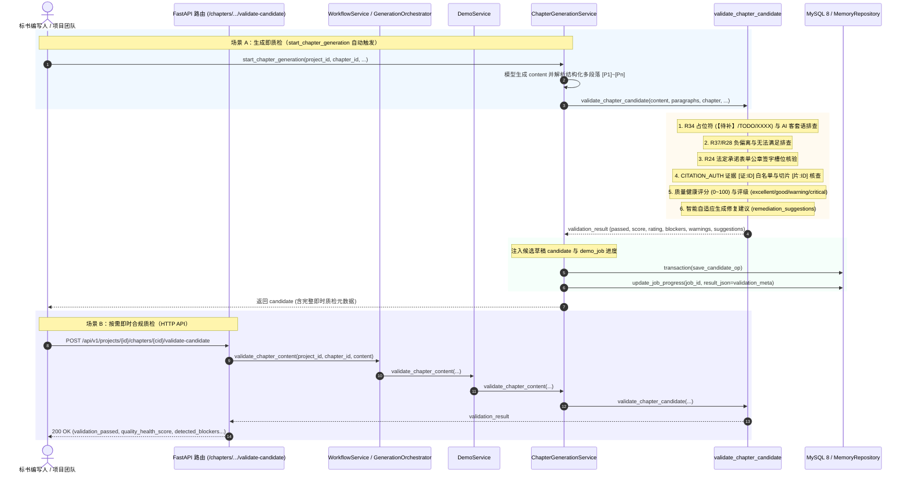

# AI-CHAPTER-AUTO-VALIDATION-GATE 代码说明：章节生成产物合规性自动即时质检门禁

## 1. 架构定位与业务拓扑

本模块作为 PRD MVP v1.8 §5.7.8《章节生成即时合规门禁》与 §5.10《合规检查中心与导出门禁》的核心门禁引擎，位于 `backend/bid-core/icg/domain/chapter_generation.py`。其核心使命是：**在大模型生成正文后（单章独立生成与批量多章节流水线调度），立即自动执行四维合规性质量核验（R34占位符/AI客套语、R37负偏离、R24法定表单公章签字槽位、CITATION_AUTH证据白名单），量化输出质量健康度评分（0~100）与评级（excellent/good/warning/critical），生成自适应修复建议，并无缝注入候选草稿（candidate）、异步任务进度（demo_job）与批量流水线全局看板（validation_summary）。**



---

## 2. 核心算法与数据结构实现

实现代码集中在 `backend/bid-core/icg/domain/chapter_generation.py`：

### 2.1 规则正则与违规关键字定义

```python
PLACEHOLDER_REGEXES = [
    re.compile(r"【待补(?:：[^】]*)?】"),
    re.compile(r"\[待补(?:：[^\]]*)?\]"),
    re.compile(r"待补"),
    re.compile(r"【待完善(?:：[^】]*)?】"),
    re.compile(r"\[待完善(?:：[^\]]*)?\]"),
    re.compile(r"待完善"),
    re.compile(r"【待确认(?:：[^】]*)?】"),
    re.compile(r"\[待确认(?:：[^\]]*)?\]"),
    re.compile(r"待确认"),
    re.compile(r"【占位(?:：[^】]*)?】"),
    re.compile(r"\[占位(?:：[^\]]*)?\]"),
    re.compile(r"占位符"),
    re.compile(r"【待定(?:：[^】]*)?】"),
    re.compile(r"\[待定(?:：[^\]]*)?\]"),
    re.compile(r"\b(?:TODO|TBD|FIXME|XXXX|XXX)\b", re.IGNORECASE),
    re.compile(r"\{\{(?!(?:fact|sla):)[^}]+\}\}"),
    re.compile(r"\$\{(?!(?:fact|sla):)[^}]+\}"),
]

AI_CONVERSATION_RESIDUALS = [
    "希望对你有帮助", "希望能帮到您", "希望能帮助到您",
    "作为AI语言模型", "作为AI大模型", "作为人工智能模型", "作为大语言模型",
    "以下是为您生成的", "如需进一步修改", "希望以上方案能满足",
    "如果还有其他需要补充", "如有其他需求", "祝您投标顺利",
]

NEGATIVE_DEVIATION_TRIGGERS = [
    "不满足", "负偏离", "无法提供", "存在差距", "无法满足",
    "不符合要求", "未能达到", "偏离招标要求", "指标不满足",
    "存在负偏离", "重大负偏离", "实质性负偏离", "技术参数低于要求",
    "未能完全满足", "无法按期交付", "无法承诺",
]

STATUTORY_FORM_KEYWORDS = (
    "投标函", "法定代表人身份证明", "授权委托书",
    "签署页", "签字盖章页", "承诺书", "投标声明",
    "服务承诺书", "廉政承诺书", "安全承诺书", "保密承诺书",
)

VALID_SEAL_MARKERS = (
    "(盖章)", "（盖章）", "[公章]", "【公章】", "[盖章]", "(公章)", "（公章）",
    "(签字)", "（签字）", "[签名]", "[法定代表人签字]", "（法定代表人签字）", "(法定代表人签字)",
    "电子签名", "电子印章", "CA签章", "已盖章", "已签名", "法定代表人签字或盖章", "【法定代表人签字】", "【公章/签字】"
)

MISSING_SEAL_TRIGGERS = (
    "未盖公章", "未签字", "(未盖章)", "（未盖章）", "[未签名]", "(未签名)", "（未签名）",
    "待盖章", "待签字", "印章缺失", "签名缺失", "印章未齐", "无签字"
)
```

### 2.2 质量健康度评分（0~100）与评级梯度模型

```python
blocker_count = len(detected_blockers)
warning_count = len(detected_warnings)

if blocker_count == 0:
    validation_passed = True
    validation_failed = False
    if warning_count == 0:
        quality_health_score = 100
        quality_health_rating = "excellent"
    elif warning_count == 1:
        quality_health_score = 90
        quality_health_rating = "excellent"
    elif warning_count == 2:
        quality_health_score = 80
        quality_health_rating = "good"
    elif warning_count == 3:
        quality_health_score = 70
        quality_health_rating = "warning"
    else:
        quality_health_score = max(50, 100 - warning_count * 10)
        quality_health_rating = "warning"
else:
    validation_passed = False
    validation_failed = True
    if blocker_count == 1:
        quality_health_score = max(40, 55 - warning_count * 5)
        quality_health_rating = "warning" if quality_health_score >= 50 else "critical"
    else:
        quality_health_score = max(0, 35 - (blocker_count - 2) * 15 - warning_count * 5)
        quality_health_rating = "critical"
```

梯度特征：
- 零瑕疵直接评定 100 分（`excellent`）；
- 存在 1~2 处知识库切片未校验告警（warning），评定为 90/80 分（`excellent`/`good`），保持 `validation_passed = True`，不阻断正常工作流；
- 出现 1 处阻断（blocker，如占位符未清或负偏离），强制扣减至 55 分（`warning`），判定 `validation_passed = False` 与 `validation_failed = True`；
- 出现 2 处及以上阻断，扣减至 35 分及以下（`critical`），强阻断风险提醒。

### 2.3 自适应修复建议清单生成

```python
all_codes = {b.get("code") for b in detected_blockers} | {w.get("code") for w in detected_warnings}
if "PLACEHOLDER_RESIDUAL" in all_codes or "AI_CONVERSATION_RESIDUAL" in all_codes:
    remediation_suggestions.append("请清除章节正文中的未替换占位符（如【待定】/TODO）与AI对话客套语，补充真实业务描述。")
if "NEGATIVE_DEVIATION_DETECTED" in all_codes:
    remediation_suggestions.append("正文包含负偏离表述，请核实招标文件实质性指标要求并改写为完全满足。")
if "MANDATORY_SEAL_SIGNATURE_MISSING" in all_codes:
    remediation_suggestions.append("法定表单章节必须包含公章与法定代表人签字槽位（如【盖章】、【法定代表人签字】），且不得包含未盖章标记。")
if "FABRICATED_OR_INVALID_EVIDENCE_CITATION" in all_codes:
    remediation_suggestions.append("检测到虚构证据编号，请仅引用项目响应矩阵已关联并核对有效的真实资质/业绩编号。")
if "UNVERIFIED_SNIPPET_CITATION" in all_codes:
    remediation_suggestions.append("建议核对知识库切片引用编号有效性，或重新匹配当前知识库候选切片。")
```

---

## 3. 全链路协同注入机制

### 3.1 候选草稿实体（candidate）与异步任务（demo_job）注入

在 `ChapterGenerationService.start_chapter_generation` 中：
```python
candidate = {
    "id": cand_id,
    "content": content,
    "structured_content": structured_content,
    "paragraphs": paragraphs,
    "scoring_subheadings": scoring_subheadings,
    "base_revision": chapter.revision,
    "input_fingerprint": project_input_fingerprint(state, project_id),
    "context_fingerprint": context_fingerprint,
    "token_budget_usage": token_budget_usage,
    "provider": getattr(provider, "name", "model"),
    "is_real_model": bool(getattr(provider, "is_real_model", False)),
    "created_at": now_iso,
    "source_scope": "whole_chapter",
    "input_snapshot": input_snapshot,
    "validation_passed": validation_res["validation_passed"],
    "validation_failed": validation_res["validation_failed"],
    "quality_health_score": validation_res["quality_health_score"],
    "quality_health_rating": validation_res["quality_health_rating"],
    "detected_blockers": validation_res["detected_blockers"],
    "detected_warnings": validation_res["detected_warnings"],
    "remediation_suggestions": validation_res["remediation_suggestions"],
    "validation_report": validation_res["validation_report"],
}
```
在异步任务进度回调中：
```python
self.repository.update_job_progress(
    job_id,
    progress=100,
    status="completed",
    step_name="章节生成完成",
    result_json={
        "candidate_id": cand_id,
        "chapter_id": chapter_id,
        "token_budget_usage": token_budget_usage,
        "context_fingerprint": context_fingerprint,
        "paragraph_count": len(paragraphs),
        "validation_passed": validation_res["validation_passed"],
        "quality_health_score": validation_res["quality_health_score"],
        "quality_health_rating": validation_res["quality_health_rating"],
        "blocker_count": len(validation_res["detected_blockers"]),
    },
)
```

### 3.2 批量流水线全局质量看板聚合

在 `ChapterGenerationService.schedule_batch_pipeline` 中：
```python
total_validation_passed = sum(1 for r in successful_results.values() if r.get("validation_passed", True))
total_validation_failed = sum(1 for r in successful_results.values() if not r.get("validation_passed", True))
total_detected_blockers = sum(len(r.get("detected_blockers", [])) for r in successful_results.values())
average_quality_score = round(
    sum(r.get("quality_health_score", 100) for r in successful_results.values()) / max(1, len(successful_results)),
    1,
) if successful_results else 100.0

validation_summary = {
    "total_validation_passed": total_validation_passed,
    "total_validation_failed": total_validation_failed,
    "total_detected_blockers": total_detected_blockers,
    "average_quality_score": average_quality_score,
}
dashboard_record["validation_summary"] = validation_summary
```
单事务原子落盘至 `workflow["batch_pipeline_runs"]` 与 `workflow["latest_batch_pipeline_run"]`。

---

## 4. 自动化测试套件与映射说明

位于 `tests/backend/test_ai_chapter_validation_gate.py`，共 12 项专属用例：

| 测试函数 | 验证重点 | 对应业务验收项 |
|---|---|---|
| `test_clean_generated_chapter_passes_validation` | 清洁、无占位符正文 100% 通过验证 | 评分 100，评级 excellent，通过标定 |
| `test_r34_placeholder_residuals_trigger_blocker` | R34 占位符（【待补】/TODO/XXXX）与 AI 对话客套语句阻断 | 抛出 `PLACEHOLDER_RESIDUAL` / `AI_CONVERSATION_RESIDUAL` blocker |
| `test_r37_negative_deviation_triggers_blocker` | R37 负偏离与无法满足排查 | 抛出 `NEGATIVE_DEVIATION_DETECTED` blocker |
| `test_r24_statutory_form_seal_signature_missing` | R24 法定承诺书签字盖章槽位缺失与未盖公章排查 | 抛出 `MANDATORY_SEAL_SIGNATURE_MISSING` blocker |
| `test_citation_auth_fabricated_evidence_and_unverified_snippet` | 虚构证据阻断与未知切片警告 | 抛出 `FABRICATED_OR_INVALID_EVIDENCE_CITATION` blocker 与 `UNVERIFIED_SNIPPET_CITATION` warning |
| `test_quality_health_score_and_rating_gradation` | 评分（0~100）与评级（excellent/good/warning/critical）梯度 | 验证各瑕疵组合的精确分值与等级标定 |
| `test_start_chapter_generation_integrates_validation` | 单章生成即时质检全流程 | candidate 元数据与 demo_job result_json 注入校验 |
| `test_batch_pipeline_aggregates_validation_summary` | 批量流水线质检看板汇总 | chapters_metadata 状态与 validation_summary 仪表盘聚合校验 |
| `test_service_validate_chapter_content_on_demand` | 独立按需合规质检方法 | `validate_chapter_content` 正常与瑕疵文本调用校验 |
| `test_multitenant_isolation_and_rbac_gates` | 多租户强隔离与系统只读角色拦截 | 跨企业 404 NOT_FOUND，只读角色 403 FORBIDDEN |
| `test_sensitive_project_local_model_gate` | 涉密项目本地模型硬门禁 | 云端外部模型拦截 403 `SENSITIVE_PROJECT_REQUIRES_LOCAL_MODEL` |
| `test_http_api_validate_candidate_endpoint` | HTTP API 端点端到端集成 | `POST /chapters/{cid}/validate-candidate` 200 与 404 响应校验 |
