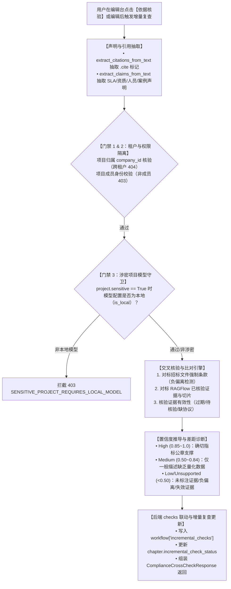

# 为什么有这个文件：说明 AI 合规检查依据交叉核验与差距诊断服务（AI-COMPLIANCE-CROSS-CHECK）的技术架构、算法设计、置信度推导矩阵与安全门禁。
# 它解决什么问题：
# 1. 声明内容与 .cite 引用多模态智能抽取：精准识别正文段落中出现的 SLA 数值承诺（可用性指标、响应/恢复时限、服务覆盖时段、巡检频次、RTO/RPO）、资质认证、人员团队能力、业绩案例及重大服务承诺；
# 2. 交叉核验与差距诊断：比对 RAGFlow 已核验资料与招标文件强制条款，针对“正文承诺 99.99% 高可用但证据仅为一般性架构描述”等缺乏量化依据支撑场景，输出依据置信度得分（0.0~1.0）、置信等级与具备针对性的改进建议；
# 3. 负偏离合规强阻断：当正文承诺指标劣于招标文件强制条款（如响应时限劣于招标要求）或引用已过期/缺协议证据时，评定为 0.0 置信度并阻断（risk=block），防范废标风险；
# 4. 后端 checks 服务与增量复查联动：将诊断结果完整沉淀至 workflow['incremental_checks']，更新章节 incremental_check_status（passed/warning/failed）；
# 5. 敏感项目与多租户权限隔离：涉密项目强拦截云端非本地模型（403 SENSITIVE_PROJECT_REQUIRES_LOCAL_MODEL），跨租户拦截 404 NOT_FOUND，非项目成员拦截 403 FORBIDDEN；
# 6. OpenAPI 契约零漂移：路由使用 include_in_schema=False 保护契约。

# AI-COMPLIANCE-CROSS-CHECK 代码解释：AI 合规检查依据交叉核验与差距诊断

- 任务标识：`AI-COMPLIANCE-CROSS-CHECK`
- 关联需求：AI 合规检查依据交叉核验与差距诊断
- 关联 Issue：[ISSUE-037](../../issues/ISSUE-037.md)、[ISSUE-007](../../issues/ISSUE-007.md)
- 规范出处：[PRD v1.8 §5.8、§5.11.5、§5.11.6](../../docs/reference/product/prd-mvp-v1.8.md)
- 依赖任务：`APP-M2-T185`（采纳原地回写）、`AI-EDITOR-CONTEXT-LINKAGE`（章节上下文感知与划词引用联动）
- 交付报告：[AI-COMPLIANCE-CROSS-CHECK 交付](../delivery/AI-COMPLIANCE-CROSS-CHECK.md)
- 核心代码路径：
  - `backend/bid-core/icg_demo/compliance_cross_check.py`（核心核验服务类、抽取规则、置信度算法与差距推导）
  - `backend/bid-core/icg_demo/workflow_schemas.py`（定义 `ComplianceFinding`、`ComplianceCrossCheckRequest`、`ComplianceCrossCheckResponse`）
  - `backend/bid-core/icg_demo/domain.py`（挂载 `compliance_cross_check` 业务方法）
  - `backend/bid-core/icg_demo/workflow.py`（暴露 `compliance_cross_check` 门面接口）
  - `backend/bid-core/icg_demo/workflow_routes.py`（注册 HTTP POST 端点并指定 `include_in_schema=False`）
  - `tests/backend/test_ai_compliance_cross_check.py`（9 项专属自动化单测）

---

## 1. 架构总览与交互流程

---

## 2. 核心算法设计与抽取逻辑

### 2.1 多维度声明抽取（`extract_claims_from_text`）
服务通过高鲁棒性的语义正则和模式抽取五大类关键声明：
1. **SLA 与性能指标承诺（`sla_metric`）**：
   - 可用性指标：双向适配 `99.99% 可用性` 或 `业务可用性达到 99.99%`；
   - 响应与恢复时限：匹配如 `15分钟响应`、`30分钟内到达现场`、`2小时内恢复`；
   - 服务时间覆盖：`7×24小时`、`7*24小时`、`5×8小时`；
   - 巡检频次：`每周2次巡检`、`每月1次例行健康检查`；
   - 容灾指标：`RTO < 30分钟`、`RPO = 0`。
2. **企业资质认证声明（`qualification`）**：
   - 抽取 `CMMI5级`、`ISO27001`、`ISO9001`、`ITSS一级`、`高新技术企业`、`系统集成一级资质`。
3. **人员与团队配置声明（`personnel`）**：
   - 抽取 `10年以上相关经验`、`持有 PMP 证书`、`高级工程师`、`配置 20 人专职运维团队`。
4. **历史案例与业绩经验（`case_experience`）**：
   - 抽取 `具备 5 个以上类似成功案例`、`合同金额不低于 1000 万元`。
5. **重大服务通用承诺（`general_promise`）**：
   - 抽取 `驻场保障服务`、`免费备品备件库`、`支持零数据丢失`、`原厂备件保障`。

### 2.2 基于字符物理位点的精确引用绑定
当同一段落包含多个声明和多个 `.cite` 引用胶囊（如 `我司具备 CMMI5 认证 [证:cite-01]，同时承诺驻场服务 [证:cite-02]`）时：
- 服务记录每个 claim 的起止字符偏移量 `(start, end)`；
- 优先查找紧随当前声明之后的带 ID 引用胶囊（`closest citation where start >= claim.end`）；
- 若段落仅有单个引用，则自动绑定该唯一引用；
- 若段落无行内引用，自动核查章节已挂依据列表中语义匹配的条目。

---

## 3. 交叉核验矩阵与置信度推导规则

| 交叉核验场景 | 证据状态 | 核心比对特征 | 置信度得分 | 置信等级 | 风险级别 | 差距诊断与改进建议示例 |
|---|---|---|---|---|---|---|
| **充分量化证据支撑** | `valid` | 声明数值（如 `99.99%`）在已核验证据正文或公章测评报告中完全吻合 | **0.95** | `high` | `info` | 依据充分，与正文声明严格相符。建议保持。 |
| **仅一般描述缺乏量化数据** | `valid` | 正文做高额数值承诺（如 `99.99%可用性`），但佐证仅有文字性高可用架构设计描述，无明确测评数据 | **0.55** | `medium` | `warning` | 正文承诺 99.99%，但引用证据仅包含一般架构描述，缺乏公章承诺或第三方 SLA 测评指标支撑。建议补充上传评测报告或盖章承诺。 |
| **正文负偏离硬性条款** | — | 正文承诺指标（如响应时间 30 分钟）劣于招标文件条款要求（15 分钟） | **0.00** | `unsupported` | `block` | 正文承诺指标劣于招标文件条款要求，构成负偏离废标风险。必须将响应时间调整至 15 分钟以内。 |
| **声明缺乏依据标注** | `missing` | 正文作出了关键承诺或资质声称，但在正文中未标注任何依据引用 | **0.15 ~ 0.40** | `unsupported` / `low` | `warning` | 段落陈述了强承诺，但正文中未关联任何佐证依据。建议在资料库核查并添加 `[证:ID]` 标记。 |
| **引用证据已失效/过期** | `expired` | 引用的证据已超过有效截止时间（`is_expired=True`） | **0.00** | `unsupported` | `block` | 引用的证据已超过有效截止时间，属于失效依据。请更新该证据资质证明。 |
| **合作伙伴缺失合作协议** | `missing_agreement` | 合作伙伴资料未上传联合体协议或分包合作协议 | **0.00** | `unsupported` | `block` | 引用的合作伙伴证据缺少合作协议。请补传合作协议，否则不可作为合规依据。 |
| **证据尚未审核确认** | `pending_verification` | 引用的证据处于待核验草稿态 | **0.40** | `medium` | `warning` | 证据尚未经录入人或管理员确认。建议先完成核验后再引用。 |

---

## 4. 后端 checks 服务与章节状态联动

- 核验完成后，整体评估章节合规性：
  - 若存在任意 `risk_level == "block"` 的诊断项，`compliance_status = "non_compliant"`，触发 `chapter.incremental_check_status = "failed"`；
  - 若无阻断但存在 `risk_level == "warning"`，`compliance_status = "warning"`，触发 `chapter.incremental_check_status = "warning"`；
  - 若全部为高置信度支撑，`compliance_status = "compliant"`，触发 `chapter.incremental_check_status = "passed"`；
- 诊断结果沉淀至 `DemoState.workflows[project_id]["incremental_checks"]` 供项目合规中心追溯历史；
- 阻断与警告项同步构建标准 `CheckIssue` 结构体，供导出前检查中心读取。
