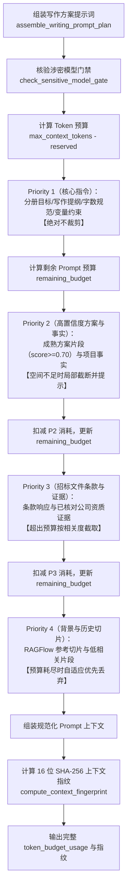

# AI-DYNAMIC-PROMPT-CONTEXT 代码说明：自适应 Prompt 动态上下文裁剪与 Token 预算控制

本文档详细说明自适应 Prompt 动态上下文裁剪与 Token 预算控制（`AI-DYNAMIC-PROMPT-CONTEXT`）的代码架构、算法逻辑与集成细节。

## 1. 架构定位与业务时序

在投标文件大纲章节生成（APP-M2-T124 / APP-M2-T126）链路中，当项目事实、条款响应、公司证据、高置信度方案片段与 RAGFlow 背景切片逐渐积累膨胀时，Prompt 总字符数容易超出大语言模型的上下文窗口限制（如 4096 / 8192 Token）。若无自适应预算控制，容易引发截断报错、重要指令丢失或输出截断。

本模块在 `backend/bid-core/icg/domain/prompt_budget.py` 中引入 `DynamicPromptContextManager`，根据上下文预算执行 **四级优先级动态自适应裁剪**：



---

## 2. 算法与核心逻辑详解

### 2.1 中英文加权 Token 估算算法（`estimate_tokens`）
不同语言在主流大模型 Tokenizer（如 Qwen Byte-Pair Encoding）中的分词效率存在显著差异：
- 中文字符：1 个中文字符通常占 0.6 ~ 0.8 个 Token，加权权重设为 `0.7`；
- 英文单词与数字串：1 个英文单词通常占 1.2 ~ 1.4 个 Token，加权权重设为 `1.3`；
- 标点符号与空白字符：加权权重设为 `0.3`。

估算公式：
$$\text{Estimated Tokens} = \lceil N_{\text{chinese}} \times 0.7 + N_{\text{words}} \times 1.3 + N_{\text{others}} \times 0.3 \rceil$$

空字符串返回 0，非空文本至少计 1 Token。

### 2.2 四级优先级分层裁剪策略

1. **Priority 1 (Core & System Constraints)**：
   - 角色设定与项目分册目标；
   - 章节小标题提纲与得分要点（`writing_points`）；
   - 目标字数预期（`target_length`）；
   - 事实变量保留规范（如 `{{fact:xxx}}` 严禁手写替换）；
   - 证据引用标记规范（`[证]` 引用与 `[片]` 参考边界）。
   - **裁决**：优先级最高，无论预算如何紧缩，绝对不裁剪。
2. **Priority 2 (High-Confidence Snippets & Project Facts)**：
   - 精确匹配度 $\ge 0.70$ 的成熟企业方案片段；
   - 项目已核对的事实与 SLA 变量清单。
   - **裁决**：若剩余预算充足则全量吸纳；若剩余预算不足但仍有缓冲（$\ge 80$ Token），执行局部自适应截断并追加清晰告示（`...[因Token预算限制，该方案片段后续内容已截断]`）；若彻底不足则记录为 `omitted_due_to_budget`。
3. **Priority 3 (Tender Clauses & Confirmed Evidence)**：
   - 招标文件条款及应答（`requirements`）；
   - 公司资料库已核对的有效资质与业绩证明（`evidence`）。
   - **裁决**：在剩余可用预算内依次填入；超出预算条目记入 `truncated_items`。
4. **Priority 4 (Background References & Low-Confidence Snippets)**：
   - RAGFlow 检索候选切片（`retrieved_evidence`）；
   - 匹配度 $< 0.70$ 的方案参考。
   - **裁决**：最低优先级，预算紧张时最先丢弃，记录为 `dropped_low_priority_due_to_budget`。

### 2.3 16 位 SHA-256 上下文指纹（`compute_context_fingerprint`）
为防止Prompt装配过程被隐式篡改或重放，系统基于最终保留的结构化数据计算确定性指纹：
```python
payload = {
    "chapter_id": chapter_id,
    "core": core_summary,
    "p2": sorted(retained_p2_ids),
    "p3": sorted(retained_p3_ids),
    "p4": sorted(retained_p4_ids),
    "facts": facts_snapshot,
}
fingerprint = hashlib.sha256(json.dumps(payload, sort_keys=True).encode()).hexdigest()[:16]
```
任何项目事实、小标题或保留片段的变动，指纹立即突变。

### 2.4 涉密隔离与防编造红线
- **涉密项目本地模型门禁（`check_sensitive_model_gate`）**：
  若项目标记为敏感项目（`project.sensitive = True`），检查绑定或默认模型配置的 `is_local` 与 `allow_sensitive` 属性；若为云端模型，严格抛出 403 `SENSITIVE_PROJECT_REQUIRES_LOCAL_MODEL`，禁止任何数据发往外网。
- **未匹配变量防幻觉（`missing_variables`）**：
  扫描方案片段中所有的变量占位符，若项目事实字典中未定义，严格收集到 `missing_variables`，并标定 `has_missing_variables = True`，禁止模型猜测或编造默认值。

---

## 3. 代码变更结构

### 3.1 核心新增与修改模块
1. `backend/bid-core/icg/domain/prompt_budget.py`：
   - 定义 `TokenBudgetUsage` 数据类；
   - 落地 `estimate_tokens` 加权算法；
   - 落地 `compute_context_fingerprint` 指纹生成；
   - 落地 `check_sensitive_model_gate` 门禁；
   - 实现 `DynamicPromptContextManager`。
2. `backend/bid-core/icg/domain/chapter_generation.py`：
   - `assemble_writing_prompt_plan`：解析项目模型配置上下文窗口，实例化 `DynamicPromptContextManager`，调用动态装配并输出 Token 统计与上下文指纹；
   - `ChapterGenerationService.start_chapter_generation`：将 `token_budget_usage` 与 `context_fingerprint` 持久化记录至 `job_data`、`final_job` 与章节生成成果 `candidate`。
3. `backend/bid-core/icg/domain/domain.py` 与 `icg/domain/generation_service.py`：
   - 在顶层服务门面中透传 `max_context_tokens` 与 `snippet_matches`。
4. `backend/bid-core/icg_demo/prompt_budget.py` 与 `backend/bid-core/icg_demo/snippet_retrieval.py`：
   - 兼容层轻量重导出，保障向后兼容。

---

## 4. 验证与回归总结

专属单测套件 `tests/backend/test_ai_prompt_budget.py` 覆盖以下核心场景：
1. `test_token_estimation_chinese_and_english_weighted`：中英文加权分词估算精确性；
2. `test_priority_1_core_never_truncated_under_tight_budget`：P1 核心指令在紧缩预算下绝对不裁剪；
3. `test_priority_adaptive_truncation_p4_dropped_first`：P4 背景切片在预算受限时优先被丢弃；
4. `test_priority_2_snippet_partial_truncation`：P2 成熟方案在空间有限时局部截断并追加告示；
5. `test_token_budget_usage_statistics_accuracy`：Token 使用统计结构与分级分解完整性；
6. `test_context_fingerprint_deterministic_and_tamper_evident`：16 位上下文防伪指纹防篡改；
7. `test_missing_variables_detected_without_hallucination`：缺失变量如实上报，杜绝虚构编造；
8. `test_sensitive_project_blocks_cloud_model`：涉密项目 403 强门禁拦截；
9. `test_assemble_writing_prompt_plan_end_to_end_integration`：端到端写作方案上下文组装；
10. `test_start_chapter_generation_records_budget_and_fingerprint`：异步生成任务与生成候选成果落盘记录。
