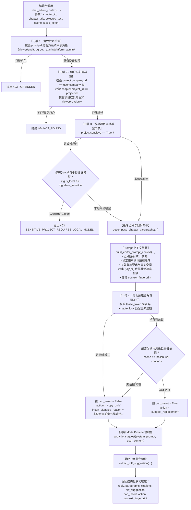

# 为什么有这个文件：说明编辑台章节上下文感知问答与划词引用联动（AI-EDITOR-CONTEXT-LINKAGE）的技术架构、核心实现、段落切分、Diff润色建议生成与四道安全门禁。
# 它解决什么问题：
# 1. 编辑台上下文注入：当助手接收编辑台请求时，支持传入 chapter_id, chapter_title, selected_text（用户划词选中文本片段）；
# 2. 段落元数据与依据组装：将章节正文分解为带编号段落 [P1], [P2]...，精准标记划词命中段落；并将招标文件条款、公司证据 [证] 与切片 [片]（含唯一溯源指纹）与事实/SLA 变量装配进 Prompt；
# 3. 双场景闭环支持：
#    - 场景 1 划词优化/润色建议（polish）：输出 Diff 对比建议与专业改写片段，强制保护事实变量；
#    - 场景 2 章节合规性与完整度问答（compliance_qa）：基于全文段落与条款覆盖提供诊断建议；
# 4. 安全守卫与锁控制：
#    - 未获得独占编辑锁时严格禁止正文替换，自由问答默认 can_insert=False, action="copy_only"，正文零突变；
#    - 持有有效锁且具有可溯源 citations 时允许生成 suggest_replacement 替换建议；缺少依据时阻断直接替换；
#    - 敏感项目本地模型强门禁（403 SENSITIVE_PROJECT_REQUIRES_LOCAL_MODEL）；
#    - 只读角色拦截（403 FORBIDDEN）与租户隔离（404 NOT_FOUND）。

# AI-EDITOR-CONTEXT-LINKAGE 编辑台章节上下文感知问答与划词引用联动代码解释

- 任务编号：`AI-EDITOR-CONTEXT-LINKAGE`
- 关联需求：编辑台深度联动（智能投标辅助编辑台右侧助手与中间正文联动）
- 关联 Issue：[ISSUE-007](../../issues/ISSUE-007.md)
- 规范出处：[PRD v1.8 §5.11.3～5.11.6、§5.7.8](../../docs/reference/product/prd-mvp-v1.8.md)
- 交付报告：[AI-EDITOR-CONTEXT-LINKAGE 交付](../delivery/AI-EDITOR-CONTEXT-LINKAGE.md)
- 核心代码路径：
  - `backend/bid-core/icg_demo/editor_ai_context.py`
  - `backend/bid-core/icg_demo/answer_card.py`
  - `backend/bid-core/icg_demo/domain.py`
  - `backend/bid-core/icg_demo/workflow.py`
  - `tests/backend/test_editor_ai_context.py`

---

## 1. 架构总览与交互数据流

编辑台场景下，右侧智能对话助手需与中间正文编辑区产生实时、深度的双向联动。用户在编辑区划选文本段落后，发起“润色优化”或“合规诊断”时，助手能感知划词片段及其所在的上下文段落、关联招标文件条款和可用证据：



---

## 2. 核心模块与功能设计

### 2.1 段落切分与划词定位（`decompose_chapter_paragraphs`）

在 `editor_ai_context.py` 中，通过统一规范化换行，将章节正文切分为带编号的段落列表：
```python
paragraphs = [
    {
        "index": 1,
        "label": "[P1]",
        "text": "第一段正文内容...",
        "is_selected": False,
        "char_length": 86,
        "match_start": -1,
        "match_end": -1,
    },
    {
        "index": 2,
        "label": "[P2]",
        "text": "第二段：系统采用双活容灾备份方案...",
        "is_selected": True,  # 划词命中标记
        "char_length": 112,
        "match_start": 4,
        "match_end": 12,
    }
]
```
- **无划词兜底**：当 `selected_text` 为 None 或空串时，全部段落标记 `is_selected=False`，系统以章节全文作为上下文无缝兜底；
- **模糊容错**：支持部分划词与子句跨空格匹配，确保前端划词与后端段落精准关联。

### 2.2 依据材料收集与不可篡改溯源指纹（`collect_chapter_citations`）

系统自动搜集本章节已关联确认的依据材料：
1. **公司资料库已确认证据 `[证]`**：提取对应资质、认证、证书、案例，获取条目版本 `revision` 与有效期 `valid_until`；
2. **知识库检索切片 `[片]`**：若知识库开启且配置证据服务，自动执行语义切片检索；
3. **依据指纹计算**：为每项证据生成不可篡改 SHA-256 前缀指纹（16位十六进制）：
   ```python
   fingerprint = hashlib.sha256(f"{item['id']}:{rev}:{name}:{valid_until}".encode()).hexdigest()[:16]
   ```
4. **上下文指纹**：计算当前提问、选中文本、段落版本与依据指纹清单的联合指纹 `context_fingerprint`（64位十六进制），确保审计与复现一致性。

### 2.3 双场景 Prompt 架构（`build_editor_prompt_context`）

支持两类核心场景的 Prompt 组装与自动判定：
- **场景 1 划词优化/润色建议（`polish`）**：
  - System Prompt 约束：强化语言专业度与中标说服力，保留所有事实变量 `{{fact:...}}` 与 `{{sla:...}}`，禁止篡改取值；
  - User Content：结构化标注 `【当前章节全文段落】`、`【用户划词选中文本】`（附所在段落标号，如 `[P2]`）、招标文件条款与参考依据；
  - 产物：输出清晰的修改前后 Diff 建议（`diff_suggestion`：`original` vs `suggested`）。
- **场景 2 章节合规性/完整度问答（`compliance_qa`）**：
  - System Prompt 约束：对照关联招标文件条款与评分项，逐段分析响应覆盖度与潜在废标风险；
  - User Content：提供全文段落清单、条款要求、已核对证据 `[证]` 与可用事实清单；
  - 产物：输出专业、针对性的合规诊断意见与补全建议。

### 2.4 四道安全门禁与独占编辑锁守护

严格遵循 PRD v1.8 与 APP-M2-T179 规范：
1. **门禁 1（只读角色拦截）**：`viewer`、`auditor`、`group_admin`、`platform_admin` 以及项目分工 `viewer`/`readonly` 成员发起请求一律拦截（抛出 `403 FORBIDDEN`）；
2. **门禁 2（租户与归属隔离）**：跨公司项目或跨项目章节访问统一返回 `404 NOT_FOUND`；
3. **门禁 3（敏感项目本地模型强门禁）**：敏感项目强制使用离线本地模型（`is_local=True` 且 `allow_sensitive=True`），使用云端模型时抛出 `403 SENSITIVE_PROJECT_REQUIRES_LOCAL_MODEL`；
4. **门禁 4（独占编辑锁与正文零突变守护）**：
   - 当调用方未提供或持有无效/过期编辑锁（`lease_token` 不匹配），`can_insert` 恒定为 `False`，`action="copy_only"`，明确提示“未获取当前章节编辑锁，仅供参考与复制，不可直接替换正文”；
   - 整个问答过程正文内容、章节修订号、版本历史零突变；
   - 仅当持有有效独占编辑锁且具备已核对依据溯源（`citations` 存在且指纹完备）时，才允许生成带溯源的替换建议（`action="suggest_replacement"`, `can_insert=True`）。

---

## 3. 服务层统一门面接入

- **`DemoService`**：挂载 `EditorAIContextService`，暴露 `chat_editor_context` 方法；
- **`WorkflowService`**：暴露 `editor_ai_chat` 与 `build_editor_prompt_context` 门面委托；
- **`AnswerCardService`**：在 `general_chat` 中透明扩展 `chapter_title`, `selected_text`, `scene`, `lease_token` 可选参数，并提供 `editor_context_chat` 显式入口。

---

## 4. 自动化测试与契约保证

在 `tests/backend/test_editor_ai_context.py` 中编写了 12 项专属测试，100% 覆盖关键场景：
- `test_decompose_paragraphs_and_selection_matching`：验证段落切分、选中文本定位与无选中时的干净兜底；
- `test_scene_detection`：验证智能场景判定规则；
- `test_build_editor_prompt_context_polish_scene`：验证划词润色 Prompt 组装、段落标号注入与依据指纹；
- `test_build_editor_prompt_context_compliance_scene`：验证合规性问答 Prompt 组装与条款注入；
- `test_chat_editor_context_fallback_when_no_selection`：验证无划词时全局问答结构返回；
- `test_chat_editor_context_polish_diff_suggestion`：验证 Diff 对比建议产物；
- `test_guard_no_lock_forces_copy_only`：验证无锁时强制 copy_only 与正文零突变；
- `test_guard_valid_lock_and_citations_allow_suggest_replacement`：验证持有效锁且有依据时放行替换建议；
- `test_guard_valid_lock_without_citations_blocks_insert`：验证无依据时强拦截插入；
- `test_guard_sensitive_project_blocks_cloud_model`：验证敏感项目云端模型 403 阻断与本地模型放行；
- `test_guard_readonly_roles_and_cross_tenant_isolation`：验证只读角色 403 与跨租户 404；
- `test_workflow_service_and_answer_card_integration`：验证服务层门面委派与平滑兼容。
