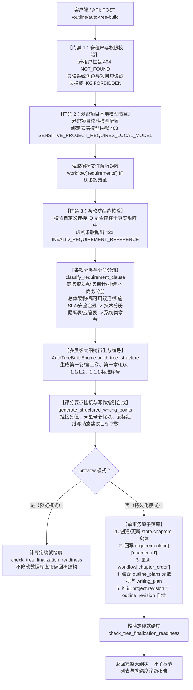

# AI-OUTLINE-AUTO-TREE-BUILD 代码说明：招标文件解析驱动的大纲树自动规划构建引擎

本文档详细说明招标文件解析驱动的大纲树自动规划构建引擎（`AI-OUTLINE-AUTO-TREE-BUILD`，PRD MVP v1.8 §5.7.1 / §5.7.2）的代码架构、算法逻辑与集成细节。

## 1. 架构定位与业务时序

在智能投标全流程中，大纲规划是承接“招标文件解析确认”与“章节分节生成”的关键中枢。解析出的招标文件条款散落在需求矩阵中，人工手动逐节梳理目录、挂接评分项、设定字数耗时冗长且容易遗漏废标条款。

大纲树自动规划构建引擎通过智能语义分类与招投标规范骨架，自动衍生“卷（Volume，Level 0）-> 章/编（Part/Chapter，Level 1）-> 节（Section，Level 2）-> 子节（Subsection，Level 3）”的标准层级大纲树，自动挂接评分项分值与星号红线，合成结构化编写要点，并严格执行防编造、多租户隔离与涉密模型门禁。

大纲树自动推导与持久化时序如下：



---

## 2. 核心算法与模块详解

### 2.1 中文大纲与数字层级生成器

招投标文件要求严格遵循中国官方公文与招投标格式标准。`backend/bid-core/icg/domain/outline_auto_tree.py` 提供了规范化编号工具：

```python
CHINESE_NUMS = ["零", "一", "二", "三", "四", "五", "六", "七", "八", "九", "十"]

def to_chinese_num(n: int) -> str:
    """将阿拉伯数字转换为中文数字（1 -> 一, 12 -> 十二, 25 -> 二十五）。"""
    if n <= 0:
        return "零"
    if n <= 10:
        return CHINESE_NUMS[n]
    if n < 20:
        return "十" + (CHINESE_NUMS[n % 10] if n % 10 != 0 else "")
    tens = n // 10
    ones = n % 10
    tens_str = CHINESE_NUMS[tens] + "十"
    ones_str = CHINESE_NUMS[ones] if ones > 0 else ""
    return tens_str + ones_str

def format_volume_info(volume: str, index: int) -> tuple[str, str]:
    """返回 (中文编号, 完整卷标题)，如 ('第一卷', '第一卷 商务标')。"""
    c_num = f"第{to_chinese_num(index)}卷"
    name = "技术标" if volume == "technical" else "商务标"
    return c_num, f"{c_num} {name}"

def format_chapter_info(index: int, name: str) -> tuple[str, str, str]:
    """返回 (中文章号, 章节序号如 1.0, 完整章标题)，如 ('第一章', '1.0', '第一章 投标人商务资质与综合实力')。"""
    c_num = f"第{to_chinese_num(index)}章"
    sec_num = f"{index}.0"
    return c_num, sec_num, f"{c_num} {name}"

def format_section_info(chapter_idx: int, section_idx: int, name: str) -> tuple[str, str]:
    """返回 (节序号如 1.1, 完整节标题)，如 ('1.1', '1.1 投标人营业资质与法定代表人授权')。"""
    sec_num = f"{chapter_idx}.{section_idx}"
    return sec_num, f"{sec_num} {name}"
```

---

### 2.2 招标文件矩阵条款智能分类器（`classify_requirement_clause`）

根据 PRD MVP v1.8 规范，自动识别招标条款的属性并映射到两卷与大纲子类：
- **偏离表**：命中 `deviation` 类别或“偏离”关键词，归入偏离表专项章节；
- **商务资质与实力**：命中 `commercial`、`qualification`、`finance`，或“资质”、“营业执照”、“法人”、“审计”、“纳税”、“案例”，细分为基础资质、财务审计、体系认证与同类业绩；
- **项目实施与运维 SLA**：命中 `service`、`implementation`、`sla`，或“实施”、“运维”、“巡检”、“SLA”、“培训”、“团队”，细分为组织架构、进度计划、运维SLA与培训移交；
- **总体技术架构方案**：命中 `technical`、`system`、`architecture`，或“微服务”、“架构”、“高可用”、“双活”、“数据库”、“接口”，细分为高可用双活方案、总体拓扑、业务功能与接口集成；
- **安全保障与应急**：命中 `security`、`compliance`，或“等保”、“加密”、“容灾”、“应急”、“演练”，细分为网络安全、数据隐私与应急演练。

---

### 2.3 结构化写作指引合成器（`generate_structured_writing_points`）

为叶子章节合成包含章节定位、分册、分值统计、条款清单、★星号红线与目标字数的结构化文本：
- **目标字数加权算法**：基础 800 字，每绑定一条条款增加 250 字，命中星号/废标条款额外增加 200 字，上限封顶 3000 字；
- **红线标签高亮**：对命中星号的条款自动附加 `【★关键星号项·必须实质响应】`，对废标条款附加 `【废标红线项·不符直接废标】`；
- **佐证材料要求**：明确标注须关联客观资料库有效资质证书或业绩合同，禁止空头承诺。

---

### 2.4 大纲树自动推导构建引擎核心（`AutoTreeBuildEngine`）

核心类 `AutoTreeBuildEngine` 实现于 `backend/bid-core/icg/domain/outline_auto_tree.py`：
1. **防编造白名单核验**：对照 `req_by_id` 字典逐一检查用户自定义映射的条款 ID，非真实条款抛出 `OutlinePlanError(422, "INVALID_REQUIREMENT_REFERENCE")`；
2. **多层级递归装配**：遍历 `STANDARD_TREE_TEMPLATE` 两卷骨架，提取匹配各节的条款桶 `req_mapping_buckets`；
3. **现有章节无损保留**：检查 `existing_chapters`，若存在历史章节，复用其 chapter_id，确保旧章节版本和正文不被硬删除；
4. **零未映射条款保证**：若存在特殊条款未能落入预置桶，自动兜底挂接至对应卷的专项响应节，确保 `unmapped_requirements_count == 0`。

---

### 2.5 领域服务入口与单事务原子落盘（`OutlinePlanService.auto_build_outline_tree`）

在 `backend/bid-core/icg/domain/outline_plan.py` 中接入领域事务控制：
1. 校验多租户归属与用户 RBAC 只读限制；
2. 校验涉密项目模型门禁；
3. 执行 `AutoTreeBuildEngine.build_tree_structure`；
4. 若 `preview=True`，直接返回预览树结构；
5. 若 `preview=False`，在单一数据库事务内完成：
   - 插入/更新 `state.chapters` 实体并自增 revision；
   - 更新需求矩阵中对应条款的 `chapter_id`；
   - 更新 `workflow["chapter_order"]`；
   - 写入 `workflow["outline_plans"]` 元数据；
   - 同步更新 `workflow["writing_plan"]["chapters"]`；
   - 推进 `project.revision` 与 `workflow["outline_revision"]`；
   - 调用持久化仓储 `save_chapter` 与 `save_workflow`；
   - 返回包含 `finalization_readiness` 的最终大纲树。

---

### 2.6 大纲定稿就绪诊断检查器（`check_tree_finalization_readiness`）

在定稿前执行多维度严密核验：
- `unmapped_requirements_count`：未分配到章节的条款数必须为 0；
- `missing_volumes`：技术分册与商务分册必须同时具备；
- `empty_chapters`：排查正文内容为空的章节；
- `pending_chapters`：排查包含“【待补】”标记的章节；
- `mandatory_blocked`：排查星号条款或废标条款关联章节是否被错误标记为“不适用”（`applicable: False`）；
- `plan_confirmed`：大纲方案是否已经过人工或系统确认。

---

## 3. 关键门禁与防幻觉设计

| 门禁类型 | 触发条件 | HTTP 状态码 | 业务错误码 | 业务保障效果 |
|---|---|---|---|---|
| **防编造校验** | 传入不存在于当前需求矩阵的虚构条款 ID | 422 | `INVALID_REQUIREMENT_REFERENCE` | 严禁 AI 或用户引用未经核实的虚假条款作为大纲依据 |
| **多租户隔离** | 访问不属于当前账号所属公司的项目 | 404 | `NOT_FOUND` | 严格防范企业间招标文件与大纲商业机密嗅探 |
| **RBAC 角色门禁** | 系统只读角色（viewer/auditor）或项目只读成员操作大纲构建 | 403 | `FORBIDDEN` | 保证大纲构建与修改权限严格受控 |
| **涉密项目本地模型门禁** | 敏感项目（sensitive=True）企图使用外部云端模型规划大纲 | 403 | `SENSITIVE_PROJECT_REQUIRES_LOCAL_MODEL` | 落实内网物理隔离红线，核心标书数据严禁外泄公网 |
| **星号与废标红线门禁** | 星号（★）或废标条款所在章节被标记为“不适用” | 400 | `INVALID_ACTION` | 废标红线条款绝不允许排除响应 |

---

## 4. 自动化测试映射表

专属自动化测试套件 `tests/backend/test_ai_outline_auto_tree_build.py` 覆盖情况如下：

| 测试函数 | 验证重点 | 核心断言与覆盖说明 |
|---|---|---|
| `test_chinese_numbering_utilities` | 中文数字转换与多层级编号工具 | 断言 `to_chinese_num` 1/2/10/12/20/25 转换；断言卷、章、节序号格式化 |
| `test_clause_categorization_and_volume_alignment` | 矩阵条款智能分类器分流 | 验证财务审计归入商务资质卷，网络安全归入技术安全卷，偏离表归入偏离表 |
| `test_auto_tree_build_structure_and_numbering` | 多层级大纲树与规范编号自动推导 | 验证 Level 0（第一卷/第二卷）、Level 1（第一章/1.0）、Level 2（1.1/1.2）；验证叶子节与条款绑定，★星号与废标标记识别，`writing_points` 自动生成 |
| `test_anti_hallucination_clause_verification` | 条款防编造白名单门禁 | 传入虚构条款 ID `req-fake-nonexistent-clause-999`，精确断言拦截 422 `INVALID_REQUIREMENT_REFERENCE` |
| `test_multi_tenant_isolation` | 多租户强隔离门禁 | 乙公司账号访问甲公司项目，精确断言拦截 404 `NOT_FOUND` |
| `test_rbac_role_gate` | RBAC 角色权限门禁 | 只读账号 `alpha-viewer` 尝试构建大纲，精确断言拦截 403 `FORBIDDEN` |
| `test_sensitive_project_local_model_gate` | 涉密项目本地模型硬门禁 | 敏感项目调用云端模型拦截 403 `SENSITIVE_PROJECT_REQUIRES_LOCAL_MODEL`；切换为本地模型正常放行 |
| `test_preview_mode_preserves_state` | preview 模式内存推导 | 验证 `preview=True` 时成功返回大纲树但绝对不修改仓储数据与项目版本 |
| `test_persistence_mode_atomic_updates` | 持久化模式单事务原子写入 | 验证章节实体落盘、`requirements` 条款 `chapter_id` 映射全覆盖、`chapter_order` 排序、`outline_plans` 元数据与 `writing_plan` 同步，项目版本自增 |
| `test_outline_finalization_readiness_check` | 大纲定稿就绪诊断检查器 | 验证大纲未填正文时报 `ready=False`（空章节诊断）；正文填入后 `ready=True`，未映射条款数为 0 |
| `test_http_api_auto_tree_build` | HTTP API 端点集成 | `TestClient` 端到端调用 `POST /api/v1/projects/{project_id}/outline/auto-tree-build`，验证 200 响应与树状结构 |
