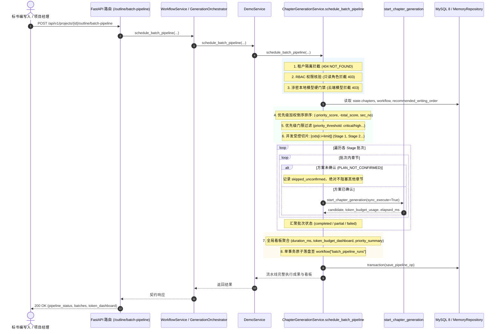

# AI-OUTLINE-BATCH-GENERATION-PIPELINE 代码说明：基于优先级推荐队列的大纲多章节批量生成流水线调度引擎

## 1. 架构定位与业务拓扑

本模块作为 PRD MVP v1.8 §5.7.1《生成闭环总览》与 §5.7.8《批量生成编排》的核心调度引擎，位于 `backend/bid-core/icg/domain/chapter_generation.py`。其核心使命是：**依托大纲评分项权重与推荐编写队列（recommended_writing_order），按受控并发门限（concurrency_limit: 1~5）将全书章节切片为 Stage 批次，优先调度废标红线与关键必保章节；同时严格贯彻未确认章节隔离跳过不阻塞后续章节的核心红线，完成全局 Token 预算聚合与单事务原子落盘。**



---

## 2. 核心调度与编排机制实现

核心实现位于 `backend/bid-core/icg/domain/chapter_generation.py` 中的 `schedule_batch_pipeline`：

### 2.1 优先级推荐队列排序与动态元数据回退

引擎首先尝试读取工作流中由大纲树构建引擎持久化的 `workflow["recommended_writing_order"]`。若不存在，则从已解析需求中提取叶子章节条款、分值、一票否决与★星标标记，调用 `calculate_score_weights_and_priorities` 动态生成。

排序算法采用四元复合元组进行绝对稳定排序：
```python
def get_sort_key(cid: str):
    meta = ch_meta_map.get(cid, {})
    p_score = float(meta.get("priority_score") or 0.0)
    t_score = float(meta.get("total_score") or 0.0)
    sec_no = str(meta.get("section_number") or "")
    return (-p_score, -t_score, sec_no, cid)

ordered_chapter_ids = sorted(candidate_cids, key=get_sort_key)
```
- **一票否决红线章节（`disqualified`）**：priority_score 约 100+，排在首位；
- **★关键必保章节（`asterisk`）**：priority_score 约 80+，紧随其后；
- **高分值核心章节（`high`）**：按分值及占比降序排列；
- **中分值与基础支撑章节**：排在后续批次。

### 2.2 并发门限受控切片（Concurrency Limiting）

本地模型部署环境下，显存资源与并发请求容量极度有限。系统设置了硬性并发钳制保护：
```python
limit_val = 2 if concurrency_limit is None else concurrency_limit
limit = max(1, min(int(limit_val), 5))
batched_cids = [ordered_chapter_ids[i:i + limit] for i in range(0, len(ordered_chapter_ids), limit)]
```
- 严格限制并发数在 1 至 5 之间，默认 2 并发；
- 将排序后的章节序列分割为 Stage 1, Stage 2... 批次逐阶段推进。

### 2.3 PRD §5.7.8 绝对红线：未确认章节隔离跳过不阻塞

根据产品需求规范，整书多章节批量生成时，部分章节未完成写作方案确认或历史方案指纹过期，绝不允许拖垮整个项目生成流程：
```python
saved_plan = workflow.get("writing_plan", {}).get("chapters", {}).get(cid, {})
if not saved_plan.get("confirmed_at") or not plan_is_current(state, project_id, cid):
    # 核心红线：未确认方案章节绝对不阻塞其他章节调度生成
    skip_info = {
        "chapter_id": cid,
        "reason": "PLAN_NOT_CONFIRMED",
        "status": "skipped",
        "message": f"章节 {cid} 写作方案尚未确认或方案已过期，流水线跳过生成并继续后续章节。",
    }
    skipped_unconfirmed.append(skip_info)
    failed_chapters[cid] = {"code": "PLAN_NOT_CONFIRMED", "message": skip_info["message"]}
    continue
```
若批次内某些章节跳过而其他章节成功，批次状态记为 `partial_completed`，流水线最终状态判定为 `partial_completed`，已确认章节生成的候选正文完整落盘至 `workflow["candidates"]`。

### 2.4 全局 Token 消耗与执行指标看板

引擎在调度过程中实时累加各章节的提示词消耗与估算生成消耗：
```python
token_dashboard = {
    "total_prompt_tokens": total_prompt_tokens,
    "total_completion_tokens": max(0, total_estimated_tokens - total_prompt_tokens),
    "total_tokens": total_estimated_tokens if total_estimated_tokens > 0 else total_prompt_tokens,
    "total_estimated_tokens": total_estimated_tokens,
    "max_context_tokens_limit": limit_tokens,
    "average_prompt_tokens_per_chapter": round(total_prompt_tokens / max(1, len(successful_results)), 1),
    "context_fingerprints": fingerprints,
    "by_chapter": by_chapter_tokens,
}
```

---

## 3. 安全物理隔离与防编造保证

1. **涉密项目本地模型硬门禁（Airgap Boundary）**：
   涉密项目（`project.sensitive = True`）在前置安全门禁中检查 `demo.model_provider` 及模型配置：
   - 凡 `is_local == False` 企图调用云端外部接口者，立即抛出 `DomainError(403, "SENSITIVE_PROJECT_REQUIRES_LOCAL_MODEL")`；
   - 保证涉密项目的招标文件要求、评分项与大纲正文绝不泄漏到公网。
2. **多租户强隔离**：
   - `project.company_id != principal.user.company_id` 严格返回 404 `NOT_FOUND`，防止企业间信息窥探。
3. **RBAC 角色权限管控**：
   - 系统只读角色（`viewer`、`auditor`）直接在入口阻断 403 `FORBIDDEN`；
   - 非项目编写人拦截 403 `PROJECT_WRITER_REQUIRED`。

---

## 4. 自动化测试映射

所有核心业务约束均由 `tests/backend/test_ai_outline_batch_pipeline.py` 进行 100% 独立验证：

| 测试函数名称 | 验证的核心约束与产品条款 | 期望结果 |
|---|---|---|
| `test_batch_pipeline_priority_sorting_and_slicing` | 优先级队列排序：废标红线与星标优先进入 Stage 1，按并发限制 2 切分 3 个批次 | 状态 `completed`，批次划分精确对齐优先级 |
| `test_batch_pipeline_unconfirmed_chapter_non_blocking` | PRD §5.7.8 绝对红线：未确认章节跳过，绝不阻塞其余 5 章节执行 | 状态 `partial_completed`，未确认章节记录在 `skipped_unconfirmed_chapters` |
| `test_batch_pipeline_priority_threshold_filtering` | 优先级门限过滤（`priority_threshold="critical"`） | 仅调度一票否决与星标章节 |
| `test_batch_pipeline_token_budget_and_metrics_aggregation` | 全局 Token 仪表盘与执行耗时 `duration_ms` 汇聚，原子落盘验证 | Token 统计大于 0，工作流持久化记录存在 |
| `test_batch_pipeline_concurrency_limit_boundaries` | 并发门限 1~5 边界钳制（传入 0 钳制为 1，传入 100 钳制为 5） | 批次数量与并发限制精确对应 |
| `test_batch_pipeline_multi_tenant_isolation` | 跨企业租户调用隔离 | 严格抛出 404 `NOT_FOUND` |
| `test_batch_pipeline_rbac_permission_gate` | 只读用户权限拦截 | 严格拦截 403 `FORBIDDEN` |
| `test_batch_pipeline_sensitive_project_local_model_gate` | 涉密项目本地模型硬门禁 | 云端模型抛出 403，本地模型通行 |
| `test_batch_pipeline_http_api_endpoint` | HTTP API 端点集成（`POST /outline/batch-pipeline`） | 200 OK 且响应包含批次与 Token 统计 |
