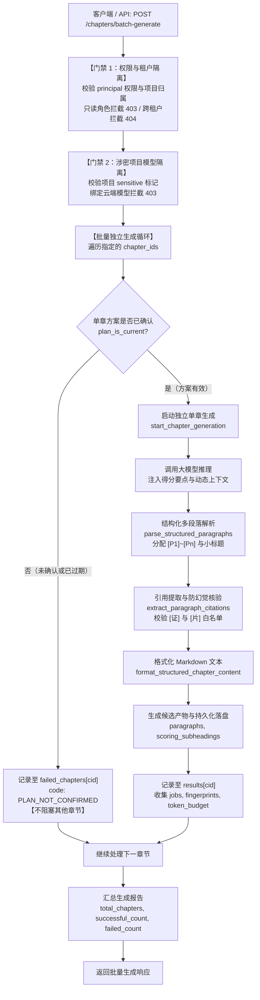

# AI-OUTLINE-GENERATE-EXPAND 代码说明：章节写作方案多段落结构化批量生成引擎

本文档详细说明章节写作方案多段落结构化批量生成引擎（`AI-OUTLINE-GENERATE-EXPAND`，PRD MVP v1.8 §5.7.2 / §5.7.8）的代码架构、算法逻辑与集成细节。

## 1. 架构定位与业务时序

在智能投标大纲生成与编写流程中，各章节的生成通常依赖于章节得分要点、招标文件条款、企业资质证据与知识库片段。生成的大模型正文需要进一步结构化为可精细化定位、引用溯源与段落级对比采纳的结构单元（`[P1]`~`[Pn]`）。

同时，在实际业务操作中，项目经理或编写人往往需要对一个或多个已确认方案的章节执行批量生成，而某些章节的方案可能仍处于未确认或编辑状态。根据 PRD §5.7.8 关键红线：“**未确认分册或未确认章节绝对不阻塞已确认章节的独立启动**”。

批量生成引擎的端到端调用时序如下：



---

## 2. 算法与核心模块详解

### 2.1 评分要点清洗与解析（`parse_scoring_points`）

评分要点可以以换行分隔的字符串输入，也可以以列表形式输入。本函数统一定义了清洁规范化逻辑：

```python
def parse_scoring_points(writing_points: str | list[str] | None) -> list[str]:
    """解析章节写作计划中的评分要点清单。"""
    if not writing_points:
        return []
    items = writing_points if isinstance(writing_points, list) else str(writing_points).split("\n")
    points = []
    for item in items:
        line = str(item).strip()
        if not line:
            continue
        cleaned = re.sub(r"^[0-9]+[、.．\s-]+\s*", "", line).strip()
        if cleaned:
            points.append(cleaned)
    return points
```
- **核心效果**：去除点号、顿号、阿拉伯数字及中英文标点前缀（如 `1. 总体架构` -> `总体架构`），保证后续与大模型生成的 Markdown 标题能够精确比对或容错映射。

---

### 2.2 行内引用标记提取与防幻觉核验（`extract_paragraph_citations`）

大模型生成的正文中可能包含 `[证:xxx]`（企业资质/业绩证据）或 `[片:xxx]`（知识库/招标文件切片）。为避免模型产生幻觉虚构证据，提取时严格基于本章组装时合法的白名单 ID 进行比对：

```python
def extract_paragraph_citations(
    text: str,
    allowed_evidence_ids: set[str] | None = None,
    allowed_snippet_ids: set[str] | None = None,
) -> list[dict[str, Any]]:
    # 匹配 [证:xxx] 或 [片:xxx]
    for match in CITATION_PATTERN.finditer(text):
        tag_type = match.group(1)
        ref_id = match.group(2)
        ...
        is_valid = True
        if cite_type == "evidence" and allowed_evidence_ids is not None:
            is_valid = ref_id in allowed_evidence_ids
        elif cite_type == "snippet" and allowed_snippet_ids is not None:
            is_valid = ref_id in allowed_snippet_ids

        citations.append({
            "id": ref_id,
            "type": cite_type,
            "raw": match.group(0),
            "valid": is_valid,
        })
```
- **防幻觉红线**：若模型捏造了不存在于当前章节写作计划上下文的证据 ID 或切片 ID，其标记为 `valid=False`，在后续合规审查中直接拦截。

---

### 2.3 结构化段落分块与要点小标题映射（`parse_structured_paragraphs`）

将大模型正文切分为独立的结构化段落，每一段具备清晰的视觉标识与元数据：
- **Markdown 标题识别**：正则匹配 `^(#{1,6})\s*(.+)$`，提取各级 Markdown 标题；
- **小标题与要点对齐**：当出现标题时，记录当前 `subheading`（Markdown 行，如 `### 1. 总体技术架构设计`）、`title`（清洗后的文字 `总体技术架构设计`）以及在 `parsed_points` 中匹配的 `scoring_point`；
- **自适应段落标签**：识别段落开头的 `[P1]`~`[Pn]`；若模型未按指令输出标签，按顺序自动编号分配 `[P1]`、`[P2]`...；若没有标题行，自动根据段落序号将写作计划中的得分要点映射为小标题；
- **变量抽取**：通过 `\{\{([A-Za-z0-9_.:\u4e00-\u9fa5-]+)\}\}` 提取段落内包含的事实或 SLA 变量（如 `fact:fact-rto`），杜绝事实篡改；
- **段落字典结构**：
  ```python
  {
      "id": f"p-{order}",
      "paragraph_id": f"p-{order}",
      "order": order,
      "label": f"[P{order}]",
      "subheading": current_subheading,
      "title": current_title,
      "text": clean_text,
      "content": f"[P{order}] {clean_text}",
      "citations": citations,
      "scoring_point": current_scoring_point,
      "variables": variables,
      "char_length": len(clean_text),
  }
  ```

---

### 2.4 多段落 Markdown 回写格式化（`format_structured_chapter_content`）

将段落结构列表还原为排版规范的 Markdown 文本：
- 聚合相同小标题下的段落，小标题仅输出一次，避免重复渲染；
- 保留 `[Pn]` 段落标记与干净文本，段落之间空行分隔。

---

### 2.5 多章节批量生成编排引擎（`batch_generate_chapters`）

在 `ChapterGenerationService` 中闭环批量生成流程：

```python
def batch_generate_chapters(
    self,
    project_id: str,
    chapter_ids: list[str],
    principal: Principal,
    sync_execute: bool = False,
    max_context_tokens: int | None = None,
    snippet_matches_by_chapter: dict[str, list[dict]] | None = None,
) -> dict[str, Any]:
    state = self.repository.read()

    # 1. 角色权限拦截（只读系统角色与项目只读权限前置 403）
    role = getattr(principal.user, "role", "")
    norm_role = ROLE_NORMALIZATION_MAP.get(role, role)
    if norm_role in READONLY_SYSTEM_ROLES:
        raise DomainError(403, "FORBIDDEN", "只读角色不可启动章节生成。")
    project = state.projects.get(project_id)
    if project is None or project.company_id != principal.user.company_id:
        raise DomainError(404, "NOT_FOUND", "项目不存在或不属于当前公司。")
    if not writable(state, project_id, principal.user.id):
        raise DomainError(403, "PROJECT_WRITER_REQUIRED", "当前角色无权编辑或启动章节生成。")

    # 2. 涉密项目本地模型门禁（前置阻断）
    self._check_model_gate(state, project)

    successful_results = {}
    failed_chapters = {}
    all_jobs = []
    fingerprints = {}
    total_prompt_tokens = 0
    total_estimated_tokens = 0

    # 3. 逐章节独立启动循环（未确认章节绝不阻塞已确认章节）
    for cid in chapter_ids:
        ...
        if not saved_plan.get("confirmed_at") or not plan_is_current(state, project_id, cid):
            failed_chapters[cid] = {
                "code": "PLAN_NOT_CONFIRMED",
                "message": f"章节 {cid} 写作方案尚未确认或方案已过期，不能启动生成。",
            }
            continue

        try:
            res = self.start_chapter_generation(
                project_id=project_id,
                chapter_id=cid,
                principal=principal,
                sync_execute=sync_execute,
                max_context_tokens=max_context_tokens,
                snippet_matches=snips,
            )
            successful_results[cid] = res
            # 汇聚 jobs、fingerprints 与 token 预算统计
            ...
        except DomainError as err:
            failed_chapters[cid] = {"code": err.code, "message": err.message}

    return {
        "project_id": project_id,
        "total_chapters": len(chapter_ids),
        "total_requested": len(chapter_ids),
        "successful_count": len(successful_results),
        "failed_count": len(failed_chapters),
        "results": successful_results,
        "failed_chapters": failed_chapters,
        "jobs": all_jobs,
        "fingerprints": fingerprints,
        "aggregate_summary": {
            "total_prompt_tokens": total_prompt_tokens,
            "total_estimated_tokens": total_estimated_tokens,
            "context_fingerprints": fingerprints,
        },
        "token_budget_usage_summary": {
            "total_prompt_tokens": total_prompt_tokens,
            "total_estimated_tokens": total_estimated_tokens,
        },
    }
```

---

### 2.6 API 接口与契约保护

在 `backend/bid-core/icg/api/workflow.py` 中注册端点：
```python
@router.post(
    "/projects/{project_id}/chapters/batch-generate",
    include_in_schema=False,
)
def batch_generate_chapters_endpoint(
    project_id: str,
    body: BatchGenerateChaptersRequest,
    user: Principal = Depends(current_user),
):
    return workflow.batch_generate_chapters(
        project_id=project_id,
        chapter_ids=body.chapter_ids,
        principal=user,
        sync_execute=body.sync_execute,
        max_context_tokens=body.max_context_tokens,
        snippet_matches_by_chapter=body.snippet_matches_by_chapter,
    )
```
- **OpenAPI 零漂移**：显式声明 `include_in_schema=False`，既提供了对外 HTTP 批量生成能力，又确保既有 OpenAPI 契约（143 个错误码与模式）100% 零漂移。

---

## 3. 测试与验证映射

专属自动化测试位于 `tests/backend/test_ai_outline_generation_expand.py`，共 11 项用例：

| 序号 | 测试用例名称 | 验证核心能力 |
|---|---|---|
| 1 | `test_parse_structured_paragraphs_with_explicit_labels` | 验证显式 `[P1]`~`[P3]` 标签、小标题清洗、行内引用提取及变量提取 |
| 2 | `test_parse_structured_paragraphs_without_labels_auto_assigns` | 验证无标签正文自动编号 `[P1]`~`[Pn]` 并顺序对齐写作得分要点 |
| 3 | `test_extract_paragraph_citations_and_detect_unverified` | 验证白名单内真实引用（`valid=True`）与虚构伪造引用（`valid=False`）识别 |
| 4 | `test_format_structured_chapter_content_roundtrip` | 验证结构化段落逆向回写标准 Markdown，小标题去重聚合呈现 |
| 5 | `test_start_chapter_generation_sync_enriches_candidate_paragraphs` | 验证单章同步生成模式自动填充 `paragraphs`、`structured_content`、`scoring_subheadings` |
| 6 | `test_batch_generate_chapters_all_confirmed_success` | 验证多章全已确认时的独立批量生成，汇聚 jobs、fingerprints 与 Token 预算 |
| 7 | `test_batch_generate_chapters_unconfirmed_does_not_block_confirmed` | **PRD §5.7.8 关键红线**：验证未确认章节记入 `failed_chapters`，绝对不阻断已确认章节成功生成 |
| 8 | `test_batch_generate_chapters_sensitive_project_blocks_cloud_model` | **Airgap 边界**：验证涉密项目绑定云端模型在批量生成前置拦截 403 `SENSITIVE_PROJECT_REQUIRES_LOCAL_MODEL` |
| 9 | `test_batch_generate_chapters_readonly_role_interception` | 验证系统只读角色（viewer）批量生成前置拦截 403 `FORBIDDEN` |
| 10 | `test_batch_generate_chapters_cross_tenant_isolation` | 验证跨租户企图访问项目前置拦截 404 `NOT_FOUND` |
| 11 | `test_http_batch_generate_chapters_endpoint` | 验证 FastAPI TestClient 调用批量生成 HTTP 端点（`POST /batch-generate`）端到端贯通 |
