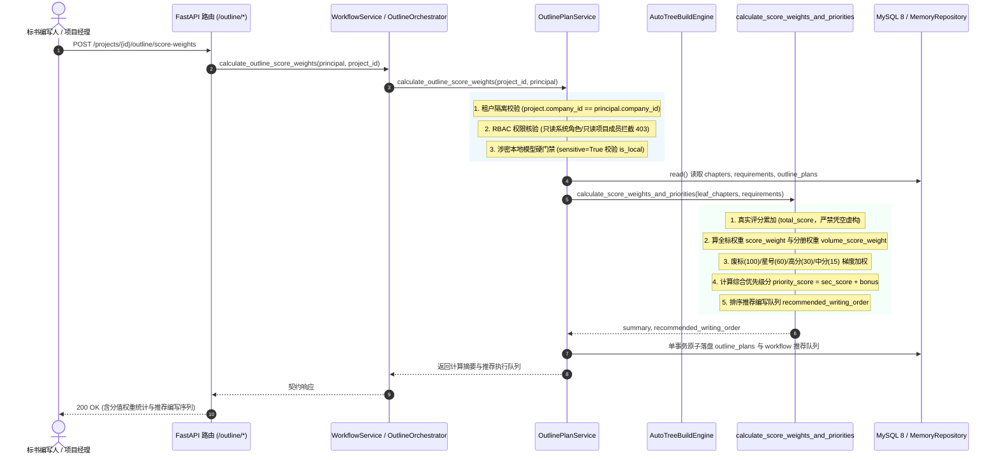

# AI-OUTLINE-SCORE-WEIGHT-CALC 代码说明：大纲评分项分值权重加权与章节优先级智能排序引擎

## 1. 架构定位与业务拓扑

本模块作为 PRD MVP v1.8 §5.7.1《生成闭环总览》与 §5.7.8《批量生成编排》的核心算法底座，位于 `backend/bid-core/icg/domain/outline_auto_tree.py` 与 `backend/bid-core/icg/domain/outline_plan.py`。其核心使命是：**以招标文件真实解析出的评分条款为权威基准，计算章节评分权重比，自动识别一票否决与星号必保红线，计算综合优先级得分并输出推荐批量编写队列。**



---

## 2. 核心数学模型与加权排序算法实现

核心算法实现于 `backend/bid-core/icg/domain/outline_auto_tree.py` 中的 `calculate_score_weights_and_priorities`：

### 2.1 分值累加与双重权重比计算公式

1. **章节分值累加（`total_score`）**：
   每个叶子章节关联 $K$ 个招标文件条款，提取各条款真实分值 $S_k$：
   $$\text{total\_score}_i = \sum_{k=1}^K S_k$$
   分值严格来源于解析矩阵，若条款无明确分值则 $S_k = 0.0$。
2. **全标总分与分册总分**：
   $$\text{grand\_total\_score} = \sum_{i \in \text{AllLeaf}} \text{total\_score}_i$$
   $$\text{volume\_score}_v = \sum_{i \in \text{Volume}_v} \text{total\_score}_i \quad (v \in \{\text{business}, \text{technical}\})$$
3. **双重权重比例**：
   - 全标权重：
     $$\text{score\_weight}_i = \begin{cases} \text{round}(\frac{\text{total\_score}_i}{\text{grand\_total\_score}}, 4), & \text{grand\_total\_score} > 0 \\ 0.0, & \text{grand\_total\_score} = 0 \end{cases}$$
   - 分册权重：
     $$\text{volume\_score\_weight}_i = \begin{cases} \text{round}(\frac{\text{total\_score}_i}{\text{volume\_score}_v}, 4), & \text{volume\_score}_v > 0 \\ 0.0, & \text{volume\_score}_v = 0 \end{cases}$$

### 2.2 综合优先级梯度附加分模型

为引导 AI 和编写团队将精力优先投入在关键条款上，设计了阶梯式附加分模型：

| 章节条款特征 | 优先级标签 (`priority`) | 附加分 (`bonus`) | 判定原因摘要 (`priority_reason`) | 推荐行动指引 (`suggested_action`) |
|---|---|---|---|---|
| **一票否决废标条款** (`has_disqualified`) | `critical` | **100.0** | 含一票否决废标条款，最高优先级前置编写与硬核审核 | 立即前置安排资深专家编写并组织法务与合规硬核复审，严防废标风险 |
| **★关键必保条款** (`has_asterisk`) | `critical` | **60.0** | 含★关键必保条款，核心重点章节 | 优先编写，严格对照评分标准逐条对齐指标与证明材料 |
| **高分值核心章节** ($\text{sec\_score} \ge 15.0$ 或 $\text{score\_weight} \ge 0.15$) | `high` | **30.0** | 高分值关键章节（分值 X 分，占总分 Y%） | 重点打磨方案深度与技术细节，争取评委技术高分与优势分 |
| **中等分值标准章节** ($\text{sec\_score} \ge 5.0$ 或 $\text{score\_weight} \ge 0.05$) | `medium` | **15.0** | 中等分值标准章节（分值 X 分，占总分 Y%） | 按标准模板规范化响应，确保佐证材料与资质完整合规 |
| **基础支撑章节** | `low` | **0.0** | 基础支撑/常规履约章节 | 依托既有知识库方案片段与模板快速组装生成 |

**综合优先级分值计算**：
$$\text{priority\_score} = \text{round}(\text{sec\_score} + \text{bonus}, 2)$$

### 2.3 推荐编写执行队列排序键

排序键三元组：
$$\text{sort\_key}(\text{leaf}) = (-\text{priority\_score}, -\text{total\_score}, \text{section\_number})$$
保证：
1. 废标条款与星号关键章节（得分通常在 80~100+）绝对置顶；
2. 高分值核心方案章节（得分 45~60+）紧随其后；
3. 同分情况下按大纲章节物理结构（`section_number`）顺排。

---

## 3. 核心代码模块解析

### 3.1 独立计算函数实现（outline_auto_tree.py）

```python
def calculate_score_weights_and_priorities(
    leaf_chapters: list[dict[str, Any]],
    requirements: list[dict[str, Any]] | None = None,
) -> tuple[dict[str, Any], list[dict[str, Any]]]:
    req_by_id = {r["id"]: r for r in (requirements or []) if isinstance(r, dict) and "id" in r}

    def safe_score(val: Any) -> float:
        if val is None:
            return 0.0
        try:
            return float(val)
        except (ValueError, TypeError):
            return 0.0

    # 1. 真实评分累加（total_score，严禁凭空虚构）
    for leaf in leaf_chapters:
        sec_score = 0.0
        if leaf.get("scoring_rows"):
            sec_score = sum(safe_score(r.get("score")) for r in leaf["scoring_rows"])
        elif leaf.get("bound_requirement_ids") and req_by_id:
            for rid in leaf["bound_requirement_ids"]:
                if rid in req_by_id:
                    sec_score += safe_score(req_by_id[rid].get("score"))
        leaf["total_score"] = round(sec_score, 2)

    # 2. 算全标总分与分册总分（除零安全保护）
    grand_total_score = round(sum(leaf["total_score"] for leaf in leaf_chapters), 2)
    volume_scores: dict[str, float] = {}
    volume_weights: dict[str, float] = {}

    for vol in ("business", "technical"):
        v_score = round(sum(leaf["total_score"] for leaf in leaf_chapters if leaf.get("volume") == vol), 2)
        volume_scores[vol] = v_score
        volume_weights[vol] = round(v_score / grand_total_score, 4) if grand_total_score > 0 else 0.0

    # 3. 阶梯附加分与综合优先级计算
    ...
```

### 3.2 方案服务持久化支持（outline_plan.py）

在 `OutlinePlanService` 中提供 `calculate_outline_score_weights` 与 `get_recommended_writing_order`，完整封装安全校验与事务落盘：
```python
def calculate_outline_score_weights(
    self,
    project_id: str,
    principal: Principal | None = None,
    options: dict[str, Any] | None = None,
) -> dict[str, Any]:
    ...
    # 租户隔离
    if project is None or project.company_id != principal.user.company_id:
        raise DomainError(404, "NOT_FOUND", "项目不存在或当前公司无权访问。")

    # RBAC 角色门禁
    norm_role = normalize_role(principal.user.role)
    if norm_role in READONLY_SYSTEM_ROLES:
        raise DomainError(403, "FORBIDDEN", "只读角色无权计算或调整大纲分值权重。")

    # 涉密项目本地模型硬门禁
    if project.sensitive and options.get("use_ai_model", False):
        ...
        if not is_local:
            raise DomainError(403, "SENSITIVE_PROJECT_REQUIRES_LOCAL_MODEL", ...)
```

---

## 4. 自动化测试用例映射

专属测试套件位于 `tests/backend/test_ai_outline_score_weight.py`，8 项测试 100% 覆盖关键场景：

| 测试函数 | 验证目标 | 预期结果 |
|---|---|---|
| `test_calculate_score_weights_and_priorities_standalone` | 验证独立算法分值汇总、全标与分册权重计算、优先级梯度与排序 | 总分 70.0，技术标 50.0 / 商务标 20.0，废标排第一位（100.0分）、星号排第二位（80.0分）、高分排第三位（60.0分） |
| `test_zero_division_and_malformed_score_resilience` | 验证分值为 None、非数字字符串、全标 0 分时的鲁棒性与除零保护 | 无异常崩溃，总分 0.0，权重 0.0，星号项保持 critical (60.0分) |
| `test_auto_build_outline_tree_incorporates_score_weights` | 验证 `auto_build_outline_tree` 自动内建计算权重并原子持久化 | 树构建结果与 `outline_plans` 均包含分值权重与推荐队列 |
| `test_calculate_outline_score_weights_service` | 验证服务层显式调用分值重新计算与持久化 | 工作流元数据正确回写，`get_recommended_writing_order` 正确命中 |
| `test_multi_tenant_isolation` | 验证跨租户访问大纲分值与推荐队列的隔离性 | 跨公司调用精确抛出 404 `NOT_FOUND` |
| `test_rbac_readonly_forbidden` | 验证系统只读角色（`auditor`）及项目只读成员拦截 | 精确拦截抛出 403 `FORBIDDEN` |
| `test_sensitive_project_local_model_gate` | 验证涉密项目使用云端外部模型规划大纲的物理隔离 | 云端模型拦截 403 `SENSITIVE_PROJECT_REQUIRES_LOCAL_MODEL`，本地模型放行 |
| `test_http_api_endpoints` | 验证 FastAPI HTTP 端点集成（POST /score-weights、GET /recommended-order） | 端点调用成功返回 200，字段完整对齐 |
