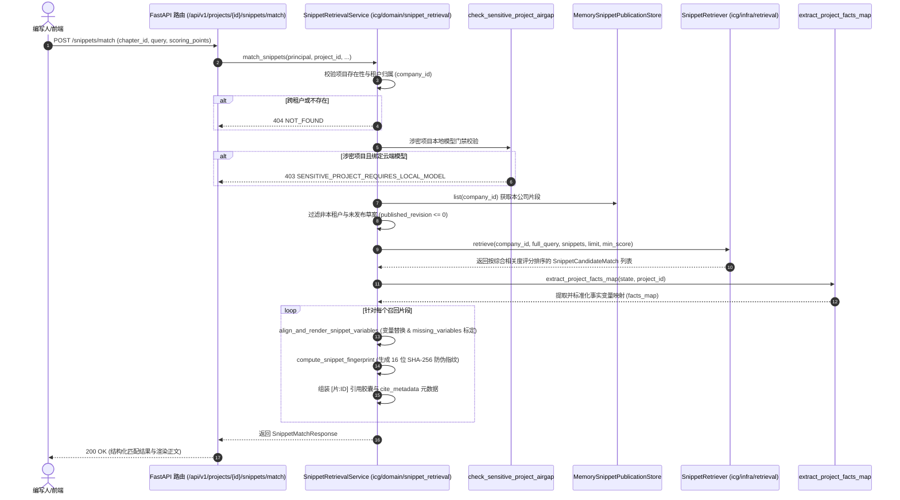

# AI-SNIPPET-RETRIEVAL-MATCH：代码解释

- 对应任务：`AI-SNIPPET-RETRIEVAL-MATCH · 方案片段智能检索与上下文精准匹配`
- 对应 Issue：[ISSUE-037](../../issues/ISSUE-037.md)、[ISSUE-010](../../issues/ISSUE-010.md)、[ISSUE-007](../../issues/ISSUE-007.md)
- 交付文档：[AI-SNIPPET-RETRIEVAL-MATCH 交付](../delivery/AI-SNIPPET-RETRIEVAL-MATCH.md)
- 代码路径：
  - `backend/bid-core/icg/domain/snippet_retrieval.py`
  - `backend/bid-core/icg/infra/retrieval.py`
  - `backend/bid-core/icg/domain/domain.py`
  - `backend/bid-core/icg/domain/generation_service.py`
  - `backend/bid-core/icg/domain/workflow_schemas.py`
  - `backend/bid-core/icg/api/workflow.py`
  - `tests/backend/test_ai_snippet_retrieval.py`

---

## 1. 改了什么以及为什么

在投标文件章节分块与方案写作过程中，编写人与模型需要引用公司企业资料库中沉淀的成熟方案片段（如高可用集群架构、数据库巡检规范、运维服务方案等）。
原有实现中，虽然提供了方案片段的展示（FE-SNIPPET-LIBRARY）和发布草稿存储（`MemorySnippetPublicationStore`），但缺乏高精度的上下文智能匹配服务，且存在跨租户数据隔离隐患、变量填充脱节、缺乏标准引用指纹及涉密外泄风险。

本卡在 `icg/domain/snippet_retrieval.py` 与 `icg/infra/retrieval.py` 中实现了完整的检索与对齐服务：
1. **多租户强隔离**：严格要求仅召回会话租户（`company_id`）且已正式发布（`published_revision > 0` 且正文非空）的方案片段，跨租户与未发布草稿 100% 物理阻断；
2. **多模态加权检索**：结合字符 2-gram 碎片重合度、关键词命中奖励与余弦向量相似度加权排序；
3. **事实变量自动对齐**：支持抽取 `{{var}}`（含中英文及 `fact:ID`、`sla:KEY` 占位符），从项目事实表和 SLA 承诺表中对齐填充，未对齐变量如实标入 `missing_variables` 告警；
4. **出处防虚构与 .cite 关联**：召回片段自动附带标准 `[片:snippet_id]` 引用胶囊与 16 位 SHA-256 不可篡改防伪溯源指纹；
5. **涉密项目本地模型守卫**：敏感项目（`sensitive=True`）若配置或调用云端模型，强门禁拦截 403 `SENSITIVE_PROJECT_REQUIRES_LOCAL_MODEL`。

---

## 2. 架构与调用时序



---

## 3. 核心算法与关键实现

### 3.1 方案片段综合匹配评分算法（`SnippetRetriever.retrieve`）

针对方案片段的标题（`product`）、类型（`snippet_type`）、来源组（`source_group`）与正文（`published_body`），采用多层次综合加权：
- **字块重合度**：采用 2-gram 切块，分别计算标题、类型、正文与来源组的交集覆盖率：
  - 标题分权重：0.30
  - 类型分权重：0.20
  - 正文分权重：0.25
  - 来源组权重：0.10
- **语义余弦相似度**：利用固定 32 维 CRC32 投影向量计算查询词与片段正文的余弦夹角：权重 0.15；
- **关键词命中奖励**：提取长度 >= 2 的核心词，命中则给予额外奖励分（上限 0.30）；
- **最终归一化**：将总分限制在 0.0 ~ 1.0 区间，过滤小于 `min_score` 的候选，并按得分与修订版本联合降序排序。

### 3.2 变量占位符智能对齐与替换（`align_and_render_snippet_variables`）

正则定义：
```python
VARIABLE_PATTERN = re.compile(r"\{\{([A-Za-z0-9_.:\u4e00-\u9fa5-]+)\}\}")
```
支持识别 ASCII 与中文字符变量。对齐优先级：
1. 精确匹配事实字典中的键（如 `project_name`、`服务期限`、`sla_availability`）；
2. 去除命名空间前缀匹配（如 `fact:fact-001` -> `fact-001`，`sla:service_period` -> `service_period`）；
3. 智能别名映射（如 `系统可用性`、`系统可用率`、`可用性` 均对齐至 SLA availability）。

未对齐变量处理：
- 严格保留 `{{var}}` 原占位符，绝不伪造虚假数据；
- 记录在 `missing_variables` 列表中，响应体中标记 `has_missing_variables: true`，为人工核对提供明确线索。

### 3.3 不可篡改溯源指纹（`compute_snippet_fingerprint`）

```python
def compute_snippet_fingerprint(snippet_id: str, revision: int, company_id: str, body: str) -> str:
    seed = f"snippet:{snippet_id}:{revision}:{company_id}:{body[:128]}"
    return hashlib.sha256(seed.encode("utf-8")).hexdigest()[:16]
```
任何字段的微小变动均会导致指纹剧变，确保出处真实、防伪可溯。

---

## 4. 关键判断与异常处理

| 场景 | 判断条件 | 异常/结果 |
|---|---|---|
| 未认证调用 | 缺少 Bearer 令牌或无效 | 401 UNAUTHENTICATED |
| 跨租户项目访问 | `project.company_id != principal.user.company_id` | 404 NOT_FOUND（防探测租户隔离） |
| 涉密项目使用云端模型 | `project.sensitive == True` 且 `is_local == False` | 403 SENSITIVE_PROJECT_REQUIRES_LOCAL_MODEL |
| RAGFlow 越界召回 | chunk 所属 dataset 非当前租户 `${company_id}::` 命名空间 | RetrievalError（立即拦截） |
| RAGFlow 服务超时/故障 | 上游网络异常抛出异常 | 优雅降级，走本地内存高精度检索，不崩溃 |
| 未发布方案片段 | `published_revision <= 0` 或 `draft_body` 未发布 | 自动过滤，绝不泄露内部草案 |

---

## 5. 验证与限制

- **专属自动化测试**：`pytest tests/backend/test_ai_snippet_retrieval.py` 11 项用例全部通过；
- **全量回归测试**：89 项通过，3 项 live RAGFlow 测试受环境门控安全跳过；
- **OpenAPI 规范**：路由配置 `include_in_schema=False`，`export_openapi.py --check` 100% 保持一致；
- **当前限制**：方案片段数据当前运行在进程内内存存储 `MemorySnippetPublicationStore`，进程重启后重置（与当前项目环境一致）；后续根据 MySQL 聚合迁移计划将片段持久化迁移至正式数据表。
