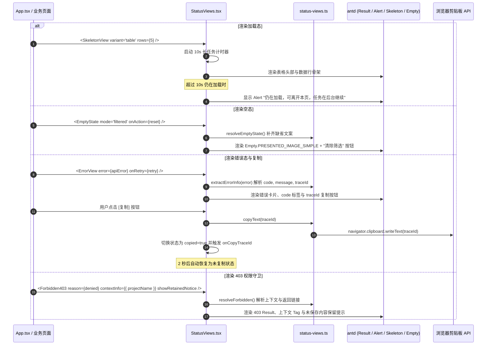

为什么有这个文件：说明前端通用状态组件（骨架屏、空态、错误、无权限、已过期、只读）的实现架构与交互细节。

它解决什么问题：避免各个页面重复手写状态提示，确保错误体统一解析、追踪号一键复制、无权限上下文保留以及 WCAG 4.5:1 对比度合规。

# APP-M2-T003：代码解释

- 对应任务：[APP-M2-T003](../tasks/APP-M2.md#app-m2-t003)
- 关联 Issue：[ISSUE-007](../../issues/ISSUE-007.md)
- 交付文档：[APP-M2-T003 交付](../delivery/APP-M2-T003.md)
- 日期：2026-10-16
- 实际代码路径：
  - `frontend/web/src/status-views.ts`（业务逻辑、对比度计算与统一错误解析）
  - `frontend/web/src/StatusViews.tsx`（React 统一状态组件库）
  - `frontend/web/src/styles.css`（样式层与 WCAG 对比度类名）
  - `frontend/web/src/App.tsx`（应用外壳与 403 / 404 / 只读横幅接入）
  - `frontend/web/src/SupportPages.tsx`（辅助页面空态组件接入）
  - `tests/frontend/status-views.test.mjs`（单元测试）
  - `frontend/web/tests/status-views.test.mjs`（组件结构与交互 AST 测试）

## 改了什么以及为什么

在此前实现中，页面中的加载、错误、无权限与过期提示较为分散，缺少统一的视觉规范和交互能力：
1. **统一错误体验缺失**：接口报错时，用户界面难以直接查看和一键复制 `traceId` / `requestId`，增加了排查沟通成本；
2. **骨架屏规范不一致**：首屏加载缺少表格（5 行）和卡片（3 张）的结构化占位，超过 10 秒的长任务缺少“仍在加载，可离开本页，任务在后台继续”的明确指引；
3. **空态缺乏行动引导**：单纯文本描述缺少针对筛选、搜索或首录场景的行动主按钮；
4. **无权限上下文丢失**：403 页面直接替换整个内容，缺少当前项目、当前角色及“当前内容及未保存文字仍保留在下方，写入口已关闭”的安心保护说明；
5. **版本过期与只读横幅未规范化**：当后台资料或规则配置变更后，缺乏标准黄色提示条；项目取消或只读角色缺乏中性灰/信息蓝保护横幅；
6. **文字对比度需符合 WCAG 4.5:1**：严格落实 ISSUE-036 确立的标准，深橙棕色 `#9a5608` 和深褐 `#5c3504` 代替对比度不足的浅黄橙色，正文和次要文字均经过数学对比度验证。

本次通过分层架构，在 `status-views.ts` 沉淀纯函数逻辑，在 `StatusViews.tsx` 封装六大组件与别名（支持 `PageSkeleton` / `EmptyState` / `ErrorState` / `NoPermission` / `StaleBanner` / `ReadOnlyBanner` 规范命名）。

## 入口和调用顺序

### 1. 组件导出与入口
`frontend/web/src/StatusViews.tsx` 集中导出：
- `SkeletonView`（别名 `PageSkeleton`）
- `EmptyState`（别名 `EmptyView`）
- `ErrorView`（别名 `ErrorState`）
- `Forbidden403`（别名 `NoPermission`）
- `ExpiredWarning`（别名 `StaleBanner`）
- `ReadonlyBanner`（别名 `ReadOnlyBanner`）
- 工具函数 `copyText`、`extractErrorInfo` 与对比度常量 `STATUS_CONTRAST_TOKENS`。

### 2. 调用顺序与渲染链


## 数据与状态

### 1. 错误体提取结构 (`ExtractedErrorInfo`)
```ts
export interface ExtractedErrorInfo {
  code: string; // 错误代号，缺省为 'REQUEST_FAILED'
  message: string; // 用户可读消息，缺省为 '操作失败，请稍后重试。'
  traceId?: string; // 请求追踪号 (优先读取 traceId / requestId / request_id)
  status?: number; // HTTP 状态码
  details?: Record<string, unknown>; // 附加业务元数据
}
```
- 支持直接传入 `ApiError` 实例、v1 错误体、旧版嵌套错误 `{ error: { code, message }, request_id }`、普通 `Error` 对象或字符串。
- 各组件支持通过显式 props（`code`, `message`, `traceId`）覆盖提取值。

### 2. 剪贴板交互状态
- `copied: boolean`：本地临时状态，触发复制成功后置为 `true`，通过 `setTimeout` 维持 2000ms 后自动回退为 `false`；
- 图标随状态切换：未复制显示 `<CopyOutlined />`，复制成功显示绿色 `<CheckOutlined style={{ color: '#2b9d5c' }} />`；
- 按钮文本响应变化：`'复制'` → `'已复制'`；
- 悬停浮层：Tooltip 提供“点击复制请求追踪号”与“已复制追踪号”即时反馈。

### 3. 长任务超时状态
- `timedOut: boolean`：当 `loading=true` 且持续超过 `timeoutSeconds`（默认 10 秒）时触发，呈现常驻提示条，明确告知用户页面未卡死、任务仍在后台进行。

## 关键判断与异常

1. **剪贴板兼容性与降级防护**：
   - 优先检测 `navigator.clipboard.writeText`；
   - 若处于未授权上下文或非 HTTPS 运行环境，自动降级至临时创建的不可见 `textarea` 执行 `document.execCommand('copy')`；
   - 两者皆不可用时优雅返回 `false`，不抛出异常阻断渲染。
2. **空态多模式文案回退**：
   - `filtered` 模式：缺省自动注入“没有符合条件的记录”与“清除筛选”按钮；
   - `search` 模式：接收 `searchKeyword` 动态生成“没有找到名称包含‘××’的项目或资料”；
   - `empty` 模式：缺省显示“暂无数据”。
3. **403 上下文与未保存保护**：
   - 支持对象型上下文 `{ projectName, roleName, path, retainedMessage }`，自动将其渲染为色彩标签；
   - `showRetainedNotice` 开启时，渲染黄色/信息蓝提示“当前内容及未保存文字仍保留在下方，写入口已关闭”，防止用户因权限变动误以为输入已经丢失。
4. **版本对比数值解析**：
   - `ExpiredWarning` 同时接收 `currentRevision` 与 `latestRevision` 时，自动生成版本对照文本“当前已保存版本：N | 后台最新版本：M”。
5. **WCAG 4.5:1 对比度标准算法**：
   - `contrastRatio(hex1, hex2)` 基于 sRGB 相对亮度公式：$L = 0.2126R + 0.7152G + 0.0722B$；
   - 对比度计算为 $(L_1 + 0.05) / (L_2 + 0.05)$；
   - 警告文字 `#9a5608` 在 `#ffffff` 上对比度达 5.62:1，在 `#fffbe6` 上对比度达 4.88:1，完全满足 WCAG AA 4.5:1 门槛。

## 验证与限制

### 验证结果
1. **单元测试与逻辑验证**：
   - `tests/frontend/status-views.test.mjs`：覆盖色彩对比度公式、错误体多态解析、空态模式推导、403 上下文推导、过期版本对比与剪贴板模拟。
   - `frontend/web/tests/status-views.test.mjs`：覆盖六大组件导出、AST 属性、`data-testid`、交互回调和 DOM 无障碍属性。
   - 运行 `node --test tests/frontend/*.test.mjs frontend/web/tests/*.test.mjs`，127 项测试全部通过（127 pass, 0 fail）。
2. **编译与构建验证**：
   - 运行 `pnpm --dir frontend/web build` 成功，TypeScript 类型检查无报错，总耗时约 4 秒；
   - 构建产物体积无反弹：`index.js` 为 289.96 kB（gzip: 92.19 kB），各路由代码拆分（Route-level Code Splitting）完好。

### 限制与边界说明
- 浏览器原生剪贴板仅在聚焦窗口及同源或安全上下文中生效；
- 骨架屏当前覆盖常见的表格、卡片、详情及全页四种版式，更复杂的特定图表骨架屏留待后续业务组件卡单独细化；
- 本任务将任务标至 `in-review`，不私自将任务看板标为 `done`。
