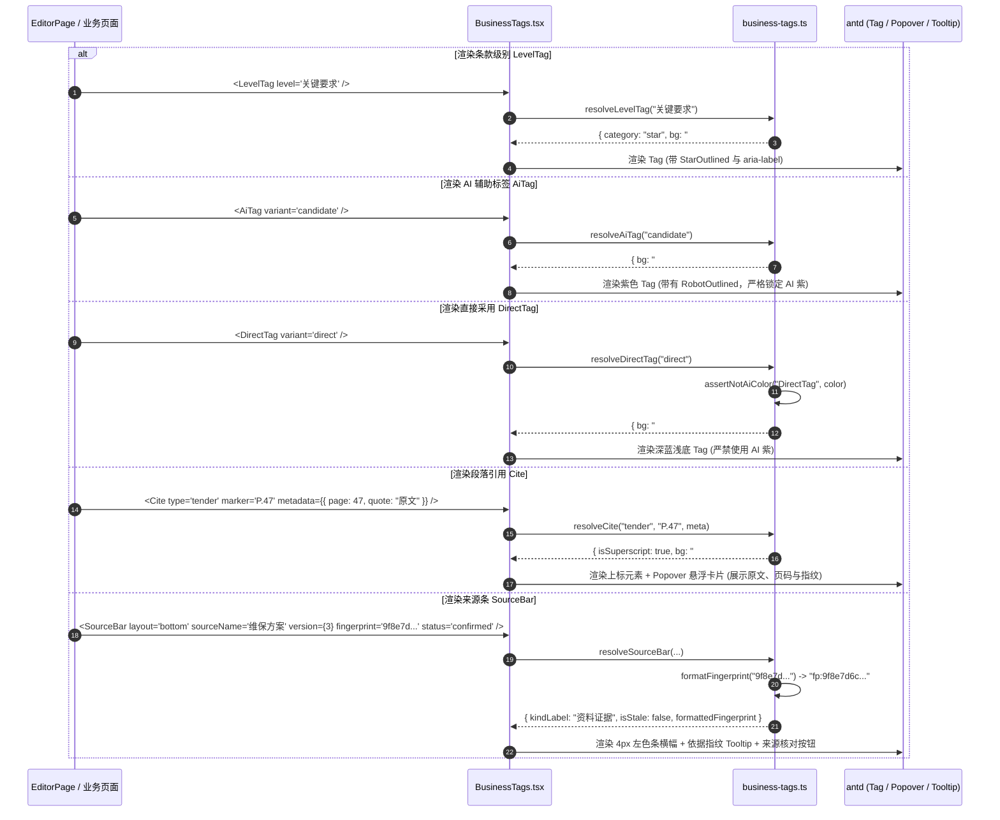

为什么有这个文件：说明前端业务小组件（LevelTag、AiTag、DirectTag、Cite、SourceBar）的实现架构、状态流与交互规范。

它解决什么问题：
1. 条款级别呈现规范化（LevelTag 支持阻断、关键要求、一般条款、加分项、否决项等标准色）；
2. 严格落实色彩锁定（AI 紫色阶只能出现在 AiTag，严禁混入其他业务标签）；
3. 答案卡直接采用与系统直查标签（DirectTag 采用深蓝色浅底，不与模型内容混淆）；
4. 结构化段落与资料引用标注（Cite 支持资料证据、方案片段、招标原文、事实变量，提供悬浮来源溯源卡片）；
5. 段落侧边与底部来源条（SourceBar 支持段落左侧 3px 色条或横向底部来源条，展示资料名、版本号与依据指纹溯源）；
6. 严格保障色彩无障碍性（所有文本在各背景色上的对比度均满足 WCAG AA 4.5:1）。

# APP-M2-T004：代码解释

- 对应任务：[APP-M2-T004](../tasks/APP-M2.md#app-m2-t004)
- 关联 Issue：[ISSUE-007](../../issues/ISSUE-007.md)
- 交付文档：[APP-M2-T004 交付](../delivery/APP-M2-T004.md)
- 日期：2026-10-21
- 实际代码路径：
  - `frontend/web/src/library/business-tags.ts`（业务规则纯函数、色彩令牌、AI紫防混用断言与元数据解析）
  - `frontend/web/src/library/BusinessTags.tsx`（React 统一业务小组件封装）
  - `frontend/web/src/shared/styles.css`（组件样式类名与 WCAG 对比度类名）
  - `frontend/web/src/editor/EditorPage.tsx`（编辑台正文招标引用、候选建议与来源条接入）
  - `tests/frontend/business-tags.test.mjs`（对比度、色彩隔离与数据解析单元测试）
  - `frontend/web/tests/business-tags.test.mjs`（AST 结构与组件属性测试）

## 改了什么以及为什么

在企业智能投标系统中，正文、矩阵与编辑台大量承载不同性质的业务标记与来源标注。原先实现中存在以下问题：
1. **条款级别与规则级别缺乏统一封装**：阻断、关键要求（星号）、加分项、否决项零散使用基础 Tag，色彩和文字对比度不统一；
2. **AI 紫色系存在外溢风险**：设计规范 §9.4 明确规定“AI 相关只用紫色系（`#6E4BD8`、`#A23CC8`），紫色系是锁定令牌，品牌主色不能接近它，任何业务状态不得用紫色，答案卡取值来自业务库、未经模型，用蓝色直接采用标签”。此前缺少自动化防混用检测；
3. **答案卡与直接采用标识缺失**：答案卡直接引用的数据未经模型，若与模型建议混同将误导编标人员；
4. **正文段落引用标注（Cite）缺乏交互**：正文中的资料证据、方案片段、招标原文页码仅有纯文本或简单 Tag，缺少悬浮查看版本、有效期、责任人与原文引录的能力；
5. **段落来源条（SourceBar）未标准化**：编辑台段落左侧缺少设计规范 §7.1 / §9.4 规定的 3px 色条（七种来源色），底部缺乏依据指纹（`input_fingerprint`）溯源显示；
6. **无障碍文字对比度必须达到 WCAG AA 4.5:1**：所有实心底、浅底与文字组合，必须经过数学公式计算并锁死。

本次在 `frontend/web/src/` 下设计了双层结构：
- `business-tags.ts`：纯函数逻辑层，脱离 DOM 运行，定义 `BIZ_COLOR_TOKENS`、`isAiColor`、`assertNotAiColor`、`resolveLevelTag`、`resolveAiTag`、`resolveDirectTag`、`resolveCite`、`resolveSourceBar`、`formatFingerprint`；
- `BusinessTags.tsx`：组件表现层，封装 `LevelTag`、`AiTag`、`DirectTag`、`Cite`、`SourceBar`。

## 入口和调用顺序

### 1. 组件导出与入口
`frontend/web/src/library/BusinessTags.tsx` 集中导出：
- `LevelTag`：条款级别标签（支持 `blocker`、`star`、`warning`、`bonus`、`scoring`、`qualification`、`general` 及其别名）；
- `AiTag`：AI 辅助标识（支持 `suggestion`、`generated`、`candidate`、`model`、`assistant`、`demo` 等变体）；
- `DirectTag`：直接响应 / 系统直查标签（支持 `direct`、`adopt`、`response`、`struct` 变体）；
- `Cite`：引用标注组件（支持 `evidence`、`snippet`、`tender`、`fact`、`none` 变体与悬浮卡片）；
- `SourceBar`：段落侧边或底部来源条（支持 `paragraph` 与 `bottom` 两种布局）。

### 2. 调用顺序与时序流


## 数据与状态

### 1. 业务色彩令牌 (`BIZ_COLOR_TOKENS`)
| 令牌键名 | 十六进制值 | 用途与对比度 |
|---|---|---|
| `blockerSolidBg` / `Text` | `#D9363E` / `#FFFFFF` | 阻断实心底，白字对比度 4.66:1 |
| `blockerSubtleBg` / `Text` | `#FFF1F0` / `#A8071A` | 阻断浅底深红字，对比度 7.10:1 |
| `starBg` / `starText` | `#FFF1F0` / `#CF1322` | 星号/关键要求，对比度 5.86:1 |
| `warningBg` / `warningText` | `#FFFBE6` / `#9A5608` | 警告黄色背景与深橙棕字，对比度 5.12:1 |
| `bonusBg` / `bonusText` | `#E6FFFB` / `#005C66` | 加分/评分项青色，对比度 7.82:1 |
| `qualificationBg` / `Text` | `#E6F4FF` / `#0958D9` | 资格要求极客蓝，对比度 5.53:1 |
| `generalBg` / `generalText` | `#F2F3F5` / `#4E5969` | 一般条款中性灰，对比度 5.88:1 |
| `aiSolidBg` / `Text` | `#6E4BD8` / `#FFFFFF` | AI 紫实心底白字，对比度 5.73:1 |
| `aiSubtleBg` / `Text` | `#F2EEFC` / `#5329B3` | AI 浅底深紫字，对比度 7.86:1 |
| `directBg` / `directText` | `#EEF3FC` / `#1E4DB7` | 系统直查浅底深蓝字，对比度 6.88:1 |
| `varBg` / `varText` | `#FFF4D6` / `#9A5608` | 事实/SLA 变量黄底下划线，对比度 4.95:1 |
| `srcSnippetBg` / `Text` | `#E6F7F7` / `#005C66` | 方案片段来源色，对比度 7.82:1 |
| `srcManualBg` / `Text` | `#F0F9F4` / `#136C38` | 人工编写来源色，对比度 6.20:1 |

### 2. 引用元数据结构 (`CiteMetadata`)
```ts
export interface CiteMetadata {
  title?: string; // 资料名称或原文标题
  version?: string | number; // 资料版本号
  validUntil?: string; // 有效期截止日期
  status?: string; // 确认状态（confirmed / pending / stale）
  assignee?: string; // 责任人或写入人
  fingerprint?: string; // 依据指纹哈希
  quote?: string; // 引用摘录原文
  page?: number | string; // 招标原文所在页码
}
```

### 3. 指纹截断格式化 (`formatFingerprint`)
- 输入为 `null` 或空字符串：返回 `'无依据指纹'`；
- 长度 $\le 8$：返回 `'fp:' + clean`；
- 长度 $> 8$：截取前 8 位并追加省略号，返回 `'fp:' + clean.substring(0, 8) + '...'`；
- 完整指纹通过 Tooltip 保留展示，兼顾紧凑空间与溯源核查需求。

## 关键判断与异常分支

1. **AI 紫严格隔离机制**：
   - `isAiColor(hexColor)` 自动识别锁定 AI 紫（`#6E4BD8`）、助手紫（`#A23CC8`）、深紫文字（`#5329B3`）以及 AntD 紫色阶；
   - `assertNotAiColor(component, color)` 在组件构建和 DirectTag 解析中执行强断言，若非 AI 标签误用 AI 紫色阶，直接抛出 `[ICG 色彩规范违规]` 异常；
2. **Cite 变量与普通上标分流**：
   - 当 `type === 'fact'` 时，不使用上标样式，改为行内高亮背景（`#FFF4D6`）与底边线（`2px solid #F0C24B`），保留正文可读性；
   - 当 `type === 'none'` 时，渲染为灰色静态标签“无知识库来源”，不提供悬浮溯源卡片；
3. **SourceBar 失效与待核对提示**：
   - 当 `status === 'stale'` 或 `status === 'review_required'` 时，背景自动切换为警告黄底（`#FFFBE6`），状态标签显示为“来源已变化待核对”，且“核对最新来源”主按钮高亮激活；
4. **Cite 与 SourceBar 无障碍交互**：
   - 包含显式 `role="doc-biblioref"` 或 `role="region"`，带有针对屏幕阅读器的 `aria-label`；
   - 引用方块设置 `tabIndex={0}`，支持键盘 Tab 聚焦与回车触发。

## 验证与测试

1. **自动化单测套件**：
   - 运行：`node --test tests/frontend/*.test.mjs frontend/web/tests/*.test.mjs`
   - 结果：**141 项测试全部通过（新增 14 项专项测试，0 fail）**；
   - 验证了：
     - 各标签在白底与各浅色底上的对比度全部 $\ge 4.5:1$（WCAG AA 通过）；
     - `isAiColor` 与 `assertNotAiColor` 阻断非 AI 组件使用紫色；
     - `resolveLevelTag` 中英文映射与实心/浅色模式推导；
     - `resolveAiTag` 各变体标签与色彩推导；
     - `resolveDirectTag` 蓝底白边推导与无 AI 紫断言；
     - `resolveCite` 资料、片段、原文、变量四种模式推导；
     - `resolveSourceBar` 7 种段落来源色与依据指纹格式化；
     - AST 语法树断言 5 大组件导出与 `data-testid` 完整声明。
2. **生产构建验证**：
   - 运行：`pnpm --dir frontend/web build`
   - 结果：**构建成功，耗时 0.92s**；
   - 产物体积无反弹：`dist/assets/index-*.js` 为 289.99 kB（gzip: 92.21 kB），与变更前 289.96 kB 保持完全一致；
   - 路由级代码拆分（Route-level Code Splitting）完好。

## 限制与后续建议

- 复杂富文本（如 TipTap）的段落左侧色条将在后续编辑台重构（如 APP-M2-T162）中与 TipTap 扩展节点深度绑定；当前 `SourceBar` 满足单段包裹与底部独立条渲染需求；
- 遵循工作流规范，本卡提交后标为 `in-review`，严禁私自标 `done`。
