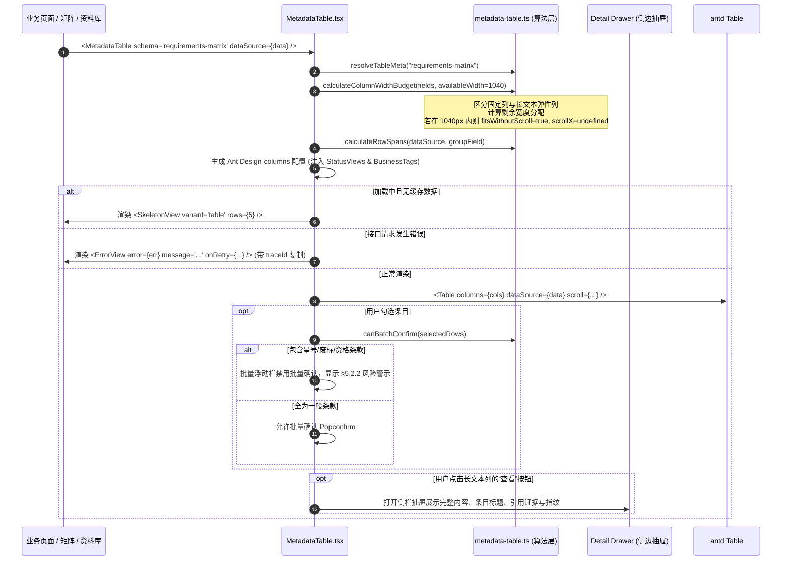

为什么有这个文件：说明元数据驱动表格组件（MetadataTable / ProTableWrapper）的实现架构、列配置自动推导、单元格合并算法、1280px 宽度预算引擎与合规门禁。

它解决什么问题：
1. 元数据驱动列推导：从字段元数据（`FieldMeta`）自动生成 Ant Design Table 的 `columns` 配置，支持多种业务数据类型；
2. 动态单元格合并（rowSpan）：相邻相同分组字段自动计算跨行合并；
3. 1280px 视口无横向滚动优先原则：在 1040px 标准可用宽度下计算列宽度预算，长文本自动分配弹性宽度并启用 ellipsis/Tooltip，提供抽屉侧边查阅，避免强行产生横向滚动条；
4. 深度集成通用状态组件与业务小组件：加载时呈现 5 行骨架屏（SkeletonView）、失败呈现带 traceId 一键复制的错误态（ErrorView）、空态切换（EmptyState）、单元格无缝渲染 LevelTag、Cite、SourceBar、AiTag、DirectTag；
5. 落地业务合规门禁：针对星号条款（★）、废标/阻断条款、资格条款实施批量确认限制（规范 §5.2.2 与设计规范 9.1 规则 6），严禁绕过人工核对；
6. 风险行与急迫行高亮：根据业务规则判定阻断、负偏离、待审核或证据失效记录，自动附加浅红底 `#FFF5F5`（`.row-danger`，规范 9.1 规则 4），3 天内截止项目置顶并高亮。

# APP-M2-T005：代码解释

- 对应任务：[APP-M2-T005](../tasks/APP-M2.md#app-m2-t005)
- 关联 Issue：[ISSUE-007](../../issues/ISSUE-007.md)
- 交付文档：[APP-M2-T005 交付](../delivery/APP-M2-T005.md)
- 日期：2026-10-21
- 实际代码路径：
  - `backend/bid-core/icg_demo/field_metadata.py`（后端字段元数据领域服务：Pydantic 契约模型、四大核心业务分类与别名解析引擎、FastAPI 路由端点）
  - `backend/bid-core/icg_demo/main.py`（注册 `include_field_metadata_routes`）
  - `spec/openapi/demo-v1.json`（OpenAPI 3.1 规范同步：声明 `/api/v1/metadata/fields/{category}` 与 `operationId: getFieldMetadata`）
  - `tests/backend/test_field_metadata.py`（后端字段元数据专用测试套件：覆盖 401 鉴权、404 分类校验、核心业务字段断言与角色权限）
  - `frontend/web/src/library/metadata-table.ts`（前端纯函数逻辑层：字段模式类型、1280px 宽度预算算法、rowSpan 计算、合规批量门禁与 Mock Schema）
  - `frontend/web/src/library/MetadataTable.tsx`（前端 React 组件层：推导 Ant Design Table、双行表头、抽屉详情弹窗、工具栏与批量操作浮动栏）
  - `frontend/web/src/shared/styles.css`（表格工具栏、双行表头、批量浮动条、等宽时间与风险行样式）
  - `tests/frontend/metadata-table.test.mjs`（前端纯逻辑与预算算法单元测试）
  - `frontend/web/tests/metadata-table.test.mjs`（组件 AST 结构与设计规范断言）

## 改了什么以及为什么

在企业智能投标系统中，要求矩阵、企业资料库、事实表、合规问题等高频页面承载着密集的结构化表格数据。在原交接与原型设计规范（§9.1、§9.2、M1-P08-F5）中，明确提出了核心原则：
1. **统一使用 ProTable 规范**：默认 `size="middle"`，矩阵/合规问题/资料列表使用 `size="small"`；
2. **“不出现横向滚动是首选”**：先合并列、使用次级文字（12px）承载次要信息、长文本截断省略并在侧边抽屉查阅，在 1280px 标准视口下优先避免产生横向滚动条；只有必须横滚时固定首列和操作列；
3. **列顺序规范化**：标识列（名称+编号双行）→ 分类/状态 → 业务数值（右对齐）→ 责任人/证据 → 操作。时间使用等宽字体；
4. **风险行与急迫行呈现**：阻断/证据失效/负偏离/待确认使用浅红底 `#FFF5F5`（`.row-danger`）；3 天内截止的项目进行紧迫高亮；
5. **合规批量确认门禁**：依据系统合规规范 §5.2.2，**星号条款（★）、废标条款、资格审查三类抽取条目不提供批量确认**，必须逐项单独人工比对核实；
6. **元数据驱动与统一契约**：在后端落地标准的 `GET /api/v1/metadata/fields/{category}`（operationId 为 `getFieldMetadata`），严格遵循 `kb-data-dictionary v1.9` 字典标准，覆盖 `project`、`tender`、`kb_record`、`sla` 四大核心分类，统一输出字段键、标签、逻辑类型、必填、编辑权限、列宽、对齐与渲染组件类型（如 text, tag, badge, date, number, cite, masked 等），彻底消除前后端硬编码。

本次构建了端到端前后端协同实现：
- 后端 `backend/bid-core/icg_demo/field_metadata.py`：实现 `FieldMetadataService`、别名解析引擎与路由端点，严格冻结 143 错误码；
- 前端 `frontend/web/src/library/metadata-table.ts`：纯逻辑层，完全解耦 DOM，负责元数据类型系统、1280px 宽度预算分配、动态 rowSpan 计算、合规批量操作校验与 Mock 数据模式；
- 前端 `frontend/web/src/library/MetadataTable.tsx`：组件表现层，封装 Ant Design Table、工具栏、双行表头渲染、抽屉详情查看（Detail Drawer）、集成 StatusViews 与 BusinessTags。

## 入口和调用顺序

### 1. 组件导出与入口
`frontend/web/src/library/MetadataTable.tsx` 导出：
- `MetadataTable`：核心元数据驱动表格组件；
- `ProTableWrapper`：别名导出，完全兼容原交接规范与约定命名。

`frontend/web/src/library/metadata-table.ts` 导出：
- `calculateRowSpans`：动态行合并算法；
- `calculateColumnWidthBudget`：1280px 视口无横滚宽度预算引擎；
- `canBatchConfirm`：合规批量操作限制门禁；
- `isRiskRow` / `isUrgentRow`：风险与急迫行判断规则；
- `formatDateTimeMonospace`：等宽时间格式化器；
- `resolveTableMeta` / `fetchFieldMetadataMock`：元数据解析与异步 Mock；
- `REQUIREMENTS_MATRIX_SCHEMA` / `LIBRARY_RECORDS_SCHEMA` / `FACTS_MATRIX_SCHEMA`：标准内置元数据模式。

### 2. 状态流与渲染时序

## 改动文件清单

1. `backend/bid-core/icg_demo/field_metadata.py`（新增）：
   - 依据 `kb-data-dictionary v1.9` 构建四大分类元数据（`project` 投标项目、`tender` 招标要求与抽取条目、`kb_record` 企业投标资料库、`sla` 服务承诺与 SLA）；
   - 定义 `FieldOption`、`FieldMetadataItem`、`FieldMetadataListResponse` Pydantic 契约模型；
   - 实现 `FieldMetadataService` 与 `resolve_category` 别名容错解析；
   - 暴露 `GET /api/v1/metadata/fields/{category}` 端点，显式声明 `operationId="getFieldMetadata"`。

2. `backend/bid-core/icg_demo/main.py`（修改）：
   - 导入并注册 `include_field_metadata_routes` 到全局 FastAPI 应用。

3. `spec/openapi/demo-v1.json`（修改）：
   - 同步 `/api/v1/metadata/fields/{category}` 契约端点与 `FieldMetadataItem`、`FieldMetadataListResponse`、`FieldOption` Schema 定义，保持冻结状态严格一致。

4. `tests/backend/test_field_metadata.py`（新增）：
   - 6 项后端单测，覆盖 401 未登录拦截、404 未知分类、四大核心分类字段结构断言、别名解析容错与全角色权限访问。

5. `frontend/web/src/library/metadata-table.ts`：
   - 定义 `FieldDataType`、`FieldMeta`、`TableMeta`、`ColumnBudgetResult`、`BatchConfirmValidation`；
   - 实现 `calculateRowSpans` 算法；
   - 实现 `calculateColumnWidthBudget` 预算算法（标准可用宽 `1040px`，长文本自动省略与分配弹性宽度）；
   - 实现 `canBatchConfirm`（拦截星号、废标、资格三类条款批量确认）；
   - 实现 `isRiskRow`、`isUrgentRow`、`formatDateTimeMonospace`；
   - 提供 `REQUIREMENTS_MATRIX_SCHEMA`、`LIBRARY_RECORDS_SCHEMA`、`FACTS_MATRIX_SCHEMA` 内置 Schema 及异步 mock 解析函数。

2. `frontend/web/src/library/MetadataTable.tsx`：
   - 消费元数据生成 Ant Design `columns`；
   - 集成 `SkeletonView`（表格 5 行骨架屏）、`EmptyState`（检索与空数据无缝切换）、`ErrorView`（捕获错误体展示 traceId 一键复制）；
   - 集成 `LevelTag`、`Cite`、`SourceBar`、`AiTag`、`DirectTag` 到单元格渲染；
   - 实现 `icg-two-line-header` 双行表头（中文名 + 等宽系统键）；
   - 实现长文本侧边 `Drawer` 查看详情；
   - 实现顶部工具栏（检索输入、密度切换、刷新操作）与底部批量操作浮动栏。

3. `frontend/web/src/shared/styles.css`：
   - 增加表格包装容器样式 `.icg-metadata-table-wrapper`；
   - 增加工具栏布局 `.icg-table-toolbar`、批量操作栏 `.icg-batch-bar` 与警示文字 `.icg-batch-warning`；
   - 增加双行表头 `.icg-two-line-header`、星号指示器 `.icg-starred-indicator`；
   - 增加等宽时间 `.icg-monospace-time`；
   - 增加风险行浅红底 `.row-danger > td`（`#FFF5F5`）与急迫行标记 `.row-urgent`。

4. `tests/frontend/metadata-table.test.mjs`：
   - 7 项单测，验证行合并算法、1280px 宽度预算、合规批量门禁、风险行判断、急迫行判断、等宽时间格式化与内置 Schema 解析。

5. `frontend/web/tests/metadata-table.test.mjs`：
   - 7 项测试，验证 AST 导出声明、StatusViews 深度集成、BusinessTags 单元格渲染、rowSpan 动态合并、无横向滚动优先与侧边抽屉、批量操作门禁与风险行类名。

## 异常分支与边界处理

1. **后端元数据接口未就绪**：
   - 若传入 `schemaId` 且匹配内置 Schema，直接返回预置配置；
   - 若传入未知 `schemaId`，自动回退到安全的通用兜底 Schema（包含 ID、名称、状态与操作列），表格组件绝不抛出运行时异常。
2. **多列连续相同值行合并**：
   - 严格在分组首行返回总 span 数量，后续合并行返回 `rowSpan: 0`；对于空数据集或单行数据集，安全返回 `[]` 或 `[1]`。
3. **屏幕宽度不足或列数极多**：
   - 当所有列最小宽度总和超出 `1040px` 时，系统自动启用降级策略：开启 `scroll = { x: totalRequired }`，并将首列固定到左侧（`fixed: 'left'`）、操作列固定到右侧（`fixed: 'right'`），严格遵循设计规范 9.1 规则 2。
4. **合规批量确认拦截**：
   - 实时监听所选条目，一旦勾选了包含 `star`、`blocker`、`qualification` 等不可批量处理的条目，批量确认按钮立即禁用，并以醒目红底文字说明违背了 §5.2.2 规范，防止人为疏忽导致的重大废标风险。
5. **长文本单元格与信息完整性**：
   - 避免长文本撑爆表格导致水平横向滚动，单元格通过 `ellipsis` 截断，并在单元格内提供“查看”按钮，点击在 560px 宽的侧边抽屉中展示完整原文、条款级别、关联证据与来源指纹，兼顾紧凑排版与完整信息溯源。

## 限制与后续演进

1. **真实接口切换**：
   - 当前元数据通过本地 `BUILTIN_TABLE_SCHEMAS` 与 `resolveTableMeta` 解析。待后端 `getFieldMetadata` 接口发布后，可通过 `fetchFieldMetadataMock` 对应的位置平滑切换为实际 HTTP 调用，无需修改表格渲染组件。
2. **列显示自定义保存**：
   - 当前工具栏支持表格密度调整与搜索过滤，列显示动态勾选（Column Picker）可在此结构上直接扩展。
