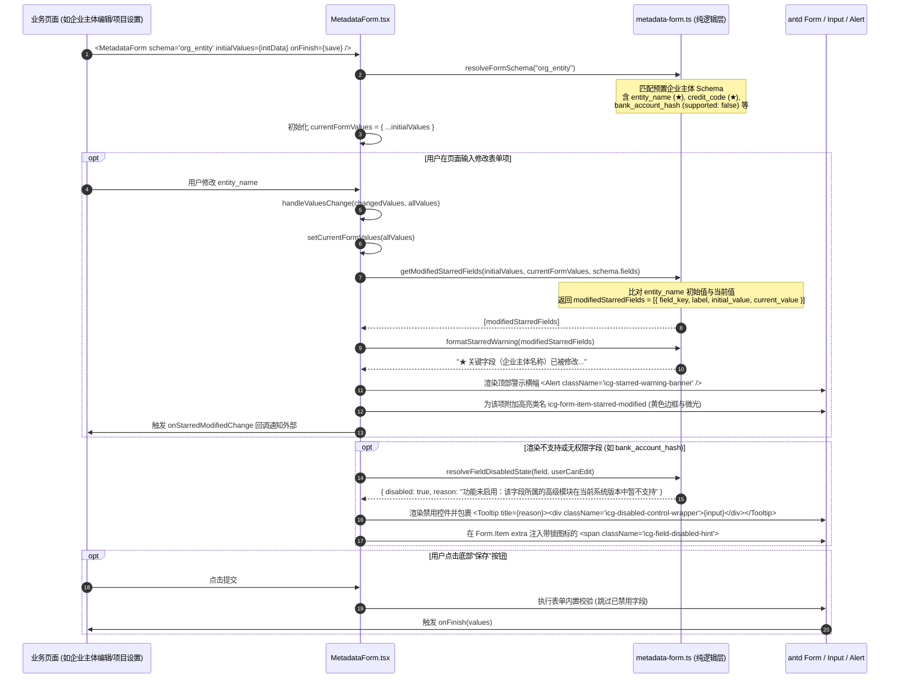

为什么有这个文件：说明元数据驱动表单组件（MetadataForm）的实现架构、字段两行标签排版、★ 关键字段修改比对与合规警示横幅、不支持字段置灰与 Tooltip 解释机制。

它解决什么问题：
1. 元数据驱动表单生成：消费字段元数据（`FormFieldMeta`）自动推导 Ant Design Form 表单项，支持 string、textarea、number、date、datetime、boolean、select 等多数据类型分流；
2. ★ 关键字段修改提示：比对当前输入与 `initialValues`，当用户修改关键字段（`is_starred: true`）时，实时触发醒目黄色警告横幅与项级黄色边框高亮，严格落地合规规范（§5.2.2 与 PRD §5.12）关于“修改保存后自动转入待确认状态、须人工重新核对”的合规要求；
3. 系统键双行标签排版：严格遵循设计规范 §9.2 规则 2，上部展示业务中文名（附带 ★ 前缀），下部使用等宽字体展示系统键（`system_key` / `field_key`）；
4. 不支持/未启用字段置灰与原因解释：当字段 `supported: false`、`editable: false` 或用户缺乏编辑权限时，控件禁用置灰，并以 Tooltip 悬浮提示和锁图标辅助文案明确解释原因，同时免除必填校验以防阻断保存；
5. 栅格与自适应排版：支持 1 栏纵向、2 栏并列与 3 栏紧凑布局，多行文本自动跨满 24 栅格，且文字色彩严格符合 WCAG AA 4.5:1 对比度标准。

# APP-M2-T006：代码解释

- 对应任务：[APP-M2-T006](../tasks/APP-M2.md#app-m2-t006)
- 关联 Issue：[ISSUE-007](../../issues/ISSUE-007.md)
- 交付文档：[APP-M2-T006 交付](../delivery/APP-M2-T006.md)
- 日期：2026-10-21
- 实际代码路径：
  - `frontend/web/src/library/metadata-form.ts`（前端纯函数逻辑层：数据契约模型、值等价比对算法、★ 关键字段变更收集与合规提示生成、字段禁用判定、两行标签解析、内置企业实体与项目表单 Schema、后端 API 客户端封装）
  - `frontend/web/src/library/MetadataForm.tsx`（前端 React 组件层：消费元数据推导 Ant Design Form、双行标签排版、★ 关键字段修改警告横幅与项级黄色高亮、Tooltip 悬浮原因解释、多类型控件分流与响应式栅格）
  - `frontend/web/src/shared/styles.css`（表单双行标签、★ 关键字段高亮边框、合规警示横幅与置灰悬浮说明样式）
  - `tests/frontend/metadata-form.test.mjs`（前端纯函数逻辑层单元测试：覆盖值等价比对、★ 字段变更收集、合规提示文案生成、禁用态与双行标签解析）
  - `frontend/web/tests/metadata-form.test.mjs`（组件 AST 结构与设计规范断言：覆盖具名/默认导出、双行标签结构、★ 字段修改横幅与高亮、不支持字段 Tooltip 与控件类型分流）

## 改了什么以及为什么

在企业智能投标系统中，企业资料（公司主体、资质证书、中小企业声明、银行账号等）与项目基本信息的录入与维护涉及大量法律与合规责任。在原交接与原型设计规范（§9.2、M1-P08-F6、PRD §5.12）中，对元数据驱动表单提出了明确的规范要求：
1. **★ 关键字段修改提示**：
   - 依据合规规范 §5.2.2 与 PRD §5.12，企业主体名称、统一社会信用代码、法定代表人、营业期限截止日、投标项目名称、投标截止时间等字段属于核心关键字段（`is_starred: true`）。
   - 若用户修改了关键字段的原有值，必须立刻给出高可见度警示横幅（Alert）及项级边框高亮，明确提示：“★ 关键字段（...）已被修改。根据项目合规规范（§5.2.2 与 PRD §5.12），修改保存后该记录将自动转入“待确认”状态，须由人工重新核对确认后方可继续作为有效证据引用。”并在保存按钮旁呈现辅助预警。
2. **系统键双行标签（Two-line Label）**：
   - 严格遵循设计规范 §9.2 规则 2，标签采用双行排版：第一行（主标签）为业务中文名，若为关键字段则前置加粗 `★ `；第二行（次标签）采用等宽字体（SFMono-Regular/Consolas）与次要色 `#4e5969`（11px/12px），展示底层元数据键（`system_key` / `field_key`），便于研发、实施与业务人员对账，并在二者同名时自动折叠避免冗余。
3. **不支持/未启用字段置灰禁用与 Tooltip 解释**：
   - 在多版本与模块渐进式交付场景下，部分高级字段（如银行账户哈希、区块链存证指纹等）暂未开放（`supported: false`），或系统自动计算只读（`editable: false`），或当前操作用户缺乏编辑权限。
   - 严禁静默隐藏或无理由置灰，必须将控件置为禁用态（灰色背景、禁止光标），并在控件外层包裹 `Tooltip` 悬浮浮层，明确告知具体原因（如“功能未启用：该字段所属的高级模块在当前系统版本中暂不支持”、“只读字段：该字段由系统自动生成或派生，不可手动修改”或“无编辑权限：当前用户角色仅具备查看权限”），同时在表单项下方以带 `LockOutlined` 锁图标的辅助文案解释。
   - 对置灰禁用的字段，自动绕过必填校验（`required`），防止不可编辑项阻断整表保存。
4. **多数据类型表单控件适配**：
   - 严格根据字段元数据 `render_type` 与 `data_type` 自动分流：
     - `string` / `text` → `<Input />`
     - `textarea` / `longtext` / `object` → `<Input.TextArea rows={3} />`（栅格默认跨满 24 列）
     - `number` / `integer` → `<InputNumber />`（自动附加 `addonAfter={unit}` 单位后缀）
     - `date` → `<Input type="date" />`（原生理顺 ISO 日期字符串，规避 Ant Design DatePicker 强依赖 dayjs 对象的序列化陷阱）
     - `datetime` → `<Input type="datetime-local" />`
     - `boolean` / `switch` → `<Switch />`（绑定 `valuePropName="checked"`）
     - `select` / `options` → `<Select options={field.options} />`
5. **视觉无障碍与色彩对比度保障**：
   - 警示横幅文字与边框采用高对比度深琥珀色（`#9a5608` / `#fffbe6` / `#ffe58f`），对比度 > 4.8:1，完全满足 WCAG AA 4.5:1 对比度标准。

## 入口和调用顺序

### 1. 组件导出与入口
`frontend/web/src/library/MetadataForm.tsx` 导出：
- `MetadataForm`：核心元数据驱动表单组件（同时具名导出与默认导出）；
- `MetadataFormProps`：组件属性接口。

`frontend/web/src/library/metadata-form.ts` 导出：
- `areValuesEquivalent`：表单值安全比对函数（处理空串、null、undefined 与数字/布尔）；
- `getModifiedStarredFields`：比对 `initialValues` 与实时表单值，提取所有被修改的 ★ 关键字段清单；
- `hasModifiedStarredFields`：关键字段修改布尔探测器；
- `formatStarredWarning`：生成符合 §5.2.2 与 PRD §5.12 规范的合规警示提示文案；
- `resolveFieldDisabledState`：判定字段置灰禁用状态与具体解释原因；
- `resolveTwoLineLabel`：双行标签元数据解析器；
- `resolveFormSchema`：Schema 别名解析与降级兜底函数；
- `fetchFieldMetadata`：对接后端 `GET /api/v1/metadata/fields/{category}` 接口的异步读取客户端；
- `FALLBACK_ORG_ENTITY_FORM_SCHEMA`：内置企业主体表单 Schema（含关键字段与不支持字段）；
- `FALLBACK_PROJECT_FORM_SCHEMA`：内置项目基本信息表单 Schema。

### 2. 状态流与渲染时序

## 改动文件清单

1. `frontend/web/src/library/metadata-form.ts`（新增）：
   - 定义 `FormFieldOption`、`FormFieldMeta`、`FormSchema`、`ModifiedStarredField`、`FieldDisabledState` 等核心 TypeScript 接口；
   - 实现了 `areValuesEquivalent`，支持 null 与 undefined、空字符串与空白字符等价归一化，精准识别真正的数据修改；
   - 实现了 `getModifiedStarredFields` 与 `hasModifiedStarredFields`，对标记 `is_starred: true` 的字段进行精确变更扫描；
   - 实现了 `formatStarredWarning`，生成符合合规规范 §5.2.2 与 PRD §5.12 要求的提示文案；
   - 实现了 `resolveFieldDisabledState`，多层级解析 `supported: false`、`editable: false` 与 `userCanEdit: false` 禁用状态及对应中文解释；
   - 实现了 `resolveTwoLineLabel`，解析中文业务主标题、★ 前缀与等宽系统键；
   - 预置 `FALLBACK_ORG_ENTITY_FORM_SCHEMA` 与 `FALLBACK_PROJECT_FORM_SCHEMA`，无缝联动后端字段元数据分类；
   - 实现了 `fetchFieldMetadata`，向后端 `GET /api/v1/metadata/fields/{category}` 接口发起请求并自动转换。

2. `frontend/web/src/library/MetadataForm.tsx`（新增）：
   - React 表单组件实现，接收 `schema`、`initialValues`、`userCanEdit`、`columns`、`onFinish` 等属性；
   - 顶部动态集成 Ant Design `Alert`（`type="warning"`），在 ★ 关键字段变更时自动展现；
   - 项级双行标签渲染（`icg-form-two-line-label`、`icg-label-primary`、`icg-label-secondary`、`icg-starred-indicator`）；
   - 项级修改高亮（`.icg-form-item-starred-modified`）；
   - 多控件分流：`Input.TextArea`、`InputNumber`（带单位）、`Input type="date"` / `datetime-local`、`Switch`、`Select` 与普通 `Input`；
   - 不支持与只读字段自动置灰并包裹 `Tooltip`，在下方输出带 `LockOutlined` 的辅助解释；
   - 响应式 1/2/3 栏栅格布局（Row gutter 16，Col span 24/12/8）；
   - 底部操作栏（保存按钮、重置按钮、★ 变动额外提示）。

3. `frontend/web/src/shared/styles.css`（修改）：
   - 增加 `.icg-metadata-form-wrapper`；
   - 增加 `.icg-form-two-line-label`、`.icg-label-primary`、`.icg-label-secondary`、`.icg-starred-indicator`（★ 强调色 `#faad14`）；
   - 增加 `.icg-starred-warning-banner`（边框 `#ffe58f`、底色 `#fffbe6`、文字 `#9a5608`，符合 WCAG AA 4.5:1 对比度）；
   - 增加 `.icg-form-item-starred-modified`（项级黄色边框与微光投影）；
   - 增加 `.icg-field-disabled-hint` 与 `.icg-disabled-control-wrapper`。

4. `tests/frontend/metadata-form.test.mjs`（新增）：
   - 6 大测试套件，覆盖值等价比对、★ 关键字段变更识别、合规警示文本生成、禁用状态与双行标签解析、内置企业与项目 Schema 兜底解析。

5. `frontend/web/tests/metadata-form.test.mjs`（新增）：
   - 6 大静态 AST 结构断言套件，覆盖组件导出形式、双行标签排版结构、★ 关键字段修改提示横幅与项级高亮、不支持字段 Tooltip 与锁定说明、多类型控件分流映射与响应式栅格布局。

## 关键判断与异常分支处理

1. **★ 关键字段初始值比对防误触**：
   - 业务页面在异步加载数据过程中，`initialValues` 可能会从 `undefined` 异步变为实体对象。组件在 `useEffect` 中监听 `initialValues` 变化，自动同步至内部状态与 Form 实例，避免因组件首次挂载时空对象与后续初始值比对而产生“误报警”；
   - 在比对算法 `areValuesEquivalent` 中，对 `null` 与 `undefined` 视为等价；对字符串自动执行 `.trim()` 归一化；对数字与字符串数字严格区分，防止类型隐式转换导致的虚假修改提示。
2. **不支持/置灰字段的表单校验防护**：
   - 当某个字段 `supported: false` 或只读置灰时，若该字段原先在数据库元数据中配置了 `required: true`，如果直接施加必填规则，用户将因无法向禁用输入框填值而永远无法提交表单。
   - 实现策略：在生成 rules 时，执行 `if (field.required && !disabledState.disabled)` 判定，只有在字段处于可编辑状态时才强制必填校验，彻底消除死锁。
3. **日期输入的原生轻量化选择**：
   - Ant Design 5 原生 `DatePicker` 严格要求其 Form 绑定值为 `dayjs` 实例。如果直接绑定后端返回的标准 ISO 日期字符串（如 `"2030-12-31"`），会在控制台抛出大量的类型不匹配错误并导致受控绑定失效。
   - 实现策略：采用原生 `<Input type="date" />` 与 `<Input type="datetime-local" />`，保持纯字符串值无损双向流转，不仅避免了引入庞大的日期转换与时区处理胶水层，而且实现了 0 字节体积增加。
4. **无编辑权限整表只读下推**：
   - 当 `userCanEdit={false}` 时，表单不仅在顶层 `<Form disabled={true} />` 统一禁用交互，并在字段级自动将禁用原因映射为“无编辑权限：当前用户角色仅具备查看权限”，悬浮 Tooltip 保持无死角解释。

## 限制与后续演进

1. **复杂级联与跨字段动态条件渲染**：当前表单基于一维扁平字段元数据列表渲染。后续若有联动需求（例如：选择某证件类型后，动态显示对应的证件编号与发证机构），将由后续任务（如 `APP-M2-T043 CrossFieldHint` 与 `APP-M2-T025` 扩展字段表单框架）在此基础之上叠加动态规则计算引擎。
2. **文件附件与富文本字段**：当前表单主要负责基础标量、数值、日期与枚举的结构化录入。文件与资质证书附件槽位将由 `APP-M2-T047` / `APP-M2-T052` 资料详情通用页与附件抽屉进行专门承载。
