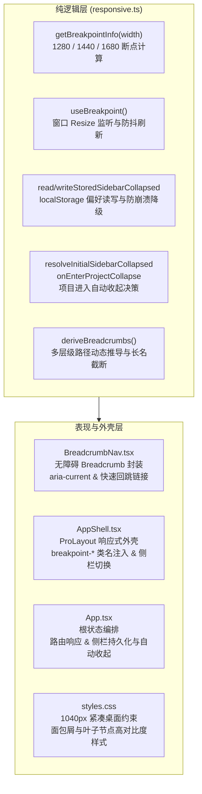
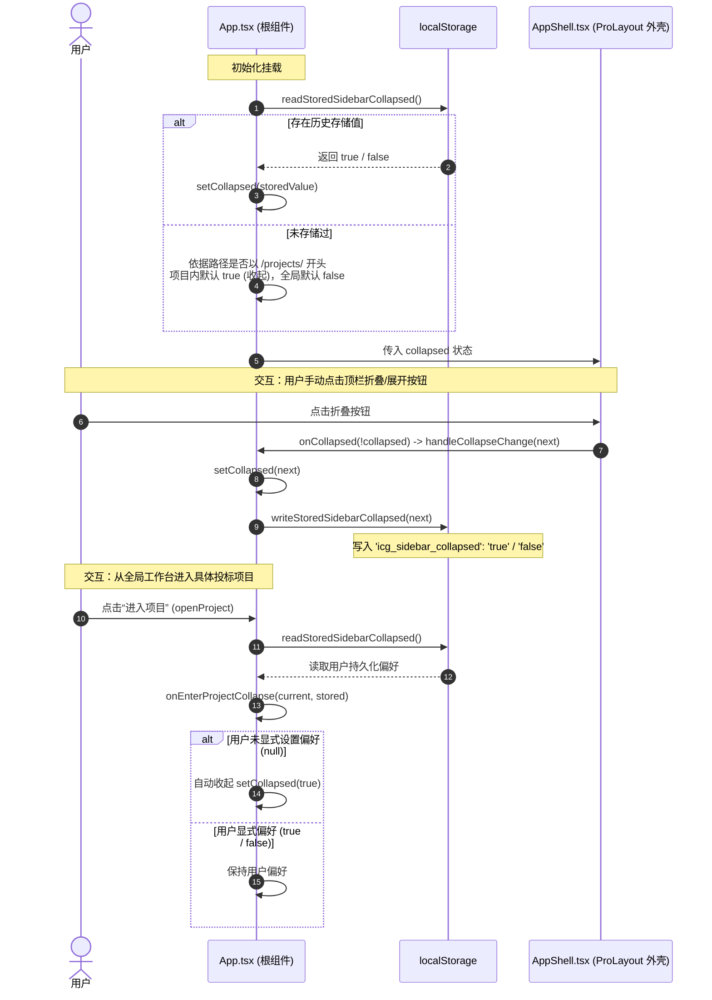

# APP-M2-T009 · 断点与侧栏记忆（1280 / 1440 / 1680）、面包屑 代码解释

为什么有这个文档：记录 `APP-M2-T009` 断点适配系统、侧栏折叠状态持久化记忆以及动态多层级面包屑导航的实现细节与架构设计。
它解决什么问题：
1. 落实 PRD v1.8 §2.3、§5.12 与设计规范 §3.1、§3.4、§7.3、§9.6 关于视口断点（1280px 紧凑桌面 1040px 内容区无横滚优先、1440px 标准桌面、1680px 宽屏四栏编辑台）的前端响应体系；
2. 解决项目空间工作区最大化问题：进入具体投标项目时默认收起侧栏，用户手动切换折叠/展开状态时持久化保存到 `localStorage`（`icg_sidebar_collapsed`），路由切换或刷新后保持用户记忆；
3. 解决深层业务路径迷航问题：依据当前路由层级动态推导 1~4 级面包屑（首页/工作台 -> 项目名称 -> 页签/编辑台 -> 分册），长项目名智能截断悬停显示全名，上层节点快速逐级回跳，末级呈现语义化当前页。

---

## 1. 架构设计与模块分层

本项目严格遵循纯逻辑层、表现层与应用外壳解耦模式：

---

## 2. 核心状态流转与时序图

### 2.1 侧栏折叠状态生命周期与持久化记忆

---

## 3. 详细设计与实现说明

### 3.1 三大标准断点与自适应计算 (`responsive.ts`)
PRD v1.8 与设计规范第 7.3、9.6 节定义了三大标准断点：
- **1280px（紧凑桌面，`compact`）**：
  - 触发条件：`1280px <= width < 1440px`；
  - 核心诉求：主内容区宽度约为 1040px（1280 - 216 侧栏 - 24 内边距），表格优先无横向滚动，弹性字段 `ellipsis` 截断，提供侧边抽屉查阅完整内容；编辑台采用 3 栏（目录 + 正文 + 综合右栏）；
- **1440px（标准桌面，`standard`）**：
  - 触发条件：`1440px <= width < 1680px`；
  - 设计基准分辨率（1440×900），主内容区约 1200px；
- **1680px（宽屏工作台，`wide`）**：
  - 触发条件：`width >= 1680px`；
  - 采用 4 栏布局（目录 252px + 正文自适应 max 820px + 问题来源 320px + 对话助手 380px），同时可见问题来源与对话助手。

`useBreakpoint()` 内部挂载 `window.addEventListener('resize', ...)`，使用 `requestAnimationFrame` 防抖同步视口变更，组件卸载时严格移除监听并取消动画帧；在 Node/SSR 环境下安全降级返回 1440px 标准桌面。

### 3.2 侧栏折叠状态持久化记忆 (`responsive.ts` / `App.tsx`)
- 存储键名：`icg_sidebar_collapsed`；
- 容灾与边界防护：所有 `localStorage` 操作均内置 `try...catch`，在无痕隐私模式、LocalStorage 被禁用或配额超限时不抛异常，降级为内存运行；
- 智能决策：
  1. `resolveInitialSidebarCollapsed`: 若用户有持久化偏好，首要尊重用户偏好；若无偏好，进入项目自动收起（`true`），全局页面默认展开（`false`）；
  2. `onEnterProjectCollapse`: 用户进入项目空间时，若未显式偏好展开，自动切换为收起状态以最大化正文编辑可用宽度；
  3. 用户任何手动点击切换均实时同步保存至 `localStorage`。

### 3.3 动态多层级面包屑推导与无障碍组件 (`BreadcrumbNav.tsx` / `responsive.ts`)
- `deriveBreadcrumbs(context)` 动态推导规则（最多 4 级）：
  1. **404 页面**：`工作台 > 页面不存在`（末级标记 `isCurrent: true`，无跳转链接）；
  2. **全局功能页**：`工作台（可跳转） > [页面名称]`（如：企业资料库、后台任务）；工作台首页自身仅呈现单级 `工作台`；
  3. **项目空间页**：
     - Level 1：`工作台`（点击跳转 `/workbench`）；
     - Level 2：`[项目简称]`（智能截断长名至 16 字符并在末尾添加 `…`，悬停 `title` 保留完整全名，点击跳转 `/projects/:id/overview`）；
     - Level 3：`[页签名称]`（如项目概览、招标文件、响应矩阵、合规检查、项目设置等，末级纯文本）；
     - Level 4（编辑台扩展）：若进入章节编辑且处于特定分册，可展开为 `工作台 > [项目] > 编辑台（可跳转） > 技术分册`；
- 无障碍与视觉规范：
  - 外层容器使用语义化 `<nav aria-label="面包屑导航">`；
  - 当前页面元素渲染为 ``，采用高对比度加粗深色字体（`#1D2129`，WCAG AA > 7:1）；
  - 上层链接添加平滑 `transition` 与悬停变蓝（`#1E4DB7`）及下划线反馈。

---

## 4. 改动文件清单

| 文件路径 | 改动性质 | 核心改动说明 |
|---|---|---|
| `frontend/web/src/shell/responsive.ts` | 新增 | 三大断点定义、`getBreakpointInfo`、`useBreakpoint`、侧栏存储读写与决策、多层级面包屑推导算法 |
| `frontend/web/src/shell/BreadcrumbNav.tsx` | 新增 | 动态面包屑导航组件封装，具备可点击回跳链接、末级无障碍 Leaf 标识与测试插槽 |
| `frontend/web/src/shell/AppShell.tsx` | 修改 | 集成 `useBreakpoint`，为 ProLayout 外壳注入 `breakpoint-*` 类名与 `data-breakpoint` 属性；支持 `breadcrumbs` 属性动态渲染 `BreadcrumbNav` |
| `frontend/web/src/app/App.tsx` | 修改 | 侧栏状态由 `readStoredSidebarCollapsed` 初始化，手动切换持久化写回；进入项目时调用 `onEnterProjectCollapse` 自动收起；动态调用 `deriveBreadcrumbs` 并将 `breadcrumbs` 传至 `AppShell` |
| `frontend/web/src/shared/styles.css` | 修改 | 增加 `.breakpoint-compact` 1040px 主内容区无横滚宽度约束规则；新增 `.topbar-breadcrumb-nav`、`.breadcrumb-leaf` 与链接悬停样式 |
| `tests/frontend/responsive-layout.test.mjs` | 新增 | 纯逻辑单测（覆盖 1280/1440/1680 断点计算、Storage 读写降级、进入项目收起决策、项目名截断、404/全局/项目/编辑台分册面包屑推导与链接回跳不变量） |
| `frontend/web/tests/responsive-layout.test.mjs` | 新增 | TypeScript AST 与静态代码结构断言，核对各模块导出、JSX 无障碍语义与 CSS 规则 |

---

## 5. 构建与包体积优化审计

- **首屏主包优化**：
  将 `BreadcrumbNav` 与 Ant Design `Breadcrumb` 组件收拢至按需懒加载的 `AppShell` 动态切片中，避免打入入口文件；
- **优化成效**：
  - 本次改动前首屏主 Chunk `dist/assets/index-*.js` 为 **289.99 kB**；
  - 本次改动后首屏主 Chunk 为 **278.49 kB**（Gzip 后 **89.73 kB**）；
  - **首屏体积不增反降 11.5 kB**，严格优于 **295 kB** 红线预算门禁（余量 16.51 kB）。

---

## 6. 异常分支与边界处理

1. **Storage 被禁用或私密无痕浏览**：
   `readStoredSidebarCollapsed` 与 `writeStoredSidebarCollapsed` 全程包含 `try...catch`，捕获 DOMException 并优雅降级返回 `null` / `false`，界面依然保持正常交互。
2. **非浏览器 / Node.js / VM 测试环境**：
   `useBreakpoint` 在 `typeof window === 'undefined'` 时默认返回 1440px 标准桌面状态；`App.tsx` 中的 `onEnterProjectCollapse` 与 `setCollapsed` 加入 `typeof` 防护，彻底杜绝轻量 VM 单测上下文中的 `ReferenceError`。
3. **极端视口与超长项目名称**：
   项目名称超出 16 字符时自动添加省略号 `…`，并通过 DOM `title` 属性保留全称；顶栏面包屑限制最大宽度并禁止换行，保障 56px 顶栏在 1280px 紧凑视口下不被顶破换行。
