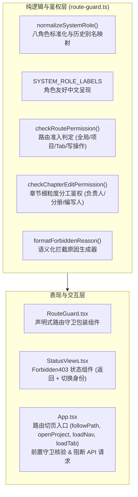
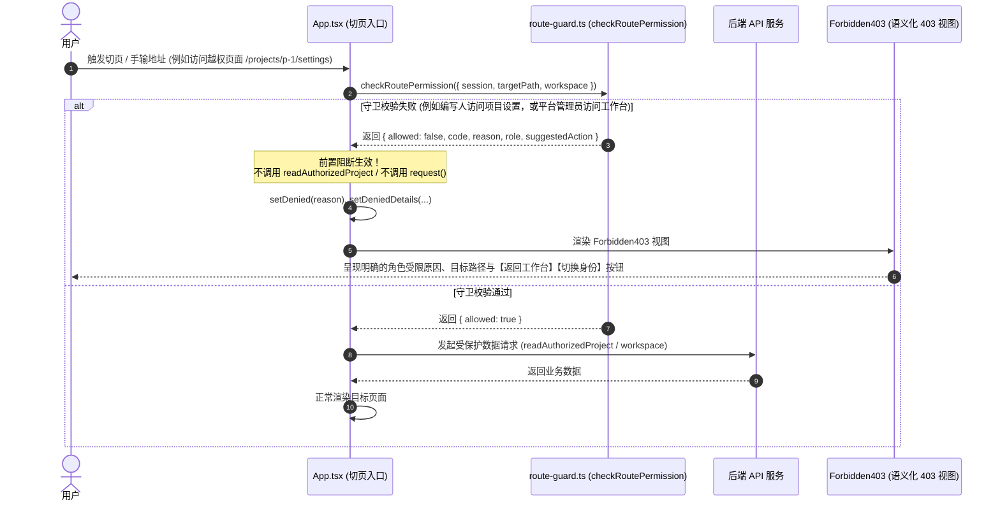

# APP-M2-T014 · 路由守卫与 403 页（结合八角色与项目分工） 代码解释

为什么有这个文档：记录 `APP-M2-T014` 路由守卫、八角色权限准入矩阵、细粒度项目分工鉴权以及语义化 403 页面的实现细节与架构设计。

它解决什么问题：
1. **八角色权限矩阵严格核验**：落实 [PRD v1.8 §2.2 / §2.3](../reference/product/prd-mvp-v1.8.md) 与 [BE-8ROLES-RBAC](../delivery/BE-8ROLES-RBAC.md) 规范，支持 8 类标准系统角色（`platform_admin`, `group_admin`, `company_admin`, `data_admin`, `project_lead`, `bid_writer`, `auditor`, `viewer`）的前端路由准入控制；
2. **前置拦截与杜绝越权外呼**：在路由跳转与数据加载前置调用守卫校验，当权限校验不通过时阻断执行，绝不向后端发起受保护数据的 API 请求，彻底杜绝静默越权外呼；
3. **细粒度项目分工判定**：不仅校验全局角色，更校验项目空间成员资格、分册分工（分册负责人）与章节指派（编写人），编写人仅限编辑被分配的章节或所属分册；
4. **语义化 403 页面呈现与快捷操作**：无权限或后端 403 时，呈现友好的语义化 403 页面，明确提示当前角色与受限原因，并提供“返回可访问首页/工作台”与“切换身份”快捷按钮，并保留未保存草稿与上下文说明。

---

## 1. 架构设计与模块分层

本项目严格遵循纯逻辑与表现层解耦规范，整体架构如图所示：



---

## 2. 核心状态流转与鉴权时序图

### 2.1 路由前置守卫与无外呼拦截时序



---

## 3. 详细设计与实现说明

### 3.1 八角色体系与标准化映射 (`route-guard.ts`)

依据 PRD v1.8 §2.2 / §2.3 与 `BE-8ROLES-RBAC`，前端定义标准八角色与中文友好标签：

| 标准角色代码 | 中文名称 | 主要职责与权限范围 |
|---|---|---|
| `platform_admin` | 平台管理员 | 平台运维、模型与解析登记、审计日志；**严禁访问公司业务数据（工作台、资料库、标书详情）** |
| `group_admin` | 集团管理员 | 跨公司全站**只读**查看项目与资料，**阻断一切写操作、生成与新建项目** |
| `company_admin` | 公司管理员 | 本公司用户管理、规则、资料库维护、**新建项目**与项目全功能访问 |
| `data_admin` | 资料管理员 | 专职维护公司资料库与模板库，**禁止新建项目**；在未加入的项目中只读 |
| `project_lead` | 项目负责人 | **新建项目**、项目成员分配、分册确认、大纲与计划确认、递交版导出 |
| `bid_writer` | 投标编写人 | 编写与生成**被分配的章节**、所属分册章节；**禁止新建项目**；非负责人禁止访问项目设置 |
| `auditor` | 审核人 | 业务页面与资料**只读**查阅与审核批注，**禁止写操作** |
| `viewer` | 只读成员 | 全站与项目内**只读**查阅，**禁止写操作** |

同时提供 `normalizeSystemRole(roleOrRoles)`，对系统历史角色进行平滑兼容：
- `manager` / `lead` $\rightarrow$ `project_lead`
- `editor` / `writer` $\rightarrow$ `bid_writer`
- `readonly` $\rightarrow$ `viewer`
- `reviewer` $\rightarrow$ `auditor`

### 3.2 细粒度项目分工鉴权 (`checkChapterEditPermission`)

对于章节正文编辑（`editor`），实行三级判定逻辑：
1. **只读保护**：若用户的公司角色为 `READONLY_SYSTEM_ROLES`（`group_admin`, `viewer`, `auditor`, `platform_admin`），或在项目成员表中标记为 `project_role: 'readonly'`，一律阻断编辑；
2. **项目负责人权限**：若为项目负责人（`project_role: 'lead'` 或 `workspace.permissions.manage_structure === true`），放行全部分册全部章节编辑；
3. **分册负责人权限**：若用户为当前章节所属分册（`technical` 或 `business`）的负责人（`volumes.owner_id === userId` 且参与该分册），放行本分册所有章节编辑；
4. **编写人指派权限**：若用户为当前章节的明确分配人（`chapter.assignee_id === userId` 且参与该分册），放行编辑；
5. **未分配拦截**：若以上条件均不满足，阻断编辑并提示：`抱歉，您当前未被分配负责章节【...】，仅被分配编写人或分册负责人可编辑。`

### 3.3 路由切页入口的前置阻断 (`App.tsx`)

在 `App.tsx` 的所有切页入口（`followPath`, `openProject`, `loadNav`, `loadTab`）中，在发起任何异步请求与数据读取前，调用 `checkRoutePermission(...)`：

```ts
const guard = checkRoutePermission({
  session: currentAuthorization.current,
  targetPath: pathname,
  workspace,
});
if (!guard.allowed && guard.code !== 'UNAUTHENTICATED') {
  writeAddress(pathname, mode);
  setDenied(guard.reason || '抱歉，您无权访问此页面。');
  setDeniedDetails({
    role: guard.role,
    roleLabel: guard.roleLabel,
    path: pathname,
    reason: guard.reason,
    projectName: workspace?.project?.name,
  });
  setLoading(false);
  arrived(false, pathname);
  return; // 立即返回，不发起 readAuthorizedProject 或 request 请求
}
```

这彻底杜绝了用户通过手输 URL、前进后退或篡改路由触发受保护 API 越权调用的隐患。

### 3.4 增强 403 页面交互与切换引导 (`StatusViews.tsx` / `App.tsx`)

- **语义化 Result 展示**：使用 Ant Design Result 403 标准状态，标题设为 `403 访问受限` 或 `没有访问权限`；
- **明确角色受限解释**：提示文案明确带出当前角色（如“抱歉，您当前的角色（平台管理员）仅限管理平台级服务、模型与审计，不可访问公司业务数据与投标项目。”）；
- **上下文信息标签**：展示【当前项目】【当前身份】【目标路径】标签条；
- **快捷动作按钮**：
  - 【返回可访问首页 / 返回工作台】（点击回到用户当前具备权限的默认主页）；
  - 【切换身份】（提供 `onSwitchRole` 回调，触发安全登出并允许用户重新选择其他具备权限的身份账号登录）。
- **未保存草稿保留保护**：若在编辑台产生冲突或失去权限，激活 `showRetainedNotice`（“当前内容及未保存文字仍保留在下方，写入口已关闭”），杜绝数据丢失。

---

## 4. 变更文件清单

| 文件路径 | 变更类型 | 说明 |
|---|---|---|
| `frontend/web/src/shell/route-guard.ts` | 新增 | 八角色规范化、权限矩阵、细粒度章节分工鉴权与原因生成器 |
| `frontend/web/src/shell/RouteGuard.tsx` | 新增 | 声明式路由守卫组件封装，包装 `Forbidden403` 与前置准入校验 |
| `frontend/web/src/status/StatusViews.tsx` | 修改 | `Forbidden403` 增加 `onSwitchRole` 与 `switchRoleText` 支持快捷切换身份 |
| `frontend/web/src/status/status-views.ts` | 修改 | `resolveForbidden` 补齐 `switchRoleText` 字段解析 |
| `frontend/web/src/app/App.tsx` | 修改 | 切页入口接入 `checkRoutePermission` 前置校验，杜绝越权 API 外呼；403 增加切换身份与角色详情 |
| `frontend/web/tests/app-orchestration.test.mjs` | 修改 | 扩展 VM 沙箱上下文注入 `route-guard` 导出符号与 `DeniedDetails` |
| `tests/frontend/route-guard.test.mjs` | 新增 | 表格驱动单元测试（8 角色准入、写操作阻断、分工细粒度、零外呼保证、403 提示） |
| `frontend/web/tests/route-guard.test.mjs` | 新增 | 静态 AST 结构断言与守卫模块契约完整性测试 |

---

## 5. 异常分支与限制说明

1. **未登录会话**：若传入 `session` 为空，守卫返回 `code: 'UNAUTHENTICATED'`，由系统外层引导登录屏；
2. **跨公司越权**：若已载入的工作区 `company_id` 与会话 `active_company_id` 不符，立即拦截并返回 `SCOPE_FORBIDDEN`，提示“跨公司访问受限”；
3. **VM 测试隔离兼容性**：在 `App.tsx` 提取源码运行于轻量 `node:vm` 时，全局函数中调用守卫方法均包含 `typeof fn === 'function'` 保护，防止轻量 mock 抛出 `ReferenceError`；
4. **包体积门禁**：逻辑层 `route-guard.ts` 保持纯 TypeScript 实现，无任何重型第三方库依赖。首屏构建主包 `dist/assets/index-*.js` 为 **287.78 kB**（gzip: 91.93 kB），严格控制在 <= 295 kB 门禁内。
