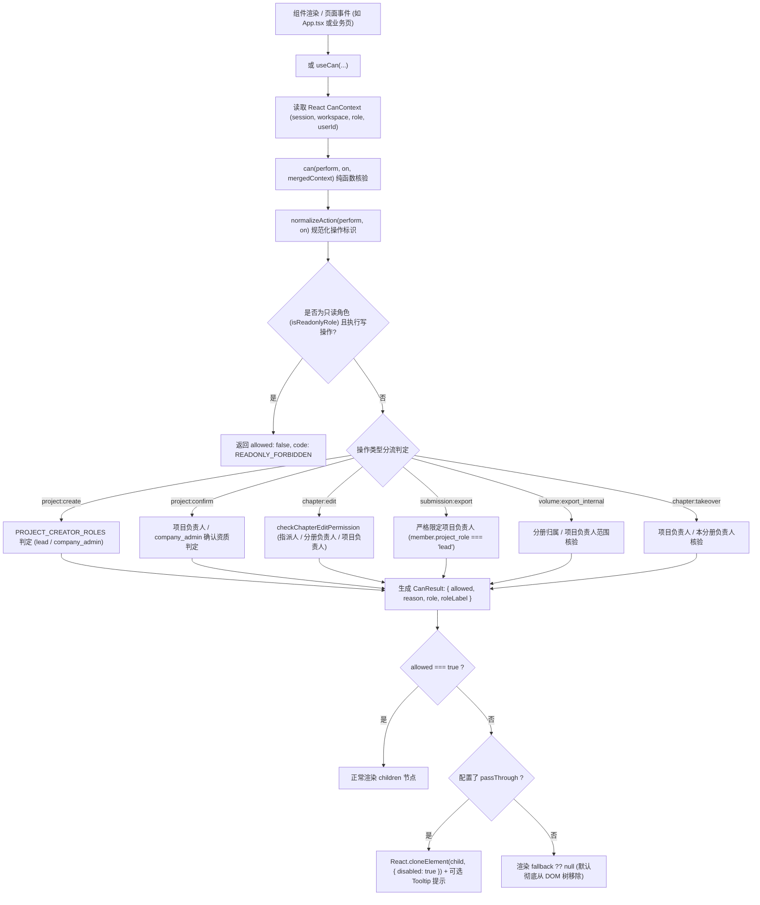

为什么有这个文件：说明 APP-M2-T015 权限指令 `<Can>` 与按钮隐藏的具体实现、状态流转、鉴权矩阵与安全保障。

它解决什么问题：阐述基于 PRD v1.8 §2.3 的声明式与编程式权限控制方案，证明无权限元素在默认模式下从 DOM 中彻底隐藏，杜绝仅靠 CSS 隐藏被绕过的安全漏洞，同时保护前端 Bundle 体积不膨胀。

# APP-M2-T015：代码解释

- 对应任务：[APP-M2-T015](../tasks/APP-M2.md#app-m2-t015) · 权限指令 `<Can>` 与按钮隐藏
- 关联 Issue：[ISSUE-007](../../issues/ISSUE-007.md)
- 交付文档：[APP-M2-T015 交付](../delivery/APP-M2-T015.md)
- 日期：2026-10-21
- 实际代码路径：
  - [can-directive.ts](../../frontend/web/src/can-directive.ts)
  - [can-context.ts](../../frontend/web/src/can-context.ts)
  - [useCan.ts](../../frontend/web/src/useCan.ts)
  - [Can.tsx](../../frontend/web/src/Can.tsx)
  - [App.tsx](../../frontend/web/src/App.tsx)
  - [route-guard.ts](../../frontend/web/src/route-guard.ts)
  - [can-directive.test.mjs](../../tests/frontend/can-directive.test.mjs)
  - [can-directive.test.mjs](../../frontend/web/tests/can-directive.test.mjs)

---

## 改了什么以及为什么

### 1. 业务痛点与安全隐患
根据 ICG 原交接文档 §6.2 M1-P03-F2 及 PRD v1.8 §2.3 权限矩阵：
- **越权绕过风险**：单纯依赖前端 CSS（如 `display: none` 或置灰）隐藏按钮，极易被通过浏览器控制台移除样式或模拟点击绕过，因此必须在 React 渲染树层面直接跳过无权限节点，保证零 DOM 痕迹输出；
- **八角色细粒度分工**：不同角色在项目内的写权限差异极大（例如新建项目仅限 `project_lead` 与 `company_admin`；递交版导出仅限 `project_lead`，而分册负责人仅限内部稿导出；章节编辑必须严格结合编写人指派与分册负责人归属）；
- **声明式与编程式双模**：界面既需要通过 `<Can perform="action" on="resource">` 声明式包裹 JSX 节点，也需要通过 `useCan` Hook 在组件事件处理函数或动态配置中直接获取权限状态。

### 2. 具体实现
1. **纯逻辑核验核心 (`can-directive.ts`)**：
   - 实现 `normalizeAction(perform, on)`，双向兼容冒号格式（如 `project:create`、`chapter:edit`、`submission:export`）与分离参数（`perform="create", on="project"`、`perform="edit", on={chapter}`）；
   - 实现核心鉴权纯函数 `can(perform, on, context)`：
     - **只读角色写阻断**：任何写操作（包含 create, edit, submit, takeover, finalize, unlock 等关键字）命中只读角色（`viewer`, `group_admin`, `auditor`, `platform_admin`）一律返回 `allowed: false` 与 `READONLY_FORBIDDEN` 错误码；
     - **项目创建资质**：`project:create` 严格限 `PROJECT_CREATOR_ROLES`（`project_lead`, `company_admin`, 及兼容别名 `manager`）；
     - **关键确认权限**：`project:confirm`、`parse:confirm`、`matrix:confirm` 仅限项目负责人（`project_lead` 或在项目团队中为 `lead`）及公司管理员，普通编写人仅限编辑建议，无确认权；
     - **章节编辑分工**：`chapter:edit` 与 `chapter:submit` 委托 `checkChapterEditPermission`，精准校验项目负责人（全项目）、分册负责人（本分册全部章节）、分配编写人（被指派章节），其余情况阻断；
     - **锁接管权限**：`chapter:takeover` 仅限项目负责人、公司管理员或本分册负责人，普通编写人不可接管他人编辑锁；
     - **递交版 Word 导出**：`submission:export` 严格限定于项目负责人，分册负责人、普通编写人及只读成员一律阻断；
     - **内部稿导出**：`volume:export_internal` 项目负责人可导出全册及两册，分册负责人仅限本分册；
     - **分册定稿与解锁**：`volume:finalize` 与 `volume:unlock` 仅限项目负责人或本分册负责人；
     - **敏感身份证号查看**：`id_card:view` 仅限 `company_admin` 与 `data_admin`；
     - **多租户与平台管理员隔离**：平台管理员不参与业务项目操作，跨公司越权请求严格阻断。
2. **上下文隔离容器 (`can-context.ts`)**：
   - 提取 `CanContext = React.createContext<CanContextType>({})`，彻底解耦 `Can.tsx` 与 `useCan.ts`，消除 Windows 平台大小写同名冲突与循环依赖。
3. **React Hook 封装 (`useCan.ts`)**：
   - `useCan(perform, on, overrideContext)`：自动合并父级 `<CanProvider>` 上下文与当前调用入参，调用 `can()` 输出 `{ allowed, reason, role, roleLabel, code }`；
   - `useCanMap(rules, overrideContext)`：支持一次性声明式批量获取多条权限裁决结果。
4. **指令组件封装 (`Can.tsx`)**：
   - `<Can>` 组件接收 `perform`, `on`, `action`, `resource`, `data`, `fallback`, `passThrough`, `tooltipOnDisabled`, `children`；
   - **默认严格模式**：未授权且未提供 fallback 时，直接返回 `null`，DOM 树上零节点输出；
   - **支持函数式 children**：`children={(result) => ...}`；
   - **支持置灰降级模式**：当显式传入 `passThrough={true}` 时，克隆子组件注入 `disabled: true` 与 `aria-disabled="true"`，并支持结合 Tooltip 悬停展示无权限原因。
5. **App 实际装配 (`App.tsx`)**：
   - 在应用顶层装配 `<CanProvider value={{ session: applicationSession, workspace, role: applicationSession?.user.primary_role, userId: applicationSession?.user.id }}>`；
   - 工作台的“新建项目”按钮外层由 `<Can perform="project:create">` 保护，只读与无权限账号登录时按钮完全不出现在 DOM 中。

---

## 入口和调用顺序

---

## 数据与状态

| 状态对象 | 来源 | 生命周期与作用 |
|---|---|---|
| `CanContext` | `<CanProvider value={...}>` | React 树生命周期，透传 `session`、`workspace`、`role`、`userId` 等 |
| `CanResult` | `can(...)` 或 `useCan(...)` | 同步瞬时计算产物，包含 `allowed: boolean`、`reason?: string`、`role: SystemRole`、`roleLabel: string`、`code?: string` |
| `DOM 表现` | `<Can>` 组件 | `allowed ? children : (passThrough ? DisabledElement : fallback ?? null)` |

---

## 关键判断与异常

1. **零 DOM 残留保证**：
   - 默认状态下 `fallback = null`，未授权元素返回 `null`，React 不生成任何 DOM 节点，杜绝前端检查器移除样式或通过控制台脚本触发点击。
2. **递交版 Word 导出强收敛**：
   - 依据 PRD v1.5 与 v1.8 规范，内部稿允许多人（分册负责人导出本分册内部稿，项目负责人导出两册），但**递交版 Word 导出仅限项目负责人**，分册负责人（`volume_lead`）与普通编写人（`bid_writer`）被严格阻断。
3. **只读角色全局熔断**：
   - 若系统角色为 `group_admin`、`viewer`、`auditor` 或 `platform_admin`，任何写操作（包含 `create`, `edit`, `submit`, `takeover`, `finalize`, `unlock` 等）均被前置拦截，统一返回友好提示与 `READONLY_FORBIDDEN` 状态码。
4. **Windows 文件系统大小写冲突防护**：
   - 针对 Windows 环境下大小写不敏感特性，将逻辑模块命名为 `can-directive.ts`，组件命名为 `Can.tsx`，彻底规避 TypeScript `forceConsistentCasingInFileNames` 报错。

---

## 验证与限制

### 1. 验证命令与结果
- **单元测试与契约测试**：
  - `node --test tests/frontend/can-directive.test.mjs frontend/web/tests/can-directive.test.mjs`：15 项全部通过。
  - `node --test tests/frontend/*.test.mjs frontend/web/tests/*.test.mjs`：全量 **221 passed, 0 failed** 全部通过。
- **构建体积门禁验证**：
  - `pnpm --dir frontend/web build`：构建成功（1.69s），首屏产物 `dist/assets/index-C6HeJH1S.js` 为 **294.82 kB**（gzip 93.88 kB），严格控制在 $\le$ 295 kB 门禁阈值内。

### 2. 限制与边界
- `<Can>` 组件主要负责前端界面元素渲染门禁与引导；数据与写操作的安全最终由后端 API（`BE-8ROLES-RBAC`）通过会话主体与锁机制做最终防御，前后端双重守护。
