为什么有这个文件：说明 APP-M2-T016 数据权限的前端表现：只读态切换（项目 / 分册 / 章节）的具体实现、状态流转、纯文本呈现与安全防护机制。

它解决什么问题：阐述基于 PRD v1.8 §2.3 与 §5.11.9 的多粒度数据权限判定方案，严格落实“只读成员与集团管理员看到文本而非控件，不是渲染了 input/select 之后再去 disabled，而是在只读模式下直接渲染排版语义纯文本展示”，并在项目、分册、章节三级提供语义化只读提示横幅。

# APP-M2-T016：代码解释

- 对应任务：[APP-M2-T016](../tasks/APP-M2.md#app-m2-t016) · 数据权限的前端表现：只读态切换（项目 / 分册 / 章节）
- 关联 Issue：[ISSUE-007](../../issues/ISSUE-007.md)
- 交付文档：[APP-M2-T016 交付](../delivery/APP-M2-T016.md)
- 日期：2026-10-21
- 实际代码路径：
  - [data-permission.ts](../../frontend/web/src/data-permission.ts)
  - [useDataPermission.ts](../../frontend/web/src/useDataPermission.ts)
  - [ReadOnlyGate.tsx](../../frontend/web/src/ReadOnlyGate.tsx)
  - [EditorPage.tsx](../../frontend/web/src/EditorPage.tsx)
  - [MetadataForm.tsx](../../frontend/web/src/MetadataForm.tsx)
  - [styles.css](../../frontend/web/src/styles.css)
  - [data-permission.test.mjs](../../tests/frontend/data-permission.test.mjs)
  - [data-permission.test.mjs](../../frontend/web/tests/data-permission.test.mjs)

---

## 改了什么以及为什么

### 1. 业务痛点与验收约束
根据 ICG 原交接文档 §6.2 M1-P03-F3 及 PRD v1.8 §2.3 与 §5.11.9：
- **纯文本视图要求**：交接约束明确要求：“只读成员与集团管理员看到文本而非控件。不是渲染了 input/select 之后再去 disabled，而是在只读模式下直接渲染排版语义的 ``、`
` 或纯文本展示”；
- **多粒度数据层级**：权限不仅取决于登录账号全局角色（平台/集团管理员与只读审计员全项目只读），还与项目分工绑定：
  1. **项目级（Project Scope）**：全局只读角色或项目成员角色为 `readonly` 时，全项目只读；
  2. **分册级（Volume Scope）**：分册负责人进入非本人主管的分册（如技术分册负责人进入商务分册）时，该分册大纲与章节自动转为只读态，并提示“您当前是【技术分册】负责人，在【商务分册】中处于只读浏览状态”；
  3. **章节级（Chapter Scope）**：普通投标编写人未被指派本章节时，该章节自动转为只读态，并提示“本章节未分配给您，当前仅可只读浏览”。
- **提示与横幅反馈**：在只读态下，必须展示明确的 `ReadonlyBanner`，明确告知用户当前只读的范围（全项目、分册、章节）与根本原因。

### 2. 具体实现架构

#### 2.1 多粒度数据权限判定算法 (`data-permission.ts`)
实现纯函数 `resolveDataPermission(context: DataPermissionContext): DataPermissionResult`，按严格优先级级联决策：
1. **系统角色级只读熔断**：`isReadonlyRole(normRole)`（包含 `group_admin`, `viewer`, `auditor`, `platform_admin`）一律返回 `scope: 'project', readOnly: true, reasonType: 'role_readonly'`，杜绝一切项目内写操作；
2. **公司管理员放行**：`company_admin` 具备公司内跨项目运维资质，返回 `canEdit: true, scope: 'none'`；
3. **项目成员资格与角色**：
   - 非项目成员且不是公司管理员：返回 `scope: 'project', readOnly: true, reasonType: 'not_member'`；
   - 成员 `project_role === 'readonly'`：返回 `scope: 'project', readOnly: true, reasonType: 'project_readonly'`；
   - 项目负责人（`project_lead` 或 `member.project_role === 'lead'`）：放行全项目、全分册、全章节，`readOnly: false`；
4. **分册负责人分工判定**：
   - 用户主管的分册（`ownedVolumes.includes(targetVolume)`）：在本分册内全放行；
   - 用户主管其他分册（如技术主管进入商务分册）：返回 `scope: 'volume', readOnly: true, reasonType: 'wrong_volume'`，并附上“您当前是【技术分册】负责人，在【商务分册】中处于只读浏览状态”；
   - 用户未参与该分册（`!memberVolumes.includes(targetVolume)`）：返回 `scope: 'volume', readOnly: true, reasonType: 'wrong_volume'`；
5. **章节级指派判定**：
   - 章节指派给当前用户（`targetChapter.assignee_id === userId`）：放行编辑权 `canEdit: true`；
   - 章节未指派给当前用户：返回 `scope: 'chapter', readOnly: true, reasonType: 'not_assigned'`，附上“本章节【...】未分配给您，当前仅可只读浏览”；
   - 未指定章节仅指定分册时，普通编写人返回 `scope: 'volume', readOnly: true`（分册整体结构只读）。

#### 2.2 响应式 React Hook (`useDataPermission.ts`)
封装 `useDataPermission(options)`：
- 聚合 `CanContext` 与 `ProjectContext`，无缝提取当前用户角色、用户 ID、项目工作区及所选分册与章节；
- 通过 `useMemo` 运行 `resolveDataPermission`，确保性能与按需重算。

#### 2.3 只读表现与组件封装 (`ReadOnlyGate.tsx`)
提供两组核心组件：
1. **`<ReadOnlyGate>` / `<ReadOnlyWrapper>`**：
   - 容器级只读控制网关；
   - 自动在只读状态下顶部渲染 `<ReadonlyBanner>` 横幅；
   - 支持 `readOnlyView`（纯文本视图）。当处于只读态时，直接渲染 `readOnlyView`，完全不渲染可编辑子表单控件；
2. **`<ReadOnlyField>` / `<ReadOnlyText>`**：
   - 字段级纯文本与输入控件无缝切换；
   - **核心安全与排版保证**：当 `readOnly: true` 时，直接渲染 `{displayValue}`，在 DOM 树中根本不创建 `<input>` 或 `<textarea>`，彻底落实“看到文本而非控件，不是渲染了控件再去 disabled”。

#### 2.4 页面落地集成
1. **章节编辑台 (`EditorPage.tsx`)**：
   - 引入 `useDataPermission`，计算 `isReadOnlyView = !canEdit || dataPermission.readOnly`；
   - 当处于只读态时，在正文区域顶部渲染带具体原因的 `ReadonlyBanner`；
   - 正文区域由原本的 `<Input.TextArea readOnly={...} />` 切换为排版语义纯文本 `

<pre>{content}</pre>

`；
   - 工具栏可写操作按钮（保存草稿、取得编辑权、提交本节、插入变量）置灰或阻断，但完整保留“保留当前文字到本地”与版本查看入口。
2. **元数据驱动表单 (`MetadataForm.tsx`)**：
   - `MetadataFormProps` 新增 `readOnly?: boolean`；
   - 当 `readOnly` 开启时，表单各项通过 `<ReadOnlyField readOnly={true} value={fieldValue} />` 渲染纯文本，且自动隐藏底部的提交保存操作条 `FormActionFooter`。
3. **全局样式补充 (`styles.css`)**：
   - 补充 `.icg-readonly-field-text` 与 `.chapter-editor-readonly-text` 的高对比度排版样式（字号 14px、行高 1.8、浅底边框与内边距）。

---

## 状态流与调用链

```mermaid
flowchart TD
    A["用户打开项目模块 (EditorPage / MetadataForm)"] --> B["useDataPermission(options)"]
    B --> C["提取 context (session, role, userId, workspace, volume, chapter)"]
    C --> D["resolveDataPermission(context)"]

    D --> E{"是否系统只读角色?<br/>(group_admin, viewer, auditor, platform_admin)"}
    E -- 是 --> F["scope: project<br/>readOnly: true<br/>reason: 当前角色处于只读状态"]
    E -- 否 --> G{"是否项目成员或公司管理员?"}

    G -- 非成员/readonly成员 --> H["scope: project<br/>readOnly: true<br/>reason: 非项目成员或项目只读"]
    G -- 项目负责人/公司管理员 --> I["scope: none<br/>readOnly: false<br/>全项目全章节可编辑"]
    G -- 编写人/分册负责人 --> J{"检查分册上下文 (targetVolume)"}

    J -- 是本分册负责人 --> K["scope: none<br/>readOnly: false<br/>本分册内全部可编辑"]
    J -- 是其他分册负责人/未参与该分册 --> L["scope: volume<br/>readOnly: true<br/>reason: 非主管分册只读浏览"]
    J -- 是普通编写人 --> M{"检查章节指派 (targetChapter)"}

    M -- 已指派给当前用户 --> N["scope: none<br/>readOnly: false<br/>章节可编辑"]
    M -- 未指派或分配他人 --> O["scope: chapter<br/>readOnly: true<br/>reason: 本章节未分配给您"]

    F & H & L & O --> P["只读态表现层生效"]
    P --> Q["渲染 ReadonlyBanner 提示原因与范围"]
    P --> R["渲染纯文本排版 (<span> / <pre>)<br/>彻底不渲染 <input>/<textarea>"]

    I & K & N --> S["可编辑态表现层生效<br/>渲染 Input.TextArea / Input 控件"]
```

---

## 异常分支与限制说明

1. **多标签页与多窗口一致性**：只读判定依赖于当前载入的 `workspace.team`。若后台分工在其他会话发生调整，编辑台在心跳或重载（`reload()`）时立即触发 `useEffect` 重新判定并释放本地编辑锁，关闭写入口。
2. **文字保留安全兜底**：即使因分工变化或只读态切换导致写入口关闭，编辑台明确保留当前输入框文字与“保留当前文字到本地”按钮，杜绝内容静默丢失。
3. **跨分册只读安全边界**：技术分册负责人在商务分册、商务分册负责人在技术分册，均处于分册级只读，不能在编辑台取得编辑锁，也不能调用提交与生成。

---

## 自动化测试与契约保证

本次任务新增专属测试套件：
1. `tests/frontend/data-permission.test.mjs`（6 个测试用例，表格驱动）：
   - `table-driven: 8 system roles in project-level data permission`：8 类系统角色在项目级的准入与只读断言；
   - `project team member role restrictions: readonly member and non-member`：项目内只读成员与外部人员阻断；
   - `table-driven: volume lead cross-volume division of labor`：分册主管跨分册只读触发及原因文本断言；
   - `table-driven: chapter-level assignment division of labor for bid writers`：普通编写人在已分配、未分配、跨分册章节的精准断言；
   - `volume lead has full chapter edit rights within their own volume`：分册负责人在本人分册内享有全章节编辑权；
   - `helper functions contract: getVolumeDisplayName and getScopeLabel`：工具纯函数契约验证。
2. `frontend/web/tests/data-permission.test.mjs`（6 个测试用例，AST 契约断言）：
   - `data-permission.ts exports ...`：导出函数与辅助工具验证；
   - `useDataPermission.ts exports ...`：Hook 导出验证；
   - `ReadOnlyGate.tsx exports ...`：组件导出验证；
   - `ReadOnlyField renders semantic span and omits inputs when readOnly is true`：验证只读时完全不渲染 input/textarea；
   - `EditorPage.tsx switches to semantic document text rather than disabled input on readOnly`：验证编辑台在只读时切换纯文本视图与横幅；
   - `MetadataForm.tsx supports readOnly pure text view and suppresses submit footer`：验证元数据表单只读态纯文本与隐藏保存条。
