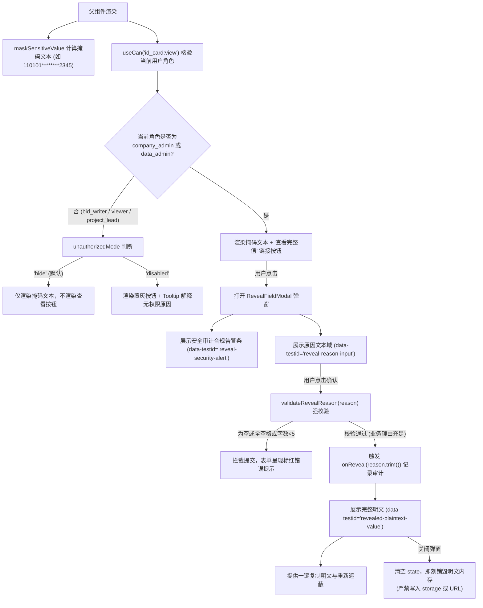

为什么有这个文件：说明 APP-M2-T017 MaskedField 与“查看完整值”弹窗（原因必填）的具体实现、状态流转、掩码规则与安全防护机制。

它解决什么问题：阐述基于 PRD v1.8 §5.4.5、§2.3 与 §5.9.1 的高敏字段脱敏与调阅合规架构，实现身份证（3+4 或 6+4）、手机号（3+4）、银行账号（后 4 位）等表格驱动掩码，集成 `<Can perform="id_card:view">` 权限判定（仅 `company_admin` 与 `data_admin` 可调阅），强制校验查看原因（必填且不可空白），并从架构上杜绝完整明文写入 localStorage、sessionStorage 或 URL。

# APP-M2-T017：代码解释

- 对应任务：[APP-M2-T017](../tasks/APP-M2.md#app-m2-t017) · MaskedField 与“查看完整值”弹窗（原因必填）
- 关联 Issue：[ISSUE-007](../../issues/ISSUE-007.md)
- 交付文档：[APP-M2-T017 交付](../delivery/APP-M2-T017.md)
- 日期：2026-10-21
- 实际代码路径：
  - [sensitive-mask.ts](../../frontend/web/src/admin/sensitive-mask.ts)
  - [RevealFieldModal.tsx](../../frontend/web/src/admin/RevealFieldModal.tsx)
  - [MaskedField.tsx](../../frontend/web/src/admin/MaskedField.tsx)
  - [can-directive.ts](../../frontend/web/src/shell/can-directive.ts)
  - [masked-field.test.mjs](../../tests/frontend/masked-field.test.mjs)
  - [masked-field.test.mjs](../../frontend/web/tests/masked-field.test.mjs)

---

## 改了什么以及为什么

### 1. 业务痛点与合规风险
根据 PRD v1.8 §5.4.5 与 §2.3 规则 8：
- **高敏泄露缺口**：人员身份证号码、手机号属于高敏个人信息。若在系统内以明文展示或直接在前端缓存中保留，会引发合规漏洞（如原交接 Q12 所指出的泄密风险）；
- **调阅审计闭环**：企业合规要求高敏明文“默认遮蔽展示、查看留痕且原因必填”。调阅必须经由授权角色触发，且必须提供具体的业务理由，严禁空提交或空格绕过；
- **前端防泄密硬安全**：查看到的临时明文绝对不能被持久化到浏览器的 `localStorage`、`sessionStorage`，也不能作为 URL query 参数传递，弹窗关闭后必须即刻销毁组件内存。

### 2. 具体实现架构

#### 2.1 高敏脱敏与校验核心 (`sensitive-mask.ts`)
纯 TypeScript 编写，零重型外部依赖：
1. **表格驱动预置掩码规则 (`DEFAULT_MASK_RULES`)**：
   - `id_card`（身份证）：默认保留前 6 后 4，中间固定 8 位 `*` 掩码；支持 `strict` 模式（前 3 后 4，如 PRD §5.4.5 示例：`110***********2345`）；
   - `phone`（手机号）：保留前 3 后 4，中间固定 4 位 `*`（如 `138****5678`）；
   - `bank_card`（银行账号）：只保留后 4 位明文，前序全部为 `*`（如 `***************0123`）；
   - `email`（邮箱）：保留前 2 位与域名，如 `zh***@company.com`；
   - `name`（姓名）：2 字遮蔽尾字（`张*`），3 字及以上遮蔽中间（`李*龙`、`诸**明`）。
2. **调阅原因强校验 (`validateRevealReason`)**：
   - 必须为非空有效字符串；
   - 彻底拦截纯空白符（空格、换行、制表符）；
   - 强制至少 5 个有效字符，确保填写具有实质业务理由（如“用于拟派项目技术负责人投标资质核验”）。
3. **零泄密断言引擎 (`assertNoSensitiveLeak`)**：
   - 检查 `localStorage`、`sessionStorage` 各 key 取值及 `window.location.href / url`；
   - 保证完整敏感明文绝不残留在上述持久化媒介中。

#### 2.2 调阅弹窗与安全告警 (`RevealFieldModal.tsx`)
1. **安全审计告警横幅**：
   - 渲染带有警告样式的合规提示条：“此项为企业受保护的高敏个人信息。根据合规规范，调阅完整值必须填写业务理由，系统将如实记录安全审计日志（操作人、时间、查看原因及当前网络环境）”；
2. **必填原因受控表单**：
   - 文本域展示实时错误与校验提示；未通过 `validateRevealReason` 强校验时禁止触发调阅请求；
3. **明文短暂展示与销毁**：
   - 调阅成功后，切换为绿色等宽明文排版容器（`SFMono-Regular, Consolas`），提供“复制明文”与“重新遮蔽”按钮；
   - 复制时给出安全提示弹条；
   - 弹窗关闭时触发 `destroyOnClose` 并主动清理 state，彻底销毁明文内存。

#### 2.3 掩码展示与权限集成组件 (`MaskedField.tsx`)
1. **自动掩码排版**：
   - 消费 `maskSensitiveValue` 或外部预脱敏文本；
2. **细粒度权限核验**：
   - 集成 `useCan('id_card:view')`；
   - 严格遵循 PRD §2.3 与 `can-directive.ts`：**仅限 `company_admin` 与 `data_admin`** 拥有调阅权限；
   - 普通编写人（`bid_writer`）、项目负责人（`project_lead`）、只读成员（`viewer`）等无权角色默认**完全不渲染调阅按钮**（零 DOM 痕迹），或在 `unauthorizedMode="disabled"` 时呈现置灰并悬浮 Tooltip 解释“仅公司管理员与资料管理员可查看完整高敏信息”。

---

## 状态流与调用链

---

## 异常分支与限制说明

1. **短字符串与格式异常边界**：若传入字符串长度不足前后保留位数之和，自动做安全遮蔽，绝不截断抛错或原样泄露。
2. **空原因提交拦截**：拦截任何纯空格、回车绕过，至少输入 5 个有效字符方可调阅。
3. **零明文留痕**：整个组件链路完全没有向 `localStorage`、`sessionStorage` 或 URL 写入完整敏感值，确保无 XSS/缓存盗取风险。

---

## 自动化测试与契约保证

本次任务新增 10 项专属测试用例：
1. `tests/frontend/masked-field.test.mjs`：
   - 身份证掩码规则（标准 6+4 与严格 3+4、15 位一代身份证、空值保护）；
   - 手机号码掩码（3+4）；
   - 银行账号掩码（后 4 位）；
   - 邮箱与姓名脱敏；
   - 查看原因强校验（空串、空格、字数不足、合规理由）；
   - 8 类系统角色调阅权限矩阵断言（`company_admin` 与 `data_admin` 放行，其余一律阻断）；
   - 防泄露断言测试（验证 storage 与 URL 零明文残留）。
2. `frontend/web/tests/masked-field.test.mjs`：
   - AST 断言 `sensitive-mask.ts` 导出函数与规则配置；
   - AST 断言 `RevealFieldModal.tsx` 强校验原因、审计横幅、测试标识与零 storage 调用；
   - AST 断言 `MaskedField.tsx` 权限集成、掩码文本呈现与弹窗挂载。
