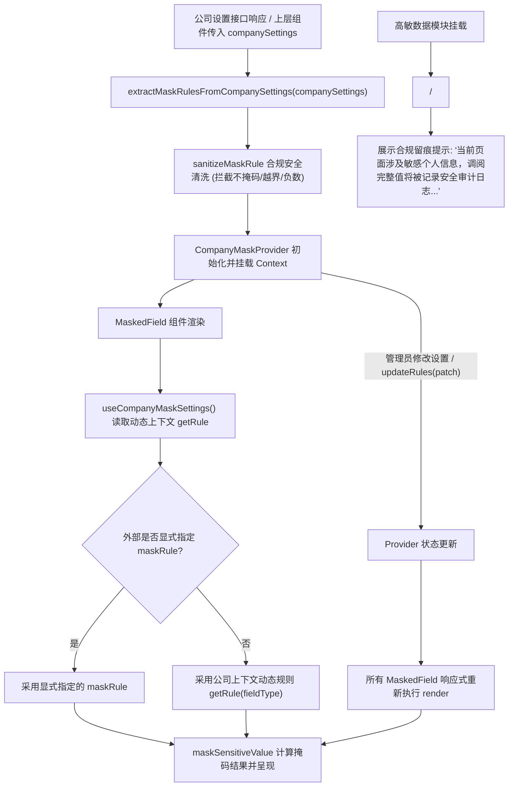

为什么有这个文件：说明 APP-M2-T018 掩码规则读取与查看留痕提示的具体实现、状态流转、规则防线与组件设计。

它解决什么问题：阐述基于 PRD v1.8 §5.4.5、§5.9.1、§6.9 及设计规范 9.10 的公司级掩码动态读取与合规留痕提示架构，实现从公司设置（sensitive_mask_rules）中动态解析脱敏规则、落实“每类保留位数可调但绝不可关闭掩码”的合规防线、实现所有 MaskedField 随公司规则响应式自动刷新，并封装多模式（banner / inline / compact）查看留痕提示组件（MaskNoticeBanner / AuditTraceHint），全程保持零 storage/URL 残留。

# APP-M2-T018：代码解释

- 对应任务：[APP-M2-T018](../tasks/APP-M2.md#app-m2-t018) · 掩码规则读取与查看留痕提示
- 关联 Issue：[ISSUE-007](../../issues/ISSUE-007.md)
- 交付文档：[APP-M2-T018 交付](../delivery/APP-M2-T018.md)
- 日期：2026-10-21
- 实际代码路径：
  - [company-mask-settings.ts](../../frontend/web/src/admin/company-mask-settings.ts)
  - [company-mask-context.ts](../../frontend/web/src/admin/company-mask-context.ts)
  - [useCompanyMaskSettings.ts](../../frontend/web/src/admin/useCompanyMaskSettings.ts)
  - [MaskNoticeBanner.tsx](../../frontend/web/src/admin/MaskNoticeBanner.tsx)
  - [MaskedField.tsx](../../frontend/web/src/admin/MaskedField.tsx)
  - [company-mask-settings.test.mjs](../../tests/frontend/company-mask-settings.test.mjs)
  - [company-mask-settings.test.mjs](../../frontend/web/tests/company-mask-settings.test.mjs)

---

## 改了什么以及为什么

### 1. 业务痛点与合规规范
根据 PRD v1.8 §5.4.5、§5.9.1 及 §6.9：
- **公司级掩码配置差异**：不同企业或行业对高敏个人信息有不同的合规要求（如有的采用前 6 后 4 标准模式，有的采用前 3 后 4 严格模式）；系统需支持读取公司级别设置中的 `sensitive_mask_rules`；
- **防绕过合规防线**：PRD §6.9 明确约束：“每类保留的前后位数可调，但不能设为‘不掩码’，不提供关闭掩码的开关”。必须在前端对传入的公司配置进行严格清洗与范围限制，严禁因错误配置（如 `prefix=18, suffix=0`）导致高敏明文泄露；
- **留痕合规警示**：根据 PRD §5.4.5 与 §7.3，涉及敏感个人信息的页面或模块必须明确警示：“当前页面涉及敏感个人信息，调阅完整值将被记录安全审计日志（操作人、时间、原因与网络环境）”，确保操作人在调阅前充分知晓审计约束；
- **响应式动态变动**：原交接约束明确要求：“规则变化后显示随之变化”。当公司配置切换时，页面内所有 `MaskedField` 必须自动重绘展示效果。

---

### 2. 具体实现架构

#### 2.1 规则解析与合规清洗核心 (`company-mask-settings.ts`)
纯 TypeScript 编写，零重型外部依赖：
1. **配置常量与系统键**：
   - `COMPANY_MASK_RULES_KEY = 'sensitive_mask_rules'`；
   - `DEFAULT_AUDIT_TRACE_NOTICE = '当前页面涉及敏感个人信息，调阅完整值将被记录安全审计日志（操作人、时间、原因与网络环境）'`；
   - `DEFAULT_AUDIT_TRACE_DETAIL = '根据合规规范，调阅完整值必须填写 5 字以上业务理由，系统将如实留痕备查。'`。
2. **规则清洗与越界纠正 (`sanitizeMaskRule`)**：
   - 过滤负数，回退至平台安全默认值；
   - 拦截企图不掩码的设置：身份证 prefix 限制不超过 8，suffix 至少 1 不超过 6（确保中间掩码存在）；手机号 prefix 不超过 4，suffix 至少 1 不超过 4；银行卡前缀严格为 0（严禁前缀展示明文）；
   - 拦截空白 `maskChar`，强制回退至 `*`。
3. **设置提取与安全兜底 (`extractMaskRulesFromCompanySettings`)**：
   - 支持空值安全回退（回退至平台标准安全默认值 `DEFAULT_MASK_RULES`）；
   - 兼容 JSON 字符串、对象或快捷模式（`'strict'` / `'standard'`）；
   - 识别嵌套在公司设置中的 `sensitive_mask_rules` 节点。

#### 2.2 上下文与 Hook 封装 (`company-mask-context.ts`, `useCompanyMaskSettings.ts`)
1. **解耦上下文 (`CompanyMaskContext`)**：
   - 包含生效规则表 `rules`、查询方法 `getRule(type)`、当前身份证模式 `idCardMode`、加载状态 `loading`、规则来源 `source`（`'company'` 或 `'default'`）、动态更新方法 `updateRules` 与重置方法 `resetRules`；
2. **容器组件 (`CompanyMaskProvider`)**：
   - 消费 `companySettings`，维护内部运行时覆盖状态 `runtimeOverrides`；
   - 允许在运行时即时调用 `updateRules` 切换规则模式或打补丁，触发下游消费组件自动重绘；
3. **Hook (`useCompanyMaskSettings`)**：
   - 便捷导出上下文状态与查询函数，脱离 Provider 独立使用时安全回退至平台默认兜底值。

#### 2.3 查看留痕合规警示组件 (`MaskNoticeBanner.tsx`)
1. **多模式支持**：
   - `mode="banner"`（默认）：基于 Ant Design `Alert` 封装，带安全盾牌图标（`SafetyCertificateOutlined`），高对比度琥珀黄（背景 `#fffbe6`、边框 `#ffe58f`、文字 `#613400`，完全符合 WCAG AA 4.5:1 对比度）；
   - `mode="inline"`：适合卡片标题旁或表单分组，紧凑内联条状展示；
   - `mode="compact"`：悬停展示完整审计说明的图标徽标；
2. **快捷别名组件 (`AuditTraceHint`)**：
   - 默认以 `inline` 模式输出，便于在人员表、银行卡表单等局部高敏模块中无缝插入。

#### 2.4 掩码组件响应式集成 (`MaskedField.tsx`)
- 内部调用 `useCompanyMaskSettings()` 获取 `getRule`；
- 优先级判定：`effectiveRule = maskRule || getRule(fieldType)`；
- 显式传入 `maskRule` 时优先使用显式规则；未指定时自动响应式消费公司动态规则；
- 当公司规则在 6+4 与严格 3+4 之间切换时，`MaskedField` 自动同步重新计算并渲染掩码文本。

---

## 状态流与调用链

---

## 异常分支与限制说明

1. **配置缺失或网络故障兜底**：当接口未返回 `sensitive_mask_rules` 或格式解析失败时，系统自动兜底至平台标准默认规则（身份证 6+4，手机号 3+4，银行卡后 4 位），确保高敏信息绝不以明文裸露；
2. **非法绕过防御**：任何试图通过配置 `prefix=18`、负数或空掩码字符关闭脱敏的操作，均被 `sanitizeMaskRule` 强制重置为安全边界；
3. **零明文留痕与 storage 防护**：整个组件与 Hook 链路完全不向 `localStorage`、`sessionStorage` 或 URL 写入任何高敏明文。

---

## 自动化测试与契约保证

本次任务新增 10 项专属测试用例：
1. `tests/frontend/company-mask-settings.test.mjs`：
   - 公司掩码规则提取与空值安全兜底；
   - 嵌套 `sensitive_mask_rules` 与合法格式解析；
   - PRD §6.9 合规拦截与越界修正；
   - 表格驱动：不同公司配置下自适应掩码输出断言；
   - 查看留痕合规警示提示文案与规范标准契约；
   - 动态规则与留痕上下文全链路零 storage / URL 泄露校验。
2. `frontend/web/tests/company-mask-settings.test.mjs`：
   - 静态契约：`company-mask-settings.ts` 核心导出与零 storage 写入断言；
   - 静态契约：`useCompanyMaskSettings.ts` Provider 与 Hook 结构断言；
   - 静态契约：`MaskNoticeBanner.tsx` 组件、别名与安全测试标识断言；
   - 静态契约：`MaskedField.tsx` 动态消费 `useCompanyMaskSettings` 契约断言。
