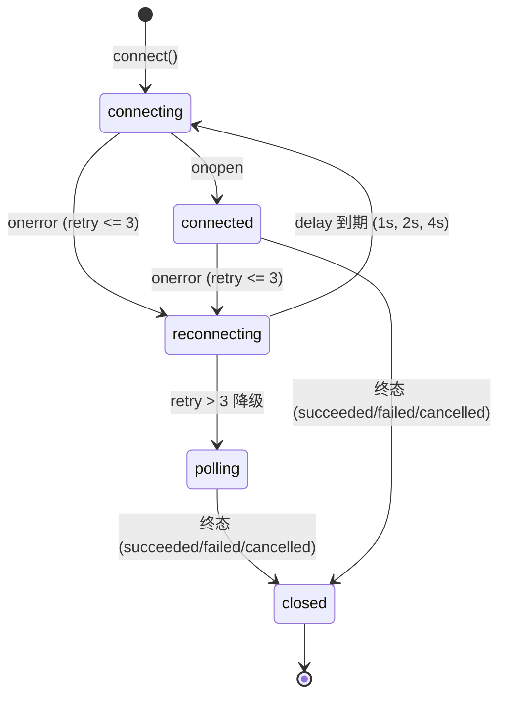

# APP-M2-T020 代码解释：JobProgress SSE 订阅流、断线重连与轮询回退机制

## 1. 为什么有这套实现

在长耗时后台任务（如 AI 章节生成、全库比对、导出等）中，前端需要实时感知任务的状态变更与子步骤流转。若全部采用短轮询，会对后端接口造成不必要的高频突发压力；若仅依靠单一 SSE 连接，遇到网络短暂抖动或代理断开时容易直接崩溃或长时间失联。
依据 PRD v1.8 §5.12.4 与 §5.7.6 以及原交接规范：
1. **实时 SSE 订阅流**：建立至 `/api/v1/jobs/{id}/events` 的流式长连接，服务端单向推送任务最新进度与子步骤数据；
2. **断线 3 阶梯指数退避重试**：当 SSE 连接发生网络异常中断时，自动进行最多 3 次阶梯指数退避重连（1s -> 2s -> 4s）；
3. **平滑轮询降级**：若 3 次重试均失败，无缝降级为 2 秒定时轮询（`GET /api/v1/jobs/{id}`），并在进度条上方呈现明确的黄色警示 Tag：“实时流已断开，已切换为定时刷新”；
4. **终态安全释放**：当任务到达终态（`completed`, `succeeded`, `failed`, `cancelled`）或组件卸载时，自动切断 SSE 并注销全部轮询与重试定时器，杜绝内存与资源泄漏。

---

## 2. 模块结构与核心入口

```
frontend/web/src/
├── job-progress-sse.ts     # 核心流控制层：SSE 消息解析、退避算法、状态机、订阅管理器与 useJobProgressSse Hook
└── JobProgress.tsx         # UI 组件层：集成降级提示 Tag，并导出 JobProgressWithSse 与所有控制符号
tests/frontend/
└── job-progress-sse.test.mjs # 7 项核心逻辑与状态机单测（全绿）
frontend/web/tests/
└── job-progress.test.mjs     # 契约测试更新：新增对 SSE 导出及降级测试 ID 断言
```

### 核心符号清单
- `JobStreamSubscriptionManager` (`job-progress-sse.ts`):
  管理 SSE 与轮询生命周期的核心类，支持依赖注入（`eventSourceFactory`, `fetchFn`），支持 `connect()`, `disconnect()`, `reconnect()`, `getStatus()`, `getRetryCount()`, `getIsFallback()`;
- `useJobProgressSse` (`job-progress-sse.ts`):
  用于 React 组件中的声明式 Hook，自动处理组件挂载连接与卸载清理，返回 `{ job, connectionStatus, retryCount, isFallback, isPolling, reconnect, disconnect }`;
- `calculateBackoffDelay(retryCount, baseMs, maxMs)`:
  纯函数：计算指数退避重试时长，第 1 次 1000ms，第 2 次 2000ms，第 3 次 4000ms；
- `parseSseLine` / `parseSseMessage`:
  纯函数：精准解析标准 SSE 数据格式（忽略空行与 `:ping` 注释行，提取 event、data、id、retry，支持多行 JSON 缓冲拼接）；
- `isJobTerminalStatus(status)`:
  纯函数：判断 `completed`, `succeeded`, `failed`, `cancelled` 终态；
- `JobProgressWithSse` (`JobProgress.tsx`):
  高阶组件，接收 `jobId` 自动联动实时 SSE 订阅流与降级轮询。

---

## 3. 状态流转与时序图

### 3.1 状态机模型



### 3.2 阶梯退避与平滑降级调用链
1. 初始化连接：创建 `EventSource('/api/v1/jobs/{id}/events')`，状态置为 `connecting`；
2. 连接建立成功：触发 `onopen`，重置 `retryCount = 0`，状态迁移为 `connected`；
3. 遇到网络异常：
   - 触发 `onerror`，关闭当前失效的 `EventSource` 实例；
   - 检查 `retryCount < maxRetries (3)`：
     - 若满足，`retryCount++`；
     - 调用 `calculateBackoffDelay` 计算延迟（依次为 1000ms、2000ms、4000ms）；
     - 状态置为 `reconnecting`，注册单次延时重试定时器；
   - 若重试 3 次均无法恢复（`retryCount >= 3`）：
     - 调用 `fallbackToPolling()`，状态置为 `polling`，`isFallback = true`；
     - 立即发起首轮 `GET /api/v1/jobs/{id}`；
     - 注册每 2000ms 的周期性轮询定时器；
     - UI 响应式呈现黄色告警 Tag：`实时流已断开，已切换为定时刷新`；
4. 终态处置：
   - 无论是 SSE 推流还是轮询回传，一旦检测到 `isJobTerminalStatus(job.status)` 为 true，立即调用 `disconnect()`；
   - 执行 `clearTimeout(reconnectTimer)` 与 `clearInterval(pollingTimer)`；
   - 执行 `activeEventSource.close()`；
   - 状态迁移为 `closed`。

---

## 4. 边界处理与异常保护

1. **DOM/Node 运行环境兼容**：在缺乏原生 `EventSource` 或 `fetch` 的环境（如部分 SSR 或测试环境）下，支持工厂注入与自动安全优雅降级，不抛未捕获异常；
2. **多行与分块数据保护**：`parseSseMessage` 严谨按照 `\n\n` 分割消息块，对冒号后空格及非标准 JSON 具备防御性解析能力；
3. **组件卸载时钟清除**：`useJobProgressSse` 在 useEffect 的 cleanup 函数中触发 `manager.disconnect()`，杜绝组件卸载后后台继续发起请求造成的内存泄漏与状态更新告警；
4. **404/403 权限失效阻断**：轮询中若遇到后端明确返回 404（任务已清理）或 403（权限被撤销），立即中止轮询，避免无意义死循环。
