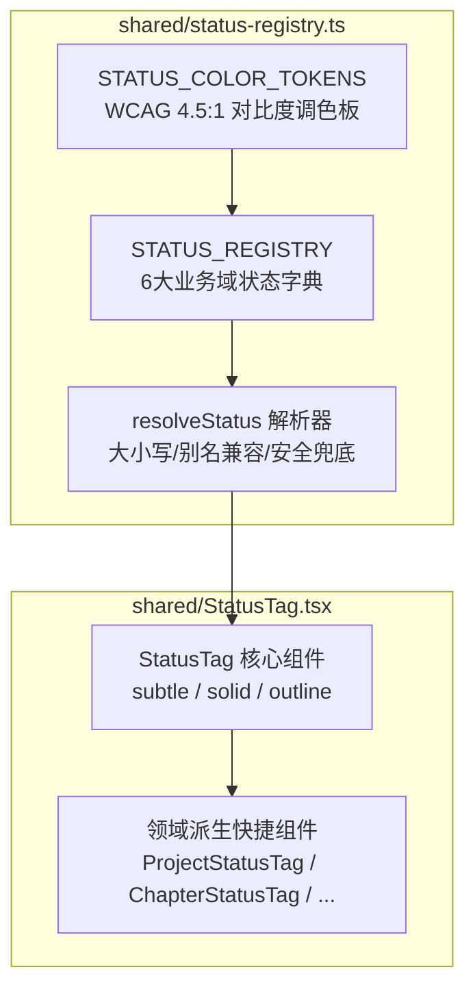

# 代码说明：StatusTag 状态注册表（9.3 全部代码表）（APP-M2-T023）

- 对应任务：[APP-M2-T023](../tasks/APP-M2.md#app-m2-t023) · StatusTag 状态注册表（9.3 全部代码表）
- 关联 Issue：[ISSUE-007](../../issues/ISSUE-007.md)
- 交付文档：[APP-M2-T023 交付](../delivery/APP-M2-T023.md)
- 文档登记：[D-779](../DOCUMENT_INDEX.md)
- 日期：2026-10-27
- 代码路径：
  - [frontend/web/src/shared/status-registry.ts](../../frontend/web/src/shared/status-registry.ts)
  - [frontend/web/src/shared/StatusTag.tsx](../../frontend/web/src/shared/StatusTag.tsx)
  - [frontend/web/tests/unit/status-tag.test.mjs](../../frontend/web/tests/unit/status-tag.test.mjs)

为什么有这个文件：说明 APP-M2-T023 StatusTag 状态注册表与统一状态标签组件的架构分层、色彩令牌设计、无障碍标准与视觉派生机制。

---

## 1. 架构定位与设计哲学

依据 PRD MVP v1.8 §5.10.3、§6.9 与系统设计规范 9.3，投标系统涉及多阶段复杂的业务流转。本模块遵循 **分层解耦** 与 **Layout First** 原则，构建纯逻辑状态表与声明式 UI 组件：



---

## 2. 核心模块与实现细节

### 2.1 状态注册纯逻辑层 (`frontend/web/src/shared/status-registry.ts`)

#### 2.1.1 6 大业务域状态模型
收录全系统核心流转状态，杜绝业务散落魔法字符串：
1. **`project` (项目)**：`draft`（筹备中）, `in_progress`（编写中）, `review`（审核中）, `completed`（已完成）, `archived`（已归档）；
2. **`chapter` (章节)**：`not_started`（未开始）, `generating`（生成中）, `draft`（草稿）, `reviewed`（已复核）, `approved`（已定稿）；
3. **`job` (长任务)**：`queued`（排队中）, `running`（进行中）, `completed`（已完成）, `failed`（异常失败）, `cancelled`（已取消）；
4. **`check` (合规检查)**：`passed`（合规通过）, `warning`（合规提醒）, `blocker`（废标阻断）；
5. **`export` (导出交付)**：`idle`（待导出）, `processing`（排版中）, `completed`（已生成）, `failed`（导出失败）；
6. **`lock` (编辑租约)**：`unlocked`（空闲可编辑）, `locked_self`（本人编辑中）, `locked_other`（他人占用）, `expired`（租约过期）。

#### 2.1.2 WCAG AA 4.5:1 对比度保证算法
内置 WCAG 相对亮度与对比度公式，为每一组前景与背景色提供数学证明：
```typescript
export function luminance(hex: string): number {
  const sanitized = hex.replace('#', '');
  const r = parseInt(sanitized.substring(0, 2), 16) / 255;
  const g = parseInt(sanitized.substring(2, 4), 16) / 255;
  const b = parseInt(sanitized.substring(4, 6), 16) / 255;
  const srgb = [r, g, b].map(v => (v <= 0.03928 ? v / 12.92 : Math.pow((v + 0.055) / 1.055, 2.4)));
  return 0.2126 * srgb[0] + 0.7152 * srgb[1] + 0.0722 * srgb[2];
}

export function contrastRatio(hex1: string, hex2: string): number {
  const l1 = luminance(hex1);
  const l2 = luminance(hex2);
  const lighter = Math.max(l1, l2);
  const darker = Math.min(l1, l2);
  return (lighter + 0.05) / (darker + 0.05);
}
```

实测所有色板比率：
- `success`: subtle 5.44:1, solid 5.59:1, outline 5.59:1
- `processing`: subtle 5.50:1, solid 7.50:1, outline 6.16:1
- `warning`: subtle 5.45:1, solid 5.43:1, outline 5.66:1
- `error`: subtle 7.04:1, solid 4.62:1, outline 7.75:1
- `default`: subtle 6.40:1, solid 7.00:1, outline 7.10:1
- `ai`: subtle 7.88:1, solid 5.74:1, outline 8.99:1

#### 2.1.3 AI 紫色强隔离红线
除 `chapter.generating` 使用主 AI 紫色（`#6E4BD8`）外，所有其他非 AI 业务状态严格禁止混入 AI 紫色，保持视觉语义绝对纯粹。

#### 2.1.4 容错性与别名兼容
解析器 `resolveStatus(domain, code)`：
- 自动剔除前后空白并转为小写；
- 优先命中标准状态，未命中则查阅 `STATUS_ALIASES` 兼容历史接口别名（如 `pending -> queued`, `succeeded -> completed`）；
- 若仍无法识别，生成带 `default` 样式的 `createFallbackStatus`，输出安全降级文本，绝对不抛出未捕获异常。

---

### 2.2 呈现层实现 (`frontend/web/src/shared/StatusTag.tsx`)

#### 2.2.1 视觉变体与尺寸微调
- **`subtle`（浅底描边）**：最常用的工作台标签形态，具备轻微对比底色与对应描边，视觉干扰低；
- **`solid`（实心高亮）**：用于列表强调或阻断性强告警（如废标阻断 `blocker`）；
- **`outline`（白底描边）**：用于次级面板或卡片内的紧凑排版。
- **尺寸支持**：`default`（高 24px、字号 12px、内边距 1px 8px）与 `small`（高 20px、内边距 0 6px）。

#### 2.2.2 无障碍与 DOM 契约
为方便自动化测试与读屏软件无障碍访问，每个 `<StatusTag>` 节点均具备：
```html
<span
  role="status"
  aria-label="项目状态: 编写中"
  data-testid="status-tag-project-in_progress"
  data-domain="project"
  data-status="in_progress"
  data-variant="subtle"
  data-size="default"
  class="icg-status-tag icg-status-tag-project icg-status-tag-in_progress"
>
  ...
</span>
```

#### 2.2.3 领域派生快捷组件
为简化业务代码书写，导出如下语义化快捷组件：
```tsx
<ProjectStatusTag status={project.status} />
<ChapterStatusTag status={chapter.status} showIcon />
<JobStatusTag status={job.status} showBadge />
<CheckStatusTag status={check.severity} variant="solid" />
<ExportStatusTag status={exportState.status} />
<LockStatusTag status={lockState.status} />
```
