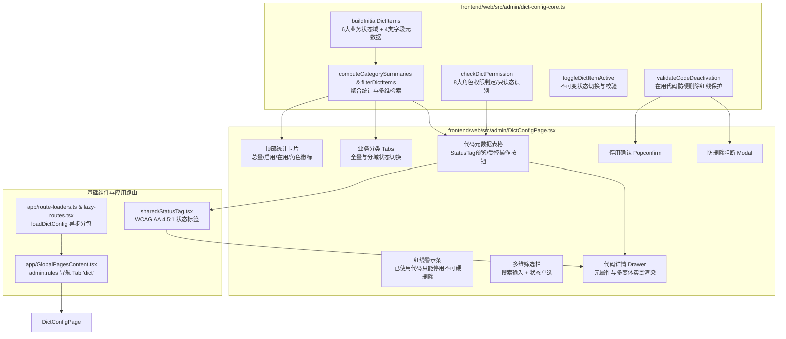

# 代码说明：A-03 字典配置页（APP-M2-T024）

- 对应任务：[APP-M2-T024](../tasks/APP-M2.md#app-m2-t024) · A-03 字典配置页
- 关联 Issue：[ISSUE-007](../../issues/ISSUE-007.md)
- 交付文档：[APP-M2-T024 交付](../delivery/APP-M2-T024.md)
- 文档登记：[D-789](../DOCUMENT_INDEX.md)
- 日期：2026-10-27
- 代码路径：
  - [frontend/web/src/admin/dict-config-core.ts](../../frontend/web/src/admin/dict-config-core.ts)
  - [frontend/web/src/admin/DictConfigPage.tsx](../../frontend/web/src/admin/DictConfigPage.tsx)
  - [frontend/web/src/app/route-loaders.ts](../../frontend/web/src/app/route-loaders.ts)
  - [frontend/web/src/app/lazy-routes.tsx](../../frontend/web/src/app/lazy-routes.tsx)
  - [frontend/web/src/app/GlobalPagesContent.tsx](../../frontend/web/src/app/GlobalPagesContent.tsx)
  - [frontend/web/tests/unit/dict-config-page.test.mjs](../../frontend/web/tests/unit/dict-config-page.test.mjs)

为什么有这个文件：说明 APP-M2-T024 A-03 字典配置与元数据管理页的前端架构拓扑、红线数据保护逻辑、角色权限感知与 UI 组件实现细节。

---

## 1. 架构定位与设计哲学

依据 PRD MVP v1.8 §5.10.3、§6.9 与系统交接规范 M1-P09-F2，投标系统需要统一的代码与元数据管理中心。本模块贯彻 **Layout First** 界面设计原则与 **纯逻辑解耦** 架构模式：



---

## 2. 核心模块与实现细节

### 2.1 纯逻辑层 (`frontend/web/src/admin/dict-config-core.ts`)

#### 2.1.1 核心红线：“已使用代码只能停用，不可直接硬删除”
依据系统交接核心约束 M1-P09-F2 与 PRD §5.10.3：
- 任何已被标书项目、章节正文、异步任务、合规检查或系统默认规则引用的状态代码，严禁从数据库物理删除；
- 物理删除会导致历史审计快照、外键关联和检查阻断规则出现悬空破损；
- 在 `validateCodeDeactivation` 函数中落实硬门禁校验：
```typescript
export function validateCodeDeactivation(item: DictItem): {
  canDeactivate: boolean;
  canHardDelete: boolean;
  reason?: string;
} {
  if (item.isInUse) {
    return {
      canDeactivate: true,
      canHardDelete: false,
      reason: '已使用代码只能停用，不可直接硬删除',
    };
  }
  if (item.isBuiltin) {
    return {
      canDeactivate: false,
      canHardDelete: false,
      reason: '系统内置核心代码不可删除或停用',
    };
  }
  return {
    canDeactivate: true,
    canHardDelete: true,
  };
}
```

#### 2.1.2 8 大角色精细化权限矩阵
实现 `checkDictPermission(role)`，按最小特权原则精细化分配字典控制权：
- **管理员角色**（`platform_admin`、`company_admin`）：享有管理权（`canEdit: true`, `canToggle: true`, `canCreate: true`, `isReadOnly: false`）；
- **只读业务角色**（`project_lead`、`bid_writer`、`auditor`、`viewer`、`data_admin`、`financial_reviewer`）：呈现受控只读安全态（`isReadOnly: true`，操作按钮禁用并附带权限受限 Tooltip）。

#### 2.1.3 6 大核心业务状态码表与字段元数据初始化
`buildInitialDictItems()` 完整收口系统所有业务状态域与字段元数据：
1. **`status_project`**：`draft`、`in_progress`、`review`、`completed`、`archived`（5 项）；
2. **`status_chapter`**：`not_started`、`generating`（专属 AI 紫）、`draft`、`reviewed`、`approved`（5 项）；
3. **`status_job`**：`queued`、`running`、`completed`、`failed`、`cancelled`（5 项）；
4. **`status_check`**：`passed`、`warning`、`blocker`（合规阻断红线，3 项）；
5. **`status_export`**：`idle`、`processing`、`completed`、`failed`（4 项）；
6. **`status_lock`**：`unlocked`、`locked_self`、`locked_other`、`expired`（4 项）；
7. **字段元数据**：覆盖 `field_project`、`field_tender`、`field_evidence`、`field_sla` 核心元数据（9 项）。

#### 2.1.4 状态过滤与不可变更新
- `filterDictItems(items, params)`：支持分类精确过滤、启用状态（all / active / inactive）筛选与多字段模糊搜索；
- `toggleDictItemActive(items, itemId, targetActive)`：执行校验后返回全新的数组引用，严格遵循不可变数据流。

---

### 2.2 呈现层组件 (`frontend/web/src/admin/DictConfigPage.tsx`)

#### 2.2.1 Layout First 视觉层级
界面布局坚决摒弃传统管理后台的长篇大论说明书，依靠视觉流自然表达：
1. **顶部指标条**：单行卡片紧凑呈现总代码量、启用数、在用保护数、状态分类数，右侧挂载当前用户角色的权限徽标；
2. **警示条**：通过轻量 Alert 声明核心数据完整性约束；
3. **操作工具条**：左侧搜索框，右侧单选状态过滤纽，无多余次级冗余文案；
4. **业务分类 Tabs**：快速在全部代码与 10 个业务分类间切换，Tab 标题内嵌对应分类的 `(启用数/总数)`；
5. **主数据 Table**：
   - 代码列：等宽字体呈现，支持点击打开详情抽屉；
   - 标签预览列：直接挂载 `<StatusTag type={domain} status={code} showIcon />` 实景呈现；
   - 显示名列：支持重要标记（★）与废标阻断专属高亮 Badge；
   - 保护状态列：呈现带有蓝底的 `在用保护` 或灰底 `未引用` 徽标；
   - 操作列：针对在用项目隐藏直接硬删除，仅提供带有 Popconfirm 气泡确认的【停用】/【启用】按钮。

#### 2.2.2 交互保护与详情抽屉
- **气泡确认（Popconfirm）**：点击停用时提示“停用后新业务流程将无法选择该状态”，确认后调用不可变更新；
- **物理删除尝试阻断（Modal）**：若通过非常规手段或未在用项点击删除，弹出 Modal 提醒确认；若属于在用项，弹出危险 Warning Modal 严正拦截；
- **侧边元数据抽屉（Drawer）**：右侧滑出展示当前状态代码的所属域、语义等级、WCAG 色系、三变体（subtle / solid / outline）与多尺寸实景对比，供管理员与业务人员直观调阅。

---

### 2.3 动态分包与全局集成

1. **动态加载器 (`frontend/web/src/app/route-loaders.ts`)**：
   ```typescript
   export const loadDictConfig = () =>
     import('../admin/DictConfigPage').then(m => ({ default: m.DictConfigPage }));
   ```
2. **懒加载路由组件 (`frontend/web/src/app/lazy-routes.tsx`)**：
   ```typescript
   export const LazyDictConfigPage = createLazyRoute(loadDictConfig, 'DictConfigPage');
   ```
3. **全局规则导航挂载 (`frontend/web/src/app/GlobalPagesContent.tsx`)**：
   在 `nav === 'admin.rules'`（规则与字典配置）下新增第四个 Tab：
   ```tsx
   {
     key: 'dict',
     label: 'A-03 字典配置',
     children: <DictConfigPage currentRole={currentRole} />,
   }
   ```
   生产构建打包出独立的 29.57 kB JS chunk，不增加系统首屏体积。

---

## 3. 测试与验证映射

专属测试套件位于 `frontend/web/tests/unit/dict-config-page.test.mjs`，包含 6 组端到端断言：
1. **字典项初始数据集**：断言 6 大状态域全部收口，状态总数与字段元数据完整无遗漏；
2. **角色权限感知**：断言 `platform_admin` / `company_admin` 享有完全权限，`bid_writer` / `auditor` 受到只读安全态约束；
3. **核心红线验证**：断言 `isInUse: true` 时 `canHardDelete === false` 且返回红线错误原因；
4. **多维检索与统计聚合**：断言 `computeCategorySummaries` 与 `filterDictItems` 的分类、状态、关键字复合检索正确；
5. **AST 契约与 TestId 断言**：静态分析 `DictConfigPage.tsx`，校验关键组件、data-testid 及安全逻辑完备性；
6. **全局页面路由集成断言**：静态分析 `GlobalPagesContent.tsx`，断言 `dict` 页签与 `<DictConfigPage />` 正确装配。
