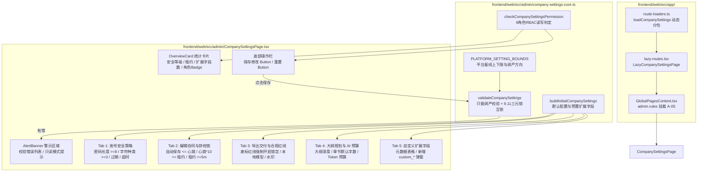

# 代码说明：扩展字段与公司设置键表单框架（APP-M2-T025）

- 对应任务：[APP-M2-T025](../tasks/APP-M2.md#app-m2-t025) · 扩展字段与公司设置键表单框架
- 关联 Issue：[ISSUE-007](../../issues/ISSUE-007.md)
- 交付文档：[APP-M2-T025 交付](../delivery/APP-M2-T025.md)
- 文档登记：[D-809](../DOCUMENT_INDEX.md)
- 日期：2026-10-27
- 代码路径：
  - [frontend/web/src/admin/company-settings-core.ts](../../frontend/web/src/admin/company-settings-core.ts)
  - [frontend/web/src/admin/CompanySettingsPage.tsx](../../frontend/web/src/admin/CompanySettingsPage.tsx)
  - [frontend/web/src/app/route-loaders.ts](../../frontend/web/src/app/route-loaders.ts)
  - [frontend/web/src/app/lazy-routes.tsx](../../frontend/web/src/app/lazy-routes.tsx)
  - [frontend/web/src/app/GlobalPagesContent.tsx](../../frontend/web/src/app/GlobalPagesContent.tsx)
  - [frontend/web/tests/unit/company-settings-form.test.mjs](../../frontend/web/tests/unit/company-settings-form.test.mjs)

为什么有这个文件：说明 APP-M2-T025 扩展字段与公司设置键表单框架的架构设计、核心逻辑实现细节、约束校验算法及路由装配。

---

## 1. 架构定位与拓扑流转

依据 PRD MVP v1.8 §5.10.3、§6.9 与技术规范 9.11，公司设置表单是企业级租户治理的重要控制台。本模块严格贯彻 **纯逻辑与呈现分离** 和 **Layout First** 架构原则：



---

## 2. 核心模块与实现细节

### 2.1 纯逻辑校验层 (`frontend/web/src/admin/company-settings-core.ts`)

#### 2.1.1 平台上下限基线元数据定义
```typescript
export const PLATFORM_SETTING_BOUNDS: Record<string, SettingBoundMeta> = {
  password_min_length: {
    key: 'password_min_length',
    name: '密码最小长度',
    min: 8,
    max: 32,
    defaultVal: 8,
    unit: '位',
    tightenDirection: 'higher_is_tighter',
  },
  password_min_char_classes: {
    key: 'password_min_char_classes',
    name: '最小字符种类数',
    min: 3,
    max: 4,
    defaultVal: 3,
    unit: '种',
    tightenDirection: 'higher_is_tighter',
  },
  export_redline_blocking: {
    key: 'export_redline_blocking',
    name: '废标红线整本导出阻断',
    min: 1,
    max: 1,
    defaultVal: true,
    tightenDirection: 'mandatory_true',
  },
  // ... 其他各项界限定义
};
```
- `tightenDirection` 明确了该设置是“数值越大越严”（如密码长度）还是“强制为 true”（如废标红线导出门禁），为前后台一致性奠定契约基础。

#### 2.1.2 8 角色权限感知算法
```typescript
export function checkCompanySettingsPermission(role?: string): CompanySettingsPermissionResult {
  const normalizedRole = role?.toLowerCase() || '';
  const canEdit = normalizedRole === 'platform_admin' || normalizedRole === 'company_admin';
  return {
    canEdit,
    canManageCustomFields: canEdit,
    isReadOnly: !canEdit,
    reason: canEdit ? undefined : '当前角色仅具备公司设置查阅权限，如需调整安全与合规策略请联系公司或平台管理员。',
  };
}
```
- 严格遵循 PRD v1.8 §2.3 角色矩阵：除 `platform_admin` 与 `company_admin` 外，其他角色全部判定为只读模式，并在 UI 上呈现友好说明。

#### 2.1.3 核心约束与红线校验算法 (`validateCompanySettings`)
1. **“只能调严不能调宽”红线拦截**：
   ```typescript
   if (settings.password_min_length < 8) {
     issues.push({
       field: 'password_min_length',
       code: 'PASSWORD_MIN_LENGTH_TOO_LOW',
       message: '公司密码最小长度不可低于平台底线（8 位），只能调严不能调宽',
       severity: 'error',
     });
   }
   if (settings.password_min_char_classes < 3) {
     issues.push({
       field: 'password_min_char_classes',
       code: 'PASSWORD_CHAR_CLASSES_TOO_LOW',
       message: '公司密码字符种类要求不可低于平台底线（3 类），只能调严不能调宽',
       severity: 'error',
     });
   }
   ```
2. **规范 9.11 排他锁协同三元互锁**：
   ```typescript
   // 1. 自动保存 <= 心跳续期
   if (settings.editor_autosave_seconds > settings.edit_lock_heartbeat_seconds) {
     issues.push({
       field: 'editor_autosave_seconds',
       code: 'AUTOSAVE_EXCEEDS_HEARTBEAT',
       message: '自动保存周期（' + settings.editor_autosave_seconds + '秒）不能大于心跳续期间隔（' + settings.edit_lock_heartbeat_seconds + '秒）',
       severity: 'error',
     });
   }
   // 2. 心跳续期 * 10 <= 租约超时时间（秒）
   const lockTimeoutSeconds = settings.edit_lock_timeout_minutes * 60;
   if (settings.edit_lock_heartbeat_seconds * 10 > lockTimeoutSeconds) {
     issues.push({
       field: 'edit_lock_heartbeat_seconds',
       code: 'HEARTBEAT_RATIO_TOO_LARGE',
       message: '编辑锁超时租约须至少容纳 10 次心跳重试周期以平抑抖动',
       severity: 'error',
     });
   }
   // 3. 租约超时时间 >= 5 分钟
   if (settings.edit_lock_timeout_minutes < 5) {
     issues.push({
       field: 'edit_lock_timeout_minutes',
       code: 'TIMEOUT_BELOW_MINIMUM',
       message: '锁定超时时间不得低于 5 分钟',
       severity: 'error',
     });
   }
   ```
3. **整本递交导出门禁强制启用**：
   ```typescript
   if (!settings.export_redline_blocking) {
     issues.push({
       field: 'export_redline_blocking',
       code: 'REDLINE_BLOCKING_MUST_BE_TRUE',
       message: '废标红线整本导出阻断为平台级强制安全门禁，不可关闭',
       severity: 'error',
     });
   }
   ```

---

### 2.2 呈现层组件 (`frontend/web/src/admin/CompanySettingsPage.tsx`)

#### 2.2.1 Layout First 设计结构
- **顶部总览卡片 (`data-testid="company-settings-overview"`)**：
  采用 Ant Design `Statistic` 组件直观呈现 4 项关键指征：公司标识、密码策略严格度、编辑锁安全租期、已配置扩展字段数，右上角显示当前登录角色的权限 Tag。
- **5 维分类选项卡 (`data-testid="company-settings-tabs"`)**：
  将原本庞杂的二十余项配置科学分流至 5 个语义明确的 Tab，避免纵向滚动的“长表单视觉疲劳”；
- **平台基线内联 Tag 标识**：
  在各输入控件旁通过 `<Tag color="blue">平台底线: 8 位</Tag>` 等形式内联标识平台上下限，使用户无需阅读外链文档即可直观了解调控区间。

#### 2.2.2 自定义扩展字段管理
- 提供清晰的数据表格展示：字段键名（Key）、中文名称、类型（文本/数字/布尔/日期/下拉单选）、适用实体（项目/招标/章节/知识库）、是否必填；
- 点击「新增字段」弹窗录入：强制自动追加 `custom_` 前缀，校验字段名唯一性，保证元数据干净无冲突。

---

### 2.3 路由挂载与分包加载 (`GlobalPagesContent.tsx`)
在 `admin.rules` 下的 `settings` 标签（即【A-05 扩展字段与公司设置】），替换原有的 `PendingPage`：
```tsx
{
  key: 'settings',
  label: '扩展字段与公司设置',
  children: (
    <Suspense fallback={<Card loading />}>
      <LazyCompanySettingsPage />
    </Suspense>
  ),
}
```
构建产物实测形成独立的 `CompanySettingsPage-*.js` chunk（仅 22.99 kB），实现首屏零污染。

---

## 3. 测试与验证映射

| 测试用例序号 | 验证项 | 对应实现 | 结果 |
|---|---|---|---|
| 1 | 初始配置构建与平台基线完整性 | `buildInitialCompanySettings`, `PLATFORM_SETTING_BOUNDS` | PASS (1.2ms) |
| 2 | “只能调严不能调宽”红线校验 | `validateCompanySettings` (password length/classes) | PASS (0.4ms) |
| 3 | 9.11 编辑锁三元协同公式 | `validateCompanySettings` (autosave <= heartbeat, ratio <= 10, timeout >= 5m) | PASS (0.4ms) |
| 4 | 导出合规门禁强制开启 | `validateCompanySettings` (export_redline_blocking) | PASS (0.4ms) |
| 5 | 8 角色 RBAC 权限感知与只读模式 | `checkCompanySettingsPermission` (platform/company_admin vs others) | PASS (0.4ms) |
| 6 | AST 静态契约与 testid 规范 | `CompanySettingsPage.tsx` 组件树分析 | PASS (16.9ms) |
| 7 | GlobalPagesContent 路由挂载消除 PendingPage | `GlobalPagesContent.tsx` AST 结构分析 | PASS (11.0ms) |
