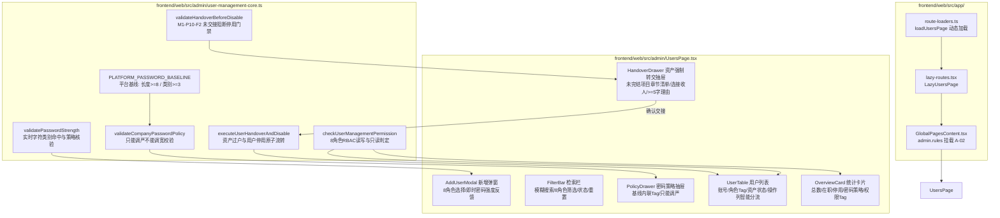

# 代码说明：A-02 用户列表、新增与停用前转交安全表单（APP-M2-T027）

- 对应任务：[APP-M2-T027](../tasks/APP-M2.md#app-m2-t027) · A-02 用户列表、新增、停用前转交；“账号安全设置”面板（公司密码策略，只能调严）
- 关联 Issue：[ISSUE-007](../../issues/ISSUE-007.md)
- 交付文档：[APP-M2-T027 交付](../delivery/APP-M2-T027.md)
- 文档登记：[D-819](../DOCUMENT_INDEX.md)
- 日期：2026-10-28
- 代码路径：
  - [frontend/web/src/admin/user-management-core.ts](../../frontend/web/src/admin/user-management-core.ts)
  - [frontend/web/src/admin/UsersPage.tsx](../../frontend/web/src/admin/UsersPage.tsx)
  - [frontend/web/src/app/route-loaders.ts](../../frontend/web/src/app/route-loaders.ts)
  - [frontend/web/src/app/lazy-routes.tsx](../../frontend/web/src/app/lazy-routes.tsx)
  - [frontend/web/src/app/GlobalPagesContent.tsx](../../frontend/web/src/app/GlobalPagesContent.tsx)
  - [frontend/web/tests/unit/user-management-page.test.mjs](../../frontend/web/tests/unit/user-management-page.test.mjs)

为什么有这个文件：说明 APP-M2-T027 用户与角色管理、新增用户表单、停用前业务资产强制交接门禁及公司密码策略调严校验的架构设计与核心代码实现。

---

## 1. 架构定位与拓扑流转

依据 PRD MVP v1.8 §2.3、§5.10.1、§5.10.2 与交接约束 M1-P10-F2，本模块遵循 **纯逻辑与呈现分离** 和 **Layout First** 架构准则：



---

## 2. 核心模块与实现细节

### 2.1 纯逻辑领域层 (`frontend/web/src/admin/user-management-core.ts`)

#### 2.1.1 密码字符类别统计与强度动态校验
```typescript
export function countPasswordCharClasses(password: string): number {
  if (!password) return 0;
  let classes = 0;
  if (/[A-Z]/.test(password)) classes++;
  if (/[a-z]/.test(password)) classes++;
  if (/[0-9]/.test(password)) classes++;
  if (/[^A-Za-z0-9]/.test(password)) classes++;
  return classes;
}

export function validatePasswordStrength(
  password: string,
  policy: Partial<CompanyPasswordPolicy> = DEFAULT_COMPANY_PASSWORD_POLICY
): PasswordValidationResult {
  const minLength = policy.password_min_length ?? PLATFORM_PASSWORD_BASELINE.MIN_LENGTH;
  const minClasses = policy.password_min_char_classes ?? PLATFORM_PASSWORD_BASELINE.MIN_CHAR_CLASSES;
  // ... 校验长度与字符类别数并输出即时错误
}
```
- 精确检测大写字母、小写字母、数字、特殊符号 4 种字符类别；
- 依据当前公司生效策略（支持调严）给出实时反馈，不满足时明确告知当前命中类数。

#### 2.1.2 “公司设置只能调严不能调宽”策略校验
```typescript
export function validateCompanyPasswordPolicy(
  policy: Partial<CompanyPasswordPolicy>
): { valid: boolean; issues: string[] } {
  const issues: string[] = [];

  if (typeof policy.password_min_length === 'number') {
    if (policy.password_min_length < PLATFORM_PASSWORD_BASELINE.MIN_LENGTH) {
      issues.push(`密码最小长度（${policy.password_min_length} 位）低于平台基线（${PLATFORM_PASSWORD_BASELINE.MIN_LENGTH} 位），只能调严不能调宽`);
    }
  }

  if (typeof policy.password_min_char_classes === 'number') {
    if (policy.password_min_char_classes < PLATFORM_PASSWORD_BASELINE.MIN_CHAR_CLASSES) {
      issues.push(`字符种类数（${policy.password_min_char_classes} 类）低于平台基线（${PLATFORM_PASSWORD_BASELINE.MIN_CHAR_CLASSES} 类），只能调严不能调宽`);
    }
  }
  // ...
  return { valid: issues.length === 0, issues };
}
```
- 严格封堵通过表单将公司密码策略降至 8 位或 3 类以下的漏洞。

#### 2.1.3 停用前资产交接核心红线（M1-P10-F2）
```typescript
export function validateHandoverBeforeDisable(params: {
  sourceUser: UserItem;
  targetUserId: string;
  reason: string;
  availableUsers: UserItem[];
}): { valid: boolean; field?: 'targetUserId' | 'reason'; message?: string } {
  // 1. 接收人非空
  // 2. 接收人防自选 (targetUserId !== sourceUser.id)
  // 3. 接收人状态必须正常在职 (targetUser.status === 'active')
  // 4. 严禁跨租户企业交接 (targetUser.company_id === sourceUser.company_id)
  // 5. 交接理由不少于 5 个字 (trimmedReason.length >= 5)
}
```
- 形成严密的交接门禁，防止数据泄露或随意移交。

#### 2.1.4 原子化资产转移流转
```typescript
export function executeUserHandoverAndDisable(params: { ... }) {
  // 1. 抽取源用户全部项目、章节与资料资产
  // 2. 追加合并至接收人 assigned_assets
  // 3. 清空源用户资产并将源用户 status 置为 'disabled'
  // 4. 生成规范审计流水 UserHandoverRecord
}
```

---

### 2.2 呈现交互层 (`frontend/web/src/admin/UsersPage.tsx`)

#### 2.2.1 Layout First 设计结构
- **顶部统计概览卡片 (`data-testid="user-management-overview"`)**：
  采用 Ant Design `Statistic` 组件呈现 4 项关键指征：总用户数、正常在职、已停用、当前公司密码策略，右上角内联当前角色的权限 Tag（读写管理 vs 纯只读）。
- **操作列智能分流**：
  - 若用户持有未完结资产（`hasActiveAssets` 为 true）：操作列高亮展示「转交并停用」按钮，引导进入资产交接 Drawer；
  - 若用户无任何负责资产：呈现「停用」Popconfirm 二次确认弹窗，确认后直接停用；
  - 若用户已处于停用状态：呈现「启用」按钮，点击恢复正常在职；
  - 只读模式下操作列按钮全局置灰并展示 tooltip 友好提示。
- **停用前资产交接 Drawer (`data-testid="user-handover-drawer"`)**：
  - 顶部显式警告 Alert 阐明合规交接规范；
  - 列表分类列出待交接的负责项目、在编章节与资料条目；
  - 仅展示同公司正常在职成员供选择；
  - 必须填写不少于 5 个字的交接理由。

---

### 2.3 路由装配与分包加载
在 `frontend/web/src/app/GlobalPagesContent.tsx` 中挂载于 `admin.rules` 下的 Tab `users`：
```tsx
{
  key: 'users',
  label: 'A-02 用户与角色',
  children: (
    <UsersPage
      session={session}
      currentUser={currentUser}
      onNavigate={onRequestPath}
    />
  ),
}
```
构建产物实测形成独立的 `UsersPage-*.js` chunk（仅 29.50 kB，gzip 9.85 kB），首屏零负担。

---

## 3. 测试与验证映射

| 测试用例序号 | 验证项 | 对应实现 | 结果 |
|---|---|---|---|
| 1 | 用户初始数据集与业务资产统计完整性 | `INITIAL_USERS`, `countUserActiveAssets`, `hasActiveAssets` | PASS (1.0ms) |
| 2 | “公司设置只能调严不能调宽”密码策略合规校验 | `validateCompanyPasswordPolicy` (length, classes, attempts) | PASS (0.5ms) |
| 3 | 密码强度与字符类别动态核验算法 | `countPasswordCharClasses`, `validatePasswordStrength` | PASS (0.4ms) |
| 4 | 新增用户表单校验与查重防线 | `validateNewUserForm` (username, name, role, policy) | PASS (0.7ms) |
| 5 | 停用前业务资产强制交接合规红线校验（M1-P10-F2） | `validateHandoverBeforeDisable` (self, cross-tenant, reason) | PASS (0.4ms) |
| 6 | 执行资产交接与状态停用领域逻辑断言 | `executeUserHandoverAndDisable` (assets migration, status) | PASS (2.2ms) |
| 7 | 8 角色 RBAC 细粒度权限感知与多租户隔离过滤 | `checkUserManagementPermission`, `filterUsersList` | PASS (0.4ms) |
| 8 | UsersPage.tsx 与 GlobalPagesContent.tsx AST 静态契约断言 | 组件树与全局路由结构分析 | PASS (0.9ms) |
