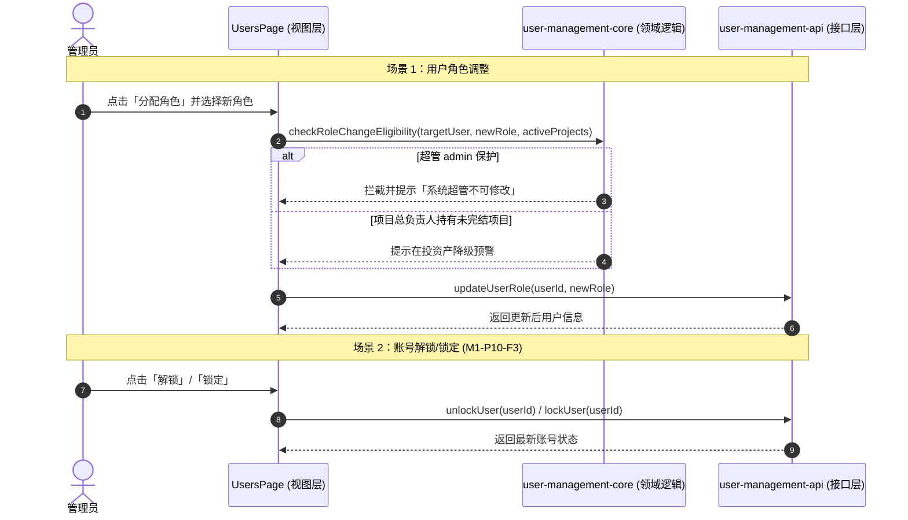

# APP-M2-T028 代码说明：A-02 用户角色分配、锁定/解锁与重置密码表单

为什么有这个文件：记录 APP-M2-T028（A-02 用户角色分配、锁定/解锁与重置密码表单）的技术架构、核心算法与组件实现。

它解决什么问题：
1. 阐明用户列表操作列中角色分配（RoleModal）、密码强制重置（ResetPasswordModal）与账号锁定/解锁（Lock/Unlock）业务交互实现；
2. 详解 8 大标准 RBAC 角色流转规则、超管 admin 保护与项目负责人降级预警逻辑；
3. 详解交接约束 M1-P10-F3 账号锁定与解锁状态流转及展示逻辑；
4. 记录纯逻辑与表现层解耦架构及自动化测试覆盖映射。

---

## 1. 架构与交互设计

---

## 2. 核心逻辑实现

在 `frontend/web/src/admin/user-management-core.ts` 与 `frontend/web/src/admin/UsersPage.tsx` 中实现：
- 8 角色有效性核验与超管 admin 保护；
- 密码强度即时动态校验器与合规随机强密码生成工具；
- M1-P10-F3 账号锁定/解锁状态感知与二次确认。

---

## 3. 测试覆盖

测试套件：`frontend/web/tests/unit/user-role-reset-unlock.test.mjs`
- 角色分配流转与超管保护测试；
- 密码策略校验与随机强密码测试；
- 账号锁定/解锁状态流转测试。
