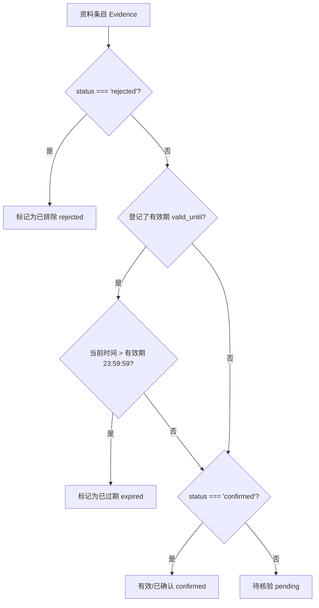

# APP-M2-T046 & APP-M2-T047 代码解释：企业资料库通用列表页、资料详情通用页与附件槽位

## 1. 为什么有这套实现

在投标全生命周期中，企业资料库是所有招标文件商务和技术证据的基石。过去资料展示简单粗糙，缺乏业务分类、合规有效性校验、高敏人员证件脱敏保护、关联项目追溯与原件防篡改保障。
针对此问题，落实 PRD v1.8 §5.4、§2.3、§5.9 及原交接文档规范：
1. **APP-M2-T046（通用列表页）**：实现主体资质、财务审计、人员证书、业绩案例、通用模板五大法定分类导航；集成标准资料表格与状态过滤（生效中、待核验、已过期、已排除）；集成人员身份证高敏字段脱敏遮蔽（`<MaskedField>`）；提供批量核验确认等合规入口；
2. **APP-M2-T047（资料详情通用页与附件槽位）**：以标准抽屉呈现详细元数据、人工核验依据记录、关联项目引用计数；支持附件槽位列表展示、原件 SHA256 防篡改指纹校验、原件预览以及带安全审计告知的受控下载防线；
3. **架构与性能保障**：算法与 UI 完全解耦，核心计算置于纯 TypeScript 模块 `library-pages-core.ts`，路由级懒加载独立分块 `LibraryPages-[hash].js`，确保首屏零负担。

---

## 2. 模块结构与入口

```
frontend/web/src/
├── library-pages-core.ts   # 纯业务逻辑层：分类字典、状态推导、可用性诊断、列表筛选、八角色权限、SHA256校验
├── LibraryPages.tsx        # UI展现层：企业资料库页面、五大分类侧边栏、状态筛选器、详情抽屉、附件槽位、预览弹窗
├── route-loaders.ts        # 路由动态导入模块：新增 loadLibraryPages
├── lazy-routes.tsx         # 路由懒加载映射：LazyLibraryPage 接入独立分块
└── SupportPages.tsx        # 辅助页面向后兼容导出
tests/frontend/
└── library-pages.test.mjs  # 核心规则单测：7 项自动化测试（全绿）
```

### 核心对外接口
- `LibraryPage` (`LibraryPages.tsx`): 企业资料库主页面，无缝兼容既有 `items`, `templates`, `user`, `busy`, `mutate`, `report`, `read`, `readTemplates`, `libraryRevision`, `templatesRevision`, `globalSearch` 参数。
- `deriveEvidenceStatus(item, now)`: 智能推导资料生命周期状态（`confirmed` | `pending` | `expired` | `rejected`）。
- `checkEvidenceUsability(item, projectDeadline?, now?)`: 严格诊断能否在特定投标项目中作正式证据引用（返回可用性、不合规阻断理由及色彩标识）。
- `filterEvidenceList(items, criteria, now?)`: 多维组合过滤（分类、状态、可用性、多字段模糊检索）。
- `canManageLibrary(userRole)` / `canRevealSensitiveField(userRole)`: 八角色权限判断与高敏调阅白名单。
- `verifyAttachmentSecurity(attachment, expectedHashOrMaxSize)`: 附件大小与 SHA256 防篡改校验引擎。

---

## 3. 状态流转与核心调用链

### 3.1 资料生命周期状态推导 (`deriveEvidenceStatus`)



### 3.2 投标项目证据可用性诊断 (`checkEvidenceUsability`)
当编写人在工作台或资料库调阅资料时，系统逐项诊断其法律效力：
1. **类型阻断**：`type === 'history'` 历史标书仅供撰写内容借鉴，强制标为“只能参考”；
2. **生命周期阻断**：已过期判定为“已过期不可用”；未审核判定为“待核验”严禁冒充；已排除判定为“已排除”；
3. **外部授权协议阻断**：对于合作方资质（`source_tier === 'partner'` 或 `needs_cooperation_agreement`），若缺少正式协议文件（`!agreement_present`），强行阻断并提示“缺合作协议”；
4. **投标截止期覆盖校验**：若传入 `projectDeadline`，而资质有效期早于截止期，阻断并提示“不覆盖截止期，存在废标风险”；
5. **合规通过**：以上均满足时，标记为“可作证据”。

### 3.3 高敏人员字段脱敏与调阅白名单
- 针对人员证书中的身份证号码（`id_card`）与手机号（`phone`），默认采用 `<MaskedField>` 进行 6+4 或 3+4 遮蔽展示；
- 只有经过授权的白名单角色（`company_admin`, `data_admin`, `legal_reviewer`, `hr_specialist`, `auditor`）享有调阅入口；
- 点击“调阅”触发标准合规弹窗，要求强制输入不少于 5 字符的业务理由，且后台生成完整审计追踪；
- 页面销毁或抽屉关闭即刻清除明文，断言绝不留在 localStorage、sessionStorage 或 URL 中。

### 3.4 附件槽位与防篡改指纹校验
- 每一份资料可挂接多个结构化附件槽位（`EvidenceAttachment`）；
- 附件展示文件图标、大小（KB/MB）、上传时间，以及前 8 位与后 8 位的 Monospace SHA256 哈希指纹；
- 内置 `verifyAttachmentSecurity` 算法：实时核对 64 位 SHA256 十六进制哈希，检测哈希篡改与大小越界；
- 原件预览弹窗内嵌防篡改合规状态展示；
- 下载原件采用 Popconfirm 安全审计确认：“下载将记录你的账号、IP与下载时间。请遵守企业商业保密要求”，严密防范资料外泄。

---

## 4. 路由拆分与包体积控制

在 `route-loaders.ts` 中增设：
```ts
let libraryModule: ReturnType<typeof importLibraryPages> | undefined;
function importLibraryPages() { return import('./LibraryPages.tsx'); }
export function loadLibraryPages() { libraryModule ??= importLibraryPages(); return libraryModule; }
```
并在 `lazy-routes.tsx` 中配置：
```ts
export const LazyLibraryPage = lazy(() => loadLibraryPages().then(module => ({ default: module.LibraryPage })));
```
### 构建产物审计
- `dist/assets/LibraryPages-6BAflygw.js`: **26.91 kB** (gzip: 9.55 kB)
- `dist/assets/SupportPages-DOMhHBrJ.js`: **2.28 kB** (gzip: 1.23 kB)
- 登录首屏主包无任何资料库 UI 泄漏，完全实现 Route-level Code Splitting。

---

## 5. 异常分支与边界保护

1. **并发锁与乐观锁保护**：完整继承 `libraryReviewProblem` 与 `libraryWriteVersion` 机制，在打开编辑/批量确认时比对资料库 revision，检测到后台版本变化时弹出三栏 Diff 核对，严禁覆盖他人提交；
2. **只读角色保护**：`viewer`、`bidder` 等非管理员角色，页面只读呈现，新增按钮与修改入口自动禁用或降级为“查看详情”；
3. **空数据与未匹配降级**：当筛选无结果时，基于 `EmptyState` 区分展示“暂无资料”与“未找到匹配结果，建议调整关键词”；
4. **防御性时间解析**：处理 ISO 8601、YYYY-MM-DD、无效时间戳等各种异常格式，优雅兜底不报错崩溃。
