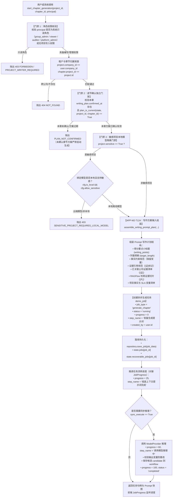

# 为什么有这个文件：说明大纲写作计划组装（APP-M2-T124）与逐节确认启动章节生成（APP-M2-T126）的技术实现、架构设计、安全门禁与任务生命周期。
# 它解决什么问题：
# 1. 写作方案输入上下文组装（APP-M2-T124）：将各章节得分要点小标题、已关联公司证据版本（含 [证] 标记与版本）、RAGFlow 候选切片（含 [片] 溯源）、项目可用事实及 SLA 变量组装为标准模型 Prompt 写作计划，包含字数预期、事实变量不可篡改约束及 [证] 引用标记规范；
# 2. 逐节确认启动生成（APP-M2-T126）：落地 start_chapter_generation(project_id, chapter_id, principal)，按逐节确认结果独立启动已确认章节的生成任务，未确认分册或未确认章节绝对不阻塞已确认章节的独立启动；未确认方案的章节企图启动生成前置抛出 PLAN_NOT_CONFIRMED；
# 3. 异步任务与进度流转：在 demo_job 中创建异步任务（job_type="generate_chapter", status="running", progress=0），并与 JobProgress 进度流转对接；
# 4. 敏感项目本地模型强门禁：敏感项目强制使用本地模型配置，企图使用云端模型抛出 403 SENSITIVE_PROJECT_REQUIRES_LOCAL_MODEL。

# APP-M2-T126 写作方案组装与逐节确认启动生成代码解释

- 任务编号：[APP-M2-T124](../tasks/APP-M2.md#app-m2-t124)、[APP-M2-T126](../tasks/APP-M2.md#app-m2-t126)
- 关联 Issue：[ISSUE-007](../../issues/ISSUE-007.md)、[ISSUE-022](../../issues/ISSUE-022.md)
- 规范出处：[PRD v1.8 §5.7.2、§5.7.8](../../docs/reference/product/prd-mvp-v1.8.md)、数据字典 v1.9 §4.16（JobProgress）
- 交付报告：[APP-M2-T126 交付](../delivery/APP-M2-T126.md)
- 核心代码路径：
  - `backend/bid-core/icg_demo/chapter_generation.py`
  - `backend/bid-core/icg_demo/domain.py`
  - `backend/bid-core/icg_demo/workflow.py`
  - `tests/backend/test_outline_generation_start.py`

---

## 1. 架构总览与业务数据流

在大纲与章节树协同编辑场景中，用户通过逐节确认大纲与写作方案，可按章节独立启动 AI 生成任务。流程不依赖其他未确认章节或分册的就绪状态，极大提升协同写作并发度：

---

## 2. 核心模块与功能设计

### 2.1 写作方案 Prompt 输入组装（APP-M2-T124）

在 `chapter_generation.py` 中封装 `assemble_writing_prompt_plan` 与 `format_writing_plan_prompt`，将底层零散的条款、证据与事实标准化为结构严谨、约束明确的模型 Prompt 写作计划：

1. **得分要点小标题（`writing_points`）**：
   抽取方案中指定的得分要点小标题及提纲结构，作为生成框架；
2. **字数预期（`target_length`）**：
   注入目标字数（如 800 字），明确供人工核对的篇幅基准；
3. **事实约束规范**：
   明确声明“正文引用事实必须保留变量标记（如 `{{fact:xxx}}` 或 `{{sla:xxx}}`），严禁修改取值或将变量替换为手写文字；严禁私自修改事实来源取值”；
4. **证据引用规范**：
   规范正式证据使用 `[证]` 或 `[证:编号]` 标记，严禁自行捏造未核对的公司资质或业绩证明；标明 `[片]` 检索切片仅供写作方案参考，不得作为正式附着证据；
5. **已关联公司证据清单**：
   带 `[证]` 标签输出已核对证据名称、标识、记录版本 `revision`、有效期及正文内容；
6. **RAGFlow 候选切片**：
   对接 `EvidenceCandidateService`，带 `[片]` 标签输出 `chunk_id`、`document_id` 及不可附着性说明；
7. **项目事实与变量**：
   带对应变量标识输出核对取值与招标原文件页码/出处；
8. **结构化快照 `input_snapshot`**：
   完整保留 `scope="whole_chapter"` 快照，供后续防篡改核验与版本审计回溯。

### 2.2 逐节确认启动生成（APP-M2-T126）

在 `ChapterGenerationService.start_chapter_generation` 中闭环逐节确认与启动生成：

1. **逐节独立启动原则**：
   只核验当前章节 `writing_plan.chapters[chapter_id]` 的 `confirmed_at` 是否有效以及 `plan_is_current(state, project_id, chapter_id)`。
   **其他分册或其他未确认章节绝对不阻塞已确认章节的独立启动**！
2. **未确认前置拦截**：
   若当前章节方案未确认或方案已过期（输入来源指纹变化），前置拦截并抛出标准的 `PLAN_NOT_CONFIRMED`；
3. **敏感项目模型内网隔离**：
   若当前项目标记为敏感项目（`project.sensitive=True` 或 `project.is_sensitive=True`），严格核验绑定的模型配置是否为本地离线模型（`is_local=True` 且 `allow_sensitive=True`），企图调用或配置云端模型时强拦截并抛出 `403 SENSITIVE_PROJECT_REQUIRES_LOCAL_MODEL`；
4. **异步任务与 JobProgress 对接**：
   在 `demo_job` 中创建异步任务（`job_type="generate_chapter"`, `status="running"`, `progress=0`），并随提示词组装和模型调用推进进度，与前端 `JobProgress`（AI 类任务专属紫色 `#722ed1`）规范完全一致。

---

## 3. 错误码与 HTTP 状态严格冻结映射

依据 `backend/bid-core/icg_demo/errors.py` 严格冻结映射表：

| 业务错误码 | HTTP 状态 | 触发场景 |
|---|---|---|
| `FORBIDDEN` | 403 | 集团管理员、审计员、查看人等只读角色企图启动生成 |
| `PROJECT_WRITER_REQUIRED` | 403 | 当前角色无项目编写或管理权限企图启动生成 |
| `SENSITIVE_PROJECT_REQUIRES_LOCAL_MODEL` | 403 | 敏感项目配置或使用了云端/非本地模型运行时 |
| `NOT_FOUND` | 404 | 访问不存在的项目或跨公司租户非法越权访问 |
| `PLAN_NOT_CONFIRMED` | 409 | 目标章节写作方案尚未确认或方案指纹已过期 |
| `MODEL_UNAVAILABLE` | 502 | 下游大模型推理服务异常或超时 |

---

## 4. 自动化测试验证

在 `tests/backend/test_outline_generation_start.py` 中编写 10 项全方位单元测试，全部通过：
1. `test_assemble_writing_prompt_plan_context_complete`：验证写作方案上下文（得分要点、字数目标、事实约束、证据规范、[证]条目、[片]切片、变量清单）完整组装；
2. `test_start_chapter_generation_success_creates_job`：验证逐节确认后启动已确认章节生成，在 `demo_job` 中成功创建 `job_type="generate_chapter"` 任务；
3. `test_independent_start_unconfirmed_chapters_do_not_block_confirmed_chapter`：验证逐节独立启动核心门禁，未确认章节不阻塞已确认章节生成，企图启动未确认章节被 `PLAN_NOT_CONFIRMED` 强拦截；
4. `test_start_generation_stale_plan_rejected`：验证事实篡改后指纹失效拦截；
5. `test_sensitive_project_blocks_cloud_model`：验证敏感项目云端模型前置 403 强拦截；
6. `test_sensitive_project_allows_local_model`：验证敏感项目合格本地离线模型正常放行；
7. `test_readonly_roles_interception`：验证只读角色启动生成拦截（403）；
8. `test_cross_tenant_isolation`：验证跨租户隔离拦截（404）；
9. `test_sync_execution_generates_candidate_and_completes_job`：验证同步执行推理、候选生成入库与任务状态流转至 100% completed；
10. `test_workflow_service_delegation`：验证 `WorkflowService` 顶层门面与模块全局函数委派正常。
