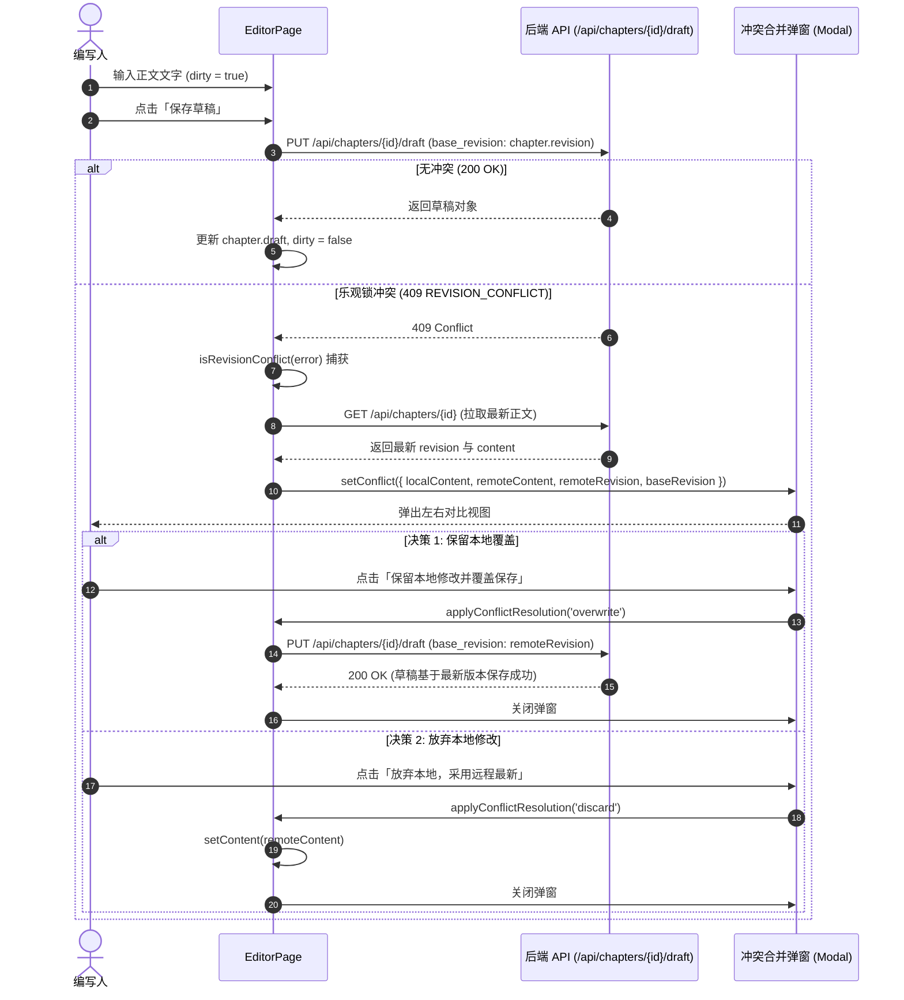

为什么有这个文件：说明 APP-M2-T162 编辑台段落保存、实时字数统计与 OCC 409 冲突合并的具体实现架构、状态流转、纯函数抽象与组件契约。

它解决什么问题：
1. 建立段落编写实时字数统计与方案目标字数（`target_length`）偏离诊断机制，提供区间进度百分比与符合状态提示；
2. 建立精准脏状态检测（`dirty`），并根据“未保存修改”高亮保存草稿按钮；
3. 落实后端 OCC（乐观并发控制）409 版本冲突（`REVISION_CONFLICT`）识别与合并弹窗机制，提供“保留本地修改并覆盖保存”与“放弃本地采用远程最新”两套明确决策分支；
4. 规范未持锁态纯文本呈现（`unheld-editor-view`）与获取编辑锁指引，杜绝未持锁时 textarea 禁用样式的视觉割裂；
5. 保证向后兼容性，保持只读态视图与已有全量测试桩完好无损。

# APP-M2-T162：代码解释

- 对应任务：[APP-M2-T162](../tasks/APP-M2.md#app-m2-t162) · 编辑台段落保存、实时字数统计与 OCC 409 冲突合并
- 关联 Issue：[ISSUE-007](../../issues/ISSUE-007.md) · 编辑台与大纲协作
- 交付文档：[APP-M2-T162 交付](../delivery/APP-M2-T162.md)
- 日期：2026-10-22
- 实际改动与测试路径：
  - [editor-conflict.ts](../../frontend/web/src/editor/editor-conflict.ts)（新增）
  - [EditorPage.tsx](../../frontend/web/src/editor/EditorPage.tsx)（修改）
  - [app-orchestration.test.mjs](../../frontend/web/tests/app-orchestration.test.mjs)（修改）
  - [editor-conflict.test.mjs](../../tests/frontend/editor-conflict.test.mjs)（新增纯逻辑单测）
  - [editor-conflict.test.mjs](../../frontend/web/tests/editor-conflict.test.mjs)（新增组件契约与 AST 测试）

---

## 1. 核心业务痛点与技术决策

### 1.1 痛点与需求
1. **字数无目标比对与失控风险**：标书技术方案或商务应答各章节均在写作方案中设定了预期篇幅（如 1500 字）。以往编辑台仅统计字符总数，缺乏与 `writing_input.target_length` 的对照比对，编写人易写得过少（评分点不充分）或冗长超标（影响总页数控制）；
2. **保存草稿按钮状态模糊**：编写人不知道当前内容相对已保存草稿或正文是否发生修改，保存草稿按钮没有直观的高亮或未保存标签提示；
3. **多人协作 OCC 409 冲突粗暴报错**：在多人协助或跨会话编辑时，如果正文基线版本落后于后端正文（`base_revision != chapter.revision`），后端会返回 409（`REVISION_CONFLICT`）。以往前端仅弹报错通知，编写人花费大量心血编写的文字无法安全保存或智能对比合并；
4. **未持锁态下文本输入框呈现生硬**：在未取得编辑锁时，使用 disabled 的 `Input.TextArea` 容易给用户造成系统卡死或无响应的错觉，且排版视觉较差。

### 1.2 核心技术决策
- **纯函数分层解耦 (`editor-conflict.ts`)**：
  将字数统计算法（`calculateWordCount`）、脏状态检测（`calculateDirtyState`）、409 乐观锁冲突识别（`isRevisionConflict`）以及冲突决策逻辑（`resolveConflictChoice`）提取为无副作用纯函数，杜绝与 React 组件生命周期强绑定，单测覆盖率可达 100%。
- **字数三档状态与进度可视化**：
  定义 `<80%` 为偏少（`below_target`，提示还差多少字）、`80%~120%` 为符合预期（`on_target`，绿色成功态）、`>120%` 为超出上限（`above_target`，黄色警告态并提示精炼）。
- **OCC 409 冲突合并弹窗机制**：
  保存草稿或提交正文捕获 409 异常后，通过 `handleRevisionConflict` 异步拉取后端最新章节，弹出双栏对比对话框（`conflict-resolution-modal`），编写人可直观核对“本地修改”与“服务器最新正文”，并选择：
  - **保留本地修改并覆盖保存**：更新基线版本号至服务器最新版本（`base_revision = conflict.remoteRevision`），重新触发草稿保存；
  - **放弃本地，采用远程最新**：放弃本地暂存内容，载入服务器最新内容并刷新工作区。
- **编辑区三态权限守卫**：
  `isReadOnlyView ? <readonly-editor-view> : !held ? <unheld-editor-view> : <Input.TextArea>`。未持锁态渲染为优雅边框纯文本容器，并在上方悬浮 Alert 引导点击取得编辑权，兼顾美观与操作指引。

---

## 2. 状态流转与调用链

### 2.1 保存草稿与 OCC 409 冲突合并时序

---

## 3. 改动文件明细

### 3.1 `frontend/web/src/editor/editor-conflict.ts`（新增）
- 导出 `calculateWordCount(content, targetLength)`：
  计算当前字符数、目标字数、进度百分比、状态（`below_target` / `on_target` / `above_target` / `no_target`）、Tag 色彩与说明文案；
- 导出 `calculateDirtyState(content, chapterOrDraft, ...)`：
  对比当前编辑文本与基线（若草稿基于当前正式正文版本则以草稿为基线，否则以正式正文为基线），产出 `dirty` 与 `modified`；
- 导出 `isRevisionConflict(error)`：
  识别包含 409 状态码、`REVISION_CONFLICT`、`CHAPTER_CONFLICT` 或消息文本中包含“冲突”的异常；
- 导出 `resolveConflictChoice(choice, context)`：
  生成覆盖或放弃的解析结果与提示信息。

### 3.2 `frontend/web/src/editor/EditorPage.tsx`（修改）
- 顶部工具栏：
  - 增加 `dirty && <Tag color="warning" data-testid="dirty-status-tag">未保存修改</Tag>`；
  - 增加快捷草稿保存按钮 `toolbar-save-draft-btn`；
- 正文编辑区三态化：
  - `isReadOnlyView` 分支：保留 `readonly-editor-view`；
  - `!held` 分支：渲染 `unheld-editor-view`、提示 Alert 及 `unheld-acquire-btn`；
  - 持锁分支：渲染 `Input.TextArea`；
- 编辑台底部指标与操作栏：
  - 渲染 `editor-word-count` 容器、字符与目标进度条（`word-count-progress`）及诊断状态 Tag（`word-count-status-tag`）；
  - `save-draft-btn` 仅在 `dirty && held` 时高亮为 `type="primary"`；
- OCC 409 冲突处理与弹窗：
  - `saveDraft` 与 `commit` 接入 `isRevisionConflict` 拦截；
  - 渲染 `conflict-resolution-modal` 对话框，包含 `conflict-local-content`、`conflict-remote-content`、`conflict-overwrite-btn`、`conflict-discard-btn` 与 `conflict-cancel-btn`。

### 3.3 `frontend/web/tests/app-orchestration.test.mjs`（修改）
- 在 `contextFor` 注入 `...conflicts`，确保独立 VM 环境下测试执行 `EditorPage` 闭包时不发生 `ReferenceError`。

---

## 4. 异常分支与限制说明

1. **未持锁覆盖保存限制**：
   在 409 冲突弹窗中点击“保留本地覆盖”必须以当前账号持有有效编辑锁（`held = true`）为前提；若编辑锁已超时释放，系统将拦截并提示“保留本地覆盖前请先取得编辑权”，防止引发二次并发写入覆盖。
2. **网络中断或后台不可达**：
   若在 409 冲突处理期间拉取最新章节失败，系统回退至标准提示“后台正文或草稿已变化，本次写入未成功。请核对最新版本。”，本地文字继续完整保留在编辑器内存中。
