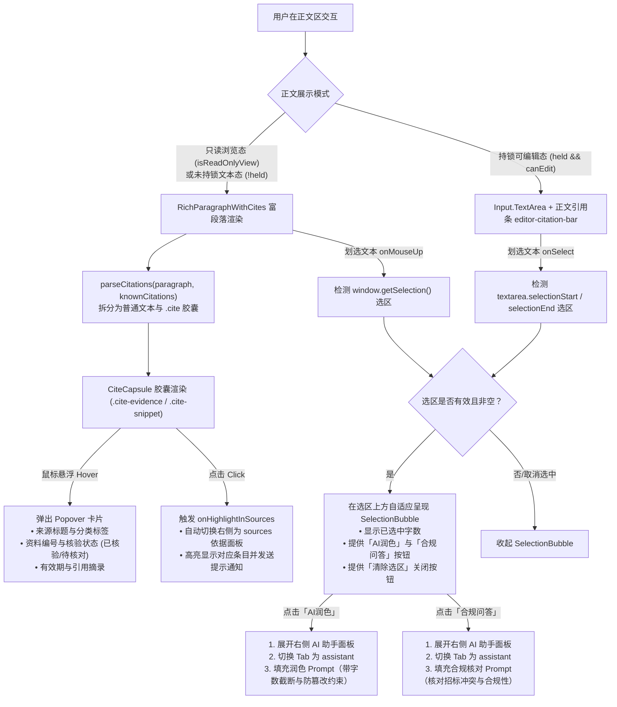

# APP-M2-T165 / APP-M2-T167 证据节点 `.cite` 悬浮与选区快捷气泡代码解释

- 任务编号：[APP-M2-T165](../tasks/APP-M2.md#app-m2-t165)（证据节点与 `.cite`）、[APP-M2-T167](../tasks/APP-M2.md#app-m2-t167)（选区悬浮工具条）
- 关联 Issue：[ISSUE-007](../../issues/ISSUE-007.md)
- 规范出处：[PRD v1.8 §5.11.2～§5.11.10](../../docs/reference/product/prd-mvp-v1.8.md)、架构决策 ADR-002
- 交付报告：[APP-M2-T165 交付文档](../delivery/APP-M2-T165.md)
- 核心代码路径：
  - `frontend/web/src/cite-capsule.ts`
  - `frontend/web/src/CiteCapsule.tsx`
  - `frontend/web/src/SelectionBubble.tsx`
  - `frontend/web/src/EditorPage.tsx`
  - `frontend/web/src/styles.css`
  - `tests/frontend/cite-selection.test.mjs`
  - `frontend/web/tests/cite-selection.test.mjs`

---

## 1. 架构总览与交互流转

在投标文件正文编制与审校场景中，标书正文引用了底层知识库的**资料证据**（如资质、业绩合同、审计报告等，格式为 `[证:ID]`）以及写作方案中的**方案切片**（格式为 `[片:ID]`）。
同时，编写人员在浏览或编辑正文时，通过划词选中关键语句，能够自适应唤起快捷浮动气泡，一键直达“AI润色”或“合规问答”工作流。



---

## 2. 核心模块与实现细节

### 2.1 引用标记提取与分词算法（`cite-capsule.ts`）

- **双引用标记正则契约**：
  ```ts
  export const CITE_REGEX = /\[(证|片):([a-zA-Z0-9_\-.:#]+)\]/g;
  ```
  精准匹配 `[证:ID]`（资料证据，对应后端数据字典与资料库条目）与 `[片:ID]`（方案切片，对应 RAGFlow 片段与方案提纲）。
- **`parseCitations` 纯函数**：
  将输入段落文本拆解为 `TextSegment[]`（`text` 纯文本与 `cite` 结构化引用标记），并结合当前章节的大纲要求或预取元数据（`knownCitations`）完成元数据填充。
- **`extractCitationIds` 汇总统计**：
  利用 ES6 `Set` 对正文中引用的证据 ID 与片段 ID 进行保序去重，生成当前正文的引用清单 `allIds`，用于编辑态正文引用条（`editor-citation-bar`）的自适应渲染。

### 2.2 胶囊徽标与 Popover 悬浮卡片（`CiteCapsule.tsx`）

- **胶囊样式与可访问性声明**：
  - 声明 `data-testid="cite-capsule"`、`data-cite-id={id}`、`data-cite-type={kind}`。
  - 根据引用类型分别附加 `.cite-evidence`（淡蓝科技配色 `#1677ff`）与 `.cite-snippet`（优雅紫色 `#722ed1`）设计语言。
- **Popover 悬浮详情卡片**：
  - 声明 `data-testid="cite-popover-content"`。
  - 呈现资料名称/片段标题、资料编号、核验状态徽标（“已核验” / “待核对”）、有效期至以及原始引用摘录。
  - 提供 `data-testid="cite-highlight-btn"` 交互按钮，点击后调用 `onHighlightInSources` 回调。
- **段落包裹器 `RichParagraphWithCites`**：
  - 按换行符 `\n` 分段并保持原有排版段落间距（`margin: 8px 0`）；
  - 保留语义文本容器与类名，杜绝未持锁与只读态的 DOM 闪烁。

### 2.3 选区划词快捷操作气泡（`SelectionBubble.tsx`）

- **浮动定位与抗失焦设计**：
  - 计算选区边界的矩形（`Range.getBoundingClientRect()` 或 `Textarea` 相对偏移），结合父容器 `editorWrapperRef` 计算相对坐标（`position: absolute`，居中上浮 `translate(-50%, -100%)`）。
  - 在气泡容器上挂载 `onMouseDown={e => e.preventDefault()}`，避免点击气泡内按钮导致正文编辑框或只读选区失焦被清空。
- **操作按钮与契约**：
  - `data-testid="bubble-selected-count"`：实时呈现选中字符数；
  - `data-testid="bubble-polish-btn"`：一键将选区文字带入 AI 润色流程；
  - `data-testid="bubble-compliance-btn"`：一键将选区文字带入合规问答流程；
  - `data-testid="bubble-clear-btn"`：一键清除当前选区并收起气泡。

### 2.4 编辑台集成与双向联动（`EditorPage.tsx`）

- **选区事件双向感知**：
  - 在 `Input.TextArea` 上绑定 `onSelect={handleTextareaSelect}`；
  - 在只读浏览视图与未持锁纯文本视图容器上绑定 `onMouseUp={handleContainerMouseUp}`；
  - 划选文字且长度大于 0 时唤起气泡，未划选时自动收起。
- **与 AI 助手无缝打通**：
  - 当触发润色或合规问答时，调用 `setAssistantCollapsed(false)` 确保右侧助手面板自动展开，无需用户额外点击。
  - 自动切换右侧面板到 `'assistant'` Tab，并将模板化提示词填入输入框，同时弹出轻量提示 Notice。
- **可编辑态正文引用条（`data-testid="editor-citation-bar"`）**：
  - 当正文输入或删除 `[证:xxx]` 时，`detectedCitations` 响应式更新；
  - 仅在有引用时展示引用条，便于编写人在编辑正文时随时查看正文已引用的资料依据。

---

## 3. 改动文件列表

| 文件路径 | 改动类型 | 说明 |
|---|---|---|
| `frontend/web/src/cite-capsule.ts` | 新建 | 正则分词、元数据合并与 ID 提取纯逻辑工具 |
| `frontend/web/src/CiteCapsule.tsx` | 新建 | `CiteCapsule` 悬浮卡片与 `RichParagraphWithCites` 富段落组件 |
| `frontend/web/src/SelectionBubble.tsx` | 新建 | `SelectionBubble` 选区悬浮操作条组件 |
| `frontend/web/src/styles.css` | 修改 | 添加气泡浮动、淡入动效与 `.icg-cite` 悬浮色彩样式 |
| `frontend/web/src/EditorPage.tsx` | 修改 | 正文区挂载选区气泡、只读态富段落、编辑态引用条与事件联动 |
| `tests/frontend/cite-selection.test.mjs` | 新建 | 纯逻辑单测：正则分词、ID 提取、提示词格式化 |
| `frontend/web/tests/cite-selection.test.mjs` | 新建 | AST 静态契约单测：组件导出、`data-testid` 与挂载断言 |

---

## 4. 边界异常分支与防御措施

1. **空选区或纯空白文本**：
   - 用户双击或划选仅包含空格、制表符或换行符时，`trimmed.length === 0`，自动拦截不弹出气泡。
2. **长文本提示词防膨胀与防截断**：
   - 当用户划选超过 100 字的长段落时，提示词使用 `.slice(0, 100)...` 友好展示，避免助手的单行 prompt 溢出破损。
3. **弹窗绝对定位出界保护**：
   - 使用 `Math.max(8, position.top)` 与 `Math.max(16, position.left)` 进行视口与容器边界保护，避免浮动条超出文档纸张顶部。
4. **只读权限容器类名不破损**：
   - 保持 `readonly-editor-text` 与 `unheld-editor-text` 的类名和 `data-testid` 完整，完全兼容原有数据权限及只读拦截断言。
