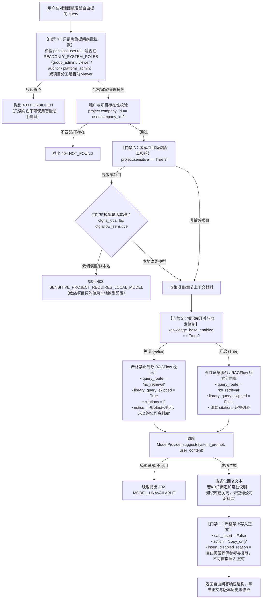

# 为什么有这个文件：说明智能对话助手自由问答（APP-M2-T179）的技术实现、四道安全门禁、数据流转与契约规范。
# 它解决什么问题：
# 1. 门禁 1（禁止写入正文）：自由问答响应中 can_insert 必须恒定为 False，action="copy_only"，绝不返回直接插入正文或段落替换操作，仅支持前端复制，杜绝非授权内容污染正式章节；
# 2. 门禁 2（知识库关闭常驻说明）：当 knowledge_base_enabled=False 时，严格禁止外呼 RAGFlow 检索公司库，并在回答中保持常驻说明“知识库已关闭，未查询公司资料库”，绝不编造虚假的公司资质或业绩数据；
# 3. 门禁 3（敏感项目模型隔离）：若当前项目为敏感项目（sensitive=True 或 is_sensitive=True），必须强制使用本地模型运行时；企图绑定或调用云端模型时，严格触发 403 SENSITIVE_PROJECT_REQUIRES_LOCAL_MODEL；
# 4. 门禁 4（只读角色提问拦截）：只读角色（group_admin、viewer、auditor、platform_admin）及项目只读成员尝试发起自由提问时，统一拦截拒绝（403 FORBIDDEN）。

# APP-M2-T179 自由问答（只“复制”与安全隔离）代码解释

- 任务编号：[APP-M2-T179](../tasks/APP-M2.md#app-m2-t179)
- 关联 Issue：[ISSUE-007](../../issues/ISSUE-007.md)
- 规范出处：[PRD v1.8 §5.11.3～5.11.6、§5.11.11](../../docs/reference/product/prd-mvp-v1.8.md)
- 交付报告：[APP-M2-T179 交付](../delivery/APP-M2-T179.md)
- 核心代码路径：
  - `backend/bid-core/icg_demo/answer_card.py`
  - `backend/bid-core/icg_demo/workflow.py`
  - `tests/backend/test_general_chat_qa.py`

---

## 1. 架构总览与业务数据流

当用户在智能对话助手输入框直接发起自由提问（未划选正文段落）时，系统通过 `AnswerCardService.general_chat`（同时提供别名 `ask_assistant`，并在 `WorkflowService` 暴露统一门面）调度问答流程。全流程贯穿四道安全与业务门禁：



---

## 2. 四道安全门禁核心实现

### 2.1 门禁 1（禁止写入正文，只“复制”）
依据 PRD §5.11.4 规则：自由提问只回答问题，回答下方不出现写入按钮，只提供“复制”。
在后端返回体中严格固化：
```python
"can_insert": False,
"insert_disabled_reason": "自由问答仅供参考与复制，不可直接插入正文",
"action": "copy_only",
"answer_card": None,
```
- 没有任何直接插入章节正文、段落替换或锁定租约的副作用；
- 若调用方企图调用 `insert_answer_card` 强行写入自由问答内容，将被底层门禁拦截抛出 `403 FORBIDDEN` 或 `409 EVIDENCE_NOT_USABLE`。

### 2.2 门禁 2（知识库关闭常驻说明与零外呼）
依据 PRD §5.11.4 第 2 点与 §5.11.15 规则：
- 当 `knowledge_base_enabled=False` 时：
  - **零外呼**：严格不调用 RAGFlow 检索公司库，避免发生离线环境下的网络挂起或外部泄密；
  - **状态标志**：`query_route="no_retrieval"`，`library_query_skipped=True`，`citations=[]`；
  - **常驻说明**：在 `notice` 提示与 `reply` 正文末尾持久附带常驻说明：“知识库已关闭，未查询公司资料库”；
  - **杜绝捏造**：模型系统 Prompt 强约束“若知识库未开启或未检索到公司资料，严禁自行捏造虚假的公司资质编号、人员身份或业绩合同”。

### 2.3 门禁 3（敏感项目模型隔离）
依据 PRD §6.4、§6.5 与 ISSUE-024 约定：
- 敏感项目（`project.sensitive=True` 或 `project.is_sensitive=True`）涉及国家机密或企业绝密投标数据；
- 强行核查绑定的模型配置（`state.project_model_configs` 或公司默认配置）：
  ```python
  if is_sensitive:
      bound_id = state.project_model_configs.get(project_id)
      cfg = state.model_configs.get(bound_id) if bound_id else state.model_configs.get(f"default-{project.company_id}")
      if cfg is not None:
          if not getattr(cfg, "is_local", False) or not getattr(cfg, "allow_sensitive", False):
              raise DomainError(403, "SENSITIVE_PROJECT_REQUIRES_LOCAL_MODEL", "敏感项目只能使用本地模型配置。")
      else:
          provider = self.demo.model_provider
          if getattr(provider, "is_local", False) is False and getattr(provider, "is_real_model", None) is not False:
              raise DomainError(403, "SENSITIVE_PROJECT_REQUIRES_LOCAL_MODEL", "敏感项目只能使用本地模型。")
  ```
- 企图将敏感项目路由至云端大模型时，前置强行拦截并返回标准的 `403 SENSITIVE_PROJECT_REQUIRES_LOCAL_MODEL`。

### 2.4 门禁 4（只读角色提问拦截）
依据 PRD §2.3 角色矩阵与八角色规范：
- 集团管理员（`group_admin`）跨公司只读，“集团管理员不能使用对话助手”；
- 审计员（`auditor`）、只读成员（`viewer`）与平台管理员（`platform_admin`）属于只读系统角色（`READONLY_SYSTEM_ROLES`）；
- 项目团队成员分工中标记为 `viewer` 的只读成员亦无权使用助手提问；
- 调用时统一拦截阻断并抛出 `403 FORBIDDEN`（“只读角色不可使用智能助手提问。”）。

---

## 3. 错误码与 HTTP 状态严格冻结映射

| 业务错误码 | HTTP 状态 | 触发场景 |
|---|---|---|
| `FORBIDDEN` | 403 | 集团管理员、审计员、只读成员或项目只读成员发起自由提问 |
| `SENSITIVE_PROJECT_REQUIRES_LOCAL_MODEL` | 403 | 敏感项目配置或使用了云端/非本地模型运行时 |
| `NOT_FOUND` | 404 | 访问不存在的项目或跨公司租户非法越权访问 |
| `MODEL_UNAVAILABLE` | 502 | 下游大模型推理服务异常或超时 |

---

## 4. 自动化测试验证

创建专属单元测试 `tests/backend/test_general_chat_qa.py`，10 项测试全部通过：
1. `test_gate_1_copy_only_and_no_writing`：验证门禁 1，`can_insert=False`、`action='copy_only'`，正文与章节修订号绝对未变；
2. `test_gate_2_kb_disabled_zero_retrieval_and_persistent_notice`：验证门禁 2，知识库关闭时零外呼检索，常驻说明文案精准注入；
3. `test_gate_2_kb_enabled_retrieval_and_citations`：验证门禁 2，知识库开启时正常执行检索并附加候选切片引用；
4. `test_gate_3_sensitive_project_blocks_cloud_model`：验证门禁 3，敏感项目绑定云端模型时强拦截抛出 403 `SENSITIVE_PROJECT_REQUIRES_LOCAL_MODEL`；
5. `test_gate_3_sensitive_project_allows_local_model`：验证门禁 3，敏感项目绑定合格本地离线模型配置时正常放行；
6. `test_gate_4_readonly_roles_interception`：验证门禁 4，4 类系统只读角色发起自由提问时全量拦截抛出 403 `FORBIDDEN`；
7. `test_gate_4_project_member_viewer_interception`：验证门禁 4，项目级只读分工成员拦截抛出 403 `FORBIDDEN`；
8. `test_cross_tenant_isolation`：跨租户项目提问鉴权隔离拦截（404 `NOT_FOUND`）；
9. `test_model_failure_mapped_to_502`：模型异常映射验证（502 `MODEL_UNAVAILABLE`）；
10. `test_workflow_service_delegation`：验证 `WorkflowService.general_chat` 与 `ask_assistant` 正确委派。

助手全链路 4 套单测联合执行：**47 passed, 0 failed**。
后端全量回归：**532 passed, 37 skipped, 0 failed**，100% 离线纯洁性。
