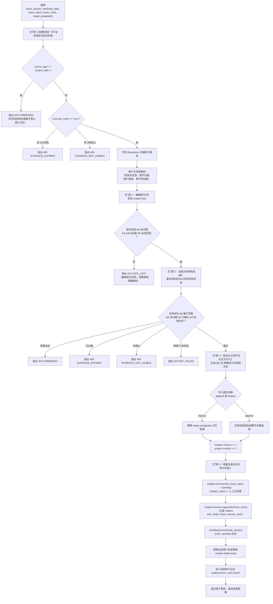

# 为什么有这个文件：说明插入为引用（APP-M2-T183）的技术实现、四道安全门禁、数据流转与契约规范。
# 它解决什么问题：
# 1. 门禁 1（编辑锁守卫）：验证调用方持有目标章节的有效编辑租约（若无租约、租约过期、令牌不匹配或跨会话所有者不符，抛出 423 LOCK_LOST）；
# 2. 门禁 2（卡片类型与资格拦截）：
#    - 仅 source_type="company_library" 且 can_insert=True 的合格资料卡允许执行插入；
#    - 本项目数据卡（source_type="project_data"）严格禁止插入正文（抛出 403 FORBIDDEN）；
#    - 已过期（409 EVIDENCE_EXPIRED）、受限无权（403 FORBIDDEN）或未确认/不可用（409 EVIDENCE_NOT_USABLE）严格禁止插入；
# 3. 门禁 3（引用标记与正文写入）：
#    - 将资料内容格式化为带溯源标识的引用节点（[证:ID]），写入目标段落（追加 append 或替换 replace），正文 revision 与项目 revision 原子自增；
# 4. 门禁 4（增量复查标记与审计历史）：
#    - 插入完成后，章节 incremental_check_status 置为 "pending"，工作流章节状态置为 "人工已处理"；
#    - 生成版本历史变更记录（edit_mode="insert_answer_card", version_origin="assistant_edit", 包含完整 citation 信息）；
#    - 触发增量复查任务记录（incremental_checks 记录），清理草稿，生成审计日志。

# APP-M2-T183 插入为引用：差异视图、写入、引用标记代码解释

- 任务编号：[APP-M2-T183](../tasks/APP-M2.md#app-m2-t183)
- 关联 Issue：[ISSUE-007](../../issues/ISSUE-007.md)
- 规范出处：[PRD v1.8 §5.11.15 规则 4、§5.11.6、§5.11.9](../../docs/reference/product/prd-mvp-v1.8.md)
- 交付报告：[APP-M2-T183 交付](../delivery/APP-M2-T183.md)
- 核心代码路径：
  - `backend/bid-core/icg_demo/answer_card.py`
  - `backend/bid-core/icg_demo/workflow.py`
  - `tests/backend/test_insert_answer_card.py`
  - `tests/backend/test_answer_cards.py`

---

## 1. 架构总览与四道门禁流水线

当用户在智能对话助手界面将卡片内容“插入为引用”写入章节时，后端统一通过 `AnswerCardService.insert_answer_card`（经由 `WorkflowService.insert_answer_card` 门面调用）执行原子操作。流程严格贯穿 4 道安全与业务门禁：



---

## 2. 关键核心实现

### 2.1 卡片源类型标记与构造（`AnswerCard`）

在 `backend/bid-core/icg_demo/answer_card.py` 中，扩展数据模型 `AnswerCard` 显式标明 `source_type`：
- 本项目结构化数据卡（招标要求、项目事实、响应矩阵、检查结果）：`source_type="project_data"`，`can_insert=False`，`insert_disabled_reason="本项目数据不插入正文"`。
- 本公司资料库卡（人员证书、公司资质、业绩合同、SLA服务承诺）：`source_type="company_library"`，仅当包含已确认且未过期的有效条目时 `can_insert=True`。

### 2.2 门禁 1：编辑锁守卫（`LOCK_LOST`）

写入前必须持有合法有效的独占排他编辑锁：
```python
lease = chapter.lock
now = self.demo._now()
if (lease is None or lease.expires_at <= now
        or lease.token != lease_token
        or lease.owner_id != principal.user.id
        or lease.session_token != principal.session_token):
    raise DomainError(423, "LOCK_LOST", "编辑权已失效，请重新取得编辑权后再操作。")
```
- 无锁、锁超时、token 不匹配、拥有者不符或跨会话操作一律即时拦截并抛出 `423 LOCK_LOST`。

### 2.3 门禁 2：卡片类型与实体资格拦截

双重防护：
1. **外层前置拦截**：
   - 卡片来源不是 `company_library`（如 `project_data`）：立即抛出 `403 FORBIDDEN`（本项目结构化数据卡禁止插入正文）。
   - 卡片标记为 `can_insert=False`：若是过期原因抛出 `409 EVIDENCE_EXPIRED`，未确认原因抛出 `409 EVIDENCE_NOT_USABLE`。
2. **内层真实实体核验**（防止前端伪造 `can_insert=True` 绕过）：
   - 核对 `state.library[target_item_id]` 或 `state.sla_templates[target_item_id]`；
   - 跨租户资料：抛出 `404 NOT_FOUND`；
   - 受限资料（`is_restricted=True`）：校验 `_restricted_allowed`，无权则抛出 `403 FORBIDDEN`；
   - 状态未确认：抛出 `409 EVIDENCE_NOT_USABLE`；
   - 效期早于项目截止日期：抛出 `409 EVIDENCE_EXPIRED`。

### 2.4 门禁 3：引用标记格式化与正文写入

依据 PRD §5.11.15 规则 4，生成的引用标签与正文格式规范统一：
- 溯源引用标记：`[证:{target_item_id}]`
- 内容格式化：
  - 人员/证书：`[证:ID] {人员描述}（有效期至 {valid_until}）`
  - 公司资质：`[证:ID] 公司持有{资质名称}（有效期至 {valid_until}）。`
  - 业绩合同：`[证:ID] 公司具备同类业绩：{合同名称}（{合同描述}）。`
  - SLA服务承诺：`[证:ID] 公司提供 SLA 服务承诺：{模板名}（一级响应时限...）。`
- 写入模式：
  - `replace`：精准替换目标占位段落（`target_paragraph`）；
  - `append`：追加至目标段落后或章节正文末尾；
- 事务内同步自增 `chapter.revision += 1` 和 `project.revision += 1`。

### 2.5 门禁 4：增量复查标记与审计历史

写入成功后：
1. **状态流转**：
   - 章节 `incremental_check_status = "pending"`
   - 工作流章节状态 `chapter_statuses[chapter.id] = "人工已处理"`
   - 增量检查队列 `workflow["incremental_checks"][chapter.id]` 记录当前修订号、引用 ID、时间戳。
2. **版本历史变更记录**：
   - 向 `chapter.versions` 追加版本条目，携带 `edit_mode="insert_answer_card"`、`version_origin="assistant_edit"`、`citation` 结构化对象与当前增量复查状态。
3. **草稿清理与审计日志**：
   - 清除当前用户在当前章节的未保存草稿：`chapter.drafts.pop(principal.user.id, None)`；
   - 记录系统级审计日志：`audit("answer_card.insert", details)`。

---

## 3. 错误码与 HTTP 状态严格冻结映射

本模块严格遵守系统统一冻结错误码规范（`errors.py` 与 `frozen_error_codes.py`）：

| 业务错误码 | HTTP 状态 | 触发场景 |
|---|---|---|
| `LOCK_LOST` | 423 | 缺少编辑租约、租约过期、令牌不匹配或跨会话所有者不符 |
| `FORBIDDEN` | 403 | 尝试插入本项目结构化数据卡；普通编写人尝试引用受限保密资料 |
| `NOT_FOUND` | 404 | 项目或章节不存在；引用了跨租户资料或不存在的资料记录 |
| `EVIDENCE_EXPIRED` | 409 | 引用的资料有效期早于项目投标截止日期 |
| `EVIDENCE_NOT_USABLE` | 409 | 引用的资料未通过人工核实确认（状态为 pending）或缺少必填标识 |

---

## 4. 自动化测试验证

创建专属单元测试 `tests/backend/test_insert_answer_card.py`，12 项测试全部通过：
1. `test_insert_answer_card_success_append`：合格公司证书卡追加模式成功插入，全面核验 4 道门禁状态、正文变更、版本条目、工作流增量标记与草稿清理；
2. `test_insert_answer_card_success_replace`：合格资质卡替换模式精准替换占位段落；
3. `test_insert_answer_card_sla_template`：SLA 服务承诺卡片插入格式化与响应时限格式验证；
4. `test_gate_1_missing_or_empty_lease`：无编辑锁拦截（423 LOCK_LOST）；
5. `test_gate_1_expired_lease`：编辑锁超时拦截（423 LOCK_LOST）；
6. `test_gate_1_mismatched_token_or_other_user_lease`：非持有者/跨会话令牌拦截（423 LOCK_LOST）；
7. `test_gate_2_project_data_strictly_forbidden`：本项目结构化数据卡（招标要求、项目事实、矩阵、检查）全量拦截（403 FORBIDDEN）；
8. `test_gate_2_expired_evidence_blocked`：过期资料卡前置与后端双重拦截（409 EVIDENCE_EXPIRED）；
9. `test_gate_2_unconfirmed_evidence_blocked`：未确认资料卡前置与后端双重拦截（409 EVIDENCE_NOT_USABLE）；
10. `test_gate_2_restricted_evidence_unauthorized_blocked`：未授权受限资料插入拦截（403 FORBIDDEN）；
11. `test_cross_tenant_and_not_found_isolation`：跨租户资料、跨项目章节隔离校验（404 NOT_FOUND）；
12. `test_workflow_service_delegation`：WorkflowService 统一门面方法正确委托与输出验证。

联合全量回归测试：**522 passed, 31 skipped, 0 failed**，保证 100% 离线纯洁性。
