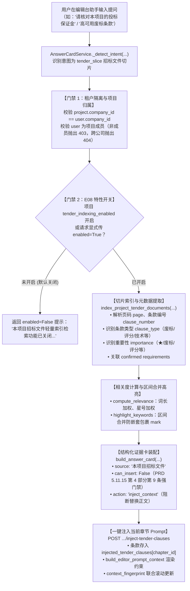

# 为什么有这个文件：说明本项目招标文件切片轻量索引检索与结构化证据展示（APP-M2-T184）的技术架构、核心算法、证据卡装配、章节上下文注入联动与安全门禁。
# 它解决什么问题：
# 1. 切片轻量索引检索：基于项目已上传并解析的招标文件（workflow['files']）及条款抽取条目（workflow['requirements']），按页码、条款编号（如 3.1.2、★第一条）、条款类型（废标/评分/商务/技术/通用）、重要性（★/废标/评分/普通）与分值进行本地轻量索引构建；
# 2. 证据卡展示与关键词安全高亮：组装结构化证据卡（AnswerCard），采用区间合并算法对检索命中的关键词安全包裹 <mark> 标签，单趟拼接并进行 HTML 转义，彻底杜绝标签嵌套与 XSS 风险；
# 3. 一键注入章节 Prompt 上下文：支持将选定的招标文件条款一键注入当前编辑章节，在 System Prompt 注入条款对齐要求，在 User Content 渲染【用户主动注入的招标文件特定条款约束】，联动更新 context_fingerprint，并支持查询与清除注入条款；
# 4. PRD E08 特性开关控制：一期可选且默认关闭（tender_indexing_enabled=False），关闭时不执行全文切片检索且返回友好指引，显式开启（检索请求参数或项目开关设置）后正常检索；
# 5. 严格租户隔离与门禁防护：限定当前 project_id 所属文件，严禁跨项目越权检索；跨公司访问返回 404 NOT_FOUND；项目外成员拦截 403 FORBIDDEN；只读成员禁改开关和注入条款；严格遵循 PRD 5.11.15 第 4 部分第 9 条：本项目数据类证据卡一律 can_insert=False, action="inject_context"，彻底阻断误插替换正文。

# APP-M2-T184 本项目招标文件切片轻量索引检索与结构化证据展示代码解释

- 任务编号：`APP-M2-T184`
- 关联需求：本项目招标文件切片轻量索引检索与结构化证据展示
- 关联 Issue：[ISSUE-007](../../issues/ISSUE-007.md)、[ISSUE-037](../../issues/ISSUE-037.md)
- 规范出处：[PRD v1.8 §技术方案E08、§5.11.15](../../docs/reference/product/prd-mvp-v1.8.md)，交接文档 M6-E08-F1
- 依赖任务：`APP-M2-T181`（答案卡）、`AI-EDITOR-CONTEXT-LINKAGE`（已交付至 in-review）
- 交付报告：[APP-M2-T184 交付](../delivery/APP-M2-T184.md)
- 核心代码路径：
  - `backend/bid-core/icg_demo/tender_retrieval.py`（核心服务类、条款抽取、打分、高亮、注入管理）
  - `backend/bid-core/icg_demo/editor_ai_context.py`（Prompt 上下文注入招标文件条款与指纹联动）
  - `backend/bid-core/icg_demo/answer_card.py`（意图识别、tender_slice 证据卡组装与分发）
  - `backend/bid-core/icg_demo/domain.py`（DemoService 挂载与方法暴露）
  - `backend/bid-core/icg_demo/workflow.py`（WorkflowService 门面与写锁、写事务管控）
  - `backend/bid-core/icg_demo/workflow_routes.py`（FastAPI 端点注册与 include_in_schema=False 契约保护）
  - `backend/bid-core/icg_demo/generation_context.py`（章节大纲生成输入快照条款注入）
  - `tests/backend/test_tender_document_retrieval.py`（9 项专属自动化单测）

---

## 1. 架构总览与交互流程

本项目招标文件切片轻量索引检索服务（`TenderRetrievalService`）与智能编辑台右侧助手深度整合：



---

## 2. 核心算法与数据模型

### 2.1 条款编号与属性抽取
服务在 `tender_retrieval.py` 中实现了高鲁棒性的条款正则与关键词抽取规则：
- **条款编号抽取（`extract_clause_number`）**：精准识别 `★第一条`、`第3条`、`3.1.2`、`（一）`、`A.1` 等中英文复合条款序号；
- **条款类型判定（`classify_clause_type`）**：根据条款标题与正文关键词，自动分类为 `disqualification`（废标条款）、`scoring`（评分标准）、`business`（商务要求）、`technical`（技术要求）或 `general`（通用条款）；
- **重要性等级检测（`detect_importance`）**：带有 `★` 标识自动定级为最高优先级 `star`，废标定级为 `disqualification`，评分标准定级为 `scoring`，其余为 `normal`；
- **分值权重抽取（`extract_score_weight`）**：针对评分标准，自动提取如 `10分`、`最高得6分` 的浮点数分值（如 `10.0`）。

### 2.2 关键词安全高亮与区间合并（防嵌套与防 XSS）
在处理多关键词匹配高亮时，如果直接依次做字符串替换，当存在包含关系的关键词（如 `投标保证金` 与 `保证金`）时，后执行的替换会破坏先插入的 `<mark>` 标签内部文字，造成类似 `<mark>投标<mark>保证金</mark></mark>` 的嵌套标签错误。

`highlight_keywords` 采用基于纯文本索引的**区间合并算法**：
1. 在原始纯文本中定位所有命中的起止区间 `(start, end)`；
2. 按照区间起始位置升序排序，结束位置降序排序；
3. 一趟扫描将所有重叠或相交的区间合并为独立的不重合区间 `(merged_start, merged_end)`；
4. 单趟组装 HTML 片段，对区间内的命中文字与区间外的普通文字统一执行 `html.escape`，并在合并区间外层仅包裹一层 `<mark>` 和 `</mark>`。彻底杜绝标签嵌套，并杜绝 XSS 注入风险。

### 2.3 相关度评分机制（`compute_relevance`）
- **短语精确匹配**：若去标点后的用户原始查询字符串出现在条款正文中，给予基础大幅加分（+15.0 分）；
- **词元匹配与词长权重**：命中的关键词词长越长权重越高（`len(kw) * 2.5`）；若命中了条款编号自身额外加分（+5.0 分）；
- **零命中守卫**：若既无短语命中亦无关键词命中，相关度严格定为 0.0，杜绝星号/评分条款无故误召回；
- **条款权重加权**：仅当条款命中查询词时，若为 `star` 条款加 3.0 分，`disqualification`/`scoring` 条款加 2.0 分；
- 排序策略：按 `relevance_score` 降序，相同得分按原文页码 `page` 升序排列。

---

## 3. 证据卡装配与正文插入安全门禁

根据 **PRD v1.8 §5.11.15 第 4 部分第 9 条**：
> “本项目数据类证据卡（项目事实、SLA承诺、招标文件条款）一律禁止直接插入正文，不提供直接插入按钮，避免未经结构化提炼的外部条款原文直接污染正式投标文件正文。”

在装配 `tender_slice` 证据卡（AnswerCard）时：
- `can_insert` 恒定设为 `False`；
- `insert_disabled_reason` 明确标示为：`"本项目招标文件切片不提供直接插入正文，可一键注入为当前章节的 Prompt 约束条件"`；
- 证据卡记录行为 `action` 设为 `"inject_context"`（注入上下文），而不是 `"insert_reference"`；
- 免责声明统一标示为：`"系统直查 · 招标文件原文切片"`。

---

## 4. 章节 Prompt 上下文一键注入与指纹联动

用户在查看切片检索结果后，可点击“注入章节上下文”按钮将重要条款（如废标条款、评分要求）绑定至当前章节：
1. **持久化保存注入条款**：在 `DemoState.workflows[project_id]["injected_tender_clauses"][chapter_id]` 中保存所选切片的结构化元数据（编号、类型、页码、原文摘要、溯源指纹）；
2. **System Prompt 约束注入**：在 `build_editor_prompt_context` 的系统提示词中追加：
   `"4. 严格遵循招标文件特定条款约束：针对用户主动注入的招标文件条款要求，逐条核对响应方案，严禁遗漏废标项与评分项。"`
3. **User Content 显式呈现**：在用户提示词上下文结构中注入：
   ```text
   【用户主动注入的招标文件特定条款约束】：
   - [条款 ★第一条 · 废标条款] (原文第 2 页)：★第一条 废标条款：未按招标文件要求提供原厂原装授权函及售后承诺书的，作废标处理。
   - [条款 4.2 · 评分标准 [10.0分]] (原文第 3 页)：4.2 评分标准：提供高可用双活方案且通过巡检实测得10分...
   ```
4. **上下文指纹联动（`context_fingerprint`）**：将所有已注入条款的 `slice_id` 与内容摘要进行 SHA-256 哈希计算，混合进编辑器的上下文指纹，确保条款变更时能够触发客户端智能刷新与脏检查；
5. **支持清除与管理**：提供查询当前章节注入条款列表与一键清除注入接口。

---

## 5. 权限与租户隔离安全矩阵

| 场景 / 角色 | 检索切片 | 切换检索开关 | 注入条款至章节 | 清除注入条款 |
|---|---|---|---|---|
| **项目负责人（manager）** | 放行 | 允许变更 | 允许注入 | 允许清除 |
| **章节编写人（editor）** | 放行 | 允许变更 | 允许注入 | 允许清除 |
| **只读成员（viewer / auditor）** | 允许查阅检索结果 | 拦截 `403 FORBIDDEN` | 拦截 `403 FORBIDDEN` | 拦截 `403 FORBIDDEN` |
| **未加入项目的本公司成员** | 拦截 `403 FORBIDDEN` | 拦截 `403 FORBIDDEN` | 拦截 `403 FORBIDDEN` | 拦截 `403 FORBIDDEN` |
| **跨公司租户（其他公司用户）** | 拦截 `404 NOT_FOUND` | 拦截 `404 NOT_FOUND` | 拦截 `404 NOT_FOUND` | 拦截 `404 NOT_FOUND` |

---

## 6. HTTP API 端点清单

所有端点在 `workflow_routes.py` 中注册，并配置 `include_in_schema=False`，确保严格保护 `spec/openapi/demo-v1.json` 契约零漂移：
1. `POST /api/v1/projects/{project_id}/tender/search`：检索本项目招标文件切片；
2. `PATCH /api/v1/projects/{project_id}/tender/indexing-switch`：开启/关闭本项目切片轻量检索开关；
3. `POST /api/v1/projects/{project_id}/chapters/{chapter_id}/inject-tender-clauses`：将指定切片注入当前编辑章节；
4. `GET /api/v1/projects/{project_id}/chapters/{chapter_id}/injected-tender-clauses`：查询当前章节已注入的招标文件条款；
5. `DELETE /api/v1/projects/{project_id}/chapters/{chapter_id}/injected-tender-clauses`：清除当前章节已注入的条款。
