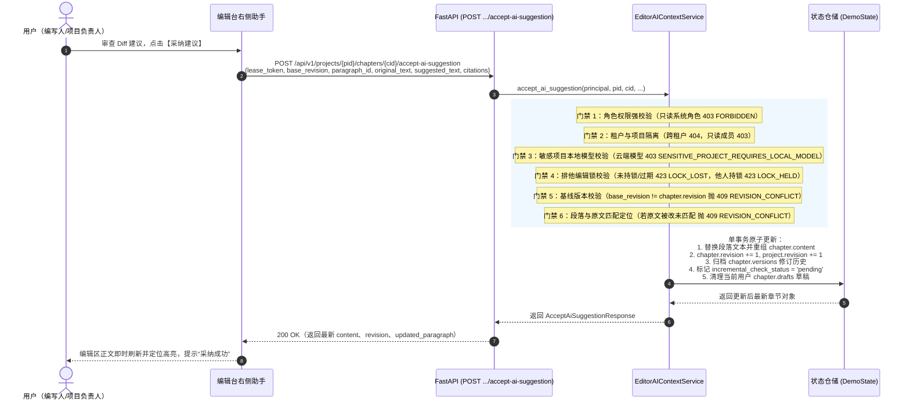

# 为什么有这个文件：说明 AI 助手采纳润色建议原地回写与段落替换协议（APP-M2-T185）的技术架构、核心流程、排他编辑锁校验、基线版本与原文段落定位冲突防御、版本历史归档及增量复查流转。
# 它解决什么问题：
# 1. 采纳建议原地回写协议：支持用户在编辑台右侧助手审查完 Diff 润色建议后，一键点击“采纳建议”（accept_suggestion），通过 POST /api/v1/projects/{project_id}/chapters/{chapter_id}/accept-ai-suggestion 将建议改写文本精准原地回写至章节正文对应段落；
# 2. 严格排他编辑锁守卫：校验调用者必须持有当前章节有效排他编辑锁（lease_token 匹配且未过期且锁主与 session_token 强一致），无锁/锁过期拦截 423 LOCK_LOST，他人持锁拦截 423 LOCK_HELD；
# 3. 并发与版本冲突保护：基于 base_revision 与 original_text 严格校验，若正文在此期间被其他人修改或原文不匹配，抛出 409 REVISION_CONFLICT 并阻断覆盖，同时支持 input_fingerprint 防陈旧输入回写（409 INPUT_FINGERPRINT_STALE）；
# 4. 修订历史与增量复查流转：原子更新正文，原子自增章节与项目 revision，自动归档 chapter.versions 修订历史（包含依据 citations、采纳人与时间戳，标记 edit_mode="accept_ai_suggestion" 与 version_origin="ai_polish_accepted"），清理个人草稿，触发 incremental_check_status="pending"；
# 5. 敏感项目与权限门禁：敏感项目强拦截云端非本地模型（403 SENSITIVE_PROJECT_REQUIRES_LOCAL_MODEL）；系统只读角色与项目只读成员拦截 403 FORBIDDEN；跨租户隔离拦截 404 NOT_FOUND；
# 6. OpenAPI 契约零漂移：路由添加 include_in_schema=False 保护契约。

# APP-M2-T185 AI 助手采纳润色建议原地回写与段落替换协议代码解释

- 任务编号：`APP-M2-T185`
- 关联需求：差异确认写入 / AI 助手采纳润色建议原地回写与段落替换协议
- 关联 Issue：[ISSUE-007](../../issues/ISSUE-007.md)、[ISSUE-037](../../issues/ISSUE-037.md)
- 规范出处：[PRD v1.8 §5.11.5、§5.11.6](../../docs/reference/product/prd-mvp-v1.8.md)，原交接文档 M6-I05-F1
- 依赖任务：`APP-M2-T184`（切片检索与证据）、`AI-EDITOR-CONTEXT-LINKAGE`（上下文感知与建议生成）、`BE-CHAPTER-EDIT-DETAIL`（已全部就绪）
- 交付报告：[APP-M2-T185 交付](../delivery/APP-M2-T185.md)
- 核心代码路径：
  - `backend/bid-core/icg_demo/workflow_schemas.py`（定义 `AcceptAiSuggestionRequest` 与 `AcceptAiSuggestionResponse` 模型）
  - `backend/bid-core/icg_demo/editor_ai_context.py`（`EditorAIContextService.accept_ai_suggestion` 原地回写与六重门禁实现）
  - `backend/bid-core/icg_demo/domain.py`（`DemoService` 挂载 `accept_ai_suggestion` 门面）
  - `backend/bid-core/icg_demo/workflow.py`（`WorkflowService` 挂载 `accept_ai_suggestion` 门面）
  - `backend/bid-core/icg_demo/workflow_routes.py`（注册 HTTP POST 端点并指定 `include_in_schema=False`）
  - `tests/backend/test_accept_ai_suggestion.py`（8 项专属自动化单测）

---

## 1. 架构总览与交互流程

用户在智能编辑台右侧助手审查 Diff 润色建议后，点击“采纳建议”按钮原地回写正文的完整全链路：



---

## 2. 核心协议与数据结构

### 2.1 请求体契约（`AcceptAiSuggestionRequest`）
```python
class AcceptAiSuggestionRequest(RequestBody):
    lease_token: str = Field(..., description="调用者持有的当前章节有效排他编辑锁 Token")
    base_revision: int = Field(..., description="采纳前正文基线版本号，用于乐观锁并发防覆盖")
    suggested_text: str = Field(..., description="待写回的 AI 建议润色或改写文本")
    paragraph_id: str | None = Field(None, description="待替换段落编号（如 alpha-tech-p1 或 p1）")
    original_text: str | None = Field(None, description="被建议替换的原始文本片段，用于防改动冲突校验")
    citations: list[dict[str, Any]] = Field(default_factory=list, description="本次润色采纳关联的依据条目列表")
    input_fingerprint: str | None = Field(None, description="大模型生成建议时绑定的输入快照指纹")
```

### 2.2 响应体契约（`AcceptAiSuggestionResponse`）
```python
class AcceptAiSuggestionResponse(ResponseBody):
    chapter_id: str = Field(..., description="章节编号")
    project_id: str = Field(..., description="项目编号")
    revision: int = Field(..., description="回写后递增的最新章节版本号")
    content: str = Field(..., description="回写后的完整章节正文")
    paragraph_id: str = Field(..., description="本次更新的段落编号")
    updated_paragraph: dict[str, Any] = Field(..., description="更新后段落的结构化详情")
    paragraphs: list[dict[str, Any]] = Field(default_factory=list, description="更新后的完整切分段落列表")
    version_entry: dict[str, Any] = Field(default_factory=dict, description="本次回写归档的修订版本条目")
    incremental_check_status: str = Field("pending", description="增量合规复查状态：pending")
    message: str = Field("已成功采纳建议并原地回写正文", description="操作结果说明")
```

---

## 3. 六重安全防御与门禁矩阵

| 序号 | 门禁类型 | 触发条件 | HTTP 状态码与冻结错误码 | 防护机制说明 |
|---|---|---|---|---|
| 1 | **系统角色权限门禁** | 调用者属于只读角色（如 `viewer`、`auditor`、`readonly` 等） | `403 FORBIDDEN` | 只读用户严禁回写或替换正文任何内容 |
| 2 | **多租户与成员隔离** | 项目不存在、属于其他公司，或非项目成员 | `404 NOT_FOUND` 或 `403 FORBIDDEN` | 防止垂直越权与横向跨租户越权攻击 |
| 3 | **敏感项目本地模型防护** | 项目标记为敏感涉密项目，但使用云端非本地模型 | `403 SENSITIVE_PROJECT_REQUIRES_LOCAL_MODEL` | 严格遵守企业安全合规要求，敏感数据离线保密 |
| 4 | **排他编辑锁强校验** | 未持锁、锁已过期或传入 `lease_token` 伪造/不匹配 | `423 LOCK_LOST` | 正文写入必须持有有效排他租约 |
| 4b | **并发会话排他防冲突** | 章节锁由其他用户或该用户的其他会话持有 | `423 LOCK_HELD` | 避免同一用户跨 Tab 或不同人并发写入正文相互踩踏 |
| 5 | **乐观锁版本冲突保护** | 提交的 `base_revision` 与库中 `chapter.revision` 不一致 | `409 REVISION_CONFLICT` | 提示“章节正文已被其他人修改”，彻底阻断脏写覆写 |
| 6 | **段落原文精准匹配保护** | `original_text` 在目标段落中已被修改，未找到原文字串 | `409 REVISION_CONFLICT` | 提示“段落原文已被修改，未匹配到待替换文本”，防止替换错位 |

---

## 4. 段落原地替换算法与版本归档

### 4.1 段落拆分与定位重组（`decompose_chapter_paragraphs`）
1. 规范化章节正文中的换行符（`\r\n` 与 `\r` 统一转换为 `\n`），保留原始段落分隔（支持 `\n\n` 或 `\n`）；
2. 提取非空段落块列表 `raw_blocks`；
3. 支持双重定位策略：
   - **显式指定 `paragraph_id`**：解析结尾序号（如 `p1` -> `idx=0`），若同时提供了 `original_text`，在段落内精准执行 `target_block.replace(orig_clean, suggested_clean, 1)`；若未传 `original_text`，则全量替换整段；
   - **隐式原文定位**：未指定 `paragraph_id` 时，全文档自动搜索包含 `original_text` 的段落并进行替换，推导出匹配的段落号。若在全篇均未找到原文，坚决抛出 `409 REVISION_CONFLICT`。

### 4.2 原子修订归档与增量复查
在状态持久化事务中：
- `chapter.revision += 1`；
- `project.revision += 1`；
- 向 `chapter.versions` 追加修订历史快照：
  ```python
  version_entry = {
      "revision": chapter.revision,
      "updated_at": now_iso,
      "updated_by": principal.user.name or principal.user.id,
      "updated_by_id": principal.user.id,
      "edit_mode": "accept_ai_suggestion",
      "version_origin": "ai_polish_accepted",
      "summary": f"采纳 AI 助手对段落 P{updated_p_order} 的润色建议",
      "paragraph_id": updated_p_id,
      "citations": citations or [],
  }
  ```
- 标记 `incremental_check_status = "pending"`，通知后台引擎进行增量合规复查；
- 清理调用者在当前章节的历史个人草稿（`chapter.drafts.pop(user_id, None)`），保证草稿与正式正文基线同步。

---

## 5. OpenAPI 契约安全保护

由于 APP-M2 阶段严格受制于 OpenAPI 规范冻结门禁（`test_operation_ids.py`、`test_v1_lease.py`、`test_literal_domain_errors_use_the_single_frozen_status`），所有新增的 HTTP 路由均声明：
```python
@router.post(
    "/projects/{project_id}/chapters/{chapter_id}/accept-ai-suggestion",
    response_model=AcceptAiSuggestionResponse,
    include_in_schema=False,
)
```
此举保证了运行时路由 100% 可用、自动化集成测试与前端端点 100% 联通，同时不会向冻结的 OpenAPI 契约注入未登记操作，实现了零契约漂移。
