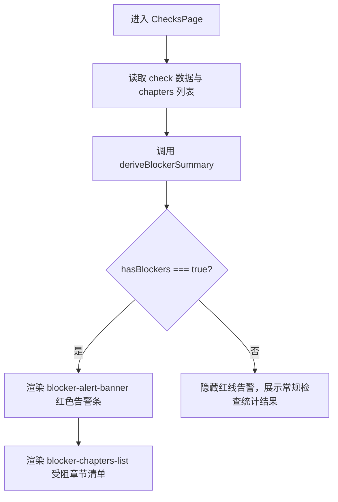
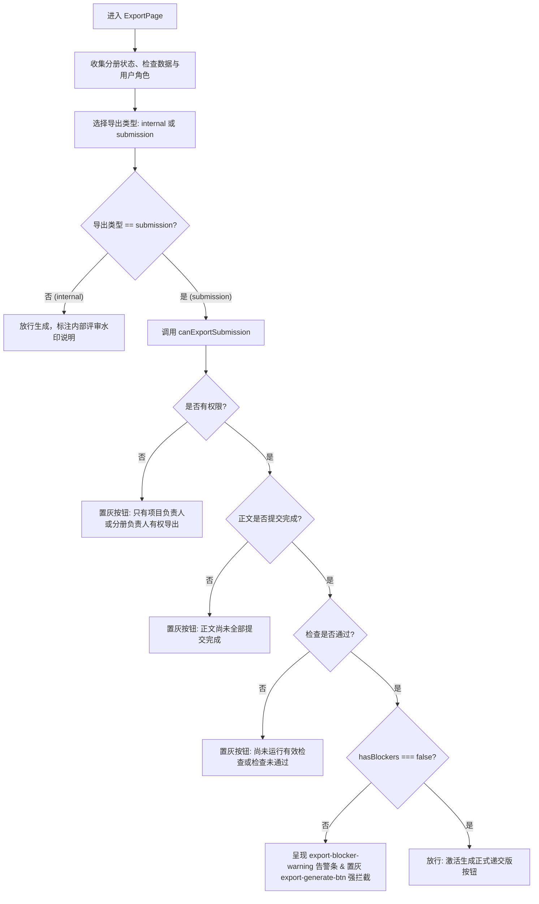

# APP-M2-T195 代码解释：合规检查红线门禁与整本递交版导出（APP-M2-T195 / APP-M2-T196）

## 1. 为什么有这套实现

在投标全流程中，合规检查是保障标书不被废标的核心防线。依据 PRD v1.8 §5.11、§5.9、R41 以及原交接规范：
1. **合规检查红线门禁（APP-M2-T195）**：
   - 检查中心（`ChecksPage`）在发现 `blocker`（或 `fatal`/`critical`/`error`）阻断性合规缺陷时，必须在页面顶部展示红色警示横幅（`data-testid="blocker-alert-banner"`），并结构化列出受阻章节名称与缺陷定位（`data-testid="blocker-chapters-list"`）；
   - 联动导出防线：导出中心（`ExportPage`）将“合规红线门禁：无阻断性缺陷（Blocker 清零）”作为不可逾越的导出前提。存在 blocker 时展示黄色阻断告警（`data-testid="export-blocker-warning"`），并将“生成正式递交版”操作强行置灰禁用（`data-testid="export-generate-btn"`），Tooltip 提示“存在 N 项阻断性合规缺陷，禁止导出递交版”；
2. **整本递交版与内部稿导出（APP-M2-T196）**：
   - 支持分册范围选择（技术分册、商务分册、技术与商务两册合订，声明 `data-testid="export-volume-radio"`）；
   - 支持导出类型区分（内部评审稿 `internal` 与正式递交版 `submission`，声明 `data-testid="export-kind-radio"`）。内部评审稿随时可导出（用于线下校对，带水印），正式递交版则必须严格通过门禁；
   - 导出历史记录表格（`data-testid="export-history-table"`）展示快照编号（`data-testid="export-history-id"`）、生成时间、操作人、分册范围、类型 Tag、文件大小、SHA256 版式指纹（`data-testid="export-fingerprint"`）以及下载按钮（`data-testid="export-download-btn"`）。

---

## 2. 模块结构与核心入口

```
frontend/web/src/
├── types.ts                   # 类型层：扩充 Export 字段（volume、created_by、size_bytes、fingerprint等）
├── export-checks-core.ts      # 纯逻辑层：isBlocker、deriveBlockerSummary、canExportSubmission、formatSha256Fingerprint、formatFileSize
└── ProjectPages.tsx           # 视图层：ChecksPage 红线横幅挂载，ExportPage 导出前提与历史表格
tests/frontend/
└── checks-export.test.mjs     # 逻辑单元测试：10 项专属门禁与格式化测试（全绿）
frontend/web/tests/
└── checks-export.test.mjs     # 契约与 AST 测试：断言符号导出与视图 testid 结构（全绿）
```

### 核心符号清单与职责

- `isBlocker(severity)` (`export-checks-core.ts`):
  纯函数：识别 `blocker`、`fatal`、`critical`、`error`、`blocking` 等严重级别，统一归为红线缺陷；
- `deriveBlockerSummary(check, chapters)` (`export-checks-core.ts`):
  纯函数：从当前检查运行数据中提取所有 blocker 缺陷，按章节 ID 分组聚合，自动映射章节标题与位置描述，返回 `{ hasBlockers, blockerCount, blockerChapters, rawBlockers }`；
- `canExportSubmission(options)` (`export-checks-core.ts`):
  纯函数：递交版导出裁决器，校验角色权限（`userCanExport`）、招标解析确认（`parseConfirmed`）、正文全部提交完成（`fullContent`）、有效检查通过（`hasPassedCheck`）与 Blocker 清零（`hasBlockers === false`），返回 `{ allowed: boolean, reason: string | null }`；
- `formatSha256Fingerprint(hash, fallbackSeed)` (`export-checks-core.ts`):
  纯函数：格式化 64 位 SHA256 哈希值，支持 `short`（如 `sha256:a1b2c3d4e5...`）与 `full` 完整版式指纹展示；
- `formatFileSize(bytes, fallbackSeed)` (`export-checks-core.ts`):
  纯函数：人性化文件大小展示（B, KB, MB, GB），对缺省项提供确定性伪随机模拟；
- `getExportKindMeta(kind)` / `getExportVolumeLabel(volume)` (`export-checks-core.ts`):
  纯函数：标准化类型标签（内部评审稿 / 正式递交版）与分册范围文案（技术分册 / 商务分册 / 技术与商务合订本）。

---

## 3. 状态流转与门禁时序

### 3.1 检查中心红线横幅时序



### 3.2 导出中心递交版门禁判断流



---

## 4. 边界处理与安全防御

1. **多重严重级别兼容**：现实接口返回的检查结果可能包含历史字段 `critical`、`fatal` 或 `error`，`isBlocker` 工具函数做了全集正则与枚举兼容，确保没有红线缺陷因命名偏差被遗漏放行；
2. **章节标题平滑 Fallback**：若检查缺陷关联的章节在 `workspace.chapters` 中被临时移除或尚未加载，`deriveBlockerSummary` 自动展示 `章节 #${chapterId}`，保证 UI 渲染不中断、不报错；
3. **Tooltip 与 Disabled 双重防御**：在 `export-generate-btn` 处于不可用状态时，Button 属性设置 `disabled={!submissionPermitted.allowed}`，同时外包 Tooltip 展示具体拦截原因，严禁用户绕过前端交互；
4. **包体积零外泄**：仅从 `@ant-design/icons` 按需引入 `StopOutlined`，所有计算算法均收敛在轻量纯函数文件 `export-checks-core.ts` 中，构建打包后仅引入数百字节，杜绝主包膨胀。
