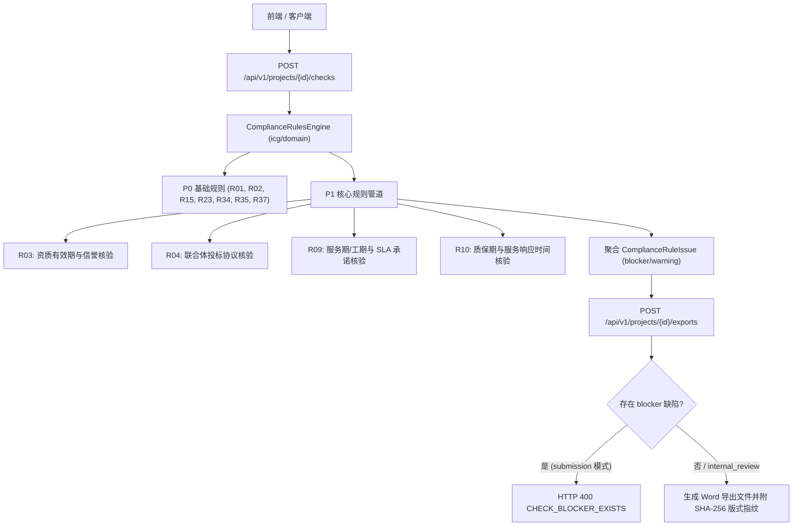

# 代码说明：PRD P1 核心合规规则引擎扩充与导出门禁联动（BE-COMPLIANCE-RULES-P1）

## 1. 架构定位与设计理念

`BE-COMPLIANCE-RULES-P1` 位于 `backend/bid-core/icg/domain/compliance_rules.py`，属于投标合规规则引擎的核心业务领域层。
该模块承接项目状态（`DemoState`）、项目元数据、工作流矩阵以及知识库资质材料，在执行导出门禁或检查中心调用时，对商务条款、资质有效性、联合体履约及 SLA/质保期承诺执行多维交叉审查。

## 2. 核心模块实现细节

### 2.1 R03 资质有效期与信誉核验 (`check_r03`)
- **截止时间覆盖**：核验挂接的资质材料 `valid_to` / `valid_until` 是否大于项目投标截止时间 `deadline`，否则触发 `QUALIFICATION_CERTIFICATE_EXPIRED`；
- **资质证书缺失**：资质类要求若未挂接任何证据材料，触发 `QUALIFICATION_CERTIFICATE_MISSING` blocker；
- **失信黑名单过滤**：对承诺文本及证据名称执行语义分析，如出现“被执行人”、“列入失信”且前置无否定词，触发 `DISHONEST_RECORD_EXISTS` blocker。

### 2.2 R04 联合体投标协议核验 (`check_r04`)
- **独立主体投标**：未标记联合体投标时，自动放行（返回 info 级通过）；
- **联合体协议书门禁**：若项目标记为联合体，必须在上传文件、资料库或成员附件中存在《联合体投标协议书》，否则触发 `CONSORTIUM_AGREEMENT_MISSING` blocker；
- **成员资质完备性**：遍历 `project_partners` 列表，核查各成员是否在资料库中具备已审核的企业营业执照或法定资质，未上传时触发 `CONSORTIUM_MEMBER_QUALIFICATION_MISSING` blocker。

### 2.3 R09 服务期与 SLA 承诺核验 (`check_r09`)
- **服务期未响应**：工期/实施期条款若应答为空，触发 `SERVICE_PERIOD_COMMITMENT_MISSING` blocker；
- **服务期负偏离**：若承诺应答包含延长工期或 `deviation_type == "negative"`，触发 `SERVICE_PERIOD_NEGATIVE_DEVIATION` blocker。

### 2.4 R10 质保期与服务响应时间核验 (`check_r10`)
- **低于基线拦截**：免费质保期低于招标要求或响应时间超标，触发 `WARRANTY_PERIOD_BELOW_BASELINE` / `RESPONSE_TIME_BELOW_BASELINE` blocker；
- **跨章节口径冲突**：提取技术分册与商务分册章节正文中关于质保年限的描述（如技术分册写 3 年质保，商务分册写 1 年质保），侦测到冲突时触发 `WARRANTY_PERIOD_INCONSISTENT` blocker。

## 3. 测试覆盖设计

测试套件 `tests/backend/test_compliance_rules_p1.py` 覆盖 5 项典型场景：
1. `test_r03_qualification_validity_and_credit`：正例通过、证书过期 blocker、资质缺失 blocker、失信黑名单 blocker；
2. `test_r04_consortium_agreement_verification`：独立投标放行、缺少协议书 blocker、成员资质完备通过、成员资质缺失 blocker；
3. `test_r09_service_period_and_sla_commitment`：正例承诺通过、未承诺 blocker、工期负偏离 blocker；
4. `test_r10_warranty_period_and_response_time`：正例通过、质保期低于基线 blocker、响应超时 blocker、跨章节矛盾 blocker；
5. `test_export_gate_blocked_by_p1_compliance_rules`：存在 P1 blocker 缺陷时，正式递交版导出强阻断返回 400 `CHECK_BLOCKER_EXISTS`。
